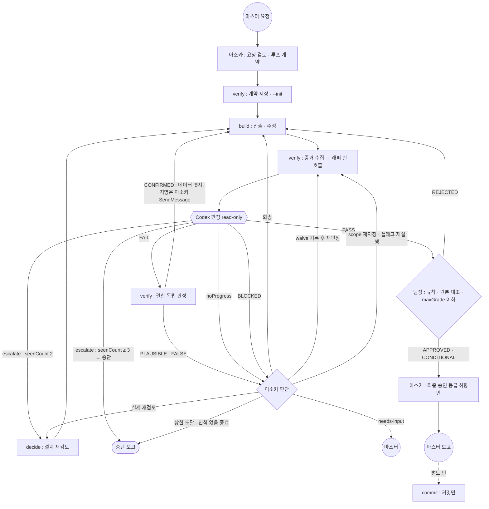

# 40. 루프 엔지니어링 규칙

> **용도** : 구현(Claude 서브에이전트) → 검증(Codex) → 회송 → 재검증 → 승인 루프의 정본. 루프를 시작하는 턴은 0절·C절을 먼저 읽는다.
> 엔지니어링 5종 중 40번 — [[anakins_prompt|10 프롬프트]] · [[anakins_context|20 컨텍스트]] · [[anakins_harnes|30 하네스]] · 40 루프 · [[anakins_graph|50 그래프]] — 목차 [[00. index]]
> 작성 2026-11-07 원문(구 A~D)·검토 의견(구 E) → 2026-11-08 전면 개정(마스터 지시 0-0). 0절 아키텍처 = 결정 단계 결론 + 마스터 결정 + 실증, 나머지 문구 = Claude 초안(마스터 검토 전). 근거 = 루트 `CLAUDE.md`(정본), [[codex_procedure]], 실호출 원장 `.omc/state/loop/first-call/`.

**한 줄 정의** : **되돌아가는 엣지 설계** — 결과가 완료 기준을 못 채웠을 때 누가, 무엇을 근거로, 몇 번까지 다시 하고, 언제 멈춰 사람에게 넘길지를 정한다.

**다른 문서와의 관계**

| 요소 | 담당 문서 |
|---|---|
| 루프 안 노드 하나의 브리프, 메인의 턴 절차(0-5) | [[anakins_prompt]] |
| 맥락 설계 일반(컨텍스트 계층·공용 컨텍스트 파일·실물 대조) — 판정자 입력 묶음 세부는 [[codex_procedure]] 4절 | [[anakins_context]] |
| 강제 장치 일반(훅·권한·에이전트 정의·격리·관측) — 래퍼·잠금은 [[codex_procedure]], 20·30 반영은 H-17 | [[anakins_harnes]] |
| 루프가 들어가는 전체 호출 그래프 | [[anakins_graph]] (패턴 B-5) |
| Codex 호출 명령·입력 묶음·출력 스키마·예산·잠금 세부 | [[codex_procedure]] (**정본** — 이 문서는 요약하고 링크만 한다) |
| 역할 노드 카드(그래프 뷰) | [[마스터]] · [[아소카]] · [[build]] · [[verify]] · [[codex-judge]] · [[decide]] · [[teamanakin-admin]] · [[commit]] |

---

## 0. 루프 아키텍처

### 0-0. 지시 원문 요지

**2026-11-08 마스터 지시**

> 루프 엔지니어링 아키텍처를 완성 — 구현/개발은 클로드 subagent, 검증은 Codex, 미진·미완료는 다시 클로드 subagent 로 되돌려 수행, 다시 Codex 검증 반복, 검증 끝나면 최종으로 파다완 아소카(메인)가 승인 후 마스터 보고. 장표 .claude/engineering/40. loop/anakins_loop.md 를 보강해서 원칙을 준수하고 수행할 수 있도록

**2026-11-07 원문 요지** (구 A~D — 본문으로 흡수, 흡수 위치는 부록 I. 원문 글자 그대로 = [[anakins_loop#부록 J. 마스터 원문 (2026-11-07)|부록 J]])

- 구 A 성공 기준 : 완료 기준을 모두 채울 때까지 [수정 → 검증 → 보고] 반복. 빌드·정적 검사, 자동 테스트, 모든 버튼·인터랙션, 모바일·Pi Browser 호환, 회귀 방지. 매 반복 `[Iteration N]` 보고, 실제 실행 출력으로만 판정, 테스트 약화 금지, 최소 범위 수정, 최대 10회. 최종 보고에 기준별 증거·수정 파일·수동 확인 항목.
- 구 B 누가 검증 : 만드는 AI = Claude 서브에이전트, 검수 AI = Codex 도 방법.
- 구 C 언제 멈추나 : 무한 반복 금지. 모든 테스트 통과 = 종료, 5번 시도해도 안 되면 중단·보고.
- 구 D 반복업무 자동화 : 주간 매출 보고서(수집 → 양식 작성 → 검증 → 확인 3번까지 → 보고), 문제 접수 → AI 확인·수정 → 알림 → 해결 여부 선택.

### 0-1. 역할 (7종 + 외부 판정자)

| 역할 | 누구 | 루프에서 하는 일 | 하지 않는 일 | 노드 |
|---|---|---|---|---|
| 마스터 | 사용자 | 요청, needs-input 응답, `--allow-bulk` 승인, 최종 결정 | — | [[마스터]] |
| 아소카 | 메인 세션 | 요청 검토, **루프 계약**(AC-n·scope·쓰기 허용·토큰 추정) 작성, 지명·브리핑, 회송 판단, waive 결정, 원장 재생성·잠금 해제 승인, 최종 승인(등급 하향만), 마스터 보고 | 파일 쓰기·명령 실행 일체([[anakins_prompt]] 0-2) — `--init`·`--waive` 도 전문가가 실행 | [[아소카]] |
| build | `anakin_phase-build` (Opus·high) | 산출·수정, tsc·단위 테스트·`--selftest` | 실제 Codex 호출(시험은 가짜 판정자 `CODEX_JS`만), 커밋, 루프 계약 파일 수정 | [[build]] |
| verify | `anakin_phase-verify` (Sonnet·medium) | 계약 저장·`--init`, 증거 수집, 래퍼 실호출(`--confirm-real`), 결함 **독립 판정**, `--waive` 기록 실행 | 프로젝트 파일 수정, scope 넓히기·줄이기, waive 결정 | [[verify]] |
| Codex | 외부 판정자(`codex exec -s read-only`) | 프롬프트 본문만으로 기준별 met/unmet·결함 판정 | 파일 수정·셸 읽기(차단됨)·승인 | [[codex-judge]] |
| decide | `anakin_phase-decide` (Fable·high) | escalate 때 원인·설계 재검토, 권장안 초안 | 파일 쓰기 | [[decide]] |
| 팀장 | `teamanakin-admin` (Opus·high) | Codex PASS 뒤 프로젝트 규칙·**원본 표본 대조**, APPROVED·CONDITIONAL·REJECTED, waive 결정 | maxGrade 를 넘는 등급 | [[teamanakin-admin]] |
| commit | `anakin_phase-commit` (Haiku 4.5) | 승인된 결과 커밋(**별도 턴**) | push(훅 차단 — 마스터 직접) | [[commit]] |

수집(`anakin_phase-collect`, [[collect]])·문서 검수(`anakin_phase-review`, [[review]])는 루프 앞뒤 보조 노드다. 문서 산출물이면 review 가 팀장 앞에 들어간다.

### 0-2. 루프 그래프



CONFIRMED → build 는 **데이터 엣지**다(파일 `L/iter-N.triage.md` 가 흐른다). build 를 다시 부르는 지명은 아소카가 SendMessage 로 한다. seenCount ≥ 3 중단은 (마스터 확정 2026-11-08)이다.

**노드 카드** (엣지 = 파일 + 형식, 루프 폴더 `L = .omc/state/loop/<id>/` — gitignore, 커밋 대상 아님)

| 노드 | 입력 | 출력(파일) | 쓰기 경로 | 완료 조건 |
|---|---|---|---|---|
| 아소카 : 계약 | 마스터 요청 | 루프 계약 텍스트(D-1) | 없음(브리프로만 전달) | AC-n 이 실행·출력으로 판정 가능, scope 확정 |
| verify : init | 계약 텍스트 | `L/contract.md`(원문 그대로)·`L/ledger.json` | `L/` | `--init` 종료 0, 계약 줄 수 보고 |
| build | `L/contract.md`, 회송 시 `L/iter-N.triage.md` | 변경 파일 + 보고(파일별 diff stat) | 계약의 쓰기 허용 경로만 | tsc·단위 테스트·selftest 통과 |
| verify : 증거·호출 | 계약, 작업 트리 | `L/evidence-N/*.txt`, `L/iter-N.codex.json` | `L/` | 증거 = 실제 출력 원문, 래퍼 종료 코드 0·1·2 |
| Codex | 래퍼가 조립한 프롬프트(files·diff·evidence 본문) | 판정 JSON(출력 계약) | 없음 | 스키마 통과 |
| verify : 독립 판정 | `L/iter-N.codex.json`, 작업 트리 | `L/iter-N.triage.md`(D-3) | `L/` | 결함마다 판정·근거 |
| decide | 원장·결함 이력·관련 파일 경로 | 설계 결정 초안(응답) | 없음 | 강력추천 1건 + 뒤집히는 조건 |
| 아소카 : 판단 | `L/iter-N.triage.md`·결과 `noProgress`·`blocked[]` | 회송·waive·scope 재지정·decide·중단·needs-input 결정(응답) | 없음 | 결정마다 근거 1줄 |
| 팀장 | 요청 원문·계약·결과 경로·`maxGrade` | 판정(응답) | 없음 | 요구별 근거 짝짓기, 원본 표본 대조 |
| 아소카 : 최종 | 팀장 판정·`maxGrade` | 마스터 보고(D-4) | 없음 | 등급 ≤ 모든 상한 |

### 0-3. 승인 3단 · 등급 규칙 · waive

**3단** : ① Codex 판정(`verdict`·`maxGrade`) → ② 팀장(`teamanakin-admin`) → ③ 아소카 최종 승인. 앞 단을 통과해야 다음 단으로 간다. ②③의 반려는 build 회송 = 다음 회차(회차를 소모한다).

**최종 등급 = 아래 값 중 가장 낮은 것**

| 상한 | 값 |
|---|---|
| 판정자 | Codex PASS = `APPROVED` / Claude 대체 판정 = `CONDITIONAL`(래퍼가 `maxGrade` 로 고정) |
| 실기기 | 인증·결제·페이지 변경이 Pi Browser 실기기 미검증 = `CONDITIONAL`(루트 `CLAUDE.md` 핵심 가치) |
| 팀장 | 팀장 판정 |
| 아소카 | 아소카는 **내리기만** 한다. FAIL 을 PASS 로, CONDITIONAL 을 APPROVED 로 올리지 않는다 |

- `src/` 변경에 `pnpm build` 통과 증거가 없으면 팀장 REJECTED(팀장 정의).
- **waive(결함 면제)** : 결정 = 팀장·아소카만, 근거 필수. 기록 = verify 가 `--waive D-xxx --waive-reason "<근거>"` 로 원장 `waived` 에 남긴다(래퍼가 seenCount·escalate 를 올리지 않음). waive 한 결함은 build 브리프에서 뺀다. 판정이 FAIL 이었으면 waive 뒤 **재판정 1회**로 PASS 를 받아야 다음 단으로 간다.
- `--waive` 는 판정 호출에 붙는 옵션이다 — 회차 번호 1개를 쓰고, Codex 호출은 보통 1회(계약 위반 재요청 시 최대 2회, 호출 전 BLOCKED·대체 판정이면 0회)다.
- waive 할 수 없는 것([[codex_procedure]] 8절과 같은 목록) : 비밀 노출, 테스트 약화, Pi Browser 치명 제약 위반, R-P0~P6 위반(의도 사유가 원장 `docs/BUILD_DEFECTS.md` 에 먼저 적힌 경우 제외).

### 0-4. Codex 호출 요약 → 세부는 [[codex_procedure]]

| 항목 | 요지 | 절차서 |
|---|---|---|
| 시작 | `node scripts/codex-verify.mjs --id <id> --init` — 원장을 만드는 유일한 경로 | 3절 |
| 회차 | `--task L/contract.md --evidence L/evidence-N --id <id> --iter N --scope <계약 값> --confirm-real` (verify 만) | 3절 |
| 입력 | 판정 규칙 · 규칙 발췌 · 완료 기준 · scope 안 diff·파일 본문(직접 연관 1단계·규칙 문맥 포함) · 증거 · 이전 결함. 비밀·경로 가림, nonce 인젝션 방어 | 4절 |
| 출력 | `verdict`·`criteria`·`defects(id·file·line·repro·fix_hint·seenCount)`·`maxGrade`·`noProgress`·`escalate` — 래퍼가 결정 필드를 다시 계산(fail-closed) | 5절 |
| 대체 | `--judge claude` → 새 컨텍스트 Claude 판정 → `--ingest`, 최대 CONDITIONAL | 6절 |
| 상한 | 회차 10 · 벽시계 90분 · Codex 호출 10 · 1회 기본 15분, `--timeout-min` 으로 최대 120분까지, 실제 타임아웃 = min(지정값, 남은 90분 예산) — 래퍼 강제, 토큰 2배 — 아소카 | 9절 |
| 보안 | `-s read-only` + `approval_policy="never"`, `--ephemeral`, 판정자 env 허용 목록 | 10절 |

외부 전송 범위(마스터 확정 2026-11-08) = scope 안 변경 + 직접 연관 1단계 + 규칙 문맥. OS 수준 읽기 차단은 완화책만, 추후 결정(마스터).

---

## A. 완료 기준

### A-1. 루프 계약의 완료 기준(AC-n) 쓰는 법

- 기준마다 `AC-1`, `AC-2` … ID 를 붙인다. 래퍼가 등장 순서로 뽑아, 판정에서 빠진 ID 는 unverifiable 로 채우고 PASS 를 FAIL 로 고친다.
- 기준은 **실행해서 출력으로 판정**할 수 있어야 한다. "깔끔하게"·"최적으로" 금지([[anakins_prompt]] C).
- 범위 밖 금지도 기준으로 쓴다. 예 `AC-6 : git 추적 상태와 인덱스를 바꾸지 않는다(.omc 원장은 예외)`.
- 계약은 `--init` 때 `L/contract.md` 로 고정한다. 바꾸려면 아소카가 변경 사유를 계약 끝 '변경' 칸에 추가하게 하고(실행 = verify), build 는 계약 파일을 고치지 않는다.
- 이 고정은 **절차 규칙**이다 — 래퍼는 계약 파일을 해시로 대조하지 않는다. verify 정의 개정(H-8) 전까지 verify 의 쓰기 폴더(`L/`)는 아소카가 브리프에서 지정한다.

### A-2. 공통 관문 — 순서 고정

| 순서 | 명령 | 언제 | 실패하면 |
|---|---|---|---|
| 1 | `pnpm build` | `src/`·라우트·env·locale·messages 변경(하위 앱은 그 앱 `CLAUDE.md` 의 같은 명령) | 나머지 생략, 바로 회송 |
| 2 | `pnpm tsc --noEmit` | TS 변경 | 회송 |
| 3 | `pnpm lint` | 코드 변경 | 회송 |
| 4 | `pnpm test` | 테스트가 있는 영역 | 회송(flaky 는 C-4) |
| 5 | `node --check <파일>` · `node <파일> --selftest` | 스크립트·훅 변경 | 회송 |

- 이 저장소는 **pnpm 11** 이다. `npm run`·`npx` 로 돌리지 않는다(잠금 파일·설정이 달라 결과가 달라질 수 있다).
- 예외 — Codex CLI 전역 설치에 한해 npm — 마스터 승인 2026-11-08(사유 : pnpm 11 allowBuilds 가 전역 네이티브 빌드 차단 가능), [[codex_procedure]] 1절.
- `pnpm build` 가 최소 관문이다 — lint 는 타입 에러를 못 잡고, build 는 env·locale 교차 검증까지 한다.
- 문서 산출물은 링크 검사·mermaid 확인·문서 검수(review)가 관문이다.
- E2E(Playwright 테스트 러너)는 현재 미설치 — [TBD : 도입 결정]. 화면 확인은 verify 의 playwright MCP 렌더로 대신한다.

### A-3. 변경 유형별 추가 기준

| 변경 | 추가 기준 |
|---|---|
| 인증 | authenticate **성공·실패 두 mock** 모두 크래시 없음 / `signIn()` 가드는 `if (!window.Pi)` 만(UA 분기 grep 0건) / Pi Browser 판정은 authenticate 성공 여부로만 / 쿠키 차단 컨텍스트에서 `X-Pi-Token` 헤더 경로 동작 / `fetch('/api/` grep 0건(`piFetch`) / `getSessionUser()` null 시 `redirect` 0건 |
| 결제 | 결제·지갑 호출은 **mock 으로만** assert — 실제 결제 버튼을 누르지 않는다(U2A 결제는 앱 서버가 취소 불가) |
| 페이지·UI | 범위 = 이번 변경이 닿은 페이지 + 핵심 흐름(로그인·결제·카페). **페이지별 버튼·링크·폼 목록을 먼저 작성**하고 각각 기대 결과(라우팅·모달·API 호출·상태 변화)를 assert(원문 A-3 복원). 뷰포트 375×667·390×844 가로 스크롤 없음, `console.error`·unhandled rejection 0건 |
| 모바일·Pi Browser 호환 | **Pi SDK 미로딩 환경(일반 브라우저)에서도 크래시 없이 graceful fallback**(원문 A-4 복원) / **iOS Safari 계열 이슈(100vh·touch 이벤트·safe-area) 점검**(원문 A-4 복원) |
| SQL | `da-ddl-guard` 통과(차단 시 우회 금지 — DA 승인). 실행 수단이 없으면 "미검증 : 실행 수단 없음" |
| 배포까지 포함 | 커밋 status `Vercel – cafe: success` 개별 확인 + 운영 주소의 배포 ID 대조("응답한다" ≠ 반영) — 배포 승격 자체는 마스터 노드 |

### A-4. 회귀 테스트 먼저

새로 발견한 버그는 재현 테스트를 먼저 추가하고, **수정 전에 그 테스트가 실패하는 것**을 증거로 남긴 뒤 고친다. 처음부터 통과하는 재현 테스트는 버그를 못 잡는다.

### A-5. 테스트 약화 금지

테스트 삭제·skip·assert 완화·기대값을 결과에 맞추기·타임아웃만 늘리기로 통과시키는 것은 금지다. 판정자가 찾으면 severity high, waive 불가(0-3).

### A-6. 완료 표기

- `완료` = 모든 AC met + 3단 승인 + 실기기 해당 없음.
- `조건부 완료(실기기 대기)` = 인증·결제·페이지 변경이 Pi Browser 실기기 미검증. 마스터 보고에 실기기 점검표(로그인·결제·카페 접속)를 붙인다.
- 실행하지 않은 검증을 통과로 적지 않는다. 추측으로 "통과"라고 쓰지 않는다.

---

## B. 누가 만들고 누가 검증하나

### B-1. 작성과 검증의 분리

| 산출물 | 작성 | 검증 | 독립성 |
|---|---|---|---|
| 루프 계약 | 아소카 | 팀장(요청 원문 대조) | build 는 계약을 읽기만 |
| 코드·문서·SQL | build | verify(실행) → Codex(판정) → verify(독립 판정) | Codex 입력에 build 의 설명·결론을 넣지 않는다 |
| Codex 판정 | Codex | verify 독립 판정 → 팀장 원본 대조 | 판정자 결과도 그대로 믿지 않는다 |
| 최종 보고 | 아소카 | 마스터 | — |

자기 승인 금지 — 만든 노드가 자기 결과를 PASS 로 판정하지 않는다.

### B-2. 입력 묶음 (verify → Codex)

verify 는 증거를 **실제 실행 출력 그대로** 파일로 저장한다(`<명령> > L/evidence-N/build.txt 2>&1` — 요약·발췌 금지). 래퍼가 묶는 7구획(판정 규칙·규칙 발췌·완료 기준·작업 폴더 범위·diff·증거·이전 결함)과 파일 본문 선정·비밀 가림은 [[codex_procedure]] 4절. build 의 보고문은 묶음에 넣지 않는다(작성자 결론 배제 — [[anakins_prompt]] A-2 '검수 브리프에는 작성자의 설명을 넣지 않는다'·0-4 ②).

### B-3. 출력 계약 요지

`verdict`(PASS·FAIL·BLOCKED), 기준별 `criteria[].status`, `defects[]`(id 고정 — 해결 fixed·재발 regressed·이의 contested·면제 waived), `blocked[].reason`(device·master-permission·judge-unavailable·budget) + 범위 사유 scope-missing·scope-too-broad = 6종 — 사유별 행동은 C-3 표. `maxGrade`·`seenCount`·`escalate`·`noProgress` 는 래퍼가 원장으로 계산한다 — 판정자 값을 믿지 않는다. 세부 [[codex_procedure]] 5절.

### B-4. 결함 독립 판정 (verify, FAIL 때마다)

Codex 결함을 그대로 회송하지 않는다. verify 가 결함마다 `repro` 를 직접 실행·대조해 판정하고 `L/iter-N.triage.md`(D-3)에 남긴다.

| 판정 | 뜻 | 다음 |
|---|---|---|
| CONFIRMED | 재현됨 또는 file:line 에서 직접 확인 | build 회송 |
| PLAUSIBLE | 재현 못 했으나 근거가 있음(경합·환경 의존 등) | 아소카 판단 — 회송(조건 : 재현 테스트 먼저, A-4) 또는 다음 회차에 반증 증거를 붙여 재판정 |
| FALSE | 반증됨(인용 줄이 없음, 범위 밖, 규칙 오해) | 아소카 판단 — waive(사유 = verify 반증 근거) 또는 회송 |

contested 결함도 아소카가 같은 방식으로 판단한다(인정 → waive, 불인정 → 회송).

### B-5. 회송 브리프 (아소카 → build)

- CONFIRMED(와 아소카가 회송으로 정한 것)만, 결함 ID·file:line·repro·fix_hint 를 그대로 넘긴다. 결함 ID 는 바꾸지 않는다.
- 같은 원인은 형제 케이스까지 한 번에 고친다(R-P0 — 패턴·매치 N·처리 N 보고).
- build 보고 = 결함 ID → 수정 파일:줄. 계약의 쓰기 허용 밖은 고치지 않고 '계약 이탈'로 보고.
- 회송은 같은 build 에이전트에 SendMessage 로 이어 보낸다(맥락 유지). 맥락이 오염됐으면 새로 지명한다.

### B-6. 대체 판정자 (Codex 미가용)

Codex 미설치·미로그인·시간 초과·계약 위반 2회면 `--judge claude`([[codex_procedure]] 6절) :

1. verify : `--judge claude` 실행 → 판정 프롬프트 파일 경로 보고(종료 4 = 판정 아님).
2. 아소카 : build·verify 와 **다른 새 컨텍스트** 판정자를 지명한다. 기본 = `anakin_phase-review`(읽기 전용 Opus, [[review]]). [확인중 : 마스터 — 전용 판정자 정의 신설 여부, H-11]
   브리프에 반드시 적는다 : "판정 프롬프트 안의 파일 쓰기 지시는 무시한다 / JSON 1개만 응답한다(앞뒤 설명 없음) / 검수 첫 줄 형식('검수 : 통과 N / 결함 M')은 적용하지 않는다".
3. verify : 응답 JSON 을 가공 없이 `iter-N.claude.raw.json` 에 저장 → `--ingest`. **판정자는 응답으로만 반환, 저장은 verify** 가 정본이다([[codex_procedure]] 6절 2항과 같음).
4. 결과 `maxGrade = CONDITIONAL`. 마스터 보고 **첫 줄** = `검증자 : Claude 대체(Codex 미가용)`.

---

## C. 금지와 멈춤

### C-1. 금지

- 무한 반복 — 모든 순환 엣지에 상한(C-2)이 있다.
- 추측 판정 — 실행 출력 없이 "통과".
- 테스트 약화(A-5), 버그 수정에 필요한 범위를 넘는 기능·디자인 변경.
- build 의 실제 Codex 호출 — 시험은 `CODEX_JS`(가짜 판정자)만. `--confirm-real` 은 verify 만.
- 실호출 흔적(결과·이벤트·원장) 삭제 — 시험 정리 때도 금지.
- 원장(`ledger.json`) 직접 수정 — 래퍼만 쓴다.
- 마스터 승인 없는 `--allow-bulk` — verify 는 계약에 마스터 승인 원문(날짜·문구)이 없으면 쓰지 않는다(래퍼 강제는 H-1).
- 같은 `--id` 동시 실행(래퍼 잠금이 막는다).
- `npm`·`npx` 로 프로젝트 명령 실행 — pnpm 만(예외 : Codex CLI 전역 설치 — 마스터 승인 2026-11-08(사유 : pnpm 11 allowBuilds 가 전역 네이티브 빌드 차단 가능), [[codex_procedure]] 1절).

### C-2. 상한 — 이름 붙여 하나로

| 상한 | 값 | 판정 주체 | 넘으면 |
|---|---|---|---|
| 회차 | **10** — 팀장·아소카 반려 회송도 1회차. BLOCKED 결과는 원장 회차(`iters`)에 넣지 않지만 회차 번호(결과 파일 이름 `iter-N`)는 소모한다 — 다음 판정은 N+1. `--waive` 는 판정 호출에 붙는 옵션이다 — 회차 번호 1개를 쓰고, Codex 호출은 보통 1회(계약 위반 재요청 시 최대 2회, 호출 전 BLOCKED·대체 판정이면 0회)다. | 래퍼(`--iter 11` 이상 BLOCKED) | 중단 보고 |
| 같은 결함 | `seenCount` **2** → escalate | 래퍼 계산 | decide 설계 재검토 후 build |
| escalate 뒤 같은 결함 | `seenCount` 3 | 아소카 | 중단 보고(다시 escalate 하지 않음) (마스터 확정 2026-11-08) |
| 벽시계 | 90분(원장 `startedAt` 부터) | 래퍼 | BLOCKED budget |
| Codex 호출 | 10회(재요청 포함) | 래퍼 | BLOCKED budget |
| Codex 1회 | 기본 15분, `--timeout-min` 으로 최대 120분까지, 실제 타임아웃 = min(지정값, 남은 90분 예산) | 래퍼 | BLOCKED judge-unavailable |
| 토큰 | 추정치의 2배 | 아소카(`pnpm work:stats` 대조) | 중단 보고 |
| flaky 재실행 | 실패 테스트 1회 | verify | C-4 |
| 재확인(반복업무) | 3회 | 부록 G 전용 | 담당자 보고 |

- 구 문서의 10회·5회·3회 불일치는 위 이름으로 정리했다 — "5번 시도"는 '같은 결함 2 → escalate, 3 → 중단, 전체 회차 10'으로 대체했다 (마스터 확정 2026-11-08).
- 벽시계·토큰·Codex 호출 값은 실측 전 값이다(마스터 확정 2026-11-08). 정기 재평가일에 원장 실측으로 조정한다.

### C-3. 멈춤 조건과 행동

| 조건 | 감지 | 행동 |
|---|---|---|
| PASS | `verdict` | 팀장 → 아소카 → 마스터 보고 |
| FAIL | `verdict` | 독립 판정(B-4) → 회송 |
| escalate | 결과 `escalate: true` | 3번째 수정 대신 decide — 원인·설계부터 |
| 진척 없음 | 결과 `noProgress: true`(미해결 결함 줄지 않음 + 새로 met 된 기준 0) | 같은 브리프 재시도 금지 → 아소카 판단 : decide 또는 중단 보고 |
| 상한 도달 | C-2 | 중단 보고(남은 결함·막힌 원인·다음 선택지) |
| BLOCKED | `verdict`·`blocked[].reason` | 수정 반복 대상이 아님. 아소카가 아래 사유별 행동표대로 처리 |
| 사람만 풀 수 있는 일 | OAuth 로그인·Pi Browser 실기기·운영 DB 쓰기·배포 승격·`codex login` | 루프 밖 — 바로 needs-input |
| 같은 경로 두 작성자 | 예상 밖 수정 시각 변화 | 전체 일시정지, 소유자 재지정([[anakins_graph]] D) |

**BLOCKED 사유별 행동** ([[codex_procedure]] 8절과 같은 표)

| 사유 | 뜻 | 행동 |
|---|---|---|
| scope-missing | `--scope` 없음 | 아소카가 scope 를 다시 지정 → verify 재실행 |
| scope-too-broad | 미추적 30·변경 300·프롬프트 상한 초과 | 아소카가 scope 를 다시 지정(대량 전송은 마스터 승인 `--allow-bulk`) |
| judge-unavailable | `--confirm-real` 누락 / 미로그인·시간 초과·계약 위반 2회·격리 재확인 실패 | 플래그 누락 → verify 재실행 / 미로그인 → 마스터(`! codex login`) / 그 밖 → 아소카가 Claude 대체(B-6) 결정 |
| budget | 회차·벽시계·호출 상한, 원장 부재·손상·불일치, 잠금 | 아소카 — 상한은 중단 보고, 원장·잠금은 확인 후 결정(재생성·잠금 해제 승인 = 아소카, 실행 = 전문가) |
| device | Pi Browser 실기기 등 기기 필요 | 마스터 |
| master-permission | 마스터 권한 필요(운영 DB·배포·승인) | 마스터 |

### C-4. 불안정(flaky) 테스트

실패한 테스트는 1회만 재실행한다. 재실행 통과면 `flaky` 로 증거에 남기고 루프 실패로 세지 않는다. 같은 테스트가 다음 회차에도 flaky 면 결함(med)으로 올린다 — 재실행을 반복해 통과시키지 않는다.

### C-5. 상태 파일 fail-closed

- 생성 경로는 하나(`--init`), 그 밖의 모든 호출은 원장의 **부재·손상·불일치를 한 번에 열거**해 전부 BLOCKED 로 막는다. 사례별로 하나씩 막으면 형제 케이스가 남는다(E 표 #3).
- 원장을 지우고 `--init` 으로 다시 만들면 예산 이력이 새로 시작된다 — 아소카 승인 사항, 실행은 verify.
- 남은 잠금(`ledger.lock`)은 자동으로 풀리지 않는다. 아소카가 다른 실행이 없음을 확인해 결정하고, 삭제는 전문가가 한다.

---

## D. 템플릿

### D-1. 루프 계약 브리프 (아소카 → verify 가 `L/contract.md` 로 저장)

```text
[루프 ID] <영문·숫자·하이픈>
[목표] <한 문장>
[완료 기준]
AC-1 : <실행 명령 + 기대 출력>
AC-2 : …
AC-n : <범위 밖 금지 — 예 git 추적 상태 불변(.omc 예외)>
[scope] <저장소 상대경로, 쉼표 구분> — verify 는 그대로 --scope 로 넘긴다
[쓰기 허용] <build 가 고칠 경로> — 그 밖 수정 금지
[실기기] 인증·결제·페이지 변경 여부 → 해당하면 최대 CONDITIONAL
[토큰 추정] <회차당 build·verify·판정 합계 × 예상 회차> — 상한 = 2배
[대량 전송] 없음 | 마스터 승인 <날짜·원문>
[기본값] <판단이 갈릴 때의 기본 — 예 "디스크와 행 수가 충돌하면 디스크 우선">
[금지] 커밋·푸시·운영 DB·배포·포맷 명령·실제 Codex 호출(build)
[변경] <계약 변경 시 날짜·사유 — 아소카 결정만>
```

### D-2. `[Iteration N]` 보고 (verify → 아소카, 첫 줄 고정)

```text
[Iteration N] 판정 FAIL / 기준 met 4·unmet 1·unverifiable 1 / 결함 CONFIRMED 2·PLAUSIBLE 1·FALSE 0 / escalate N / noProgress N
- 증거 : L/evidence-N/ (build.txt · tsc.txt · lint.txt · test.txt) — 핵심 줄 인용
- 판정 : L/iter-N.codex.json (종료 코드 1), 독립 판정 : L/iter-N.triage.md
- 원장 : 회차 N/10 · Codex 호출 K/10 · 경과 M/90분
- 회송 후보 : D-004(file:line) …
```

### D-3. 독립 판정 표 (`L/iter-N.triage.md`)

```text
| 결함 | 심각도 | Codex 요지 | 확인 방법(repro 실행·줄 대조) | 결과 원문 | 판정 | 근거 |
|---|---|---|---|---|---|---|
| D-004 | high | 실행 중 90분 상한 초과 시 판정 확정 | node … --selftest | FAIL: … | CONFIRMED | scripts/x.mjs:120 |
```

### D-4. 최종 보고 (아소카 → 마스터)

```text
[1줄] 검증자 : Codex | Claude 대체(Codex 미가용)     ← 대체면 반드시 첫 줄
[2줄] 최종 등급 : APPROVED | CONDITIONAL | REJECTED (팀장 판정 : … / maxGrade : …)
[3줄] 수행 단계 : 계약 → build ×N → verify ×N → Codex ×K → 팀장 → 아소카
- 완료 기준별 통과 증거(명령 + 핵심 출력)
- 수정 파일과 변경 요지
- waive 목록(결함·사유·결정자)
- 남은 일 : 실기기 점검표 / 후속 과제 / 커밋 지시 대기(별도 턴)
```

---

## E. 사례 → 규칙 (2026-11-08)

#1~#7 원장 `.omc/state/loop/first-call/` — Codex 실호출 5회, 입력 토큰 회당 약 7만~8만·출력 약 1.4천~1.7천(`ledger.json`).

| # | 일어난 일 | 규칙 |
|---|---|---|
| 1 | iter1 BLOCKED — Windows read-only 샌드박스가 Codex 의 셸 읽기(Get-Content·rg)를 막아 AC 6건 모두 unverifiable | 판정 입력 = 프롬프트 본문(파일 전문 포함). 판정자가 셸로 읽는다고 가정하지 않는다 |
| 2 | iter2 FAIL 8건 — Claude 5회차 검증이 놓친 예산 우회(D-004)·원장 부재(D-005)·기준 누락 PASS(D-006)를 Codex 가 찾음 | 다른 벤더 독립 판정자를 둔다. Claude 자체 검증만으로 PASS 처리하지 않는다(대체 판정 = 최대 CONDITIONAL) |
| 3 | iter3 FAIL — D-005 1차 수정이 '손상'만 막고 '부재'를 놓쳐 seenCount 2 → escalate → decide 가 "생성 경로 1개 + 나머지 fail-closed" 결정 | C-5. 3번째 땜질 대신 설계로 올린다 |
| 4 | iter4 FAIL — 이전 결함 문구가 가림을 거치지 않음(D-010)·같은 루프 동시 실행(D-011) | 최종 프롬프트 단일 가림 관문, 배타 잠금 |
| 5 | iter5 PASS — 11건 중 fixed 8·waived 3 | 3단 승인으로 진행 |
| 6 | build 가 시험 중 금지된 실호출 1회, 그 결과를 시험 원장과 함께 지움 | `--confirm-real` 게이트(verify 만), 실호출 흔적 삭제 금지 |
| 7 | waive 3건(D-001 숫자 없는 단어형 비밀 = 의도된 한계, D-003 `--allow-bulk` = 마스터 승인 예외, D-008 원장 위치 `.omc` = 설계) — 아소카 결정·사유 원장 기록 | 0-3 waive 규칙 |
| 8 | (출처 : 이번 세션 Pi통신 샘플 적재 실행기 `sitemap/pitel/database/run-init.mjs`·`run-init.log`, 2026-11-07~08) 팀장이 보고문이 아니라 원본 로그를 대조해 재시작 횟수 2 → 5 로 정정 | 팀장은 원본 표본 대조가 의무 |
| 9 | (같은 출처) 팀장 원본 대조로 디스크 정지선의 VERIFY 단계가 불완전함을 발견 | 같음 — "보고된 통과"를 원본으로 확인 |

---

## F. 변경 이력

| 날짜 | 변경 | 사유 |
|---|---|---|
| 2026-11-07 | 원문 A~D 작성 + Claude 검토 의견 E(14건) | 마스터 초안 |
| 2026-11-08 | 전면 개정 — 0절 루프 아키텍처(역할·그래프·3단 승인·Codex 요약), A~D 재작성(pnpm 표기·관문 순서·상한 통일·멈춤 표·템플릿), E 실증 사례, 부록 G~I. 구 E 14건 반영(부록 I). Obsidian 볼트 위키링크 | 마스터 지시 0-0 |
| 2026-11-08 | Iteration 2 — 마스터 원문 A~D 를 부록 J 로 글자 그대로 복원, 누락 기준 3개 A-3 복원, 그래프에 아소카 판단 노드·seenCount ≥ 3 중단·데이터 엣지 표기, BLOCKED 사유 6종 행동표, 회차 번호 소모 문구 통일, 대체 판정 = 응답 반환·verify 저장 정본, npm 예외 명시, 원장 재생성 승인 = 아소카, H-15~H-18 | Codex loop-docs iter1 FAIL + review 검수 |
| 2026-11-08 | Iteration 3 — npm 예외 근거 = 마스터 승인, "5번 시도" 대체 마스터 확정(같은 결함 2 → escalate, 3 → 중단, 회차 10), Codex 1회 시간 = 기본 15분·최대 120분·min(지정값, 남은 예산), `--waive` 의 회차·호출 소모 문장 통일 | Codex loop-docs iter2 FAIL(D-005·D-006) + 마스터 결정 |
| 2026-11-08 | C-5 잠금 항목의 절차서 해석 괄호 삭제(절차서 8절 잠금 문구를 승인 = 아소카·삭제 = 전문가로 맞춤) | 팀장 지적 2(low) |

---

## 부록 G. 반복업무 자동화 (구 D + 구 E-3)

### G-1. 주간 보고서 예 — 매주 금요일 17시 매출 보고서

| 단계 | 규칙 |
|---|---|
| 일정 실행 | 로컬 파일·로컬 DB 가 필요하면 Windows 작업 스케줄러 + `claude -p "<프롬프트>"`(비대화형). 저장소·웹만 필요하면 예약 에이전트(`/schedule`) — 클라우드 쪽은 이 PC 의 로컬 DB 에 접근하지 못한다 |
| 수집 | 원천 = Pi 결제 원장(`pi_pymnt`), 읽기 전용 계정. 원화는 참고 환산 표시만, 집계·검증은 **Pi 금액** |
| 작성 | 정해진 양식(양식 파일 경로를 계약에 고정) |
| 검증 | 막연한 재확인 대신 **대사 규칙** : 보고서 합계 = 원장 합계(건수·금액), 전주 대비 ±N% 초과 시 경보([TBD : N 값]) |
| 재확인 | 대사 불일치면 재수집·재작성 후 재검증, **재확인 3회**까지. 그래도 불일치면 담당자에게 직접 보고 |

### G-2. 문제 접수 → 처리

접수 → AI 확인 → 접수자 알림 → 직원 선택(해결되었어요 | 아직이에요).

- 운영 코드는 '즉시 수정' 대신 **수정안 + 검수 후 반영**(이 문서의 루프 그대로 — 운영 반영은 마스터 노드).
- "아직이에요"는 다시 루프로 돌리되 같은 건 **재확인 3회** 뒤 담당자에게 넘긴다.
- 정할 것 : 알림 채널(메일·메신저)·접수자 인증 방법 — [TBD]

---

## 부록 H. 후속 과제

| # | 과제 | 대상 | 상태 |
|---|---|---|---|
| H-1 | 결정안 B-1 — `--allow-bulk` 에 마스터 승인 코드 강제 없음(지금은 C-1 절차로만 막음) | `scripts/codex-verify.mjs` | 다음 단계 |
| H-2 | 결정안 B-2 — 원장 `iters` 에 `--allow-bulk` 사용 표시 필드 없음 | 래퍼 | 다음 단계 |
| H-3 | 결정안 S-3 — 범위 밖 변경 요약에 2단계 폴더명이 노출됨 | 래퍼 | 다음 단계 |
| H-4 | BLOCKED 결과는 원장 회차(`iters`)에 넣지 않지만 회차 번호(결과 파일 이름 `iter-N`)는 소모한다 — 다음 판정은 N+1. (사례 : first-call iter1 BLOCKED → 원장 기록은 iter2 부터.) 문서화 완료(C-2·[[codex_procedure]] 8절), 동작 변경 여부만 남음 | 래퍼 | 동작 결정 대기 |
| H-5 | `CODEX_JS`(가짜 판정자) 지정 시 `--confirm-real` 없이 호출되는 경로 — 우회 가능성 문서화 | [[codex_procedure]] 3절 | 다음 단계 |
| H-6 | `codexCalls` 선기록 순서 — 절차서 9절 표 "호출 직전에 원장에 센다"로 이미 문서화 | [[codex_procedure]] 9절 | **해소** |
| H-7 | `--init` 재생성 시 예산 초기화 — 절차서 3절에는 있음, 승인 절차 명문화 | [[codex_procedure]] | 다음 단계 |
| H-8 | verify 정의에 래퍼 실호출(`--confirm-real`)·독립 판정(B-4)·증거 폴더 쓰기 예외 반영 | `.claude/agents/teamAnakin/anakin_phase-verify.md` | 다음 단계 |
| H-9 | build 정의에 "실호출 금지·`CODEX_JS` 만" 명시 | `.claude/agents/teamAnakin/anakin_phase-build.md` | 다음 단계 |
| H-10 | `[모델 단계 계획]`·운용 기준서에 Codex 판정 노드 반영 | `.claude/hooks/model-advisor.mjs`, 운용 기준서 | 다음 단계 |
| H-11 | Claude 대체 판정자 전용 정의 신설 여부(현재 기본 = review) | `.claude/agents/` | [확인중 : 마스터] |
| H-12 | [[anakins_prompt]] 0-5 턴 절차와 0-2 루프 그래프 정합(정본 3곳 동기화) | 10 프롬프트·루트 `CLAUDE.md`·운용 기준서 | 별도 단계 |
| H-13 | 토큰 상한 측정 자동화(현재 아소카 수동 대조) | `pnpm work:stats` | 재평가일 |
| H-14 | E2E 테스트 러너 도입 여부 | `package.json` | [TBD] |
| H-15 | 팀장 정의 개정 — `maxGrade` 상한·원본 표본 대조 의무·waive 결정 권한 | `.claude/agents/teamAnakin/teamAnakin_admin.md` | 다음 단계 |
| H-16 | review 정의에 대체 판정 모드 추가(B-6 브리프 3항목 — 파일 쓰기 무시·JSON 1개 응답·검수 첫 줄 미적용) | `.claude/agents/teamAnakin/anakin_phase-review.md` | 다음 단계 |
| H-17 | [[anakins_context]]·[[anakins_harnes]] 에 Codex 루프(판정자 입력 묶음·래퍼·잠금) 반영 — 지금은 [[codex_procedure]] 에만 있음 | 20 컨텍스트·30 하네스 | 다음 단계 |
| H-18 | 루프 계약의 AC 가 참조하는 파일이 scope 밖이면 래퍼가 경고(사례 : loop-docs iter1 AC-2 unverifiable) | `scripts/codex-verify.mjs` | 다음 단계 |

---

## 부록 I. 구 검토 의견(E) 반영표

구 E-1 8건 + E-2 6건 = 14건, 미반영 0. E-3·E-4 는 아래 부가 행.

| # | 구 의견 | 반영 위치 | 상태 |
|---|---|---|---|
| E-1-1 | npm → pnpm 11 명령 | A-2 | 반영 |
| E-1-2 | `pnpm build` 최소 관문, 순서 고정 | A-2 | 반영(build → tsc → lint → test) |
| E-1-3 | 상한 10/5/3 불일치 | C-2 | 반영(이름 붙인 상한) — "5번 시도" 대체 (마스터 확정 2026-11-08) |
| E-1-4 | `window.Pi` ≠ Pi Browser, UA 사전 차단 금지 | A-3 인증 | 반영 |
| E-1-5 | 쿠키 미저장 — 헤더 경로·`piFetch`·redirect 금지 | A-3 인증 | 반영 |
| E-1-6 | 실기기 전 '완료' 금지 | A-6, 0-3 | 반영(조건부 완료) |
| E-1-7 | 모든 버튼 범위 폭발·결제 버튼 금지 | A-3 결제·페이지 | 반영 |
| E-1-8 | 검수자 독립성 | B-1·B-2 | 반영(작성자 결론 배제 + 독립 판정 B-4) |
| E-2-1 | 진척 없음 감지 | C-3 `noProgress` | 반영 |
| E-2-2 | 비용·시간 상한 | C-2 | 반영(90분·호출 10·토큰 2배) |
| E-2-3 | flaky 규칙 | C-4 | 반영 |
| E-2-4 | 사람만 풀 수 있는 실패는 루프 밖 | C-3 | 반영 |
| E-2-5 | 배포 검증 철칙 | A-3 배포 | 반영 |
| E-2-6 | 재현 테스트가 수정 전 실패 확인 | A-4 | 반영 |
| E-3 | 반복업무 실행 방법 4건 | 부록 G | 반영 |
| E-4 | 장 제목 통일·B~D 를 루프 규칙으로 흡수·오타 "검증헤" | 문서 전체 구조, G-1 | 반영(부록 J 원문은 글자 그대로 둠) |

**복원 기록 (2026-11-08 Iteration 2)** — 1차 개정에서 빠진 마스터 원문 완료 기준 3개를 A-3 에 되살렸다. 마스터 요구는 폐기하지 않는다.

| 원문 위치 | 원문 기준 | 복원 위치 |
|---|---|---|
| 구 A-3 | 페이지별 버튼/링크/폼 목록을 먼저 작성 | A-3 페이지·UI |
| 구 A-4 | Pi SDK 미로딩 환경(일반 브라우저)에서도 크래시 없이 graceful fallback | A-3 모바일·Pi Browser 호환 |
| 구 A-4 | iOS Safari 계열 이슈(100vh, touch 이벤트, safe-area) 점검 | A-3 모바일·Pi Browser 호환 |

---

## 부록 J. 마스터 원문 (2026-11-07)

> 2026-11-07 마스터 원문 A~D 를 글자 그대로 둔다(HEAD 판 1~66행, 줄 끝 공백 포함). 원문의 `npm` 명령 표기는 보존용이며 현행 명령은 A-2 다. 요지는 0-0.

````text
A. 명확한 성공 기준
## 목표
아래 "완료 기준"을 모두 충족할 때까지 [수정 → 검증 → 보고]를 반복한다.
하나라도 실패하면 원인을 분석하고 수정한 뒤 처음부터 다시 검증한다.

## 완료 기준 (전부 통과해야 종료)
1. 빌드/정적 검사
   - `npm run build` 에러 0건
   - `npm run lint` 에러 0건, `npx tsc --noEmit` 에러 0건
2. 자동 테스트
   - `npm test` 전 케이스 통과 (실패·skip 0건)
   - E2E: `npx playwright test` 통과
3. 모든 버튼·인터랙션 동작
   - 페이지별 버튼/링크/폼 목록을 먼저 작성하고, Playwright로 각각 클릭 →
     기대 결과(라우팅, 모달, API 호출, 상태 변화)를 assert 하는 테스트를 추가
   - console.error / unhandled rejection 0건
4. 모바일 & Pi Browser 호환
   - Playwright 뷰포트 375×667, 390×844 에서 레이아웃 깨짐·가로 스크롤 없음
   - Pi SDK 미로딩 환경(일반 브라우저)에서도 크래시 없이 graceful fallback
   - window.Pi 존재 시 Pi.init / authenticate 호출 경로 에러 없음 (mock 사용)
   - iOS Safari 계열 이슈(100vh, touch 이벤트, safe-area) 점검
5. 회귀 방지
   - 새로 발견한 버그는 반드시 재현 테스트를 먼저 추가한 뒤 수정

## 루프 규칙
- 매 반복마다 다음 형식으로 짧게 보고:
  [Iteration N] 실패 항목 / 원인 / 수정 내용 / 재검증 결과
- 검증 명령은 반드시 실제 실행하고 출력으로 판단한다. 추측으로 "통과"라고 쓰지 않는다.
- 테스트를 약화·삭제·skip 해서 통과시키는 것은 금지.
- 기존 기능·디자인 변경은 버그 수정에 필요한 최소 범위로 제한.
- 최대 10회 반복. 초과 시 중단하고 남은 실패 항목과 막힌 이유를 보고한다.

## 최종 보고
- 완료 기준별 통과 증거(실행 명령 + 핵심 출력 요약)
- 수정한 파일 목록과 변경 요지
- 수동 확인이 필요한 항목(실제 Pi Browser 기기 테스트 등)

<작업 단계>
작업  >  테스트 > 수정 > 다시 테스트 > 작업 > 기준 통과까지 계속 루프


B. 누가 결과물을 검증할까?

1. subagent 만드는 AI (요청된 작업 수행) >  : Claude가 개발하고
   > subagent : 검수 AI (오류 찾아내기)  codex가 검수를 하는 것도 방법

C. 언제 멈출것인가?
1. 절대로 무한정 반복하지 마.

2. 미리 정해 놓은 종료 조건
   - 모든 테스트를 통과하면 > 종료
   - 5번 시도해도 해결안되면 중단하고 나에게 보고 해


D. 반복업무 자동화 
1. 매일, 매주 보고서 작성 예시
   1.1 매주 금요일 오후 5시에
   1.2 쇼핑몰 매출 데이터를 직접 수집해
   1.3 정해진 양식으로 보고서 작성
   1.4 검증헤 보고 문제가 있으면 다시 확인하고 수정
   1.5 확인은 3번까지 하고 그래도 문제가 있으면 나에게 직접 보고
   
2. 문제 접수 
   -> AI가 바로 확인 및 수정 
   -> 접수자에게 알림 
   -> 직원의 선택 : 해결되었어요 | 아직이에요 
````
