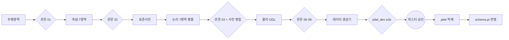
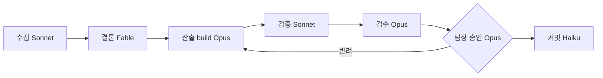
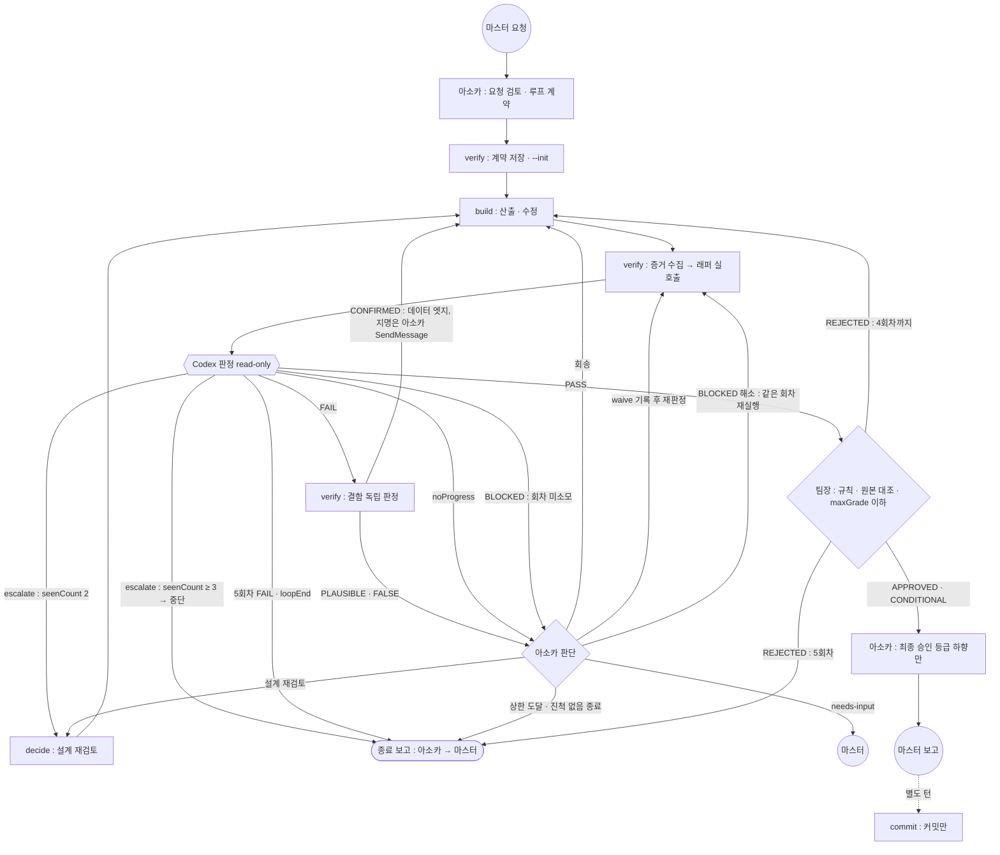

# 50. 그래프 엔지니어링 규칙

> 엔지니어링 5종 중 50번 — [[anakins_prompt|10 프롬프트]] · [[anakins_context|20 컨텍스트]] · [[anakins_harnes|30 하네스]] · [[anakins_loop|40 루프]] · 50 그래프 — 목차 [[00. index]]
> 작성 2026-11-07 Claude 초안(마스터 검토 전). 사례 = 2026-11-07 pitel 데이터 표준화 파이프라인, 2026-11-08 Codex 교차 검증 루프(B-5·F-7~9).

**한 줄 정의** : 여러 에이전트·단계·사람을 **노드**로, 산출물 전달을 **엣지**로, 공유 상태를 **파일**로 보고 작업 흐름 전체를 설계하는 일. 무엇을 병렬로·무엇을 직렬로 하고, 어디서 합쳐 판정하는지를 정한다.

**이 문서의 '그래프'** = 작업 흐름 그래프(에이전트 오케스트레이션). 지식 그래프(GraphRAG)는 G 부록에 짧게 둔다.

**다른 문서와의 관계**

| 그래프 요소 | 담당 문서 |
|---|---|
| 노드 하나의 지시 | [[anakins_prompt]] |
| 노드가 보는 맥락 | [[anakins_context]] |
| 노드를 돌리는 장치 | [[anakins_harnes]] |
| 되돌아가는(재시도) 엣지 | [[anakins_loop]] |
| 외부 판정자(Codex) 호출 계약 | [[codex_procedure]] |
| 역할 노드 카드(그래프 뷰) | `60. nodes/` — [[아소카]] · [[build]] · [[codex-judge]] · [[teamanakin-admin]] 등 |

---

## A. 완료 기준 — 그래프 설계 체크리스트 10

| # | 기준 | 설명 |
|---|---|---|
| 1 | **노드 카드** | 노드마다 입력 파일·출력 파일(경로·형식)·쓰기 경로·완료 기준·담당(에이전트 유형·모델)·예상 비용(D-1 형식) |
| 2 | **엣지 = 파일 + 형식 계약** | 다음 노드에는 대화 요약이 아니라 파일을 넘긴다. 형식은 JSON 키·문서 절로 계약한다(예 : pitel CONTEXT.md 3절) |
| 3 | **병렬 조건** | 쓰기 경로가 겹치지 않는 노드만 병렬로 돌린다. 공유 자원은 **제안 칸**(예 `newTerms`)에만 쓰고, 합류 노드가 병합한다 |
| 4 | **합류 관문 필수** | 병렬 뒤에는 반드시 교차 정합 검사 노드를 둔다. 각 노드의 "위반 0"은 노드 **사이**의 불일치를 못 잡는다 |
| 5 | **깊이 제한** | 기본은 1단(메인 → 서브). 서브가 하위를 소집하려면 노드 카드에 명시한다 |
| 6 | **단일 작성자** | 한 경로는 한 노드만 쓴다. 그래프 밖의 세션(포크 포함)도 마찬가지다 |
| 7 | **재시작 가능** | 노드는 멱등(같은 입력 = 같은 결과)이고, 진행 상태를 파일로 남긴다(`datagen/state`, Workflow 재개 ID). 중간에 실패해도 끝난 노드를 다시 돌리지 않는다 |
| 8 | **사람 노드 명시** | 승인·실기기 검증·운영 반영은 사람 노드다. 자동으로 지나가지 않는다 |
| 9 | **폭 상한** | 동시 에이전트는 기본 10개 미만. 실측 적정값은 6~7개 |
| 10 | **비용 추정** | 노드 수 × 노드당 평균 토큰. 실측 : 논리 모델 7노드 약 138만 토큰(노드당 약 20만) |

---

## B. 이 저장소의 그래프 패턴

### B-1. 직렬 파이프라인 + 단계 관문 — pitel



### B-2. 단계별 모델 배치 — teamAnakin



### B-3. 리더·팀원 — da-team

리더(`da-leader`)가 요구를 나눠 표준·모델·품질·이행 담당에게 할당하고, 리더가 통합 검토·승인한다.

### B-4. 분산 → 합류

pitel 논리 모델은 7영역 노드를 병렬로 돌렸다(쓰기 경로 = 영역별 파일). 공유 사전에는 직접 쓰지 않고 `newTerms` 로 제안하게 했고, 합류 관문 노드가 병합했다.

### B-5. Codex 교차 검증 루프 — 2026-11-08

> 2026-11-10 개정 : 아래 도식·표의 'verify' 노드는 SubagentStop 훅 `.claude/hooks/codex-gate.mjs` 로 바뀌었다(검증 단계 에이전트 폐지 — 훅이 계약·증거 저장 → `--init` → 래퍼 실호출 → 결과 알림, 독립 판정·회송 지명은 아소카). 절차 정본 [[codex_procedure]] 13절.

정본은 [[anakins_loop]] 0-2 — 아래 그림은 그 사본이다(다르면 0-2 가 이긴다).

구현 = Claude 서브에이전트, 판정 = 다른 벤더(Codex), 미진하면 build 로 되돌린다. 되돌아가는 엣지의 상한·멈춤은 [[anakins_loop]] C절, 호출 명령·스키마는 [[codex_procedure]].



**노드 카드** (루프 폴더 `L = .omc/state/loop/<id>/`, 카드 상세 = `60. nodes/`)

| 노드 | 담당 | 입력 | 출력 | 쓰기 경로 |
|---|---|---|---|---|
| 계약 | [[아소카]] | 마스터 요청 | 루프 계약 텍스트(AC-n·scope) | 없음 |
| init | [[verify]] | 계약 텍스트 | `L/contract.md`·`L/ledger.json` | `L/` |
| 산출 | [[build]] | `L/contract.md`, 회송 시 `L/iter-N.triage.md` | 변경 파일 | 계약의 쓰기 허용 |
| 증거·호출 | [[verify]] | 작업 트리 | `L/evidence-N/*.txt`, `L/iter-N.codex.json` | `L/` |
| 판정 | [[codex-judge]] | 래퍼 프롬프트(본문 포함) | 판정 JSON | 없음(read-only) |
| 독립 판정 | [[verify]] | `L/iter-N.codex.json` | `L/iter-N.triage.md` | `L/` |
| 설계 재검토 | [[decide]] | 원장 결함 이력 | 결정 초안(응답) | 없음 |
| 판단 | [[아소카]] | `L/iter-N.triage.md`·결과 `noProgress`·`blocked[]` | 회송·waive·scope 재지정·decide·중단·needs-input 결정(응답) | 없음 |
| 승인 | [[teamanakin-admin]] → [[아소카]] | 요청 원문·결과 경로·`maxGrade` | 판정(응답, `maxGrade` 이하) | 없음 |

**엣지 계약 = 파일 + 형식**

| 엣지 | 파일 | 형식 |
|---|---|---|
| 아소카 → build | `L/contract.md` (brief md) | D-1 양식 — `AC-1` … ID, `[scope]`·`[쓰기 허용]` 칸 |
| build → verify | 작업 트리 변경 | `git diff` 기준 ref `HEAD` |
| verify → Codex | `L/evidence-N/*.txt` (evidence txt) | 실행 출력 원문(요약 금지), 200KB 상한 |
| Codex → verify | `L/iter-N.codex.json` | 출력 계약(`verdict`·`criteria`·`defects`·`maxGrade`·`escalate`·`noProgress`) |
| 회차 ↔ 회차 | `L/ledger.json` | 래퍼 전용(원자 쓰기) — `startedAt`·`codexCalls`·`iters`·`defects{seenCount}`·`waived` |
| verify → build | `L/iter-N.triage.md` (독립 판정 표) — **데이터 엣지, 지명은 아소카(SendMessage)** | 7칸 표(결함·심각도·Codex 요지·확인 방법·결과 원문·판정·근거), 판정 = CONFIRMED·PLAUSIBLE·FALSE — 양식 [[anakins_loop]] D-3 |

A 체크리스트 대조 : 1 노드 카드 ○ / 2 엣지 = 파일 ○ / 4 합류 관문 = 팀장 / 6 단일 작성자 = 원장은 래퍼만·계약은 verify 만 / 7 재시작 = 원장 + 잠금 / 8 사람 노드 = 마스터(needs-input·승인)

### B-6. 요청 처리 흐름 그래프 페이지 — 2026-11-08

- 마스터 설계 트리(1 요청 → 1.1 접수 → 1.1.1~1.1.5 분석 서브에이전트·CDX-루프 검수 → 1.2 승인)를 노드로 그린 페이지. 설계도판 = 이 폴더 `myRequestGraph.html`(실데이터 없음, 커밋) · 슬롯 md = `request-flow/`(예 [[1.1 파다완 아소카 접수]]).
- 실요청 모니터링판 = `work-statistics/mywork/myRequestGraph.html` + 요청별 md `requests/`(둘 다 gitignore) — Stop 훅(`.claude/hooks/work-stats-refresh.mjs`)이 매 턴 갱신. 원천 = work-history 턴·agent 레코드 + `.omc/state/loop/<id>/ledger.json`.
- 생성 : `node scripts/request-graph.mjs [--days 7] [--md]` / 설계도 `node scripts/request-graph.mjs --design-only --md`. 보기 = 계층 트리 ↔ 자유 배치(Obsidian 스타일) 토글.
- 매핑 : 생성기 상단 `SLOT_MAP`(근거 문서 줄 주석, 근거 없는 대응은 `[확인중 : 마스터]`)이 에이전트·훅·Codex 루프를 엔지니어링 슬롯 1.1.1~1.1.5 에 잇는다 — 1.1.2 = `anakin_phase-collect`, 1.1.5 = `anakin_phase-graph`([[graph]], 마스터 확정 2026-11-08). 대응 기록이 없으면 '미수행'(주황 점선), 요청 노드에 '엔지니어링 N/5 수행'. teamanakin-admin 은 1.2 아래. 1.1.5.2(총괄승인) 칸·실행 기록 runs.jsonl 은 2026-11-10 삭제(마스터 "총괄승인 칸 삭제하고, 볼트는 루트로 정리해 줘") — 그래프 갱신은 훅 자동.
- 판 간 링크 : 설계도판 상단 안내 줄에 '실시간 모니터링판 열기'(상대경로, 다른 PC 는 로컬 생성 후 열림), 실데이터판에 '설계도판 열기' — 생성기 템플릿이 만든다.
- 표시 : 완료 = 연초록, 진행 = 형광 노랑 + 깜빡임(`prefers-reduced-motion` 이면 굵은 테두리), 모든 칸에 시작~종료 쌍, 같은 단계 반복 실행·Codex 판정 회차는 칸 안 줄과 상세 회차표(N/5). 실행 경로·칸 배치·칸 안 표시 규칙 = B-6-3(2026-11-10 개정 — 종전 '게이트 경로·⛔ 정지·차단 후 실행 배지'는 폐지). 턴 중간 갱신 = SubagentStart·SubagentStop 훅(`.claude/hooks/request-graph-refresh.mjs`, 2초 억제)이 세션 기록을 꼬리 스캔, 화면은 진행 중이면 5초·아니면 30초마다 새로고침(선택·보기는 주소 `#` 에 보존).

#### B-6-1. 회차 집계 범위·경보·추정 상태 — 2026-11-09 (그래프 분석 첫 실전 결함 5건)

- **회차** = 같은 에이전트에 과제를 전달한 횟수(첫 전달 = 1회차, 재작업·보완 지시를 구분하지 않음). 감지 근거 = 서브에이전트 기록(`<세션>/subagents/agent-<id>.jsonl`)의 `type: 'user'` 문자열 글 — 메인 SendMessage 는 `<teammate-message teammate_id="team-lead" …>`, 마스터가 팀원 창에 직접 쓴 글도 같은 형태. 도구 결과·`<system-reminder>` 메타는 제외, 회차 끝 = 마지막 `end_turn`(생성기 `agentRounds`).
- **verify(폐지 2026-11-10) 과거 기록** : 검증 단계 에이전트의 과거 실행은 칸·집계·상세·md 에서 숨기고, 그 판정 원장은 원장 id 접두(접두 없는 과거 원장 = Codex4 추정)로 CDX 칸에만 반영한다. 지속 에이전트 묶음 누적에서도 제외(재전달 상한 5 는 원장별 상한으로 대신).
- **요청 단위** = 그 요청 안 회차표(재작업 회차·같은 단계 반복 실행·Codex 루프) 최대값. **작업 묶음 단위** = 지속 에이전트(팀원, meta `taskKind: in_process_teammate`)의 회차가 2개 이상 요청에 걸치면 그 요청들을 한 묶음으로 묶고 회차를 회차 시작 시각이 속한 요청으로 나눈다(`splitAgentRounds` — work-history agent 레코드는 첫 디스패치 요청 1곳에만 귀속되므로). 이어받은 요청의 회차 번호는 앞 요청 몫부터 이어 센다. 요청 노드 '묶음 누적 N/5' = 둘 중 큰 값, 지속 에이전트가 없으면 요청 단위 그대로.
- **경보 임계값**(생성기 상단 `ALERT`) : 묶음 누적 ≥ 4 '상한 근접' · ≥ 5 '상한 도달'(빨강 테두리 배지) / 실행 노드 한 회차 소요 ≥ 30분 '장시간'(회차로 나뉘면 회차 단위) · 도구 오류 ≥ 5 '오류 다발'. 요청 노드에 '경보 N건'.
- **완료(추정)** = 시각 기록 없이 수행으로 보는 칸 — 2026-11-10 부터는 SA-그래프의 '생성기 자동 갱신(Stop 훅)'(graph 에이전트 미실행 요청)뿐이다(종전 '훅 실행(시각 미기록)' 근거의 프롬프트·하네스 추정 완료는 C-8 표시 조건으로 대체) : 연초록 채움 + 완료와 같은 실선 테두리('추정' 글자로 구분 — 2026-11-09 마스터 점선 제거), 시각 칸에 사유 글자, 엔지니어링 배지 'N/5 (추정 k)'.
- **워크플로 에이전트**(2026-11-09) = `<세션>/subagents/workflows/wf_<id>/agent-*.jsonl`. 생성기·로거가 최상위 `subagents/agent-*.jsonl` 만 읽어 놓치던 결함(1.1.4·1.1.5·1.2 미수행 오판정)을 고쳤다. 귀속 = 그 워크플로를 시작한 요청(Workflow 도구 호출 턴) — 로거는 Workflow 도구 결과의 `Transcript dir … wf_<id>` 로 정확히 잇고(agent 레코드 `workflow` 필드), 로거 기록이 아직 없으면 생성기가 '워크플로 첫 에이전트 시작 이전의 마지막 Workflow 호출 턴'에 붙인다. 완료 = 워크플로 `journal.jsonl` 의 그 agentId `result`. 같은 agent_id 는 한 요청에만(중복 귀속 금지).

#### B-6-2. Codex 칸 = CDX-루프 하나 — 2026-11-10 개정 (마스터 결정 "프롬프트+컨텍스트+그래프+총괄=>제거, 루프 유지+하네스는 루프에 흡수")

| 칸 | 슬롯 | 검수 대상 | 호출 규칙 | 원장 id 접두 |
|---|---|---|---|---|
| Codex4 (CDX-루프) | 1.1.4.1 | 파일을 바꾼 에이전트의 산출물(하네스 파일 포함) — 브리프 AC-n 충족 / 하네스 변경 = 규칙 정합·우회·회귀 없음·selftest 근거 / 비밀 없음 | **파일 변경 에이전트 종료 때 SubagentStop 훅 자동** — 비대상(collect·decide·review·graph·commit·admin, 훅·생성기 `NO_GATE`)·파일 변경 0건 = 판정 없음 | `c4-` |

> 폐지(2026-11-10) : Codex1 프롬프트(1.1.1.1)·Codex2 컨텍스트(1.1.2.1)·Codex3 하네스(1.1.3.1 — CDX-루프 계약 AC-4 로 흡수)·Codex5 그래프(1.1.5.1)·Codex6 총괄(1.1.5.2.1) 칸과 턴 묶음 판정. 설계도 15칸 → 10칸 → 9칸(1.1.5.2 총괄승인 칸 삭제 — 2026-11-10 마스터 "총괄승인 칸 삭제하고, 볼트는 루트로 정리해 줘"). 개정 전 정의(2026-11-09 "Codex1~6 칸은 마스터 설계 유지 + 칸별 검수 대상 정의")는 이력.

- **쌍 표시 조건(루프)** : SA-루프·CDX-루프 = c4 판정 1회 이상 **OR** 파일 변경 실행(`wrote` — 기록의 Write·Edit tool_use 1건 이상) **OR** 되돌림(N 1회 이상) **OR** 반복(같은 에이전트 종류 2회 이상·같은 원장 판정 2회 이상). 1회 Y 로 끝난 산출 턴·판정 누락 턴에서도 유일한 CDX 칸이 보인다. 판정 대상이 없으면(원장·파일 변경 실행 0건) CDX-루프는 숨긴다.
- **CDX-루프 상태** = 원장별 마지막 판정의 AND — 전부 PASS = Y(원장 1개 '검증 Y · k회 만에 완료', 2개 이상 '검증 Y · 원장 n개 전부 Y') · 하나라도 FAIL = N('검증 N · 원장 a/n N') · 진행 중 원장 = 진행 · 그 밖 = 보류. 원장 없음 : 파일 변경 실행 있음 + 진행 중 요청 = '검증 대기 — 판정 전' / 끝난 요청 = **'⚠ 검증 누락'(경보 — CDX-루프 칸에만, 실행 단위 경보 없음)**.
- **과거 원장 무시** : 개정 전 c1·c2·c3·c5·c6 원장, 턴 묶음 원장 `c<N>-turn-<요청키>`·`bundle-turn-…`, 비대상 에이전트(gate.json `agentType` ∈ `NO_GATE`) 원장은 집계에서 뺀다(생성기 `isLoopLedger` — 디스크 원장은 보존). 대체 원장(`superseded.json`)도 집계 제외.
- **하네스 귀속 표기** : SA-하네스 칸의 하네스 파일 변경 표식 = '⚙ 하네스 파일 변경 n건 → CDX-루프 판정', 상세 'Codex 판정은 CDX-루프(c4)에 귀속'. CDX-루프 칸 상세에 '하네스 파일 변경 n건 포함(SA-하네스 귀속)'.
- **실행별 판정(상세 글자)** : 판정 대상 = 파일 변경 실행(`wrote`) 또는 자기 접미 c4 원장이 판정 창 안에 있는 실행, 그 밖 = '판정 대상 아님'. 창 [자기 종료, 다음 회차 시작), 병렬 대상 접미 규칙(D-004)은 그대로.
- **승인 칸 1.2 = 기록용** : 완료 근거 = 메인 응답의 `종료 승인 :` 줄(세션 기록 — 칸 안 줄 '종료 승인 HH:mm <승인|보류> — <근거>') · 줄 없음 = 미실행. Stop 훅 `.claude/hooks/turn-gate.mjs` 는 이 줄을 `approvals.jsonl` 에 적기만 하고 막지 않는다(턴 묶음 판정·차단 폐지). 과거 '승인 강제 실패' 기록(이력)은 계속 오류로 표시. teamanakin-admin 실행은 칸 안 줄로 함께(완료 근거 아님).
- **원장↔요청 창**(c4-codex-ac436f-p1 D-001·D-002·D-003) : 요청 전으로 넓힌 창(재개 턴 — 귀속 에이전트 시작까지)은 귀속 에이전트 접미 원장·접미 없는 원장에만 — 다른 실행 접미(`-a<16진 5>`) 원장은 요청 창 안 판정만. 종료 승인 줄의 응답 뒤 60초 유예는 같은 세션 다음 요청 시작 전까지.
- **요약 집계**(2026-11-10 c5-turn-f7dc16-1110112110 D-001) : 요청 머리 '검증 Y / 누락 / 위반' = 보이는 CDX 칸 상태를 같은 함수(`cdxCheck`)로 — 누락 = '검증 누락' 칸, 위반 = `notY`.
- 칸 1.1.5.2 '총괄승인' = 삭제(2026-11-10 마스터 "총괄승인 칸 삭제하고, 볼트는 루트로 정리해 줘") — 완료 근거였던 생성기 실행 기록 runs.jsonl 도 폐지. 그래프 갱신 = Stop·SubagentStart/Stop 훅 자동, 최종 종료 승인 = 1.2. 남는 칸 = 1 · 1.1 · SA 5칸 · CDX-루프 · 1.2(설계도 9칸).
- 판정 실행 = SubagentStop 훅 `.claude/hooks/codex-gate.mjs` : 파일을 바꾼 에이전트 종료 때 원장 `c4-<주제>-<agentId 앞 6자>`(상한 초과 시 `-pN`)로 `codex-verify.mjs --init` → `--confirm-real`, 결과는 메인 다음 도구 호출·요청 때 알림. 정의·호출 시점 정본 = [[codex_procedure]] 13절 표.
- 매핑 : 생성기 `SLOT_MAP['1.1.4.1'] = { codex: 4, legacy: true }` — 원장 id 접두 `c4-` 가 일치하면 '매핑 연결' 배지, 접두 없는 과거 원장(`first-call`·`loop-docs`·`loop-cap5`)은 턴 시간창으로 '시간 기준 연결(추정)'. 정의 원문 = 생성기 상단 `CODEX_SLOTS` → 슬롯 md `request-flow/`·설계도판 노드 상세에 그대로 표시.

#### B-6-3. 순차 경로·쌍 배치·칸 안 표시 — 2026-11-10 (마스터 결정, 생성기 `scripts/request-graph.mjs`)

- **순차 연결**(C-3, "모든 프로세스가 진행되었다면 연결선이 반드시 순차적으로") : 보이는 칸을 표준 순서 S → 1 → 2 → SA → 짝 CDX → 다음 SA … → 승인 → E 로 끝까지 잇는다. 승인 칸(1.2)은 상태와 관계없이 늘 경로에 — 미실행이면 들어가는 선 '⚠ 승인 미실행'(점선, 2026-11-10 c5-turn-f7dc16-1110112110 D-002). CDX 가 Y 가 아니어도 선은 이어 가고 그 CDX 칸에 '⚠ 검증 누락'·'N' 만 표시한다(⛔ 정지 표지·'차단 후 실행 · 게이트 위반' 배지 폐지). 요약 '위반 n' = 보이는 CDX 칸 중 Y 아닌 칸 수(진행 중 요청의 판정 대기·진행 칸 제외 — 생성기 `notY`, md '⚠ Y 아닌 CDX 칸'). Y 뒤 간선 = 'Y' 라벨, N 되돌림 점선('되돌림 k회')·'N회 만에 완료'·설계도판(`--design-only`)은 그대로. 진행 중·중단 요청 = 마지막 실제 실행 칸(CDX 는 판정 원장 있음)까지 실선, 판정 대기 CDX 로 들어가는 선과 그 뒤 표준 칸 → 종료는 예정 점선, 중단 = 첫 예정 '중단'.
- **에이전트 = 칸 안 줄**(C-5, "collect·admin 등의 수행은 각 SA 단계에 포함, 반복·실패 작업도 그 안에서") : 에이전트 실행은 독립 노드로 그리지 않는다. collect = SA-컨텍스트, build = SA-루프(루프 쌍이 보일 때 — 아니면 2 접수), graph = SA-그래프, teamanakin-admin = 승인 칸, decide·review·commit·표에 없는 일반 에이전트 = 2 접수 칸. 칸 안 줄 = '<단계> ×n (회송 n-1) · 소요'(이어받은 회차는 'a~b회차', 승인 2회 이상 '[중간 k·최종]') + 실패 표식(빨강 ✖ 종료 기록 없음·도구 오류 / 주황 ⚠ 장시간). 상세 패널·요청 md '실행 에이전트'·'실행 기록(시각순)' 에는 실행별 전체.
- **CDX 칸 안 회차**(C-6, "여러 차례 진행된 검수는 CDX 박스 내에서") : 회차마다 '<k>회 Y|N|BLOCKED HH:mm · 결함 n|사유'(N 빨강 ✖, BLOCKED 주황 ⚠), 끝 줄 '→ k회 만에 완료 · 되돌림 n회', 원장이 2개 이상이면 원장별 머리 줄. 판정 결과는 짝 CDX 칸에만(SA 칸은 실행만).
- **쌍 표시 조건**(C-7 ①·C-8, "SA 가 없으면 CDX 도 없다" · 2026-11-10 개정 — CDX 칸은 CDX-루프 하나, B-6-2) : 프롬프트·컨텍스트·그래프 SA = 모든 요청 표시(짝 CDX 폐지) / 하네스 SA = 그 요청의 메인·서브에이전트 tool_use 또는 훅 주입 1건 이상(C-9 — 0건이면 숨김) / 루프 쌍 = **c4 판정 1회 이상 OR 파일 변경 실행 OR 되돌림(N 판정 1회 이상) OR 반복**(같은 에이전트 종류 2회 이상·같은 원장 판정 2회 이상) — C-13 마스터 "어떤 단계 프로세스에든지 되돌림이 있으면 루프가 발생했다는 말이고, 그러면 루프 노드를 표현해야지", 진행 중 요청도 N 즉시 표시, 둘 다 없으면 숨김. CDX-루프 상태 = 원장별 마지막 판정 AND(B-6-2) — 판정 대상 없음(원장·파일 변경 실행 0건) = 숨김. N 되돌림 화살표 = 그 CDX → 짝 SA 직접(루프 노드 경유 안 함 — SA-루프 칸 줄이 되돌림을 모아 보임). 숨긴 쌍은 경로·일련번호에서 빠지고 번호는 1부터 다시 연속.
- **칸 내용**(C-9·C-10) : SA-프롬프트 = 요청 원문을 그대로 줄인 줄(system-reminder·태그 블록·이미지 표기 제거 + 공백 정리 + 글자 수 초과 '…' — 새 문장 없음, 같은 턴 추가 지시는 시각순 번호) · SA-컨텍스트 = 출처 머리(주입 훅·읽기·collect 수) + 전(같은 세션 직전 요청 원문 축약) · 후(다음 요청) · 좌우(관련 작업·규칙·메모리) · 요점 — 좌우·요점은 graph 에이전트 요약 캐시 `.omc/state/request-graph/summaries/<요청 id>.json`, 없으면 주입 훅 이름·겹친 시간대 에이전트·collect 보고 첫 줄 + '자동 추출' 표식 · SA-하네스 = 종류별 합계 머리 + 시각순 사용 목록('HH:MM:SS 도구 [주체]', 같은 주체·도구 연속 = 'a~b 도구 ×k' 한 줄, 칸 안 스크롤·생략 없음, 입력값 비노출) + 하네스 파일 변경 표식('→ CDX-루프 판정') · SA-루프 = 되돌림 줄(빨강, '<CDX 칸> N k회(<회차>회차 결함 n …) → 재작업 대기 | 재판정 진행 | <회차>회차 Y | 보류(사유)', 예 'CDX-루프 N 1회(1회차 결함 5) → 재작업 대기', 되돌림·반복 0건이면 'Codex 판정 n건 — 되돌림 0' 또는 '파일 변경 실행 — 판정 전') + 반복 목록('build ×4 · CDX-루프 4회 · admin ×2').
- **원장 묶음 AND**(2026-11-10 c4 회송) : codex-gate 가 프롬프트 상한 때문에 원장을 파일 묶음 `-p1`…`-pN` 으로 나누면 생성기 `mergeParts` 가 회차별로 합친다 — 전부 PASS = Y · FAIL 하나라도 = N · 일부 판정 없음·BLOCKED = 보류, 나뉘기 전 기준 원장(BLOCKED scope-too-broad)은 대체로 보고 뺀다. CDX 칸 안 머리 줄 '원장 <기준 id> (묶음 n개 AND)', 실행별 판정(상세)도 같은 AND.
- **SA-컨텍스트 구획 제목 없음**(C-12, 마스터 "'전','후','좌우' 타이틀은 제거") : 출처 머리 줄만 남기고 전 → 후 → 좌우 → 요점 내용 줄만 같은 순서로 넣는다. 구획 사이 = 얇은 구분선(칸·상세 패널 `sep`), 요청 md 도 제목 없음. 요약 캐시 필드명(before·after·related·points)은 내부용으로 유지.
- **쌍 배치**(C-11, "CDX 는 SA 와 같은 Depth 에 두지 말고 한 단계 내려서 가로 시 바로 옆, 상하 시 바로 아래에 쌍으로. 항상") : CDX 칸 = 짝 SA 의 자식(depth + 1, 부모 id = SA). 세로 흐름(기본) = SA 바로 아래(간격 `pairGap` 28 — 2026-11-10 마스터 "SA와 CDX 사이 화살표가 너무 짧아서 구분이 안됨" 으로 8 → 28) + 오른쪽 들여쓰기(`pairIndent` 18, 칸 폭도 그만큼 작게), 연결선 = 짧은 수직 + 가로 브래킷. 가로 흐름 = SA 바로 오른쪽 다음 열(같은 위). 두 칸 사이에 다른 노드 없음. 표시 번호 = CDX 아닌 칸만 연속 일련번호, CDX = 짝 SA 번호 + '-1'(예 3 · 3-1). 자유 배치(그래프 보기)에서도 CDX = 짝 SA 원 바로 아래 위성(`matePos`, 물리 계산 밖 — SA 를 끌면 같이 움직임).
- **시작·승인·종료 배치**(C-15, 마스터 "'시작' 노드는 '1. 마스터 아나킨 요청' 왼쪽 옆 거리를 두고 … '파다완 아소카 승인' 하단 정중앙 … 그 왼쪽에 '종료'를 거리 두고" — **세로 모드만**) : 시작 = 1번 칸과 같은 행·왼쪽 `termGapS` 40·세로 가운데 맞춤, 승인 칸 = 그림 맨 아래·전체 폭 정중앙(아래 칸 없음, 루트 → 승인 구조선 생략 — 연결은 흐름 화살표), 종료 = 승인 칸 같은 행·왼쪽 `termGapE` 40(시작과 같은 값). 시작 → 1 · 승인 → 종료 = 짧은 가로 직선. 설계도판(`--design-only`) 세로도 같은 규칙. 가로 모드·자유 배치(가로 트리 좌표 기반)는 종전 배치 유지(생성기 `layoutTree`·`termPos`).

---

## C. 누가 설계하고 누가 검증하나

| 시점 | 담당 | 할 일 |
|---|---|---|
| 착수 전 | 리더(메인 세션) | 노드 카드·그래프 그림 작성 → A 10항목 자기 점검 → 비용 고지 |
| 실행 중 | 합류 관문 노드(독립 에이전트) | 교차 정합 검사, 결함은 직접 수정 또는 반려 |
| 사후 | 리더 | `reviews/<단계>.md` 에 점검표·수정 내역·판정 기록 |

---

## D. 금지와 멈춤

**금지**

- 공유 파일 병렬 쓰기
- 관문 없는 병렬
- 결과를 대화 요약으로만 넘기기
- 노드가 자기 쓰기 경로 밖의 파일 수정
- 상한 없는 순환 엣지 — 재시도 상한은 [[anakins_loop]] C-2 를 따른다

**멈춤**

- **같은 경로를 두 작성자가 쓰는 것이 감지됨**(예상하지 않은 수정 시각 변화) → 전체 일시정지, 소유자 재지정 후 재개
- 합류 관문이 연속 2회 반려 → 노드를 계속 고치지 말고, 그래프 설계(노드 분할·계약)를 다시 본다
- 실제 비용이 추정의 2배를 넘음 → 멈추고 보고

---

## E. 템플릿

### E-1. 노드 카드

```yaml
node: logical:PAY
agent: da-modeler            # 모델은 정의 파일 기준
input:  [CONTEXT.md, model/conceptual/PAY.json, model/std/*.json]
output: [model/logical/PAY.json, docs/04_logical_PAY.md]
write:  [model/logical/PAY.json, docs/04_logical_PAY.md]   # 이 밖은 금지
shared: { model/std: "newTerms 칸으로만 제안" }
spawn:  false                # 하위 에이전트 소집 금지
done:   "JSON.parse 성공 + 자체 점검 위반 0"
report: "10줄 이내"
cost:   "약 20만 토큰"
```

### E-2. 엣지 계약 (예 : 논리 → 물리)

```json
{ "area": "PAY", "entities": [ { "entId": "PAY-001", "phyNm": "RAW_USE_DTLS",
  "attrs": [ { "phyNm": "RAW_USE_NO", "domNm": "번호V20", "pk": true, "fk": null } ] } ] }
```

### E-3. Workflow 스크립트 골격 (병렬 → 합류)

```js
const results = await parallel(AREAS.map(a => () =>
  agent(briefFor(a), { label: `logical:${a}`, agentType: 'da-modeler' })))
// 합류 관문은 병렬이 모두 끝난 뒤 별도 노드로 — 병렬 노드 안에서 서로 보지 않는다
await agent(gateBrief(results), { label: 'gate:logical', agentType: 'da-leader' })
```

---

## F. 사례 → 규칙 (2026-11-07 pitel · 2026-11-08 Codex 루프)

| # | 일어난 일 | 위반한 기준 | 규칙 |
|---|---|---|---|
| 1 | 같은 그래프를 원본·포크 두 세션이 동시에 실행해 파일을 서로 덮어썼다 | A-6 | 단일 작성자 + 소유 세션 기록 |
| 2 | 관문 노드가 지시에 없던 하위 노드(표준사전)를 소집해 개념 JSON 을 동시에 고쳤다 | A-5 | 깊이 제한, `spawn: false` |
| 3 | 병렬 7노드 모두 "위반 0" → 관문에서 영역 간 약어(`TP`/`TY`)·참조 키 이름 불일치가 수십 건 나왔다 | A-4 | 합류 관문 필수 |
| 4 | 공유 사전을 `newTerms` 제안 칸으로 돌려 병렬 쓰기 충돌 없이 병합했다 | A-3 (성공) | 유지 |
| 5 | 영역별 생성기를 다시 돌리면 관문 수정이 되돌아갈 위험이 있었다 → 재실행 가드 추가 | A-7 | 생성기·관문 순서 고정 |
| 6 | 데이터 생성은 "결정적 키 공식"(부모 번호를 해시로 계산)을 써서 214개 테이블을 **조인 없이 병렬**로 적재했다 | — (설계 기법) | 엣지를 '데이터 전달'이 아니라 '공식 공유'로 바꾸면 의존 그래프가 평평해진다 |
| 7 | (2026-11-08 Codex 루프) Claude 자체 검증 5회차가 놓친 래퍼 결함 — Codex 가 예산 우회·원장 부재·기준 누락 PASS 를 찾았다 | A-4 | 합류 관문을 다른 벤더 판정자로 — [[anakins_loop]] E 표 #2 |
| 8 | (같음) 판정자가 셸로 파일을 읽지 못해 첫 회차 BLOCKED | A-2 | 엣지 = 파일 본문을 프롬프트에 실어 보낸다 — [[codex_procedure]] 4절 |
| 9 | (같음) build 노드가 판정자 노드 일을 대신해(실호출) 결과를 지웠다 | A-6 확장(노드 권한) | 노드별 실행 권한 게이트(`--confirm-real` = verify 만) — [[anakins_loop]] C-1 |

---

## G. 부록 — 지식 그래프

- 다음 단계(CDC → 데이터 레이크 → AI 분석 센터)에서 모델 관계(pitel FK 449, 주제영역 간 관계 121)를 그래프로 적재할 수 있다. 그러면 "이 칼럼을 바꾸면 어디가 영향받나" 같은 영향 분석과 질의 근거 탐색(GraphRAG)에 쓸 수 있다.
- 지금은 필요한 기능이 아니므로, 착수할 때 이 문서에 별도 절로 규칙을 추가한다.
