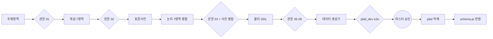
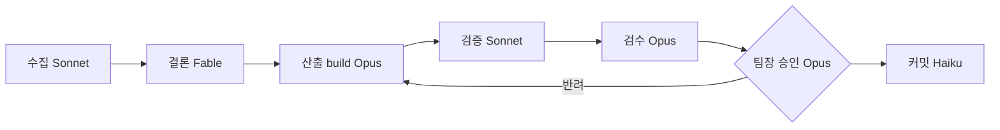

# 50. 그래프 엔지니어링 규칙

> 엔지니어링 5종 중 50번 — 10 프롬프트 · 20 컨텍스트 · 30 하네스 · 40 루프 · 50 그래프
> 작성 2026-11-07 Claude 초안(마스터 검토 전). 사례 = 2026-11-07 pitel 데이터 표준화 파이프라인.

**한 줄 정의** : 여러 에이전트·단계·사람을 **노드**로, 산출물 전달을 **엣지**로, 공유 상태를 **파일**로 보고 작업 흐름 전체를 설계하는 일. 무엇을 병렬로·무엇을 직렬로 하고, 어디서 합쳐 판정하는지를 정한다.

**이 문서의 '그래프'** = 작업 흐름 그래프(에이전트 오케스트레이션). 지식 그래프(GraphRAG)는 G 부록에 짧게 둔다.

**다른 문서와의 관계**

| 그래프 요소 | 담당 문서 |
|---|---|
| 노드 하나의 지시 | 10 프롬프트 |
| 노드가 보는 맥락 | 20 컨텍스트 |
| 노드를 돌리는 장치 | 30 하네스 |
| 되돌아가는(재시도) 엣지 | 40 루프 |

---

## A. 완료 기준 — 그래프 설계 체크리스트 10

| # | 기준 | 설명 |
|---|---|---|
| 1 | **노드 카드** | 노드마다 입력 파일·출력 파일(경로·형식)·쓰기 경로·완료 기준·담당(에이전트 유형·모델)·예상 비용(D-1 형식) |
| 2 | **엣지 = 파일 + 형식 계약** | 다음 노드에는 대화 요약이 아니라 파일을 넘긴다. 형식은 JSON 키·문서 절로 계약한다(예 : pitel CONTEXT.md 3절) |
| 3 | **병렬 조건** | 쓰기 경로가 겹치지 않는 노드만 병렬로 돌린다. 공유 자원은 **제안 칸**(예 `newTerms`)에만 쓰고, 합류 노드가 병합한다 |
| 4 | **합류 관문 필수** | 병렬 뒤에는 반드시 교차 정합 검사 노드를 둔다. 각 노드의 "위반 0"은 노드 **사이**의 불일치를 못 잡는다 |
| 5 | **깊이 제한** | 기본은 1단(메인 → 서브). 서브가 하위를 소집하려면 노드 카드에 명시한다 |
| 6 | **단일 작성자** | 한 경로는 한 노드만 쓴다. 그래프 밖의 세션(포크 포함)도 마찬가지다 |
| 7 | **재시작 가능** | 노드는 멱등(같은 입력 = 같은 결과)이고, 진행 상태를 파일로 남긴다(`datagen/state`, Workflow 재개 ID). 중간에 실패해도 끝난 노드를 다시 돌리지 않는다 |
| 8 | **사람 노드 명시** | 승인·실기기 검증·운영 반영은 사람 노드다. 자동으로 지나가지 않는다 |
| 9 | **폭 상한** | 동시 에이전트는 기본 10개 미만. 실측 적정값은 6~7개 |
| 10 | **비용 추정** | 노드 수 × 노드당 평균 토큰. 실측 : 논리 모델 7노드 약 138만 토큰(노드당 약 20만) |

---

## B. 이 저장소의 그래프 패턴

### B-1. 직렬 파이프라인 + 단계 관문 — pitel



### B-2. 단계별 모델 배치 — teamAnakin



### B-3. 리더·팀원 — da-team

리더(`da-leader`)가 요구를 나눠 표준·모델·품질·이행 담당에게 할당하고, 리더가 통합 검토·승인한다.

### B-4. 분산 → 합류

pitel 논리 모델은 7영역 노드를 병렬로 돌렸다(쓰기 경로 = 영역별 파일). 공유 사전에는 직접 쓰지 않고 `newTerms` 로 제안하게 했고, 합류 관문 노드가 병합했다.

---

## C. 누가 설계하고 누가 검증하나

| 시점 | 담당 | 할 일 |
|---|---|---|
| 착수 전 | 리더(메인 세션) | 노드 카드·그래프 그림 작성 → A 10항목 자기 점검 → 비용 고지 |
| 실행 중 | 합류 관문 노드(독립 에이전트) | 교차 정합 검사, 결함은 직접 수정 또는 반려 |
| 사후 | 리더 | `reviews/<단계>.md` 에 점검표·수정 내역·판정 기록 |

---

## D. 금지와 멈춤

**금지**

- 공유 파일 병렬 쓰기
- 관문 없는 병렬
- 결과를 대화 요약으로만 넘기기
- 노드가 자기 쓰기 경로 밖의 파일 수정
- 상한 없는 순환 엣지 — 재시도 상한은 40 루프 규칙을 따른다

**멈춤**

- **같은 경로를 두 작성자가 쓰는 것이 감지됨**(예상하지 않은 수정 시각 변화) → 전체 일시정지, 소유자 재지정 후 재개
- 합류 관문이 연속 2회 반려 → 노드를 계속 고치지 말고, 그래프 설계(노드 분할·계약)를 다시 본다
- 실제 비용이 추정의 2배를 넘음 → 멈추고 보고

---

## E. 템플릿

### E-1. 노드 카드

```yaml
node: logical:PAY
agent: da-modeler            # 모델은 정의 파일 기준
input:  [CONTEXT.md, model/conceptual/PAY.json, model/std/*.json]
output: [model/logical/PAY.json, docs/04_logical_PAY.md]
write:  [model/logical/PAY.json, docs/04_logical_PAY.md]   # 이 밖은 금지
shared: { model/std: "newTerms 칸으로만 제안" }
spawn:  false                # 하위 에이전트 소집 금지
done:   "JSON.parse 성공 + 자체 점검 위반 0"
report: "10줄 이내"
cost:   "약 20만 토큰"
```

### E-2. 엣지 계약 (예 : 논리 → 물리)

```json
{ "area": "PAY", "entities": [ { "entId": "PAY-001", "phyNm": "RAW_USE_DTLS",
  "attrs": [ { "phyNm": "RAW_USE_NO", "domNm": "번호V20", "pk": true, "fk": null } ] } ] }
```

### E-3. Workflow 스크립트 골격 (병렬 → 합류)

```js
const results = await parallel(AREAS.map(a => () =>
  agent(briefFor(a), { label: `logical:${a}`, agentType: 'da-modeler' })))
// 합류 관문은 병렬이 모두 끝난 뒤 별도 노드로 — 병렬 노드 안에서 서로 보지 않는다
await agent(gateBrief(results), { label: 'gate:logical', agentType: 'da-leader' })
```

---

## F. 2026-11-07 pitel 사례 → 규칙

| # | 일어난 일 | 위반한 기준 | 규칙 |
|---|---|---|---|
| 1 | 같은 그래프를 원본·포크 두 세션이 동시에 실행해 파일을 서로 덮어썼다 | A-6 | 단일 작성자 + 소유 세션 기록 |
| 2 | 관문 노드가 지시에 없던 하위 노드(표준사전)를 소집해 개념 JSON 을 동시에 고쳤다 | A-5 | 깊이 제한, `spawn: false` |
| 3 | 병렬 7노드 모두 "위반 0" → 관문에서 영역 간 약어(`TP`/`TY`)·참조 키 이름 불일치가 수십 건 나왔다 | A-4 | 합류 관문 필수 |
| 4 | 공유 사전을 `newTerms` 제안 칸으로 돌려 병렬 쓰기 충돌 없이 병합했다 | A-3 (성공) | 유지 |
| 5 | 영역별 생성기를 다시 돌리면 관문 수정이 되돌아갈 위험이 있었다 → 재실행 가드 추가 | A-7 | 생성기·관문 순서 고정 |
| 6 | 데이터 생성은 "결정적 키 공식"(부모 번호를 해시로 계산)을 써서 214개 테이블을 **조인 없이 병렬**로 적재했다 | — (설계 기법) | 엣지를 '데이터 전달'이 아니라 '공식 공유'로 바꾸면 의존 그래프가 평평해진다 |

---

## G. 부록 — 지식 그래프

- 다음 단계(CDC → 데이터 레이크 → AI 분석 센터)에서 모델 관계(pitel FK 449, 주제영역 간 관계 121)를 그래프로 적재할 수 있다. 그러면 "이 칼럼을 바꾸면 어디가 영향받나" 같은 영향 분석과 질의 근거 탐색(GraphRAG)에 쓸 수 있다.
- 지금은 필요한 기능이 아니므로, 착수할 때 이 문서에 별도 절로 규칙을 추가한다.
