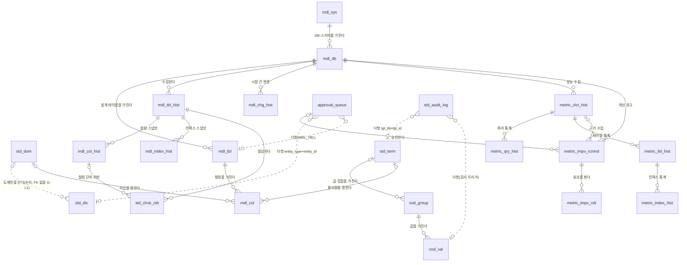

# 02_modeler_model — 메타시스템(METAPI) 데이터 모델 설계서

> 작성 2026-10-14 · da-modeler · 상태 **초안(DA 승인 전제)** · 짝 파일 `02_modeler_ddl.sql`(잡 디렉토리 전용, `sql/` 미적용)
> 입력 : 제안서 v0.7 §3~§5, 정본 `데이터표준규칙.md` v2.4, README §6 템플릿, Hook `da-ddl-guard.mjs`, 01 정의서 8.5 프로파일, 04 모델링 가이드 §2·§3·§5·§6.1·§7.3·8장, 표준담당 `01_standards_dictionary.md` §4 치환표(r1)
> 실 DB 근거 : 승계 5 테이블 컬럼은 cafe.pi 개발 DB(.env.local 대상)의 PostgREST OpenAPI 정의(2026-10-14 조회, 읽기 전용)로 확인했다. 운영 DB 는 미확인이다 [확인중 : 운영 프로젝트 카탈로그 — 이관담당 S0-1 실측으로 대조]. CHECK·트리거는 OpenAPI 에 나오지 않아 `sql/006~010` 기준이며 해당 항목은 [확인중 : 실 DB 조회]로 표기했다.
> 검증 : PGlite(PostgreSQL 16 WASM)에 baseline `fn_grant_svc_only`·역할 3종과 승계 5 테이블 점검용 스텁(개발 DB OpenAPI 정의 + 04 보정)을 먼저 적용하고, 이어 `02_modeler_ddl.sql` 을 적용했다. 업무 규칙 단언 12건, 권한 잠금 단언(테이블 17·함수 9), 전 테이블 형식 단언, 자기 카탈로그 수집 리허설(318행 = 전 컬럼)이 모두 통과했다. 승계 테이블 정본 DDL 은 `04_migration_ddl.sql`(이행담당) 이며 02 는 그 뒤에 실행한다. Hook 결과는 §5-4.

## 0. 집계

| 구분 | 테이블 | 컬럼 | 비고 |
|---|---|---|---|
| 1단계 신규 | 11 | 156 | `cod_` 2 · `mdl_` 8(`_hist` 4) · `std_chck_rslt` |
| 2단계 신규 | 6 | 81 | `metric_` 6(`_hist` 4) |
| **신규 계** | **17** | **237** | r5 보강 +11 포함(1단계 9 · 2단계 2) |
| 승계(이관 후 모습) | 5 | 81 | 원천 실 DB 72 + 무해 보정 추가 9 |
| **점검 합계** | **22** | **318** | 전체 318 = 신규 237 + 승계 81 |

집계 이력 :
- r1 신규 226 은 표준담당 치환표 집계 231 보다 5컬럼 적었다. §6-1 구조 판단(도출 컬럼·반복 컬럼 제거)의 결과다. r5 보강 11컬럼(§6-1 S10)을 더해 237 이 됐다.
- 승계 원천은 72컬럼이다. 표준담당 r1 집계 64 와의 차이 8 은 세 테이블에서 나왔다. `std_dic` 은 22 로 세어 +1, `std_dom` 은 17 로 세어 +1, `approval_queue` 는 sql/010 근거분 5만 세어 −10 이다(개발 DB 정의는 15). 합하면 +1 +1 −10 = −8 이다. `std_dic`·`std_dom` 의 +1 은 표준담당이 계수 오류로 확인해 철회했다. 표준담당은 정본 집계를 72 로 고쳤다.
- 승계 이관 후 81 = 원천 72 + 04 무해 보정 9(`del_dtm` 4 · `approval_queue.del_yn` 1 · `std_audit_log` 시스템 컬럼 4)다.

3단계 예약 테이블 9개 (이름만 예약, 컬럼은 수요 발생 시 설계 — 01 §4-0)

| # | 제안서 §4-3 구명 | 확정 신명 | 용도 |
|---|---|---|---|
| 1 | `std_syn` | `std_synm` | 동의어 |
| 2 | `std_ban` | `std_phwrd` | 금칙어 |
| 3 | `biz_glos` | `biz_term` | 업무 용어집(용어 TERM 기등재) |
| 4 | `biz_subj` | `biz_tpc` | 주제영역·오너 |
| 5 | `biz_tag` | `biz_tag` | 태그·태그 템플릿 |
| 6 | `mdl_tbl_ver` | `mdl_tbl_ver` | 모델 버전 |
| 7 | `mdl_prg` | `mdl_prgrm` | 프로그램 |
| 8 | `mdl_prg_ref` | `mdl_prgrm_rfrnc` | 프로그램 참조(영향도) |
| 9 | `sys_cfg` | `sys_cfg` | 환경 설정(기존 변경 원장 sys_cfg_chg_hist, sql/176) |

`biz_` 접두사와 3단계 단어 4개(동의어·금칙어·프로그램·사업)는 3단계 착수 때 등재한다(01 판정 6). 주제 TPC 는 r5 에서 1단계로 등재됐다.

## 1. 주제영역 정의서

| 주제영역 | 접두사 | 정의 | 엔터티(유형) | 단계 |
|---|---|---|---|---|
| 표준 | `std_` | 표준단어·도메인·용어와 그 변경 감사 | `std_dic`·`std_dom`·`std_term`(기본, 승계) · `std_audit_log`(행위·이력, 승계) | 승계 |
| 코드 | `cod_` | 표준코드 그룹과 값(04 §6.1 공통코드 2테이블) | `cod_group`(기본) · `cod_val`(기본) | 1 |
| 모델·구조 | `mdl_` | 대상 시스템·DB, 설계 모델(테이블·컬럼), 실 DB 카탈로그 수집 스냅샷과 시점 간 변경 | `mdl_sys`·`mdl_db`(기본) · `mdl_tbl`·`mdl_col`(중심) · `mdl_tbl_hist`·`mdl_col_hist`·`mdl_index_hist`·`mdl_chg_hist`(행위·이력) | 1 |
| 검증 | `std_` (`std_chck` 하위) | 수집 스냅샷에 대한 표준 규칙 점검 결과 | `std_chck_rslt`(행위) | 1 |
| 승인 | `approval_` | 단어·도메인·용어·코드·모델·개선권고의 변경요청·승인 | `approval_queue`(행위, 승계) | 승계 |
| 성능 | `metric_` | 대상 DB 성능 통계 수집 스냅샷, AI 개선 권고와 효과 측정 | `metric_clct_hist`·`metric_qry_hist`·`metric_tbl_hist`·`metric_index_hist`(행위·이력) · `metric_impv_rcmnd`·`metric_impv_rslt`(행위) | 2 |

- `mdl_` 은 DA 승인 전 신설 접두사다. 성능 영역은 리더 판정 2 에 따라 기존 승인 접두사 `metric_`(시스템 계측) 를 재사용한다. 제안서 `prf_` 는 공통표준 PRF(이익)와 동음이라 채택하지 않았다(§6-3).
- 1행 1의미 원칙에 따라 `mdl_db` 1행은 "DB 1개의 스키마 1개"다. 같은 Supabase 프로젝트의 다른 스키마는 행을 따로 둔다.
- 사이트 간 데이터 정책 해석 전에는 schema.pi 자기 DB 만 운영 수집한다. cafe.pi 는 개발 DB 만 수집하고, cafe.pi 운영 DB 포함 여부는 [확인중 : 마스터]다. 19 사이트 확대는 [확인중 : legal-compliance-advisor → Pi 서포트, PRD_28 §11 #4] 해석 뒤다. 모델은 19 사이트를 수용하며 행 수만 달라진다.

## 2. 개념 ERD

실선은 물리 FK, 점선은 물리 FK 가 없는 논리 관계다. 다형 참조는 FK 를 걸 수 없다.

관계 정의표 (전 관계 비식별 — 자식 PK 는 전부 UUID 인조 식별자)

| # | 부모 → 자식 | 카디널리티 | 자식 선택성 | 물리 | 관계명 |
|---|---|---|---|---|---|
| 1 | `std_term` → `cod_group` | 1 : 0..N | 부모 선택(NULL 허용) | FK `cod_group_std_term_id_fkey` | 값 집합을 가진다 |
| 2 | `cod_group` → `cod_val` | 1 : 0..N | 부모 필수 | FK `cod_val_cod_group_id_fkey` | 값을 가진다 |
| 3 | `mdl_sys` → `mdl_db` | 1 : 0..N | 필수 | FK | DB·스키마를 가진다 |
| 4 | `mdl_db` → `mdl_tbl` | 1 : 0..N | 필수 | FK | 설계 테이블을 가진다 |
| 5 | `mdl_tbl` → `mdl_col` | 1 : 0..N | 필수 | FK | 컬럼을 가진다 |
| 6 | `std_term` → `mdl_col` | 1 : 0..N | 선택(NULL = 비표준, P18 대상) | FK | 물리명을 정한다 |
| 7 | `std_dom` → `mdl_col` | 1 : 0..N | 선택 | FK(TEXT) | 타입을 정한다 |
| 8 | `mdl_db` → `mdl_tbl_hist` | 1 : 0..N | 필수 | FK | 수집된다 |
| 9 | `mdl_tbl_hist` → `mdl_col_hist` | 1 : 1..N | 필수 | FK | 컬럼 스냅샷 |
| 10 | `mdl_tbl_hist` → `mdl_index_hist` | 1 : 0..N | 필수 | FK | 인덱스 스냅샷 |
| 11 | `mdl_db` → `mdl_chg_hist` | 1 : 0..N | 필수 | FK | 시점 간 변경 |
| 12 | `mdl_tbl_hist` → `std_chck_rslt` | 1 : 0..N | 필수 | FK | 점검된다 |
| 13 | `mdl_col_hist` → `std_chck_rslt` | 1 : 0..N | 선택(NULL = 테이블 단위) | FK | 컬럼 단위 위반 |
| 14 | `mdl_db` → `metric_clct_hist` | 1 : 0..N | 필수 | FK | 성능 수집 |
| 15 | `metric_clct_hist` → `metric_qry_hist` | 1 : 0..N | 필수 | FK | 쿼리 통계 |
| 16 | `metric_clct_hist` → `metric_tbl_hist` | 1 : 0..N | 필수 | FK | 테이블 통계 |
| 17 | `metric_tbl_hist` → `metric_index_hist` | 1 : 0..N | 필수 | FK | 인덱스 통계 |
| 18 | `mdl_db` → `metric_impv_rcmnd` | 1 : 0..N | 필수 | FK | 개선 권고 |
| 19 | `metric_clct_hist` → `metric_impv_rcmnd` | 1 : 0..N | 선택 | FK | 근거 수집 |
| 20 | `approval_queue` → `metric_impv_rcmnd` | 1 : 0..N | 선택(APPROVED·APPLIED 면 필수, CHECK) | FK(UUID, 선택지 ① 이면 TEXT) | 승인한다 |
| 21 | `metric_impv_rcmnd` → `metric_impv_rslt` | 1 : 0..N | 필수 | FK | 효과를 잰다 |
| G-L1 | `std_dom` → `std_dic` | 1 : 0..N | 선택 | **FK 없음(실 DB)** — 승계 결함, 이관 후 FK 추가는 고아 행 검증 뒤 [확인중 : 실 DB 조회] | 도메인을 쓴다 |
| G-L2 | `std_dom` → `std_term` | — | — | **관계 컬럼 자체가 없음** — 용어는 도메인으로 끝나야 하는데(§1-3) 그 도메인을 가리키는 속성이 없다. 소급 시 `std_term.dom_id` 추가 권고 | 도메인으로 끝난다 |
| P1 | `approval_queue` ↔ 승인 대상 6종 | N : 1 | — | 다형(`entity_type`+`entity_id`) | 변경을 요청한다 |
| P2 | `std_audit_log` ↔ 감사 대상 5종 | N : 1 | — | 다형(`tgt_tbl`+`tgt_id`), 트리거 적재 | 변경을 기록한다 |

- M:N 관계는 없다. 1:1 관계도 없다.
- 서브타입은 두지 않았다. 수집 객체(테이블·컬럼·인덱스)는 성질이 달라 테이블을 나눴다. 변경 이력만 `objt_tp_cd` 로 롤업했다. 변경 이력은 세 객체에 같은 구조(전·후 JSONB)를 쓰므로 롤업 방식이 맞다.
- FK 정책(8.5 STD-08 적용 제외) : 신규 관계 21건은 모두 FK 로 만들었다. PostgREST 임베디드 조인(`mdl_tbl(*, mdl_col(*))` 등)이 이 FK 에 기댄다. 다형 참조 2건만 FK 가 없다(sql/176 선례).
## 3. 논리 엔터티·속성 정의서 (PGlite 카탈로그 생성 — 타입·NULL·기본값·키는 DDL 원본)

키 : PK 기본키 · FK→부모 외래키 · UK 활성행 UNIQUE 구성 컬럼. 도메인 = 물리명 마지막 토큰. ⚠ = grandfathered 위반(개명안 병기, 이관 중 개명 0). [②] = 이관 후 모습에서 무해 보정으로 추가한 컬럼. 승계 5 테이블 행은 점검용이다. 개발 DB OpenAPI 정의에 04 보정(무해 보정·M4 UUID 전환)을 더한 스텁에서 생성했으며, 정본 DDL·최종 타입은 04 S0 실측이 정한다.

### cod_group (12)

| # | 논리명 | 물리명 | 도메인 | 타입 | NULL | 기본값 | 키 | 설명 |
|---|---|---|---|---|---|---|---|---|
| 1 | 코드그룹ID | `cd_group_id` | id | uuid | N | gen_random_uuid() | PK |  |
| 2 | 코드그룹코드 | `cd_group_cd` | cd | character varying(50) | N |  | UK | 대문자 snake, 활성행 UNIQUE |
| 3 | 코드그룹명 | `cd_group_nm` | nm | character varying(100) | N |  |  |  |
| 4 | 코드그룹설명 | `cd_group_desc` | desc | text | Y |  |  |  |
| 5 | 용어ID | `term_id` | id | uuid | Y |  | FK→std_term | 표준용어 참조(NULL = 미매핑) |
| 6 | 사용여부 | `use_yn` | yn | character(1) | N | 'Y' |  | 폐기·일시중지(삭제 아님) |
| 7 | 삭제여부 | `del_yn` | yn | character(1) | N | 'N' |  |  |
| 8 | 삭제일시 | `del_dtm` | dtm | timestamp with time zone | Y |  |  |  |
| 9 | 등록자ID | `regr_id` | id | text | N | 'ADMIN' |  |  |
| 10 | 등록일시 | `reg_dtm` | dtm | timestamp with time zone | N | CURRENT_TIMESTAMP |  |  |
| 11 | 변경자ID | `modr_id` | id | text | N | 'ADMIN' |  |  |
| 12 | 변경일시 | `mod_dtm` | dtm | timestamp with time zone | N | CURRENT_TIMESTAMP |  | 트리거 자동 갱신(_hist·_log 제외) |

### cod_val (15)

| # | 논리명 | 물리명 | 도메인 | 타입 | NULL | 기본값 | 키 | 설명 |
|---|---|---|---|---|---|---|---|---|
| 1 | 코드값ID | `cd_val_id` | id | uuid | N | gen_random_uuid() | PK |  |
| 2 | 코드그룹ID | `cd_group_id` | id | uuid | N |  | FK→cod_group UK |  |
| 3 | 코드값코드 | `cd_val_cd` | cd | character varying(50) | N |  | UK | 실제 저장값, 그룹 내 활성행 UNIQUE |
| 4 | 코드값명 | `cd_val_nm` | nm | character varying(100) | N |  |  | 국문 |
| 5 | 코드값영문명 | `cd_val_eng_nm` | nm | character varying(100) | Y |  |  |  |
| 6 | 코드값설명 | `cd_val_desc` | desc | text | Y |  |  |  |
| 7 | 정렬순서 | `sort_seq` | seq | integer | N | 0 |  | 공통표준 SORT_SEQ |
| 8 | 유효종료일자 | `vld_end_dt` | dt | date | Y |  |  | NULL = 무기한 |
| 9 | 사용여부 | `use_yn` | yn | character(1) | N | 'Y' |  | 폐기·일시중지(삭제 아님) |
| 10 | 삭제여부 | `del_yn` | yn | character(1) | N | 'N' |  |  |
| 11 | 삭제일시 | `del_dtm` | dtm | timestamp with time zone | Y |  |  |  |
| 12 | 등록자ID | `regr_id` | id | text | N | 'ADMIN' |  |  |
| 13 | 등록일시 | `reg_dtm` | dtm | timestamp with time zone | N | CURRENT_TIMESTAMP |  |  |
| 14 | 변경자ID | `modr_id` | id | text | N | 'ADMIN' |  |  |
| 15 | 변경일시 | `mod_dtm` | dtm | timestamp with time zone | N | CURRENT_TIMESTAMP |  | 트리거 자동 갱신(_hist·_log 제외) |

### mdl_sys (11)

| # | 논리명 | 물리명 | 도메인 | 타입 | NULL | 기본값 | 키 | 설명 |
|---|---|---|---|---|---|---|---|---|
| 1 | 시스템ID | `sys_id` | id | uuid | N | gen_random_uuid() | PK |  |
| 2 | 시스템명 | `sys_nm` | nm | character varying(100) | N |  |  |  |
| 3 | 사이트명 | `site_nm` | nm | character varying(100) | N |  | UK | sites.json 도메인 문자열(cafe.pi) |
| 4 | 시스템설명 | `sys_desc` | desc | text | Y |  |  |  |
| 5 | 사용여부 | `use_yn` | yn | character(1) | N | 'Y' |  | 폐기·일시중지(삭제 아님) |
| 6 | 삭제여부 | `del_yn` | yn | character(1) | N | 'N' |  |  |
| 7 | 삭제일시 | `del_dtm` | dtm | timestamp with time zone | Y |  |  |  |
| 8 | 등록자ID | `regr_id` | id | text | N | 'ADMIN' |  |  |
| 9 | 등록일시 | `reg_dtm` | dtm | timestamp with time zone | N | CURRENT_TIMESTAMP |  |  |
| 10 | 변경자ID | `modr_id` | id | text | N | 'ADMIN' |  |  |
| 11 | 변경일시 | `mod_dtm` | dtm | timestamp with time zone | N | CURRENT_TIMESTAMP |  | 트리거 자동 갱신(_hist·_log 제외) |

### mdl_db (19)

| # | 논리명 | 물리명 | 도메인 | 타입 | NULL | 기본값 | 키 | 설명 |
|---|---|---|---|---|---|---|---|---|
| 1 | 데이터베이스ID | `db_id` | id | uuid | N | gen_random_uuid() | PK |  |
| 2 | 시스템ID | `sys_id` | id | uuid | N |  | FK→mdl_sys UK |  |
| 3 | 환경코드 | `env_cd` | cd | character varying(20) | N |  | UK | DEV·STG·PROD |
| 4 | 데이터베이스유형코드 | `db_tp_cd` | cd | character varying(20) | N | 'PG'::character varying |  | PG 고정 |
| 5 | 스키마명 | `schm_nm` | nm | character varying(63) | N | 'public'::character varying | UK |  |
| 6 | 환경키명 | `env_key_nm` | nm | character varying(100) | N |  |  | META_DB_<SITE> 형식만 CHECK(비밀 키 이름 차단) |
| 7 | 데이터베이스설명 | `db_desc` | desc | text | Y |  |  |  |
| 8 | 접속시험일시 | `cntn_test_dtm` | dtm | timestamp with time zone | Y |  |  |  |
| 9 | 접속시험결과코드 | `cntn_test_rslt_cd` | cd | character varying(10) | Y |  |  | OK·FAIL |
| 10 | 최종수집일시 | `last_clct_dtm` | dtm | timestamp with time zone | Y |  |  | 반정규화(목록 표시) |
| 11 | 최종수집결과코드 | `last_clct_rslt_cd` | cd | character varying(10) | Y |  |  | OK·FAIL |
| 12 | 최종오류텍스트 | `last_err_txt` | txt | text | Y |  |  | 비밀값 기록 금지 |
| 13 | 사용여부 | `use_yn` | yn | character(1) | N | 'Y' |  | 폐기·일시중지(삭제 아님) |
| 14 | 삭제여부 | `del_yn` | yn | character(1) | N | 'N' |  |  |
| 15 | 삭제일시 | `del_dtm` | dtm | timestamp with time zone | Y |  |  |  |
| 16 | 등록자ID | `regr_id` | id | text | N | 'ADMIN' |  |  |
| 17 | 등록일시 | `reg_dtm` | dtm | timestamp with time zone | N | CURRENT_TIMESTAMP |  |  |
| 18 | 변경자ID | `modr_id` | id | text | N | 'ADMIN' |  |  |
| 19 | 변경일시 | `mod_dtm` | dtm | timestamp with time zone | N | CURRENT_TIMESTAMP |  | 트리거 자동 갱신(_hist·_log 제외) |

### mdl_tbl (13)

| # | 논리명 | 물리명 | 도메인 | 타입 | NULL | 기본값 | 키 | 설명 |
|---|---|---|---|---|---|---|---|---|
| 1 | 테이블ID | `tbl_id` | id | uuid | N | gen_random_uuid() | PK |  |
| 2 | 데이터베이스ID | `db_id` | id | uuid | N |  | FK→mdl_db UK |  |
| 3 | 테이블물리명 | `tbl_phys_nm` | nm | character varying(63) | N |  | UK |  |
| 4 | 테이블논리명 | `tbl_lgc_nm` | nm | character varying(200) | N |  |  |  |
| 5 | 테이블설명 | `tbl_desc` | desc | text | Y |  |  | COMMENT ON 원천(P28) |
| 6 | 주제영역코드 | `tpc_rlm_cd` | cd | character varying(20) | Y |  |  | cod_group TPC_RLM_CD 값(물리 FK 없음) |
| 7 | 승인상태코드 | `apv_sts_cd` | cd | character varying(20) | N | 'DRAFT'::character varying |  | DRAFT·PENDING·APPROVED·REJECTED |
| 8 | 삭제여부 | `del_yn` | yn | character(1) | N | 'N' |  |  |
| 9 | 삭제일시 | `del_dtm` | dtm | timestamp with time zone | Y |  |  |  |
| 10 | 등록자ID | `regr_id` | id | text | N | 'ADMIN' |  |  |
| 11 | 등록일시 | `reg_dtm` | dtm | timestamp with time zone | N | CURRENT_TIMESTAMP |  |  |
| 12 | 변경자ID | `modr_id` | id | text | N | 'ADMIN' |  |  |
| 13 | 변경일시 | `mod_dtm` | dtm | timestamp with time zone | N | CURRENT_TIMESTAMP |  | 트리거 자동 갱신(_hist·_log 제외) |

### mdl_col (22)

| # | 논리명 | 물리명 | 도메인 | 타입 | NULL | 기본값 | 키 | 설명 |
|---|---|---|---|---|---|---|---|---|
| 1 | 컬럼ID | `col_id` | id | uuid | N | gen_random_uuid() | PK |  |
| 2 | 테이블ID | `tbl_id` | id | uuid | N |  | FK→mdl_tbl UK |  |
| 3 | 컬럼순번 | `col_seq` | seq | integer | N |  | UK | pg attnum |
| 4 | 컬럼물리명 | `col_phys_nm` | nm | character varying(63) | N |  | UK |  |
| 5 | 컬럼논리명 | `col_lgc_nm` | nm | character varying(200) | N |  |  |  |
| 6 | 용어ID | `term_id` | id | uuid | Y |  | FK→std_term | 표준용어 참조(NULL = 미매핑) |
| 7 | 도메인ID | `dom_id` | id | text | Y |  | FK→std_dom | 표준도메인 참조 |
| 8 | 자료유형명 | `data_tp_nm` | nm | character varying(50) | N |  |  | format_type 원문(길이 포함) |
| 9 | 자료길이 | `data_len` | len | integer | Y |  |  |  |
| 10 | 소수점길이 | `dcpt_len` | len | integer | Y |  |  |  |
| 11 | 널허용여부 | `nul_prm_yn` | yn | character(1) | N | 'Y' |  |  |
| 12 | 기본키순번 | `pk_seq` | seq | integer | Y |  |  | NULL = PK 아님, 복합 PK 순서 |
| 13 | 참조테이블명 | `rfrnc_tbl_nm` | nm | character varying(63) | Y |  |  | 단일 컬럼 FK |
| 14 | 참조컬럼명 | `rfrnc_col_nm` | nm | character varying(63) | Y |  |  |  |
| 15 | 기본값텍스트 | `bsc_val_txt` | txt | text | Y |  |  | pg_get_expr |
| 16 | 컬럼설명 | `col_desc` | desc | text | Y |  |  |  |
| 17 | 삭제여부 | `del_yn` | yn | character(1) | N | 'N' |  |  |
| 18 | 삭제일시 | `del_dtm` | dtm | timestamp with time zone | Y |  |  |  |
| 19 | 등록자ID | `regr_id` | id | text | N | 'ADMIN' |  |  |
| 20 | 등록일시 | `reg_dtm` | dtm | timestamp with time zone | N | CURRENT_TIMESTAMP |  |  |
| 21 | 변경자ID | `modr_id` | id | text | N | 'ADMIN' |  |  |
| 22 | 변경일시 | `mod_dtm` | dtm | timestamp with time zone | N | CURRENT_TIMESTAMP |  | 트리거 자동 갱신(_hist·_log 제외) |

### mdl_tbl_hist (10)

| # | 논리명 | 물리명 | 도메인 | 타입 | NULL | 기본값 | 키 | 설명 |
|---|---|---|---|---|---|---|---|---|
| 1 | 테이블이력ID | `tbl_hist_id` | id | uuid | N | gen_random_uuid() | PK |  |
| 2 | 데이터베이스ID | `db_id` | id | uuid | N |  | FK→mdl_db UK |  |
| 3 | 수집일시 | `clct_dtm` | dtm | timestamp with time zone | N |  | UK | 같은 수집 실행 전 행 동일값 |
| 4 | 테이블명 | `tbl_nm` | nm | character varying(63) | N |  | UK | 카탈로그 relname |
| 5 | 테이블유형코드 | `tbl_tp_cd` | cd | character varying(20) | N |  |  | TABLE·VIEW·MVIEW·PARTITIONED·FOREIGN |
| 6 | 테이블설명 | `tbl_desc` | desc | text | Y |  |  | COMMENT ON 원천(P28) |
| 7 | 등록자ID | `regr_id` | id | text | N | 'ADMIN' |  |  |
| 8 | 등록일시 | `reg_dtm` | dtm | timestamp with time zone | N | CURRENT_TIMESTAMP |  |  |
| 9 | 변경자ID | `modr_id` | id | text | N | 'ADMIN' |  |  |
| 10 | 변경일시 | `mod_dtm` | dtm | timestamp with time zone | N | CURRENT_TIMESTAMP |  | 트리거 자동 갱신(_hist·_log 제외) |

### mdl_col_hist (17)

| # | 논리명 | 물리명 | 도메인 | 타입 | NULL | 기본값 | 키 | 설명 |
|---|---|---|---|---|---|---|---|---|
| 1 | 컬럼이력ID | `col_hist_id` | id | uuid | N | gen_random_uuid() | PK |  |
| 2 | 테이블이력ID | `tbl_hist_id` | id | uuid | N |  | FK→mdl_tbl_hist UK |  |
| 3 | 컬럼순번 | `col_seq` | seq | integer | N |  |  | pg attnum |
| 4 | 컬럼명 | `col_nm` | nm | character varying(63) | N |  | UK |  |
| 5 | 자료유형명 | `data_tp_nm` | nm | character varying(50) | N |  |  | format_type 원문(길이 포함) |
| 6 | 자료길이 | `data_len` | len | integer | Y |  |  |  |
| 7 | 소수점길이 | `dcpt_len` | len | integer | Y |  |  |  |
| 8 | 널허용여부 | `nul_prm_yn` | yn | character(1) | N |  |  |  |
| 9 | 기본값텍스트 | `bsc_val_txt` | txt | text | Y |  |  | pg_get_expr |
| 10 | 기본키순번 | `pk_seq` | seq | integer | Y |  |  | NULL = PK 아님, 복합 PK 순서 |
| 11 | 참조테이블명 | `rfrnc_tbl_nm` | nm | character varying(63) | Y |  |  | 단일 컬럼 FK |
| 12 | 참조컬럼명 | `rfrnc_col_nm` | nm | character varying(63) | Y |  |  |  |
| 13 | 컬럼설명 | `col_desc` | desc | text | Y |  |  |  |
| 14 | 등록자ID | `regr_id` | id | text | N | 'ADMIN' |  |  |
| 15 | 등록일시 | `reg_dtm` | dtm | timestamp with time zone | N | CURRENT_TIMESTAMP |  |  |
| 16 | 변경자ID | `modr_id` | id | text | N | 'ADMIN' |  |  |
| 17 | 변경일시 | `mod_dtm` | dtm | timestamp with time zone | N | CURRENT_TIMESTAMP |  | 트리거 자동 갱신(_hist·_log 제외) |

### mdl_index_hist (10)

| # | 논리명 | 물리명 | 도메인 | 타입 | NULL | 기본값 | 키 | 설명 |
|---|---|---|---|---|---|---|---|---|
| 1 | 인덱스이력ID | `index_hist_id` | id | uuid | N | gen_random_uuid() | PK |  |
| 2 | 테이블이력ID | `tbl_hist_id` | id | uuid | N |  | FK→mdl_tbl_hist UK |  |
| 3 | 인덱스명 | `index_nm` | nm | character varying(63) | N |  | UK |  |
| 4 | 고유여부 | `unq_yn` | yn | character(1) | N |  |  |  |
| 5 | 기본키여부 | `pk_yn` | yn | character(1) | N |  |  |  |
| 6 | 인덱스정의텍스트 | `index_dfn_txt` | txt | text | N |  |  | pg_get_indexdef |
| 7 | 등록자ID | `regr_id` | id | text | N | 'ADMIN' |  |  |
| 8 | 등록일시 | `reg_dtm` | dtm | timestamp with time zone | N | CURRENT_TIMESTAMP |  |  |
| 9 | 변경자ID | `modr_id` | id | text | N | 'ADMIN' |  |  |
| 10 | 변경일시 | `mod_dtm` | dtm | timestamp with time zone | N | CURRENT_TIMESTAMP |  | 트리거 자동 갱신(_hist·_log 제외) |

### mdl_chg_hist (13)

| # | 논리명 | 물리명 | 도메인 | 타입 | NULL | 기본값 | 키 | 설명 |
|---|---|---|---|---|---|---|---|---|
| 1 | 변경이력ID | `chg_hist_id` | id | uuid | N | gen_random_uuid() | PK |  |
| 2 | 데이터베이스ID | `db_id` | id | uuid | N |  | FK→mdl_db |  |
| 3 | 수집일시 | `clct_dtm` | dtm | timestamp with time zone | N |  |  | 같은 수집 실행 전 행 동일값 |
| 4 | 전수집일시 | `old_clct_dtm` | dtm | timestamp with time zone | N |  |  | 비교 기준 |
| 5 | 객체유형코드 | `objt_tp_cd` | cd | character varying(20) | N |  |  | TBL·COL·INDEX |
| 6 | 객체명 | `objt_nm` | nm | character varying(200) | N |  |  |  |
| 7 | 변경유형코드 | `chg_tp_cd` | cd | character varying(20) | N |  |  | ADD·DROP·ALTER |
| 8 | 전값 | `old_val` | val | jsonb | Y |  |  |  |
| 9 | 후값 | `new_val` | val | jsonb | Y |  |  |  |
| 10 | 등록자ID | `regr_id` | id | text | N | 'ADMIN' |  |  |
| 11 | 등록일시 | `reg_dtm` | dtm | timestamp with time zone | N | CURRENT_TIMESTAMP |  |  |
| 12 | 변경자ID | `modr_id` | id | text | N | 'ADMIN' |  |  |
| 13 | 변경일시 | `mod_dtm` | dtm | timestamp with time zone | N | CURRENT_TIMESTAMP |  | 트리거 자동 갱신(_hist·_log 제외) |

### std_chck_rslt (14)

| # | 논리명 | 물리명 | 도메인 | 타입 | NULL | 기본값 | 키 | 설명 |
|---|---|---|---|---|---|---|---|---|
| 1 | 점검결과ID | `chck_rslt_id` | id | uuid | N | gen_random_uuid() | PK |  |
| 2 | 테이블이력ID | `tbl_hist_id` | id | uuid | N |  | FK→mdl_tbl_hist |  |
| 3 | 컬럼이력ID | `col_hist_id` | id | uuid | Y |  | FK→mdl_col_hist |  |
| 4 | 점검일시 | `chck_dtm` | dtm | timestamp with time zone | N | CURRENT_TIMESTAMP |  |  |
| 5 | 규칙코드 | `rul_cd` | cd | character varying(10) | N |  |  | 검증 엔진 R1~R10(설계서 §6-4) |
| 6 | 점검등급코드 | `chck_grd_cd` | cd | character varying(10) | N |  |  | P1~P3 |
| 7 | 점검결과내용 | `chck_rslt_cont` | cont | text | N |  |  |  |
| 8 | 예외여부 | `excp_yn` | yn | character(1) | N | 'N' |  | grandfathered, 엔진 상수(01 §6·03 §3-1) |
| 9 | 삭제여부 | `del_yn` | yn | character(1) | N | 'N' |  |  |
| 10 | 삭제일시 | `del_dtm` | dtm | timestamp with time zone | Y |  |  |  |
| 11 | 등록자ID | `regr_id` | id | text | N | 'ADMIN' |  |  |
| 12 | 등록일시 | `reg_dtm` | dtm | timestamp with time zone | N | CURRENT_TIMESTAMP |  |  |
| 13 | 변경자ID | `modr_id` | id | text | N | 'ADMIN' |  |  |
| 14 | 변경일시 | `mod_dtm` | dtm | timestamp with time zone | N | CURRENT_TIMESTAMP |  | 트리거 자동 갱신(_hist·_log 제외) |

### metric_clct_hist (9)

| # | 논리명 | 물리명 | 도메인 | 타입 | NULL | 기본값 | 키 | 설명 |
|---|---|---|---|---|---|---|---|---|
| 1 | 수집ID | `clct_id` | id | uuid | N | gen_random_uuid() | PK |  |
| 2 | 데이터베이스ID | `db_id` | id | uuid | N |  | FK→mdl_db UK |  |
| 3 | 수집일시 | `clct_dtm` | dtm | timestamp with time zone | N |  | UK | 같은 수집 실행 전 행 동일값 |
| 4 | 통계초기화일시 | `stats_init_dtm` | dtm | timestamp with time zone | Y |  |  | 누적치 증분 기준 |
| 5 | 데이터베이스버전명 | `db_ver_nm` | nm | character varying(50) | Y |  |  | GENERIC_PLAN 가능 판단 |
| 6 | 등록자ID | `regr_id` | id | text | N | 'ADMIN' |  |  |
| 7 | 등록일시 | `reg_dtm` | dtm | timestamp with time zone | N | CURRENT_TIMESTAMP |  |  |
| 8 | 변경자ID | `modr_id` | id | text | N | 'ADMIN' |  |  |
| 9 | 변경일시 | `mod_dtm` | dtm | timestamp with time zone | N | CURRENT_TIMESTAMP |  | 트리거 자동 갱신(_hist·_log 제외) |

### metric_qry_hist (13)

| # | 논리명 | 물리명 | 도메인 | 타입 | NULL | 기본값 | 키 | 설명 |
|---|---|---|---|---|---|---|---|---|
| 1 | 쿼리통계ID | `qry_stats_id` | id | uuid | N | gen_random_uuid() | PK |  |
| 2 | 수집ID | `clct_id` | id | uuid | N |  | FK→metric_clct_hist UK |  |
| 3 | 쿼리외부식별자 | `qry_uid` | uid | text | N |  | UK | pg_stat_statements queryid 문자열(COMMENT 명기) |
| 4 | 쿼리텍스트 | `qry_txt` | txt | text | N |  |  | 정규화+상수 마스킹 |
| 5 | 호출건수 | `clot_cnt` | cnt | bigint | N |  |  |  |
| 6 | 합계실행밀리초 | `sum_excn_ms` | ms | numeric(18,3) | N |  |  |  |
| 7 | 행건수 | `row_cnt` | cnt | bigint | N |  |  |  |
| 8 | 블록적중건수 | `blck_hit_cnt` | cnt | bigint | N |  |  |  |
| 9 | 블록읽기건수 | `blck_rd_cnt` | cnt | bigint | N |  |  |  |
| 10 | 등록자ID | `regr_id` | id | text | N | 'ADMIN' |  |  |
| 11 | 등록일시 | `reg_dtm` | dtm | timestamp with time zone | N | CURRENT_TIMESTAMP |  |  |
| 12 | 변경자ID | `modr_id` | id | text | N | 'ADMIN' |  |  |
| 13 | 변경일시 | `mod_dtm` | dtm | timestamp with time zone | N | CURRENT_TIMESTAMP |  | 트리거 자동 갱신(_hist·_log 제외) |

### metric_tbl_hist (14)

| # | 논리명 | 물리명 | 도메인 | 타입 | NULL | 기본값 | 키 | 설명 |
|---|---|---|---|---|---|---|---|---|
| 1 | 테이블통계ID | `tbl_stats_id` | id | uuid | N | gen_random_uuid() | PK |  |
| 2 | 수집ID | `clct_id` | id | uuid | N |  | FK→metric_clct_hist UK |  |
| 3 | 테이블명 | `tbl_nm` | nm | character varying(63) | N |  | UK | 카탈로그 relname |
| 4 | 전체스캔건수 | `whol_scn_cnt` | cnt | bigint | N |  |  | seq_scan |
| 5 | 인덱스스캔건수 | `index_scn_cnt` | cnt | bigint | Y |  |  |  |
| 6 | 유효행건수 | `vld_row_cnt` | cnt | bigint | N |  |  | n_live_tup |
| 7 | 무효행건수 | `invld_row_cnt` | cnt | bigint | N |  |  | n_dead_tup |
| 8 | 테이블크기 | `tbl_sz` | sz | bigint | N |  |  | 바이트 |
| 9 | 인덱스크기 | `index_sz` | sz | bigint | N |  |  | 바이트 |
| 10 | 최종배큠일시 | `last_vcm_dtm` | dtm | timestamp with time zone | Y |  |  |  |
| 11 | 등록자ID | `regr_id` | id | text | N | 'ADMIN' |  |  |
| 12 | 등록일시 | `reg_dtm` | dtm | timestamp with time zone | N | CURRENT_TIMESTAMP |  |  |
| 13 | 변경자ID | `modr_id` | id | text | N | 'ADMIN' |  |  |
| 14 | 변경일시 | `mod_dtm` | dtm | timestamp with time zone | N | CURRENT_TIMESTAMP |  | 트리거 자동 갱신(_hist·_log 제외) |

### metric_index_hist (9)

| # | 논리명 | 물리명 | 도메인 | 타입 | NULL | 기본값 | 키 | 설명 |
|---|---|---|---|---|---|---|---|---|
| 1 | 인덱스통계ID | `index_stats_id` | id | uuid | N | gen_random_uuid() | PK |  |
| 2 | 테이블통계ID | `tbl_stats_id` | id | uuid | N |  | FK→metric_tbl_hist UK |  |
| 3 | 인덱스명 | `index_nm` | nm | character varying(63) | N |  | UK |  |
| 4 | 인덱스스캔건수 | `index_scn_cnt` | cnt | bigint | N |  |  |  |
| 5 | 인덱스크기 | `index_sz` | sz | bigint | N |  |  | 바이트 |
| 6 | 등록자ID | `regr_id` | id | text | N | 'ADMIN' |  |  |
| 7 | 등록일시 | `reg_dtm` | dtm | timestamp with time zone | N | CURRENT_TIMESTAMP |  |  |
| 8 | 변경자ID | `modr_id` | id | text | N | 'ADMIN' |  |  |
| 9 | 변경일시 | `mod_dtm` | dtm | timestamp with time zone | N | CURRENT_TIMESTAMP |  | 트리거 자동 갱신(_hist·_log 제외) |

### metric_impv_rcmnd (21)

| # | 논리명 | 물리명 | 도메인 | 타입 | NULL | 기본값 | 키 | 설명 |
|---|---|---|---|---|---|---|---|---|
| 1 | 권고ID | `rcmnd_id` | id | uuid | N | gen_random_uuid() | PK |  |
| 2 | 데이터베이스ID | `db_id` | id | uuid | N |  | FK→mdl_db |  |
| 3 | 수집ID | `clct_id` | id | uuid | Y |  | FK→metric_clct_hist |  |
| 4 | 쿼리외부식별자 | `qry_uid` | uid | text | Y |  |  | pg_stat_statements queryid 문자열(COMMENT 명기) |
| 5 | 권고유형코드 | `rcmnd_tp_cd` | cd | character varying(20) | N |  |  | INDEX·REWRITE·VACUUM·PARTITION |
| 6 | 권고사유내용 | `rcmnd_rsn_cont` | cont | text | N |  |  |  |
| 7 | 권고쿼리텍스트 | `rcmnd_qry_txt` | txt | text | N |  |  | DDL·SQL 초안 |
| 8 | 기대효과내용 | `expt_efct_cont` | cont | text | Y |  |  |  |
| 9 | 위험등급코드 | `risk_grd_cd` | cd | character varying(10) | N |  |  | LOW·MID·HIGH |
| 10 | 모델명 | `mdl_nm` | nm | character varying(100) | N |  |  | AI 모델 |
| 11 | 권고상태코드 | `rcmnd_sts_cd` | cd | character varying(20) | N | 'DRAFT'::character varying |  | DRAFT·PENDING·APPROVED·APPLIED·REJECTED |
| 12 | 승인ID | `apv_id` | id | uuid | Y |  | FK→approval_queue |  |
| 13 | 적용일시 | `aplcn_dtm` | dtm | timestamp with time zone | Y |  |  | APPLIED ⇔ NOT NULL |
| 14 | 요청내용 | `dmnd_cont` | cont | text | Y |  |  | AI 프롬프트(마스킹 후) |
| 15 | 응답내용 | `rspns_cont` | cont | text | Y |  |  | AI 응답 원문 |
| 16 | 삭제여부 | `del_yn` | yn | character(1) | N | 'N' |  |  |
| 17 | 삭제일시 | `del_dtm` | dtm | timestamp with time zone | Y |  |  |  |
| 18 | 등록자ID | `regr_id` | id | text | N | 'ADMIN' |  |  |
| 19 | 등록일시 | `reg_dtm` | dtm | timestamp with time zone | N | CURRENT_TIMESTAMP |  |  |
| 20 | 변경자ID | `modr_id` | id | text | N | 'ADMIN' |  |  |
| 21 | 변경일시 | `mod_dtm` | dtm | timestamp with time zone | N | CURRENT_TIMESTAMP |  | 트리거 자동 갱신(_hist·_log 제외) |

### metric_impv_rslt (15)

| # | 논리명 | 물리명 | 도메인 | 타입 | NULL | 기본값 | 키 | 설명 |
|---|---|---|---|---|---|---|---|---|
| 1 | 개선결과ID | `impv_rslt_id` | id | uuid | N | gen_random_uuid() | PK |  |
| 2 | 권고ID | `rcmnd_id` | id | uuid | N |  | FK→metric_impv_rcmnd |  |
| 3 | 측정일시 | `msrmt_dtm` | dtm | timestamp with time zone | N |  |  |  |
| 4 | 전평균실행밀리초 | `old_avg_excn_ms` | ms | numeric(18,3) | N |  |  |  |
| 5 | 후평균실행밀리초 | `new_avg_excn_ms` | ms | numeric(18,3) | N |  |  |  |
| 6 | 전호출건수 | `old_clot_cnt` | cnt | bigint | N |  |  |  |
| 7 | 후호출건수 | `new_clot_cnt` | cnt | bigint | N |  |  |  |
| 8 | 전블록읽기건수 | `old_blck_rd_cnt` | cnt | bigint | N |  |  |  |
| 9 | 후블록읽기건수 | `new_blck_rd_cnt` | cnt | bigint | N |  |  |  |
| 10 | 삭제여부 | `del_yn` | yn | character(1) | N | 'N' |  |  |
| 11 | 삭제일시 | `del_dtm` | dtm | timestamp with time zone | Y |  |  |  |
| 12 | 등록자ID | `regr_id` | id | text | N | 'ADMIN' |  |  |
| 13 | 등록일시 | `reg_dtm` | dtm | timestamp with time zone | N | CURRENT_TIMESTAMP |  |  |
| 14 | 변경자ID | `modr_id` | id | text | N | 'ADMIN' |  |  |
| 15 | 변경일시 | `mod_dtm` | dtm | timestamp with time zone | N | CURRENT_TIMESTAMP |  | 트리거 자동 갱신(_hist·_log 제외) |

### std_dic (22)

| # | 논리명 | 물리명 | 도메인 | 타입 | NULL | 기본값 | 키 | 설명 |
|---|---|---|---|---|---|---|---|---|
| 1 | 단어ID | `dic_id` | id | text | N |  | PK | ⚠ TEXT·기본값 없음(04 ② 전환 대상) |
| 2 | 단어논리명 | `dic_log_nm` | nm | text | Y |  |  | ⚠ log=_log 동음 → dic_lgc_nm |
| 3 | 단어물리명 | `dic_phy_nm` | nm | text | Y |  |  | ⚠ phy → dic_phys_nm |
| 4 | 단어물리전체명 | `dic_phy_fll_nm` | nm | text | Y |  |  | ⚠ fll 미등재 → dic_eng_nm |
| 5 | 단어설명 | `dic_desc` | desc | text | Y |  |  |  |
| 6 | 단어구분코드 | `dic_gbn_cd` | cd | text | Y |  |  | ⚠ gbn 미등재 → dic_se_cd |
| 7 | 엔터티분류여부 | `ent_clss_yn` | yn | text | Y |  |  | ⚠ TEXT(CHAR(1)+CHECK 위반)·ent/clss 미등재 |
| 8 | 속성분류여부 | `attr_clss_yn` | yn | text | Y |  |  | ⚠ 동일 |
| 9 | 도메인사용여부 | `dom_use_yn` | yn | text | Y |  |  | ⚠ TEXT |
| 10 | 도메인ID | `dom_id` | id | text | Y |  |  | 표준도메인 참조 |
| 11 | 데이터유형 | `data_type` | — | text | Y |  |  | ⚠ 도메인 미종결 → data_tp_cd |
| 12 | 자료길이 | `data_len` | len | integer | Y |  |  |  |
| 13 | 소수자리 | `data_scale` | — | integer | Y |  |  | ⚠ 미종결 → dcpt_len |
| 14 | 구성용어ID목록 | `stored_term_comp_ids` | — | text | Y |  |  | ⚠ 다중값(1NF)·미등재·미종결 → 설계 재검토 |
| 15 | 승인상태 | `apv_status` | — | text | Y | 'APPROVED' |  | ⚠ status → apv_sts_cd |
| 16 | 동기화일시 | `synced_at` | — | timestamp with time zone | Y | CURRENT_TIMESTAMP |  | ⚠ 금지 패턴 _at → sync_dtm |
| 17 | 삭제여부 | `del_yn` | yn | character(1) | N | 'N' |  |  |
| 18 | 삭제일시 | `del_dtm` | dtm | timestamp with time zone | Y |  |  | [②]  |
| 19 | 등록자ID | `regr_id` | id | text | N | 'ADMIN' |  |  |
| 20 | 등록일시 | `reg_dtm` | dtm | timestamp with time zone | N | CURRENT_TIMESTAMP |  |  |
| 21 | 변경자ID | `modr_id` | id | text | N | 'ADMIN' |  |  |
| 22 | 변경일시 | `mod_dtm` | dtm | timestamp with time zone | N | CURRENT_TIMESTAMP |  | 트리거 자동 갱신(_hist·_log 제외) |

### std_dom (17)

| # | 논리명 | 물리명 | 도메인 | 타입 | NULL | 기본값 | 키 | 설명 |
|---|---|---|---|---|---|---|---|---|
| 1 | 도메인ID | `dom_id` | id | text | N |  | PK | 표준도메인 참조 |
| 2 | 대표도메인명 | `key_dom_nm` | nm | text | Y |  |  |  |
| 3 | 대표도메인물리명 | `key_dom_phy_nm` | nm | text | Y |  |  | ⚠ phy → key_dom_phys_nm |
| 4 | 도메인명 | `dom_nm` | nm | text | Y |  |  |  |
| 5 | 도메인유형코드 | `dom_type_cd` | cd | text | Y |  |  | ⚠ type → dom_tp_cd |
| 6 | 데이터유형코드 | `data_type_cd` | cd | text | Y |  |  | ⚠ type → data_tp_cd |
| 7 | 자료길이 | `data_len` | len | integer | Y |  |  |  |
| 8 | 소수자리 | `data_scale` | — | integer | Y |  |  | ⚠ 미종결 → dcpt_len |
| 9 | 도메인설명 | `dom_desc` | desc | text | Y |  |  |  |
| 10 | 승인상태 | `apv_status` | — | text | N | 'APPROVED' |  | ⚠ status → apv_sts_cd |
| 11 | 동기화일시 | `synced_at` | — | timestamp with time zone | Y | CURRENT_TIMESTAMP |  | ⚠ 금지 패턴 _at → sync_dtm |
| 12 | 삭제여부 | `del_yn` | yn | character(1) | N | 'N' |  |  |
| 13 | 삭제일시 | `del_dtm` | dtm | timestamp with time zone | Y |  |  | [②]  |
| 14 | 등록자ID | `regr_id` | id | text | N | 'ADMIN' |  |  |
| 15 | 등록일시 | `reg_dtm` | dtm | timestamp with time zone | N | CURRENT_TIMESTAMP |  |  |
| 16 | 변경자ID | `modr_id` | id | text | N | 'ADMIN' |  |  |
| 17 | 변경일시 | `mod_dtm` | dtm | timestamp with time zone | N | CURRENT_TIMESTAMP |  | 트리거 자동 갱신(_hist·_log 제외) |

### std_term (13)

| # | 논리명 | 물리명 | 도메인 | 타입 | NULL | 기본값 | 키 | 설명 |
|---|---|---|---|---|---|---|---|---|
| 1 | 용어ID | `term_id` | id | uuid | N | gen_random_uuid() | PK | 표준용어 참조(NULL = 미매핑) |
| 2 | 용어논리명 | `term_log_nm` | nm | text | N |  |  | ⚠ → term_lgc_nm |
| 3 | 용어물리명 | `term_phy_nm` | nm | text | N |  |  | ⚠ → term_phys_nm |
| 4 | 용어물리전체명 | `term_phy_fll_nm` | nm | text | Y |  |  | ⚠ → term_eng_nm |
| 5 | 용어설명 | `term_desc` | desc | text | Y |  |  |  |
| 6 | 승인상태 | `apv_status` | — | text | N | 'APPROVED' |  | ⚠ status → apv_sts_cd |
| 7 | 동기화일시 | `synced_at` | — | timestamp with time zone | N | CURRENT_TIMESTAMP |  | ⚠ 금지 패턴 _at → sync_dtm |
| 8 | 삭제여부 | `del_yn` | yn | character(1) | N | 'N' |  |  |
| 9 | 삭제일시 | `del_dtm` | dtm | timestamp with time zone | Y |  |  | [②]  |
| 10 | 등록자ID | `regr_id` | id | text | N | 'ADMIN' |  |  |
| 11 | 등록일시 | `reg_dtm` | dtm | timestamp with time zone | N | CURRENT_TIMESTAMP |  |  |
| 12 | 변경자ID | `modr_id` | id | text | N | 'ADMIN' |  |  |
| 13 | 변경일시 | `mod_dtm` | dtm | timestamp with time zone | N | CURRENT_TIMESTAMP |  | 트리거 자동 갱신(_hist·_log 제외) |

### approval_queue (17)

| # | 논리명 | 물리명 | 도메인 | 타입 | NULL | 기본값 | 키 | 설명 |
|---|---|---|---|---|---|---|---|---|
| 1 | 승인ID | `apv_id` | id | uuid | N | gen_random_uuid() | PK | 원천 TEXT → 04 M4 에서 UUID 전환(스텁은 전환 후) |
| 2 | 대상유형 | `entity_type` | — | text | N |  |  | ⚠ 미종결·entity 미등재 → entty_tp_cd |
| 3 | 대상ID | `entity_id` | id | text | N |  |  | 다형 참조(FK 불가) → entty_id |
| 4 | 대상명 | `entity_nm` | nm | text | Y |  |  |  |
| 5 | 승인상태 | `apv_status` | — | text | N | 'PENDING' |  | ⚠ status → apv_sts_cd |
| 6 | 요청데이터 | `req_data` | — | jsonb | Y |  |  | ⚠ → req_val |
| 7 | 요청자 | `req_by` | — | text | Y |  |  | ⚠ → req_usr_id |
| 8 | 요청일시 | `req_at` | — | timestamp with time zone | Y | CURRENT_TIMESTAMP |  | ⚠ _at → req_dtm |
| 9 | 결정자 | `decided_by` | — | text | Y |  |  | ⚠ → dcsn_usr_id |
| 10 | 결정일시 | `decided_at` | — | timestamp with time zone | Y |  |  | ⚠ → dcsn_dtm |
| 11 | 반려사유 | `reject_reason` | — | text | Y |  |  | ⚠ → rjct_rsn_cont |
| 12 | 삭제여부 | `del_yn` | yn | character(1) | N | 'N' |  | [②]  |
| 13 | 삭제일시 | `del_dtm` | dtm | timestamp with time zone | Y |  |  | [②]  |
| 14 | 등록자ID | `regr_id` | id | text | N | 'ADMIN' |  |  |
| 15 | 등록일시 | `reg_dtm` | dtm | timestamp with time zone | N | CURRENT_TIMESTAMP |  |  |
| 16 | 변경자ID | `modr_id` | id | text | N | 'ADMIN' |  |  |
| 17 | 변경일시 | `mod_dtm` | dtm | timestamp with time zone | N | CURRENT_TIMESTAMP |  | 트리거 자동 갱신(_hist·_log 제외) |

### std_audit_log (12)

| # | 논리명 | 물리명 | 도메인 | 타입 | NULL | 기본값 | 키 | 설명 |
|---|---|---|---|---|---|---|---|---|
| 1 | 로그ID | `log_id` | id | uuid | N | gen_random_uuid() | PK |  |
| 2 | 대상테이블 | `tgt_tbl` | — | text | N |  |  | ⚠ 미종결 → tgt_tbl_nm |
| 3 | 대상ID | `tgt_id` | id | text | N |  |  | 다형 참조 |
| 4 | 행위코드 | `action_cd` | cd | text | N |  |  | ⚠ action=ACTN 이음 → actn_cd |
| 5 | 전값 | `old_val` | val | jsonb | Y |  |  |  |
| 6 | 후값 | `new_val` | val | jsonb | Y |  |  |  |
| 7 | 변경자ID | `chgr_id` | id | text | N | 'ADMIN' |  |  |
| 8 | 변경일시 | `chg_dtm` | dtm | timestamp with time zone | N | CURRENT_TIMESTAMP |  |  |
| 9 | 등록자ID | `regr_id` | id | text | N | 'ADMIN' |  | [②]  |
| 10 | 등록일시 | `reg_dtm` | dtm | timestamp with time zone | N | CURRENT_TIMESTAMP |  | [②]  |
| 11 | 변경자ID | `modr_id` | id | text | N | 'ADMIN' |  | [②]  |
| 12 | 변경일시 | `mod_dtm` | dtm | timestamp with time zone | N | CURRENT_TIMESTAMP |  | [②] 트리거 자동 갱신(_hist·_log 제외) |

## 4. 물리 테이블 정의서 (인덱스·제약·FK·면제·트리거)

| 테이블 | 논리삭제 | mod_dtm 트리거 | 감사 트리거 | 인덱스(PK 제외) | FK | CHECK |
|---|---|---|---|---|---|---|
| `cod_group` | del_yn·del_dtm | `trg_cod_group_mod_dtm` | trg_cod_group_audit | `cod_group_cd_group_cd_key`(부분) `idx_cod_group_cd_group_nm_trgm`(trgm)(부분) | `cod_group_std_term_id_fkey` | 3 |
| `cod_val` | del_yn·del_dtm | `trg_cod_val_mod_dtm` | trg_cod_val_audit | `cod_val_cd_group_id_cd_val_cd_key`(부분) `idx_cod_val_cd_group_id_sort_seq`(부분) `idx_cod_val_cd_val_nm_trgm`(trgm)(부분) | `cod_val_cod_group_id_fkey` | 2 |
| `mdl_sys` | del_yn·del_dtm | `trg_mdl_sys_mod_dtm` | — | `mdl_sys_site_nm_key`(부분) | — | 3 |
| `mdl_db` | del_yn·del_dtm | `trg_mdl_db_mod_dtm` | — | `mdl_db_sys_id_env_cd_schm_nm_key`(부분) | `mdl_db_mdl_sys_id_fkey` | 7 |
| `mdl_tbl` | del_yn·del_dtm | `trg_mdl_tbl_mod_dtm` | — | `idx_mdl_tbl_tbl_lgc_nm_trgm`(trgm)(부분) `idx_mdl_tbl_tbl_phys_nm_trgm`(trgm)(부분) `mdl_tbl_db_id_tbl_phys_nm_key`(부분) | `mdl_tbl_mdl_db_id_fkey` | 3 |
| `mdl_col` | del_yn·del_dtm | `trg_mdl_col_mod_dtm` | — | `idx_mdl_col_col_lgc_nm_trgm`(trgm)(부분) `idx_mdl_col_col_phys_nm_trgm`(trgm)(부분) `idx_mdl_col_term_id`(부분) `mdl_col_tbl_id_col_phys_nm_key`(부분) `mdl_col_tbl_id_col_seq_key`(부분) | `mdl_col_mdl_tbl_id_fkey` `mdl_col_std_dom_id_fkey` `mdl_col_std_term_id_fkey` | 8 |
| `mdl_tbl_hist` | 면제(R6, _hist) | 면제(append-only) | — | `idx_mdl_tbl_hist_tbl_nm_trgm`(trgm) `mdl_tbl_hist_db_id_clct_dtm_tbl_nm_key` | `mdl_tbl_hist_mdl_db_id_fkey` | 1 |
| `mdl_col_hist` | 면제(R6, _hist) | 면제(append-only) | — | `idx_mdl_col_hist_col_nm_trgm`(trgm) `mdl_col_hist_tbl_hist_id_col_nm_key` | `mdl_col_hist_mdl_tbl_hist_id_fkey` | 2 |
| `mdl_index_hist` | 면제(R6, _hist) | 면제(append-only) | — | `mdl_index_hist_tbl_hist_id_index_nm_key` | `mdl_index_hist_mdl_tbl_hist_id_fkey` | 2 |
| `mdl_chg_hist` | 면제(R6, _hist) | 면제(append-only) | — | `idx_mdl_chg_hist_db_id_clct_dtm` | `mdl_chg_hist_mdl_db_id_fkey` | 3 |
| `std_chck_rslt` | del_yn·del_dtm | `trg_std_chck_rslt_mod_dtm` | — | `idx_std_chck_rslt_chck_dtm_rul_cd`(부분) `idx_std_chck_rslt_tbl_hist_id`(부분) | `std_chck_rslt_mdl_col_hist_id_fkey` `std_chck_rslt_mdl_tbl_hist_id_fkey` | 4 |
| `metric_clct_hist` | 면제(R6, _hist) | 면제(append-only) | — | `metric_clct_hist_db_id_clct_dtm_key` | `metric_clct_hist_mdl_db_id_fkey` | 0 |
| `metric_qry_hist` | 면제(R6, _hist) | 면제(append-only) | — | `idx_metric_qry_hist_qry_uid` `metric_qry_hist_clct_id_qry_uid_key` | `metric_qry_hist_metric_clct_hist_id_fkey` | 2 |
| `metric_tbl_hist` | 면제(R6, _hist) | 면제(append-only) | — | `metric_tbl_hist_clct_id_tbl_nm_key` | `metric_tbl_hist_metric_clct_hist_id_fkey` | 0 |
| `metric_index_hist` | 면제(R6, _hist) | 면제(append-only) | — | `metric_index_hist_tbl_stats_id_index_nm_key` | `metric_index_hist_metric_tbl_hist_id_fkey` | 0 |
| `metric_impv_rcmnd` | del_yn·del_dtm | `trg_metric_impv_rcmnd_mod_dtm` | — | `idx_metric_impv_rcmnd_db_id_rcmnd_sts_cd`(부분) `idx_metric_impv_rcmnd_qry_uid`(부분) | `metric_impv_rcmnd_approval_queue_id_fkey` `metric_impv_rcmnd_mdl_db_id_fkey` `metric_impv_rcmnd_metric_clct_hist_id_fkey` | 6 |
| `metric_impv_rslt` | del_yn·del_dtm | `trg_metric_impv_rslt_mod_dtm` | — | `idx_metric_impv_rslt_rcmnd_id_msrmt_dtm`(부분) | `metric_impv_rslt_metric_impv_rcmnd_id_fkey` | 1 |
| `std_dic` | del_yn·del_dtm | `trg_std_dic_mod_dtm` | trg_std_dic_audit | `idx_std_dic_dic_log_nm_trgm`(trgm)(부분) `idx_std_dic_dic_phy_fll_nm_trgm`(trgm)(부분) `idx_std_dic_dic_phy_nm_trgm`(trgm)(부분) | — | 2 |
| `std_dom` | del_yn·del_dtm | `trg_std_dom_mod_dtm` | trg_std_dom_audit | `idx_std_dom_dom_nm_trgm`(trgm)(부분) `idx_std_dom_key_dom_nm_trgm`(trgm)(부분) `idx_std_dom_key_dom_phy_nm_trgm`(trgm)(부분) | — | 2 |
| `std_term` | del_yn·del_dtm | `trg_std_term_mod_dtm` | trg_std_term_audit | `idx_std_term_term_log_nm_trgm`(trgm)(부분) `idx_std_term_term_phy_nm_trgm`(trgm)(부분) | — | 2 |
| `approval_queue` | del_yn·del_dtm | `trg_approval_queue_mod_dtm` | — | `idx_approval_queue_apv_status`(부분) `idx_approval_queue_entity_id`(부분) | — | 2 |
| `std_audit_log` | 면제(R6, _log) | 면제(append-only) | — | `idx_std_audit_log_tgt_id` `idx_std_audit_log_tgt_tbl_chg_dtm` | — | 1 |

집계 : 테이블 22 · 인덱스(PK 제외) 43 (trgm 16) · FK 21 · CHECK 56 · 트리거 18

### 4-1. 물리 설계 메모

- **이력 적재** : `_hist` 8개는 시점 스냅샷 패턴이다(04 §5.1). 수집 1회 = (`db_id`, `clct_dtm`)이고, 수집기가 같은 값을 모든 행에 넣는다. 유효기간 선분(유효시작·종료일시)은 두지 않는다. 시점 비교는 `clct_dtm` 두 개로 끝나기 때문이다. `mdl_col_hist`·`mdl_index_hist` 는 `tbl_hist_id` 로 수집 시점·테이블을 물려받는다.
- **트리거** : mod_dtm 트리거는 02 의 신규 운영 테이블 9개에 둔다(템플릿 9벌을 DO 루프 1개로 생성, 객체명은 템플릿과 동일). 신규 `_hist` 8개는 정본 §6 예외로 생략한다. 승계 4개 트리거는 04 소관이다. 감사 트리거 `fn_std_audit_log` 는 표준 3종과 코드 2종에 붙인다. 구 sql/009 함수는 PK 이름 COALESCE 순서에 기대어 PK 를 뽑았다. 그래서 `cod_group.term_id` 처럼 다른 테이블 PK 와 이름이 같은 컬럼이 있으면 PK 를 잘못 뽑는다. 이 결함을 `TG_TABLE_NAME` 별 PK 매핑으로 바꿨다(PGlite 단언으로 확인).
- **비밀값 차단** : `mdl_db.env_key_nm` 은 CHECK `^META_DB_[A-Z0-9_]+$` 로 META_DB_<SITE> 형식만 받는다(r5 강화). 이전 `^[A-Z][A-Z0-9_]*$` 는 `SUPABASE_SERVICE_ROLE_KEY` 같은 비밀 키 이름도 통과시켰다. 접속 문자열·비밀 키 이름을 넣으면 거부된다(단언 확인).
- **권한 잠금(service role 전용, anon/authenticated REVOKE)** : PostgREST 는 anon 키로도 스키마를 노출한다. 그래서 02 G절에서 신규 17 테이블과 mod_dtm 트리거 함수 9개를 baseline 공용 함수 `fn_grant_svc_only` 로 잠근다. 이 함수는 RLS 를 끄고, PUBLIC·anon·authenticated 권한을 회수하고, service_role 에만 부여한다. 04 M1-9 패턴과 같다. 트리거 함수는 `SET search_path = pg_catalog, pg_temp` 로 고정해 search_path 하이재킹을 막는다(04 함수와 동일). 선행 조건은 `000_baseline.sql`(함수 정의) → 04 M1~M4 → 02 다. 감사 함수 `fn_std_audit_log()` 권한은 04 소관이다. PGlite 단언으로 확인했다 : anon SELECT 불가, authenticated INSERT 불가, service_role 허용, 함수 9개 EXECUTE 회수와 search_path 설정.
- **상태 전이 CHECK** : `metric_impv_rcmnd` 는 승인 ID 없이 APPROVED·APPLIED 로 갈 수 없다. APPLIED 와 적용일시는 서로를 요구한다. "측정 없는 권고는 닫히지 않는다"(제안서 리스크 4)는 효과 측정 행 존재로 판정하는 앱 규칙(P42)이다. 행 존재를 CHECK 로 강제할 수 없기 때문이다.
- **검색** : 부분일치 검색 컬럼 16개에 `pg_trgm` GIN 을 둔다. 논리삭제 테이블은 `WHERE del_yn='N'` 부분 인덱스다. PostgREST `.ilike` 는 컬럼 GIN 을 그대로 탄다. 그래서 `lower()` 식 인덱스가 아니라 컬럼 인덱스로 만들었다. 승계 표준 3종의 trgm 8개는 현행 cafe DB 에 없는 신설분이다.
- **인덱스 6개 이상** : `mdl_col` 은 PK 포함 6개다. 활성행 UNIQUE 2(물리명·순번), 검색 trgm 2(물리·논리명), P23 용어 영향 1 이다(8.5 STD-03·04 사유 기재).
- **활성행 UNIQUE** : 업무키 UNIQUE 는 모두 `WHERE del_yn='N'` 부분 UNIQUE 다. 논리삭제 뒤 같은 코드를 다시 등록할 수 있다(단언 확인). 단건 조회 `.maybeSingle()` 경로(코드그룹코드·사이트명·DB 환경)가 이 제약으로 보장된다.

### 4-2. 승계 5 테이블 — 이관 후 모습 (정본 04, 모델은 점검·반영 요청)

이행담당 결정(2026-10-14)에 따라 승계 5 테이블 DDL 정본은 `04_migration_ddl.sql` M1 이다. 02 는 다시 CREATE 하지 않고 타입도 단정하지 않는다. 이행 결정은 무해 보정 + `apv_id` ② 전환이며 모델 권고와 같다. 선택지 번호는 04·설계서 §10 과 같은 ①유지/②전환 체계다.

| 항목 | 내용 | 이행 결정 |
|---|---|---|
| 원형 복제 | 실 DB 정의 그대로 | 미채택 |
| 무해 보정 | `del_dtm` 추가 4 · `approval_queue.del_yn` · `std_audit_log` 시스템 4컬럼(chgr_id·chg_dtm 백필) · 트리거 `CURRENT_TIMESTAMP` · 감사 INSERT `TG_TABLE_SCHEMA` 동적화 | **채택** |
| `apv_id` 타입 — ① 유지(TEXT) / ② 전환(UUID) | ②는 비 UUID 0건 게이트(미통과 시 EXCEPTION 중단), 미통과 시 ① | **② 채택(게이트부)** — 02 는 M4 뒤 실행으로 고정하고 `metric_impv_rcmnd.apv_id` 를 UUID 로 선언(품질담당 P1 반영 : M4 전에 02 를 적용하면 FK 가 걸린 PK 타입 변경 불가 42804). M4 미통과 시 그 컬럼만 TEXT |
| 개명 소급 | §3 ⚠ 개명안 | 이관과 분리, 후속 순번 |

모델이 04 에 반영을 요청한 항목(02 DDL A절 주석 ①~⑤) — **전부 04 반영 완료**(이행담당 로컬 리허설, S0-0 3중 diff 게이트에서 승계 72컬럼 diff 0) :

1. 감사 함수 PK 매핑을 `TG_TABLE_NAME` 별로 바꾼다. 구 COALESCE 방식은 `cod_group.term_id` 를 PK 로 잘못 뽑는다(PGlite 단언으로 재현·수정 확인). 02 의 코드 2종 감사 트리거가 이 반영에 기댄다.
2. 표준 3종 검색 trgm 부분 인덱스 8개를 신설한다.
3. 승계 인덱스 이름 4개를 표준화한다.
4. `std_audit_log` 의 `del_yn`·`del_dtm` 은 `_log` 면제라 빼도 된다(무해).
5. M1 컬럼 목록과 개발 DB 정의의 차이를 S0 실측으로 확정한다(§7).
6. 실행 순서를 04 M1~M4 → 02 로 고정한다(04 계획서 §1·§4·§8 C2a).

**적용 절차** : 000_baseline.sql → 04 M1~M4 → 02 순서다. db-migrate.mjs 가 대기 중인 파일을 한 번에 모두 적용하므로, 02 파일은 M4 파일이 적용된 뒤에 저장소에 넣어야 한다(04_migration_plan.md §11).

## 5. 자가 점검

### 5-1. 04 §7.3 모델 검토 체크리스트 11항

| # | 항목 | 판정 | 근거 |
|---|---|---|---|
| 1 | 모든 엔터티가 주제영역에 속하고 이름이 8.4 규칙을 따른다 | 조건부 | §1 주제영역 6. `mdl_` 접두사는 DA 승인 대기(Hook R2 8건). `metric_` 는 기존 승인 접두사 |
| 2 | 식별자가 유일·최소·불변·존재 원칙을 만족한다 | 충족 | §5-2 |
| 3 | 모든 속성명이 표준용어이고 도메인이 지정되어 있다 | 신규 충족 · 승계 미충족 | 신규 237 컬럼 도메인 종결 위반 0(도메인 `ms`·`len` 등재 전제). 승계 21 컬럼 grandfathered(§3 ⚠) |
| 4 | 관계에 식별·비식별, 관계명, 카디널리티, 선택성이 있다 | 충족 | §2 관계 정의표 21 + 논리 2 + 다형 2 |
| 5 | 1:1·M:N 관계가 설명 가능하게 정리되어 있다 | 충족 | 둘 다 없음 |
| 6 | 서브타입 구분 속성·물리 변환 방식이 기록되어 있다 | 해당 없음 | 서브타입 미사용. `mdl_chg_hist` 는 `objt_tp_cd` 롤업(§2) |
| 7 | 이력 엔터티가 패턴·유효기간 표준을 따른다 | 충족(사유 기재) | 시점 스냅샷 패턴이라 유효기간 선분 불필요(§4-1) |
| 8 | 코드 속성의 공통·개별 구분이 명확하고 코드그룹과 연결된다 | 조건부 | 시스템 코드 13종(`apv_sts_cd`·`env_cd`·`rcmnd_sts_cd`·`tbl_tp_cd`·`cntn_test_rslt_cd` 등)은 CHECK 고정값이다. 승인 상태는 DRAFT·PENDING·APPROVED·REJECTED 4값으로 통일했다(`rcmnd_sts_cd` 는 생애주기 APPLIED 1값을 더 가짐). 업무 공통코드는 `cod_group`·`cod_val` 에 둔다. `mdl_tbl.tpc_rlm_cd`(주제영역)는 코드그룹 `TPC_RLM_CD` 값을 쓰는 업무 코드다. 연결은 `cod_group.term_id` 로 한다. CHECK 고정 코드도 1단계 초기 적재 때 `cod_group` 에 자기 등재하기를 권고한다 |
| 9 | 4NF 도달 또는 미달 사유·반정규화 승인 기록 | 신규 충족 · 승계 미충족 | §5-3 |
| 10 | STD-01~08·별표 1 R 규칙 통과 | 조건부 | §5-4 Hook 실행. 차단 R2 8건(`mdl_` 승인 대기)뿐 |
| 11 | 모델·표준 용어 신청 결과가 메타 리포지토리에 등록되어 있다 | 미충족(구조상 후행) | METAPI 자체가 그 리포지토리다. 구축 후 P09 로 이 DDL 을 `mdl_tbl`·`mdl_col` 에 자기 등재한다 |

### 5-2. 식별자 4원칙 (04 §2.2)

| 원칙 | 판정 |
|---|---|
| 유일성 | 신규 17 테이블 PK 는 `<엔터티약어>_id` UUID `gen_random_uuid()` 다. 업무 유일성은 별도 부분 UNIQUE 로 둔다(코드그룹코드·사이트명·DB 환경 스키마·설계 테이블·컬럼·수집 시점 등 14건) |
| 최소성 | 단일 컬럼 PK. 복합 업무키는 UNIQUE 후보로만 둔다(04 §2.2 "복합 3개 초과 시 인조") |
| 불변성 | 이름·상태·일시는 식별자에 넣지 않았다. 외부 발급값 `queryid` 는 PK 가 아니라 일반 속성(`qry_uid`)이다. 재설치·버전 변경 때 값이 바뀔 수 있기 때문이다 |
| 존재성 | PK 기본값 자동 생성, NOT NULL |
| 승계 위반 | `std_dic.dic_id`·`std_dom.dom_id`·`approval_queue.apv_id` 는 TEXT 이고 앞의 둘은 기본값이 없다(API 가 생성). 존재성은 API 에 기댄다. 04 의 ② 전환(게이트부)으로 소급한다 |

### 5-3. 정규화 판정 (3NF 기본 · BCNF 필수 · 4NF 권고)

| 대상 | 판정 | 근거 |
|---|---|---|
| 신규 17 | 4NF | 모든 비키 속성이 PK 에만 함수 종속한다. 반복 그룹·다중값 독립 사실이 없다 |
| 제안서 대비 정규화 조정 | 3NF 확보 | ① `metric_qry_hist.avg_excn_ms` 제거 — `sum_excn_ms / clot_cnt` 로 도출되는 파생 속성 ② `metric_index_hist` 의 `clct_id`·`tbl_nm` 제거, `tbl_stats_id` FK 로 대체 — 이행 종속 ③ `mdl_col_hist`·`mdl_index_hist` 의 수집 시점·스키마·테이블명 제거, `tbl_hist_id` FK 로 대체 — 이행 종속 ④ `std_chck_rslt` 의 `db_id`·객체명 제거, FK 로 도출 ⑤ `mdl_tbl`·이력 테이블의 `schm_nm` 제거 — `db_id` → `mdl_db.schm_nm` 로 도출 |
| 반정규화 1건 | **리더 승인(2026-10-14)** | `metric_impv_rslt` 의 전·후 평균·호출·블록읽기는 원칙상 `metric_qry_hist` 구간 집계로 도출된다. 그래도 측정 시점 값을 고정 저장한다. 수집 행은 보존 기간이 지나면 정리될 수 있고, 다시 계산하면 효과 기록이 바뀌기 때문이다(감사 증적) |
| 반정규화 1건 | **리더 승인(2026-10-14)** | `mdl_db.last_clct_dtm`·`last_clct_rslt_cd`(r5) — 대상 DB 목록 화면 표시용 요약이다. 성공 이력의 정본은 `mdl_tbl_hist` 의 `clct_dtm` 이다. 별도 cron 이력 테이블은 두지 않는다 |
| 고유 속성(반정규화 아님) | — | `mdl_db.last_err_txt` — 실패한 수집은 이력 행을 남기지 않으므로 원천이 없다. 다른 곳에서 도출할 수 없는 고유 속성이다(품질담당 Q-P2-4 권고로 분리 기재) |
| 반정규화 1건 | **리더 승인(2026-10-14)** | `mdl_chg_hist.objt_nm`·전후 JSONB 는 두 스냅샷에서 다시 만들 수 있다. 그래도 결과를 저장한다. P15 화면이 매번 전체 diff 를 돌리지 않게 하고, 스냅샷 정리 뒤에도 변경 이력을 남기기 위해서다 |
| 승계 `std_dic` | 1NF 위반 | `stored_term_comp_ids` 는 다중값(ID 목록 문자열) |
| 승계 `std_dic` | 3NF 위반 | `dom_id` 가 있는데도 `data_type`·`data_len`·`data_scale` 을 따로 가진다. 도메인 속성이 이행 종속으로 중복된다 |
| 승계 `approval_queue` | 반정규화(기록 없음) | `entity_nm` 은 대상 엔터티 이름 사본이다. 승인 당시 명칭 보존 용도로 사후 정당화가 가능하다. 소급 시 사유를 기록한다 |

### 5-4. da-ddl-guard Hook 실행 결과 (`02_modeler_ddl.sql` 전체 입력, 2026-10-14)

| 규칙 | 결과 | 비고 |
|---|---|---|
| R1 시스템 컬럼 4 | 0 | 02 는 신규 17 테이블만 담는다. 승계 `std_audit_log` 는 04 ② 보정으로 해소 |
| R2 접두사 | **차단 8** | `mdl_` 8 — DA 승인 대기(설계 전제). `metric_`·`cod_`·`std_`·`approval_` 은 통과 |
| R3 소문자 · R4 날짜 타입 · R5 물리삭제 · R6 논리삭제 · R8 단일 단어 | 0 | 승계 `approval_queue` R6 은 04 ② 보정으로 해소 |
| R7 도메인 종결(경고) | 7 | 전부 신규 도메인 `len`(4)·`ms`(3) 미등재분이며 등재와 함께 사라진다. 승계 21 컬럼 grandfathered 는 04 소관이며 §3 ⚠ 로 점검했다 |

Hook 이 보지 않는 위반도 따로 적는다. 승계 `std_dic` 의 `ent_clss_yn`·`attr_clss_yn`·`dom_use_yn` 은 TEXT 다. 정본 §3-4 의 `CHAR(1)+CHECK` 규칙에 어긋난다. Hook 은 `_yn` 타입을 검사하지 않는다.

## 6. 명명 치환 · 구조 판단 기록

### 6-1. 표준담당 치환표(r1) 적용 결과 — 이름은 전량 채택, 구조 차이 9건

물리명은 치환표 §4 를 그대로 썼다. 아래 9건은 이름이 아니라 엔터티·속성 구성에 관한 모델 판단이다. 표준담당에게 검증을 요청했다(§7).

| # | 대상 | 치환표 | 모델 | 사유 |
|---|---|---|---|---|
| S1 | 이력·통계 PK | `hist_id` 공통 | `tbl_hist_id`·`col_hist_id`·`index_hist_id`·`chg_hist_id`·`qry_stats_id`·`tbl_stats_id`·`index_stats_id` | 자식이 부모 이력 PK 를 FK 로 받는다(S2). 둘 다 `hist_id` 면 자식 PK 와 FK 컬럼명이 겹친다. 정본 §3-2 `<엔터티약어>_id` |
| S2 | `mdl_col_hist`·`mdl_index_hist` | `db_id`·`clct_dtm`·`schm_nm`·`tbl_nm` 반복 | `tbl_hist_id` FK | 이행 종속 제거(3NF), PostgREST 임베딩 |
| S3 | `metric_index_hist` | `clct_id`·`schm_nm`·`tbl_nm` | `tbl_stats_id` FK | 동일 |
| S4 | `metric_qry_hist.avg_excn_ms` | 있음 | 제거 | 파생 속성(§5-3) |
| S5 | `std_chck_rslt` | `db_id`(NULL 허용)·`objt_tp_cd`·`objt_nm` | `tbl_hist_id`·`col_hist_id` FK | P18 은 수집 스냅샷 점검이다(제안서 §3-1). 파일 점검은 Hook 이 즉시 처리하고 저장하지 않는다. 파일 점검 결과 저장이 필요해지면 컬럼을 추가한다 |
| S6 | `schm_nm` | `mdl_tbl`·이력·통계 테이블마다 | `mdl_db` 에만 | `mdl_db` 1행 = 스키마 1개(§1) |
| S7 | `mdl_col`·`mdl_col_hist` PK·FK 표현 | `pk_yn`·`fk_yn` | `pk_seq`(기본키순번)·`rfrnc_tbl_nm`/`rfrnc_col_nm` 쌍 | 복합 PK 순서가 P10 DDL 생성에 필요하다. `fk_yn` 은 참조명 NOT NULL 로 도출된다. 이력 쪽에는 치환표에 PK·FK 컬럼이 없었다. 하지만 P16 현행화 비교에 필요해 추가했다 |
| S8 | 추가 속성 | (없음) | `cod_group.term_id`·`mdl_tbl.apv_sts_cd`·`metric_impv_rcmnd.clct_id`·`metric_impv_rcmnd.aplcn_dtm`(적용일시, 공통표준 APLCN)·`metric_impv_rslt.old/new_blck_rd_cnt` | 각각 코드↔용어 연결(04 §6.1), 설계 승인 상태(P20), 권고 근거 추적, P42 전후 구간 경계, P42 "블록 읽기 비교" |
| S9 | `mdl_db.db_nm` | (없음) | 두지 않음(치환표대로 `db_desc`) | 시스템명 + 환경으로 식별된다 |
| S10 | r5 보강 11컬럼(설계서 검수 반영) | (없음) | `mdl_tbl_hist.tbl_tp_cd` · `std_chck_rslt.excp_yn` · `metric_impv_rcmnd.dmnd_cont`·`rspns_cont` · `cod_val.vld_end_dt` · `mdl_tbl.tpc_rlm_cd` · `mdl_db.cntn_test_dtm`·`cntn_test_rslt_cd`·`last_clct_dtm`·`last_clct_rslt_cd`·`last_err_txt` | 수집 객체 유형(§1-2·§6-1 서술), grandfathered 예외 표시(P18 배지·P19 분리 산식 — 기준 목록은 엔진 설정이라 `mdl_tbl` 에 두지 않음), AI 요청·응답 보관(05 추적성), 코드 유효종료(P04·04 §6.1), 주제영역(P08), 접속 시험·최종 수집 결과(P12). 크기 컬럼은 2단계 `metric_tbl_hist` 영역이라 `mdl_tbl_hist` 에 두지 않음 |

`qry_uid` 는 표준담당 r1 판정 5 로 정했다. 정본 §8 은 외부 시스템이 발급한 식별자를 `_uid` 로 짓는다. pg_stat_statements `queryid` 가 여기에 해당한다. 출처는 DDL F절 COMMENT 로 명기했다.

### 6-2. 신규 단어·도메인

신규 단어·도메인 목록의 정본은 `01_standards_dictionary.md` §1·§2 다(신규 단어 60 = 공통 54 · 기관 6, r5 9 포함, 도메인 `ms`·`len`).

r5 보강 컬럼의 단어 9개(아래)는 01 사전에 없었다. 리더 후보명은 공통표준단어 CSV(2025-11-01) 약어로 바꿨다. 표준담당이 판정해 신청서 §1-1 #50~57 로 등재했다(영역 RLM 포함, 주제 TPC 는 3단계 예약에서 앞당김).

| 단어 | 공통표준 약어 | 리더 후보 → 모델 물리명 | 비고 |
|---|---|---|---|
| 요청 | DMND | `rqst_cont` → `dmnd_cont` | RQST 는 공통표준에서 '의뢰'라 동음 |
| 응답 | RSPNS | `rspns_cont` 유지 | |
| 종료 | END | `vld_end_dt` 유지 | 유효 VLD 는 기등재 |
| 주제·영역 | TPC·RLM | `sbjt_area_cd` → `tpc_rlm_cd` | 표준담당 r5 판정 R5-V1 : 공통 용어 '주제영역명' TPC_RLM_NM 의 구성 단어를 따른다. `tpc_cd` 는 '주제코드'로 읽혀 3단계 `biz_tpc` 와 섞인다 |
| 접속 | CNTN | `cnct_tst_*` → `cntn_test_*` | 연결 LNKG 는 링크 뜻이라 접속 채택 |
| 시험 | TEST | 위와 같음 | TST 는 공통 미등재 |
| 오류 | ERR | `last_err_txt` 유지 | 최종 LAST 기등재 |
| 예외 | EXCP | `gf_yn` → `excp_yn` | grandfathered(GF)는 공통 미등재·약어 의미 불명 |

### 6-3. 접두사 치환 기록 (리더 판정 2 반영, r2)

| 이전 | 적용 | 바뀐 객체 | 컬럼명 영향 | 코드 영향 |
|---|---|---|---|---|
| `prf_`(제안서·r1) | **`metric_`(r2 적용)** | 테이블 6 + 제약·인덱스명 18 + 트리거 함수·트리거 4 = 28 | **0** (`clct_id`·`rcmnd_id` 등 컬럼 토큰에 접두사 단어 없음) | 2단계 미구현이라 0. DDL 일괄 치환 후 PGlite·Hook 재실행 통과. Hook R2 차단 14 → 8 |
| `mdl_` | (판정 대상 아님) | — | — | 승인 시 정본 §2-1·Hook `PREFIX_RE`·README §3 동시 갱신 |

## 7. 협업 기록 · 미결

- 표준담당 명명 검증 : r1 위반 2건 — V1 `prf_` → `metric_`(리더 판정 2), V2 `qry_id` → `qry_uid`(정본 §8). 판정 요청 5건은 승인·통과(추가 단어 APLCN 등재, 엔터티약어 PK, `pk_seq`·`rfrnc_*` 쌍으로 기관 신규 단어 FK 신청 철회). r2 에서 2건을 반영했고 **r2 명명 검증 통과**(2026-10-14, 당시 신규 226 컬럼 토큰·도메인·R8·제약명 위반 0). r5 보강 11컬럼은 r5·r6 검증을 통과했다(현재 신규 237 컬럼, 위반 0). 승계 집계는 표준담당 r1 의 64 를 72 로 정정했다. 차이 8 은 `std_dic` +1(22 로 셈)·`std_dom` +1(17 로 셈)·`approval_queue` −10(sql/010 근거분 5만 셈, 개발 DB 정의 15)이다. `std_dic`·`std_dom` 의 +1 은 표준담당이 계수 오류로 확인해 철회했다(§0 과 같음). 표준담당 r1 보고서는 OpenAPI 출처를 "운영"으로 적었으나 실제는 개발 DB 다. 표준담당이 정정했다. std_dic 22컬럼은 계수 오류였고 21 로 OpenAPI 와 일치한다.
- 이관담당 협의 : 승계 5 테이블 정본을 04 로 일원화했다(02 A절 → 04 참조). 아래 차이점과 반영 요청 ①~⑤는 04 에 전부 반영됐다(2026-10-14). 공유했던 차이점은 다음과 같다. `04_migration_ddl.sql` M1 의 승계 테이블 정의가 개발 DB(OpenAPI)와 다르다. ① `std_dic` 6컬럼 누락(`ent_clss_yn`·`attr_clss_yn`·`dom_use_yn`·`dom_id`·`data_scale`·`stored_term_comp_ids`) — 적재 시 데이터 유실 ② `std_term.term_id` 는 실 DB 가 UUID 다(M1 은 TEXT) ③ `approval_queue.req_at` 누락 ④ NOT NULL 차이(실 DB 는 `std_dic.dic_log_nm`·`dic_phy_nm`·`apv_status`, `std_dom.dom_nm`·`key_dom_nm`·`key_dom_phy_nm` 이 NULL 허용) — 적재 실패 위험 ⑤ `std_audit_log` 의 `del_yn`·`del_dtm` 은 `_log` 면제라 불필요. 02 §3 승계 행(개발 DB OpenAPI 기준)과 04 S0 실측으로 대조한다.
- 품질담당 게이트 : r3 **PASS**(2026-10-14). apv_id FK 타입 충돌 P1 은 수정안 A(UUID 선언 + M4 뒤 실행)로 해소했다. 04 M1 → M4 → 02 PGlite 재현이 통과했다. 권한 잠금도 재판정 대상에 포함됐다. 남은 P3 3건 중 A절 ①~④ 주석의 "반영 완료" 갱신은 처리했다. 나머지 2건은 sql/ 확정본 이동 때 처리한다 : ① 테이블·컬럼 COMMENT ON 일괄 생성(정의서 R12) ② IF NOT EXISTS·CREATE OR REPLACE TRIGGER 로 멱등화.
- [확인중 : 실 DB 조회] `std_dic`·`std_term` 의 `apv_status` CHECK 존재 여부, 원천 트리거 존재, `std_dic.dom_id` 고아 행 수.
- [확인중 : Supabase 문서] 구조·통계 전용 role(테이블 SELECT 0 + `pg_read_all_stats`) 발급 가능 여부.
- 비밀값 마스킹(품질담당 Q-P3-4) : `last_err_txt`·`dmnd_cont`·`rspns_cont` 의 마스킹은 DB 가 강제하지 못한다(주석 규칙). 앱 구현 시 마스킹 테스트 1건을 둔다. 접속 문자열·키 형태 문자열이 저장 전에 지워지는지 확인하는 테스트다.
- 알려진 한계 : 감사 트리거 PK 매핑은 대상 테이블 5개에 한정된다. 대상을 늘리면 CASE 에 1행을 더한다. 수집 실행 실패·부분 적재는 기록하지 않는다. 실행 상태가 필요해지면 수집 헤더 테이블을 추가한다(1단계 `mdl_` 쪽에는 `metric_clct_hist` 같은 헤더가 없다).
