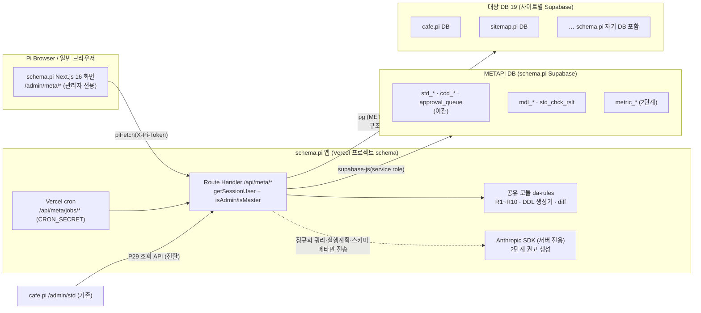

## 2. 아키텍처 (B안 `schema.pi` 독립 앱)

### 2-1. 구성도

### 2-2. 배치 원칙

| 항목 | 결정 | 근거 |
|---|---|---|
| 앱 | `sitemap/schema.pi/` — pnpm 워크스페이스 멤버, cafe.pi 와 같은 스택(Next 16·React 19·Tailwind v4·shadcn base-nova·next-intl·zod 4) | PRD_28 §3·§1 |
| 공용 코드 | `@pi/auth`(세션 발급·`getSessionUser`·`isAdmin`·`isMaster`)·`@pi/db`(supabase-admin lazy init·baseline `sys_user`·`pi_pymnt`)·`@pi/guard`(API 가드) 의존, 복제 금지 | PRD_28 §4 |
| 인증 | **Pi 인증만**(신규 사이트 Google 금지). 쿠키 OR `X-Pi-Token` 이중 경로, 서버 `getSessionUser()` null 이면 redirect 금지 → 클라이언트 게이트 `ClientMetaGate` | PRD_28 §1.1-2, CLAUDE.md |
| 권한 | 전 화면 `isAdmin`, DDL 초안·성능·튜닝·시스템 등록은 `isMaster`(타입 술어). 일반 사용자에게 `/admin/meta` 미노출 | 루트 CLAUDE.md 권한 최상위 ADMIN |
| METAPI DB | schema.pi 전용 Supabase 프로젝트(운영), 개발·스테이징은 공유 `pi-nonprod` 의 `schema_dev`·`schema_stg` 스키마. RLS 비활성 + 서버 전용 service role | PRD_28 §5 |
| 대상 DB 접속 | 사이트별 env `META_DB_<SITE>`(접속 문자열, 19 사이트 키를 schema.pi `src/env.ts` 에 optional 로 정적 등재) — DB 에는 **키 이름만**(`mdl_db.env_key_nm`, CHECK `^META_DB_[A-Z0-9_]+$` + 서버는 env.ts 등재 키만 허용 → `SUPABASE_SERVICE_ROLE_KEY` 같은 비밀 키 이름 지정 불가). role 은 테이블 SELECT 0 + `pg_read_all_stats` [확인중 : Supabase 문서 — 읽기 전용 role 발급 절차] | 제안서 §5, 시크릿 금지 |
| 수집 범위 | 구조(`pg_catalog`)·통계(`pg_stat_*`)만. 행 데이터·샘플 프로파일링 금지. 사이트 간 사용자 데이터 교차 조회 0 — 구조·통계 메타가 Developer Terms Section 4 "사용자 데이터"에 해당하지 않는다는 해석은 [확인중 : legal-compliance-advisor → Pi 서포트](PRD_28 §11 #4). **해석 전까지 운영 수집 대상은 schema.pi 자기 DB 만, cafe.pi 는 개발 DB 만**(cafe.pi 운영 DB 수집 자체가 사이트 간 사례이므로 포함 여부는 [확인중 : 마스터]) | PRD_28 §1.1-1 |
| 배치 | Vercel cron → `/api/meta/jobs/collect`·`/jobs/check`(1단계 수동 버튼 + cron 일 1회), `CRON_SECRET` 헤더 검증 | 제안서 §3 P13·P18 |
| AI | 서버 전용 Anthropic SDK, 2단계. 모델·단가·토큰 상한 [확인중 : claude-api·마스터] | §7 |
| 운영 승격 | 브랜치 `prod/schema`, 승격 후 GitHub commit status 의 `Vercel – schema` 개별 success 확인 | CLAUDE.md 배포 검증 철칙 |
| 등재 | schema.pi 는 EDU 사이트로 등재(sites.json) — METAPI 는 관리자 전용 부가 기능, 교차 프로모션·사용자 데이터 교차 없음, A-1~A-7 점검은 사이트 출시 전 | PRD_28 §1.1 |

### 2-3. 모듈 배치

| 모듈 | 화면 경로 | API 경로 | 공유 모듈 | 단계 |
|---|---|---|---|---|
| M1 표준관리 | `/admin/meta/std/{words,domains,terms,codes}` | `/api/meta/std/*` | — | 1 |
| M2 모델관리 | `/admin/meta/model/{tables,ddl}` | `/api/meta/model/*` | `da-rules/ddl-gen` | 1 |
| M3 DB 구조관리 | `/admin/meta/db/{systems,collect,changes,drift}` | `/api/meta/db/*`, `/api/meta/jobs/collect` | `da-rules/collect`·`diff` | 1 |
| M4 표준 준수 검증 | `/admin/meta/check/{run,rate}` | `/api/meta/check/*`, `/api/meta/jobs/check` | `da-rules/rules`(R1~R10) | 1 |
| M5 영향도 | `/admin/meta/impact` | `/api/meta/impact` | — | 1 |
| M6 검색 | `/admin/meta/search` | `/api/meta/search` | — | 1 |
| M7 워크플로 | `/admin/meta/approvals`, `/admin/meta/audit` | `/api/meta/approvals/*`, `/api/meta/audit` | — | 1(확장) |
| M8 배포·연계 | 엑셀 업·다운은 M1 화면 안 버튼 | `/api/meta/std/import`, `/export`, 공개 조회 `/api/meta/pub/std` | `xlsx`(신규 의존성 [확인중 : 마스터]) | 1 |
| M9 시스템관리 | `/admin/meta/db/systems`(= M3 화면, 메뉴만 별도) · 사용자·권한은 기존 `sys_user` 화면 | — | — | 1 |
| M11·M12 성능·AI | `/admin/meta/perf/*`, `/admin/meta/tune/*` | `/api/meta/perf/*`, `/api/meta/jobs/perf`(cron), `/api/meta/tune/*` | `da-rules/pgstat` | 2 |

### 2-4. 공유 모듈 `da-rules` (패키지 `packages/pi-da-rules`, 후보)

| 함수 | 입력 → 출력 | 사용처 |
|---|---|---|
| `checkDdl(sql, opts)` | DDL 문자열 → `{ violations: {rule:'R1'..'R10', obj, msg, level:'block'\|'warn'}[] }` | Hook `da-ddl-guard.mjs`(현 로직 이전), P10 생성 결과 자체 검증, P09 import |
| `checkCatalog(snapshot)` | 수집 스냅샷(테이블·컬럼·인덱스 행) → 같은 violations | P18 전수 검사(배치·화면) |
| `genDdl(model)` | `mdl_tbl`+`mdl_col` 행 → PostgreSQL DDL(README §6 템플릿 : UUID PK·`del_yn`/`del_dtm`·시스템 컬럼·`fn_upd_*`/`trg_*`·인덱스·FK) | P10, 2단계 P41 권고 DDL |
| `parseDdl(sql)` | CREATE TABLE(Postgres 문법) → 모델 행 | P09 |
| `diffSnapshots(a, b)` | 두 수집 시점 → `mdl_chg_hist` 행(ADD·DROP·ALTER, old/new JSONB) | P13 후처리, P15 |
| `compareModel(model, snapshot)` | 설계 ↔ 최신 스냅샷 → 모델에만·DB에만·불일치(타입·NULL·기본값·PK) | P16 |
| `pgstatDelta(prev, cur)` | 누적 카운터 두 시점 + reset 시점 → 증분 | 2단계 P35 |

단일 소스 원칙 : Hook·API·배치가 같은 모듈을 쓴다. 접두사·도메인 목록은 METAPI DB(`std_dom`·접두사 코드 `cod_group`='TBL_PREFIX')를 읽고, 오프라인 Hook 은 모듈 내 상수 사본을 쓰되 CI 테스트가 둘을 대조한다(README §3 와 Hook `PREFIX_RE` 드리프트 재발 방지).

### 2-5. 기존 자산 재사용·수정

| 자산 | 처리 |
|---|---|
| cafe.pi `/admin/std/{words,domains,terms,approvals,audit}` 6화면·API | 화면 코드는 schema.pi 로 **이식**(경로 `/admin/meta/std/*`), cafe.pi 측은 이관 후 조회 전용 → P29 소비자 전환(§4-8) |
| cafe.pi `/admin/std/ddl` `DdlExportPage` | `buildDDL` 의 `DTM: 'TIMESTAMP'` 위반(→ TIMESTAMPTZ), 시스템 컬럼·`del_yn`·트리거 미삽입 — `genDdl` 로 교체(P10) |
| `.claude/hooks/da-ddl-guard.mjs` | R1~R7 로직을 `da-rules.checkDdl` 로 추출, Hook 은 얇은 래퍼 |
| `sitemap/sites.json` | `mdl_sys.site_nm` 초기 적재 원천(19 사이트 도메인만). wave·preset·status 는 DB 에 넣지 않고 P12 화면이 직접 읽음 |
| `sql/009` 감사 트리거 `fn_std_audit_log` | 이관 시 `TG_TABLE_SCHEMA` 동적 INSERT + 테이블별 PK 매핑으로 교체(§4-8) |
