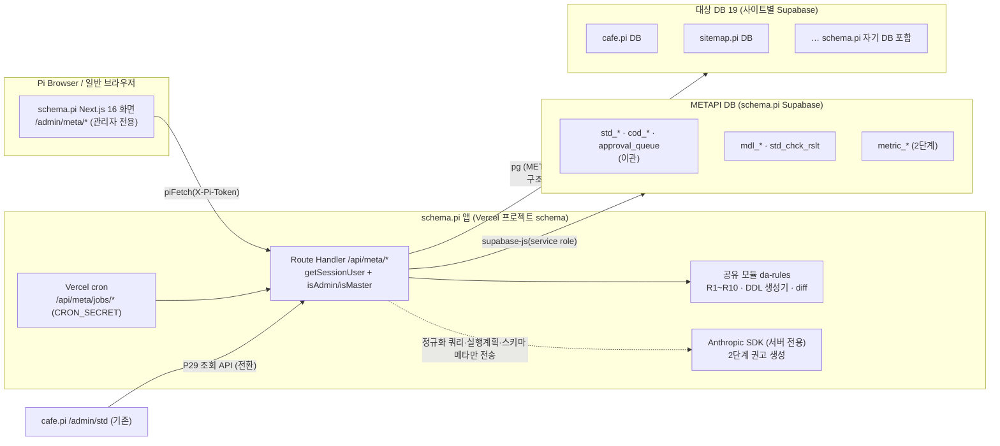
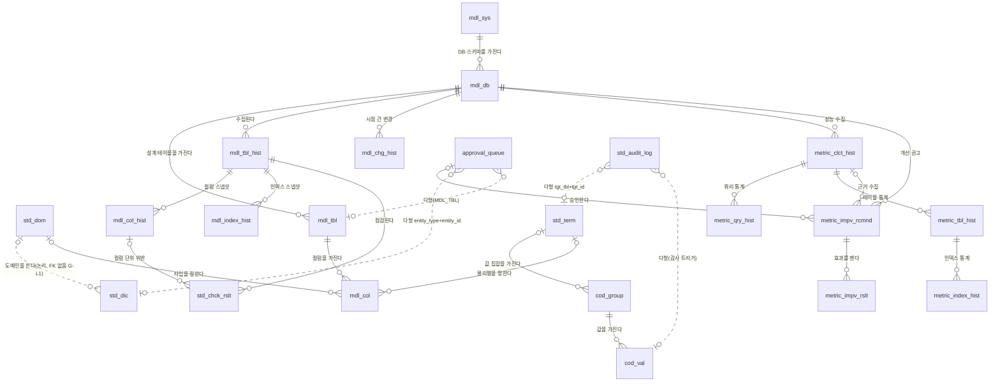

# 메타시스템(METAPI) 구축 설계서

> 버전 v0.2 · 작성 2026-10-14 · 작성 아소카(DA팀 leader) + da-standards·da-modeler·da-migration·da-quality · 상태 **설계 초안(DA·마스터 승인 전제)**
> 요건 정본 `docs/da/메타시스템_구축_제안서.md` v0.7 · 적용 규칙 `docs/da/데이터표준규칙.md` v2.4 + 「공공기관 데이터 표준체계 정의서」 8.5 PostgreSQL 네이티브 프로파일 + 「데이터 모델링 가이드」 8장 운영 강제 규칙
> 잡 디렉토리 `docs/da/_workspace/20261014_metapi_설계/`(팀원 산출물 01~04, REA 증거 `rea/`)

## 결정 사항 (마스터 확정 2026-10-14, 계획 승인)

| # | 항목 | 결정 | 설계 반영 |
|---|---|---|---|
| D1 | 참조 사이트 분석 | OpenMetadata 샌드박스(Apache-2.0) 1순위, 마스터 로그인 Chrome 에 REA 연결 | §1 |
| D2 | 설계 범위 | **1단계(데이터표준·모델링 필수) 상세 · 2단계(성능 모니터링·AI 튜닝)·3단계(선택) 개요** | §3·§5·§7 |
| D3 | 구현 위치 | **B안 `schema.pi` 독립 앱**(PRD_28 멀티사이트 W4), 19 사이트 DB 대상 | §2 |
| D4 | 신규 접두사·단어·도메인 | 제안서 §4 안을 "DA 승인 전제"로 설계서 DDL 에만 사용, `sql/` 미작성 | §4 |
| 리더 | 성능 접두사 | 제안서 `prf_` → 기존 승인 접두사 **`metric_`** 재사용(공통표준 PRF=이익 동음이의, DA 승인 불필요) | §4·§10 |
| 리더 | 표준사전 소유권 | cafe.pi DB → METAPI DB 이관, cafe.pi `/admin/std` 는 조회 API 소비자로 전환(마스터 확인 요청 §10) | §4-8·§9 |

## 0. 개요

### 0-1. 목적

19개 `.pi` 사이트(PRD_28)의 데이터 표준(단어·도메인·용어·코드)·데이터 모델·실 DB 구조·표준 준수·성능을 한곳에서 관리하는 **메타데이터 관리 시스템 METAPI** 를 `schema.pi` 사이트의 관리자 기능으로 구축한다. 제안서 v0.7 의 3단계 가운데 이 설계서는 1단계를 구현 가능한 수준(화면·API·DDL·배치·테스트)으로, 2·3단계를 아키텍처·데이터 모델·인터페이스 개요로 정한다.

### 0-2. 범위

| 단계 | 이 설계서 | 메뉴 | 프로그램 | 테이블 |
|---|---|---|---|---|
| 1단계 데이터표준·모델링 필수 | **상세** — 화면 레이아웃·상태 흐름·API Request/Response·DDL·수집 SQL·검증 엔진·테스트 | 18 | 21(기존 5·확장 3·신규 13) | 신규 11 + 승계 5(이관) |
| 2단계 성능 모니터링·AI 튜닝 | 개요 — 데이터 모델(DDL 포함)·수집 SQL 초안·AI 프롬프트 템플릿·권고 JSON 스키마·승인 흐름 | 7 | 8 | 신규 6(`metric_`) |
| 3단계 기타 선택 | 목록 — 메뉴·프로그램·예약 테이블명(§4-0 일람) | 17 | 16(P29 조회 API 는 cafe.pi 전환 전제라 1단계 ⑦에서 선행 구현, 분류는 제안서대로 3단계) | 예약 9 |

제외 : 범정부 플랫폼·ITSM 연계, 이기종 DBMS(Postgres 전용), 그래픽 ERD 편집기, 데이터 값 프로파일링(구조·통계만 수집), 앱의 운영 DB 직접 DDL 실행.

### 0-3. 용어·표기

- **표준사전** = 표준단어(`std_dic`) + 표준도메인(`std_dom`) + 표준용어(`std_term`), 표준코드(`cod_group`·`cod_val`)는 용어에 연결된 값 집합.
- **수집(collect)** = 대상 DB 의 `pg_catalog` 를 읽어 시점 스냅샷(`*_hist`)으로 저장. **현행화 비교** = 설계 모델(`mdl_tbl`·`mdl_col`) ↔ 최신 스냅샷 대조.
- 프로그램 ID `P01~P45`, 메뉴 `M1~M12` 는 제안서 §2·§3 과 같다. 미확정은 `[확인중 : 채널]`.
- 브랜드 표기 : PyCafé™(사용자 표시 텍스트), 코드값·식별자는 원형.

### 0-4. 관련 문서

제안서 v0.7(요건·분류 근거) · 누락 검토 보고서 `docs/da/reports/2026-10-14_표준재정의_누락검토.md`(규칙 보완) · PRD_28(멀티사이트·DB 분리·등재 가드레일) · CLAUDE.md(Pi 인증 이중 경로·FK 정책·프론트 패칭 표준) · 01 정의서 8.5 · 04 모델링 가이드 · 05 AI 설계 가이드(프롬프트 템플릿).

## 1. 참조 사이트 분석 (REA)

### 1-1. 선정 근거

| 후보 | 요건 12영역 적합 | 분석 가능성 | 라이선스 | 판정 |
|---|---|---|---|---|
| **OpenMetadata** (sandbox.open-metadata.org, docs, GitHub openmetadata-spec) | 8 — 용어집(계층·동의어·검토자·상태), 커넥터 수집, 버전 이력(changeDescription), 컬럼 계보, 검색, 용어 승인 워크플로(Draft→Approved/Rejected·Task), CSV import(Preview), 품질 테스트 | 공개 샌드박스(Google 로그인) + JSON Schema·REST 공개 → 화면·모델·API 셋 다 검증 가능 | Apache-2.0 | **1순위** |
| DataHub (demo.datahub.com, 공식 문서 datahubproject.io 2026-10-14 확인) | 6 — 용어집·수집·스키마 이력·계보·검색·assertion | 데모 로그인 방식 [확인중 : REA — 마스터 세션], 승인 워크플로는 DataHub Cloud 기능으로 문서에 표기(2026-10-14) | Apache-2.0(코어) | 2순위 보조(스키마 이력 화면) |
| NCP Data Catalog(네이버클라우드 공식 가이드, 2026-10-14 확인) | 3 — 스캐너·스키마 버전·태그 | 문서만(콘솔 로그인·VPC) | 상용 | 문서 보조 |
| Metatron·Amundsen·Atlas·eGovFrame | — | 공개 데모 없음(Amundsen 은 GitHub 저장소 보관 처리 2026-09, 구 데모 도메인은 이전돼 접속하지 않음 — 2026-10-14 확인) | Apache-2.0 등 | 제외 |
| 국내 상용 6종 | 10+ | 공개 화면 없음 | 상용 | 제안서 §1 근거로 이미 반영 |

어느 제품도 갖지 않아 **직접 설계**한 영역 : 모델↔DB 현행화 비교(§6-3), 표준단어·도메인 2계층과 `단어_도메인` 조립(§3-3 P03), 표준코드(§4 `cod_*`), 명명 준수율(§6-4), DDL 생성기(§2-4 `genDdl`), `pg_stat` 기반 튜닝(§7).

### 1-2. 스펙·문서 기준 분석 (GitHub `openmetadata-spec` · docs.open-metadata.org, 2026-10-14)

원문 메모 `rea/00_spec_notes.md`. 설계 반영 지점 :

| OpenMetadata | 확인 내용 | METAPI 반영 |
|---|---|---|
| GlossaryTerm `entityStatus`(type/status.json) | Draft · In Review · Approved · Archived · Deprecated · Rejected · Unprocessed, 생성 시 생략하면 유형별 초기 단계 | `apv_sts_cd` = DRAFT·PENDING·APPROVED·REJECTED 4값(§3-2 상태 머신, 승계 `approval_queue.apv_status` 와 동일). In Review=PENDING, Deprecated 는 `use_yn`/`del_yn` 으로 대체, Archived·Unprocessed 는 미채택 |
| GlossaryTerm 속성 | `parent/children`·`synonyms`·`relatedTerms`·`reviewers`·`owners`·`deleted`(논리삭제)·`version`·`changeDescription` | 유사어 = `pg_trgm` 경고 + (3단계) `std_synm`; `deleted` = `del_yn`; `reviewers` 는 DA 단일 승인자라 미채택 |
| 승인 워크플로(docs) | Reviewers 있으면 Draft → Task 생성 → Reviewers 만 Approve/Reject, **없으면 자동 Approved** | 자동 승인 **불채택**(자기 승인 금지), P20 승인은 항상 master. Task = `approval_queue` 행 + 코멘트 |
| entityHistory `changeDescription` | `fieldsAdded/Updated/Deleted[] {name, oldValue, newValue}`, `previousVersion`, 버전 0.1 시작·Minor/Major | `mdl_chg_hist`(`chg_tp_cd` ADD/DROP/ALTER, `old_val`·`new_val` JSONB) — 1:1 대응, 버전 대신 수집 시점 쌍(§6-2) |
| Table / Column | `dataType`(80 enum)·`dataLength`·`precision`·`scale`·`constraint`(NULL·NOT_NULL·UNIQUE·PRIMARY_KEY)·`ordinalPosition`·`description`·`profile`, `tableType` 15종, `tableConstraints`(FK·relationshipType), `schemaDefinition`(DDL 원문) | `mdl_col_hist` 속성 집합(§4-3), `tbl_tp_cd` TABLE/VIEW/MVIEW/PARTITIONED/FOREIGN, `profile` 은 **수집 금지**(구조만) |
| Classification / Tag | 집합·값 2계층, `mutuallyExclusive`·`disabled`(삭제 대신 비활성)·`deprecated`·`usageCount` | `cod_group`/`cod_val`, 값 폐기 = `use_yn`+유효종료일자(04 §6.1) |
| Glossary CSV import(docs) | Export(템플릿/현재) → 열 parent·name*·displayName·description*·synonyms(;)·relatedTerms·references·tags → Import → 검증·Preview → 확정 → 성공/실패 메시지 | P06 = 템플릿 다운로드 → 업로드 → **행별 검증 미리보기** → 반영(승인 경유). 행별 사유를 OM 보다 한 단계 더 둠 |
| Lineage(docs) | 컬럼 수준 계보 그래프 | P23 은 그래프 대신 역조회 목록(1단계), 그래프는 3단계 |
| Data Quality TestCase | Success/Failed/Aborted 결과·추이 | P18 위반 목록 + P19 추이 스파크라인 |

### 1-3. REA 화면 관찰 (sandbox.open-metadata.org)

상태 : **[확인중 : 마스터 — Google 로그인 Chrome(디버그 포트 9222) 제공]**. 비로그인 공개 화면·번들 분석도 이 세션에서는 Chrome 실행 권한이 거부돼 수행하지 못했다(2026-10-14, 아래 S0). 제공되면 `rea` CLI(connect 모드, passive 관찰·쿠키 미수집)로 시나리오 S1~S8 을 관찰해 Evidence ID 와 스크린샷을 부록 A 에 싣고 이 절을 갱신한다.

| # | 시나리오 | 관찰 목적 | 반영 절 |
|---|---|---|---|
| S0 | 비로그인 공개 화면·JS 번들(라우트 트리·`/api/v1/*` 목록) | 마스터 세션 또는 승인된 헤드리스 Chrome | 부록 A |
| S1 | 설정 메뉴 트리 | 메뉴 계층·명칭 | §3-1 |
| S2 | 용어 추가 → Draft → 검토자 → Approve/Reject | 상태 배지·Task 패널·API 호출 순서 | §3-2·§5 A16 |
| S3 | 테이블 상세 Schema 탭 | 컬럼 그리드 항목·제약 표시 | §3-3 P08·P16 |
| S4 | Version History | diff 표현 | §3-3 P15·§6-2 |
| S5 | Lineage 컬럼 수준 | 역조회 UI | §3-3 P23 |
| S6 | 검색·필터 | 결과 카드·필터 축 | §3-3 P25 |
| S7 | Data Quality 결과·추이 | 상태·추이 그래프 | §3-3 P18·P19 |
| S8 | Glossary Import 미리보기 | 검증→미리보기→확정 화면 | §3-3 P06 |

비로그인 공개 화면·JS 번들 분석(S0)은 로그인 여부와 무관하게 가능하지만 이 세션에서는 수행하지 못했고(위), 결과가 나오면 부록 A 에 기록한다. 관찰 전에는 §1-2 스펙·문서 기준으로 설계했고, 화면 관찰로 바뀌는 범위는 주로 레이아웃 세부(§3)로 예상한다 [확인중 : 마스터 — REA 관찰 후 확정].

## 2. 아키텍처 (B안 `schema.pi` 독립 앱)

### 2-1. 구성도



### 2-2. 배치 원칙

| 항목 | 결정 | 근거 |
|---|---|---|
| 앱 | `sitemap/schema.pi/` — pnpm 워크스페이스 멤버, cafe.pi 와 같은 스택(Next 16·React 19·Tailwind v4·shadcn base-nova·next-intl·zod 4) | PRD_28 §3·§1 |
| 공용 코드 | `@pi/auth`(세션 발급·`getSessionUser`·`isAdmin`·`isMaster`)·`@pi/db`(supabase-admin lazy init·baseline `sys_user`·`pi_pymnt`)·`@pi/guard`(API 가드) 의존, 복제 금지 | PRD_28 §4 |
| 인증 | **Pi 인증만**(신규 사이트 Google 금지). 쿠키 OR `X-Pi-Token` 이중 경로, 서버 `getSessionUser()` null 이면 redirect 금지 → 클라이언트 게이트 `ClientMetaGate` | PRD_28 §1.1-2, CLAUDE.md |
| 권한 | 전 화면 `isAdmin`, DDL 초안·성능·튜닝·시스템 등록은 `isMaster`(타입 술어). 일반 사용자에게 `/admin/meta` 미노출 | 루트 CLAUDE.md 권한 최상위 ADMIN |
| METAPI DB | schema.pi 전용 Supabase 프로젝트(운영), 개발·스테이징은 공유 `pi-nonprod` 의 `schema_dev`·`schema_stg` 스키마. RLS 비활성 + 서버 전용 service role | PRD_28 §5 |
| 대상 DB 접속 | 사이트별 env `META_DB_<SITE>`(접속 문자열, 19 사이트 키를 schema.pi `src/env.ts` 에 optional 로 정적 등재) — DB 에는 **키 이름만**(`mdl_db.env_key_nm`, CHECK `^META_DB_[A-Z0-9_]+$` + 서버는 env.ts 등재 키만 허용 → `SUPABASE_SERVICE_ROLE_KEY` 같은 비밀 키 이름 지정 불가). role 은 테이블 SELECT 0 + `pg_read_all_stats` [확인중 : Supabase 문서 — 읽기 전용 role 발급 절차] | 제안서 §5, 시크릿 금지 |
| 수집 범위 | 구조(`pg_catalog`)·통계(`pg_stat_*`)만. 행 데이터·샘플 프로파일링 금지. 사이트 간 사용자 데이터 교차 조회 0 — 구조·통계 메타가 Developer Terms Section 4 "사용자 데이터"에 해당하지 않는다는 해석은 [확인중 : legal-compliance-advisor → Pi 서포트](PRD_28 §11 #4). **해석 전까지 운영 수집 대상은 schema.pi 자기 DB 만, cafe.pi 는 개발 DB 만**(cafe.pi 운영 DB 수집 자체가 사이트 간 사례이므로 포함 여부는 [확인중 : 마스터]) | PRD_28 §1.1-1 |
| 배치 | Vercel cron → `/api/meta/jobs/collect`·`/jobs/check`(1단계 수동 버튼 + cron 일 1회), `CRON_SECRET` 헤더 검증 | 제안서 §3 P13·P18 |
| AI | 서버 전용 Anthropic SDK, 2단계. 모델·단가·토큰 상한 [확인중 : claude-api·마스터] | §7 |
| 운영 승격 | 브랜치 `prod/schema`, 승격 후 GitHub commit status 의 `Vercel – schema` 개별 success 확인 | CLAUDE.md 배포 검증 철칙 |
| 등재 | schema.pi 는 EDU 사이트로 등재(sites.json) — METAPI 는 관리자 전용 부가 기능, 교차 프로모션·사용자 데이터 교차 없음, A-1~A-7 점검은 사이트 출시 전 | PRD_28 §1.1 |

### 2-3. 모듈 배치

| 모듈 | 화면 경로 | API 경로 | 공유 모듈 | 단계 |
|---|---|---|---|---|
| M1 표준관리 | `/admin/meta/std/{words,domains,terms,codes}` | `/api/meta/std/*` | — | 1 |
| M2 모델관리 | `/admin/meta/model/{tables,ddl}` | `/api/meta/model/*` | `da-rules/ddl-gen` | 1 |
| M3 DB 구조관리 | `/admin/meta/db/{systems,collect,changes,drift}` | `/api/meta/db/*`, `/api/meta/jobs/collect` | `da-rules/collect`·`diff` | 1 |
| M4 표준 준수 검증 | `/admin/meta/check/{run,rate}` | `/api/meta/check/*`, `/api/meta/jobs/check` | `da-rules/rules`(R1~R10) | 1 |
| M5 영향도 | `/admin/meta/impact` | `/api/meta/impact` | — | 1 |
| M6 검색 | `/admin/meta/search` | `/api/meta/search` | — | 1 |
| M7 워크플로 | `/admin/meta/approvals`, `/admin/meta/audit` | `/api/meta/approvals/*`, `/api/meta/audit` | — | 1(확장) |
| M8 배포·연계 | 엑셀 업·다운은 M1 화면 안 버튼 | `/api/meta/std/import`, `/export`, 공개 조회 `/api/meta/pub/std` | `xlsx`(신규 의존성 [확인중 : 마스터]) | 1 |
| M9 시스템관리 | `/admin/meta/db/systems`(= M3 화면, 메뉴만 별도) · 사용자·권한은 기존 `sys_user` 화면 | — | — | 1 |
| M11·M12 성능·AI | `/admin/meta/perf/*`, `/admin/meta/tune/*` | `/api/meta/perf/*`, `/api/meta/jobs/perf`(cron), `/api/meta/tune/*` | `da-rules/pgstat` | 2 |

### 2-4. 공유 모듈 `da-rules` (패키지 `packages/pi-da-rules`, 후보)

| 함수 | 입력 → 출력 | 사용처 |
|---|---|---|
| `checkDdl(sql, opts)` | DDL 문자열 → `{ violations: {rule:'R1'..'R10', obj, msg, level:'block'\|'warn'}[] }` | Hook `da-ddl-guard.mjs`(현 로직 이전), P10 생성 결과 자체 검증, P09 import |
| `checkCatalog(snapshot)` | 수집 스냅샷(테이블·컬럼·인덱스 행) → 같은 violations | P18 전수 검사(배치·화면) |
| `genDdl(model)` | `mdl_tbl`+`mdl_col` 행 → PostgreSQL DDL(README §6 템플릿 : UUID PK·`del_yn`/`del_dtm`·시스템 컬럼·`fn_upd_*`/`trg_*`·인덱스·FK) | P10, 2단계 P41 권고 DDL |
| `parseDdl(sql)` | CREATE TABLE(Postgres 문법) → 모델 행 | P09 |
| `diffSnapshots(a, b)` | 두 수집 시점 → `mdl_chg_hist` 행(ADD·DROP·ALTER, old/new JSONB) | P13 후처리, P15 |
| `compareModel(model, snapshot)` | 설계 ↔ 최신 스냅샷 → 모델에만·DB에만·불일치(타입·NULL·기본값·PK) | P16 |
| `pgstatDelta(prev, cur)` | 누적 카운터 두 시점 + reset 시점 → 증분 | 2단계 P35 |

단일 소스 원칙 : Hook·API·배치가 같은 모듈을 쓴다. 접두사·도메인 목록은 METAPI DB(`std_dom`·접두사 코드 `cod_group`='TBL_PREFIX')를 읽고, 오프라인 Hook 은 모듈 내 상수 사본을 쓰되 CI 테스트가 둘을 대조한다(README §3 와 Hook `PREFIX_RE` 드리프트 재발 방지).

### 2-5. 기존 자산 재사용·수정

| 자산 | 처리 |
|---|---|
| cafe.pi `/admin/std/{words,domains,terms,approvals,audit}` 6화면·API | 화면 코드는 schema.pi 로 **이식**(경로 `/admin/meta/std/*`), cafe.pi 측은 이관 후 조회 전용 → P29 소비자 전환(§4-8) |
| cafe.pi `/admin/std/ddl` `DdlExportPage` | `buildDDL` 의 `DTM: 'TIMESTAMP'` 위반(→ TIMESTAMPTZ), 시스템 컬럼·`del_yn`·트리거 미삽입 — `genDdl` 로 교체(P10) |
| `.claude/hooks/da-ddl-guard.mjs` | R1~R7 로직을 `da-rules.checkDdl` 로 추출, Hook 은 얇은 래퍼 |
| `sitemap/sites.json` | `mdl_sys.site_nm` 초기 적재 원천(19 사이트 도메인만). wave·preset·status 는 DB 에 넣지 않고 P12 화면이 직접 읽음 |
| `sql/009` 감사 트리거 `fn_std_audit_log` | 이관 시 `TG_TABLE_SCHEMA` 동적 INSERT + 테이블별 PK 매핑으로 교체(§4-8) |

## 3. 메뉴·화면 설계

### 3-1. 메뉴 체계 (라우트)

| 모듈 | 메뉴 | 라우트 `/admin/meta/…` | 프로그램 | 단계 | 권한 |
|---|---|---|---|---|---|
| M1 | 표준단어 | `std/words` | P01 | 1 | admin |
| M1 | 표준도메인 | `std/domains` | P02 | 1 | admin |
| M1 | 표준용어 | `std/terms` | P03 | 1 | admin |
| M1 | 표준코드(그룹·값) | `std/codes`, `std/codes/[groupId]` | P04 | 1 | admin |
| M1·M8 | 엑셀 업로드·다운로드 | 위 4화면의 도구 막대 버튼 → `std/import` 모달 | P06·P07 | 1 | admin |
| M2 | 테이블 설계 | `model/tables`, `model/tables/[tblId]` | P08·P09 | 1 | admin |
| M2 | DDL 생성 | `model/ddl` | P10 | 1 | master |
| M3·M9 | 대상 시스템·DB | `db/systems`(M9 메뉴도 같은 화면) | P12 | 1 | master |
| M3 | 카탈로그 수집 | `db/collect` | P13 | 1 | master |
| M3 | DB 변경 이력 | `db/changes` | P15 | 1 | admin |
| M3 | 현행화 비교 | `db/drift` | P16 | 1 | admin |
| M4 | 명명 검사 실행·결과 | `check/run` | P17·P18 | 1 | admin |
| M4 | 준수율 | `check/rate` | P19 | 1 | admin |
| M5 | 용어·도메인 영향 | `impact` | P23 | 1 | admin |
| M6 | 카탈로그 검색 | `search` | P25 | 1 | admin |
| M7 | 변경요청·승인 | `approvals`, `approvals/[apvId]` | P20 | 1 | admin(승인은 master) |
| M7 | 변경 이력(Audit) | `audit` | P21 | 1 | admin |
| M9 | 사용자·권한 | (기존 `sys_user` 관리 화면 재사용) | P30 | 1 | master |
| M11 | 느린 쿼리 / 테이블·인덱스 통계 / 용량 추이 / 실행계획 | `perf/{queries,tables,size,plan}` | P36~P39 | 2 | master |
| M12 | AI 분석 요청 / 권고·승인 / 효과 측정 | `tune/{request,recommendations,results}` | P40~P42 | 2 | master |
| 3단계(M10 대시보드 포함) | 동의어·금칙어 / 다중 표준셋 / 모델 버전·ERD·DA# / 수집 스케줄 / 표준 추천 / 프로그램 영향 / 용어집·태그·COMMENT / 조회 API / 설정 / M10 대시보드 / 활동·락 / index_advisor / 알림 | (예약) | P05·P11·P14·P22·P24·P26~P29·P31~P34·P43~P45 | 3 | — |

좌측 내비게이션 : 표준 › 모델 › DB 구조 › 검증 › 영향·검색 › 승인·이력 › (2단계) 성능 › 튜닝. 모바일은 햄버거 + 상단 탭. 화면은 모두 **페이지 단위 조회 + 반응형 페이지네이션**(`Pagination` 컴포넌트 재사용), 상세·통계 패널은 `LazySection`(뷰포트 진입 직전 fetch).

### 3-2. 공통 레이아웃·상태 흐름

- **목록 화면 공통** : 상단 검색(2글자 이상 → `pg_trgm`)·필터 → 표(정렬 가능) → 페이지네이션. 행 클릭 → 우측 드로어(모바일 전체 화면) 상세. 쓰기 버튼은 `apv_sts_cd` 가 DRAFT·REJECTED 일 때만.
- **상태 머신(표준단어·도메인·용어·모델 공통, OpenMetadata GlossaryTerm 참고)** : `DRAFT` → (검토 요청) `PENDING` → (DA 승인) `APPROVED` / (반려) `REJECTED` → (수정) `DRAFT`. 폐기는 상태가 아니라 `use_yn='N'`(코드값·도메인) 또는 `del_yn`(논리삭제) 으로 처리한다. 표준코드(`cod_group`·`cod_val`)는 상태 컬럼 없이 `use_yn`+유효종료일자만 두고 변경은 `approval_queue` 행으로 승인 경유. OpenMetadata 의 "검토자 없으면 자동 승인"은 **채택하지 않는다**(DA 1인 체계에서 자기 승인 금지 → 항상 승인 단계). 상태값 4종은 승계 `approval_queue.apv_status`·`std_*.apv_status` 와 신규 `mdl_tbl.apv_sts_cd`·`metric_impv_rcmnd.rcmnd_sts_cd` 에 같은 코드(`rcmnd_sts_cd` 는 4값 + 적용 생애주기 APPLIED, 승계 컬럼명 `apv_status`→`apv_sts_cd` 개명은 이관 후속).
- **로딩·오류** : 비동기 조회는 렌더를 막지 않음(aria-busy), 오류는 `readApi`/`ApiErrorBody` 패턴 + 재시도 버튼. Pi Browser 에서 `piFetch` 만 사용.
- **다국어** : 화면 라벨은 next-intl `meta.*` 네임스페이스(ko 정본·en), 코드값명은 `cod_val.cd_val_nm`(한글)·`cd_val_eng_nm`.

### 3-3. 1단계 화면 상세

#### P01~P03 표준단어·도메인·용어 (기존 이식)
- 레이아웃 : 검색(논리명·물리명·전체명 trgm) · 승인 상태 필터 · 표(논리명/물리명/도메인/상태/변경일시) · 드로어(필드 편집, 유사어 경고 : 등록 전 `pg_trgm` 유사 단어 목록 표시 — 데이터표준규칙 §1-1).
- 용어 화면은 "단어 조합기" : 단어 칩을 순서대로 고르고 마지막에 도메인 → 물리명 자동 조립(`단어1_단어n_도메인`), 미등재 단어 입력 시 단어 신청 모달(P20 연결).
- 상태 흐름 : 저장 = DRAFT 생성 + `approval_queue` 행, 승인은 P20.

#### P04 표준코드
- 좌 : 코드그룹 목록(그룹코드·명·연결 용어·값 수) / 우 : 선택 그룹의 값 그리드(코드값·한글명·영문명·정렬순서·사용여부·유효기간). 값 폐기 = 유효종료일자 + 사용여부 N(삭제 금지, 04 §6.1).
- 그룹은 반드시 표준용어(`_cd` 종결)에 연결(`cod_group.term_id`), 미연결 그룹은 경고.

#### P06·P07 엑셀 업로드·다운로드
- 다운로드 : 현재 필터 결과 또는 빈 템플릿(헤더 = 화면 컬럼). 업로드 3단계 모달 : ① 파일 선택·헤더 검증 → ② **행별 검증 미리보기**(오류 행 빨강 + 사유, 경고 노랑, 정상 초록, 상단 집계) → ③ 반영(정상 행만 DRAFT 로 생성 + 승인 요청 1건 묶음). OpenMetadata CSV import(Preview 1단계)보다 행별 사유를 더 둔다.

#### P08·P09 테이블 설계·DDL 파싱
- 테이블 목록(시스템·DB 필터) → 상세 : 메타(논리명·물리명·주제영역·설명·상태) + 컬럼 그리드(순번·논리명·물리명(용어 선택)·도메인·타입·길이·NULL·기본값·PK순번·참조 테이블/컬럼·설명). 물리명은 **표준용어 선택만 가능**(직접 입력 불가), 도메인은 용어에서 자동.
- "DDL 가져오기" 버튼 : `sql/*.sql` 텍스트 붙여넣기 → `parseDdl` → 미리보기(인식 못 한 구문 목록) → 모델 생성(DRAFT).

#### P10 DDL 생성
- 테이블 선택 → `genDdl` 결과(README §6 템플릿) 미리보기 + `checkDdl` 자체 검증 결과 → 복사·다운로드(`NNN_<설명>.sql` 파일명 제안). 앱은 DB 에 실행하지 않는다(적용은 마스터가 마이그레이션 창에서).

#### P12 대상 시스템·DB
- 시스템 표(사이트명 + `sites.json` 에서 읽는 wave·status, DB 에는 저장하지 않음) + DB 표(환경 dev/stg/prod·스키마·env 키 이름·마지막 수집 시점·결과(`mdl_db.last_clct_dtm`·`last_clct_rslt_cd`)·연결 테스트 결과(`cntn_test_dtm`·`cntn_test_rslt_cd`)). 연결 테스트 = 서버가 env 키로 접속해 `SELECT 1` + `pg_catalog` 읽기 권한 확인. 접속 문자열은 화면에 절대 표시하지 않음.

#### P13 카탈로그 수집
- DB 선택 → "수집 실행" → 진행 표시(테이블 수·컬럼 수·소요) → 결과 요약 + 직전 시점 대비 변경 건수(P15 링크). cron 실행 이력도 같은 표.

#### P15 DB 변경 이력
- DB·기간 필터 → 변경 행(시점 쌍·객체 유형·객체명·변경 유형 ADD/DROP/ALTER·필드·old→new). OpenMetadata Version History 의 fieldsAdded/Updated/Deleted 표현을 따른다(§1).

#### P16 현행화 비교
- DB 선택 → 3분류 탭 : 모델에만(DDL 미적용) / DB에만(모델 미등록 — "모델로 가져오기" 버튼 → P09 경로) / 불일치(타입·NULL·기본값·PK 순번 — 필드별 좌우 비교). GAP 0 이면 녹색 배지.

#### P17·P18 명명 검사 실행·결과
- DB 또는 전체 선택 → "검사 실행"(최신 스냅샷에 `checkCatalog`) → 위반 표(규칙 R1~R10·수준 P1~P3·객체·메시지·grandfathered 표시). 규칙별 설명 패널. grandfathered 객체는 숨기지 않고 "유지" 배지(`데이터표준규칙.md` §10 #22).

#### P19 준수율
- 시스템·테이블·규칙별 % 카드 + 추이 스파크라인(수집 시점별). 산식 : 규칙 일치 객체 ÷ 전체 객체(grandfathered 는 분모 포함·분자 제외, 별도 % 병기).

#### P20 변경요청·승인 (확장)
- 큐 목록(대상 유형 필터 : 단어·도메인·용어·코드·모델·(2단계) 튜닝 권고) → 상세 : 변경 전/후 diff(JSON → 필드 표), 요청자·사유, 코멘트, **승인/반려 버튼은 master 만**. 승인 시 대상 테이블 `apv_sts_cd` 갱신 + `std_audit_log` 기록.

#### P21 변경 이력(Audit)
- 대상 테이블·기간·행위(INSERT/UPDATE/DELETE) 필터, old/new JSONB 비교.

#### P23 용어·도메인 영향
- 용어 또는 도메인 검색 → 사용 컬럼 목록(최신 스냅샷 `mdl_col_hist` + 설계 `mdl_col`) : 시스템/DB/테이블/컬럼/타입. "변경 시 영향 N개 컬럼" 요약. OpenMetadata Lineage 의 컬럼 단위 역조회 UI 참고.

#### P25 카탈로그 검색
- 통합 검색창(2글자 이상) → 결과 카드(유형 배지 : 단어·도메인·용어·코드·테이블·컬럼, 하이라이트, 시스템/DB 경로) + 좌측 유형·시스템 필터. 페이지 20건.

### 3-4. 2단계 화면 개요

| 화면 | 핵심 요소 |
|---|---|
| P36 느린 쿼리 | 기간 선택 · Top-N(총/평균 시간·호출·블록 읽기) · queryid 추이 · "AI 분석 요청"(P40) |
| P37 테이블·인덱스 통계 | seq scan 과다(행수 대비)·미사용 인덱스(idx_scan 0, N일)·dead tuple 비율 |
| P38 용량 추이 | 테이블·인덱스 크기 시계열, 급증 표시 |
| P39 실행계획 | 스테이징 DB 전용 role 로 `EXPLAIN (GENERIC_PLAN, FORMAT JSON)`; 운영 보류 [확인중 : 운영 프로젝트·PostgreSQL 공식 문서] |
| P40 AI 분석 요청 | 대상 쿼리·테이블 선택 → 전송 데이터 미리보기(마스킹 확인) → 요청 |
| P41 권고·승인 | 권고 카드(유형·근거·DDL/SQL 초안·예상 효과·리스크) → P20 승인 → P10 으로 `sql/` 산출 → 적용은 사람 |
| P42 효과 측정 | 적용 전후 N일 같은 queryid 비교, 권고 상태 APPLIED 전이 조건 |

## 4. 데이터 모델

> 정본 산출물 : `02_modeler_model.md`(da-modeler) · `01_standards_dictionary.md`(da-standards) · `04_migration_plan.md`·`04_migration_ddl.sql`(da-migration) · 게이트 `03_quality_gate.md`(da-quality). 아래는 그 절을 그대로 옮긴 것이다(제목만 4-x 로 재부여). **본문 안의 `§n` 참조는 각 원 파일의 절 번호**이며 이 설계서의 절 번호가 아니다(예 02 의 §6-1 = 4-7-5-1, 04 의 §11 = 이관 계획서 §11). 이관 요약(4-8)의 식별자 S0-x·M1~M4·M3-opt·V1~V7·C2a·롤백 R1/R2 는 `04_migration_plan.md` §1·§3~§5·§8~§10 에 정의돼 있고, 롤백 R1/R2 는 명명 규칙 R1~R10 과 무관한 04 파일 안의 번호다.

### 4-0. 집계

| 구분 | 테이블 | 컬럼 | 비고 |
|---|---|---|---|
| 1단계 신규 | 11 | 156 | `cod_` 2 · `mdl_` 8(`_hist` 4) · `std_chck_rslt` |
| 2단계 신규 | 6 | 81 | `metric_` 6(`_hist` 4) |
| **신규 계** | **17** | **237** | r5 보강 +11 포함(1단계 9 · 2단계 2) |
| 승계(이관 후 모습) | 5 | 81 | 원천 실 DB 72 + 무해 보정 추가 9 |
| **점검 합계** | **22** | **318** | 전체 318 = 신규 237 + 승계 81 |

집계 이력 :
- r1 신규 226 은 표준담당 치환표 집계 231 보다 5컬럼 적었다. §6-1 구조 판단(도출 컬럼·반복 컬럼 제거)의 결과다. r5 보강 11컬럼(§6-1 S10)을 더해 237 이 됐다.
- 승계 원천은 72컬럼이다. 표준담당 r1 집계 64 와의 차이 8 은 세 테이블에서 나왔다. `std_dic` 은 22 로 세어 +1, `std_dom` 은 17 로 세어 +1, `approval_queue` 는 sql/010 근거분 5만 세어 −10 이다(개발 DB 정의는 15). 합하면 +1 +1 −10 = −8 이다. `std_dic`·`std_dom` 의 +1 은 표준담당이 계수 오류로 확인해 철회했다. 표준담당은 정본 집계를 72 로 고쳤다.
- 승계 이관 후 81 = 원천 72 + 04 무해 보정 9(`del_dtm` 4 · `approval_queue.del_yn` 1 · `std_audit_log` 시스템 컬럼 4)다.

3단계 예약 테이블 9개 (이름만 예약, 컬럼은 수요 발생 시 설계 — 01 §4-0)

| # | 제안서 §4-3 구명 | 확정 신명 | 용도 |
|---|---|---|---|
| 1 | `std_syn` | `std_synm` | 동의어 |
| 2 | `std_ban` | `std_phwrd` | 금칙어 |
| 3 | `biz_glos` | `biz_term` | 업무 용어집(용어 TERM 기등재) |
| 4 | `biz_subj` | `biz_tpc` | 주제영역·오너 |
| 5 | `biz_tag` | `biz_tag` | 태그·태그 템플릿 |
| 6 | `mdl_tbl_ver` | `mdl_tbl_ver` | 모델 버전 |
| 7 | `mdl_prg` | `mdl_prgrm` | 프로그램 |
| 8 | `mdl_prg_ref` | `mdl_prgrm_rfrnc` | 프로그램 참조(영향도) |
| 9 | `sys_cfg` | `sys_cfg` | 환경 설정(기존 변경 원장 sys_cfg_chg_hist, sql/176) |

`biz_` 접두사와 3단계 단어 4개(동의어·금칙어·프로그램·사업)는 3단계 착수 때 등재한다(01 판정 6). 주제 TPC 는 r5 에서 1단계로 등재됐다.

### 4-1. 주제영역 정의서

| 주제영역 | 접두사 | 정의 | 엔터티(유형) | 단계 |
|---|---|---|---|---|
| 표준 | `std_` | 표준단어·도메인·용어와 그 변경 감사 | `std_dic`·`std_dom`·`std_term`(기본, 승계) · `std_audit_log`(행위·이력, 승계) | 승계 |
| 코드 | `cod_` | 표준코드 그룹과 값(04 §6.1 공통코드 2테이블) | `cod_group`(기본) · `cod_val`(기본) | 1 |
| 모델·구조 | `mdl_` | 대상 시스템·DB, 설계 모델(테이블·컬럼), 실 DB 카탈로그 수집 스냅샷과 시점 간 변경 | `mdl_sys`·`mdl_db`(기본) · `mdl_tbl`·`mdl_col`(중심) · `mdl_tbl_hist`·`mdl_col_hist`·`mdl_index_hist`·`mdl_chg_hist`(행위·이력) | 1 |
| 검증 | `std_` (`std_chck` 하위) | 수집 스냅샷에 대한 표준 규칙 점검 결과 | `std_chck_rslt`(행위) | 1 |
| 승인 | `approval_` | 단어·도메인·용어·코드·모델·개선권고의 변경요청·승인 | `approval_queue`(행위, 승계) | 승계 |
| 성능 | `metric_` | 대상 DB 성능 통계 수집 스냅샷, AI 개선 권고와 효과 측정 | `metric_clct_hist`·`metric_qry_hist`·`metric_tbl_hist`·`metric_index_hist`(행위·이력) · `metric_impv_rcmnd`·`metric_impv_rslt`(행위) | 2 |

- `mdl_` 은 DA 승인 전 신설 접두사다. 성능 영역은 리더 판정 2 에 따라 기존 승인 접두사 `metric_`(시스템 계측) 를 재사용한다. 제안서 `prf_` 는 공통표준 PRF(이익)와 동음이라 채택하지 않았다(§6-3).
- 1행 1의미 원칙에 따라 `mdl_db` 1행은 "DB 1개의 스키마 1개"다. 같은 Supabase 프로젝트의 다른 스키마는 행을 따로 둔다.
- 사이트 간 데이터 정책 해석 전에는 schema.pi 자기 DB 만 운영 수집한다. cafe.pi 는 개발 DB 만 수집하고, cafe.pi 운영 DB 포함 여부는 [확인중 : 마스터]다. 19 사이트 확대는 [확인중 : legal-compliance-advisor → Pi 서포트, PRD_28 §11 #4] 해석 뒤다. 모델은 19 사이트를 수용하며 행 수만 달라진다.

### 4-2. 개념 ERD

실선은 물리 FK, 점선은 물리 FK 가 없는 논리 관계다. 다형 참조는 FK 를 걸 수 없다.



관계 정의표 (전 관계 비식별 — 자식 PK 는 전부 UUID 인조 식별자)

| # | 부모 → 자식 | 카디널리티 | 자식 선택성 | 물리 | 관계명 |
|---|---|---|---|---|---|
| 1 | `std_term` → `cod_group` | 1 : 0..N | 부모 선택(NULL 허용) | FK `cod_group_std_term_id_fkey` | 값 집합을 가진다 |
| 2 | `cod_group` → `cod_val` | 1 : 0..N | 부모 필수 | FK `cod_val_cod_group_id_fkey` | 값을 가진다 |
| 3 | `mdl_sys` → `mdl_db` | 1 : 0..N | 필수 | FK | DB·스키마를 가진다 |
| 4 | `mdl_db` → `mdl_tbl` | 1 : 0..N | 필수 | FK | 설계 테이블을 가진다 |
| 5 | `mdl_tbl` → `mdl_col` | 1 : 0..N | 필수 | FK | 컬럼을 가진다 |
| 6 | `std_term` → `mdl_col` | 1 : 0..N | 선택(NULL = 비표준, P18 대상) | FK | 물리명을 정한다 |
| 7 | `std_dom` → `mdl_col` | 1 : 0..N | 선택 | FK(TEXT) | 타입을 정한다 |
| 8 | `mdl_db` → `mdl_tbl_hist` | 1 : 0..N | 필수 | FK | 수집된다 |
| 9 | `mdl_tbl_hist` → `mdl_col_hist` | 1 : 1..N | 필수 | FK | 컬럼 스냅샷 |
| 10 | `mdl_tbl_hist` → `mdl_index_hist` | 1 : 0..N | 필수 | FK | 인덱스 스냅샷 |
| 11 | `mdl_db` → `mdl_chg_hist` | 1 : 0..N | 필수 | FK | 시점 간 변경 |
| 12 | `mdl_tbl_hist` → `std_chck_rslt` | 1 : 0..N | 필수 | FK | 점검된다 |
| 13 | `mdl_col_hist` → `std_chck_rslt` | 1 : 0..N | 선택(NULL = 테이블 단위) | FK | 컬럼 단위 위반 |
| 14 | `mdl_db` → `metric_clct_hist` | 1 : 0..N | 필수 | FK | 성능 수집 |
| 15 | `metric_clct_hist` → `metric_qry_hist` | 1 : 0..N | 필수 | FK | 쿼리 통계 |
| 16 | `metric_clct_hist` → `metric_tbl_hist` | 1 : 0..N | 필수 | FK | 테이블 통계 |
| 17 | `metric_tbl_hist` → `metric_index_hist` | 1 : 0..N | 필수 | FK | 인덱스 통계 |
| 18 | `mdl_db` → `metric_impv_rcmnd` | 1 : 0..N | 필수 | FK | 개선 권고 |
| 19 | `metric_clct_hist` → `metric_impv_rcmnd` | 1 : 0..N | 선택 | FK | 근거 수집 |
| 20 | `approval_queue` → `metric_impv_rcmnd` | 1 : 0..N | 선택(APPROVED·APPLIED 면 필수, CHECK) | FK(UUID, 선택지 ① 이면 TEXT) | 승인한다 |
| 21 | `metric_impv_rcmnd` → `metric_impv_rslt` | 1 : 0..N | 필수 | FK | 효과를 잰다 |
| G-L1 | `std_dom` → `std_dic` | 1 : 0..N | 선택 | **FK 없음(실 DB)** — 승계 결함, 이관 후 FK 추가는 고아 행 검증 뒤 [확인중 : 실 DB 조회] | 도메인을 쓴다 |
| G-L2 | `std_dom` → `std_term` | — | — | **관계 컬럼 자체가 없음** — 용어는 도메인으로 끝나야 하는데(§1-3) 그 도메인을 가리키는 속성이 없다. 소급 시 `std_term.dom_id` 추가 권고 | 도메인으로 끝난다 |
| P1 | `approval_queue` ↔ 승인 대상 6종 | N : 1 | — | 다형(`entity_type`+`entity_id`) | 변경을 요청한다 |
| P2 | `std_audit_log` ↔ 감사 대상 5종 | N : 1 | — | 다형(`tgt_tbl`+`tgt_id`), 트리거 적재 | 변경을 기록한다 |

- M:N 관계는 없다. 1:1 관계도 없다.
- 서브타입은 두지 않았다. 수집 객체(테이블·컬럼·인덱스)는 성질이 달라 테이블을 나눴다. 변경 이력만 `objt_tp_cd` 로 롤업했다. 변경 이력은 세 객체에 같은 구조(전·후 JSONB)를 쓰므로 롤업 방식이 맞다.
- FK 정책(8.5 STD-08 적용 제외) : 신규 관계 21건은 모두 FK 로 만들었다. PostgREST 임베디드 조인(`mdl_tbl(*, mdl_col(*))` 등)이 이 FK 에 기댄다. 다형 참조 2건만 FK 가 없다(sql/176 선례).

### 4-3. 논리 엔터티·속성 정의서 (PGlite 카탈로그 생성 — 타입·NULL·기본값·키는 DDL 원본)

키 : PK 기본키 · FK→부모 외래키 · UK 활성행 UNIQUE 구성 컬럼. 도메인 = 물리명 마지막 토큰. ⚠ = grandfathered 위반(개명안 병기, 이관 중 개명 0). [②] = 이관 후 모습에서 무해 보정으로 추가한 컬럼. 승계 5 테이블 행은 점검용이다. 개발 DB OpenAPI 정의에 04 보정(무해 보정·M4 UUID 전환)을 더한 스텁에서 생성했으며, 정본 DDL·최종 타입은 04 S0 실측이 정한다.

#### cod_group (12)

| # | 논리명 | 물리명 | 도메인 | 타입 | NULL | 기본값 | 키 | 설명 |
|---|---|---|---|---|---|---|---|---|
| 1 | 코드그룹ID | `cd_group_id` | id | uuid | N | gen_random_uuid() | PK |  |
| 2 | 코드그룹코드 | `cd_group_cd` | cd | character varying(50) | N |  | UK | 대문자 snake, 활성행 UNIQUE |
| 3 | 코드그룹명 | `cd_group_nm` | nm | character varying(100) | N |  |  |  |
| 4 | 코드그룹설명 | `cd_group_desc` | desc | text | Y |  |  |  |
| 5 | 용어ID | `term_id` | id | uuid | Y |  | FK→std_term | 표준용어 참조(NULL = 미매핑) |
| 6 | 사용여부 | `use_yn` | yn | character(1) | N | 'Y' |  | 폐기·일시중지(삭제 아님) |
| 7 | 삭제여부 | `del_yn` | yn | character(1) | N | 'N' |  |  |
| 8 | 삭제일시 | `del_dtm` | dtm | timestamp with time zone | Y |  |  |  |
| 9 | 등록자ID | `regr_id` | id | text | N | 'ADMIN' |  |  |
| 10 | 등록일시 | `reg_dtm` | dtm | timestamp with time zone | N | CURRENT_TIMESTAMP |  |  |
| 11 | 변경자ID | `modr_id` | id | text | N | 'ADMIN' |  |  |
| 12 | 변경일시 | `mod_dtm` | dtm | timestamp with time zone | N | CURRENT_TIMESTAMP |  | 트리거 자동 갱신(_hist·_log 제외) |

#### cod_val (15)

| # | 논리명 | 물리명 | 도메인 | 타입 | NULL | 기본값 | 키 | 설명 |
|---|---|---|---|---|---|---|---|---|
| 1 | 코드값ID | `cd_val_id` | id | uuid | N | gen_random_uuid() | PK |  |
| 2 | 코드그룹ID | `cd_group_id` | id | uuid | N |  | FK→cod_group UK |  |
| 3 | 코드값코드 | `cd_val_cd` | cd | character varying(50) | N |  | UK | 실제 저장값, 그룹 내 활성행 UNIQUE |
| 4 | 코드값명 | `cd_val_nm` | nm | character varying(100) | N |  |  | 국문 |
| 5 | 코드값영문명 | `cd_val_eng_nm` | nm | character varying(100) | Y |  |  |  |
| 6 | 코드값설명 | `cd_val_desc` | desc | text | Y |  |  |  |
| 7 | 정렬순서 | `sort_seq` | seq | integer | N | 0 |  | 공통표준 SORT_SEQ |
| 8 | 유효종료일자 | `vld_end_dt` | dt | date | Y |  |  | NULL = 무기한 |
| 9 | 사용여부 | `use_yn` | yn | character(1) | N | 'Y' |  | 폐기·일시중지(삭제 아님) |
| 10 | 삭제여부 | `del_yn` | yn | character(1) | N | 'N' |  |  |
| 11 | 삭제일시 | `del_dtm` | dtm | timestamp with time zone | Y |  |  |  |
| 12 | 등록자ID | `regr_id` | id | text | N | 'ADMIN' |  |  |
| 13 | 등록일시 | `reg_dtm` | dtm | timestamp with time zone | N | CURRENT_TIMESTAMP |  |  |
| 14 | 변경자ID | `modr_id` | id | text | N | 'ADMIN' |  |  |
| 15 | 변경일시 | `mod_dtm` | dtm | timestamp with time zone | N | CURRENT_TIMESTAMP |  | 트리거 자동 갱신(_hist·_log 제외) |

#### mdl_sys (11)

| # | 논리명 | 물리명 | 도메인 | 타입 | NULL | 기본값 | 키 | 설명 |
|---|---|---|---|---|---|---|---|---|
| 1 | 시스템ID | `sys_id` | id | uuid | N | gen_random_uuid() | PK |  |
| 2 | 시스템명 | `sys_nm` | nm | character varying(100) | N |  |  |  |
| 3 | 사이트명 | `site_nm` | nm | character varying(100) | N |  | UK | sites.json 도메인 문자열(cafe.pi) |
| 4 | 시스템설명 | `sys_desc` | desc | text | Y |  |  |  |
| 5 | 사용여부 | `use_yn` | yn | character(1) | N | 'Y' |  | 폐기·일시중지(삭제 아님) |
| 6 | 삭제여부 | `del_yn` | yn | character(1) | N | 'N' |  |  |
| 7 | 삭제일시 | `del_dtm` | dtm | timestamp with time zone | Y |  |  |  |
| 8 | 등록자ID | `regr_id` | id | text | N | 'ADMIN' |  |  |
| 9 | 등록일시 | `reg_dtm` | dtm | timestamp with time zone | N | CURRENT_TIMESTAMP |  |  |
| 10 | 변경자ID | `modr_id` | id | text | N | 'ADMIN' |  |  |
| 11 | 변경일시 | `mod_dtm` | dtm | timestamp with time zone | N | CURRENT_TIMESTAMP |  | 트리거 자동 갱신(_hist·_log 제외) |

#### mdl_db (19)

| # | 논리명 | 물리명 | 도메인 | 타입 | NULL | 기본값 | 키 | 설명 |
|---|---|---|---|---|---|---|---|---|
| 1 | 데이터베이스ID | `db_id` | id | uuid | N | gen_random_uuid() | PK |  |
| 2 | 시스템ID | `sys_id` | id | uuid | N |  | FK→mdl_sys UK |  |
| 3 | 환경코드 | `env_cd` | cd | character varying(20) | N |  | UK | DEV·STG·PROD |
| 4 | 데이터베이스유형코드 | `db_tp_cd` | cd | character varying(20) | N | 'PG'::character varying |  | PG 고정 |
| 5 | 스키마명 | `schm_nm` | nm | character varying(63) | N | 'public'::character varying | UK |  |
| 6 | 환경키명 | `env_key_nm` | nm | character varying(100) | N |  |  | META_DB_<SITE> 형식만 CHECK(비밀 키 이름 차단) |
| 7 | 데이터베이스설명 | `db_desc` | desc | text | Y |  |  |  |
| 8 | 접속시험일시 | `cntn_test_dtm` | dtm | timestamp with time zone | Y |  |  |  |
| 9 | 접속시험결과코드 | `cntn_test_rslt_cd` | cd | character varying(10) | Y |  |  | OK·FAIL |
| 10 | 최종수집일시 | `last_clct_dtm` | dtm | timestamp with time zone | Y |  |  | 반정규화(목록 표시) |
| 11 | 최종수집결과코드 | `last_clct_rslt_cd` | cd | character varying(10) | Y |  |  | OK·FAIL |
| 12 | 최종오류텍스트 | `last_err_txt` | txt | text | Y |  |  | 비밀값 기록 금지 |
| 13 | 사용여부 | `use_yn` | yn | character(1) | N | 'Y' |  | 폐기·일시중지(삭제 아님) |
| 14 | 삭제여부 | `del_yn` | yn | character(1) | N | 'N' |  |  |
| 15 | 삭제일시 | `del_dtm` | dtm | timestamp with time zone | Y |  |  |  |
| 16 | 등록자ID | `regr_id` | id | text | N | 'ADMIN' |  |  |
| 17 | 등록일시 | `reg_dtm` | dtm | timestamp with time zone | N | CURRENT_TIMESTAMP |  |  |
| 18 | 변경자ID | `modr_id` | id | text | N | 'ADMIN' |  |  |
| 19 | 변경일시 | `mod_dtm` | dtm | timestamp with time zone | N | CURRENT_TIMESTAMP |  | 트리거 자동 갱신(_hist·_log 제외) |

#### mdl_tbl (13)

| # | 논리명 | 물리명 | 도메인 | 타입 | NULL | 기본값 | 키 | 설명 |
|---|---|---|---|---|---|---|---|---|
| 1 | 테이블ID | `tbl_id` | id | uuid | N | gen_random_uuid() | PK |  |
| 2 | 데이터베이스ID | `db_id` | id | uuid | N |  | FK→mdl_db UK |  |
| 3 | 테이블물리명 | `tbl_phys_nm` | nm | character varying(63) | N |  | UK |  |
| 4 | 테이블논리명 | `tbl_lgc_nm` | nm | character varying(200) | N |  |  |  |
| 5 | 테이블설명 | `tbl_desc` | desc | text | Y |  |  | COMMENT ON 원천(P28) |
| 6 | 주제영역코드 | `tpc_rlm_cd` | cd | character varying(20) | Y |  |  | cod_group TPC_RLM_CD 값(물리 FK 없음) |
| 7 | 승인상태코드 | `apv_sts_cd` | cd | character varying(20) | N | 'DRAFT'::character varying |  | DRAFT·PENDING·APPROVED·REJECTED |
| 8 | 삭제여부 | `del_yn` | yn | character(1) | N | 'N' |  |  |
| 9 | 삭제일시 | `del_dtm` | dtm | timestamp with time zone | Y |  |  |  |
| 10 | 등록자ID | `regr_id` | id | text | N | 'ADMIN' |  |  |
| 11 | 등록일시 | `reg_dtm` | dtm | timestamp with time zone | N | CURRENT_TIMESTAMP |  |  |
| 12 | 변경자ID | `modr_id` | id | text | N | 'ADMIN' |  |  |
| 13 | 변경일시 | `mod_dtm` | dtm | timestamp with time zone | N | CURRENT_TIMESTAMP |  | 트리거 자동 갱신(_hist·_log 제외) |

#### mdl_col (22)

| # | 논리명 | 물리명 | 도메인 | 타입 | NULL | 기본값 | 키 | 설명 |
|---|---|---|---|---|---|---|---|---|
| 1 | 컬럼ID | `col_id` | id | uuid | N | gen_random_uuid() | PK |  |
| 2 | 테이블ID | `tbl_id` | id | uuid | N |  | FK→mdl_tbl UK |  |
| 3 | 컬럼순번 | `col_seq` | seq | integer | N |  | UK | pg attnum |
| 4 | 컬럼물리명 | `col_phys_nm` | nm | character varying(63) | N |  | UK |  |
| 5 | 컬럼논리명 | `col_lgc_nm` | nm | character varying(200) | N |  |  |  |
| 6 | 용어ID | `term_id` | id | uuid | Y |  | FK→std_term | 표준용어 참조(NULL = 미매핑) |
| 7 | 도메인ID | `dom_id` | id | text | Y |  | FK→std_dom | 표준도메인 참조 |
| 8 | 자료유형명 | `data_tp_nm` | nm | character varying(50) | N |  |  | format_type 원문(길이 포함) |
| 9 | 자료길이 | `data_len` | len | integer | Y |  |  |  |
| 10 | 소수점길이 | `dcpt_len` | len | integer | Y |  |  |  |
| 11 | 널허용여부 | `nul_prm_yn` | yn | character(1) | N | 'Y' |  |  |
| 12 | 기본키순번 | `pk_seq` | seq | integer | Y |  |  | NULL = PK 아님, 복합 PK 순서 |
| 13 | 참조테이블명 | `rfrnc_tbl_nm` | nm | character varying(63) | Y |  |  | 단일 컬럼 FK |
| 14 | 참조컬럼명 | `rfrnc_col_nm` | nm | character varying(63) | Y |  |  |  |
| 15 | 기본값텍스트 | `bsc_val_txt` | txt | text | Y |  |  | pg_get_expr |
| 16 | 컬럼설명 | `col_desc` | desc | text | Y |  |  |  |
| 17 | 삭제여부 | `del_yn` | yn | character(1) | N | 'N' |  |  |
| 18 | 삭제일시 | `del_dtm` | dtm | timestamp with time zone | Y |  |  |  |
| 19 | 등록자ID | `regr_id` | id | text | N | 'ADMIN' |  |  |
| 20 | 등록일시 | `reg_dtm` | dtm | timestamp with time zone | N | CURRENT_TIMESTAMP |  |  |
| 21 | 변경자ID | `modr_id` | id | text | N | 'ADMIN' |  |  |
| 22 | 변경일시 | `mod_dtm` | dtm | timestamp with time zone | N | CURRENT_TIMESTAMP |  | 트리거 자동 갱신(_hist·_log 제외) |

#### mdl_tbl_hist (10)

| # | 논리명 | 물리명 | 도메인 | 타입 | NULL | 기본값 | 키 | 설명 |
|---|---|---|---|---|---|---|---|---|
| 1 | 테이블이력ID | `tbl_hist_id` | id | uuid | N | gen_random_uuid() | PK |  |
| 2 | 데이터베이스ID | `db_id` | id | uuid | N |  | FK→mdl_db UK |  |
| 3 | 수집일시 | `clct_dtm` | dtm | timestamp with time zone | N |  | UK | 같은 수집 실행 전 행 동일값 |
| 4 | 테이블명 | `tbl_nm` | nm | character varying(63) | N |  | UK | 카탈로그 relname |
| 5 | 테이블유형코드 | `tbl_tp_cd` | cd | character varying(20) | N |  |  | TABLE·VIEW·MVIEW·PARTITIONED·FOREIGN |
| 6 | 테이블설명 | `tbl_desc` | desc | text | Y |  |  | COMMENT ON 원천(P28) |
| 7 | 등록자ID | `regr_id` | id | text | N | 'ADMIN' |  |  |
| 8 | 등록일시 | `reg_dtm` | dtm | timestamp with time zone | N | CURRENT_TIMESTAMP |  |  |
| 9 | 변경자ID | `modr_id` | id | text | N | 'ADMIN' |  |  |
| 10 | 변경일시 | `mod_dtm` | dtm | timestamp with time zone | N | CURRENT_TIMESTAMP |  | 트리거 자동 갱신(_hist·_log 제외) |

#### mdl_col_hist (17)

| # | 논리명 | 물리명 | 도메인 | 타입 | NULL | 기본값 | 키 | 설명 |
|---|---|---|---|---|---|---|---|---|
| 1 | 컬럼이력ID | `col_hist_id` | id | uuid | N | gen_random_uuid() | PK |  |
| 2 | 테이블이력ID | `tbl_hist_id` | id | uuid | N |  | FK→mdl_tbl_hist UK |  |
| 3 | 컬럼순번 | `col_seq` | seq | integer | N |  |  | pg attnum |
| 4 | 컬럼명 | `col_nm` | nm | character varying(63) | N |  | UK |  |
| 5 | 자료유형명 | `data_tp_nm` | nm | character varying(50) | N |  |  | format_type 원문(길이 포함) |
| 6 | 자료길이 | `data_len` | len | integer | Y |  |  |  |
| 7 | 소수점길이 | `dcpt_len` | len | integer | Y |  |  |  |
| 8 | 널허용여부 | `nul_prm_yn` | yn | character(1) | N |  |  |  |
| 9 | 기본값텍스트 | `bsc_val_txt` | txt | text | Y |  |  | pg_get_expr |
| 10 | 기본키순번 | `pk_seq` | seq | integer | Y |  |  | NULL = PK 아님, 복합 PK 순서 |
| 11 | 참조테이블명 | `rfrnc_tbl_nm` | nm | character varying(63) | Y |  |  | 단일 컬럼 FK |
| 12 | 참조컬럼명 | `rfrnc_col_nm` | nm | character varying(63) | Y |  |  |  |
| 13 | 컬럼설명 | `col_desc` | desc | text | Y |  |  |  |
| 14 | 등록자ID | `regr_id` | id | text | N | 'ADMIN' |  |  |
| 15 | 등록일시 | `reg_dtm` | dtm | timestamp with time zone | N | CURRENT_TIMESTAMP |  |  |
| 16 | 변경자ID | `modr_id` | id | text | N | 'ADMIN' |  |  |
| 17 | 변경일시 | `mod_dtm` | dtm | timestamp with time zone | N | CURRENT_TIMESTAMP |  | 트리거 자동 갱신(_hist·_log 제외) |

#### mdl_index_hist (10)

| # | 논리명 | 물리명 | 도메인 | 타입 | NULL | 기본값 | 키 | 설명 |
|---|---|---|---|---|---|---|---|---|
| 1 | 인덱스이력ID | `index_hist_id` | id | uuid | N | gen_random_uuid() | PK |  |
| 2 | 테이블이력ID | `tbl_hist_id` | id | uuid | N |  | FK→mdl_tbl_hist UK |  |
| 3 | 인덱스명 | `index_nm` | nm | character varying(63) | N |  | UK |  |
| 4 | 고유여부 | `unq_yn` | yn | character(1) | N |  |  |  |
| 5 | 기본키여부 | `pk_yn` | yn | character(1) | N |  |  |  |
| 6 | 인덱스정의텍스트 | `index_dfn_txt` | txt | text | N |  |  | pg_get_indexdef |
| 7 | 등록자ID | `regr_id` | id | text | N | 'ADMIN' |  |  |
| 8 | 등록일시 | `reg_dtm` | dtm | timestamp with time zone | N | CURRENT_TIMESTAMP |  |  |
| 9 | 변경자ID | `modr_id` | id | text | N | 'ADMIN' |  |  |
| 10 | 변경일시 | `mod_dtm` | dtm | timestamp with time zone | N | CURRENT_TIMESTAMP |  | 트리거 자동 갱신(_hist·_log 제외) |

#### mdl_chg_hist (13)

| # | 논리명 | 물리명 | 도메인 | 타입 | NULL | 기본값 | 키 | 설명 |
|---|---|---|---|---|---|---|---|---|
| 1 | 변경이력ID | `chg_hist_id` | id | uuid | N | gen_random_uuid() | PK |  |
| 2 | 데이터베이스ID | `db_id` | id | uuid | N |  | FK→mdl_db |  |
| 3 | 수집일시 | `clct_dtm` | dtm | timestamp with time zone | N |  |  | 같은 수집 실행 전 행 동일값 |
| 4 | 전수집일시 | `old_clct_dtm` | dtm | timestamp with time zone | N |  |  | 비교 기준 |
| 5 | 객체유형코드 | `objt_tp_cd` | cd | character varying(20) | N |  |  | TBL·COL·INDEX |
| 6 | 객체명 | `objt_nm` | nm | character varying(200) | N |  |  |  |
| 7 | 변경유형코드 | `chg_tp_cd` | cd | character varying(20) | N |  |  | ADD·DROP·ALTER |
| 8 | 전값 | `old_val` | val | jsonb | Y |  |  |  |
| 9 | 후값 | `new_val` | val | jsonb | Y |  |  |  |
| 10 | 등록자ID | `regr_id` | id | text | N | 'ADMIN' |  |  |
| 11 | 등록일시 | `reg_dtm` | dtm | timestamp with time zone | N | CURRENT_TIMESTAMP |  |  |
| 12 | 변경자ID | `modr_id` | id | text | N | 'ADMIN' |  |  |
| 13 | 변경일시 | `mod_dtm` | dtm | timestamp with time zone | N | CURRENT_TIMESTAMP |  | 트리거 자동 갱신(_hist·_log 제외) |

#### std_chck_rslt (14)

| # | 논리명 | 물리명 | 도메인 | 타입 | NULL | 기본값 | 키 | 설명 |
|---|---|---|---|---|---|---|---|---|
| 1 | 점검결과ID | `chck_rslt_id` | id | uuid | N | gen_random_uuid() | PK |  |
| 2 | 테이블이력ID | `tbl_hist_id` | id | uuid | N |  | FK→mdl_tbl_hist |  |
| 3 | 컬럼이력ID | `col_hist_id` | id | uuid | Y |  | FK→mdl_col_hist |  |
| 4 | 점검일시 | `chck_dtm` | dtm | timestamp with time zone | N | CURRENT_TIMESTAMP |  |  |
| 5 | 규칙코드 | `rul_cd` | cd | character varying(10) | N |  |  | 검증 엔진 R1~R10(설계서 §6-4) |
| 6 | 점검등급코드 | `chck_grd_cd` | cd | character varying(10) | N |  |  | P1~P3 |
| 7 | 점검결과내용 | `chck_rslt_cont` | cont | text | N |  |  |  |
| 8 | 예외여부 | `excp_yn` | yn | character(1) | N | 'N' |  | grandfathered, 엔진 상수(01 §6·03 §3-1) |
| 9 | 삭제여부 | `del_yn` | yn | character(1) | N | 'N' |  |  |
| 10 | 삭제일시 | `del_dtm` | dtm | timestamp with time zone | Y |  |  |  |
| 11 | 등록자ID | `regr_id` | id | text | N | 'ADMIN' |  |  |
| 12 | 등록일시 | `reg_dtm` | dtm | timestamp with time zone | N | CURRENT_TIMESTAMP |  |  |
| 13 | 변경자ID | `modr_id` | id | text | N | 'ADMIN' |  |  |
| 14 | 변경일시 | `mod_dtm` | dtm | timestamp with time zone | N | CURRENT_TIMESTAMP |  | 트리거 자동 갱신(_hist·_log 제외) |

#### metric_clct_hist (9)

| # | 논리명 | 물리명 | 도메인 | 타입 | NULL | 기본값 | 키 | 설명 |
|---|---|---|---|---|---|---|---|---|
| 1 | 수집ID | `clct_id` | id | uuid | N | gen_random_uuid() | PK |  |
| 2 | 데이터베이스ID | `db_id` | id | uuid | N |  | FK→mdl_db UK |  |
| 3 | 수집일시 | `clct_dtm` | dtm | timestamp with time zone | N |  | UK | 같은 수집 실행 전 행 동일값 |
| 4 | 통계초기화일시 | `stats_init_dtm` | dtm | timestamp with time zone | Y |  |  | 누적치 증분 기준 |
| 5 | 데이터베이스버전명 | `db_ver_nm` | nm | character varying(50) | Y |  |  | GENERIC_PLAN 가능 판단 |
| 6 | 등록자ID | `regr_id` | id | text | N | 'ADMIN' |  |  |
| 7 | 등록일시 | `reg_dtm` | dtm | timestamp with time zone | N | CURRENT_TIMESTAMP |  |  |
| 8 | 변경자ID | `modr_id` | id | text | N | 'ADMIN' |  |  |
| 9 | 변경일시 | `mod_dtm` | dtm | timestamp with time zone | N | CURRENT_TIMESTAMP |  | 트리거 자동 갱신(_hist·_log 제외) |

#### metric_qry_hist (13)

| # | 논리명 | 물리명 | 도메인 | 타입 | NULL | 기본값 | 키 | 설명 |
|---|---|---|---|---|---|---|---|---|
| 1 | 쿼리통계ID | `qry_stats_id` | id | uuid | N | gen_random_uuid() | PK |  |
| 2 | 수집ID | `clct_id` | id | uuid | N |  | FK→metric_clct_hist UK |  |
| 3 | 쿼리외부식별자 | `qry_uid` | uid | text | N |  | UK | pg_stat_statements queryid 문자열(COMMENT 명기) |
| 4 | 쿼리텍스트 | `qry_txt` | txt | text | N |  |  | 정규화+상수 마스킹 |
| 5 | 호출건수 | `clot_cnt` | cnt | bigint | N |  |  |  |
| 6 | 합계실행밀리초 | `sum_excn_ms` | ms | numeric(18,3) | N |  |  |  |
| 7 | 행건수 | `row_cnt` | cnt | bigint | N |  |  |  |
| 8 | 블록적중건수 | `blck_hit_cnt` | cnt | bigint | N |  |  |  |
| 9 | 블록읽기건수 | `blck_rd_cnt` | cnt | bigint | N |  |  |  |
| 10 | 등록자ID | `regr_id` | id | text | N | 'ADMIN' |  |  |
| 11 | 등록일시 | `reg_dtm` | dtm | timestamp with time zone | N | CURRENT_TIMESTAMP |  |  |
| 12 | 변경자ID | `modr_id` | id | text | N | 'ADMIN' |  |  |
| 13 | 변경일시 | `mod_dtm` | dtm | timestamp with time zone | N | CURRENT_TIMESTAMP |  | 트리거 자동 갱신(_hist·_log 제외) |

#### metric_tbl_hist (14)

| # | 논리명 | 물리명 | 도메인 | 타입 | NULL | 기본값 | 키 | 설명 |
|---|---|---|---|---|---|---|---|---|
| 1 | 테이블통계ID | `tbl_stats_id` | id | uuid | N | gen_random_uuid() | PK |  |
| 2 | 수집ID | `clct_id` | id | uuid | N |  | FK→metric_clct_hist UK |  |
| 3 | 테이블명 | `tbl_nm` | nm | character varying(63) | N |  | UK | 카탈로그 relname |
| 4 | 전체스캔건수 | `whol_scn_cnt` | cnt | bigint | N |  |  | seq_scan |
| 5 | 인덱스스캔건수 | `index_scn_cnt` | cnt | bigint | Y |  |  |  |
| 6 | 유효행건수 | `vld_row_cnt` | cnt | bigint | N |  |  | n_live_tup |
| 7 | 무효행건수 | `invld_row_cnt` | cnt | bigint | N |  |  | n_dead_tup |
| 8 | 테이블크기 | `tbl_sz` | sz | bigint | N |  |  | 바이트 |
| 9 | 인덱스크기 | `index_sz` | sz | bigint | N |  |  | 바이트 |
| 10 | 최종배큠일시 | `last_vcm_dtm` | dtm | timestamp with time zone | Y |  |  |  |
| 11 | 등록자ID | `regr_id` | id | text | N | 'ADMIN' |  |  |
| 12 | 등록일시 | `reg_dtm` | dtm | timestamp with time zone | N | CURRENT_TIMESTAMP |  |  |
| 13 | 변경자ID | `modr_id` | id | text | N | 'ADMIN' |  |  |
| 14 | 변경일시 | `mod_dtm` | dtm | timestamp with time zone | N | CURRENT_TIMESTAMP |  | 트리거 자동 갱신(_hist·_log 제외) |

#### metric_index_hist (9)

| # | 논리명 | 물리명 | 도메인 | 타입 | NULL | 기본값 | 키 | 설명 |
|---|---|---|---|---|---|---|---|---|
| 1 | 인덱스통계ID | `index_stats_id` | id | uuid | N | gen_random_uuid() | PK |  |
| 2 | 테이블통계ID | `tbl_stats_id` | id | uuid | N |  | FK→metric_tbl_hist UK |  |
| 3 | 인덱스명 | `index_nm` | nm | character varying(63) | N |  | UK |  |
| 4 | 인덱스스캔건수 | `index_scn_cnt` | cnt | bigint | N |  |  |  |
| 5 | 인덱스크기 | `index_sz` | sz | bigint | N |  |  | 바이트 |
| 6 | 등록자ID | `regr_id` | id | text | N | 'ADMIN' |  |  |
| 7 | 등록일시 | `reg_dtm` | dtm | timestamp with time zone | N | CURRENT_TIMESTAMP |  |  |
| 8 | 변경자ID | `modr_id` | id | text | N | 'ADMIN' |  |  |
| 9 | 변경일시 | `mod_dtm` | dtm | timestamp with time zone | N | CURRENT_TIMESTAMP |  | 트리거 자동 갱신(_hist·_log 제외) |

#### metric_impv_rcmnd (21)

| # | 논리명 | 물리명 | 도메인 | 타입 | NULL | 기본값 | 키 | 설명 |
|---|---|---|---|---|---|---|---|---|
| 1 | 권고ID | `rcmnd_id` | id | uuid | N | gen_random_uuid() | PK |  |
| 2 | 데이터베이스ID | `db_id` | id | uuid | N |  | FK→mdl_db |  |
| 3 | 수집ID | `clct_id` | id | uuid | Y |  | FK→metric_clct_hist |  |
| 4 | 쿼리외부식별자 | `qry_uid` | uid | text | Y |  |  | pg_stat_statements queryid 문자열(COMMENT 명기) |
| 5 | 권고유형코드 | `rcmnd_tp_cd` | cd | character varying(20) | N |  |  | INDEX·REWRITE·VACUUM·PARTITION |
| 6 | 권고사유내용 | `rcmnd_rsn_cont` | cont | text | N |  |  |  |
| 7 | 권고쿼리텍스트 | `rcmnd_qry_txt` | txt | text | N |  |  | DDL·SQL 초안 |
| 8 | 기대효과내용 | `expt_efct_cont` | cont | text | Y |  |  |  |
| 9 | 위험등급코드 | `risk_grd_cd` | cd | character varying(10) | N |  |  | LOW·MID·HIGH |
| 10 | 모델명 | `mdl_nm` | nm | character varying(100) | N |  |  | AI 모델 |
| 11 | 권고상태코드 | `rcmnd_sts_cd` | cd | character varying(20) | N | 'DRAFT'::character varying |  | DRAFT·PENDING·APPROVED·APPLIED·REJECTED |
| 12 | 승인ID | `apv_id` | id | uuid | Y |  | FK→approval_queue |  |
| 13 | 적용일시 | `aplcn_dtm` | dtm | timestamp with time zone | Y |  |  | APPLIED ⇔ NOT NULL |
| 14 | 요청내용 | `dmnd_cont` | cont | text | Y |  |  | AI 프롬프트(마스킹 후) |
| 15 | 응답내용 | `rspns_cont` | cont | text | Y |  |  | AI 응답 원문 |
| 16 | 삭제여부 | `del_yn` | yn | character(1) | N | 'N' |  |  |
| 17 | 삭제일시 | `del_dtm` | dtm | timestamp with time zone | Y |  |  |  |
| 18 | 등록자ID | `regr_id` | id | text | N | 'ADMIN' |  |  |
| 19 | 등록일시 | `reg_dtm` | dtm | timestamp with time zone | N | CURRENT_TIMESTAMP |  |  |
| 20 | 변경자ID | `modr_id` | id | text | N | 'ADMIN' |  |  |
| 21 | 변경일시 | `mod_dtm` | dtm | timestamp with time zone | N | CURRENT_TIMESTAMP |  | 트리거 자동 갱신(_hist·_log 제외) |

#### metric_impv_rslt (15)

| # | 논리명 | 물리명 | 도메인 | 타입 | NULL | 기본값 | 키 | 설명 |
|---|---|---|---|---|---|---|---|---|
| 1 | 개선결과ID | `impv_rslt_id` | id | uuid | N | gen_random_uuid() | PK |  |
| 2 | 권고ID | `rcmnd_id` | id | uuid | N |  | FK→metric_impv_rcmnd |  |
| 3 | 측정일시 | `msrmt_dtm` | dtm | timestamp with time zone | N |  |  |  |
| 4 | 전평균실행밀리초 | `old_avg_excn_ms` | ms | numeric(18,3) | N |  |  |  |
| 5 | 후평균실행밀리초 | `new_avg_excn_ms` | ms | numeric(18,3) | N |  |  |  |
| 6 | 전호출건수 | `old_clot_cnt` | cnt | bigint | N |  |  |  |
| 7 | 후호출건수 | `new_clot_cnt` | cnt | bigint | N |  |  |  |
| 8 | 전블록읽기건수 | `old_blck_rd_cnt` | cnt | bigint | N |  |  |  |
| 9 | 후블록읽기건수 | `new_blck_rd_cnt` | cnt | bigint | N |  |  |  |
| 10 | 삭제여부 | `del_yn` | yn | character(1) | N | 'N' |  |  |
| 11 | 삭제일시 | `del_dtm` | dtm | timestamp with time zone | Y |  |  |  |
| 12 | 등록자ID | `regr_id` | id | text | N | 'ADMIN' |  |  |
| 13 | 등록일시 | `reg_dtm` | dtm | timestamp with time zone | N | CURRENT_TIMESTAMP |  |  |
| 14 | 변경자ID | `modr_id` | id | text | N | 'ADMIN' |  |  |
| 15 | 변경일시 | `mod_dtm` | dtm | timestamp with time zone | N | CURRENT_TIMESTAMP |  | 트리거 자동 갱신(_hist·_log 제외) |

#### std_dic (22)

| # | 논리명 | 물리명 | 도메인 | 타입 | NULL | 기본값 | 키 | 설명 |
|---|---|---|---|---|---|---|---|---|
| 1 | 단어ID | `dic_id` | id | text | N |  | PK | ⚠ TEXT·기본값 없음(04 ② 전환 대상) |
| 2 | 단어논리명 | `dic_log_nm` | nm | text | Y |  |  | ⚠ log=_log 동음 → dic_lgc_nm |
| 3 | 단어물리명 | `dic_phy_nm` | nm | text | Y |  |  | ⚠ phy → dic_phys_nm |
| 4 | 단어물리전체명 | `dic_phy_fll_nm` | nm | text | Y |  |  | ⚠ fll 미등재 → dic_eng_nm |
| 5 | 단어설명 | `dic_desc` | desc | text | Y |  |  |  |
| 6 | 단어구분코드 | `dic_gbn_cd` | cd | text | Y |  |  | ⚠ gbn 미등재 → dic_se_cd |
| 7 | 엔터티분류여부 | `ent_clss_yn` | yn | text | Y |  |  | ⚠ TEXT(CHAR(1)+CHECK 위반)·ent/clss 미등재 |
| 8 | 속성분류여부 | `attr_clss_yn` | yn | text | Y |  |  | ⚠ 동일 |
| 9 | 도메인사용여부 | `dom_use_yn` | yn | text | Y |  |  | ⚠ TEXT |
| 10 | 도메인ID | `dom_id` | id | text | Y |  |  | 표준도메인 참조 |
| 11 | 데이터유형 | `data_type` | — | text | Y |  |  | ⚠ 도메인 미종결 → data_tp_cd |
| 12 | 자료길이 | `data_len` | len | integer | Y |  |  |  |
| 13 | 소수자리 | `data_scale` | — | integer | Y |  |  | ⚠ 미종결 → dcpt_len |
| 14 | 구성용어ID목록 | `stored_term_comp_ids` | — | text | Y |  |  | ⚠ 다중값(1NF)·미등재·미종결 → 설계 재검토 |
| 15 | 승인상태 | `apv_status` | — | text | Y | 'APPROVED' |  | ⚠ status → apv_sts_cd |
| 16 | 동기화일시 | `synced_at` | — | timestamp with time zone | Y | CURRENT_TIMESTAMP |  | ⚠ 금지 패턴 _at → sync_dtm |
| 17 | 삭제여부 | `del_yn` | yn | character(1) | N | 'N' |  |  |
| 18 | 삭제일시 | `del_dtm` | dtm | timestamp with time zone | Y |  |  | [②]  |
| 19 | 등록자ID | `regr_id` | id | text | N | 'ADMIN' |  |  |
| 20 | 등록일시 | `reg_dtm` | dtm | timestamp with time zone | N | CURRENT_TIMESTAMP |  |  |
| 21 | 변경자ID | `modr_id` | id | text | N | 'ADMIN' |  |  |
| 22 | 변경일시 | `mod_dtm` | dtm | timestamp with time zone | N | CURRENT_TIMESTAMP |  | 트리거 자동 갱신(_hist·_log 제외) |

#### std_dom (17)

| # | 논리명 | 물리명 | 도메인 | 타입 | NULL | 기본값 | 키 | 설명 |
|---|---|---|---|---|---|---|---|---|
| 1 | 도메인ID | `dom_id` | id | text | N |  | PK | 표준도메인 참조 |
| 2 | 대표도메인명 | `key_dom_nm` | nm | text | Y |  |  |  |
| 3 | 대표도메인물리명 | `key_dom_phy_nm` | nm | text | Y |  |  | ⚠ phy → key_dom_phys_nm |
| 4 | 도메인명 | `dom_nm` | nm | text | Y |  |  |  |
| 5 | 도메인유형코드 | `dom_type_cd` | cd | text | Y |  |  | ⚠ type → dom_tp_cd |
| 6 | 데이터유형코드 | `data_type_cd` | cd | text | Y |  |  | ⚠ type → data_tp_cd |
| 7 | 자료길이 | `data_len` | len | integer | Y |  |  |  |
| 8 | 소수자리 | `data_scale` | — | integer | Y |  |  | ⚠ 미종결 → dcpt_len |
| 9 | 도메인설명 | `dom_desc` | desc | text | Y |  |  |  |
| 10 | 승인상태 | `apv_status` | — | text | N | 'APPROVED' |  | ⚠ status → apv_sts_cd |
| 11 | 동기화일시 | `synced_at` | — | timestamp with time zone | Y | CURRENT_TIMESTAMP |  | ⚠ 금지 패턴 _at → sync_dtm |
| 12 | 삭제여부 | `del_yn` | yn | character(1) | N | 'N' |  |  |
| 13 | 삭제일시 | `del_dtm` | dtm | timestamp with time zone | Y |  |  | [②]  |
| 14 | 등록자ID | `regr_id` | id | text | N | 'ADMIN' |  |  |
| 15 | 등록일시 | `reg_dtm` | dtm | timestamp with time zone | N | CURRENT_TIMESTAMP |  |  |
| 16 | 변경자ID | `modr_id` | id | text | N | 'ADMIN' |  |  |
| 17 | 변경일시 | `mod_dtm` | dtm | timestamp with time zone | N | CURRENT_TIMESTAMP |  | 트리거 자동 갱신(_hist·_log 제외) |

#### std_term (13)

| # | 논리명 | 물리명 | 도메인 | 타입 | NULL | 기본값 | 키 | 설명 |
|---|---|---|---|---|---|---|---|---|
| 1 | 용어ID | `term_id` | id | uuid | N | gen_random_uuid() | PK | 표준용어 참조(NULL = 미매핑) |
| 2 | 용어논리명 | `term_log_nm` | nm | text | N |  |  | ⚠ → term_lgc_nm |
| 3 | 용어물리명 | `term_phy_nm` | nm | text | N |  |  | ⚠ → term_phys_nm |
| 4 | 용어물리전체명 | `term_phy_fll_nm` | nm | text | Y |  |  | ⚠ → term_eng_nm |
| 5 | 용어설명 | `term_desc` | desc | text | Y |  |  |  |
| 6 | 승인상태 | `apv_status` | — | text | N | 'APPROVED' |  | ⚠ status → apv_sts_cd |
| 7 | 동기화일시 | `synced_at` | — | timestamp with time zone | N | CURRENT_TIMESTAMP |  | ⚠ 금지 패턴 _at → sync_dtm |
| 8 | 삭제여부 | `del_yn` | yn | character(1) | N | 'N' |  |  |
| 9 | 삭제일시 | `del_dtm` | dtm | timestamp with time zone | Y |  |  | [②]  |
| 10 | 등록자ID | `regr_id` | id | text | N | 'ADMIN' |  |  |
| 11 | 등록일시 | `reg_dtm` | dtm | timestamp with time zone | N | CURRENT_TIMESTAMP |  |  |
| 12 | 변경자ID | `modr_id` | id | text | N | 'ADMIN' |  |  |
| 13 | 변경일시 | `mod_dtm` | dtm | timestamp with time zone | N | CURRENT_TIMESTAMP |  | 트리거 자동 갱신(_hist·_log 제외) |

#### approval_queue (17)

| # | 논리명 | 물리명 | 도메인 | 타입 | NULL | 기본값 | 키 | 설명 |
|---|---|---|---|---|---|---|---|---|
| 1 | 승인ID | `apv_id` | id | uuid | N | gen_random_uuid() | PK | 원천 TEXT → 04 M4 에서 UUID 전환(스텁은 전환 후) |
| 2 | 대상유형 | `entity_type` | — | text | N |  |  | ⚠ 미종결·entity 미등재 → entty_tp_cd |
| 3 | 대상ID | `entity_id` | id | text | N |  |  | 다형 참조(FK 불가) → entty_id |
| 4 | 대상명 | `entity_nm` | nm | text | Y |  |  |  |
| 5 | 승인상태 | `apv_status` | — | text | N | 'PENDING' |  | ⚠ status → apv_sts_cd |
| 6 | 요청데이터 | `req_data` | — | jsonb | Y |  |  | ⚠ → req_val |
| 7 | 요청자 | `req_by` | — | text | Y |  |  | ⚠ → req_usr_id |
| 8 | 요청일시 | `req_at` | — | timestamp with time zone | Y | CURRENT_TIMESTAMP |  | ⚠ _at → req_dtm |
| 9 | 결정자 | `decided_by` | — | text | Y |  |  | ⚠ → dcsn_usr_id |
| 10 | 결정일시 | `decided_at` | — | timestamp with time zone | Y |  |  | ⚠ → dcsn_dtm |
| 11 | 반려사유 | `reject_reason` | — | text | Y |  |  | ⚠ → rjct_rsn_cont |
| 12 | 삭제여부 | `del_yn` | yn | character(1) | N | 'N' |  | [②]  |
| 13 | 삭제일시 | `del_dtm` | dtm | timestamp with time zone | Y |  |  | [②]  |
| 14 | 등록자ID | `regr_id` | id | text | N | 'ADMIN' |  |  |
| 15 | 등록일시 | `reg_dtm` | dtm | timestamp with time zone | N | CURRENT_TIMESTAMP |  |  |
| 16 | 변경자ID | `modr_id` | id | text | N | 'ADMIN' |  |  |
| 17 | 변경일시 | `mod_dtm` | dtm | timestamp with time zone | N | CURRENT_TIMESTAMP |  | 트리거 자동 갱신(_hist·_log 제외) |

#### std_audit_log (12)

| # | 논리명 | 물리명 | 도메인 | 타입 | NULL | 기본값 | 키 | 설명 |
|---|---|---|---|---|---|---|---|---|
| 1 | 로그ID | `log_id` | id | uuid | N | gen_random_uuid() | PK |  |
| 2 | 대상테이블 | `tgt_tbl` | — | text | N |  |  | ⚠ 미종결 → tgt_tbl_nm |
| 3 | 대상ID | `tgt_id` | id | text | N |  |  | 다형 참조 |
| 4 | 행위코드 | `action_cd` | cd | text | N |  |  | ⚠ action=ACTN 이음 → actn_cd |
| 5 | 전값 | `old_val` | val | jsonb | Y |  |  |  |
| 6 | 후값 | `new_val` | val | jsonb | Y |  |  |  |
| 7 | 변경자ID | `chgr_id` | id | text | N | 'ADMIN' |  |  |
| 8 | 변경일시 | `chg_dtm` | dtm | timestamp with time zone | N | CURRENT_TIMESTAMP |  |  |
| 9 | 등록자ID | `regr_id` | id | text | N | 'ADMIN' |  | [②]  |
| 10 | 등록일시 | `reg_dtm` | dtm | timestamp with time zone | N | CURRENT_TIMESTAMP |  | [②]  |
| 11 | 변경자ID | `modr_id` | id | text | N | 'ADMIN' |  | [②]  |
| 12 | 변경일시 | `mod_dtm` | dtm | timestamp with time zone | N | CURRENT_TIMESTAMP |  | [②] 트리거 자동 갱신(_hist·_log 제외) |

### 4-4. 물리 테이블 정의서 (인덱스·제약·FK·면제·트리거)

| 테이블 | 논리삭제 | mod_dtm 트리거 | 감사 트리거 | 인덱스(PK 제외) | FK | CHECK |
|---|---|---|---|---|---|---|
| `cod_group` | del_yn·del_dtm | `trg_cod_group_mod_dtm` | trg_cod_group_audit | `cod_group_cd_group_cd_key`(부분) `idx_cod_group_cd_group_nm_trgm`(trgm)(부분) | `cod_group_std_term_id_fkey` | 3 |
| `cod_val` | del_yn·del_dtm | `trg_cod_val_mod_dtm` | trg_cod_val_audit | `cod_val_cd_group_id_cd_val_cd_key`(부분) `idx_cod_val_cd_group_id_sort_seq`(부분) `idx_cod_val_cd_val_nm_trgm`(trgm)(부분) | `cod_val_cod_group_id_fkey` | 2 |
| `mdl_sys` | del_yn·del_dtm | `trg_mdl_sys_mod_dtm` | — | `mdl_sys_site_nm_key`(부분) | — | 3 |
| `mdl_db` | del_yn·del_dtm | `trg_mdl_db_mod_dtm` | — | `mdl_db_sys_id_env_cd_schm_nm_key`(부분) | `mdl_db_mdl_sys_id_fkey` | 7 |
| `mdl_tbl` | del_yn·del_dtm | `trg_mdl_tbl_mod_dtm` | — | `idx_mdl_tbl_tbl_lgc_nm_trgm`(trgm)(부분) `idx_mdl_tbl_tbl_phys_nm_trgm`(trgm)(부분) `mdl_tbl_db_id_tbl_phys_nm_key`(부분) | `mdl_tbl_mdl_db_id_fkey` | 3 |
| `mdl_col` | del_yn·del_dtm | `trg_mdl_col_mod_dtm` | — | `idx_mdl_col_col_lgc_nm_trgm`(trgm)(부분) `idx_mdl_col_col_phys_nm_trgm`(trgm)(부분) `idx_mdl_col_term_id`(부분) `mdl_col_tbl_id_col_phys_nm_key`(부분) `mdl_col_tbl_id_col_seq_key`(부분) | `mdl_col_mdl_tbl_id_fkey` `mdl_col_std_dom_id_fkey` `mdl_col_std_term_id_fkey` | 8 |
| `mdl_tbl_hist` | 면제(R6, _hist) | 면제(append-only) | — | `idx_mdl_tbl_hist_tbl_nm_trgm`(trgm) `mdl_tbl_hist_db_id_clct_dtm_tbl_nm_key` | `mdl_tbl_hist_mdl_db_id_fkey` | 1 |
| `mdl_col_hist` | 면제(R6, _hist) | 면제(append-only) | — | `idx_mdl_col_hist_col_nm_trgm`(trgm) `mdl_col_hist_tbl_hist_id_col_nm_key` | `mdl_col_hist_mdl_tbl_hist_id_fkey` | 2 |
| `mdl_index_hist` | 면제(R6, _hist) | 면제(append-only) | — | `mdl_index_hist_tbl_hist_id_index_nm_key` | `mdl_index_hist_mdl_tbl_hist_id_fkey` | 2 |
| `mdl_chg_hist` | 면제(R6, _hist) | 면제(append-only) | — | `idx_mdl_chg_hist_db_id_clct_dtm` | `mdl_chg_hist_mdl_db_id_fkey` | 3 |
| `std_chck_rslt` | del_yn·del_dtm | `trg_std_chck_rslt_mod_dtm` | — | `idx_std_chck_rslt_chck_dtm_rul_cd`(부분) `idx_std_chck_rslt_tbl_hist_id`(부분) | `std_chck_rslt_mdl_col_hist_id_fkey` `std_chck_rslt_mdl_tbl_hist_id_fkey` | 4 |
| `metric_clct_hist` | 면제(R6, _hist) | 면제(append-only) | — | `metric_clct_hist_db_id_clct_dtm_key` | `metric_clct_hist_mdl_db_id_fkey` | 0 |
| `metric_qry_hist` | 면제(R6, _hist) | 면제(append-only) | — | `idx_metric_qry_hist_qry_uid` `metric_qry_hist_clct_id_qry_uid_key` | `metric_qry_hist_metric_clct_hist_id_fkey` | 2 |
| `metric_tbl_hist` | 면제(R6, _hist) | 면제(append-only) | — | `metric_tbl_hist_clct_id_tbl_nm_key` | `metric_tbl_hist_metric_clct_hist_id_fkey` | 0 |
| `metric_index_hist` | 면제(R6, _hist) | 면제(append-only) | — | `metric_index_hist_tbl_stats_id_index_nm_key` | `metric_index_hist_metric_tbl_hist_id_fkey` | 0 |
| `metric_impv_rcmnd` | del_yn·del_dtm | `trg_metric_impv_rcmnd_mod_dtm` | — | `idx_metric_impv_rcmnd_db_id_rcmnd_sts_cd`(부분) `idx_metric_impv_rcmnd_qry_uid`(부분) | `metric_impv_rcmnd_approval_queue_id_fkey` `metric_impv_rcmnd_mdl_db_id_fkey` `metric_impv_rcmnd_metric_clct_hist_id_fkey` | 6 |
| `metric_impv_rslt` | del_yn·del_dtm | `trg_metric_impv_rslt_mod_dtm` | — | `idx_metric_impv_rslt_rcmnd_id_msrmt_dtm`(부분) | `metric_impv_rslt_metric_impv_rcmnd_id_fkey` | 1 |
| `std_dic` | del_yn·del_dtm | `trg_std_dic_mod_dtm` | trg_std_dic_audit | `idx_std_dic_dic_log_nm_trgm`(trgm)(부분) `idx_std_dic_dic_phy_fll_nm_trgm`(trgm)(부분) `idx_std_dic_dic_phy_nm_trgm`(trgm)(부분) | — | 2 |
| `std_dom` | del_yn·del_dtm | `trg_std_dom_mod_dtm` | trg_std_dom_audit | `idx_std_dom_dom_nm_trgm`(trgm)(부분) `idx_std_dom_key_dom_nm_trgm`(trgm)(부분) `idx_std_dom_key_dom_phy_nm_trgm`(trgm)(부분) | — | 2 |
| `std_term` | del_yn·del_dtm | `trg_std_term_mod_dtm` | trg_std_term_audit | `idx_std_term_term_log_nm_trgm`(trgm)(부분) `idx_std_term_term_phy_nm_trgm`(trgm)(부분) | — | 2 |
| `approval_queue` | del_yn·del_dtm | `trg_approval_queue_mod_dtm` | — | `idx_approval_queue_apv_status`(부분) `idx_approval_queue_entity_id`(부분) | — | 2 |
| `std_audit_log` | 면제(R6, _log) | 면제(append-only) | — | `idx_std_audit_log_tgt_id` `idx_std_audit_log_tgt_tbl_chg_dtm` | — | 1 |

집계 : 테이블 22 · 인덱스(PK 제외) 43 (trgm 16) · FK 21 · CHECK 56 · 트리거 18

#### 4-4-1. 물리 설계 메모

- **이력 적재** : `_hist` 8개는 시점 스냅샷 패턴이다(04 §5.1). 수집 1회 = (`db_id`, `clct_dtm`)이고, 수집기가 같은 값을 모든 행에 넣는다. 유효기간 선분(유효시작·종료일시)은 두지 않는다. 시점 비교는 `clct_dtm` 두 개로 끝나기 때문이다. `mdl_col_hist`·`mdl_index_hist` 는 `tbl_hist_id` 로 수집 시점·테이블을 물려받는다.
- **트리거** : mod_dtm 트리거는 02 의 신규 운영 테이블 9개에 둔다(템플릿 9벌을 DO 루프 1개로 생성, 객체명은 템플릿과 동일). 신규 `_hist` 8개는 정본 §6 예외로 생략한다. 승계 4개 트리거는 04 소관이다. 감사 트리거 `fn_std_audit_log` 는 표준 3종과 코드 2종에 붙인다. 구 sql/009 함수는 PK 이름 COALESCE 순서에 기대어 PK 를 뽑았다. 그래서 `cod_group.term_id` 처럼 다른 테이블 PK 와 이름이 같은 컬럼이 있으면 PK 를 잘못 뽑는다. 이 결함을 `TG_TABLE_NAME` 별 PK 매핑으로 바꿨다(PGlite 단언으로 확인).
- **비밀값 차단** : `mdl_db.env_key_nm` 은 CHECK `^META_DB_[A-Z0-9_]+$` 로 META_DB_<SITE> 형식만 받는다(r5 강화). 이전 `^[A-Z][A-Z0-9_]*$` 는 `SUPABASE_SERVICE_ROLE_KEY` 같은 비밀 키 이름도 통과시켰다. 접속 문자열·비밀 키 이름을 넣으면 거부된다(단언 확인).
- **권한 잠금(service role 전용, anon/authenticated REVOKE)** : PostgREST 는 anon 키로도 스키마를 노출한다. 그래서 02 G절에서 신규 17 테이블과 mod_dtm 트리거 함수 9개를 baseline 공용 함수 `fn_grant_svc_only` 로 잠근다. 이 함수는 RLS 를 끄고, PUBLIC·anon·authenticated 권한을 회수하고, service_role 에만 부여한다. 04 M1-9 패턴과 같다. 트리거 함수는 `SET search_path = pg_catalog, pg_temp` 로 고정해 search_path 하이재킹을 막는다(04 함수와 동일). 선행 조건은 `000_baseline.sql`(함수 정의) → 04 M1~M4 → 02 다. 감사 함수 `fn_std_audit_log()` 권한은 04 소관이다. PGlite 단언으로 확인했다 : anon SELECT 불가, authenticated INSERT 불가, service_role 허용, 함수 9개 EXECUTE 회수와 search_path 설정.
- **상태 전이 CHECK** : `metric_impv_rcmnd` 는 승인 ID 없이 APPROVED·APPLIED 로 갈 수 없다. APPLIED 와 적용일시는 서로를 요구한다. "측정 없는 권고는 닫히지 않는다"(제안서 리스크 4)는 효과 측정 행 존재로 판정하는 앱 규칙(P42)이다. 행 존재를 CHECK 로 강제할 수 없기 때문이다.
- **검색** : 부분일치 검색 컬럼 16개에 `pg_trgm` GIN 을 둔다. 논리삭제 테이블은 `WHERE del_yn='N'` 부분 인덱스다. PostgREST `.ilike` 는 컬럼 GIN 을 그대로 탄다. 그래서 `lower()` 식 인덱스가 아니라 컬럼 인덱스로 만들었다. 승계 표준 3종의 trgm 8개는 현행 cafe DB 에 없는 신설분이다.
- **인덱스 6개 이상** : `mdl_col` 은 PK 포함 6개다. 활성행 UNIQUE 2(물리명·순번), 검색 trgm 2(물리·논리명), P23 용어 영향 1 이다(8.5 STD-03·04 사유 기재).
- **활성행 UNIQUE** : 업무키 UNIQUE 는 모두 `WHERE del_yn='N'` 부분 UNIQUE 다. 논리삭제 뒤 같은 코드를 다시 등록할 수 있다(단언 확인). 단건 조회 `.maybeSingle()` 경로(코드그룹코드·사이트명·DB 환경)가 이 제약으로 보장된다.

#### 4-4-2. 승계 5 테이블 — 이관 후 모습 (정본 04, 모델은 점검·반영 요청)

이행담당 결정(2026-10-14)에 따라 승계 5 테이블 DDL 정본은 `04_migration_ddl.sql` M1 이다. 02 는 다시 CREATE 하지 않고 타입도 단정하지 않는다. 이행 결정은 무해 보정 + `apv_id` ② 전환이며 모델 권고와 같다. 선택지 번호는 04·설계서 §10 과 같은 ①유지/②전환 체계다.

| 항목 | 내용 | 이행 결정 |
|---|---|---|
| 원형 복제 | 실 DB 정의 그대로 | 미채택 |
| 무해 보정 | `del_dtm` 추가 4 · `approval_queue.del_yn` · `std_audit_log` 시스템 4컬럼(chgr_id·chg_dtm 백필) · 트리거 `CURRENT_TIMESTAMP` · 감사 INSERT `TG_TABLE_SCHEMA` 동적화 | **채택** |
| `apv_id` 타입 — ① 유지(TEXT) / ② 전환(UUID) | ②는 비 UUID 0건 게이트(미통과 시 EXCEPTION 중단), 미통과 시 ① | **② 채택(게이트부)** — 02 는 M4 뒤 실행으로 고정하고 `metric_impv_rcmnd.apv_id` 를 UUID 로 선언(품질담당 P1 반영 : M4 전에 02 를 적용하면 FK 가 걸린 PK 타입 변경 불가 42804). M4 미통과 시 그 컬럼만 TEXT |
| 개명 소급 | §3 ⚠ 개명안 | 이관과 분리, 후속 순번 |

모델이 04 에 반영을 요청한 항목(02 DDL A절 주석 ①~⑤) — **전부 04 반영 완료**(이행담당 로컬 리허설, S0-0 3중 diff 게이트에서 승계 72컬럼 diff 0) :

1. 감사 함수 PK 매핑을 `TG_TABLE_NAME` 별로 바꾼다. 구 COALESCE 방식은 `cod_group.term_id` 를 PK 로 잘못 뽑는다(PGlite 단언으로 재현·수정 확인). 02 의 코드 2종 감사 트리거가 이 반영에 기댄다.
2. 표준 3종 검색 trgm 부분 인덱스 8개를 신설한다.
3. 승계 인덱스 이름 4개를 표준화한다.
4. `std_audit_log` 의 `del_yn`·`del_dtm` 은 `_log` 면제라 빼도 된다(무해).
5. M1 컬럼 목록과 개발 DB 정의의 차이를 S0 실측으로 확정한다(§7).
6. 실행 순서를 04 M1~M4 → 02 로 고정한다(04 계획서 §1·§4·§8 C2a).

**적용 절차** : 000_baseline.sql → 04 M1~M4 → 02 순서다. db-migrate.mjs 가 대기 중인 파일을 한 번에 모두 적용하므로, 02 파일은 M4 파일이 적용된 뒤에 저장소에 넣어야 한다(04_migration_plan.md §11).

### 4-5. DDL 초안 (`02_modeler_ddl.sql` 전문 — DA 승인 전제, `sql/` 미적용)

```sql
-- DA 승인 전제 : 접두사 mdl_(신설) · metric_(기존 재사용, 리더 판정 2) · 신규 표준단어 60(공통 54·기관 6, r5 9 포함 — DMND·RSPNS·END·TPC·RLM·CNTN·TEST·ERR·EXCP, 01_standards_dictionary.md §1) · 신규 도메인 ms(밀리초 NUMERIC(18,3))·len(길이 INT) (설계서 초안, sql/ 미적용)
-- METAPI(schema.pi) 자체 Supabase DB 데이터 모델 DDL 초안 — 1단계 11 + 2단계 6 = 신규 17 테이블(승계 5 테이블은 04_migration_ddl.sql 정본).
-- 선행 : packages/pi-db/sql/000_baseline.sql(fn_grant_svc_only 정의) → 04 M1~M4 적용 완료(M1-9 승계 권한 잠금 포함, M4 apv_id UUID 전환 게이트 통과). M4 미통과로 TEXT 유지(선택 ①)가 되면 C-5 metric_impv_rcmnd.apv_id 를 TEXT 로 바꿔 적용한다 — FK 는 참조 PK 와 같은 타입(정본 §3-3).
-- 투입 규칙 : db-migrate.mjs 가 대기 중인 파일을 한 번에 모두 적용하므로, 02 파일은 M4 파일이 적용된 뒤에 저장소에 넣어야 한다(04_migration_plan.md §11).
-- 용도 : 설계 검토·PGlite 실행 검증 전용. 운영 적용 금지(확정본은 da-leader 승인 후 sql/{순번}_*.sql 로 이동, 적용은 마스터).
-- 승계 객체 근거 : 04_migration_ddl.sql M1(정본). 모델의 승계 점검(02_modeler_model.md §3)은 개발 DB PostgREST OpenAPI(2026-10-14) 기준 — 운영 미확인.
-- 물리명은 01_standards_dictionary.md §4 치환표(r1) 적용. 치환표와 다른 구조 판단은 02_modeler_model.md §6-1 에 근거 기재.

CREATE EXTENSION IF NOT EXISTS pg_trgm;

-- =====================================================================
-- A. 승계 5 테이블 (std_dic·std_dom·std_term·approval_queue·std_audit_log) — 정본 DDL = 04_migration_ddl.sql M1 (이행담당 소관)
--    이 파일은 04 적용 뒤에 실행한다. 여기서 다시 CREATE 하지 않으며 컬럼 타입도 단정하지 않는다(04 S0 카탈로그 실측이 정본).
--    이 파일이 기대는 04 의 객체 : std_term(term_id) · std_dom(dom_id) · approval_queue(apv_id) · fn_std_audit_log()
--    04 반영 요청(모델 판단, 02_modeler_model.md §4-2) — ①~⑤ 전부 04 반영 완료(이행담당 로컬 리허설 확인, 2026-10-14) :
--      ① fn_std_audit_log PK 추출을 TG_TABLE_NAME 별 매핑으로 — cod_group.term_id 처럼 다른 PK 와 같은 이름의 컬럼이 있으면
--         구 sql/009 COALESCE(dic_id·dom_id·term_id 순)가 오추출. 매핑 : std_dic→dic_id · std_dom→dom_id · std_term→term_id ·
--         cod_group→cd_group_id · cod_val→cd_val_id (미매핑 테이블은 tgt_id NOT NULL 로 실패)
--      ② 표준 3종 검색 trgm 부분 인덱스 8 (API .ilike 대상) : std_dic(dic_log_nm·dic_phy_nm·dic_phy_fll_nm) · std_dom(dom_nm·key_dom_nm·key_dom_phy_nm)
--         · std_term(term_log_nm·term_phy_nm), USING gin (<col> gin_trgm_ops) WHERE del_yn = 'N'
--      ③ 인덱스명 표준화 : idx_std_audit_log_tgt → idx_std_audit_log_tgt_tbl_chg_dtm · idx_std_audit_log_id → idx_std_audit_log_tgt_id
--         · idx_approval_queue_status → idx_approval_queue_apv_status · idx_approval_queue_entity → idx_approval_queue_entity_id
--      ④ std_audit_log 의 del_yn·del_dtm 은 _log 면제(R6)라 불필요 — 넣어도 무해하나 정본 §4-3 과 맞추려면 제외
--      ⑤ 실행 순서 : 04 M4 → 02. M4 전에 02 를 적용하면 FK 가 걸린 apv_id 의 타입을 바꿀 수 없다(42804, 품질담당 PGlite 실측)
-- =====================================================================

-- =====================================================================
-- B. 1단계 신규 11 테이블 (물리명 = 01_standards_dictionary.md §4 치환표 적용, 구조 차이는 모델 §6-1)
-- =====================================================================

-- B-1. 코드그룹 (cod_group) — 04 §6.1. term_id = 이 그룹을 값으로 쓰는 표준용어(예 role_cd) → 컬럼↔코드 자동 매핑
CREATE TABLE cod_group (
  cd_group_id    UUID         PRIMARY KEY DEFAULT gen_random_uuid(),
  cd_group_cd    VARCHAR(50)  NOT NULL CHECK (cd_group_cd ~ '^[A-Z][A-Z0-9_]*$'),  -- 코드그룹코드(대문자 snake)
  cd_group_nm    VARCHAR(100) NOT NULL,                                           -- 코드그룹명
  cd_group_desc  TEXT,                                                            -- 코드그룹설명
  term_id        UUID         CONSTRAINT cod_group_std_term_id_fkey REFERENCES std_term (term_id),  -- 용어ID
  use_yn         CHAR(1)      NOT NULL DEFAULT 'Y' CHECK (use_yn IN ('Y', 'N')),
  del_yn  CHAR(1)     NOT NULL DEFAULT 'N' CHECK (del_yn IN ('Y', 'N')),
  del_dtm TIMESTAMPTZ,
  regr_id TEXT        NOT NULL DEFAULT 'ADMIN',
  reg_dtm TIMESTAMPTZ NOT NULL DEFAULT CURRENT_TIMESTAMP,
  modr_id TEXT        NOT NULL DEFAULT 'ADMIN',
  mod_dtm TIMESTAMPTZ NOT NULL DEFAULT CURRENT_TIMESTAMP
);
CREATE UNIQUE INDEX cod_group_cd_group_cd_key ON cod_group (cd_group_cd) WHERE del_yn = 'N';
CREATE INDEX idx_cod_group_cd_group_nm_trgm   ON cod_group USING gin (cd_group_nm gin_trgm_ops) WHERE del_yn = 'N';

-- B-2. 코드값 (cod_val)
CREATE TABLE cod_val (
  cd_val_id      UUID         PRIMARY KEY DEFAULT gen_random_uuid(),
  cd_group_id    UUID         NOT NULL CONSTRAINT cod_val_cod_group_id_fkey REFERENCES cod_group (cd_group_id),
  cd_val_cd      VARCHAR(50)  NOT NULL,                       -- 코드값코드(실제 저장값)
  cd_val_nm      VARCHAR(100) NOT NULL,                       -- 코드값명(국문)
  cd_val_eng_nm  VARCHAR(100),                                -- 코드값영문명
  cd_val_desc    TEXT,
  sort_seq       INT          NOT NULL DEFAULT 0,             -- 정렬순서(공통표준 SORT_SEQ)
  vld_end_dt     DATE,                                        -- 유효종료일자(NULL = 무기한, 04 §6.1 코드 폐기 기준)
  use_yn         CHAR(1)      NOT NULL DEFAULT 'Y' CHECK (use_yn IN ('Y', 'N')),  -- 폐기는 use_yn='N'(04 §6.1)
  del_yn  CHAR(1)     NOT NULL DEFAULT 'N' CHECK (del_yn IN ('Y', 'N')),
  del_dtm TIMESTAMPTZ,
  regr_id TEXT        NOT NULL DEFAULT 'ADMIN',
  reg_dtm TIMESTAMPTZ NOT NULL DEFAULT CURRENT_TIMESTAMP,
  modr_id TEXT        NOT NULL DEFAULT 'ADMIN',
  mod_dtm TIMESTAMPTZ NOT NULL DEFAULT CURRENT_TIMESTAMP
);
CREATE UNIQUE INDEX cod_val_cd_group_id_cd_val_cd_key ON cod_val (cd_group_id, cd_val_cd) WHERE del_yn = 'N';
CREATE INDEX idx_cod_val_cd_group_id_sort_seq         ON cod_val (cd_group_id, sort_seq) WHERE del_yn = 'N';
CREATE INDEX idx_cod_val_cd_val_nm_trgm               ON cod_val USING gin (cd_val_nm gin_trgm_ops) WHERE del_yn = 'N';

-- B-3. 대상 시스템 (mdl_sys) — 19 사이트 1행씩. site_nm = sites.json 도메인 문자열(cafe.pi)
CREATE TABLE mdl_sys (
  sys_id    UUID         PRIMARY KEY DEFAULT gen_random_uuid(),
  sys_nm    VARCHAR(100) NOT NULL,                            -- 시스템명(PyCafé™ 등 표시명)
  site_nm   VARCHAR(100) NOT NULL CHECK (site_nm ~ '^[a-z0-9][a-z0-9.-]*$'),  -- 사이트명
  sys_desc  TEXT,
  use_yn    CHAR(1)      NOT NULL DEFAULT 'Y' CHECK (use_yn IN ('Y', 'N')),   -- 수집 대상 여부
  del_yn  CHAR(1)     NOT NULL DEFAULT 'N' CHECK (del_yn IN ('Y', 'N')),
  del_dtm TIMESTAMPTZ,
  regr_id TEXT        NOT NULL DEFAULT 'ADMIN',
  reg_dtm TIMESTAMPTZ NOT NULL DEFAULT CURRENT_TIMESTAMP,
  modr_id TEXT        NOT NULL DEFAULT 'ADMIN',
  mod_dtm TIMESTAMPTZ NOT NULL DEFAULT CURRENT_TIMESTAMP
);
CREATE UNIQUE INDEX mdl_sys_site_nm_key ON mdl_sys (site_nm) WHERE del_yn = 'N';

-- B-4. 대상 DB·스키마 (mdl_db) — 1행 = DB 1개의 스키마 1개. 접속 비밀 저장 금지 : env 키 이름만, 형식 CHECK 로 접속 문자열 유입 차단
CREATE TABLE mdl_db (
  db_id       UUID         PRIMARY KEY DEFAULT gen_random_uuid(),
  sys_id      UUID         NOT NULL CONSTRAINT mdl_db_mdl_sys_id_fkey REFERENCES mdl_sys (sys_id),
  env_cd      VARCHAR(20)  NOT NULL CHECK (env_cd IN ('DEV', 'STG', 'PROD')),   -- 환경코드(P39 실행계획은 STG 만)
  db_tp_cd    VARCHAR(20)  NOT NULL DEFAULT 'PG' CHECK (db_tp_cd = 'PG'),       -- 이기종 DBMS 제외(제안서 §7)
  schm_nm     VARCHAR(63)  NOT NULL DEFAULT 'public',         -- 스키마명
  env_key_nm  VARCHAR(100) NOT NULL CHECK (env_key_nm ~ '^META_DB_[A-Z0-9_]+$'),  -- 환경키명 — META_DB_<SITE> 형식만(비밀 키 이름 SUPABASE_SERVICE_ROLE_KEY 등 차단)
  db_desc     TEXT,
  cntn_test_dtm      TIMESTAMPTZ,                             -- 접속시험일시
  cntn_test_rslt_cd  VARCHAR(10)  CHECK (cntn_test_rslt_cd IN ('OK', 'FAIL')),     -- 접속시험결과코드
  last_clct_dtm      TIMESTAMPTZ,                             -- 최종수집일시(반정규화 — 목록 표시용, 성공 이력은 _hist clct_dtm distinct)
  last_clct_rslt_cd  VARCHAR(10)  CHECK (last_clct_rslt_cd IN ('OK', 'FAIL')),     -- 최종수집결과코드
  last_err_txt       TEXT,                                    -- 최종오류텍스트(FAIL 사유, 접속 문자열·비밀값 기록 금지)
  use_yn      CHAR(1)      NOT NULL DEFAULT 'Y' CHECK (use_yn IN ('Y', 'N')),
  del_yn  CHAR(1)     NOT NULL DEFAULT 'N' CHECK (del_yn IN ('Y', 'N')),
  del_dtm TIMESTAMPTZ,
  regr_id TEXT        NOT NULL DEFAULT 'ADMIN',
  reg_dtm TIMESTAMPTZ NOT NULL DEFAULT CURRENT_TIMESTAMP,
  modr_id TEXT        NOT NULL DEFAULT 'ADMIN',
  mod_dtm TIMESTAMPTZ NOT NULL DEFAULT CURRENT_TIMESTAMP
);
CREATE UNIQUE INDEX mdl_db_sys_id_env_cd_schm_nm_key ON mdl_db (sys_id, env_cd, schm_nm) WHERE del_yn = 'N';

-- B-5. 설계 테이블 (mdl_tbl) — P08 편집·P09 DDL import 결과. 스키마는 db_id 로 도출(mdl_db 가 스키마 단위). 승인 요청은 approval_queue 다형 참조(entity_type='MDL_TBL')
CREATE TABLE mdl_tbl (
  tbl_id       UUID         PRIMARY KEY DEFAULT gen_random_uuid(),
  db_id        UUID         NOT NULL CONSTRAINT mdl_tbl_mdl_db_id_fkey REFERENCES mdl_db (db_id),
  tbl_phys_nm  VARCHAR(63)  NOT NULL CHECK (tbl_phys_nm ~ '^[a-z][a-z0-9_]*$'),  -- 테이블물리명
  tbl_lgc_nm   VARCHAR(200) NOT NULL,                         -- 테이블논리명
  tbl_desc     TEXT,                                          -- 테이블설명(P28 COMMENT ON 원천)
  tpc_rlm_cd   VARCHAR(20),                                   -- 주제영역코드(cod_group 'TPC_RLM_CD' 의 cd_val_cd 값 — 코드 컬럼 물리 FK 없음, 04 §6.1)
  apv_sts_cd   VARCHAR(20)  NOT NULL DEFAULT 'DRAFT' CHECK (apv_sts_cd IN ('DRAFT', 'PENDING', 'APPROVED', 'REJECTED')),  -- 승인상태코드
  del_yn  CHAR(1)     NOT NULL DEFAULT 'N' CHECK (del_yn IN ('Y', 'N')),
  del_dtm TIMESTAMPTZ,
  regr_id TEXT        NOT NULL DEFAULT 'ADMIN',
  reg_dtm TIMESTAMPTZ NOT NULL DEFAULT CURRENT_TIMESTAMP,
  modr_id TEXT        NOT NULL DEFAULT 'ADMIN',
  mod_dtm TIMESTAMPTZ NOT NULL DEFAULT CURRENT_TIMESTAMP
);
CREATE UNIQUE INDEX mdl_tbl_db_id_tbl_phys_nm_key ON mdl_tbl (db_id, tbl_phys_nm) WHERE del_yn = 'N';
CREATE INDEX idx_mdl_tbl_tbl_phys_nm_trgm         ON mdl_tbl USING gin (tbl_phys_nm gin_trgm_ops) WHERE del_yn = 'N';
CREATE INDEX idx_mdl_tbl_tbl_lgc_nm_trgm          ON mdl_tbl USING gin (tbl_lgc_nm gin_trgm_ops) WHERE del_yn = 'N';

-- B-6. 설계 컬럼 (mdl_col) — 물리명은 표준용어 참조(term_id NULL = 비표준 → P18 점검 대상). FK 는 단일 컬럼만(참조 테이블·컬럼명)
CREATE TABLE mdl_col (
  col_id        UUID         PRIMARY KEY DEFAULT gen_random_uuid(),
  tbl_id        UUID         NOT NULL CONSTRAINT mdl_col_mdl_tbl_id_fkey REFERENCES mdl_tbl (tbl_id),
  col_seq       INT          NOT NULL CHECK (col_seq > 0),    -- 컬럼순번
  col_phys_nm   VARCHAR(63)  NOT NULL CHECK (col_phys_nm ~ '^[a-z][a-z0-9_]*$'),
  col_lgc_nm    VARCHAR(200) NOT NULL,
  term_id       UUID         CONSTRAINT mdl_col_std_term_id_fkey REFERENCES std_term (term_id),
  dom_id        TEXT         CONSTRAINT mdl_col_std_dom_id_fkey REFERENCES std_dom (dom_id),
  data_tp_nm    VARCHAR(50)  NOT NULL,                        -- 자료유형명(format_type(atttypid, atttypmod) 원문 — 길이 포함, 예 character varying(100))
  data_len      INT          CHECK (data_len > 0),            -- 자료길이(신규 도메인 len)
  dcpt_len      INT          CHECK (dcpt_len >= 0),           -- 소수점길이
  nul_prm_yn    CHAR(1)      NOT NULL DEFAULT 'Y' CHECK (nul_prm_yn IN ('Y', 'N')),  -- 널허용여부
  pk_seq        INT,                                          -- 기본키순번(NULL = PK 아님, 복합 PK 순서 보존)
  rfrnc_tbl_nm  VARCHAR(63),                                  -- 참조테이블명(FK 대상)
  rfrnc_col_nm  VARCHAR(63),                                  -- 참조컬럼명
  bsc_val_txt   TEXT,                                         -- 기본값텍스트(pg_get_expr 형식)
  col_desc      TEXT,
  del_yn  CHAR(1)     NOT NULL DEFAULT 'N' CHECK (del_yn IN ('Y', 'N')),
  del_dtm TIMESTAMPTZ,
  regr_id TEXT        NOT NULL DEFAULT 'ADMIN',
  reg_dtm TIMESTAMPTZ NOT NULL DEFAULT CURRENT_TIMESTAMP,
  modr_id TEXT        NOT NULL DEFAULT 'ADMIN',
  mod_dtm TIMESTAMPTZ NOT NULL DEFAULT CURRENT_TIMESTAMP,
  CONSTRAINT mdl_col_pk_seq_check CHECK (pk_seq IS NULL OR (pk_seq > 0 AND nul_prm_yn = 'N')),  -- PK 컬럼은 NOT NULL
  CONSTRAINT mdl_col_rfrnc_col_nm_check CHECK ((rfrnc_tbl_nm IS NULL) = (rfrnc_col_nm IS NULL))
);
-- 인덱스 6개(PK 포함) — 사유 : 활성행 UNIQUE 2(물리명·순번), P25 검색 trgm 2(물리·논리명), P23 용어 영향 1
CREATE UNIQUE INDEX mdl_col_tbl_id_col_phys_nm_key ON mdl_col (tbl_id, col_phys_nm) WHERE del_yn = 'N';
CREATE UNIQUE INDEX mdl_col_tbl_id_col_seq_key     ON mdl_col (tbl_id, col_seq)     WHERE del_yn = 'N';
CREATE INDEX idx_mdl_col_col_phys_nm_trgm          ON mdl_col USING gin (col_phys_nm gin_trgm_ops) WHERE del_yn = 'N';
CREATE INDEX idx_mdl_col_col_lgc_nm_trgm           ON mdl_col USING gin (col_lgc_nm gin_trgm_ops) WHERE del_yn = 'N';
CREATE INDEX idx_mdl_col_term_id                   ON mdl_col (term_id) WHERE del_yn = 'N';

-- B-7. 테이블 카탈로그 수집 이력 (mdl_tbl_hist) — 시점 스냅샷 패턴(04 §5.1). 수집 1회 = (db_id, clct_dtm). append-only : R6·트리거 면제
CREATE TABLE mdl_tbl_hist (
  tbl_hist_id  UUID        PRIMARY KEY DEFAULT gen_random_uuid(),
  db_id        UUID        NOT NULL CONSTRAINT mdl_tbl_hist_mdl_db_id_fkey REFERENCES mdl_db (db_id),
  clct_dtm     TIMESTAMPTZ NOT NULL,                          -- 수집일시(같은 수집 실행의 전 행 동일값)
  tbl_nm       VARCHAR(63) NOT NULL,                          -- pg_class.relname
  tbl_tp_cd    VARCHAR(20) NOT NULL CHECK (tbl_tp_cd IN ('TABLE', 'VIEW', 'MVIEW', 'PARTITIONED', 'FOREIGN')),  -- 테이블유형코드(relkind r·v·m·p·f)
  tbl_desc     TEXT,                                          -- obj_description
  regr_id TEXT        NOT NULL DEFAULT 'ADMIN',
  reg_dtm TIMESTAMPTZ NOT NULL DEFAULT CURRENT_TIMESTAMP,
  modr_id TEXT        NOT NULL DEFAULT 'ADMIN',
  mod_dtm TIMESTAMPTZ NOT NULL DEFAULT CURRENT_TIMESTAMP
);
CREATE UNIQUE INDEX mdl_tbl_hist_db_id_clct_dtm_tbl_nm_key ON mdl_tbl_hist (db_id, clct_dtm, tbl_nm);
CREATE INDEX idx_mdl_tbl_hist_tbl_nm_trgm ON mdl_tbl_hist USING gin (tbl_nm gin_trgm_ops);

-- B-8. 컬럼 카탈로그 수집 이력 (mdl_col_hist) — pg_attribute·pg_attrdef·pg_constraint(PK·단일컬럼 FK). 수집 시점·테이블은 tbl_hist_id 로 도출
CREATE TABLE mdl_col_hist (
  col_hist_id   UUID        PRIMARY KEY DEFAULT gen_random_uuid(),
  tbl_hist_id   UUID        NOT NULL CONSTRAINT mdl_col_hist_mdl_tbl_hist_id_fkey REFERENCES mdl_tbl_hist (tbl_hist_id),
  col_seq       INT         NOT NULL,                         -- pg_attribute.attnum
  col_nm        VARCHAR(63) NOT NULL,
  data_tp_nm    VARCHAR(50) NOT NULL,                         -- format_type(atttypid, atttypmod) 원문(길이 포함). data_len·dcpt_len 은 atttypmod 분해
  data_len      INT,                                          -- atttypmod 해석(varchar n·numeric p)
  dcpt_len      INT,                                          -- numeric s
  nul_prm_yn    CHAR(1)     NOT NULL CHECK (nul_prm_yn IN ('Y', 'N')),
  bsc_val_txt   TEXT,                                         -- pg_get_expr(adbin, adrelid)
  pk_seq        INT,                                          -- 기본키순번(conkey 내 위치)
  rfrnc_tbl_nm  VARCHAR(63),                                  -- 참조테이블명(단일 컬럼 FK)
  rfrnc_col_nm  VARCHAR(63),
  col_desc      TEXT,                                         -- col_description
  regr_id TEXT        NOT NULL DEFAULT 'ADMIN',
  reg_dtm TIMESTAMPTZ NOT NULL DEFAULT CURRENT_TIMESTAMP,
  modr_id TEXT        NOT NULL DEFAULT 'ADMIN',
  mod_dtm TIMESTAMPTZ NOT NULL DEFAULT CURRENT_TIMESTAMP,
  CONSTRAINT mdl_col_hist_rfrnc_col_nm_check CHECK ((rfrnc_tbl_nm IS NULL) = (rfrnc_col_nm IS NULL))
);
CREATE UNIQUE INDEX mdl_col_hist_tbl_hist_id_col_nm_key ON mdl_col_hist (tbl_hist_id, col_nm);
CREATE INDEX idx_mdl_col_hist_col_nm_trgm ON mdl_col_hist USING gin (col_nm gin_trgm_ops);  -- P23 용어 역조회·P25

-- B-9. 인덱스 카탈로그 수집 이력 (mdl_index_hist) — pg_index
CREATE TABLE mdl_index_hist (
  index_hist_id  UUID        PRIMARY KEY DEFAULT gen_random_uuid(),
  tbl_hist_id    UUID        NOT NULL CONSTRAINT mdl_index_hist_mdl_tbl_hist_id_fkey REFERENCES mdl_tbl_hist (tbl_hist_id),
  index_nm       VARCHAR(63) NOT NULL,
  unq_yn         CHAR(1)     NOT NULL CHECK (unq_yn IN ('Y', 'N')),  -- 고유여부
  pk_yn          CHAR(1)     NOT NULL,                        -- 기본키여부
  index_dfn_txt  TEXT        NOT NULL,                        -- 인덱스정의텍스트(pg_get_indexdef)
  regr_id TEXT        NOT NULL DEFAULT 'ADMIN',
  reg_dtm TIMESTAMPTZ NOT NULL DEFAULT CURRENT_TIMESTAMP,
  modr_id TEXT        NOT NULL DEFAULT 'ADMIN',
  mod_dtm TIMESTAMPTZ NOT NULL DEFAULT CURRENT_TIMESTAMP,
  CONSTRAINT mdl_index_hist_pk_yn_check CHECK (pk_yn IN ('Y', 'N') AND (pk_yn = 'N' OR unq_yn = 'Y'))  -- PK 인덱스는 UNIQUE
);
CREATE UNIQUE INDEX mdl_index_hist_tbl_hist_id_index_nm_key ON mdl_index_hist (tbl_hist_id, index_nm);

-- B-10. 수집 시점 간 변경 이력 (mdl_chg_hist) — P15 diff 결과. 전·후 = 기등재 OLD/NEW + val(sql/176)
CREATE TABLE mdl_chg_hist (
  chg_hist_id   UUID         PRIMARY KEY DEFAULT gen_random_uuid(),
  db_id         UUID         NOT NULL CONSTRAINT mdl_chg_hist_mdl_db_id_fkey REFERENCES mdl_db (db_id),
  clct_dtm      TIMESTAMPTZ  NOT NULL,                        -- 이번 수집일시
  old_clct_dtm  TIMESTAMPTZ  NOT NULL,                        -- 비교 기준(직전) 수집일시
  objt_tp_cd    VARCHAR(20)  NOT NULL CHECK (objt_tp_cd IN ('TBL', 'COL', 'INDEX')),  -- 객체유형코드
  objt_nm       VARCHAR(200) NOT NULL,                        -- 객체명(tbl | tbl.col | index)
  chg_tp_cd     VARCHAR(20)  NOT NULL,                        -- ADD·DROP·ALTER (값·전후값 정합은 아래 명명 CHECK)
  old_val       JSONB,
  new_val       JSONB,
  regr_id TEXT        NOT NULL DEFAULT 'ADMIN',
  reg_dtm TIMESTAMPTZ NOT NULL DEFAULT CURRENT_TIMESTAMP,
  modr_id TEXT        NOT NULL DEFAULT 'ADMIN',
  mod_dtm TIMESTAMPTZ NOT NULL DEFAULT CURRENT_TIMESTAMP,
  CONSTRAINT mdl_chg_hist_clct_dtm_check CHECK (clct_dtm > old_clct_dtm),
  CONSTRAINT mdl_chg_hist_chg_tp_cd_check CHECK (
    (chg_tp_cd = 'ADD'   AND old_val IS NULL     AND new_val IS NOT NULL) OR
    (chg_tp_cd = 'DROP'  AND old_val IS NOT NULL AND new_val IS NULL) OR
    (chg_tp_cd = 'ALTER' AND old_val IS NOT NULL AND new_val IS NOT NULL))
);
CREATE INDEX idx_mdl_chg_hist_db_id_clct_dtm ON mdl_chg_hist (db_id, clct_dtm DESC);

-- B-11. 표준 점검 결과 (std_chck_rslt) — P18 전수 점검(수집 스냅샷 대상). DB·객체명은 FK 로 도출(3NF — 치환표 db_id·objt_tp_cd·objt_nm 미채택, 모델 §6-1)
CREATE TABLE std_chck_rslt (
  chck_rslt_id    UUID        PRIMARY KEY DEFAULT gen_random_uuid(),
  tbl_hist_id     UUID        NOT NULL CONSTRAINT std_chck_rslt_mdl_tbl_hist_id_fkey REFERENCES mdl_tbl_hist (tbl_hist_id),
  col_hist_id     UUID        CONSTRAINT std_chck_rslt_mdl_col_hist_id_fkey REFERENCES mdl_col_hist (col_hist_id),  -- NULL = 테이블 단위 위반
  chck_dtm        TIMESTAMPTZ NOT NULL DEFAULT CURRENT_TIMESTAMP,  -- 점검일시
  rul_cd          VARCHAR(10) NOT NULL CHECK (rul_cd ~ '^R[0-9]{1,2}$'),              -- 규칙코드(검증 엔진 R1~R10, 설계서 §6-4)
  chck_grd_cd     VARCHAR(10) NOT NULL CHECK (chck_grd_cd IN ('P1', 'P2', 'P3')),     -- 점검등급코드(품질점검기준서)
  chck_rslt_cont  TEXT        NOT NULL,                       -- 점검결과내용(위반 내용·권장값)
  excp_yn         CHAR(1)     NOT NULL DEFAULT 'N' CHECK (excp_yn IN ('Y', 'N')),  -- 예외여부(grandfathered — 엔진 상수로 세팅(원천 = 01 §6 승계 객체 목록·03 §3-1 grandfathered), P18 배지·P19 준수율 분리)
  del_yn  CHAR(1)     NOT NULL DEFAULT 'N' CHECK (del_yn IN ('Y', 'N')),
  del_dtm TIMESTAMPTZ,
  regr_id TEXT        NOT NULL DEFAULT 'ADMIN',
  reg_dtm TIMESTAMPTZ NOT NULL DEFAULT CURRENT_TIMESTAMP,
  modr_id TEXT        NOT NULL DEFAULT 'ADMIN',
  mod_dtm TIMESTAMPTZ NOT NULL DEFAULT CURRENT_TIMESTAMP
);
CREATE INDEX idx_std_chck_rslt_tbl_hist_id       ON std_chck_rslt (tbl_hist_id) WHERE del_yn = 'N';
CREATE INDEX idx_std_chck_rslt_chck_dtm_rul_cd   ON std_chck_rslt (chck_dtm DESC, rul_cd) WHERE del_yn = 'N';

-- =====================================================================
-- C. 2단계 신규 6 테이블 (접두사 metric_ = 기존 승인 접두사 재사용, 리더 판정 2 — 제안서 prf_ 미채택)
-- =====================================================================

-- C-1. 성능 수집 시점 (metric_clct_hist) — pg_stat_statements 누적치 증분 환산용 초기화 시점 보관
CREATE TABLE metric_clct_hist (
  clct_id         UUID        PRIMARY KEY DEFAULT gen_random_uuid(),
  db_id           UUID        NOT NULL CONSTRAINT metric_clct_hist_mdl_db_id_fkey REFERENCES mdl_db (db_id),
  clct_dtm        TIMESTAMPTZ NOT NULL,
  stats_init_dtm  TIMESTAMPTZ,                                -- 통계초기화일시(pg_stat_statements_info.stats_reset)
  db_ver_nm       VARCHAR(50),                                -- 데이터베이스버전명(server_version — GENERIC_PLAN 가능 판단)
  regr_id TEXT        NOT NULL DEFAULT 'ADMIN',
  reg_dtm TIMESTAMPTZ NOT NULL DEFAULT CURRENT_TIMESTAMP,
  modr_id TEXT        NOT NULL DEFAULT 'ADMIN',
  mod_dtm TIMESTAMPTZ NOT NULL DEFAULT CURRENT_TIMESTAMP
);
CREATE UNIQUE INDEX metric_clct_hist_db_id_clct_dtm_key ON metric_clct_hist (db_id, clct_dtm);

-- C-2. 쿼리 통계 (metric_qry_hist) — toplevel DML 을 queryid 단위로 합산 수집. 평균은 sum/clot 로 도출(치환표 avg_excn_ms 미채택, 3NF)
CREATE TABLE metric_qry_hist (
  qry_stats_id  UUID          PRIMARY KEY DEFAULT gen_random_uuid(),
  clct_id       UUID          NOT NULL CONSTRAINT metric_qry_hist_metric_clct_hist_id_fkey REFERENCES metric_clct_hist (clct_id),
  qry_uid       TEXT          NOT NULL,                       -- 쿼리외부식별자(pg_stat_statements queryid, bigint 문자열)
  qry_txt       TEXT          NOT NULL,                       -- 정규화 + 상수 마스킹 쿼리
  clot_cnt      BIGINT        NOT NULL CHECK (clot_cnt >= 0),             -- 호출건수
  sum_excn_ms   NUMERIC(18,3) NOT NULL CHECK (sum_excn_ms >= 0),          -- 합계실행밀리초(신규 도메인 ms)
  row_cnt       BIGINT        NOT NULL,
  blck_hit_cnt  BIGINT        NOT NULL,                       -- shared_blks_hit
  blck_rd_cnt   BIGINT        NOT NULL,                       -- shared_blks_read
  regr_id TEXT        NOT NULL DEFAULT 'ADMIN',
  reg_dtm TIMESTAMPTZ NOT NULL DEFAULT CURRENT_TIMESTAMP,
  modr_id TEXT        NOT NULL DEFAULT 'ADMIN',
  mod_dtm TIMESTAMPTZ NOT NULL DEFAULT CURRENT_TIMESTAMP
);
CREATE UNIQUE INDEX metric_qry_hist_clct_id_qry_uid_key ON metric_qry_hist (clct_id, qry_uid);
CREATE INDEX idx_metric_qry_hist_qry_uid                ON metric_qry_hist (qry_uid);  -- P36 queryid 별 추이

-- C-3. 테이블 통계·크기 (metric_tbl_hist) — 스키마는 clct_id → db_id 로 도출
CREATE TABLE metric_tbl_hist (
  tbl_stats_id   UUID        PRIMARY KEY DEFAULT gen_random_uuid(),
  clct_id        UUID        NOT NULL CONSTRAINT metric_tbl_hist_metric_clct_hist_id_fkey REFERENCES metric_clct_hist (clct_id),
  tbl_nm         VARCHAR(63) NOT NULL,
  whol_scn_cnt   BIGINT      NOT NULL,                        -- 전체스캔건수(pg seq_scan)
  index_scn_cnt  BIGINT,                                      -- 인덱스스캔건수(인덱스 없는 테이블 NULL)
  vld_row_cnt    BIGINT      NOT NULL,                        -- n_live_tup
  invld_row_cnt  BIGINT      NOT NULL,                        -- n_dead_tup
  tbl_sz         BIGINT      NOT NULL,                        -- 바이트
  index_sz       BIGINT      NOT NULL,
  last_vcm_dtm   TIMESTAMPTZ,                                 -- greatest(last_vacuum, last_autovacuum)
  regr_id TEXT        NOT NULL DEFAULT 'ADMIN',
  reg_dtm TIMESTAMPTZ NOT NULL DEFAULT CURRENT_TIMESTAMP,
  modr_id TEXT        NOT NULL DEFAULT 'ADMIN',
  mod_dtm TIMESTAMPTZ NOT NULL DEFAULT CURRENT_TIMESTAMP
);
CREATE UNIQUE INDEX metric_tbl_hist_clct_id_tbl_nm_key ON metric_tbl_hist (clct_id, tbl_nm);

-- C-4. 인덱스 통계 (metric_index_hist) — 테이블 통계 행에 종속(clct_id·tbl_nm 은 tbl_stats_id 로 도출, 이행 종속 제거)
CREATE TABLE metric_index_hist (
  index_stats_id  UUID        PRIMARY KEY DEFAULT gen_random_uuid(),
  tbl_stats_id    UUID        NOT NULL CONSTRAINT metric_index_hist_metric_tbl_hist_id_fkey REFERENCES metric_tbl_hist (tbl_stats_id),
  index_nm        VARCHAR(63) NOT NULL,
  index_scn_cnt   BIGINT      NOT NULL,                       -- 0 = 미사용 인덱스 후보
  index_sz        BIGINT      NOT NULL,
  regr_id TEXT        NOT NULL DEFAULT 'ADMIN',
  reg_dtm TIMESTAMPTZ NOT NULL DEFAULT CURRENT_TIMESTAMP,
  modr_id TEXT        NOT NULL DEFAULT 'ADMIN',
  mod_dtm TIMESTAMPTZ NOT NULL DEFAULT CURRENT_TIMESTAMP
);
CREATE UNIQUE INDEX metric_index_hist_tbl_stats_id_index_nm_key ON metric_index_hist (tbl_stats_id, index_nm);

-- C-5. AI 개선 권고 (metric_impv_rcmnd) — 상태 전이 규칙을 CHECK 로 강제(승인 없이 APPROVED/APPLIED 불가, APPLIED ⇔ 적용일시)
CREATE TABLE metric_impv_rcmnd (
  rcmnd_id        UUID         PRIMARY KEY DEFAULT gen_random_uuid(),
  db_id           UUID         NOT NULL CONSTRAINT metric_impv_rcmnd_mdl_db_id_fkey REFERENCES mdl_db (db_id),
  clct_id         UUID         CONSTRAINT metric_impv_rcmnd_metric_clct_hist_id_fkey REFERENCES metric_clct_hist (clct_id),  -- 근거 수집 시점
  qry_uid         TEXT,                                       -- 대상 쿼리외부식별자(pg_stat_statements queryid)(VACUUM 등 쿼리 무관 권고는 NULL)
  rcmnd_tp_cd     VARCHAR(20)  NOT NULL CHECK (rcmnd_tp_cd IN ('INDEX', 'REWRITE', 'VACUUM', 'PARTITION')),  -- 권고유형코드
  rcmnd_rsn_cont  TEXT         NOT NULL,                      -- 권고사유내용
  rcmnd_qry_txt   TEXT         NOT NULL,                      -- 권고쿼리텍스트(DDL·재작성 SQL 초안 — 적용은 P10 → sql/ → 사람)
  expt_efct_cont  TEXT,                                       -- 기대효과내용
  risk_grd_cd     VARCHAR(10)  NOT NULL CHECK (risk_grd_cd IN ('LOW', 'MID', 'HIGH')),  -- 위험등급코드
  mdl_nm          VARCHAR(100) NOT NULL,                      -- 모델명(AI 모델, 공통 MDL_NM)
  rcmnd_sts_cd    VARCHAR(20)  NOT NULL DEFAULT 'DRAFT' CHECK (rcmnd_sts_cd IN ('DRAFT', 'PENDING', 'APPROVED', 'APPLIED', 'REJECTED')),
  apv_id          UUID         CONSTRAINT metric_impv_rcmnd_approval_queue_id_fkey REFERENCES approval_queue (apv_id),
  aplcn_dtm       TIMESTAMPTZ,                                -- 적용일시(공통 APLCN, P42 전후 구간 경계)
  dmnd_cont       TEXT,                                       -- 요청내용(AI 프롬프트 원문 — 마스킹 후, 05 가이드 추적성)
  rspns_cont      TEXT,                                       -- 응답내용(AI 응답 원문 JSON)
  del_yn  CHAR(1)     NOT NULL DEFAULT 'N' CHECK (del_yn IN ('Y', 'N')),
  del_dtm TIMESTAMPTZ,
  regr_id TEXT        NOT NULL DEFAULT 'ADMIN',
  reg_dtm TIMESTAMPTZ NOT NULL DEFAULT CURRENT_TIMESTAMP,
  modr_id TEXT        NOT NULL DEFAULT 'ADMIN',
  mod_dtm TIMESTAMPTZ NOT NULL DEFAULT CURRENT_TIMESTAMP,
  CONSTRAINT metric_impv_rcmnd_apv_id_check    CHECK (rcmnd_sts_cd NOT IN ('APPROVED', 'APPLIED') OR apv_id IS NOT NULL),
  CONSTRAINT metric_impv_rcmnd_aplcn_dtm_check CHECK ((rcmnd_sts_cd = 'APPLIED') = (aplcn_dtm IS NOT NULL))
);
CREATE INDEX idx_metric_impv_rcmnd_db_id_rcmnd_sts_cd ON metric_impv_rcmnd (db_id, rcmnd_sts_cd) WHERE del_yn = 'N';
CREATE INDEX idx_metric_impv_rcmnd_qry_uid             ON metric_impv_rcmnd (qry_uid) WHERE del_yn = 'N';

-- C-6. 개선 효과 측정 (metric_impv_rslt) — 적용 전/후 = 기등재 OLD/NEW
CREATE TABLE metric_impv_rslt (
  impv_rslt_id      UUID          PRIMARY KEY DEFAULT gen_random_uuid(),
  rcmnd_id          UUID          NOT NULL CONSTRAINT metric_impv_rslt_metric_impv_rcmnd_id_fkey REFERENCES metric_impv_rcmnd (rcmnd_id),
  msrmt_dtm         TIMESTAMPTZ   NOT NULL,                   -- 측정일시
  old_avg_excn_ms   NUMERIC(18,3) NOT NULL,                   -- 적용 전 구간 평균실행밀리초(구간 집계값 — 원천 행 없음, 도출 아님)
  new_avg_excn_ms   NUMERIC(18,3) NOT NULL,
  old_clot_cnt      BIGINT        NOT NULL,
  new_clot_cnt      BIGINT        NOT NULL,
  old_blck_rd_cnt   BIGINT        NOT NULL,                   -- P42 "블록 읽기 비교"
  new_blck_rd_cnt   BIGINT        NOT NULL,
  del_yn  CHAR(1)     NOT NULL DEFAULT 'N' CHECK (del_yn IN ('Y', 'N')),
  del_dtm TIMESTAMPTZ,
  regr_id TEXT        NOT NULL DEFAULT 'ADMIN',
  reg_dtm TIMESTAMPTZ NOT NULL DEFAULT CURRENT_TIMESTAMP,
  modr_id TEXT        NOT NULL DEFAULT 'ADMIN',
  mod_dtm TIMESTAMPTZ NOT NULL DEFAULT CURRENT_TIMESTAMP
);
CREATE INDEX idx_metric_impv_rslt_rcmnd_id_msrmt_dtm ON metric_impv_rslt (rcmnd_id, msrmt_dtm DESC) WHERE del_yn = 'N';

-- =====================================================================
-- D. 트리거
-- =====================================================================

-- D-1. mod_dtm 자동 갱신 — 신규 운영 테이블 9개(1단계 7 + 2단계 2). _hist 는 면제(정본 §6 예외). 승계 4개 트리거는 04 M1-7
-- 템플릿 9벌 반복 대신 DO 루프 1개 — 생성 객체명은 템플릿과 동일(fn_upd_<t>_mod_dtm·trg_<t>_mod_dtm). sql/ 확정본에서 펼칠지는 da-leader 판단
DO $$
DECLARE t TEXT;
BEGIN
  FOREACH t IN ARRAY ARRAY[
                           'cod_group', 'cod_val', 'mdl_sys', 'mdl_db', 'mdl_tbl', 'mdl_col', 'std_chck_rslt',
                           'metric_impv_rcmnd', 'metric_impv_rslt'] LOOP
    EXECUTE format($f$
      CREATE OR REPLACE FUNCTION fn_upd_%1$s_mod_dtm() RETURNS TRIGGER LANGUAGE plpgsql SET search_path = pg_catalog, pg_temp AS $b$
      BEGIN
        NEW.mod_dtm = CURRENT_TIMESTAMP;
        RETURN NEW;
      END;
      $b$;
      CREATE TRIGGER trg_%1$s_mod_dtm BEFORE UPDATE ON %1$s
        FOR EACH ROW EXECUTE FUNCTION fn_upd_%1$s_mod_dtm();
    $f$, t);
  END LOOP;
END $$;

-- D-2. 표준 감사 — 코드 2종에 04 의 fn_std_audit_log() 를 붙인다. 함수 PK 매핑(A절 ①)은 04 반영 완료
CREATE TRIGGER trg_cod_group_audit AFTER INSERT OR UPDATE OR DELETE ON cod_group FOR EACH ROW EXECUTE FUNCTION fn_std_audit_log();
CREATE TRIGGER trg_cod_val_audit   AFTER INSERT OR UPDATE OR DELETE ON cod_val   FOR EACH ROW EXECUTE FUNCTION fn_std_audit_log();

-- =====================================================================
-- E. PK UUID 전환은 04 M4(비 UUID 0건 게이트, 미통과 시 EXCEPTION 중단)가 정본. 02 는 M4 통과 뒤 실행하므로 apv_id 를 UUID 로 선언했다(C-5)
-- =====================================================================

-- =====================================================================
-- F. 컬럼 주석 (표준담당 r1 판정 5 — 외부 발급 식별자 출처 명기)
-- =====================================================================
COMMENT ON COLUMN metric_qry_hist.qry_uid   IS '쿼리외부식별자 — pg_stat_statements queryid(bigint)의 문자열';
COMMENT ON COLUMN metric_impv_rcmnd.qry_uid IS '대상 쿼리외부식별자 — pg_stat_statements queryid(bigint)의 문자열, 쿼리 무관 권고는 NULL';

-- =====================================================================
-- G. 권한 잠금 — 04 M1-9 패턴 미러링(baseline 공용 함수 : RLS 비활성 + PUBLIC·anon·authenticated 회수 + service_role 부여)
--    PostgREST 는 anon 키로도 public 스키마를 노출하므로 신규 17 테이블·트리거 함수 9개를 서버 전용으로 잠근다.
--    fn_std_audit_log() 권한은 04 M1-9 소관(02 는 트리거만 붙임).
-- =====================================================================
SELECT fn_grant_svc_only('TABLE', t) FROM unnest(ARRAY[
  'cod_group', 'cod_val', 'mdl_sys', 'mdl_db', 'mdl_tbl', 'mdl_col',
  'mdl_tbl_hist', 'mdl_col_hist', 'mdl_index_hist', 'mdl_chg_hist', 'std_chck_rslt',
  'metric_clct_hist', 'metric_qry_hist', 'metric_tbl_hist', 'metric_index_hist', 'metric_impv_rcmnd', 'metric_impv_rslt']) AS t;
SELECT fn_grant_svc_only('FUNCTION', 'fn_upd_' || t || '_mod_dtm()') FROM unnest(ARRAY[
  'cod_group', 'cod_val', 'mdl_sys', 'mdl_db', 'mdl_tbl', 'mdl_col', 'std_chck_rslt',
  'metric_impv_rcmnd', 'metric_impv_rslt']) AS t;
```

### 4-6. 신규 표준단어·도메인·접두사 신청서 — 적용 원칙 (판정 순서)

1. **기관 정본 기등재·실사용 약어 유지** — 정본 §9·§1-2·sql/176 에 있고 실제 컬럼에 쓰이는 약어는 공통표준과 달라도 그대로 쓴다. 같은 뜻을 두 약어로 등록하면 이음동의어 금지(§1-1) 위반이다. 해당 : `hist`(공통 HSTRY)·`old`/`new`(공통 이전 BFR·이후 AFTR, 공통 CSV 가 이음동의어로 '전'·'후'를 명시)·`tgt`(TRGT)·`apv`(APRV)·`tp`(TYPE)·`sts`(STTS)·`desc`(EXPLN)·`cont`(CN)·`cnt`(NOCS)·`dtm`(DT).
2. **공통표준 우선** — 1에 해당하지 않으면 공통표준단어의 영문약어를 그대로 쓴다(01 지침서 2장). 한글명이 공통표준단어에 없으면 공통표준 **용어**(예 '기대효과내용' = `EXPT_EFCT_CN`)의 구성 단어를 따른다.
3. **기관 신규 축약** — 공통표준 단어·용어 어디에도 없을 때만 §1-1(자음 위주 2~3자·관용형 우선)로 새로 만든다. 새 약어는 공통표준 약어 3,284건과 **역방향 충돌**(같은 약어가 다른 뜻으로 등재)이 없어야 한다.
4. **신규 단어를 늘리지 않는 대체 우선** — 기등재·공통표준 단어로 같은 뜻을 낼 수 있으면 새 단어를 만들지 않는다(예 심각도 → 등급 `GRD`, 튜닝 → 개선 `IMPV`, 총 → 합계 `SUM`, 튜플 → 행 `ROW`).
5. **형식단어 이중 역할 허용** — 도메인 약어와 **같은 뜻**의 단어는 컬럼 중간 토큰으로 쓸 수 있다(공통표준 형식단어 원칙. 개발 `std_dic` 에도 `CD`·`NM`·`YN` 이 단어로 등재돼 있음). 금지 대상은 '다른 뜻'이 같은 약어를 쓰는 경우(`ord` 주문↔순서)뿐이다. → 제안서 질의 `val`(`cd_val_*`)·`key`(`env_key_nm`)·`cd`(`cd_group_id`) **사용 가능**.

#### 4-6-1. 단어 신청서

> **길이 규칙 예외(판정 1, 리더 2026-10-14)** : 공통표준 등재분은 §1-1 길이 규칙(자음 위주 2~3자) 예외로 하여 공통표준 영문약어를 길이와 무관하게 그대로 쓴다(01 지침서 2장 공통표준 우선이 §1-1 보다 상위). §1-1 길이 규칙은 기관 신규 축약에만 적용한다.

길이 판정 : ✅ = 자음 위주 2~3자 충족 / ⚠ = 4자 이상(공통표준 채택분, §1-1 예외 필요 — §5 판정 1). 충돌 검사 : 동음 = 같은 약어·다른 뜻, 이음 = 같은 뜻·다른 약어, 도메인 = §1-2 도메인 약어와 겹침.

##### 4-6-1-1. 공통표준 채택 (57 = 이번 등재 묶음 54 + 3단계 예약 3)

| # | 한글명 | 영문명 | 영문약어(확정안) | 근거 | 길이 | 충돌 검사 | 사용 컬럼·테이블 |
|---|---|---|---|---|---|---|---|
| 1 | 모델 | Model | MDL | 공통표준단어 | ✅ | 없음. 제안서 이음동의 회피 메모(`model`)와 일치 | 접두사 `mdl_`, `mdl_nm` |
| 2 | 수집 | Collection | CLCT | 공통표준단어(용어 '수집일시' CLCT_DT) | ⚠ | 없음 | `clct_id`·`clct_dtm`·`old_clct_dtm`, `metric_clct_hist` |
| 3 | 점검 | Check | CHCK | 공통표준단어(용어 '점검결과내용' CHCK_RSLT_CN) | ⚠ | '검사 INSP'와 근접 이음 → **점검 하나만 등재**(품질점검기준서 용어와 일치) | `std_chck_rslt`, `chck_rslt_id`·`chck_grd_cd`·`chck_rslt_cont`·`chck_dtm` |
| 4 | 결과 | Result | RSLT | 공통표준단어 | ⚠ | 제안서 축약안 `rst`(reset 충돌)는 폐기 | `std_chck_rslt`·`metric_impv_rslt`, `*_rslt_*` |
| 5 | 규칙 | Rule | RUL | 공통표준단어(용어 '규칙명' RUL_NM) | ✅ | 제안서 축약안 `rl` 대신 공통표준 | `rul_cd` |
| 6 | 등급 | Grade | GRD | 공통표준 형식단어(분류 '번호') | ✅ | 없음. **심각도(공통 미등재)·위험수준을 대체** — 공통 용어 '위험등급명' RISK_GRD_NM | `chck_grd_cd`(P1~P3)·`risk_grd_cd` |
| 7 | 객체 | Object | OBJT | 공통표준단어 | ⚠ | 없음 | `objt_tp_cd`·`objt_nm` |
| 8 | 실행 | Execution | EXCN | 공통표준단어(용어 '실행횟수' EXCN_NMTM) | ⚠ | 없음 | `sum_excn_ms`·`avg_excn_ms`·`old/new_avg_excn_ms` |
| 9 | 호출 | Call Out | CLOT | 공통표준단어(용어 '호출수' CLOT_CNT) | ⚠ | 없음 | `clot_cnt`·`old/new_clot_cnt` |
| 10 | 블록 | Block | BLCK | 공통표준단어 | ⚠ | 없음 | `blck_hit_cnt`·`blck_rd_cnt` |
| 11 | 합계 | Sum | SUM | 공통표준단어 | ✅ | **총(`tot`, 공통 미등재) 대체** | `sum_excn_ms` |
| 12 | 평균 | Average | AVG | 공통표준단어 | ✅ | `mean` 대체(제안서 메모와 일치) | `avg_excn_ms` |
| 13 | 유효 | Validity | VLD | 공통표준단어 | ✅ | pg `live` 대체(살아있는 행 = 유효 행) | `vld_row_cnt` |
| 14 | 무효 | Invalidity | INVLD | 공통표준단어 | ⚠(5) | pg `dead` 대체. 공통 '사망 DTH'는 뜻이 달라 미채택 | `invld_row_cnt` |
| 15 | 전체 | Whole | WHOL | 공통표준단어 | ⚠ | pg `full`/`seq_scan` 대체. 제안서 축약안 `fl` 은 개발 `std_dic` 의 FL(파일)과 동음 → 폐기 | `whol_scn_cnt` |
| 16 | 최종 | Last | LAST | 공통표준단어(용어 '최종점검일시' LAST_CHCK_DT) | ⚠ | 없음 | `last_vcm_dtm` |
| 17 | 위험 | Risk | RISK | 공통표준단어 | ⚠ | 없음 | `risk_grd_cd` |
| 18 | 개선 | Improvement | IMPV | 공통표준단어(용어 '개선효과내용' IMPV_EFCT_CN) | ⚠ | **튜닝(공통 미등재) 대체** — 테이블명 연동 변경 | `metric_impv_rcmnd`·`metric_impv_rslt`, `impv_rslt_id` |
| 19 | 권고 | Recommendation | RCMND | 공통표준단어(용어 '권고내용' RCMND_CN) | ⚠(5) | 제안서 `rcmd` 는 공통과 다른 축약 → 공통 채택. '추천 RCMDTN'은 미채택 | `metric_impv_rcmnd`, `rcmnd_*` |
| 20 | 기대 | Expectation | EXPT | 공통표준 용어 '기대효과내용' EXPT_EFCT_CN | ⚠ | '예상 EXPC'와 근접 이음 → 기대만 등재. 제안서 축약안 `exp`(expire 충돌) 폐기 | `expt_efct_cont` |
| 21 | 효과 | Effect | EFCT | 공통표준단어 | ⚠ | 없음 | `expt_efct_cont` |
| 22 | 측정 | Measurement | MSRMT | 공통표준단어(용어 '측정일시' MSRMT_DT) | ⚠(5) | 없음 | `msrmt_dtm` |
| 23 | 통계 | Statistics | STATS | 공통표준단어 | ⚠(5) | 접두사 `stat_`(통계 중간집계)와 표기만 다름 — 접두사는 표준단어가 아니므로 위반 아님, 혼동 주의 | `stats_init_dtm` |
| 24 | 초기화 | Initialization | INIT | 공통표준단어(용어 '초기화여부' INIT_YN) | ⚠ | `reset` 대체. 제안서 축약안 `rst` 폐기 | `stats_init_dtm` |
| 25 | 인덱스 | Index | INDEX | 공통표준단어(용어 '인덱스명' INDEX_NM) | ⚠(5) | 인덱스 **객체명** 접두사 `idx_`(정본 §5)와 표기 불일치 — 단어 사전 충돌은 아님(§5 판정 1) | `mdl_index_hist`·`metric_index_hist`, `index_nm`·`index_sz`·`index_scn_cnt`·`index_dfn_txt` |
| 26 | 스키마 | Schema | SCHM | 공통표준단어(용어 '스키마명' SCHM_NM) | ⚠ | 없음 | `schm_nm` |
| 27 | 버전 | Version | VER | 공통표준단어 | ✅ | 없음 | `db_ver_nm`, 3단계 `mdl_tbl_ver` |
| 28 | 환경 | Environment | ENV | 공통표준단어 | ✅ | 없음 | `env_cd`·`env_key_nm` |
| 29 | 사이트 | Site | SITE | 공통표준단어(용어 '사이트명' SITE_NM) | ⚠ | 제안서 축약안 `st`(start·status) 폐기 | `site_nm` |
| 30 | 정렬 | Sort | SORT | 공통표준 용어 '정렬순서' SORT_SEQ | ⚠ | 없음. 기존 `sort_ord` 15테이블은 grandfathered | `sort_seq` |
| 31 | 데이터베이스 | Database | DB | 공통표준단어 | ✅ | 없음 | `mdl_db`, `db_id`·`db_tp_cd`·`db_desc`·`db_ver_nm` |
| 32 | 자료 | Data | DATA | 공통표준단어(이음동의어 '데이터' 명시) | ⚠ | 승계 컬럼 `std_dom.data_type_cd`·`data_len` 과 토큰 일치 | `data_tp_nm`·`data_len` |
| 33 | 참조 | Reference | RFRNC | 공통표준 용어 '참조컬럼명' RFRNC_COL_NM | ⚠(5) | 제안서 `ref` 대체 | `rfrnc_tbl_nm`·`rfrnc_col_nm`, 3단계 `mdl_prgrm_rfrnc` |
| 34 | 기본키 | Primary Key | PK | 공통표준 용어 '기본키여부' PK_YN | ✅ | 없음 | `pk_yn` |
| 35 | 널 | Null | NUL | 공통표준 용어 '널허용여부' NUL_PRM_YN | ✅ | 없음 | `nul_prm_yn` |
| 36 | 허용 | Permit | PRM | 공통표준단어 | ✅ | 없음 | `nul_prm_yn` |
| 37 | 기본 | Basic | BSC | 공통표준단어(금칙어 '디폴트') | ✅ | `default`·`dflt` 금지 | `bsc_val_txt` |
| 38 | 논리 | Logic | LGC | 공통표준 용어 '컬럼논리명' COL_LGC_NM | ✅ | 승계 컬럼 `dic_log_nm` 의 `log` 는 테이블 접미사 `_log`(로그)와 동음 → 신규는 LGC, 승계분 grandfathered(§6) | `tbl_lgc_nm`·`col_lgc_nm` |
| 39 | 물리 | Physics | PHYS | 공통표준 용어 '컬럼물리명' COL_PHYS_NM | ⚠ | 승계 컬럼 `dic_phy_nm` 의 `phy` 와 이음 → 신규는 PHYS, 승계분 grandfathered(§6) | `tbl_phys_nm`·`col_phys_nm` |
| 40 | 고유 | Unique | UNQ | 공통표준단어 | ✅ | 없음 | `unq_yn` |
| 41 | 정의 | Definition | DFN | 공통표준 형식단어(분류 '내용') | ✅ | 없음 | `index_dfn_txt` |
| 42 | 소수점 | Decimal Point | DCPT | 공통표준 용어 '소수점자릿수' DCPT_DGT | ⚠ | 없음 | `dcpt_len` |
| 43 | 영문 | English | ENG | 공통표준 용어 '공통코드영문명' COM_CD_ENG_NM | ✅ | 제안서 `en`·`ko` 대체. 국문명은 공통표준 관례대로 `_nm` 단독(공통코드명 COM_CD_NM) | `cd_val_eng_nm` |
| 44 | 그룹 | Group | GROUP | 공통표준 용어 '코드그룹명' CD_GROUP_NM | ⚠(5) | 개발 `std_dic` 에 GRP(그룹) 있으나 정본 §9 미수록·`sql/` 사용 0건이고, 공통표준에서 GRP 는 '단체' → **동음 회피로 GROUP 채택, 개발 GRP 폐기 권고**(§5 판정 4). 제안서 `set`(집합, 공통 미등재) 대체 | `cod_group`, `cd_group_*` |
| 45 | 주제 | Topic | TPC | 공통표준 용어 '주제영역명' TPC_RLM_NM | ✅ | 없음 — r5 에서 1단계 사용으로 앞당김(3단계 예약 해제) | `mdl_tbl.tpc_rlm_cd`, 3단계 `biz_tpc`(구 `biz_subj`) |
| 46 | 동의어 | Synonym | SYNM | 공통표준 용어 '동의어명' SYNM_NM | ⚠ | 3단계 | `std_synm`(구 `std_syn`) |
| 47 | 금칙어 | Prohibited Words | PHWRD | 공통표준 용어 '금칙어명' PHWRD_NM | ⚠(5) | 3단계. `ban` 대체 | `std_phwrd`(구 `std_ban`) |
| 48 | 프로그램 | Program | PRGRM | 공통표준단어 | ⚠(5) | 3단계 | `mdl_prgrm`·`mdl_prgrm_rfrnc`(구 `mdl_prg`·`mdl_prg_ref`) |
| 49 | 적용 | Application | APLCN | 공통표준단어(1차 2020-08) | ⚠ | 없음 — modeler r1 추가 요청(2026-10-14 승인) | `metric_impv_rcmnd.aplcn_dtm`(P42 전후 구간 경계) |
| 50 | 영역 | Realm | RLM | 공통표준 용어 '주제영역명' TPC_RLM_NM | ✅ | 없음 — r5 추가 | `tpc_rlm_cd`(주제영역코드) |
| 51 | 요청 | Demand | DMND | 공통표준 용어 '변경요청내용' CHG_DMND_CN | ⚠ | 없음. `RQST` 는 공통에서 '의뢰'로 등재돼 있어 요청에 쓰면 동음 → 미채택 — r5 추가 | `metric_impv_rcmnd.dmnd_cont` |
| 52 | 응답 | Response | RSPNS | 공통표준 용어 '응답내용' RSPNS_CN | ⚠(5) | 없음 — r5 추가 | `metric_impv_rcmnd.rspns_cont` |
| 53 | 종료 | End | END | 공통표준 용어 '유효종료일자' VLD_END_YMD | ✅ | 없음(SQL 예약어지만 단독 식별자로 쓰지 않음) — r5 추가 | `cod_val.vld_end_dt` |
| 54 | 접속 | Connection | CNTN | 공통표준단어 | ⚠ | '연결 LNKG'(이음동의어 링크)와 뜻 구분 — r5 추가 | `mdl_db.cntn_test_dtm`·`cntn_test_rslt_cd` |
| 55 | 시험 | Test | TEST | 공통표준단어(이음동의어 '테스트') | ⚠ | 없음. `TST` 는 공통 미등재 — r5 추가 | `cntn_test_*` |
| 56 | 오류 | Error | ERR | 공통 용어 '오류내용' ERR_CN | ✅ | 없음(공통 개정은 설명 수정뿐) — r5 추가 | `mdl_db.last_err_txt` |
| 57 | 예외 | Exception | EXCP | 공통표준 용어 '예외여부' EXCP_YN | ⚠ | 없음. `GF` 는 공통 미등재 — r5 추가 | `std_chck_rslt.excp_yn` |

> 3단계 접두사 `biz_` 의 단어 '사업 BIZ'(공통표준, Business)는 §3 에서 접두사와 함께 신청한다(공통 54(이번 묶음)에는 넣지 않음). 3단계 '용어집'(`glos`)은 기등재 '용어 `term`'으로 대체 → `biz_term`(구 `biz_glos`). 3단계 `biz_tag` 의 '태그'는 도메인 `tag` 와 같은 뜻이라 형식단어로 허용(원칙 5).

##### 4-6-1-2. 기관 신규 축약 (6)

| # | 한글명 | 영문명 | 영문약어(확정안) | 근거 | 길이 | 충돌 검사 | 사용 컬럼·테이블 |
|---|---|---|---|---|---|---|---|
| 58 | 쿼리 | Query | QRY | 공통 미등재(쿼리·질의·질의어 없음) | ✅ | 공통 역충돌 없음 | `qry_uid`·`qry_txt`·`rcmnd_qry_txt`, `metric_qry_hist` |
| 59 | 행 | Row | ROW | 공통 미등재('레코드 RCRD'는 있으나 pg 관용어 rows) | ✅ | 공통 역충돌 없음. 튜플(`tup`) 대체 | `row_cnt`·`vld_row_cnt`·`invld_row_cnt` |
| 60 | 적중 | Hit | HIT | 공통 미등재 | ✅ | 공통 역충돌 없음 | `blck_hit_cnt` |
| 61 | 읽기 | Read | RD | 공통 미등재 | ✅ | 공통 역충돌 없음. 개발 `std_dic` 의 '조회 VW'와 뜻 다름(디스크 블록 읽기) | `blck_rd_cnt` |
| 62 | 스캔 | Scan | SCN | 공통 미등재 | ✅ | 공통 역충돌 없음 | `whol_scn_cnt`·`index_scn_cnt` |
| 63 | 배큠 | Vacuum | VCM | 공통 미등재. 공통 '정리 ARNGMT'는 뜻이 달라 미채택 | ✅ | 공통 역충돌 없음 | `last_vcm_dtm` |

##### 4-6-1-3. 기존 등재 재사용 (신청 불필요)

`sys`·`tbl`·`col`·`cd`·`val`·`key`·`hist`·`chg`·`tp`·`sts`·`old`·`new`·`rsn`·`apv`·`term`·`dom`·`std`·`seq`·`desc`·`cont`·`txt`·`nm`·`sz`·`cnt`·`dtm`·`yn`·`id`·`use`(개발 `std_dic` 의 USE, 공통 USE 일치).
※ 이 중 `seq`·`apv`·`sys`·`std`·`dom`·`term`·`col`·`desc` 등 정본 §9 약어 다수가 개발 `std_dic` 에 **행으로 없다** — §5 판정 5.

##### 4-6-1-4. 제안서 후보 토큰 처리 결과 (전량 처리)

| 처리 | 토큰 |
|---|---|
| 공통표준 채택 | `mdl` `clct` `chk→chck` `rslt` `rule→rul` `obj→objt` `exec→excn` `call→clot` `blk→blck` `mean→avg` `full→whol` `last` `risk` `rcmd→rcmnd` `efct` `msr→msrmt` `stat→stats` `reset→init` `idx→index` `schema→schm` `ver` `env` `site` `sort` `db` `ref→rfrnc` `syn→synm` `ban→phwrd` `subj→tpc` `prg→prgrm` `en→eng` `expct→expt` `biz` |
| 대체(신규 단어 없음) | `sevr`·`lvl`→`grd` · `tot`→`sum` · `tune`→`impv` · `live`→`vld` · `dead`→`invld` · `tup`→`row` · `bef`/`aft`→`old`/`new`(sql/176) · `glos`→`term` · `set`→`group` · `dbms`→`db`+`tp` · `ko`→(`_nm` 단독) · `sql`→`qry` |
| 기관 신규 | `qry` `row` `hit` `read→rd` `scan→scn` `vacuum→vcm` (`fk` 는 modeler r1 의 `pk_seq` 구조로 미사용 → 신청 철회) |
| 형식단어 허용 | `val`·`key`·`cd`(`cd_group_id`·`cd_val_*`) |
| 미사용 확정 | `dom`(웹 도메인 뜻) · `seq`(sequential 뜻) · `model` · `aprv` · `cod`(컬럼 토큰) · `ord`(순서 뜻) · `tup` · `dbms` · `prf`(공통 PRF=이익 동음 — 판정 2 로 `metric_` 재사용, 단어 '성능' 등재 불필요) |

#### 4-6-2. 도메인 신청서

| 도메인 약어 | 의미 | 기본 타입 | 공통표준도메인 대조 | 사용 컬럼 | 판정 |
|---|---|---|---|---|---|
| `ms` | 밀리초(경과 시간) | NUMERIC(18,3) | **해당 없음** — 공통 '날짜/시간' 그룹은 시각 형식(`시분초C6`·`연월일시분초C14`·`연월일시분초D`)뿐이고 경과 시간 도메인이 없다. 수치는 '수량' 그룹 `수N22,6` 류 범용 → 기관 도메인 신설 | `sum_excn_ms`·`avg_excn_ms`·`old_avg_excn_ms`·`new_avg_excn_ms` | 신청(제안서 원안) |
| `len` | 길이(문자 수·자릿수) | INT | 공통 '길이 LEN'은 **형식단어**(분류 '수')로 등재 — 도메인 역할 근거. 공통 도메인은 `수N7` 등 범용 | `data_len`·`dcpt_len` | **신청(추가안)** — 승계 컬럼 `std_dic.data_len`·`std_dom.data_len` 도 소급 적법화 |

- 두 도메인 모두 공통표준 약어 역충돌 없음(`MS` 미등재, `LEN` = 길이 동일 뜻).
- 승인 시 **정본 §1-2 표 + Hook `DOMAIN_SUFFIXES` 동시 추가**(한쪽만 갱신 금지) + da-quality 전수조사 정규식 갱신.
- `ms` 는 pg `double precision` 을 받으므로 NUMERIC(18,3) 으로 반올림 저장(마이크로초 미만 버림).
- 수치 컬럼 타입 메모(modeler 전달) : `*_cnt` 중 pg 누적 카운터(`clot_cnt`·`row_cnt`·`blck_*_cnt`·`*_scn_cnt`·`*_row_cnt`)는 INT 상한을 넘을 수 있어 BIGINT. `qry_uid` 는 pg `queryid`(bigint, 음수 가능)라 `uid` 도메인 TEXT 로 저장.

#### 4-6-3. 접두사 신청

| 접두사 | 정의 | 주제영역 | 공통표준 단어 대조 | 권고 |
|---|---|---|---|---|
| `mdl_` | 데이터 모델링 메타 | 대상 시스템·DB·설계 모델(논리·물리)·카탈로그 수집 이력·변경 이력 — 1단계 8테이블 | 모델 MDL 일치, 역충돌 없음 | **신설(DA 승인 대상)** — 정본 §2-1·Hook `PREFIX_RE`·README §3 동시 갱신 |
| `prf_` | 성능 메타 | (미채택) | 공통 PRF = '이익' 동음 | **미채택(판정 2)** — 대안 열로만 유지. 차선이던 `pfm_` 도 미채택 |
| `metric_`(기존) | 시스템 계측(모니터링) — DB 성능 통계·AI 개선 권고·효과 측정 | 2단계 6테이블 | 접두사 전용, 기존 등재 | **채택(판정 2)** — 정본 §2-1·Hook 기등재라 DA 승인·Hook 갱신 불필요. 범위는 테이블명 둘째 토큰(`clct`·`qry`·`tbl`·`index`·`impv`)과 COMMENT 로 드러낸다 |
| `biz_` | 사업(비즈니스) 메타 | 3단계 업무 용어집·주제영역·태그 | 사업 BIZ(공통) 일치 | **3단계 착수 시 신설, 지금은 보류**(수요 발생 시 설계 — 제안서 §4-3). 단어 '사업 BIZ'도 그때 등재 |
| `cod_`(기존) | 공통 코드 | `cod_group`·`cod_val` | — | 기존 예약 사용. 컬럼 토큰은 `cd`(원칙 5) |
| `std_`(기존) | 표준 데이터 | `std_chck_rslt` | — | 기존 사용 |

> 제안서 §4-2 의 `prf_` 신설 사유(`stat_` 은 서비스 지표, `metric_` 은 계측 일반)는 타당했으나, 공통표준 동음(PRF=이익)이 확인돼 판정 2 로 `metric_` 재사용이 확정됐다. 마스터 보고는 설계서 §10. 컬럼명 영향 0.

#### 4-6-4. 리더 판정 결과 (2026-10-14 회신 반영)

| # | 쟁점 | 판정 | 반영 |
|---|---|---|---|
| 1 | 공통표준 약어 4자 이상 28건 vs §1-1 자음 2~3자 | **A안** — 공통표준 등재분은 길이 무관 그대로(01 2장이 §1-1 보다 상위) | §1 머리 예외 1문장. 기관 축약 대안(`clct→clc` 등)은 폐기 |
| 2 | `prf_` 가 공통 PRF(이익)와 동음 | **`metric_` 재사용** — 기존 등재라 DA 승인 불필요 | §3·§4 의 `prf_*` 6테이블을 `metric_*` 로 치환, `prf_` 는 §4-0 대안(미채택) 열로만. 단어 '성능 PRF' 신청 철회. 마스터 보고는 설계서 §10 |
| 3 | 신규 도메인 `len` | **승인** | §2 유지 |
| 4 | 개발 std_dic GRP(그룹) | **폐기, GROUP 채택** | `cod_group`·`cd_group_*` 유지 |
| 5 | 정본 ↔ 개발 std_dic 드리프트 | **별도 잡** — 설계서 §10 후속 과제로만 | 본 신청서 범위 밖. 내역 : §9 약어 다수 미등재, OD↔ORD·RGST↔REGR·CAT↔CTGR 이음동의, TP '종류'·TYP '유형', MOD·MODR '수정', LVL 단어·도메인 중복, 운영 미검증 |
| 6 | 3단계 단어 등재 시점 | **3단계 착수 시 등재** | 이번 묶음 = 공통 54 + 기관 6 = 60(r5 반영 — 주제 TPC 는 1단계 사용으로 앞당김). 동의어·금칙어·프로그램·사업 4개는 예약만 |

#### 4-6-5. 승계 객체 명명 점검 (grandfathered — 재정의 금지, 점검만)

| 객체 | 컬럼 | 위반 유형 | 권장값(소급 시) |
|---|---|---|---|
| `std_dic` | `dic_log_nm`·`dic_phy_nm`·`dic_phy_fll_nm` | `log`(접미사 `_log` 동음)·`phy`(PHYS 이음)·`fll` 미등재 | `dic_lgc_nm`·`dic_phys_nm`·`dic_eng_nm` |
| `std_dic` | `dic_gbn_cd` | `gbn` 미등재(공통 구분 = SE) | `dic_se_cd` |
| `std_dic` | `ent_clss_yn`·`attr_clss_yn` | `ent`·`attr`·`clss` 미등재(공통 ENTTY·ATRB) | 등재 후 판단 |
| `std_dic` | `data_type`·`data_scale`·`data_len` | 도메인 미종결(R7)·`type` 은 `tp` 이음 | `data_tp_cd`·`dcpt_len`·`data_len`(`len` 승인 시 적법) |
| `std_dic` | `stored_term_comp_ids` | 도메인 미종결·복수형·미등재 단어 | 설계 재검토 |
| `std_dic`·`std_dom`·`std_term` | `apv_status`·`synced_at` | 도메인 미종결(`status`→`sts`, `_at`→`_dtm`) | `apv_sts_cd`·`sync_dtm` |
| `std_dic`·`std_dom`·`std_term` | (없음) | `del_dtm` 누락 | `del_dtm TIMESTAMPTZ` 추가 |
| `std_dom` | `key_dom_nm`·`key_dom_phy_nm`·`dom_type_cd`·`data_type_cd`·`data_len`·`data_scale` | `phy` 이음·`type` 이음·도메인 미종결 | `key_dom_phys_nm`·`dom_tp_cd`·`data_tp_cd`·`dcpt_len` |
| `std_term` | `term_log_nm`·`term_phy_nm`·`term_phy_fll_nm` | `std_dic` 와 동일 | 동일 |
| `std_audit_log` | `tgt_tbl`·`action_cd` | 도메인 미종결·`action` 은 `actn`(sql/176) 이음 | `tgt_tbl_nm`·`actn_cd` |
| `std_audit_log` | (없음) | 시스템 4컬럼 없음(개발 DB 조회 8컬럼) | 소급 추가 |
| `approval_queue` | 테이블명 | 접두사 `approval_`(Hook 만 허용, 정본 §2-1 미수록)·`apv` 와 이음 | 소급 검토 |
| `approval_queue` | `apv_status`·`entity_type`·`entity_id`·`apv_id TEXT` | 도메인 미종결·`entity`(공통 ENTTY) 미등재·`type` 이음·UUID 를 TEXT 로 보관 | `apv_sts_cd`·`entty_tp_cd`·`entty_id` |

- 점검 컬럼 수(승계) : **원천 72**(std_dic 21 · std_dom 16 · std_term 12 · approval_queue 15 · std_audit_log 8), 이관 후 81 — modeler 의 PostgREST OpenAPI 조회(개발 DB, 운영 미확인) 기준으로 정정했다(초판 64 는 개발 DB 키 조회라 approval_queue 를 5컬럼만 셌다).
- 소급 계획은 da-migration 몫이다. METAPI 이관 때 개명하면 cafe.pi `/admin/std` API 가 깨지므로 P29 조회 API 전환(00_input 결정 요청)과 묶어야 한다.

### 4-7. 자가 점검 (04 §7.3 체크리스트·식별자·정규화·Hook)

#### 4-7-1. 04 §7.3 모델 검토 체크리스트 11항

| # | 항목 | 판정 | 근거 |
|---|---|---|---|
| 1 | 모든 엔터티가 주제영역에 속하고 이름이 8.4 규칙을 따른다 | 조건부 | §1 주제영역 6. `mdl_` 접두사는 DA 승인 대기(Hook R2 8건). `metric_` 는 기존 승인 접두사 |
| 2 | 식별자가 유일·최소·불변·존재 원칙을 만족한다 | 충족 | §5-2 |
| 3 | 모든 속성명이 표준용어이고 도메인이 지정되어 있다 | 신규 충족 · 승계 미충족 | 신규 237 컬럼 도메인 종결 위반 0(도메인 `ms`·`len` 등재 전제). 승계 21 컬럼 grandfathered(§3 ⚠) |
| 4 | 관계에 식별·비식별, 관계명, 카디널리티, 선택성이 있다 | 충족 | §2 관계 정의표 21 + 논리 2 + 다형 2 |
| 5 | 1:1·M:N 관계가 설명 가능하게 정리되어 있다 | 충족 | 둘 다 없음 |
| 6 | 서브타입 구분 속성·물리 변환 방식이 기록되어 있다 | 해당 없음 | 서브타입 미사용. `mdl_chg_hist` 는 `objt_tp_cd` 롤업(§2) |
| 7 | 이력 엔터티가 패턴·유효기간 표준을 따른다 | 충족(사유 기재) | 시점 스냅샷 패턴이라 유효기간 선분 불필요(§4-1) |
| 8 | 코드 속성의 공통·개별 구분이 명확하고 코드그룹과 연결된다 | 조건부 | 시스템 코드 13종(`apv_sts_cd`·`env_cd`·`rcmnd_sts_cd`·`tbl_tp_cd`·`cntn_test_rslt_cd` 등)은 CHECK 고정값이다. 승인 상태는 DRAFT·PENDING·APPROVED·REJECTED 4값으로 통일했다(`rcmnd_sts_cd` 는 생애주기 APPLIED 1값을 더 가짐). 업무 공통코드는 `cod_group`·`cod_val` 에 둔다. `mdl_tbl.tpc_rlm_cd`(주제영역)는 코드그룹 `TPC_RLM_CD` 값을 쓰는 업무 코드다. 연결은 `cod_group.term_id` 로 한다. CHECK 고정 코드도 1단계 초기 적재 때 `cod_group` 에 자기 등재하기를 권고한다 |
| 9 | 4NF 도달 또는 미달 사유·반정규화 승인 기록 | 신규 충족 · 승계 미충족 | §5-3 |
| 10 | STD-01~08·별표 1 R 규칙 통과 | 조건부 | §5-4 Hook 실행. 차단 R2 8건(`mdl_` 승인 대기)뿐 |
| 11 | 모델·표준 용어 신청 결과가 메타 리포지토리에 등록되어 있다 | 미충족(구조상 후행) | METAPI 자체가 그 리포지토리다. 구축 후 P09 로 이 DDL 을 `mdl_tbl`·`mdl_col` 에 자기 등재한다 |

#### 4-7-2. 식별자 4원칙 (04 §2.2)

| 원칙 | 판정 |
|---|---|
| 유일성 | 신규 17 테이블 PK 는 `<엔터티약어>_id` UUID `gen_random_uuid()` 다. 업무 유일성은 별도 부분 UNIQUE 로 둔다(코드그룹코드·사이트명·DB 환경 스키마·설계 테이블·컬럼·수집 시점 등 14건) |
| 최소성 | 단일 컬럼 PK. 복합 업무키는 UNIQUE 후보로만 둔다(04 §2.2 "복합 3개 초과 시 인조") |
| 불변성 | 이름·상태·일시는 식별자에 넣지 않았다. 외부 발급값 `queryid` 는 PK 가 아니라 일반 속성(`qry_uid`)이다. 재설치·버전 변경 때 값이 바뀔 수 있기 때문이다 |
| 존재성 | PK 기본값 자동 생성, NOT NULL |
| 승계 위반 | `std_dic.dic_id`·`std_dom.dom_id`·`approval_queue.apv_id` 는 TEXT 이고 앞의 둘은 기본값이 없다(API 가 생성). 존재성은 API 에 기댄다. 04 의 ② 전환(게이트부)으로 소급한다 |

#### 4-7-3. 정규화 판정 (3NF 기본 · BCNF 필수 · 4NF 권고)

| 대상 | 판정 | 근거 |
|---|---|---|
| 신규 17 | 4NF | 모든 비키 속성이 PK 에만 함수 종속한다. 반복 그룹·다중값 독립 사실이 없다 |
| 제안서 대비 정규화 조정 | 3NF 확보 | ① `metric_qry_hist.avg_excn_ms` 제거 — `sum_excn_ms / clot_cnt` 로 도출되는 파생 속성 ② `metric_index_hist` 의 `clct_id`·`tbl_nm` 제거, `tbl_stats_id` FK 로 대체 — 이행 종속 ③ `mdl_col_hist`·`mdl_index_hist` 의 수집 시점·스키마·테이블명 제거, `tbl_hist_id` FK 로 대체 — 이행 종속 ④ `std_chck_rslt` 의 `db_id`·객체명 제거, FK 로 도출 ⑤ `mdl_tbl`·이력 테이블의 `schm_nm` 제거 — `db_id` → `mdl_db.schm_nm` 로 도출 |
| 반정규화 1건 | **리더 승인(2026-10-14)** | `metric_impv_rslt` 의 전·후 평균·호출·블록읽기는 원칙상 `metric_qry_hist` 구간 집계로 도출된다. 그래도 측정 시점 값을 고정 저장한다. 수집 행은 보존 기간이 지나면 정리될 수 있고, 다시 계산하면 효과 기록이 바뀌기 때문이다(감사 증적) |
| 반정규화 1건 | **리더 승인(2026-10-14)** | `mdl_db.last_clct_dtm`·`last_clct_rslt_cd`(r5) — 대상 DB 목록 화면 표시용 요약이다. 성공 이력의 정본은 `mdl_tbl_hist` 의 `clct_dtm` 이다. 별도 cron 이력 테이블은 두지 않는다 |
| 고유 속성(반정규화 아님) | — | `mdl_db.last_err_txt` — 실패한 수집은 이력 행을 남기지 않으므로 원천이 없다. 다른 곳에서 도출할 수 없는 고유 속성이다(품질담당 Q-P2-4 권고로 분리 기재) |
| 반정규화 1건 | **리더 승인(2026-10-14)** | `mdl_chg_hist.objt_nm`·전후 JSONB 는 두 스냅샷에서 다시 만들 수 있다. 그래도 결과를 저장한다. P15 화면이 매번 전체 diff 를 돌리지 않게 하고, 스냅샷 정리 뒤에도 변경 이력을 남기기 위해서다 |
| 승계 `std_dic` | 1NF 위반 | `stored_term_comp_ids` 는 다중값(ID 목록 문자열) |
| 승계 `std_dic` | 3NF 위반 | `dom_id` 가 있는데도 `data_type`·`data_len`·`data_scale` 을 따로 가진다. 도메인 속성이 이행 종속으로 중복된다 |
| 승계 `approval_queue` | 반정규화(기록 없음) | `entity_nm` 은 대상 엔터티 이름 사본이다. 승인 당시 명칭 보존 용도로 사후 정당화가 가능하다. 소급 시 사유를 기록한다 |

#### 4-7-4. da-ddl-guard Hook 실행 결과 (`02_modeler_ddl.sql` 전체 입력, 2026-10-14)

| 규칙 | 결과 | 비고 |
|---|---|---|
| R1 시스템 컬럼 4 | 0 | 02 는 신규 17 테이블만 담는다. 승계 `std_audit_log` 는 04 ② 보정으로 해소 |
| R2 접두사 | **차단 8** | `mdl_` 8 — DA 승인 대기(설계 전제). `metric_`·`cod_`·`std_`·`approval_` 은 통과 |
| R3 소문자 · R4 날짜 타입 · R5 물리삭제 · R6 논리삭제 · R8 단일 단어 | 0 | 승계 `approval_queue` R6 은 04 ② 보정으로 해소 |
| R7 도메인 종결(경고) | 7 | 전부 신규 도메인 `len`(4)·`ms`(3) 미등재분이며 등재와 함께 사라진다. 승계 21 컬럼 grandfathered 는 04 소관이며 §3 ⚠ 로 점검했다 |

Hook 이 보지 않는 위반도 따로 적는다. 승계 `std_dic` 의 `ent_clss_yn`·`attr_clss_yn`·`dom_use_yn` 은 TEXT 다. 정본 §3-4 의 `CHAR(1)+CHECK` 규칙에 어긋난다. Hook 은 `_yn` 타입을 검사하지 않는다.

#### 4-7-5. 명명 치환 · 구조 판단 기록

##### 4-7-5-1. 표준담당 치환표(r1) 적용 결과 — 이름은 전량 채택, 구조 차이 9건

물리명은 치환표 §4 를 그대로 썼다. 아래 9건은 이름이 아니라 엔터티·속성 구성에 관한 모델 판단이다. 표준담당에게 검증을 요청했다(§7).

| # | 대상 | 치환표 | 모델 | 사유 |
|---|---|---|---|---|
| S1 | 이력·통계 PK | `hist_id` 공통 | `tbl_hist_id`·`col_hist_id`·`index_hist_id`·`chg_hist_id`·`qry_stats_id`·`tbl_stats_id`·`index_stats_id` | 자식이 부모 이력 PK 를 FK 로 받는다(S2). 둘 다 `hist_id` 면 자식 PK 와 FK 컬럼명이 겹친다. 정본 §3-2 `<엔터티약어>_id` |
| S2 | `mdl_col_hist`·`mdl_index_hist` | `db_id`·`clct_dtm`·`schm_nm`·`tbl_nm` 반복 | `tbl_hist_id` FK | 이행 종속 제거(3NF), PostgREST 임베딩 |
| S3 | `metric_index_hist` | `clct_id`·`schm_nm`·`tbl_nm` | `tbl_stats_id` FK | 동일 |
| S4 | `metric_qry_hist.avg_excn_ms` | 있음 | 제거 | 파생 속성(§5-3) |
| S5 | `std_chck_rslt` | `db_id`(NULL 허용)·`objt_tp_cd`·`objt_nm` | `tbl_hist_id`·`col_hist_id` FK | P18 은 수집 스냅샷 점검이다(제안서 §3-1). 파일 점검은 Hook 이 즉시 처리하고 저장하지 않는다. 파일 점검 결과 저장이 필요해지면 컬럼을 추가한다 |
| S6 | `schm_nm` | `mdl_tbl`·이력·통계 테이블마다 | `mdl_db` 에만 | `mdl_db` 1행 = 스키마 1개(§1) |
| S7 | `mdl_col`·`mdl_col_hist` PK·FK 표현 | `pk_yn`·`fk_yn` | `pk_seq`(기본키순번)·`rfrnc_tbl_nm`/`rfrnc_col_nm` 쌍 | 복합 PK 순서가 P10 DDL 생성에 필요하다. `fk_yn` 은 참조명 NOT NULL 로 도출된다. 이력 쪽에는 치환표에 PK·FK 컬럼이 없었다. 하지만 P16 현행화 비교에 필요해 추가했다 |
| S8 | 추가 속성 | (없음) | `cod_group.term_id`·`mdl_tbl.apv_sts_cd`·`metric_impv_rcmnd.clct_id`·`metric_impv_rcmnd.aplcn_dtm`(적용일시, 공통표준 APLCN)·`metric_impv_rslt.old/new_blck_rd_cnt` | 각각 코드↔용어 연결(04 §6.1), 설계 승인 상태(P20), 권고 근거 추적, P42 전후 구간 경계, P42 "블록 읽기 비교" |
| S9 | `mdl_db.db_nm` | (없음) | 두지 않음(치환표대로 `db_desc`) | 시스템명 + 환경으로 식별된다 |
| S10 | r5 보강 11컬럼(설계서 검수 반영) | (없음) | `mdl_tbl_hist.tbl_tp_cd` · `std_chck_rslt.excp_yn` · `metric_impv_rcmnd.dmnd_cont`·`rspns_cont` · `cod_val.vld_end_dt` · `mdl_tbl.tpc_rlm_cd` · `mdl_db.cntn_test_dtm`·`cntn_test_rslt_cd`·`last_clct_dtm`·`last_clct_rslt_cd`·`last_err_txt` | 수집 객체 유형(§1-2·§6-1 서술), grandfathered 예외 표시(P18 배지·P19 분리 산식 — 기준 목록은 엔진 설정이라 `mdl_tbl` 에 두지 않음), AI 요청·응답 보관(05 추적성), 코드 유효종료(P04·04 §6.1), 주제영역(P08), 접속 시험·최종 수집 결과(P12). 크기 컬럼은 2단계 `metric_tbl_hist` 영역이라 `mdl_tbl_hist` 에 두지 않음 |

`qry_uid` 는 표준담당 r1 판정 5 로 정했다. 정본 §8 은 외부 시스템이 발급한 식별자를 `_uid` 로 짓는다. pg_stat_statements `queryid` 가 여기에 해당한다. 출처는 DDL F절 COMMENT 로 명기했다.

##### 4-7-5-2. 신규 단어·도메인

신규 단어·도메인 목록의 정본은 `01_standards_dictionary.md` §1·§2 다(신규 단어 60 = 공통 54 · 기관 6, r5 9 포함, 도메인 `ms`·`len`).

r5 보강 컬럼의 단어 9개(아래)는 01 사전에 없었다. 리더 후보명은 공통표준단어 CSV(2025-11-01) 약어로 바꿨다. 표준담당이 판정해 신청서 §1-1 #50~57 로 등재했다(영역 RLM 포함, 주제 TPC 는 3단계 예약에서 앞당김).

| 단어 | 공통표준 약어 | 리더 후보 → 모델 물리명 | 비고 |
|---|---|---|---|
| 요청 | DMND | `rqst_cont` → `dmnd_cont` | RQST 는 공통표준에서 '의뢰'라 동음 |
| 응답 | RSPNS | `rspns_cont` 유지 | |
| 종료 | END | `vld_end_dt` 유지 | 유효 VLD 는 기등재 |
| 주제·영역 | TPC·RLM | `sbjt_area_cd` → `tpc_rlm_cd` | 표준담당 r5 판정 R5-V1 : 공통 용어 '주제영역명' TPC_RLM_NM 의 구성 단어를 따른다. `tpc_cd` 는 '주제코드'로 읽혀 3단계 `biz_tpc` 와 섞인다 |
| 접속 | CNTN | `cnct_tst_*` → `cntn_test_*` | 연결 LNKG 는 링크 뜻이라 접속 채택 |
| 시험 | TEST | 위와 같음 | TST 는 공통 미등재 |
| 오류 | ERR | `last_err_txt` 유지 | 최종 LAST 기등재 |
| 예외 | EXCP | `gf_yn` → `excp_yn` | grandfathered(GF)는 공통 미등재·약어 의미 불명 |

##### 4-7-5-3. 접두사 치환 기록 (리더 판정 2 반영, r2)

| 이전 | 적용 | 바뀐 객체 | 컬럼명 영향 | 코드 영향 |
|---|---|---|---|---|
| `prf_`(제안서·r1) | **`metric_`(r2 적용)** | 테이블 6 + 제약·인덱스명 18 + 트리거 함수·트리거 4 = 28 | **0** (`clct_id`·`rcmnd_id` 등 컬럼 토큰에 접두사 단어 없음) | 2단계 미구현이라 0. DDL 일괄 치환 후 PGlite·Hook 재실행 통과. Hook R2 차단 14 → 8 |
| `mdl_` | (판정 대상 아님) | — | — | 승인 시 정본 §2-1·Hook `PREFIX_RE`·README §3 동시 갱신 |

### 4-8. 표준사전 5테이블 이관 계획 (`04_migration_plan.md` 요약 — 전문은 잡 디렉토리, 절 번호는 원 파일 것을 유지하므로 결번은 생략한 절)

#### 4-8-0. 요약

| 항목 | 결정 |
|---|---|
| 대상 | `std_dic`·`std_dom`·`std_term`·`approval_queue`·`std_audit_log` 5테이블, 소유권을 cafe.pi DB 에서 METAPI DB 로 1회 이전 |
| 정의 정본 | 승계 컬럼·타입·NULL 은 `02_modeler_model.md` §3(cafe.pi 개발 DB PostgREST OpenAPI 2026-10-14). 운영 원천은 S0-0·S0-1 게이트로 재확인 |
| 방식 | 원천 `\copy`(binary, 파일 경유) → 대상 임시테이블 → PK `ON CONFLICT` 업서트. 트리거는 `session_replication_role=replica` 로 끈다 |
| 컬럼 | 원천 1:1 승계, 이관 중 이름 변경 0, NULL 허용 그대로. 규칙 소급 9컬럼 추가 |
| apv_id | TEXT → UUID 전환 권고(선택지 ②). 비UUID 1건이라도 있으면 전체 중단하는 게이트 내장 |
| 이중 기록 | 하지 않는다. 짧은 쓰기 동결 창(분 단위)으로 대체 |
| cafe.pi | `/admin/std` 조회는 METAPI P29 소비자로 전환, 쓰기·승인·감사는 METAPI 로 이동, 원천 테이블은 DB 트리거로 읽기 전용 동결 |
| 검증 | 실 정의 기준 원천으로 로컬 PostgreSQL 17 리허설 22개 점검 전부 통과(§13). 운영 DB 실측은 미실행 |

**점검 컬럼 수** : 전체 81 = 신규 0 + 승계 72 + 소급 추가 9.

**정정 이력(2026-10-14 r2)** : 1차 M1 은 API 9개 라우트와 sql/004~010 에서만 컬럼을 역추적했다. 그래서 API 가 쓰지 않는 실 DB 컬럼 7개(std_dic 6개·`approval_queue.req_at`)를 놓쳤고, 이대로 적재하면 그 컬럼 값이 조용히 사라질 뻔했다. `std_term.term_id` 타입(실 DB UUID)과 NULL 허용 6곳도 달랐다. 모델러의 OpenAPI 확인으로 정정했고, 재발을 막으려고 S0-0 게이트(OpenAPI·카탈로그·적재 목록 3중 diff 0)를 넣었다.

#### 4-8-2. 원천 → 대상 매핑

##### 4-8-2-1. 테이블

| 원천(cafe.pi `public`) | 대상(METAPI) | 승계 컬럼 | 소급 추가 | 행 성격 |
|---|---|---|---|---|
| `std_dic` | `std_dic` | 21 | 1 | 표준단어 |
| `std_dom` | `std_dom` | 16 | 1 | 표준도메인 |
| `std_term` | `std_term` | 12 | 1 | 표준용어 |
| `approval_queue` | `approval_queue` | 15 | 2 | 승인 대기열 |
| `std_audit_log` | `std_audit_log` | 8 | 4 | 감사 로그(append-only) |

##### 4-8-2-2. 컬럼 (1:1, 변환 없음 — 소급 컬럼만 ★)

| 테이블 | 컬럼(원천 = 대상) |
|---|---|
| `std_dic` | dic_id · dic_log_nm · dic_phy_nm · dic_phy_fll_nm · dic_desc · dic_gbn_cd · ent_clss_yn · attr_clss_yn · dom_use_yn · dom_id · data_type · data_len · data_scale · stored_term_comp_ids · apv_status · synced_at · del_yn · regr_id · reg_dtm · modr_id · mod_dtm · ★del_dtm |
| `std_dom` | dom_id · key_dom_nm · key_dom_phy_nm · dom_nm · dom_type_cd · data_type_cd · data_len · data_scale · dom_desc · apv_status · synced_at · del_yn · regr_id · reg_dtm · modr_id · mod_dtm · ★del_dtm |
| `std_term` | term_id(UUID) · term_log_nm · term_phy_nm · term_phy_fll_nm · term_desc · apv_status · synced_at · del_yn · regr_id · reg_dtm · modr_id · mod_dtm · ★del_dtm |
| `approval_queue` | apv_id · entity_type · entity_id · entity_nm · apv_status · req_data · req_by · req_at · decided_by · decided_at · reject_reason · regr_id · reg_dtm · modr_id · mod_dtm · ★del_yn · ★del_dtm |
| `std_audit_log` | log_id · tgt_tbl · tgt_id · action_cd · old_val · new_val · chgr_id · chg_dtm · ★regr_id · ★reg_dtm · ★modr_id · ★mod_dtm |

- NULL 허용은 실 DB 그대로다. `std_dic` 의 dic_log_nm·dic_phy_nm·apv_status 와 `std_dom` 의 dom_nm·key_dom_nm·key_dom_phy_nm 은 NULL 을 허용한다. 대상에서 NOT NULL 로 강화하면 원천 NULL 행이 적재에서 실패한다. 강화는 데이터 정비 뒤 후속 순번으로 한다.
- `_yn` 3개(ent_clss_yn·attr_clss_yn·dom_use_yn)는 실 DB 가 TEXT·CHECK 없음이라 그대로 둔다. CHAR(1)+CHECK 전환은 값 분포 확인 뒤 후속 순번이다.

##### 4-8-2-3. grandfathered 명명 (이관 중 유지 · 후속 순번에서 정비)

da-ddl-guard 가 경고 21건을 냈다(차단 0). 모두 원천 그대로 승계한 이름이다. 정비 후보 이름은 02 모델 §3 개명안을 따른다.

| 컬럼 | 위반 |
|---|---|
| `apv_status` ×4 · `entity_type` · `tgt_tbl` · `req_data` · `req_by` · `decided_by` · `reject_reason` · `data_type` · `data_len` ×2 · `data_scale` ×2 · `stored_term_comp_ids` | 표준도메인 미종결 |
| `synced_at` ×3 · `req_at` · `decided_at` | `_at` 비표준 |

- 이관과 이름 변경을 한 번에 하지 않는다. 위험 두 개를 겹치면 대사 불일치의 원인을 가를 수 없다.
- 정비는 METAPI API(P01~P03·P20·P21)가 새로 쓰이는 시점에 맞춰 schema.pi 쪽 새 순번 SQL 로 한다. cafe.pi 소비자는 P29 응답 계약만 보므로 영향이 없다.
- `stored_term_comp_ids` 는 다중값이라 1NF 위반이다. 개명이 아니라 구조 재검토 대상이다(02 모델 §3).

##### 4-8-2-4. 규칙 소급 · 원천 대비 변경

| 규칙 | 원천 상태 | 대상 처리 | 값 |
|---|---|---|---|
| 논리삭제 `del_dtm` | 4테이블 부재 | 컬럼 추가 | 이관분 NULL |
| 논리삭제 `del_yn` | `approval_queue` 부재 | 컬럼 추가 | 전건 'N' |
| 시스템 컬럼 4개 | `std_audit_log` 부재(sql/009 의도적 제외) | sql/176 선례대로 추가 | regr_id·modr_id = chgr_id, reg_dtm·mod_dtm = chg_dtm (M3, 원천 실재 값에서만 파생) |
| `std_audit_log` 논리삭제 | 부재 | **두지 않는다** | `_log` 면제(R6, 02 모델 요청 ④) |
| mod_dtm 트리거 `NOW()` | 3함수 | `CURRENT_TIMESTAMP` 로 교체, 함수명 승계 | 의미 동일 |
| `approval_queue` mod_dtm 트리거 | 부재(API 가 직접 설정) | 신설 | 02 모델 §4 |
| 감사 트리거 INSERT 대상 | `public.std_audit_log` 하드코딩 | `TG_TABLE_SCHEMA` 동적 INSERT | tier 마다 스키마가 달라 필수 |
| 감사 트리거 PK 추출 | COALESCE(dic_id·dom_id·term_id) | `TG_TABLE_NAME` 별 매핑(std_dic·std_dom·std_term·cod_group·cod_val) | COALESCE 는 `cod_group.term_id` 를 PK 로 잘못 뽑는다. 미매핑 테이블은 tgt_id NOT NULL 로 실패(02 모델 요청 ①) |
| 인덱스 이름 4개 | 구 이름 | 표준 이름(`idx_std_audit_log_tgt_tbl_chg_dtm` 등), approval_queue 2개는 `del_yn='N'` 부분 인덱스 | 02 모델 요청 ③ |
| 검색 인덱스 | 없음 | 표준 3종 trgm 부분 인덱스 8개 신설 | 02 모델 요청 ②, 검색 표준(pg_trgm GIN) |
| 함수 search_path | 미지정 | `SET search_path = pg_catalog, pg_temp` | Supabase 린터 경고 해소 |

- **이관분 `del_dtm` 은 NULL 로 둔다(리더 판정 2026-10-14).** 원천에 삭제일시가 없고, `mod_dtm` 으로 근사 백필하면 삭제 뒤 수정과 구분되지 않아 감사 추적이 왜곡되기 때문이다.

##### 4-8-2-5. `apv_id` TEXT → UUID

| 선택지 | 내용 | 장점 | 단점 |
|---|---|---|---|
| ① 유지(grandfathered) | TEXT 그대로 | 변환 위험 0 | 표준 위반 잔존, 신규 테이블 UUID 와 불일치 |
| **② 전환(권고)** | 적재·대사 후 M4 에서 `USING apv_id::UUID` | 표준 정합. supabase-js 는 uuid 를 문자열로 다뤄 API 코드 영향 0 | 원천 값이 전부 UUID 형식이어야 한다 |

- 근거 : sql/010 이 기본값을 `gen_random_uuid()::TEXT` 로 정했다. 그 전 행은 앱이 직접 값을 넣었을 수 있다.
- 검증 : S0-4 가 원천에서 UUID형·비UUID형·대문자 건수를 센다. M4 는 대상에서 다시 세고, 비UUID 1건이라도 있으면 EXCEPTION 으로 멈춘다. tier 마다 타입이 갈리지 않도록 조용히 건너뛰지 않는다.
- 순서 : V2 체크섬 대사를 끝낸 뒤 M4 를 돌린다. 로컬 리허설에서 소문자 UUID 는 전환 뒤에도 체크섬이 같았다.
- 02 연동 : M4 를 통과하면 `metric_impv_rcmnd.apv_id` 도 UUID 로 만든다(FK 타입 일치, 02 E절).

#### 4-8-6. cafe.pi 전환 계획

##### 4-8-6-1. API 라우트별 처리

| 라우트(`src/app/api/admin/std/`) | 현재 | 전환 후 |
|---|---|---|
| `words`·`domains`·`terms` GET | 자기 DB 조회 | METAPI P29 서버 측 조회로 교체, 응답 모양(`{ words }` 등) 유지 → 화면·`ddl` 페이지 코드 무변경 |
| 위 3종 POST · `[id]` PATCH·DELETE | 자기 DB 쓰기 | 410 + schema.pi 관리 화면 안내 |
| `approvals` GET·POST · `[apvId]` PATCH | 자기 DB | METAPI(P20)로 이동, cafe.pi 는 410 |
| `audit` GET | 자기 DB | METAPI(P21)로 이동, cafe.pi 는 410 |

- 화면 : words·domains·terms 는 읽기 전용(등록·수정 버튼 숨김), approvals·audit 는 schema.pi 안내로 바꾼다.
- 이 코드는 개발 작업이다. 라우트 수정 뒤 `pnpm build` 관문, 배포 뒤 `Vercel – cafe: success` 개별 확인, Pi Browser 실기기 `/admin/std` 확인이 완료 조건이다.
- P29 는 공개 읽기다. 작성자 컬럼(regr_id·modr_id)은 응답에서 뺀다. 현재 목록 select 에 regr_id 가 있으므로 cafe.pi 화면의 작성자 열도 함께 뺀다.
- METAPI API 를 새로 쓸 때 현재 패턴 `regr_id: requester?.id ?? null` 을 옮기지 않는다. NOT NULL 컬럼에 명시적 null 은 기본값을 쓰지 않고 오류를 낸다.

##### 4-8-6-2. FK 정책 영향

- 5테이블은 PostgREST 임베디드 조인 대상이 아니다. `src` 전체에서 이 테이블을 쓰는 코드는 `admin/std` 라우트 9개뿐이고 전부 단일 테이블 조회다. FK 를 옮기거나 지워도 PGRST200 위험은 없다.
- 그래도 S0-2 에 FK 가 나오면 대상에 같은 FK 를 재현한다. cafe.pi 다른 테이블을 가리키는 FK(예 : sys_user)는 DB 를 넘어 옮길 수 없으므로 리더 판정으로 넘긴다.

##### 4-8-6-3. 동결 → 폐지

1. **동결(C1)** : 원천 5테이블에 BEFORE INSERT·UPDATE·DELETE 트리거로 오류를 낸다. API 410 과 별개로 SQL 파일·MCP 직접 실행 같은 우회 쓰기까지 막는다. 데이터는 손대지 않는다.
2. **purge 정책(C2)** : sql/104 `fn_log_catalog` 의 `std_audit_log` 를 PURGEABLE 에서 READONLY 로 바꾸는 새 순번 SQL 을 낸다. 바꾸지 않으면 "로그 관리" 화면 정리가 동결 오류로 끝난다.
3. **폐지** : 코드 참조 0(grep) + 들어오는 FK 0 + 안정화 관찰 기간 [확인중 : 마스터, 권고 30일] 뒤 라우트 파일을 지운다. 테이블은 동결 상태로 보관한다(용량 미미). DROP 은 pg_dump 백업 보관과 마스터 승인이 있을 때만 한다.

##### 4-8-6-4. da-ddl-guard Hook 영향

- Hook 은 DB 의 `std_dic` 을 조회하지 않는다. 표준 약어·도메인 목록을 파일 안 상수로 갖는다(`DOMAIN_SUFFIXES` 등). 이관은 Hook 동작에 영향이 없다.
- 바뀌는 것은 등재 절차다. sql/176 처럼 `INSERT INTO public.std_dic` 으로 단어를 등재하던 cafe.pi SQL 은 동결 뒤 오류로 멈춘다. 앞으로 등재 SQL 은 `sitemap/schema.pi/sql/` 에 둔다. Hook 상수와 정본 §1-2 동기화 규칙은 그대로다. P17 규칙 모듈 추출 때 Hook 이 METAPI 사전을 읽을지는 별도 결정이다.

#### 4-8-8. 컷오버 체크리스트 (운영)

| # | 시점 | 항목 | 확인 |
|---|---|---|---|
| P1 | 사전 | schema.pi 운영 Supabase 프로젝트 생성, 리전·Session pooler 주소 확인 | ☐ |
| P2 | 사전 | baseline·M1 운영 적용(`--tier prod`), `schema_migrations` 기록 확인. **02 는 이때 적용하지 않는다**(C2a) | ☐ |
| P3 | 사전 | schema.pi Vercel env : Supabase URL·`SUPABASE_SERVICE_ROLE_KEY` 가 **service_role 키인지**(anon 아님) 확인 | ☐ |
| P4 | 사전 | P29 배포, `Vercel – <schema 프로젝트>: success` 개별 확인 | ☐ |
| P5 | 사전 | cafe.pi env 에 P29 주소 추가(`src/env.ts`·`.env.example` 동시) | ☐ |
| P6 | 사전 | 개발·스테이징 리허설 2회 V1~V5 PASS evidence | ☐ |
| P7 | 사전 | S0-2 들어오는 FK 0, S0-5 = 0, S0-4 결과로 ①/② 확정 | ☐ |
| C0 | 리허설 시작 | `std_audit_log` purge 중지(관리자 "로그 관리" 화면에서 실행 금지 공지) | ☐ |
| C1 | T0 | 원천 동결 SQL 적용 → 쓰기 시도가 읽기 전용 오류로 끝나는지 확인 | ☐ |
| C2 | T0+ | M2 → M3 → V1~V5 diff PASS → M4 → V7 | ☐ |
| C2a | T0+ | **02_modeler_ddl.sql(신규 17테이블)은 04 M1~M4 적용·V 검증 통과 뒤에 별도 순번으로 적용한다.** M4 미통과 또는 선택지 ①로 apv_id 가 TEXT 로 남으면 02 는 `metric_impv_rcmnd.apv_id` 만 TEXT 로 바꾼 본을 적용한다 | ☐ |
| C3 | T0+ | cafe.pi 라우트 전환 배포, `Vercel – cafe: success` 확인, Pi Browser 실기기 `/admin/std` 단어·도메인·용어·DDL 화면 확인 | ☐ |
| C4 | T0+ | METAPI 쓰기 개방(schema.pi 관리 화면에서 단어 1건 등록 → 감사 로그 1건 생성 확인) | ☐ |
| C5 | 사후 | C2 purge 정책 SQL 적용, 안정화 관찰 시작 | ☐ |
| F1 | 후속 | **등재 SQL 경로 전환** — sql/176 처럼 `std_dic`·`std_dom`·`std_term` 에 등재하는 SQL 은 C1 이후 `sitemap/schema.pi/sql/` 에 둔다(설계서 §9 구현 순서에 공지 항목으로 수록, 리더 판정 2026-10-14). cafe.pi `sql/` 에 두면 동결 트리거 오류로 멈춘다 | ☐ |

- **DB 밖 자산** : Storage 버킷은 대상 아님(5테이블은 파일을 참조하지 않는다). cron 도 대상 아님(purge 는 수동 실행). 확인 대상은 env(P3·P5)와 Exposed schemas(개발·스테이징)다.
- **테스트 금전 데이터** : 해당 없음. 5테이블에 금액·통화 컬럼이 없다.
- 쓰기 동결 창은 C1~C4 이고, 읽기 중단은 0이다.

#### 4-8-10. 롤백

| 시점 | 트리거 조건 | 절차 | 데이터 손실 |
|---|---|---|---|
| 리허설 | M2 실패·V 불일치·M4 예외 | 원인 수정 후 M2 재실행(업서트). 원천 무영향 | 0 |
| C1~C3 | V1~V5 1건이라도 불일치, M2 실패, S0-5 > 0 | R1 동결 해제 → cafe.pi 원상. 대상은 비정본이라 그대로 둔다 | 0 |
| C3 직후 | cafe.pi 빌드 실패·`Vercel – cafe` 비성공·Pi Browser `/admin/std` 401·500·P29 오류 | cafe.pi 이전 커밋 재승격 + R1 해제 | 0(METAPI 쓰기 미개방) |
| C4 이후 | METAPI 쓰기 경로 장애로 복귀 결정 | R2 : 컷오버 시각 이후 METAPI 변경분을 원천에 업서트(역방향 load) → R1 해제 → 라우트 복귀 | 0(역반영 범위 = 변경분 전량) |

M3-opt 를 실행한 뒤 되돌려야 하면 R-opt 를 쓴다. M4 를 적용한 뒤 approval_queue 를 재적재할 때는 `load()` 4번째 인자로 `apv_id::uuid` 를 넘긴다. 빠뜨리면 binary 타입 불일치로 멈춘다.

M4 예외는 컷오버 차단 사유가 아니다. 마스터가 ①(유지)을 고르면 M4 를 빼고 진행한다.

#### 4-8-12. 리스크 · 확인중

| # | 리스크·확인 항목 | 영향 | 대응 | 채널 |
|---|---|---|---|---|
| 1 | 운영 원천 정의가 개발 DB(02 §3 근거)와 다름 | 컬럼 유실·적재 실패 | S0-0 3중 diff + 타입 게이트 + binary 2차 게이트. 1차 M1 의 7컬럼 누락이 실제 발생 사례 | [확인중 : 마스터 운영 S0-0·S0-1 실측] |
| 2 | `session_replication_role` 설정 권한이 신규 프로젝트에서도 되는지 | M2 실패 | 안 되면 테이블 소유자로 `ALTER TABLE … DISABLE TRIGGER USER` 후 적재·재활성 | [확인중 : Supabase 문서] |
| 3 | 리허설~컷오버 사이 purge 실행 | V1 불일치 | C0 purge 중지 | 마스터 공지 |
| 4 | 개발·스테이징 스키마 Exposed schemas 미등록 | P29 조회 실패 | §4 등록 확인 | [확인중 : 마스터 — pi-nonprod 설정] |
| 5 | schema.pi 운영 프로젝트 리전·pooler 주소 | 접속 실패 | P1 | [확인중 : 마스터] |
| 6 | 운영자 UUID 이전이 교차 금지 조항 범위인지 | 원값 유지 or M3-opt 실행 | 기본 원값 유지, 해당 판정 시 M3-opt(롤백 R-opt) | [확인중 : legal-compliance-advisor → Pi 서포트] |
| 7 | 기존 삭제행 `del_dtm` 근사 백필 | — | 해소 : NULL 유지(리더 판정 2026-10-14) | — |
| 8 | apv_id ①/② | M4 포함 여부 | 권고 ②, 설계서 §10 에 상정 | [확인중 : 마스터 결정] |
| 9 | 등재 SQL 위치 변경을 팀이 모름 | 동결 뒤 등재 실패 | 해소 : §8 F1, 설계서 §9 구현 순서에 공지(리더 판정 2026-10-14) | — |
| 10 | P29 미구현 | 컷오버 불가 | P4 선행 조건 | 설계서 P29 일정 |
| 11 | 안정화 관찰 기간 | 폐지 시점 | 권고 30일, 설계서 §10 에 상정 | [확인중 : 마스터] |

### 4-9. 품질 게이트 판정 (`03_quality_gate.md` 판정·요약·위반 목록 발췌 — 집계·PGlite·체크리스트 전문은 잡 디렉토리, 결번 = 생략한 절)

게이트 판정 : PASS (r6 최종 — P1 0 · P2 0, P3 4건 개선 과제)
> 작성 : da-quality · 2026-10-14 · 작업 T4
> 대상 : `02_modeler_model.md` · `02_modeler_ddl.sql`(20:41, r5 보강 11컬럼·CHECK 56) · `04_migration_plan.md`(20:28) · `04_migration_ddl.sql`(20:26) · `01_standards_dictionary.md`(20:45, r5 단어) — r5 재판정 기준본
> 기준 : `docs/da/품질점검기준서.md` §3 P1~P3 · `docs/da/데이터표준규칙.md` v2.4 · 신규 03 지침 별표 2(P1~P3 등급)
> 방법 : 주장 대신 실측으로 판정했다. ① da-ddl-guard Hook 을 두 SQL 에 실행 ② PGlite(PostgreSQL WASM)에 04 M1 → 02 를 적용하고 단언 ③ cafe.pi 개발 DB PostgREST OpenAPI 를 읽기 전용으로 조회해 승계 컬럼을 독립 대조 ④ 문서 grep.
> 점검 스크립트 : 스크래치패드 `qa/gate.mjs`(저장소 밖, 산출물 무수정). 운영 DB 는 조회하지 않았다 [확인중 : 마스터 S0 실측].

#### 4-9-1. 판정 요약

| 등급 | 건수 | 내용 |
|---|---|---|
| **P1** | **0** (r1 1건 해소) | Q-P1-1 `apv_id` FK 타입 충돌 — r2 해소 |
| P2 | 0 (+ grandfathered 5종) | Q-P2-3 r5b 해소(`tpc_rlm_cd` 개명) · Q-P2-4 r6 해소(리더 승인). Q-P2-1·Q-P2-2 해소 |
| P3 | 4 | COMMENT 부족 · 02 재적용 비멱등 · 02 머리 주석 낡음 · 비밀값 마스킹 앱 책임(Q-P3-4, r5) |
| 승인 대기(위반 아님) | 15 | Hook R2 `mdl_` 8 · R7 `len` 4 · `ms` 3 |

r1 의 P1 은 modeler 수정(02 를 M4 뒤 실행·`apv_id UUID`)으로 해소됐고 PGlite 로 재확인했다(§5·§8). r3 에서 계획서 §4·컷오버 C2a 에 "02 는 M4 통과 뒤에만"이 들어가 Q-P2-2 도 해소됐다.

#### 4-9-3. 위반 목록

| ID | 위치 | 위반 항목 | 등급 | 근거 조항 | 수정 권고 |
|---|---|---|---|---|---|
| ~~Q-P1-1~~ **r2 해소** | 02 C-5 `metric_impv_rcmnd.apv_id TEXT` ↔ 04 M4 | `approval_queue.apv_id` 를 UUID 로 바꾸면 TEXT FK 가 성립하지 않는다. 04 M1 → M4 → 02 순서와 04 M1 → 02 → M4 순서 모두 `42804 foreign key constraint "metric_impv_rcmnd_approval_queue_id_fkey" cannot be implemented` 로 실패한다. 02 E절 "통과 시 동반 변경"은 실행문이 없다 | P1 | 정본 §3-3(FK = 참조 PK 와 같은 이름·타입) · 리더 지시 3(적용 검증) | A) 02 를 M4 뒤 실행으로 고정하고 `apv_id UUID` 선언, 선택지 ① 채택 시 TEXT 로 되돌린다고 머리 주석에 명기(권고). B) 04 M4 가 참조 FK 를 DROP → 두 컬럼 ALTER TYPE → FK 재생성 |
| ~~Q-P2-1~~ **r2 해소** | `04_migration_plan.md` §0·§2-1·§2-2·§2-3·§9 | DDL 갱신(20:19)이 계획서(20:06)에 반영되지 않았다. 계획서는 76컬럼 = 승계 65 + 소급 11 이고, §2-2 목록에 실 DB 컬럼 7개(`ent_clss_yn`·`attr_clss_yn`·`dom_use_yn`·`dom_id`·`data_scale`(std_dic)·`stored_term_comp_ids`·`req_at`)가 없다. Hook 경고도 18건으로 적었지만 실측은 21건이다 | P2 | 품질점검기준서 Phase 2 경계면 교차 비교 · 정본 §10 #22 | 81 = 승계 72 + 소급 9 로 일괄 정정. §11-1 의 맨 `[확인중]` 도 `[확인중 : 채널]` 형식으로 |
| ~~Q-P2-2~~ **r3 해소**(계획서 §4-1 "02 적용(M4 통과 뒤에만)"·컷오버 C2a), r4 에서 §11-2 파일 투입 순서 규칙·§11-3 db-migrate 3회 분할(① M1 ② M4 ③ 02) 확인 | `04_migration_plan.md` §11-3 · §8 컷오버 체크리스트 | 02 는 "04 M4 통과 뒤 적용"이 선행조건이다(02 머리 주석). 그런데 §11-3 은 `db-migrate.mjs --app schema` 로 schema.pi/sql 을 일괄 적용한 뒤 M4 를 수동으로 돌린다. 02 확정본이 같은 sql/ 순번에 들어가면 M4 전에 적용돼 42804 로 멈춘다(PGlite A3 실측) | P2 | 적용 순서 정합 · 리더 지시 5(모델↔이관 정합) | §11-3 과 컷오버 체크리스트에 "02 확정본은 M4 통과 뒤 별도 순번으로 적용, 선택지 ① 이면 `apv_id TEXT` 본 적용"을 명기. 또는 02 확정본 순번을 M4 뒤로 채번 |
| ~~Q-P2-3~~ **r5b 해소**(표준담당 R5-V1, modeler 개명) | 02 B-5 `mdl_tbl.tpc_cd` ↔ 01 §1-1 #45·#50 | 표준사전 r5 는 "주제영역코드"를 `tpc_rlm_cd`(주제 TPC + 영역 RLM, 공통 용어 TPC_RLM_NM)로 등재했다. DDL 은 `tpc_cd`(주제코드)라 표준용어와 다르다. 01 의 "영역 RLM" 등재 사유가 이 컬럼 하나뿐이다 | P2 | 정본 §1-3 표준용어 일치 · 경계면 교차 비교 | 표준담당 판정으로 하나로 확정. 01 안이면 02·모델 §3·설계서를 `tpc_rlm_cd` 로, 02 안이면 01 에서 RLM 신청 철회 |
| ~~Q-P2-4~~ **r6 해소**(리더 승인 2026-10-14) | 02 B-4 `mdl_db.last_clct_dtm`·`last_clct_rslt_cd`·`last_err_txt` · 모델 §5-3 | 성공 수집일시는 `mdl_tbl_hist.clct_dtm` 최댓값으로 도출되는 반정규화다. 모델은 "승인 요청"으로 기록했고 리더 승인 기록은 아직 없다 | P2 | 04 §7.3 #9(반정규화 승인 기록) | 리더 승인·사유 기록. 실패 사유(`last_err_txt`)는 원천이 없어 반정규화가 아닌 고유 속성으로 분리 기재 권고 |
| Q-P3-4 (r5) | 02 `mdl_db.last_err_txt` · `metric_impv_rcmnd.dmnd_cont`·`rspns_cont` | "접속 문자열·비밀값 기록 금지"·"마스킹 후"가 주석으로만 있다. CHECK 로 강제할 수 없어 앱(P39·P40) 책임이다 | P3 | 보안 심층화 | 수집기·AI 호출부에 마스킹 단위 테스트 1건을 두고 설계서 §8 에 명기 |
| Q-P3-1 | 02 F절 | `COMMENT ON` 이 2건(`qry_uid`)뿐이다. 신규 17 테이블·226 컬럼의 논리명은 DDL 행 끝 주석에만 있다 | P3 | 품질점검기준서 §3 P3 "메타데이터(COMMENT)" | sql/ 확정본에서 테이블·컬럼 COMMENT 일괄 생성. METAPI P28 이 이 일을 하는 기능이라 자기 등재 때 처리해도 된다 |
| Q-P3-2 | 02 전체 | 재적용하면 첫 문장에서 `42P07 relation "cod_group" already exists` 로 멈춘다. 이중 생성은 없어 리더 기준("IF NOT EXISTS 또는 오류")은 충족한다. 다만 04 는 IF NOT EXISTS·CREATE OR REPLACE 로 멱등이라 두 파일 관례가 다르다 | P3 | 정본 §0 bypass 절차 · 04 머리 주석 멱등 원칙 | sql/ 확정본에서 `CREATE TABLE IF NOT EXISTS`·`CREATE OR REPLACE TRIGGER` 로 통일 |
| Q-P3-3 | 02 A절 주석 ①~⑤ · `02_modeler_model.md` §4-2 | "04 반영 요청"으로 적힌 ①②③④가 04 갱신본에 이미 반영됐다. 감사 PK 매핑·trgm 8·인덱스명·`std_audit_log` del_yn 제외 모두 확인했다 | P3 | 문서 정합 | "반영 완료(04 M1-5·M1-6·M1-8)"로 갱신 |

##### 4-9-3-1. grandfathered (승계 객체 위반 — 이관 중 유지, 고치지 않지만 점검은 함)

| 객체 | 위반 | 등급 | 근거 | 추적처 |
|---|---|---|---|---|
| 승계 21 컬럼 | 표준도메인 미종결(`apv_status`×4·`synced_at`×3·`data_type`·`data_len`×2·`data_scale`×2·`stored_term_comp_ids`·`entity_type`·`req_data`·`req_by`·`req_at`·`decided_by`·`decided_at`·`reject_reason`·`tgt_tbl`) — Hook R7 경고 21건과 일치 | P2 | 정본 §1-3 | 04 계획서 §2-3 후속 순번 |
| `synced_at`×3 · `req_at` · `decided_at` · `req_by` · `decided_by` | 금지 패턴 `_at`·`_by` | P2 | 정본 §3-1 금지 패턴 | 동일 |
| `std_dic.ent_clss_yn`·`attr_clss_yn`·`dom_use_yn` | `_yn` 인데 TEXT·CHECK 없음(PGlite 실측) | P3 | 정본 §3-4 | 동일. Hook 은 `_yn` 타입을 보지 않는다 |
| `std_dic.dic_id`·`std_dom.dom_id`·`approval_queue.apv_id` | PK 가 TEXT(앞 둘은 기본값 없음) | P2 | 정본 §3-2 UUID 권장 | `apv_id` 는 04 M4, 나머지 둘은 후속 |
| `std_dic.stored_term_comp_ids` · `std_dic` 도메인 속성 중복 | 1NF·3NF 위반 | P2 | 04 모델링 가이드 정규화 | 02 §5-3 기록, 후속 설계 재검토 |

## 5. API 설계

공통 : Route Handler(Node 런타임, Edge 아님), 인증 `const user = await getSessionUser(); if (!isAdmin(user)) 401`(master 전용은 `isMaster(user)`), 클라이언트는 `piFetch`. 목록은 `?page=&size=`(기본 20, 최대 100) + `?q=`(2글자 이상) + 필터. 응답 봉투 `{ items, page, size, total }` / 단건 `{ item }` / 오류 `{ error: 'code', detail? }`(`ApiErrorBody`). 쓰기는 zod 스키마로 검증, 권한은 서버 재검증. 표준 3종·코드 2종 쓰기는 `std_audit_log` 트리거로 기록하고, `mdl_*`·`approval_queue`·`metric_impv_*` 는 승인 이력(`approval_queue`)·수집 시점 이력(`*_hist`)으로 추적한다(트리거 확대는 [확인중 : 마스터]).

### 5-1. 1단계 엔드포인트

| # | 메서드·경로 | 프로그램 | 권한 | 핵심 로직 |
|---|---|---|---|---|
| A1 | `GET/POST /api/meta/std/words`, `GET/PATCH /words/[id]` | P01 | admin | 기존 cafe.pi 로직 이식. POST 는 `apv_status=DRAFT`(승계 컬럼명) + `approval_queue` 행. 등록 전 `similar?q=` 로 `pg_trgm` 유사어 반환 |
| A2 | `…/std/domains`, `/domains/[id]` | P02 | admin | Type·Length 필수, 단어 선등록 검사 |
| A3 | `…/std/terms`, `/terms/[id]`, `POST /terms/compose` | P03 | admin | `compose` : 단어 ID 배열 + 도메인 → 물리명 조립·중복·R8(2토큰) 검사 |
| A4 | `…/std/codes`(그룹), `/codes/[groupId]/values` | P04 | admin | 그룹 저장 시 `term_id` 의 `_cd` 종결 검사, 값 폐기는 PATCH `use_yn=N, vld_end_dt` |
| A5 | `POST /api/meta/std/import?target=words\|domains\|terms\|codes&dryRun=1` / `…&dryRun=0` | P06 | admin | multipart xlsx → 헤더 검증 → 행별 검증(`checkDdl` 토큰 규칙·중복·참조) → dryRun 이면 `{ rows:[{row, status, errors[]}], summary }` 만, 아니면 정상 행 DRAFT 생성 + 승인 요청 1건 |
| A6 | `GET /api/meta/std/export?target=…&filter…` | P07 | admin | xlsx 스트림, 템플릿 모드 `?template=1` |
| A7 | `GET/POST /api/meta/model/tables`, `GET/PATCH/…/[tblId]`, `PUT /[tblId]/columns` | P08 | admin | 컬럼 PUT 은 전체 치환(순번 재부여), 물리명은 `term_id` 필수, `pk_seq`·`rfrnc_*` 쌍 검증 |
| A8 | `POST /api/meta/model/import-ddl` | P09 | admin | body `{ sql }` → `parseDdl` → `{ tables, unparsed[] }` 미리보기, `?commit=1` 이면 DRAFT 모델 생성 |
| A9 | `POST /api/meta/model/ddl` | P10 | master | body `{ tblIds[] }` → `genDdl` + `checkDdl` → `{ sql, violations }` |
| A10 | `GET/POST /api/meta/db/systems`, `/systems/[sysId]/dbs`, `POST /db/[dbId]/test` | P12 | master | `env_key_nm` 형식 검사(`^META_DB_` + env.ts 등재 키 화이트리스트), test 는 `process.env[env_key_nm]` 로 접속, 결과·오류 메시지는 접속 문자열·비밀값 마스킹 후 `mdl_db.cntn_test_*` 기록 → `SELECT 1`·`pg_catalog` 읽기 → 결과만(문자열 미반환) |
| A11 | `POST /api/meta/db/[dbId]/collect`, `POST /api/meta/jobs/collect`(cron) | P13 | master / CRON_SECRET | §6-1 수집 SQL 실행 → `mdl_*_hist` 적재 → `diffSnapshots` → `mdl_chg_hist` → `{ clctDtm, tables, columns, indexes, changes }` |
| A12 | `GET /api/meta/db/[dbId]/changes?from=&to=` | P15 | admin | `mdl_chg_hist` 페이지 조회 |
| A13 | `GET /api/meta/db/[dbId]/drift` | P16 | admin | `compareModel` → `{ onlyModel[], onlyDb[], mismatch[] }` |
| A14 | `POST /api/meta/check/run?dbId=`, `POST /api/meta/jobs/check`(cron), `GET /api/meta/check/results` | P17·P18 | admin / CRON | 최신 스냅샷 `checkCatalog` → `std_chck_rslt` 적재(수집 시점 FK) |
| A15 | `GET /api/meta/check/rate?by=sys\|tbl\|rule` | P19 | admin | 집계 뷰, `Cache-Control: s-maxage=300, stale-while-revalidate` |
| A16 | `GET/POST /api/meta/approvals`, `GET/PATCH /approvals/[apvId]`(action=approve\|reject\|comment) | P20 | admin / approve·reject 는 master | 승인 시 트랜잭션 : 대상 상태 컬럼(`apv_status`/`apv_sts_cd`/`rcmnd_sts_cd`) 갱신 + `approval_queue.apv_status` + `decided_by/decided_at` |
| A17 | `GET /api/meta/audit?tgtTbl=&tgtId=&from=&to=` | P21 | admin | `std_audit_log` 조회 |
| A18 | `GET /api/meta/impact?termId=\|domId=` | P23 | admin | `mdl_col`(설계) + 최신 `mdl_col_hist` 조인, 시스템·DB·테이블·컬럼 목록 |
| A19 | `GET /api/meta/search?q=&type=&sysId=` | P25 | admin | 6개 원천 `ilike '%q%'`(trgm GIN) UNION, 유형별 상위 N, 페이지 |
| A20 | `GET /api/meta/pub/std?type=words\|domains\|terms\|codes&since=` | P29(선택이나 cafe.pi 전환에 필요 → 1단계 포함) | 공개 읽기(인증 없음, APPROVED 만) | `Cache-Control: s-maxage=600`, cafe.pi `/admin/std` GET 3종이 이 응답 모양을 소비 |

### 5-2. 요청·응답 예시 (대표 3건)

```jsonc
// A5 POST /api/meta/std/import?target=words&dryRun=1  (multipart: file)
// 200
{ "summary": { "total": 120, "ok": 112, "warn": 5, "error": 3 },
  "rows": [ { "row": 7, "status": "error", "errors": ["영문약어 4자 초과(기관 신규)", "동음이의: 주문 ORD"] }, … ] }

// A11 POST /api/meta/db/{dbId}/collect
// 200
{ "clctDtm": "2026-10-14T09:00:00Z", "tables": 41, "columns": 512, "indexes": 97,
  "changes": { "ADD": 3, "DROP": 0, "ALTER": 2 }, "elapsedMs": 1840 }

// A16 PATCH /api/meta/approvals/{apvId}  { "action": "approve", "comment": "..." }
// 200 { "item": { "apvId": "…", "apvStatus": "APPROVED", "decidedBy": "…", "decidedAt": "…" } }
// 403 { "error": "forbidden" }  — master 아님 / 409 { "error": "invalid_transition" }
```

### 5-3. zod 타입(발췌)

```ts
export const WordInput = z.object({
  dicLogNm: z.string().min(1).max(100),            // 한글명
  dicPhyNm: z.string().regex(/^[a-z][a-z0-9]{1,7}$/), // 2~8자 — 기관 신규는 아래 refine 으로 3자 이하
  dicPhyFllNm: z.string().max(100),
  commonStdYn: z.enum(['Y','N']).default('N'),      // 공통표준 채택분은 길이 예외(4-6-1 원칙)
}).refine(w => w.commonStdYn === 'Y' || w.dicPhyNm.length <= 3, { message: '기관 신규 단어는 2~3자' })
export const ColumnInput = z.object({
  colSeq: z.number().int().positive(),
  termId: z.string().uuid(),                        // 물리명은 용어에서
  domId: z.string().min(1).optional(),              // std_dom.dom_id 는 UUID 아닌 TEXT(승계)
  nulPrmYn: z.enum(['Y','N']), bscValTxt: z.string().optional(),
  pkSeq: z.number().int().positive().optional(),
  rfrncTblNm: z.string().optional(), rfrncColNm: z.string().optional(),
}).refine(c => !c.rfrncTblNm === !c.rfrncColNm, { message: '참조 테이블·컬럼은 쌍' })
export const ApprovalAction = z.object({ action: z.enum(['approve','reject','comment']), comment: z.string().max(2000).optional() })
```

### 5-4. 2단계 엔드포인트 개요

| 경로 | 프로그램 | 권한 | 요지 |
|---|---|---|---|
| `POST /api/meta/perf/[dbId]/collect`, `POST /api/meta/jobs/perf`(cron 일 1회) | P35 | master/CRON | §7-1 수집 SQL → `metric_*_hist`, reset 시점 보관, 증분은 조회 시 `pgstatDelta` |
| `GET /api/meta/perf/[dbId]/queries?from=&to=&top=` | P36 | master | 증분 기준 Top-N |
| `GET …/tables`, `…/size` | P37·P38 | master | seq scan 비율·미사용 인덱스·dead tuple·크기 시계열 |
| `POST /api/meta/perf/[dbId]/plan` | P39 | master | 스테이징 role 한정 `EXPLAIN (GENERIC_PLAN, FORMAT JSON)` |
| `POST /api/meta/tune/request` | P40 | master | §7-4 프롬프트 → Anthropic SDK → zod 검증 → `metric_impv_rcmnd`(`rcmnd_sts_cd` DRAFT) |
| `GET/PATCH /api/meta/tune/recommendations/[rcmndId]` | P41 | master | 상태 전이 CHECK(APPROVED·APPLIED 는 `apv_id` 필수) |
| `POST /api/meta/tune/results` | P42 | master | 전후 구간 집계 고정 저장 |

## 6. 수집·배치·검증 설계

### 6-1. 카탈로그 수집 SQL (P13, `pg_catalog` 기준 — `information_schema` 는 role 권한 범위만 보이므로 미사용)

```sql
-- 테이블·뷰 (mdl_tbl_hist)
-- 별칭 = DDL 컬럼명(§4-5). 스키마명은 mdl_db.schm_nm 과 같아 저장하지 않는다
SELECT c.relname AS tbl_nm,
       CASE c.relkind WHEN 'r' THEN 'TABLE' WHEN 'p' THEN 'PARTITIONED' WHEN 'v' THEN 'VIEW'
                      WHEN 'm' THEN 'MVIEW' WHEN 'f' THEN 'FOREIGN' END AS tbl_tp_cd,
       obj_description(c.oid, 'pg_class') AS tbl_desc
FROM pg_class c JOIN pg_namespace n ON n.oid = c.relnamespace
WHERE c.relkind IN ('r','p','v','m','f') AND n.nspname = $1;

-- 컬럼 (mdl_col_hist)
SELECT c.relname AS tbl_nm, a.attnum AS col_seq, a.attname AS col_nm,
       format_type(a.atttypid, a.atttypmod) AS data_tp_nm,   -- 길이 포함 원문(예 character varying(50)) 그대로 저장, data_len·dcpt_len 은 atttypmod 분해값(원문과 겹치지만 비교·검색용)
       CASE WHEN a.attnotnull THEN 'N' ELSE 'Y' END AS nul_prm_yn,
       pg_get_expr(d.adbin, d.adrelid) AS bsc_val_txt,
       col_description(c.oid, a.attnum) AS col_desc,
       (SELECT array_position(i.indkey, a.attnum) FROM pg_index i WHERE i.indrelid = c.oid AND i.indisprimary) AS pk_seq,
       k.confrelid::regclass::text AS rfrnc_tbl_nm,
       (SELECT attname FROM pg_attribute WHERE attrelid = k.confrelid AND attnum = k.confkey[array_position(k.conkey, a.attnum)]) AS rfrnc_col_nm
FROM pg_attribute a JOIN pg_class c ON c.oid = a.attrelid JOIN pg_namespace n ON n.oid = c.relnamespace
LEFT JOIN pg_attrdef d ON d.adrelid = a.attrelid AND d.adnum = a.attnum
LEFT JOIN LATERAL (SELECT confrelid, conkey, confkey FROM pg_constraint WHERE conrelid = c.oid AND contype = 'f' AND a.attnum = ANY(conkey) LIMIT 1) k ON TRUE
WHERE n.nspname = $1 AND a.attnum > 0 AND NOT a.attisdropped AND c.relkind IN ('r','p','v','m','f');

-- 인덱스·제약 (mdl_index_hist)
SELECT c.relname AS tbl_nm, ic.relname AS index_nm,
       CASE WHEN i.indisunique THEN 'Y' ELSE 'N' END AS unq_yn, CASE WHEN i.indisprimary THEN 'Y' ELSE 'N' END AS pk_yn,
       pg_get_indexdef(i.indexrelid) AS index_dfn_txt
FROM pg_index i JOIN pg_class c ON c.oid = i.indrelid JOIN pg_class ic ON ic.oid = i.indexrelid
JOIN pg_namespace n ON n.oid = c.relnamespace WHERE n.nspname = $1;
```

- 실행 : 서버 `pg` 클라이언트, `statement_timeout` 30s, 읽기 전용 트랜잭션. 접속 문자열은 `process.env[mdl_db.env_key_nm]`. 결과는 한 수집 시점(`clct_dtm` = 트랜잭션 시작 시각)으로 묶어 `mdl_tbl_hist` → `mdl_col_hist`·`mdl_index_hist`(`tbl_hist_id` FK) 순 적재.
- 행 데이터·`pg_stats` 값 분포는 읽지 않는다(§2-2 수집 범위). 크기·스캔 통계는 1단계 수집 대상이 아니다(2단계 `metric_tbl_hist`·`metric_index_hist`, §7-1). `tbl_tp_cd` 는 `mdl_tbl_hist` 컬럼(검수 반영 2026-10-14 보강).

### 6-2. 스냅샷 diff 알고리즘 (`diffSnapshots`, P13 후처리 → `mdl_chg_hist`)

1. 키 : 같은 `db_id`(= 스키마 1개) 안에서 테이블 `tbl_nm`, 컬럼 `tbl_nm.col_nm`, 인덱스 `tbl_nm.index_nm`.
2. 직전 시점(A)과 현재(B)의 키 집합 비교 → B−A = `ADD`, A−B = `DROP`, 교집합 중 비교 필드(컬럼 : `data_tp_nm`·`data_len`·`dcpt_len`·`nul_prm_yn`·`bsc_val_txt`·`pk_seq`·`rfrnc_tbl_nm`·`rfrnc_col_nm`·`col_seq`·`col_desc` / 인덱스 : `unq_yn`·`pk_yn`·`index_dfn_txt` / 테이블 : `tbl_tp_cd`·`tbl_desc`)가 다르면 `ALTER`.
3. 행 = `mdl_chg_hist`(`db_id`, `old_clct_dtm`, `clct_dtm`, `objt_tp_cd` TBL/COL/INDEX, `objt_nm`, `chg_tp_cd` ADD/DROP/ALTER, `old_val` JSONB, `new_val` JSONB). OpenMetadata `changeDescription.fieldsAdded/Updated/Deleted`(`{name, oldValue, newValue}`) 와 같은 구조.
4. 첫 수집(A 없음)은 전부 `ADD` 로 기록하지 않고 "기준 시점"으로만 표시(이력 폭주 방지).

### 6-3. 현행화 비교 규칙 (`compareModel`, P16)

| 분류 | 조건 | 화면 처리 |
|---|---|---|
| 모델에만 | `mdl_tbl.tbl_phys_nm`(APPROVED)이 최신 스냅샷에 없음 / 컬럼 동일 | "DDL 미적용" — P10 으로 DDL 생성 링크 |
| DB에만 | 스냅샷 객체가 모델에 없음 | "모델 미등록" — P09 경로로 가져오기(DRAFT) |
| 불일치 | 양쪽 존재, `data_tp_nm`(정규화 : `timestamp with time zone`=`TIMESTAMPTZ`, `character(1)`=`CHAR(1)`)·`nul_prm_yn`·`bsc_val_txt`(공백·캐스팅 정규화)·`pk_seq`·`rfrnc_tbl_nm` 중 하나라도 다름 | 필드별 좌우 비교, "모델을 DB 로" / "DB 를 모델로" 선택 → 각각 P10 / 모델 DRAFT 갱신 + 승인 |

### 6-4. 표준 준수 검사 엔진 (`da-rules`, P17·P18)

| 규칙 | 대상 | 판정 | 수준 |
|---|---|---|---|
| R1 시스템 컬럼 4 | 테이블 | `regr_id·reg_dtm·modr_id·mod_dtm` 마지막 4개·NOT NULL·기본값 | P1 |
| R2 접두사 | 테이블명 | `cod_group`='TBL_PREFIX' 값 집합(`mdl_` 포함 시 승인 후) | P1 |
| R3 소문자 | 테이블·컬럼명 | `^[a-z][a-z0-9_]*$` | P1 |
| R4 날짜 타입 | `_dt`·`_dtm` 컬럼 | DATE / TIMESTAMPTZ 외 위반 | P1 |
| R5 물리삭제 | DDL 문자열 | `DROP TABLE·DELETE FROM·TRUNCATE`(DA-APPROVED 주석 시 통과) | P1 |
| R6 논리삭제 | 테이블(`_log`·`_hist` 제외) | `del_yn CHAR(1)`+`del_dtm` 존재 | P1 |
| R7 도메인 종결 | 컬럼명 | 마지막 토큰 ∈ `std_dom` 물리 약어 | P2(경고) |
| R8 단일 단어 | 컬럼명 | 토큰 ≥ 2 | P2 |
| R9(추가) 여부 타입 | `_yn` | `CHAR(1)`+CHECK | P3 |
| R10(추가) 단수·3단어 | 테이블명 | 접두사 뒤 단어 ≤ 3, 복수형 접미 `s` 경고 | P3 |

- 입력 : `checkDdl(sql)`(파일·생성 DDL) / `checkCatalog(snapshot)`(수집 결과). 출력 공통 `{ rule, level, objt_tp_cd, objt_nm, msg, grandfathered }`. grandfathered 판정 = 패키지 상수 목록(원천 = §4-6-5 승계 객체 명명 점검 + §4-9-3-1 grandfathered 5종, 승계 5테이블 포함) — 테이블 컬럼이 아니라 엔진 설정이며 결과는 `std_chck_rslt.excp_yn` 에 기록(P18 배지·P19 분리 산식 근거).
- `std_chck_rslt` 적재 : 수집 시점 FK(`tbl_hist_id`·`col_hist_id`), `rul_cd`(R1~R10)·`chck_grd_cd`(P1~P3)·`chck_rslt_cont`·`excp_yn`·`chck_dtm`. 준수율(P19)은 이 테이블 집계(`excp_yn='N'` 과 전체를 따로).
- Hook `da-ddl-guard.mjs` 는 `checkDdl` 호출로 대체(현 PREFIX_RE·DOMAIN_SUFFIXES 상수는 모듈 사본 + CI 대조 테스트).

### 6-5. DDL 파싱 범위 (`parseDdl`, P09)

Postgres `CREATE TABLE [IF NOT EXISTS] <name> (...)` 의 컬럼 정의(이름·타입·NOT NULL·DEFAULT·PRIMARY KEY·REFERENCES·CHECK 는 무시 기록), 테이블 제약 `PRIMARY KEY(...)`·`FOREIGN KEY(...) REFERENCES`, `COMMENT ON`. 그 밖(파티션·상속·함수·트리거)은 `unparsed[]` 로 돌려준다. 파서는 토큰 기반 수제(의존성 추가 없음) — 복잡 구문은 범위 밖 명시.

### 6-6. 전용 role·배치 운영

- 대상 DB role `metapi_reader` : `NOLOGIN` 아님, 테이블 SELECT 권한 0, `pg_read_all_stats` 멤버(2단계), `pg_catalog` 는 기본 공개. Supabase 에서 생성 가능 여부·service role 과의 관계 [확인중 : Supabase 문서].
- cron : `vercel.json`/`vercel.ts` `crons` — collect 02:00 UTC, check 02:30 UTC(수집 뒤), perf 03:00 UTC(2단계). 핸들러는 `CRON_SECRET` 헤더 검증, 1 DB 당 1 호출(19 사이트 순차, 각 호출 60s 이내).
- 실패 처리 : 수집 실패는 `mdl_chg_hist` 에 남기지 않고 `mdl_db.last_clct_dtm`·`last_clct_rslt_cd`(OK/FAIL)·`last_err_txt`(접속 문자열·비밀값 마스킹 후) 에 마지막 결과만 기록 → P13 화면 "마지막 실패 사유". 성공 이력은 `mdl_tbl_hist.clct_dtm` distinct 로 도출한다(별도 cron 이력 테이블 없음, 검수 반영 2026-10-14).

## 7. 성능 모니터링·AI 튜닝 (2단계 개요)

### 7-1. 수집 SQL (P35 → `metric_*_hist`)

```sql
-- 수집 시점 헤더 (metric_clct_hist) : stats_reset 보관 → 누적 카운터 증분 계산 기준
SELECT now() AS clct_dtm, (SELECT stats_reset FROM pg_stat_statements_info) AS stats_init_dtm,
       current_setting('server_version') AS db_ver_nm;
-- 쿼리 통계 (metric_qry_hist) — pg_stat_statements 는 일반 SQL 의 상수를 $n 으로 정규화하지만 유틸리티 문 등 일부는 원문 그대로이므로 저장 전 §7-4 상수 마스킹 필터를 반드시 거친다 [확인중 : PostgreSQL 공식 문서 pg_stat_statements 정규화 범위]
SELECT queryid AS qry_uid, query AS qry_txt, calls AS clot_cnt, total_exec_time AS sum_excn_ms,
       rows AS row_cnt, shared_blks_hit AS blck_hit_cnt, shared_blks_read AS blck_rd_cnt
FROM pg_stat_statements WHERE toplevel AND dbid = (SELECT oid FROM pg_database WHERE datname = current_database())
ORDER BY total_exec_time DESC LIMIT 500;
-- 테이블 통계·크기 (metric_tbl_hist)
SELECT relname AS tbl_nm, seq_scan AS whol_scn_cnt, idx_scan AS index_scn_cnt,
       n_live_tup AS vld_row_cnt, n_dead_tup AS invld_row_cnt,
       greatest(last_vacuum, last_autovacuum) AS last_vcm_dtm,
       pg_table_size(relid) AS tbl_sz, pg_indexes_size(relid) AS index_sz
FROM pg_stat_user_tables WHERE schemaname = $1;
-- 인덱스 통계 (metric_index_hist)
SELECT relname AS tbl_nm, indexrelname AS index_nm, idx_scan AS index_scn_cnt,
       pg_relation_size(indexrelid) AS index_sz FROM pg_stat_user_indexes WHERE schemaname = $1;
```

`pg_stat_statements` 활성·버전(PG16+ `GENERIC_PLAN`) [확인중 : 운영 프로젝트]. 증분 = `pgstatDelta(prev, cur)` : `stats_init_dtm` 이 바뀌었으면 cur 자체를 증분으로, 같으면 `cur − prev`(음수면 reset 으로 간주).

### 7-2. 산식

| 지표 | 식 |
|---|---|
| 느린 쿼리 Top-N | 구간 증분 `sum_excn_ms` 내림차순, 평균 = `sum_excn_ms / clot_cnt`(파생, 저장 안 함) |
| 미사용 인덱스 | 최근 N 수집에서 `index_scn_cnt` 증분 0 이고 PK·UNIQUE 아님 |
| seq scan 과다 | `whol_scn_cnt 증분 > k × index_scn_cnt 증분` 이고 `vld_row_cnt > 10,000` |
| dead tuple | `invld_row_cnt / (vld_row_cnt + invld_row_cnt) > 0.2` |
| 용량 급증 | `tbl_sz` 7일 변화율 > 50% |

### 7-3. 실행계획 (P39)

스테이징 DB 전용 role(SELECT 보유)로만 `EXPLAIN (GENERIC_PLAN, FORMAT JSON) <정규화 쿼리>`. `ANALYZE` 는 GENERIC_PLAN 과 병용 불가 → 실제 파라미터 값을 넣은 쿼리에 한정[확인중 : PostgreSQL 공식 문서]. 운영 DB 실행은 보류.

### 7-4. AI 권고 생성 (P40, 05 AI 설계 가이드 프롬프트 형식)

- **전송 금지** : 행 데이터, 리터럴 값(정규화 쿼리 + 상수 마스킹 필터 `'...'`·숫자 → `$c`), `pi_username`·uid 등 식별자, 접속 문자열. 전송 전 미리보기(P40 화면)로 사람이 확인.
- **입력 5종** : ① 정규화 쿼리 ② GENERIC_PLAN JSON ③ 대상 테이블 메타(`mdl_*_hist` : 컬럼·타입·인덱스 정의) ④ 통계 증분(호출·시간·블록·행수·크기) ⑤ 제약(접두사·명명 규칙·FK 유지·논리삭제 — 권고 DDL 도 표준을 지켜야 함).
- **프롬프트 템플릿(요지)** : `[역할] PostgreSQL 성능 검토자 / [규칙] 표준용어만, FK 제거 금지, 인덱스 명명 idx_<t>_<col>, DELETE·TRUNCATE 제안 금지, 가정은 질문 목록으로 / [입력] ①~⑤ / [출력] JSON 1개 — recommendations[] { type: INDEX|REWRITE|VACUUM|PARTITION, target, rationale, sql, expectedEffect, riskLevel: LOW|MID|HIGH, questions[] }`.
- **출력 검증** : zod 스키마(아래) 통과 못 하면 재생성 1회 → 실패 시 저장 안 함. 통과분은 `metric_impv_rcmnd`(`rcmnd_sts_cd` DRAFT, `mdl_nm` 모델명·근거 수집 시점 FK, 전송 프롬프트·원응답은 `dmnd_cont`·`rspns_cont` 보관 — 검수 반영 2026-10-14 보강).
- 모델·단가·월 토큰 상한·캐싱 : `claude-api` 스킬 참조 후 확정 [확인중 : claude-api·마스터]. 서버 전용 `@anthropic-ai/sdk`(설치됨), API 키는 env.

```ts
export const Recommendation = z.object({
  type: z.enum(['INDEX','REWRITE','VACUUM','PARTITION']),
  target: z.string().max(200), rationale: z.string().max(2000),
  sql: z.string().max(8000).refine(s => !/\b(DELETE|TRUNCATE|DROP\s+TABLE)\b/i.test(s), { message: '물리 삭제 금지' }),
  expectedEffect: z.string().max(500), riskLevel: z.enum(['LOW','MID','HIGH']),
  questions: z.array(z.string()).max(10),
})
export const RecommendationSet = z.object({ recommendations: z.array(Recommendation).max(10) })
```

### 7-5. 적용·측정 흐름

`metric_impv_rcmnd.rcmnd_sts_cd` DRAFT → (P41) PENDING → P20 승인(`apv_id` 필수, CHECK) → `sql` 을 P10 `checkDdl` 통과시켜 `sql/NNN_*.sql` 파일로 산출 → **사람이 마이그레이션 창에서 적용**(앱 직접 실행 없음) → `aplcn_dtm` 기록 → P42 가 적용 전후 N일 같은 `qry_uid` 증분(평균 시간·호출·블록 읽기)을 `metric_impv_rslt` 에 고정 저장(반정규화 사유 : 감사 증적) → APPLIED. 측정 행 없는 권고는 닫히지 않는다(앱 규칙).

## 8. 보안·권한·시크릿

| 항목 | 설계 |
|---|---|
| env | schema.pi `src/env.ts`(t3-env, 서버 스키마) + `.env.example` 동시 등재 : `META_DB_<SITE>` 19개(사이트 코드별 정적 키, `z.string().optional()` — t3-env 는 동적 키를 못 받으므로 `sites.json` 19 사이트를 전부 등재, 운영 값은 Vercel 환경변수만), `CRON_SECRET`, `ANTHROPIC_API_KEY`(2단계), `SUPABASE_SERVICE_ROLE_KEY`(METAPI DB). 로컬은 `.env.local` 만, 커밋 금지 |
| DB 에 저장하는 비밀 | 없음 — `mdl_db.env_key_nm` 은 키 이름, CHECK 로 형식 강제 |
| PostgREST 노출 차단 | RLS 비활성 프로젝트이므로 **grant 잠금이 유일한 방어** — 신규 17테이블·승계 5테이블·트리거 함수 전부 `fn_grant_svc_only`(service role 전용, `anon`·`authenticated` REVOKE), 트리거 함수는 `SET search_path = pg_catalog, pg_temp`. 04 이행 M1-9 와 02 DDL 끝에 동일 패턴(보안 리뷰 2026-10-14 반영). 공개 조회 API(A20)는 Route Handler 가 service role 로 읽어 APPROVED 만 반환 |
| 인증·권한 | Pi 인증만, `getSessionUser` 이중 경로, `isAdmin` 전 화면·API, `isMaster` : DDL 생성·시스템 등록·수집 실행·승인/반려·성능·튜닝. `role === 'MASTER'` 문자열 비교 금지 |
| 대상 DB 권한 | 구조·통계 전용 role, 테이블 SELECT 0. 연결 테스트 결과에 접속 문자열 미포함 |
| AI 전송 | §7-4 금지 목록 + 화면 미리보기 확인, 응답은 zod 검증 후만 저장, 프롬프트·응답은 `metric_impv_rcmnd.dmnd_cont`/`rspns_cont` 에 보관(추적성, 05 가이드) — 개인정보 0 전제 |
| DDL 실행 | 앱은 어떤 경로로도 대상 DB 에 DDL·DML 을 실행하지 않는다(수집·EXPLAIN 읽기만). 산출은 `sql/` 파일, 적용은 마스터 |
| 감사 | 표준 3종·코드 2종 쓰기는 `std_audit_log` 트리거(§5 공통), 모델·수집·권고는 `approval_queue`·`*_hist` 이력, 승인은 `approval_queue` 에 결재자·일시, DA-APPROVED 주석은 DDL 파일에 영구 |
| 입력 검증 | zod + 서버 재검증, 엑셀은 헤더·셀 타입·길이 검증, 수식 셀 무시, 파일 크기 상한 5MB |
| 등재 심사 | 관리자 전용 경로(`/admin/meta`), 교차 프로모션·외부 이동 없음, Pi 외 통화 어휘 없음 |

## 9. 구현 순서·완료 기준·테스트

### 9-1. 선행 작업

1. DA 승인 : 접두사 `mdl_`, 신규 표준단어 60(공통표준 54·기관 신규 6, r5 보강 단어 9 포함)·도메인 `ms`·`len` → `데이터표준규칙.md` §2-1·§1-2·§9 + Hook `PREFIX_RE`·`DOMAIN_SUFFIXES` + README §3 동시 갱신 → 등재 SQL(`01_standards_dictionary.md` 부록 A)을 **schema.pi 쪽 `sql/`** 로.
2. schema.pi 앱 스캐폴드(PRD_28 §3 `_template` 또는 sitemap.pi 복제), Supabase 프로젝트·스키마(`schema_dev`·`schema_stg`), Vercel 프로젝트, Pi Developer Portal 앱.
3. 표준사전 이관(§4-8 이행 계획) — 개발 → 스테이징 → 운영 순, 컷오버 체크리스트.
4. 엑셀 의존성 승인(`xlsx` 계열 1건) [확인중 : 마스터].

### 9-2. 1단계 구현 순서 (제안서 §3-1 권장 순서 세분)

| 순서 | 작업 | 산출 | 완료 기준 |
|---|---|---|---|
| ① | `packages/pi-da-rules` 추출(`checkDdl` ← Hook 로직, `genDdl`, `parseDdl`, `diffSnapshots`, `compareModel`) + 단위 테스트 | 패키지 + Hook 래퍼 | Hook 회귀 테스트(기존 sql/ 전부 통과·차단 결과 동일) |
| ② | P01~P03 이식 + P04 표준코드 + P06·P07 엑셀 + P21 감사 이력 | 화면 6·API A1~A6·A17 | 단어·도메인·용어·코드 CRUD → 승인 → 감사 로그 end-to-end(P21 화면에서 확인) |
| ③ | P12 시스템·DB 등록, P13 수집, P15 변경 이력 | 화면 3·API A10~A12·cron | cafe.pi 개발 DB 전수 수집, 2회 수집 후 diff 정확(테스트 DDL 로 ADD/DROP/ALTER 유발) |
| ④ | P09 DDL 파싱 import, P16 현행화 비교 | API A8·A13·화면 | `sql/` 전체 파싱 → 모델 → 현행화 GAP 목록, 의도적 불일치 검출 |
| ⑤ | P17·P18·P19 검사·준수율 | A14·A15·화면 2 | cafe.pi 준수율 산출, grandfathered 분리 표시 |
| ⑥ | P08 설계 편집, P10 DDL 생성, P20 승인 확장 | A7·A9·A16·화면 3 | 신규 테이블 1건 설계 → 승인 → DDL → `sql/` → 수집 → GAP 0 |
| ⑦ | P23 영향, P25 검색, A20 공개 조회 API + cafe.pi `/admin/std` 전환 | A18~A20 | 용어 변경 영향 목록, 검색 6유형, cafe.pi 조회 응답 모양 유지 |

1단계 완료 기준(제안서 §6) : schema.pi 운영 DB + cafe.pi 개발 DB 전수 수집(cafe.pi 운영 DB 는 §10 #1 결정 후) → 현행화 GAP 목록 → 준수율 → 신규 테이블 1건 end-to-end. Pi Browser 실기기에서 관리자 로그인·화면 동작 확인 전에는 완료 아님.

### 9-3. 테스트

| 층 | 대상 | 방법 |
|---|---|---|
| 단위 | `da-rules` 전 함수 | node:test, 규칙별 양·음성 DDL 픽스처, diff·compare 표 기반 케이스 |
| DDL | §4-5 DDL | PGlite 적용·재적용 멱등·FK·CHECK 단언·트리거(`gate.mjs` 선례), `da-ddl-guard` 통과(R2 `mdl_` 는 승인 후) |
| 통합 | 수집·diff·검사 | 스크래치 Postgres(PGlite 또는 로컬 PG17)에 테스트 스키마 → 수집 → DDL 변경 → 재수집 → diff·drift·check 결과 단언 |
| API | A1~A20 | `pnpm build` 관문(타입), Route Handler 테스트(zod 거부·권한 401/403·페이지네이션) |
| 화면 | 1단계 16화면(§3-1 라우트) | Playwright : 데스크톱 1280·모바일 390, 페이지네이션·드로어·업로드 미리보기, 애니메이션은 seek 로 측정 |
| 마스킹 | `mdl_db.last_err_txt`·`metric_impv_rcmnd.dmnd_cont`/`rspns_cont` | 단위 테스트 1건 : 접속 문자열·비밀값·리터럴이 저장 문자열에 남지 않음(품질 r5 P3 권고) |
| 운영 | 배포 | `Vercel – schema` commit status success 개별 확인, 스테이징 실서빙 검증 |

### 9-4. 2단계 착수 조건

`pg_stat_statements` 확인·전용 role·AI 모델/상한 확정·사이트 간 데이터 정책 해석(19 사이트 수집 범위). 2단계 완료 기준은 제안서 §6.

## 10. 미결정·[확인중] 전수

| # | 항목 | 채널 | 영향 |
|---|---|---|---|
| 1 | 사이트 간 데이터 정책 — 구조·통계 메타의 Developer Terms Section 4 해당 여부 | legal-compliance-advisor → Pi 서포트 (PRD_28 §11 #4) | 해석 전 운영 수집 = schema.pi 자기 DB 만(cafe.pi 는 개발 DB), cafe.pi 운영 포함은 마스터 결정 |
| 2 | 구조·통계 전용 role 발급(테이블 SELECT 0 + `pg_read_all_stats`) | Supabase 문서 | 연결 테스트 설계 |
| 3 | 접두사 `mdl_`·단어 60·도메인 `ms`/`len` 승인 | 마스터·DA | Hook R2·R7 통과, `sql/` 작성 가능 |
| 4 | 성능 접두사 `prf_` → `metric_` 채택(리더 판정) 확인 | 마스터 | §4 `metric_*` 유지 |
| 5 | 표준사전 소유권 이관 + cafe.pi `/admin/std` 처리 — (가) METAPI 조회 API 소비자로 전환(권고) vs (나) 이관 후 폐지 | 마스터 | §4-8·§9-1 |
| 6 | `approval_queue.apv_id` TEXT → UUID 전환(②) | 마스터 | 이행 M4 |
| 7 | cafe.pi 원천 테이블 안정화 관찰 기간(권고 30일) | 마스터 | 폐지 시점 |
| 8 | 엑셀 의존성 1건 | 마스터 | P06·P07 |
| 9 | AI 모델·단가·월 토큰 상한·캐싱 | claude-api·마스터 | §7-4 |
| 10 | `pg_stat_statements` 활성·PG 버전(GENERIC_PLAN) | 운영 프로젝트·PostgreSQL 공식 문서 | P35·P39 |
| 11 | ANALYZE 와 GENERIC_PLAN 병용 불가 전제 | PostgreSQL 공식 문서 | P39 |
| 12 | 승계 `std_dic.dom_id` 고아 행·`apv_status` CHECK·원천 트리거 존재 | 실 DB 조회(S0 실측) | 이행 M3·FK 추가 |
| 13 | 운영 DB 표준사전 역검증(개발 DB 만 대조) | 운영 프로젝트 | 드리프트 잡 |
| 14 | 정본 §9 ↔ 개발 `std_dic` 드리프트(OD↔ORD·RGST↔REGR·CAT↔CTGR, LVL 단어·도메인 중복) | 별도 DA 잡 | 등재 전 정리 |
| 15 | 공통표준 약어 4자 이상 28건 = 정본 §1-1 길이 규칙 예외 명문화 | DA(정본 §1-1 개정) | §4-6-1 |
| 16 | 3단계 단어(동의어·금칙어·프로그램·사업 — 주제 TPC 는 r5 에서 1단계 등재) 등재 시점 | 3단계 착수 시 | — |
| 17 | 이관 시 작성자 컬럼의 cafe.pi 운영자 UUID 유지 vs 'ADMIN' 치환(M3-opt) | legal-compliance-advisor → Pi 서포트 | 이행 M3 |
| 18 | REA 화면 관찰(§1) — 마스터 로그인 세션 제공 여부 + 비로그인 S0 분석용 헤드리스 Chrome 실행 승인(이 세션 거부) | 마스터 | §1 "화면 미관찰" 표기 여부 |
| 19 | 정본 개정 상신 — Hook R1 이 시스템 컬럼 **순서**를 검사하지 않음(04 초판이 순서 오류인 채 통과) → `checkDdl` R1 에 순서 검사 추가 | DA(정본 §3-1·Hook) | §6-4 R1 |
| 20 | 반정규화 3건(`metric_impv_rslt` 전후 측정값 고정 저장·`mdl_chg_hist` 전후 JSONB 저장·`mdl_db` 최종 수집 요약 2컬럼) — 리더 승인 2026-10-14(감사 증적·스냅샷 정리 뒤 이력 보존·목록 표시). 마스터 확인만 | 마스터 | §4-7-3 |
| 21 | 품질 P3 4건 — DDL COMMENT 보강, 02 재적용 비멱등(IF NOT EXISTS 미사용 — `sql/` 전환 시 보강), 02 머리 주석 갱신, 비밀값 마스킹 테스트(§9-3 반영) | 구현 착수 시 | §4-5 |
| 22 | 감사 트리거 범위 확대(`mdl_*`·`approval_queue`·`metric_impv_*` 까지) 여부 | 마스터 | §5·§8 |
| 23 | 검수 반영 DDL 보강(상태코드 4값 통일·`mdl_tbl_hist.tbl_tp_cd`·`std_chck_rslt.excp_yn`·`metric_impv_rcmnd.dmnd_cont/rspns_cont`·`cod_val.vld_end_dt`·`mdl_tbl.tpc_rlm_cd`·`mdl_db` 연결·수집 결과 5컬럼·`env_key_nm` CHECK 축소, 단어 9 추가 등재 60) — 품질 r5 PASS(P2 2 조건부 → r6 `tpc_rlm_cd`·반정규화 승인으로 해소) | da-quality | §4-5·§4-9 |

## 부록 A. REA Evidence 목록

| ID | 종류 | 대상 | 파일 | 반영 절 |
|---|---|---|---|---|
| — | 스펙·문서 추출 | openmetadata-spec glossaryTerm·status·entityHistory·table·tag, docs approval·import | `rea/00_spec_notes.md` | §1-2 |
| (대기 — 이 세션은 헤드리스 Chrome 실행 거부로 S0 비로그인 분석도 미수행) | `rea list-browser-targets` / `inspect-web-page` / `observe-web-session` / `capture-web-screenshot` / `analyze-web-bundle` / `trace` / `evidence-export` | sandbox.open-metadata.org S1~S8 | `rea/01_targets.json` … `rea/07_evidence_bundle.json` | §1-3 [확인중 : 마스터] |

## 부록 B. OpenMetadata ↔ METAPI 매핑표

| OpenMetadata 개념 | METAPI 객체 | 채택 | 비고 |
|---|---|---|---|
| Glossary / GlossaryTerm | `std_term`(+`std_dic`·`std_dom`) | 부분 | OM 은 1계층 용어, METAPI 는 단어+도메인 조립 |
| entityStatus | `apv_sts_cd`·`approval_queue.apv_status` | 채택(4값 DRAFT·PENDING·APPROVED·REJECTED) | In Review=PENDING, Deprecated 는 `use_yn`/`del_yn`, Archived·Unprocessed 제외 |
| Reviewer·Task | `approval_queue` + master 승인 | 변형 | 자동 승인 불채택 |
| Classification / Tag | `cod_group` / `cod_val` | 채택 | `disabled`→`use_yn`, `deprecated`→`vld_end_dt` |
| Service → Database → Schema | `mdl_sys` → `mdl_db`(1행 = 스키마 1) | 채택 | 커넥터 비밀 = env 키 이름 |
| Table / Column (+constraint·ordinalPosition) | `mdl_tbl`/`mdl_col`(설계), `mdl_tbl_hist`/`mdl_col_hist`(수집) | 채택 | `profile` 미수집 |
| Version history `changeDescription` | `mdl_chg_hist` | 채택 | 버전 번호 대신 수집 시점 쌍 |
| Ingestion(커넥터 수집) | P13 `pg_catalog` 수집 + cron | 채택 | 구조만 |
| Lineage | P23 역조회 목록 | 축소 | 그래프 3단계 |
| TestCase / TestSuite | `std_chck_rslt`(R1~R10) | 변형 | 명명 규칙 검사, 값 검증 아님 |
| CSV Import(Preview) | P06 3단계(행별 사유) | 확장 | |
| Search | P25 `pg_trgm` UNION | 채택 | |
| Usage / 성능 | `metric_*`(2단계) | 직접 설계 | OM 에 없음 |

## 부록 C. 제안서 커버리지 (메뉴 43 · 프로그램 P01~P45 → 설계서 절)

| 프로그램 | 절 | 프로그램 | 절 | 프로그램 | 절 |
|---|---|---|---|---|---|
| P01 | §3-3·§5 A1 | P16 | §3-3·§5 A13·§6-3 | P31 | §3-1(3단계) |
| P02 | §3-3·A2 | P17 | §3-3·A14·§6-4 | P32 | §3-1(3단계) |
| P03 | §3-3·A3 | P18 | §3-3·A14·§6-4 | P33 | §3-1(3단계) |
| P04 | §3-3·A4·§4 `cod_*` | P19 | §3-3·A15 | P34 | §3-1(3단계) |
| P05 | §3-1(3단계)·§4-0 예약 `std_synm`·`std_phwrd` | P20 | §3-3·A16·§3-2 | P35 | §5-4·§7-1 |
| P06 | §3-3·A5 | P21 | §3-3·A17 | P36 | §3-4·§5-4·§7-2 |
| P07 | §3-3·A6 | P22 | §3-1(3단계) | P37 | §3-4·§7-2 |
| P08 | §3-3·A7·§4 `mdl_tbl/col` | P23 | §3-3·A18 | P38 | §3-4·§7-2 |
| P09 | §3-3·A8·§6-5 | P24 | §3-1(3단계)·§4-0 예약 `mdl_prgrm*` | P39 | §3-4·§7-3 |
| P10 | §3-3·A9·§2-4 `genDdl` | P25 | §3-3·A19 | P40 | §3-4·§7-4 |
| P11 | §3-1(3단계)·§4-0 예약 `mdl_tbl_ver` | P26 | §3-1(3단계)·§4-0 예약 `biz_*` | P41 | §3-4·§7-5 |
| P12 | §3-3·A10·§4 `mdl_sys/db` | P27 | §3-1(3단계) | P42 | §3-4·§7-5 |
| P13 | §3-3·A11·§6-1 | P28 | §3-1(3단계) | P43 | §3-1(3단계) |
| P14 | §3-1(3단계)·§6-6 cron | P29 | §5 A20(1단계 선행 구현) | P44 | §3-1(3단계) |
| P15 | §3-3·A12·§6-2 | P30 | §3-1·§8 | P45 | §3-1(3단계) |

메뉴 43 : 1단계 18 → §3-1 행 1~17 + M9 사용자·권한(=18), 2단계 7 → §3-1 M11·M12 행, 3단계 17 → §3-1 마지막 행(목록, M10 대시보드 포함), 제외 1(범정부·ITSM) → §0-2 제외.

## 부록 D. 변경 이력

| 날짜 | 내용 |
|---|---|
| 2026-10-14 | v0.1 최초 작성 — 마스터 결정(B안 schema.pi·1단계 상세·REA OpenMetadata·접두사 전제) 반영, da-team(standards 단어 51·도메인 2·접두사 `mdl_`, modeler 테이블 17+승계 5 DDL·ERD·정의서, migration 표준사전 이관 계획, quality 게이트) 산출물 수록, OpenMetadata 스펙 분석, REA 화면 관찰은 마스터 세션 대기 |
| 2026-10-14 | v0.2 — 문서 검수(anakin_phase-review) 결함 26건 반영 : 승인 상태 코드 4값 통일, 수집·diff·검증·성능 서술을 DDL 컬럼명과 일치, DDL 보강(`tbl_tp_cd`·`excp_yn`·`dmnd_cont`/`rspns_cont`·`vld_end_dt`·`tpc_rlm_cd`·`mdl_db` 결과 컬럼·`env_key_nm` CHECK 축소, 품질 r5·r6), 감사 범위·사이트 간 잠정 범위·P29 단계·3단계 예약 일람·zod·경로·표 이스케이프·절 번호 안내, §4-9 r6 판정·요약·위반 목록 발췌 |
