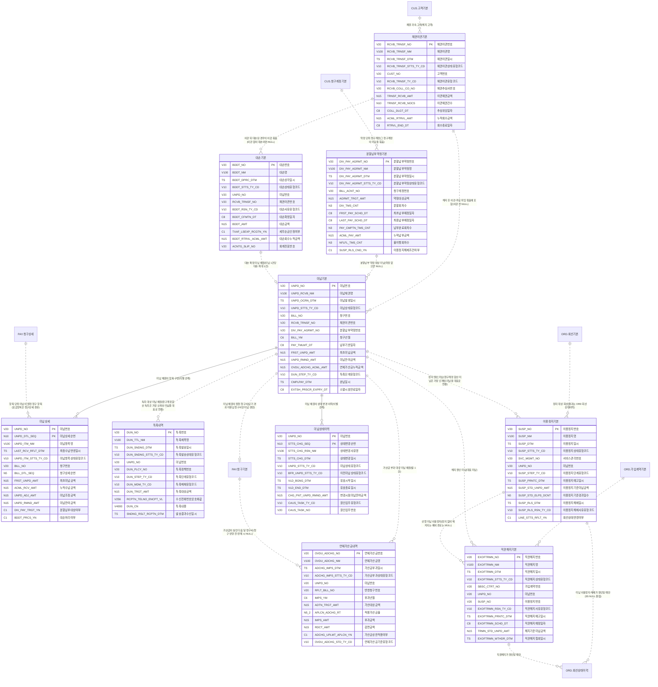

# 02. 개념 모델 — COL 미납

> 작성 2026-11-07 · subagent_subject_modeler · 02 관문 수정·재생성 masteragent_da_coordinator · 정본 `CONTEXT.md`(D1~D15·규칙 2절·형식 3절)
> 짝 산출물 : `model/conceptual/COL.json`(이 문서는 JSON 에서 생성 — 어긋나지 않음, 손으로 고치지 말고 JSON 을 고친 뒤 재생성) · 리뷰 : `reviews/02_conceptual.md`
> 요약 : 핵심 엔터티 **10개**(ACT 10) · STL 표시 0건 · 이 영역이 걸린 주제영역 간 관계(areas.json crossRels) 11건

## 1. 핵심 엔터티

물리명 = 접두어 없는 `<약어>_<분류어 약어>`(분류어 약어 = 표준단어 사전 `model/std/words.json` : 기본 BAS·상세 DTL·이력 HIST·내역 DTLS·코드 CD·집계 AGG). 테이블명 접두어 `PTL_COL_` 는 물리 단계에서 붙인다.

| # | 엔터티 | 물리명 | 테이블명(물리 미리보기) | 유형 | 모듈 | 주식별자 | 정의 |
|---|---|---|---|---|---|---|---|
| 1 | 미납기본 | UNPD_BAS | PTL_COL_UNPD_M | ACT 행위 |  | 미납번호 | 납부기한까지 완납되지 않은 청구서 1건 = 미납 채권 1건(청구기본과 1:1, 미납 발생 시에만 생성). 미납 채권의 현재 상태·잔액·진행 단계를 관리하는 COL 의 중심 엔터티 |
| 2 | 미납상세 | UNPD_DTL | PTL_COL_UNPD_D | ACT 행위 |  | 미납번호 + 미납상세순번 | 미납 채권의 요금항목 단위 미납액. 수납배분이 항목 순위(할부금·부가세 등)로 이뤄지므로 항목별 잔액을 관리(P9) |
| 3 | 연체가산금내역 | OVDU_ADCHG_DTLS | PTL_COL_OVDU_ADCHG_L | ACT 행위 |  | 연체가산금번호 | 미납 채권에 월 단위로 부과한 연체가산금 1건(이용약관 가산금율·상한 적용). 부과액은 다음 청구서에 실려 청구된다 |
| 4 | 독촉내역 | DUN_DTLS | PTL_COL_DUN_L | ACT 행위 |  | 독촉번호 | 미납 채권에 대한 독촉 발송 1건(문자·우편·전화·알림톡). 경과일별 독촉정책에 따라 단계(1차 독촉→정지 예고→해지 예고→이관 예고)를 진행 |
| 5 | 이용정지기본 | SUSP_BAS | PTL_COL_SUSP_M | ACT 행위 |  | 이용정지번호 | 미납으로 인한 회선 이용정지 1건(발신정지→착발신정지 단계, 수납 시 해제). 처리 행위는 COL, 결과 회선 상태는 ORD 회선상태이력에 기록(P2) |
| 6 | 직권해지기본 | EXOFTRMN_BAS | PTL_COL_EXOFTRMN_M | ACT 행위 |  | 직권해지번호 | 미납 이용정지가 일정 기간 지속된 가입계약을 사업자가 직권으로 해지하는 처리 1건(사전 예고 → 확정 또는 철회). 확정 시 ORD 가입계약 종료 |
| 7 | 채권이관기본 | RCVB_TRNSF_BAS | PTL_COL_RCVB_TRNSF_M | ACT 행위 |  | 채권이관번호 | 해지 고객의 미납 채권을 채권관리 단계로 이관(내부 관리·외부 추심 위임·매각 대상)하는 묶음 1건. 고객 단위로 여러 미납을 묶는다 |
| 8 | 분할납부약정기본 | DIV_PAY_AGRMT_BAS | PTL_COL_DIV_PAY_AGRMT_M | ACT 행위 |  | 분할납부약정번호 | 청구계정의 누적 미납액을 여러 회차로 나눠 내기로 한 약정 1건(약정 시 이용정지 해제 조건 부여 가능). 회차별 계획·실적은 분할납부회차상세(기본) |
| 9 | 대손기본 | BDDT_BAS | PTL_COL_BDDT_M | ACT 행위 |  | 대손번호 | 회수 불능으로 판정해 대손 상각을 확정한 미납 채권 1건(소멸시효 완성·파산·행방불명·회수비용 초과·매각). 법인세법 대손금 요건 판정과 대손 후 회수를 추적 |
| 10 | 미납상태이력 | UNPD_STTS_HIST | PTL_COL_UNPD_STTS_H | ACT 행위 |  | 미납번호 + 상태변경순번 | 미납 채권 상태(미납→독촉→정지→해지→이관→대손·완납) 변경 1건. 유효시작·종료일시 쌍으로 레이크 SCD2 에 바로 쓰는 이력 |

## 2. 참조 키 이름 규칙 (다른 주제영역과 공유)

다른 주제영역 핵심 엔터티를 참조할 때 PK 이름은 **소유 영역 이름 그대로**(`<엔터티 핵심어>번호`, 기준·코드형 `<핵심어>코드`, 역할명은 접두어 + 원 키 이름). 같은 키 = 같은 속성명·물리명·도메인.

| 구분 | 속성명 | 물리명 | 도메인 | 소유 엔터티 |
|---|---|---|---|---|
| COL 소유 | 미납번호 | UNPD_NO | 번호V20 | COL.미납기본 |
| COL 소유 | 연체가산금번호 | OVDU_ADCHG_NO | 번호V20 | COL.연체가산금내역 |
| COL 소유 | 독촉번호 | DUN_NO | 번호V20 | COL.독촉내역 |
| COL 소유 | 이용정지번호 | SUSP_NO | 번호V20 | COL.이용정지기본 |
| COL 소유 | 직권해지번호 | EXOFTRMN_NO | 번호V20 | COL.직권해지기본 |
| COL 소유 | 채권이관번호 | RCVB_TRNSF_NO | 번호V20 | COL.채권이관기본 |
| COL 소유 | 분할납부약정번호 | DIV_PAY_AGRMT_NO | 번호V20 | COL.분할납부약정기본 |
| COL 소유 | 대손번호 | BDDT_NO | 번호V20 | COL.대손기본 |
| 외부 참조 | 고객번호 | CUST_NO | 번호V20 | CUS.법인고객상세 |
| 외부 참조 | 청구계정번호 | BILL_ACNT_NO | 번호V20 | CUS.청구계정기본 |
| 외부 참조 | 가입계약번호 | SBSC_CTRT_NO | 번호V20 | ORD.가입계약기본 |
| 외부 참조 | 서비스관리번호 | SVC_MGMT_NO | 번호V20 | ORD.회선기본 |
| 외부 참조 | 청구번호 | BILL_NO | 번호V20 | PAY.청구기본 |

## 3. 엔터티별 주요 속성

역할 : 주식별자·명칭·행위 일시·상태 = 필수 4종(규칙 2-5), 업무 = 업무 핵심 속성. 물리명·도메인은 후보 — 표준사전(`model/std`) 단계에서 확정.

### 3.1 미납기본 (UNPD_BAS, ACT)

| 속성명 | 물리명 후보 | 역할 | 도메인 후보 |
|---|---|---|---|
| 미납번호 | UNPD_NO | 주식별자 | 번호V20 |
| 미납채권명 | UNPD_RCVB_NM | 명칭 | 명V100 |
| 미납발생일시 | UNPD_OCRN_DTM | 행위 일시 | 일시TS |
| 미납상태유형코드 | UNPD_STTS_TY_CD | 상태 | 코드V10 |
| 청구번호 | BILL_NO | 업무 | 번호V20 |
| 채권이관번호 | RCVB_TRNSF_NO | 업무 | 번호V20 |
| 분할납부약정번호 | DIV_PAY_AGRMT_NO | 업무 | 번호V20 |
| 청구년월 | BILL_YM | 업무 | 년월C6 |
| 납부기한일자 | PAY_TMLMT_DT | 업무 | 일자C8 |
| 최초미납금액 | FRST_UNPD_AMT | 업무 | 금액N15 |
| 미납잔여금액 | UNPD_RMND_AMT | 업무 | 금액N15 |
| 연체가산금누적금액 | OVDU_ADCHG_ACML_AMT | 업무 | 금액N15 |
| 독촉단계유형코드 | DUN_STEP_TY_CD | 업무 | 코드V10 |
| 완납일시 | CMPLPAY_DTM | 업무 | 일시TS |
| 소멸시효만료일자 | EXTSH_PRSCR_EXPRY_DT | 업무 | 일자C8 |

### 3.2 미납상세 (UNPD_DTL, ACT)

| 속성명 | 물리명 후보 | 역할 | 도메인 후보 |
|---|---|---|---|
| 미납번호 | UNPD_NO | 주식별자 | 번호V20 |
| 미납상세순번 | UNPD_DTL_SEQ | 주식별자 | 순번N10 |
| 미납항목명 | UNPD_ITM_NM | 명칭 | 명V100 |
| 최종수납반영일시 | LAST_RCV_RFLT_DTM | 행위 일시 | 일시TS |
| 미납항목상태유형코드 | UNPD_ITM_STTS_TY_CD | 상태 | 코드V10 |
| 청구번호 | BILL_NO | 업무 | 번호V20 |
| 청구상세순번 | BILL_DTL_SEQ | 업무 | 순번N5 |
| 최초미납금액 | FRST_UNPD_AMT | 업무 | 금액N15 |
| 누적수납금액 | ACML_RCV_AMT | 업무 | 금액N15 |
| 미납조정금액 | UNPD_ADJ_AMT | 업무 | 금액N15 |
| 미납잔여금액 | UNPD_RMND_AMT | 업무 | 금액N15 |
| 분할납부대상여부 | DIV_PAY_TRGT_YN | 업무 | 여부C1 |
| 대손처리여부 | BDDT_PRCS_YN | 업무 | 여부C1 |

### 3.3 연체가산금내역 (OVDU_ADCHG_DTLS, ACT)

| 속성명 | 물리명 후보 | 역할 | 도메인 후보 |
|---|---|---|---|
| 연체가산금번호 | OVDU_ADCHG_NO | 주식별자 | 번호V20 |
| 연체가산금명 | OVDU_ADCHG_NM | 명칭 | 명V100 |
| 가산금부과일시 | ADCHG_IMPS_DTM | 행위 일시 | 일시TS |
| 가산금부과상태유형코드 | ADCHG_IMPS_STTS_TY_CD | 상태 | 코드V10 |
| 미납번호 | UNPD_NO | 업무 | 번호V20 |
| 반영청구번호 | RFLT_BILL_NO | 업무 | 번호V20 |
| 부과년월 | IMPS_YM | 업무 | 년월C6 |
| 가산대상금액 | ADTN_TRGT_AMT | 업무 | 금액N15 |
| 적용가산금율 | APLCN_ADCHG_RT | 업무 | 율N5_2 |
| 부과금액 | IMPS_AMT | 업무 | 금액N15 |
| 감면금액 | RDCT_AMT | 업무 | 금액N15 |
| 가산금상한적용여부 | ADCHG_UPLMT_APLCN_YN | 업무 | 여부C1 |
| 연체가산금기준유형코드 | OVDU_ADCHG_STD_TY_CD | 업무 | 코드V10 |

### 3.4 독촉내역 (DUN_DTLS, ACT)

| 속성명 | 물리명 후보 | 역할 | 도메인 후보 |
|---|---|---|---|
| 독촉번호 | DUN_NO | 주식별자 | 번호V20 |
| 독촉제목명 | DUN_TTL_NM | 명칭 | 명V100 |
| 독촉발송일시 | DUN_SNDNG_DTM | 행위 일시 | 일시TS |
| 독촉발송상태유형코드 | DUN_SNDNG_STTS_TY_CD | 상태 | 코드V10 |
| 미납번호 | UNPD_NO | 업무 | 번호V20 |
| 독촉정책번호 | DUN_PLCY_NO | 업무 | 번호V20 |
| 독촉단계유형코드 | DUN_STEP_TY_CD | 업무 | 코드V10 |
| 독촉매체유형코드 | DUN_MDM_TY_CD | 업무 | 코드V10 |
| 독촉대상금액 | DUN_TRGT_AMT | 업무 | 금액N15 |
| 수신전화번호암호화값 | RCPTN_TELNO_ENCPT_VL | 업무 | 값V256 |
| 독촉내용 | DUN_CN | 업무 | 내용V4000 |
| 발송결과수신일시 | SNDNG_RSLT_RCPTN_DTM | 업무 | 일시TS |

### 3.5 이용정지기본 (SUSP_BAS, ACT)

| 속성명 | 물리명 후보 | 역할 | 도메인 후보 |
|---|---|---|---|
| 이용정지번호 | SUSP_NO | 주식별자 | 번호V20 |
| 이용정지명 | SUSP_NM | 명칭 | 명V100 |
| 이용정지일시 | SUSP_DTM | 행위 일시 | 일시TS |
| 이용정지상태유형코드 | SUSP_STTS_TY_CD | 상태 | 코드V10 |
| 서비스관리번호 | SVC_MGMT_NO | 업무 | 번호V20 |
| 미납번호 | UNPD_NO | 업무 | 번호V20 |
| 이용정지단계유형코드 | SUSP_STEP_TY_CD | 업무 | 코드V10 |
| 이용정지예고일시 | SUSP_PRNTC_DTM | 업무 | 일시TS |
| 이용정지기준미납금액 | SUSP_STD_UNPD_AMT | 업무 | 금액N15 |
| 이용정지기준경과일수 | SUSP_STD_ELPS_DCNT | 업무 | 일수N5 |
| 이용정지해제일시 | SUSP_RLS_DTM | 업무 | 일시TS |
| 이용정지해제사유유형코드 | SUSP_RLS_RSN_TY_CD | 업무 | 코드V10 |
| 회선상태반영여부 | LINE_STTS_RFLT_YN | 업무 | 여부C1 |

### 3.6 직권해지기본 (EXOFTRMN_BAS, ACT)

| 속성명 | 물리명 후보 | 역할 | 도메인 후보 |
|---|---|---|---|
| 직권해지번호 | EXOFTRMN_NO | 주식별자 | 번호V20 |
| 직권해지명 | EXOFTRMN_NM | 명칭 | 명V100 |
| 직권해지일시 | EXOFTRMN_DTM | 행위 일시 | 일시TS |
| 직권해지상태유형코드 | EXOFTRMN_STTS_TY_CD | 상태 | 코드V10 |
| 가입계약번호 | SBSC_CTRT_NO | 업무 | 번호V20 |
| 미납번호 | UNPD_NO | 업무 | 번호V20 |
| 이용정지번호 | SUSP_NO | 업무 | 번호V20 |
| 직권해지사유유형코드 | EXOFTRMN_RSN_TY_CD | 업무 | 코드V10 |
| 직권해지예고일시 | EXOFTRMN_PRNTC_DTM | 업무 | 일시TS |
| 직권해지예정일자 | EXOFTRMN_SCHD_DT | 업무 | 일자C8 |
| 해지기준미납금액 | TRMN_STD_UNPD_AMT | 업무 | 금액N15 |
| 직권해지철회일시 | EXOFTRMN_WTHDR_DTM | 업무 | 일시TS |

### 3.7 채권이관기본 (RCVB_TRNSF_BAS, ACT)

| 속성명 | 물리명 후보 | 역할 | 도메인 후보 |
|---|---|---|---|
| 채권이관번호 | RCVB_TRNSF_NO | 주식별자 | 번호V20 |
| 채권이관명 | RCVB_TRNSF_NM | 명칭 | 명V100 |
| 채권이관일시 | RCVB_TRNSF_DTM | 행위 일시 | 일시TS |
| 채권이관상태유형코드 | RCVB_TRNSF_STTS_TY_CD | 상태 | 코드V10 |
| 고객번호 | CUST_NO | 업무 | 번호V20 |
| 채권이관유형코드 | RCVB_TRNSF_TY_CD | 업무 | 코드V10 |
| 채권추심사번호 | RCVB_COLL_CO_NO | 업무 | 번호V20 |
| 이관채권금액 | TRNSF_RCVB_AMT | 업무 | 금액N15 |
| 이관채권건수 | TRNSF_RCVB_NOCS | 업무 | 건수N10 |
| 추심위임일자 | COLL_DLGT_DT | 업무 | 일자C8 |
| 누적회수금액 | ACML_RTRVL_AMT | 업무 | 금액N15 |
| 회수종료일자 | RTRVL_END_DT | 업무 | 일자C8 |

### 3.8 분할납부약정기본 (DIV_PAY_AGRMT_BAS, ACT)

| 속성명 | 물리명 후보 | 역할 | 도메인 후보 |
|---|---|---|---|
| 분할납부약정번호 | DIV_PAY_AGRMT_NO | 주식별자 | 번호V20 |
| 분할납부약정명 | DIV_PAY_AGRMT_NM | 명칭 | 명V100 |
| 분할납부약정일시 | DIV_PAY_AGRMT_DTM | 행위 일시 | 일시TS |
| 분할납부약정상태유형코드 | DIV_PAY_AGRMT_STTS_TY_CD | 상태 | 코드V10 |
| 청구계정번호 | BILL_ACNT_NO | 업무 | 번호V20 |
| 약정대상금액 | AGRMT_TRGT_AMT | 업무 | 금액N15 |
| 분할회차수 | DIV_TMS_CNT | 업무 | 수N3 |
| 최초납부예정일자 | FRST_PAY_SCHD_DT | 업무 | 일자C8 |
| 최종납부예정일자 | LAST_PAY_SCHD_DT | 업무 | 일자C8 |
| 납부완료회차수 | PAY_CMPTN_TMS_CNT | 업무 | 수N3 |
| 누적납부금액 | ACML_PAY_AMT | 업무 | 금액N15 |
| 불이행회차수 | NFLFL_TMS_CNT | 업무 | 수N3 |
| 이용정지해제조건여부 | SUSP_RLS_CND_YN | 업무 | 여부C1 |

### 3.9 대손기본 (BDDT_BAS, ACT)

| 속성명 | 물리명 후보 | 역할 | 도메인 후보 |
|---|---|---|---|
| 대손번호 | BDDT_NO | 주식별자 | 번호V20 |
| 대손명 | BDDT_NM | 명칭 | 명V100 |
| 대손상각일시 | BDDT_DPRC_DTM | 행위 일시 | 일시TS |
| 대손상태유형코드 | BDDT_STTS_TY_CD | 상태 | 코드V10 |
| 미납번호 | UNPD_NO | 업무 | 번호V20 |
| 채권이관번호 | RCVB_TRNSF_NO | 업무 | 번호V20 |
| 대손사유유형코드 | BDDT_RSN_TY_CD | 업무 | 코드V10 |
| 대손확정일자 | BDDT_CFMTN_DT | 업무 | 일자C8 |
| 대손금액 | BDDT_AMT | 업무 | 금액N15 |
| 세무손금인정여부 | TXAF_LSEXP_RCGTN_YN | 업무 | 여부C1 |
| 대손회수누적금액 | BDDT_RTRVL_ACML_AMT | 업무 | 금액N15 |
| 회계전표번호 | ACNTG_SLIP_NO | 업무 | 번호V20 |

### 3.10 미납상태이력 (UNPD_STTS_HIST, ACT)

| 속성명 | 물리명 후보 | 역할 | 도메인 후보 |
|---|---|---|---|
| 미납번호 | UNPD_NO | 주식별자 | 번호V20 |
| 상태변경순번 | STTS_CHG_SEQ | 주식별자 | 순번N10 |
| 상태변경사유명 | STTS_CHG_RSN_NM | 명칭 | 명V100 |
| 상태변경일시 | STTS_CHG_DTM | 행위 일시 | 일시TS |
| 미납상태유형코드 | UNPD_STTS_TY_CD | 상태 | 코드V10 |
| 이전미납상태유형코드 | BFR_UNPD_STTS_TY_CD | 업무 | 코드V10 |
| 유효시작일시 | VLD_BGNG_DTM | 업무 | 일시TS |
| 유효종료일시 | VLD_END_DTM | 업무 | 일시TS |
| 변경시점미납잔여금액 | CHG_PNT_UNPD_RMND_AMT | 업무 | 금액N15 |
| 원인업무유형코드 | CAUS_TASK_TY_CD | 업무 | 코드V10 |
| 원인업무번호 | CAUS_TASK_NO | 업무 | 번호V20 |

## 4. 관계

카디널리티는 이 엔터티(행) 기준. 식별 = 부모 키가 자식 PK 에 포함. 선택 = 상대가 없어도 됨. 상대가 다른 주제영역이면 `영역.엔터티`.

| 엔터티 | 상대 엔터티 | 차수 | 식별 | 선택 | 관계명 |
|---|---|---|---|---|---|
| 미납기본 | PAY.청구기본 | 1:1 | 비식별 | 필수 | 미납 채권의 원천 청구서(납기 경과 미완납 청구서만 미납 생성) |
| 미납기본 | 채권이관기본 | N:1 | 비식별 | 선택 | 해지 후 이관·추심 위임 묶음에 포함(이관 전 NULL) |
| 미납기본 | 분할납부약정기본 | N:1 | 비식별 | 선택 | 분할납부 약정 대상 미납(약정 없으면 NULL) |
| 미납기본 | 미납상세 | 1:N | 식별 | 선택 | 미납 채권의 항목 구성(식별 관계) |
| 미납기본 | 연체가산금내역 | 1:N | 비식별 | 선택 | 가산금 부과 대상 미납 채권(월 1건) |
| 미납기본 | 독촉내역 | 1:N | 비식별 | 선택 | 독촉 대상 미납 채권(청구계정 합산 독촉은 가장 오래된 미납을 대표로 연결) |
| 미납기본 | 이용정지기본 | 1:N | 비식별 | 선택 | 정지 원인 미납(청구계정 합산 미납은 가장 오래된 미납을 대표로 연결) |
| 미납기본 | 직권해지기본 | 1:N | 비식별 | 선택 | 해지 원인 미납(대표 미납) |
| 미납기본 | 대손기본 | 1:1 | 비식별 | 필수 | 대손 확정 미납 채권(미납 1건당 대손 최대 1건) |
| 미납기본 | 미납상태이력 | 1:N | 식별 | 선택 | 미납 채권의 상태 변경 이력(식별 관계) |
| 미납상세 | 미납기본 | N:1 | 식별 | 필수 | 미납 채권의 항목 구성(식별 관계) |
| 미납상세 | PAY.청구상세 | N:1 | 비식별 | 필수 | 항목 단위 미납의 원천 청구 항목(요금항목은 청구상세 경유) |
| 연체가산금내역 | 미납기본 | N:1 | 비식별 | 필수 | 가산금 부과 대상 미납 채권(월 1건) |
| 연체가산금내역 | PAY.청구기본 | N:1 | 비식별 | 선택 | 가산금이 실린 다음 달 청구서(청구 반영 전·면제 시 NULL) |
| 독촉내역 | 미납기본 | N:1 | 비식별 | 필수 | 독촉 대상 미납 채권(청구계정 합산 독촉은 가장 오래된 미납을 대표로 연결) |
| 이용정지기본 | ORD.회선기본 | N:1 | 비식별 | 필수 | 정지 대상 회선(결과는 ORD 회선상태이력) |
| 이용정지기본 | 미납기본 | N:1 | 비식별 | 필수 | 정지 원인 미납(청구계정 합산 미납은 가장 오래된 미납을 대표로 연결) |
| 이용정지기본 | ORD.회선상태이력 | 1:N | 비식별 | 선택 | 미납 이용정지·해제가 원인일 때만(S5 NULL 쏠림) |
| 이용정지기본 | 직권해지기본 | 1:N | 비식별 | 선택 | 선행 미납 이용정지(정지 없이 해지되는 예외 경로는 NULL) |
| 직권해지기본 | ORD.가입계약기본 | N:1 | 비식별 | 필수 | 직권해지 대상 가입계약(확정 시 계약 종료) |
| 직권해지기본 | 미납기본 | N:1 | 비식별 | 필수 | 해지 원인 미납(대표 미납) |
| 직권해지기본 | 이용정지기본 | N:1 | 비식별 | 선택 | 선행 미납 이용정지(정지 없이 해지되는 예외 경로는 NULL) |
| 직권해지기본 | ORD.회선상태이력 | 1:N | 비식별 | 선택 | 직권해지가 원인일 때만 |
| 채권이관기본 | CUS.고객기본 | N:1 | 비식별 | 필수 | 채권 귀속 고객(해지 고객) |
| 채권이관기본 | 미납기본 | 1:N | 비식별 | 선택 | 해지 후 이관·추심 위임 묶음에 포함(이관 전 NULL) |
| 채권이관기본 | 대손기본 | 1:N | 비식별 | 선택 | 이관 뒤 대손된 경우의 이관 묶음(이관 없이 대손이면 NULL) |
| 분할납부약정기본 | CUS.청구계정기본 | N:1 | 비식별 | 필수 | 약정 단위 청구계정(그 청구계정의 미납을 묶음) |
| 분할납부약정기본 | 미납기본 | 1:N | 비식별 | 선택 | 분할납부 약정 대상 미납(약정 없으면 NULL) |
| 대손기본 | 미납기본 | 1:1 | 비식별 | 필수 | 대손 확정 미납 채권(미납 1건당 대손 최대 1건) |
| 대손기본 | 채권이관기본 | N:1 | 비식별 | 선택 | 이관 뒤 대손된 경우의 이관 묶음(이관 없이 대손이면 NULL) |
| 미납상태이력 | 미납기본 | N:1 | 식별 | 필수 | 미납 채권의 상태 변경 이력(식별 관계) |

### 4.1 기본 엔터티의 주제영역 간 관계 (논리 단계 엔터티 — 양끝 일관용 예약)

| 기본 엔터티 | 모듈 | 상대 엔터티 | 차수 | 식별 | 선택 | 관계명 |
|---|---|---|---|---|---|---|
| 신용정보등록내역 |  | CUS.고객기본 | N:1 | 비식별 | 선택 | 채무 불이행 정보가 등록된다 |

## 5. ERD (Mermaid, 개념)

실선 = 식별 관계, 점선 = 비식별. 다른 주제영역·기본 엔터티는 `X_<영역>_n` 별칭으로 참조만 표시(ERD 는 주제영역 1개 단위).

## 6. 공통코드 후보 (규칙 2-6 이름 3종)

값 후보는 표준사전 단계(`model/std/codes.json`)에서 확정 — 아래는 이 영역 속성에서 나온 공통코드 용어.

| 용어명 | 종류 | 쓰는 엔터티 |
|---|---|---|
| 미납상태유형코드 | 유형 | 미납기본·미납상태이력 |
| 독촉단계유형코드 | 유형 | 미납기본·독촉내역 |
| 미납항목상태유형코드 | 유형 | 미납상세 |
| 가산금부과상태유형코드 | 유형 | 연체가산금내역 |
| 연체가산금기준유형코드 | 유형 | 연체가산금내역 |
| 독촉발송상태유형코드 | 유형 | 독촉내역 |
| 독촉매체유형코드 | 유형 | 독촉내역 |
| 이용정지상태유형코드 | 유형 | 이용정지기본 |
| 이용정지단계유형코드 | 유형 | 이용정지기본 |
| 이용정지해제사유유형코드 | 유형 | 이용정지기본 |
| 직권해지상태유형코드 | 유형 | 직권해지기본 |
| 직권해지사유유형코드 | 유형 | 직권해지기본 |
| 채권이관상태유형코드 | 유형 | 채권이관기본 |
| 채권이관유형코드 | 유형 | 채권이관기본 |
| 분할납부약정상태유형코드 | 유형 | 분할납부약정기본 |
| 대손상태유형코드 | 유형 | 대손기본 |
| 대손사유유형코드 | 유형 | 대손기본 |
| 이전미납상태유형코드 | 유형 | 미납상태이력 |
| 원인업무유형코드 | 유형 | 미납상태이력 |

## 7. 도메인 후보 (이 영역 사용분)

| 도메인 | 사용 속성 수 |
|---|---|
| 값V256 | 1 |
| 건수N10 | 1 |
| 금액N15 | 20 |
| 내용V4000 | 1 |
| 년월C6 | 2 |
| 명V100 | 10 |
| 번호V20 | 30 |
| 수N3 | 3 |
| 순번N10 | 2 |
| 순번N5 | 1 |
| 여부C1 | 6 |
| 율N5_2 | 1 |
| 일수N5 | 1 |
| 일시TS | 18 |
| 일자C8 | 8 |
| 코드V10 | 21 |

## 8. 결정 메모 (위임 자동 승인 — 근거)

### 8.1 원 작성 문서 메모 이관

> subagent_subject_modeler 원문을 옮김. 물리명은 02 관문 수정본으로 치환했고, 한글 속성명 변경은 9절을 따른다.

#### 확정 방침

| # | 결정 | 근거 |
|---|---|---|
| C1 | candidates.core 10개를 이름 그대로 확정(재명명 없음) | 국내 이동통신 미납관리 실무 흐름(미납 확정→가산금→독촉→정지→직권해지→이관→분할납부→대손)을 빠짐없이 덮음. 이름이 이미 표준단어+분류어 조합(규칙 2-1·2-4) |
| C2 | 미납 채권 단위 = **청구서 1건**(미납기본 ↔ PAY.청구기본 1:1, 미납 발생 시에만 생성), 항목 잔액 = 미납상세 | areas.json crossRels·planner P9(항목 순위 수납배분) |
| C3 | 독촉·이용정지·직권해지는 실무상 **청구계정 합산 미납** 기준으로 일어나지만, 개념 모델에서는 **대표 미납(가장 오래된 미납) 1건**에 연결 | N:M(행위↔미납 여러 건)을 개념 단계에 두지 않음. 여러 미납을 묶어야 하면 논리 단계에서 관계 엔터티(예 이용정지대상미납관계)로 해소 |
| C4 | 채권이관·분할납부약정은 **묶음 엔터티** — 미납기본이 이들을 선택 참조(N:1, opt) | 이관 = 고객 단위, 분할납부 = 청구계정 단위로 여러 미납을 묶는 것이 실무. 미납기본의 FK 는 대부분 NULL(S5 NULL 쏠림 자연 발생) |
| C5 | 미납 정지·직권해지의 **결과** 회선 상태는 ORD 회선상태이력 한 곳(P2) — COL 에는 처리 행위만, `회선상태반영여부`로 반영 확인 | planner 경계 원칙 |
| C6 | 상태 칼럼은 전부 `~상태유형코드`(규칙 2-5·2-6), 단계·매체·사유도 값이 늘 수 있어 `~유형코드`. 구분코드 없음 | 미납 단계·정지 단계(발신/착발신/데이터)·독촉 매체(문자/우편/전화/알림톡)는 사업자 정책으로 추가됨 |
| C7 | 행위 엔터티의 필수 `~명`은 표시용 제목(예 "2026-09 청구 미납") — 업무 의미가 약해도 규칙 2-5 충족용으로 둔다. 미납상태이력은 `상태변경사유명` | ModelPi 필수 속성 4종 |
| C8 | 금액 집계 성격 칼럼(미납잔여금액·연체가산금누계금액·누적회수금액 등)은 **현재값 관리 칼럼**으로 개념에 포함 — 원천 내역 합으로 다시 구할 수 있으므로 논리 단계에서 3NF 판정(유지 시 사유 기록) | 규칙 2-7 반정규화는 물리 단계만 |

#### 논리 단계로 넘기는 메모

1. **기본 엔터티 연결(논리 단계 생성)** : 연체가산금내역 → 연체가산금기준코드 · 독촉내역 → 독촉정책기본·독촉발송결과내역 · 이용정지기본 → 이용정지이력·이용정지해제내역 · 직권해지기본 → 직권해지예고내역 · 채권이관기본 → 채권추심사기본·추심위임상세·추심회수내역·채권매각내역 · 분할납부약정기본 → 분할납부회차상세 · 대손기본 → 대손상각상세·대손회수내역 · 미납기본 → 납부약속내역·채권시효이력 · 고객 → 신용정보등록내역·신용정보해제내역.
2. **교차 관계 승계** : areas.json `COL.신용정보등록내역 → CUS.고객기본`(N:1), 영역 안 힌트 `COL.추심수수료내역 → COL.채권추심사기본`(N:1, **moduleCd STL**)은 기본 엔터티끼리라 이 개념 JSON 에 넣지 않았다 — 논리 JSON rels 에 넣을 것.
3. **N:M 해소 후보** : 이용정지·직권해지·독촉이 여러 미납에 걸리는 경우(C3) → 필요하면 관계 엔터티(`~관계`, 접미어 `_R`). 기본 예산 20 안에서 판단.
4. **3NF 점검 대상** : 미납기본.청구년월·납부기한일자(청구기본 이행 종속 — 미납 시점 스냅샷이면 유지 사유 기록) · 미납상세.미납항목명(요금항목명 스냅샷) · 미납상세.청구번호(미납기본 경유 이행 — 청구상세 복합키 참조라 필요) · 누계·누적 금액(C8).
5. **원인업무번호(미납상태이력)** 는 원인업무유형코드에 따라 독촉·정지·해지·이관·수납·대손 번호를 담는 다형 참조 — FK 정의 불가, 논리 단계에서 유지 여부 결정(대안 : 원인별 선택 FK 칼럼).
6. **물리 단계 반정규화 후보(지금 넣지 않음)** : 미납기본에 청구계정번호·고객번호(독촉·정지 대상 조회 경로, 미납 수천만 행), 이용정지기본에 청구계정번호.
7. **데이터 편향 후보(data_migrationner)** : 미납상태유형코드 = 완납 98%(S3) · 채권이관번호·분할납부약정번호 95%+ NULL(S5) · 납기 다음 날·말일 미납 발생 급증(S4) · 독촉내용 1~4KB 0.5%(S9) · 연체가산금 음수 감면·0.001% 극단값(S7) · 법인 대형 청구계정 미납 핫 키(S14).

#### 표준단어 후보 (표준사전 등재 요청)

미납 UNPD · 채권 RCVB · 연체 OVDU · 가산금 ADCHG · 독촉 DUN · 이용정지 SUSP(합성어) · 직권해지 EXOFTRMN(합성어) · 이관 TRNSF · 분할납부 DIVPAY(합성어) · 약정 AGRM · 대손 BDDT · 추심 CLCT · 추심사 CLCTCO(합성어) · 상각 DPRC · 소멸시효 EXTNCT_PRSCR(소멸+시효) · 예고 PRNTC · 해제 RLS · 철회 WTHDR · 감면 RDCT · 상한 UPLMT · 누계 ACML · 잔여 RMND · 완납 CMPLPAY(합성어) · 손금 LSS · 인정 RCGTN · 전표 SLIP · 매체 MDM · 단계 STEP · 원인 CAUS · 업무 TASK. 공통 : 상태 STTS · 유형 TY · 코드 CD · 번호 NO · 순번 SN · 명 NM · 일시 DTM · 일자 DT · 년월 YM · 금액 AMT · 여부 YN · 율 RT · 일수 DCNT · 건수 CNT · 회차수 TMS_CNT · 내용 CN.
표준사전(`model/std/words.json`)이 다른 약어로 확정하면 phyNm 은 그쪽을 따른다(이 문서의 약어는 후보).

도메인 후보 : 번호V20 · 순번N10 · 명V100 · 코드V10 · 일시TS · 일자C8 · 년월C6 · 금액N15 · 율N5_2 · 일수N5 · 건수N10 · 회차N3 · 여부C1 · 내용V4000(S9 넓은 행) · 암호문V256(D11 개인정보 암호화 자리).

## 9. 02 관문 수정 반영 (reviews/02_conceptual.md)

아래는 coordinator 02 관문 수정분(수정 전 → 관문 수정본). 이후 표준사전 단계가 적용한 이름 변경은 `model/std/_build_log.txt` 가 정본이고, 1~8절은 두 단계를 모두 반영한 현재 JSON 이다.

- 엔터티 미납기본 물리명 UNPD_M → UNPD_BAS
- 미납기본.분할납부약정번호(DIVPAY_AGRM_NO/번호V20) → 분할납부약정번호(DIVPAY_AGRMT_NO/번호V20)
- 미납기본.납부기한일자(PAY_TMLMT_DT/일자C8) → 납부기한일자(PAY_DDLN_DT/일자C8)
- 미납기본.연체가산금누계금액(OVDU_ADCHG_ACML_AMT/금액N15) → 연체가산금누적금액(OVDU_ADCHG_ACML_AMT/금액N15)
- 미납기본.소멸시효만료일자(EXTNCT_PRSCR_EXPR_DT/일자C8) → 소멸시효만료일자(EXTNCT_PRSCR_EXPRY_DT/일자C8)
- 관계 추가 미납기본 → 미납상세 1:N(양끝 일관)
- 관계 추가 미납기본 → 연체가산금내역 1:N(양끝 일관)
- 관계 추가 미납기본 → 독촉내역 1:N(양끝 일관)
- 관계 추가 미납기본 → 이용정지기본 1:N(양끝 일관)
- 관계 추가 미납기본 → 직권해지기본 1:N(양끝 일관)
- 관계 추가 미납기본 → 대손기본 1:1(양끝 일관)
- 관계 추가 미납기본 → 미납상태이력 1:N(양끝 일관)
- 엔터티 미납상세 물리명 UNPD_D → UNPD_DTL
- 미납상세.미납항목명(UNPD_ITEM_NM/명V100) → 미납항목명(UNPD_ITM_NM/명V100)
- 미납상세.미납항목상태유형코드(UNPD_ITEM_STTS_TY_CD/코드V10) → 미납항목상태유형코드(UNPD_ITM_STTS_TY_CD/코드V10)
- 미납상세.청구상세순번(BILL_DTL_SN/순번N10) → 청구상세순번(BILL_DTL_SN/순번N5)
- 엔터티 연체가산금내역 물리명 OVDU_ADCHG_L → OVDU_ADCHG_DTLS
- 엔터티 독촉내역 물리명 DUN_L → DUN_DTLS
- 독촉내역.수신전화번호암호문(RCVR_TELNO_ENCPT/암호문V256) → 수신전화번호암호화값(RCPTN_TELNO_ENCPT_VL/암호화값V256)
- 엔터티 이용정지기본 물리명 SUSP_M → SUSP_BAS
- 이용정지기본.회선번호(LINE_NO/번호V20) → 서비스관리번호(SVC_MGMT_NO/번호V20)
- 관계 추가 이용정지기본 → ORD.회선상태이력 1:N(양끝 일관)
- 관계 추가 이용정지기본 → 직권해지기본 1:N(양끝 일관)
- 엔터티 직권해지기본 물리명 EXOFTRMN_M → EXOFTRMN_BAS
- 관계 추가 직권해지기본 → ORD.회선상태이력 1:N(양끝 일관)
- 엔터티 채권이관기본 물리명 RCVB_TRNSF_M → RCVB_TRNSF_BAS
- 관계 추가 채권이관기본 → 미납기본 1:N(양끝 일관)
- 관계 추가 채권이관기본 → 대손기본 1:N(양끝 일관)
- 엔터티 분할납부약정기본 물리명 DIVPAY_AGRM_M → DIVPAY_AGRMT_BAS
- 분할납부약정기본.분할납부약정번호(DIVPAY_AGRM_NO/번호V20) → 분할납부약정번호(DIVPAY_AGRMT_NO/번호V20)
- 분할납부약정기본.분할납부약정명(DIVPAY_AGRM_NM/명V100) → 분할납부약정명(DIVPAY_AGRMT_NM/명V100)
- 분할납부약정기본.분할납부약정일시(DIVPAY_AGRM_DTM/일시TS) → 분할납부약정일시(DIVPAY_AGRMT_DTM/일시TS)
- 분할납부약정기본.분할납부약정상태유형코드(DIVPAY_AGRM_STTS_TY_CD/코드V10) → 분할납부약정상태유형코드(DIVPAY_AGRMT_STTS_TY_CD/코드V10)
- 분할납부약정기본.약정대상금액(AGRM_TRGT_AMT/금액N15) → 약정대상금액(AGRMT_TRGT_AMT/금액N15)
- 분할납부약정기본.납부완료회차수(PAY_CMPL_TMS_CNT/회차N3) → 납부완료회차수(PAY_CMPTN_TMS_CNT/회차N3)
- 관계 추가 분할납부약정기본 → 미납기본 1:N(양끝 일관)
- 엔터티 대손기본 물리명 BDDT_M → BDDT_BAS
- 대손기본.대손회수누계금액(BDDT_RCVR_ACML_AMT/금액N15) → 대손회수누적금액(BDDT_RCVR_ACML_AMT/금액N15)
- 엔터티 미납상태이력 물리명 UNPD_STTS_H → UNPD_STTS_HST
- 기본 엔터티 관계 예약 신용정보등록내역 → CUS.고객기본 N:1(K7 양끝 일관)
