# 02. 개념 모델 — CUS 고객

> 작성 2026-11-07 · subagent_subject_modeler · 02 관문 수정·재생성 masteragent_da_coordinator · 정본 `CONTEXT.md`(D1~D15·규칙 2절·형식 3절)
> 짝 산출물 : `model/conceptual/CUS.json`(이 문서는 JSON 에서 생성 — 어긋나지 않음, 손으로 고치지 말고 JSON 을 고친 뒤 재생성) · 리뷰 : `reviews/02_conceptual.md`
> 요약 : 핵심 엔터티 **10개**(BASE 7 · REF 1 · ACT 2) · STL 표시 0건 · 이 영역이 걸린 주제영역 간 관계(areas.json crossRels) 21건

## 1. 핵심 엔터티

물리명 = 접두어 없는 `<약어>_<분류어 약어>`(분류어 약어 = 표준단어 사전 `model/std/words.json` : 기본 BAS·상세 DTL·이력 HIST·내역 DTLS·코드 CD·집계 AGG). 테이블명 접두어 `PTL_CUS_` 는 물리 단계에서 붙인다.

| # | 엔터티 | 물리명 | 테이블명(물리 미리보기) | 유형 | 모듈 | 주식별자 | 정의 |
|---|---|---|---|---|---|---|---|
| 1 | 고객기본 | CUST_BAS | PTL_CUS_CUST_M | BASE 실체 |  | 고객번호 | 통신 서비스를 계약하고 요금 채무를 지는 당사자(개인·개인사업자·법인·외국인·공공기관)의 공통 실체. 개인·법인 상세의 상위(슈퍼타입). 해지·사망 후에도 행을 지우지 않고 상태·파기 일시로 표현한다. |
| 2 | 개인고객상세 | INDV_CUST_DTL | PTL_CUS_INDV_CUST_D | BASE 실체 |  | 고객번호 | 개인·외국인 고객의 서브타입 상세. 생년월일·성별·실명확인 값(암호화 자리 표시 — D11, 실제 주민번호 미보관)·복지 대상 여부 등 개인에게만 있는 속성. |
| 3 | 법인고객상세 | CORP_CUST_DTL | PTL_CUS_CORP_CUST_D | BASE 실체 |  | 고객번호 | 법인·개인사업자·공공기관 고객의 서브타입 상세. 사업자등록·대표자·업종·규모 등 법인에게만 있는 속성(법인 1곳이 회선 100만+ 보유하는 S1 핫 키의 주인). |
| 4 | 청구계정기본 | BILL_ACNT_BAS | PTL_CUS_BILL_ACNT_M | BASE 실체 |  | 청구계정번호 | 청구서를 묶어 발행하는 단위(TM Forum Customer Account). 한 고객이 여러 청구계정을, 한 청구계정이 여러 회선(가입계약)을 가진다. 청구주기·청구서 수령 방법·납부자를 정한다. 납부방법 실체는 INV(P1). |
| 5 | 납부자기본 | PYR_BAS | PTL_CUS_PYR_M | BASE 실체 |  | 납부자번호 | 요금을 실제로 내는 사람·법인. 명의 고객과 다를 수 있다(부모가 자녀 요금 납부, 법인이 임직원 요금 납부). 자사 고객이면 고객번호를 참조하고, 아니면 이름·연락처만 가진다. |
| 6 | 고객연락처상세 | CUST_CNTC_DTL | PTL_CUS_CUST_CNTC_D | BASE 실체 |  | 고객번호 + 연락처순번 | 고객의 연락 수단(휴대전화·자택·직장·이메일·팩스) 현재값. 한 고객 여러 건, 유형별 대표 1건. 변경 이력은 기본 엔터티 고객연락처이력(논리 단계). |
| 7 | 고객주소상세 | CUST_ADDR_DTL | PTL_CUS_CUST_ADDR_D | BASE 실체 |  | 고객번호 + 주소순번 | 고객의 주소(거주지·청구지·직장·사업장·배송지) 현재값. 청구계정의 청구지 주소가 이 엔터티를 가리킨다. 변경 이력은 고객주소이력(논리 단계). |
| 8 | 고객동의내역 | CUST_AGRE_DTLS | PTL_CUS_CUST_AGRE_L | ACT 행위 |  | 고객동의번호 | 고객이 개인정보 수집·이용, 마케팅 수신, 제3자 제공 등 동의 항목에 동의·거부한 행위 1건. 철회·만료·파기는 상태유형코드와 일시로 표현(행 삭제 없음 — 동의 증빙 보존 의무). |
| 9 | 고객등급이력 | CUST_GRD_HIST | PTL_CUS_CUST_GRD_H | ACT 행위 |  | 고객번호 + 등급적용시작일시 | 고객 등급(VVIP·VIP·골드·실버·일반) 산정·부여 이력. 적용 기간(시작·종료)을 가져 과거 시점 등급 재현(SCD2)이 가능하다. 현재 등급은 고객기본.고객등급코드에 둔다. |
| 10 | 지역코드 | RGN_CD | PTL_CUS_RGN_C | REF 기준 |  | 지역코드 | 시도·시군구·읍면동 행정구역 기준(행정표준코드 법정동 10자리 기준, D5 — 고객 영역 소유). 상위지역코드로 계층을 이룬다. 폐지·통합은 상태·적용 기간으로 표현. |

## 2. 참조 키 이름 규칙 (다른 주제영역과 공유)

다른 주제영역 핵심 엔터티를 참조할 때 PK 이름은 **소유 영역 이름 그대로**(`<엔터티 핵심어>번호`, 기준·코드형 `<핵심어>코드`, 역할명은 접두어 + 원 키 이름). 같은 키 = 같은 속성명·물리명·도메인.

| 구분 | 속성명 | 물리명 | 도메인 | 소유 엔터티 |
|---|---|---|---|---|
| CUS 소유 | 고객번호 | CUST_NO | 번호V20 | CUS.법인고객상세 |
| CUS 소유 | 청구계정번호 | BILL_ACNT_NO | 번호V20 | CUS.청구계정기본 |
| CUS 소유 | 납부자번호 | PYR_NO | 번호V20 | CUS.납부자기본 |
| CUS 소유 | 고객동의번호 | CUST_AGRE_NO | 번호V20 | CUS.고객동의내역 |
| CUS 소유 | 지역코드 | RGN_CD | 코드V10 | CUS.지역코드 |
| 외부 참조 | 청구주기코드 | BILL_CYCL_CD | 코드V10 | PAY.청구주기코드 |

## 3. 엔터티별 주요 속성

역할 : 주식별자·명칭·행위 일시·상태 = 필수 4종(규칙 2-5), 업무 = 업무 핵심 속성. 물리명·도메인은 후보 — 표준사전(`model/std`) 단계에서 확정.

### 3.1 고객기본 (CUST_BAS, BASE)

| 속성명 | 물리명 후보 | 역할 | 도메인 후보 |
|---|---|---|---|
| 고객번호 | CUST_NO | 주식별자 | 번호V20 |
| 고객명 | CUST_NM | 명칭 | 명V100 |
| 고객등록일시 | CUST_REG_DTM | 행위 일시 | 일시TS |
| 고객상태유형코드 | CUST_STTS_TY_CD | 상태 | 코드V10 |
| 고객유형코드 | CUST_TY_CD | 업무 | 코드V10 |
| 내외국인구분코드 | DMFRGN_SE_CD | 업무 | 코드V10 |
| 국가코드 | NATN_CD | 업무 | 코드V10 |
| 고객등급유형코드 | CUST_GRD_TY_CD | 업무 | 코드V10 |
| 최초가입일자 | FRST_SBSC_DT | 업무 | 일자C8 |
| 고객해지일시 | CUST_TRMN_DTM | 업무 | 일시TS |
| 휴면전환일자 | DRMT_CNVR_DT | 업무 | 일자C8 |
| 개인정보파기일시 | PRVC_DSTR_DTM | 업무 | 일시TS |
| 명의도용신고여부 | NMNE_THFT_DCLR_YN | 업무 | 여부C1 |

### 3.2 개인고객상세 (INDV_CUST_DTL, BASE)

| 속성명 | 물리명 후보 | 역할 | 도메인 후보 |
|---|---|---|---|
| 고객번호 | CUST_NO | 주식별자 | 번호V20 |
| 영문고객명 | ENG_CUST_NM | 명칭 | 명V100 |
| 개인고객등록일시 | INDV_CUST_REG_DTM | 행위 일시 | 일시TS |
| 실명인증상태유형코드 | RLNM_CRTF_STTS_TY_CD | 상태 | 코드V10 |
| 생년월일 | BRDT | 업무 | 일자C8 |
| 성별구분코드 | GNDR_SE_CD | 업무 | 코드V10 |
| 실명확인번호암호화값 | RLNM_IDNTF_NO_ENCPT_VL | 업무 | 값V256 |
| 신분증종류코드 | IDCD_KND_CD | 업무 | 코드V10 |
| 실명인증일시 | RLNM_CRTF_DTM | 업무 | 일시TS |
| 외국인체류만료일자 | FRGNR_STAY_EXPRY_DT | 업무 | 일자C8 |
| 복지대상유형코드 | WLFR_TRGT_TY_CD | 업무 | 코드V10 |

### 3.3 법인고객상세 (CORP_CUST_DTL, BASE)

| 속성명 | 물리명 후보 | 역할 | 도메인 후보 |
|---|---|---|---|
| 고객번호 | CUST_NO | 주식별자 | 번호V20 |
| 법인명 | CORP_NM | 명칭 | 명V200 |
| 법인고객등록일시 | CORP_CUST_REG_DTM | 행위 일시 | 일시TS |
| 사업자상태유형코드 | BZMN_STTS_TY_CD | 상태 | 코드V10 |
| 사업자등록번호 | BRNO | 업무 | 번호V20 |
| 법인등록번호 | CRNO | 업무 | 번호V20 |
| 대표자명 | RPRSV_NM | 업무 | 명V100 |
| 업종코드 | TPBIZ_CD | 업무 | 코드V10 |
| 법인규모유형코드 | CORP_SCL_TY_CD | 업무 | 코드V10 |
| 설립일자 | FNDN_DT | 업무 | 일자C8 |
| 종업원수 | EMP_CNT | 업무 | 수N10 |
| 대표전화번호 | RPRS_TELNO | 업무 | 전화번호V20 |

### 3.4 청구계정기본 (BILL_ACNT_BAS, BASE)

| 속성명 | 물리명 후보 | 역할 | 도메인 후보 |
|---|---|---|---|
| 청구계정번호 | BILL_ACNT_NO | 주식별자 | 번호V20 |
| 청구계정명 | BILL_ACNT_NM | 명칭 | 명V100 |
| 청구계정등록일시 | BILL_ACNT_REG_DTM | 행위 일시 | 일시TS |
| 청구계정상태유형코드 | BILL_ACNT_STTS_TY_CD | 상태 | 코드V10 |
| 고객번호 | CUST_NO | 업무 | 번호V20 |
| 납부자번호 | PYR_NO | 업무 | 번호V20 |
| 청구주기코드 | BILL_CYCL_CD | 업무 | 코드V10 |
| 청구계정유형코드 | BILL_ACNT_TY_CD | 업무 | 코드V10 |
| 청구서수령방법유형코드 | INVC_RCPT_MTHD_TY_CD | 업무 | 코드V10 |
| 청구서이메일주소 | INVC_EML_ADDR | 업무 | 주소V100 |
| 청구지주소순번 | BILL_PLC_ADDR_SEQ | 업무 | 순번N5 |
| 통합청구여부 | INTGR_BILL_YN | 업무 | 여부C1 |
| 최초청구년월 | FRST_BILL_YM | 업무 | 년월C6 |
| 청구계정해지일시 | BILL_ACNT_TRMN_DTM | 업무 | 일시TS |

### 3.5 납부자기본 (PYR_BAS, BASE)

| 속성명 | 물리명 후보 | 역할 | 도메인 후보 |
|---|---|---|---|
| 납부자번호 | PYR_NO | 주식별자 | 번호V20 |
| 납부자명 | PYR_NM | 명칭 | 명V100 |
| 납부자등록일시 | PYR_REG_DTM | 행위 일시 | 일시TS |
| 납부자상태유형코드 | PYR_STTS_TY_CD | 상태 | 코드V10 |
| 고객번호 | CUST_NO | 업무 | 번호V20 |
| 납부자유형코드 | PYR_TY_CD | 업무 | 코드V10 |
| 명의자관계유형코드 | NMNE_PRSN_REL_TY_CD | 업무 | 코드V10 |
| 납부자생년월일 | PYR_BRDT | 업무 | 일자C8 |
| 납부자사업자등록번호 | PYR_BRNO | 업무 | 번호V20 |
| 납부자휴대전화번호 | PYR_MBL_TELNO | 업무 | 전화번호V20 |
| 납부자이메일주소 | PYR_EML_ADDR | 업무 | 주소V100 |

### 3.6 고객연락처상세 (CUST_CNTC_DTL, BASE)

| 속성명 | 물리명 후보 | 역할 | 도메인 후보 |
|---|---|---|---|
| 고객번호 | CUST_NO | 주식별자 | 번호V20 |
| 연락처순번 | CNTC_SEQ | 주식별자 | 순번N5 |
| 연락처명 | CNTC_NM | 명칭 | 명V100 |
| 연락처등록일시 | CNTC_REG_DTM | 행위 일시 | 일시TS |
| 연락처상태유형코드 | CNTC_STTS_TY_CD | 상태 | 코드V10 |
| 연락처유형코드 | CNTC_TY_CD | 업무 | 코드V10 |
| 연락처내용 | CNTC_CN | 업무 | 내용V200 |
| 대표연락처여부 | RPRS_CNTC_YN | 업무 | 여부C1 |
| 본인연락처여부 | SELF_CNTC_YN | 업무 | 여부C1 |
| 연락처검증일시 | CNTC_VRFC_DTM | 업무 | 일시TS |

### 3.7 고객주소상세 (CUST_ADDR_DTL, BASE)

| 속성명 | 물리명 후보 | 역할 | 도메인 후보 |
|---|---|---|---|
| 고객번호 | CUST_NO | 주식별자 | 번호V20 |
| 주소순번 | ADDR_SEQ | 주식별자 | 순번N5 |
| 수령인명 | RCPN_NM | 명칭 | 명V100 |
| 주소등록일시 | ADDR_REG_DTM | 행위 일시 | 일시TS |
| 주소상태유형코드 | ADDR_STTS_TY_CD | 상태 | 코드V10 |
| 주소유형코드 | ADDR_TY_CD | 업무 | 코드V10 |
| 지역코드 | RGN_CD | 업무 | 코드V10 |
| 우편번호 | ZIP | 업무 | 우편번호C5 |
| 도로명주소 | ROAD_NM_ADDR | 업무 | 주소V200 |
| 상세주소 | DADDR | 업무 | 주소V200 |
| 건물관리번호 | BLDG_MGMT_NO | 업무 | 번호V30 |
| 대표주소여부 | RPRS_ADDR_YN | 업무 | 여부C1 |
| 반송횟수 | RTRN_NMTM | 업무 | 수N5 |

### 3.8 고객동의내역 (CUST_AGRE_DTLS, ACT)

| 속성명 | 물리명 후보 | 역할 | 도메인 후보 |
|---|---|---|---|
| 고객동의번호 | CUST_AGRE_NO | 주식별자 | 번호V20 |
| 동의자명 | AGRE_PRSN_NM | 명칭 | 명V100 |
| 동의일시 | AGRE_DTM | 행위 일시 | 일시TS |
| 동의상태유형코드 | AGRE_STTS_TY_CD | 상태 | 코드V10 |
| 고객번호 | CUST_NO | 업무 | 번호V20 |
| 동의항목유형코드 | AGRE_ITM_TY_CD | 업무 | 코드V10 |
| 동의항목버전번호 | AGRE_ITM_VER_NO | 업무 | 번호V20 |
| 동의여부 | AGRE_YN | 업무 | 여부C1 |
| 동의채널유형코드 | AGRE_CHNL_TY_CD | 업무 | 코드V10 |
| 법정대리인동의여부 | LGLRP_AGRE_YN | 업무 | 여부C1 |
| 동의철회일시 | AGRE_WTHDR_DTM | 업무 | 일시TS |
| 동의만료일자 | AGRE_EXPRY_DT | 업무 | 일자C8 |

### 3.9 고객등급이력 (CUST_GRD_HIST, ACT)

| 속성명 | 물리명 후보 | 역할 | 도메인 후보 |
|---|---|---|---|
| 고객번호 | CUST_NO | 주식별자 | 번호V20 |
| 등급적용시작일시 | GRD_APLCN_BGNG_DTM | 주식별자 | 일시TS |
| 고객등급명 | CUST_GRD_NM | 명칭 | 명V100 |
| 등급산정일시 | GRD_ASMT_DTM | 행위 일시 | 일시TS |
| 등급적용상태유형코드 | GRD_APLCN_STTS_TY_CD | 상태 | 코드V10 |
| 고객등급유형코드 | CUST_GRD_TY_CD | 업무 | 코드V10 |
| 등급적용종료일시 | GRD_APLCN_END_DTM | 업무 | 일시TS |
| 등급산정기준년월 | GRD_ASMT_STD_YM | 업무 | 년월C6 |
| 산정청구금액 | ASMT_BILL_AMT | 업무 | 금액N15 |
| 가입기간개월수 | SBSC_PRD_MCNT | 업무 | 수N5 |
| 등급변경사유유형코드 | GRD_CHG_RSN_TY_CD | 업무 | 코드V10 |

### 3.10 지역코드 (RGN_CD, REF)

| 속성명 | 물리명 후보 | 역할 | 도메인 후보 |
|---|---|---|---|
| 지역코드 | RGN_CD | 주식별자 | 코드V10 |
| 지역명 | RGN_NM | 명칭 | 명V100 |
| 지역등록일시 | RGN_REG_DTM | 행위 일시 | 일시TS |
| 지역상태유형코드 | RGN_STTS_TY_CD | 상태 | 코드V10 |
| 상위지역코드 | UP_RGN_CD | 업무 | 코드V10 |
| 지역단계구분코드 | RGN_STEP_SE_CD | 업무 | 코드V10 |
| 영문지역명 | ENG_RGN_NM | 업무 | 명V100 |
| 적용시작일자 | APLCN_BGNG_DT | 업무 | 일자C8 |
| 적용종료일자 | APLCN_END_DT | 업무 | 일자C8 |
| 도서산간여부 | ISLND_MNTN_YN | 업무 | 여부C1 |

## 4. 관계

카디널리티는 이 엔터티(행) 기준. 식별 = 부모 키가 자식 PK 에 포함. 선택 = 상대가 없어도 됨. 상대가 다른 주제영역이면 `영역.엔터티`.

| 엔터티 | 상대 엔터티 | 차수 | 식별 | 선택 | 관계명 |
|---|---|---|---|---|---|
| 고객기본 | 개인고객상세 | 1:1 | 식별 | 선택 | 개인 상세를 가진다(서브타입) |
| 고객기본 | 법인고객상세 | 1:1 | 식별 | 선택 | 법인 상세를 가진다(서브타입) |
| 고객기본 | 청구계정기본 | 1:N | 비식별 | 선택 | 청구계정을 소유한다 |
| 고객기본 | 납부자기본 | 1:N | 비식별 | 선택 | 납부자로 등록된다(자사 고객인 납부자) |
| 고객기본 | 고객연락처상세 | 1:N | 식별 | 선택 | 연락처를 가진다 |
| 고객기본 | 고객주소상세 | 1:N | 식별 | 선택 | 주소를 가진다 |
| 고객기본 | 고객동의내역 | 1:N | 비식별 | 선택 | 동의한다 |
| 고객기본 | 고객등급이력 | 1:N | 식별 | 선택 | 등급을 부여받는다 |
| 고객기본 | ORD.가입계약기본 | 1:N | 비식별 | 선택 | 회선 계약을 체결한다(S1 멱법칙) |
| 고객기본 | COL.채권이관기본 | 1:N | 비식별 | 선택 | 해지 채권이 이관된다 |
| 고객기본 | COL.신용정보등록내역 | 1:N | 비식별 | 선택 | 채무 불이행 정보가 등록된다 |
| 고객기본 | ORD.가입신청기본 | 1:N | 비식별 | 선택 | 고객이 가입을 신청한다(신규 고객은 실명인증 뒤 확정 — 선택) |
| 고객기본 | ORD.결합계약기본 | 1:N | 비식별 | 선택 | 결합 대표 고객(역할명 대표고객번호) |
| 개인고객상세 | 고객기본 | 1:1 | 식별 | 필수 | 고객의 개인 서브타입이다 |
| 법인고객상세 | 고객기본 | 1:1 | 식별 | 필수 | 고객의 법인 서브타입이다 |
| 청구계정기본 | 고객기본 | N:1 | 비식별 | 필수 | 고객이 소유한다 |
| 청구계정기본 | 납부자기본 | N:1 | 비식별 | 필수 | 납부자가 요금을 낸다 |
| 청구계정기본 | 고객주소상세 | N:1 | 비식별 | 선택 | 청구지 주소로 발송한다(우편 수령만) |
| 청구계정기본 | PAY.청구주기코드 | N:1 | 비식별 | 필수 | 청구주기를 따른다(신규 교차 관계 제안) |
| 청구계정기본 | ORD.가입계약기본 | 1:N | 비식별 | 선택 | 회선 요금을 묶어 청구받는다 |
| 청구계정기본 | PAY.청구기본 | 1:N | 비식별 | 선택 | 청구월마다 청구서를 받는다(S14 핫 키) |
| 청구계정기본 | INV.납부방법기본 | 1:N | 비식별 | 선택 | 납부방법을 등록한다 |
| 청구계정기본 | INV.수납기본 | 1:N | 비식별 | 선택 | 입금이 귀속된다 |
| 청구계정기본 | INV.과오납기본 | 1:N | 비식별 | 선택 | 과오납이 발생한다 |
| 청구계정기본 | ORD.가입신청기본 | 1:N | 비식별 | 선택 | 요금을 묶을 청구계정 지정(신규 계정 생성 전 선택) |
| 청구계정기본 | INV.자동이체신청내역 | 1:N | 비식별 | 선택 | 신청 청구계정 |
| 청구계정기본 | INV.자동이체출금요청내역 | 1:N | 비식별 | 선택 | 출금 청구계정 |
| 청구계정기본 | INV.가상계좌기본 | 1:N | 비식별 | 선택 | 청구계정 전용 계좌 |
| 청구계정기본 | INV.환불내역 | 1:N | 비식별 | 선택 | 환불 청구계정 |
| 청구계정기본 | INV.선납기본 | 1:N | 비식별 | 선택 | 선납 청구계정 |
| 청구계정기본 | COL.분할납부약정기본 | 1:N | 비식별 | 선택 | 약정 단위 청구계정(그 청구계정의 미납을 묶음) |
| 납부자기본 | 고객기본 | N:1 | 비식별 | 선택 | 자사 고객이 납부자가 된다(S5 — 비고객 납부자는 NULL) |
| 납부자기본 | 청구계정기본 | 1:N | 비식별 | 선택 | 여러 청구계정 요금을 낸다 |
| 납부자기본 | INV.납부방법기본 | 1:N | 비식별 | 선택 | 납부방법 명의 납부자 |
| 고객연락처상세 | 고객기본 | N:1 | 식별 | 필수 | 고객의 연락처다 |
| 고객주소상세 | 고객기본 | N:1 | 식별 | 필수 | 고객의 주소다 |
| 고객주소상세 | 지역코드 | N:1 | 비식별 | 필수 | 지역에 속한다 |
| 고객주소상세 | 청구계정기본 | 1:N | 비식별 | 선택 | 청구지 주소로 쓰인다 |
| 고객동의내역 | 고객기본 | N:1 | 비식별 | 필수 | 고객이 동의한다 |
| 고객동의내역 | 동의항목코드 | N:1 | 비식별 | 필수 | 동의 항목 정의를 따른다(논리 단계 기본 엔터티) |
| 고객등급이력 | 고객기본 | N:1 | 식별 | 필수 | 고객의 등급 이력이다 |
| 지역코드 | 지역코드 | N:1 | 비식별 | 선택 | 상위 지역에 속한다(자기 참조, 시도는 NULL) |
| 지역코드 | 고객주소상세 | 1:N | 비식별 | 선택 | 주소의 지역이 된다 |
| 지역코드 | PRM.파트너기본 | 1:N | 비식별 | 선택 | 유통망 소재 지역이 된다(S10) |

## 5. ERD (Mermaid, 개념)

실선 = 식별 관계, 점선 = 비식별. 다른 주제영역·기본 엔터티는 `X_<영역>_n` 별칭으로 참조만 표시(ERD 는 주제영역 1개 단위).

```mermaid
erDiagram
  CUST_BAS["고객기본"] {
    V20 CUST_NO PK "고객번호"
    V100 CUST_NM "고객명"
    TS CUST_REG_DTM "고객등록일시"
    V10 CUST_STTS_TY_CD "고객상태유형코드"
    V10 CUST_TY_CD "고객유형코드"
    V10 DMFRGN_SE_CD "내외국인구분코드"
    V10 NATN_CD "국가코드"
    V10 CUST_GRD_TY_CD "고객등급유형코드"
    C8 FRST_SBSC_DT "최초가입일자"
    TS CUST_TRMN_DTM "고객해지일시"
    C8 DRMT_CNVR_DT "휴면전환일자"
    TS PRVC_DSTR_DTM "개인정보파기일시"
    C1 NMNE_THFT_DCLR_YN "명의도용신고여부"
  }
  INDV_CUST_DTL["개인고객상세"] {
    V20 CUST_NO PK "고객번호"
    V100 ENG_CUST_NM "영문고객명"
    TS INDV_CUST_REG_DTM "개인고객등록일시"
    V10 RLNM_CRTF_STTS_TY_CD "실명인증상태유형코드"
    C8 BRDT "생년월일"
    V10 GNDR_SE_CD "성별구분코드"
    V256 RLNM_IDNTF_NO_ENCPT_VL "실명확인번호암호화값"
    V10 IDCD_KND_CD "신분증종류코드"
    TS RLNM_CRTF_DTM "실명인증일시"
    C8 FRGNR_STAY_EXPRY_DT "외국인체류만료일자"
    V10 WLFR_TRGT_TY_CD "복지대상유형코드"
  }
  CORP_CUST_DTL["법인고객상세"] {
    V20 CUST_NO PK "고객번호"
    V200 CORP_NM "법인명"
    TS CORP_CUST_REG_DTM "법인고객등록일시"
    V10 BZMN_STTS_TY_CD "사업자상태유형코드"
    V20 BRNO "사업자등록번호"
    V20 CRNO "법인등록번호"
    V100 RPRSV_NM "대표자명"
    V10 TPBIZ_CD "업종코드"
    V10 CORP_SCL_TY_CD "법인규모유형코드"
    C8 FNDN_DT "설립일자"
    N10 EMP_CNT "종업원수"
    V20 RPRS_TELNO "대표전화번호"
  }
  BILL_ACNT_BAS["청구계정기본"] {
    V20 BILL_ACNT_NO PK "청구계정번호"
    V100 BILL_ACNT_NM "청구계정명"
    TS BILL_ACNT_REG_DTM "청구계정등록일시"
    V10 BILL_ACNT_STTS_TY_CD "청구계정상태유형코드"
    V20 CUST_NO "고객번호"
    V20 PYR_NO "납부자번호"
    V10 BILL_CYCL_CD "청구주기코드"
    V10 BILL_ACNT_TY_CD "청구계정유형코드"
    V10 INVC_RCPT_MTHD_TY_CD "청구서수령방법유형코드"
    V100 INVC_EML_ADDR "청구서이메일주소"
    N5 BILL_PLC_ADDR_SEQ "청구지주소순번"
    C1 INTGR_BILL_YN "통합청구여부"
    C6 FRST_BILL_YM "최초청구년월"
    TS BILL_ACNT_TRMN_DTM "청구계정해지일시"
  }
  PYR_BAS["납부자기본"] {
    V20 PYR_NO PK "납부자번호"
    V100 PYR_NM "납부자명"
    TS PYR_REG_DTM "납부자등록일시"
    V10 PYR_STTS_TY_CD "납부자상태유형코드"
    V20 CUST_NO "고객번호"
    V10 PYR_TY_CD "납부자유형코드"
    V10 NMNE_PRSN_REL_TY_CD "명의자관계유형코드"
    C8 PYR_BRDT "납부자생년월일"
    V20 PYR_BRNO "납부자사업자등록번호"
    V20 PYR_MBL_TELNO "납부자휴대전화번호"
    V100 PYR_EML_ADDR "납부자이메일주소"
  }
  CUST_CNTC_DTL["고객연락처상세"] {
    V20 CUST_NO PK "고객번호"
    N5 CNTC_SEQ PK "연락처순번"
    V100 CNTC_NM "연락처명"
    TS CNTC_REG_DTM "연락처등록일시"
    V10 CNTC_STTS_TY_CD "연락처상태유형코드"
    V10 CNTC_TY_CD "연락처유형코드"
    V200 CNTC_CN "연락처내용"
    C1 RPRS_CNTC_YN "대표연락처여부"
    C1 SELF_CNTC_YN "본인연락처여부"
    TS CNTC_VRFC_DTM "연락처검증일시"
  }
  CUST_ADDR_DTL["고객주소상세"] {
    V20 CUST_NO PK "고객번호"
    N5 ADDR_SEQ PK "주소순번"
    V100 RCPN_NM "수령인명"
    TS ADDR_REG_DTM "주소등록일시"
    V10 ADDR_STTS_TY_CD "주소상태유형코드"
    V10 ADDR_TY_CD "주소유형코드"
    V10 RGN_CD "지역코드"
    C5 ZIP "우편번호"
    V200 ROAD_NM_ADDR "도로명주소"
    V200 DADDR "상세주소"
    V30 BLDG_MGMT_NO "건물관리번호"
    C1 RPRS_ADDR_YN "대표주소여부"
    N5 RTRN_NMTM "반송횟수"
  }
  CUST_AGRE_DTLS["고객동의내역"] {
    V20 CUST_AGRE_NO PK "고객동의번호"
    V100 AGRE_PRSN_NM "동의자명"
    TS AGRE_DTM "동의일시"
    V10 AGRE_STTS_TY_CD "동의상태유형코드"
    V20 CUST_NO "고객번호"
    V10 AGRE_ITM_TY_CD "동의항목유형코드"
    V20 AGRE_ITM_VER_NO "동의항목버전번호"
    C1 AGRE_YN "동의여부"
    V10 AGRE_CHNL_TY_CD "동의채널유형코드"
    C1 LGLRP_AGRE_YN "법정대리인동의여부"
    TS AGRE_WTHDR_DTM "동의철회일시"
    C8 AGRE_EXPRY_DT "동의만료일자"
  }
  CUST_GRD_HIST["고객등급이력"] {
    V20 CUST_NO PK "고객번호"
    TS GRD_APLCN_BGNG_DTM PK "등급적용시작일시"
    V100 CUST_GRD_NM "고객등급명"
    TS GRD_ASMT_DTM "등급산정일시"
    V10 GRD_APLCN_STTS_TY_CD "등급적용상태유형코드"
    V10 CUST_GRD_TY_CD "고객등급유형코드"
    TS GRD_APLCN_END_DTM "등급적용종료일시"
    C6 GRD_ASMT_STD_YM "등급산정기준년월"
    N15 ASMT_BILL_AMT "산정청구금액"
    N5 SBSC_PRD_MCNT "가입기간개월수"
    V10 GRD_CHG_RSN_TY_CD "등급변경사유유형코드"
  }
  RGN_CD["지역코드"] {
    V10 RGN_CD PK "지역코드"
    V100 RGN_NM "지역명"
    TS RGN_REG_DTM "지역등록일시"
    V10 RGN_STTS_TY_CD "지역상태유형코드"
    V10 UP_RGN_CD "상위지역코드"
    V10 RGN_STEP_SE_CD "지역단계구분코드"
    V100 ENG_RGN_NM "영문지역명"
    C8 APLCN_BGNG_DT "적용시작일자"
    C8 APLCN_END_DT "적용종료일자"
    C1 ISLND_MNTN_YN "도서산간여부"
  }
  X_ORD_1["ORD.가입계약기본"]
  X_COL_2["COL.채권이관기본"]
  X_COL_3["COL.신용정보등록내역"]
  X_ORD_4["ORD.가입신청기본"]
  X_ORD_5["ORD.결합계약기본"]
  X_PAY_6["PAY.청구주기코드"]
  X_PAY_7["PAY.청구기본"]
  X_INV_8["INV.납부방법기본"]
  X_INV_9["INV.수납기본"]
  X_INV_10["INV.과오납기본"]
  X_INV_11["INV.자동이체신청내역"]
  X_INV_12["INV.자동이체출금요청내역"]
  X_INV_13["INV.가상계좌기본"]
  X_INV_14["INV.환불내역"]
  X_INV_15["INV.선납기본"]
  X_COL_16["COL.분할납부약정기본"]
  X_CUS_17["CUS.동의항목코드"]
  X_PRM_18["PRM.파트너기본"]
  CUST_BAS ||--o| INDV_CUST_DTL : "개인 상세를 가진다(서브타입)"
  CUST_BAS ||..o{ X_ORD_1 : "회선 계약을 체결한다(S1 멱법칙)"
  CUST_BAS ||..o{ X_COL_2 : "해지 채권이 이관된다"
  CUST_BAS ||..o{ X_COL_3 : "채무 불이행 정보가 등록된다"
  CUST_BAS ||..o{ X_ORD_4 : "고객이 가입을 신청한다(신규 고객은 실명인증 뒤 확정 — 선택)"
  CUST_BAS ||..o{ X_ORD_5 : "결합 대표 고객(역할명 대표고객번호)"
  CORP_CUST_DTL ||--o| CUST_BAS : "고객의 법인 서브타입이다"
  CUST_BAS ||..o{ BILL_ACNT_BAS : "고객이 소유한다"
  PYR_BAS ||..o{ BILL_ACNT_BAS : "납부자가 요금을 낸다"
  CUST_ADDR_DTL ||..o{ BILL_ACNT_BAS : "청구지 주소로 발송한다(우편 수령만)"
  X_PAY_6 ||..o{ BILL_ACNT_BAS : "청구주기를 따른다(신규 교차 관계 제안)"
  BILL_ACNT_BAS ||..o{ X_ORD_1 : "회선 요금을 묶어 청구받는다"
  BILL_ACNT_BAS ||..o{ X_PAY_7 : "청구월마다 청구서를 받는다(S14 핫 키)"
  BILL_ACNT_BAS ||..o{ X_INV_8 : "납부방법을 등록한다"
  BILL_ACNT_BAS ||..o{ X_INV_9 : "입금이 귀속된다"
  BILL_ACNT_BAS ||..o{ X_INV_10 : "과오납이 발생한다"
  BILL_ACNT_BAS ||..o{ X_ORD_4 : "요금을 묶을 청구계정 지정(신규 계정 생성 전 선택)"
  BILL_ACNT_BAS ||..o{ X_INV_11 : "신청 청구계정"
  BILL_ACNT_BAS ||..o{ X_INV_12 : "출금 청구계정"
  BILL_ACNT_BAS ||..o{ X_INV_13 : "청구계정 전용 계좌"
  BILL_ACNT_BAS ||..o{ X_INV_14 : "환불 청구계정"
  BILL_ACNT_BAS ||..o{ X_INV_15 : "선납 청구계정"
  BILL_ACNT_BAS ||..o{ X_COL_16 : "약정 단위 청구계정(그 청구계정의 미납을 묶음)"
  CUST_BAS ||..o{ PYR_BAS : "자사 고객이 납부자가 된다(S5 — 비고객 납부자는 NULL)"
  PYR_BAS ||..o{ X_INV_8 : "납부방법 명의 납부자"
  CUST_BAS ||--o{ CUST_CNTC_DTL : "고객의 연락처다"
  CUST_BAS ||--o{ CUST_ADDR_DTL : "고객의 주소다"
  RGN_CD ||..o{ CUST_ADDR_DTL : "지역에 속한다"
  CUST_BAS ||..o{ CUST_AGRE_DTLS : "고객이 동의한다"
  X_CUS_17 ||..o{ CUST_AGRE_DTLS : "동의 항목 정의를 따른다(논리 단계 기본 엔터티)"
  CUST_BAS ||--o{ CUST_GRD_HIST : "고객의 등급 이력이다"
  RGN_CD ||..o{ RGN_CD : "상위 지역에 속한다(자기 참조, 시도는 NULL)"
  RGN_CD ||..o{ X_PRM_18 : "유통망 소재 지역이 된다(S10)"
```

## 6. 공통코드 후보 (규칙 2-6 이름 3종)

| 용어명 | 종류 | 값 후보 |
|---|---|---|
| 고객상태유형코드 | 유형 | 정상·해지·휴면·사망·명의도용정지·파기 |
| 고객유형코드 | 유형 | 개인·개인사업자·법인·외국인·공공기관 |
| 내외국인구분코드 | 구분 | 내국인·외국인 |
| 성별구분코드 | 구분 | 남·여 |
| 실명인증상태유형코드 | 유형 | 미인증·인증·인증실패·재인증필요 |
| 신분증종류코드 | 종류 | 주민등록증·운전면허증·여권·외국인등록증·장애인등록증 |
| 복지대상유형코드 | 유형 | 해당없음·장애인·기초생활수급자·차상위계층·국가유공자·기초연금수급자 |
| 사업자상태유형코드 | 유형 | 계속·휴업·폐업·확인불가 |
| 법인규모유형코드 | 유형 | 대기업·중견기업·중소기업·소상공인·공공기관 |
| 청구계정상태유형코드 | 유형 | 정상·미납정지·해지·채권이관·대손·소멸 |
| 청구계정유형코드 | 유형 | 개인·법인·법인통합·가족통합 |
| 청구서수령방법유형코드 | 유형 | 우편·이메일·모바일·문자·미발행 |
| 납부자상태유형코드 | 유형 | 정상·변경·해지·사망 |
| 납부자유형코드 | 유형 | 본인·가족·법인·제3자개인·제3자법인 |
| 명의자관계유형코드 | 유형 | 본인·부모·자녀·배우자·형제·법인임직원·기타 |
| 연락처상태유형코드 | 유형 | 유효·결번·수신불가·반송·변경 |
| 연락처유형코드 | 유형 | 휴대전화·자택전화·직장전화·이메일·팩스 |
| 주소상태유형코드 | 유형 | 유효·반송·불명·변경 |
| 주소유형코드 | 유형 | 거주지·청구지·직장·사업장·배송지 |
| 동의상태유형코드 | 유형 | 동의·거부·철회·만료·파기 |
| 동의채널유형코드 | 유형 | 매장·온라인·고객센터·앱·서면 |
| 등급적용상태유형코드 | 유형 | 예약·적용중·종료·취소 |
| 고객등급유형코드 | 유형 | VVIP·VIP·골드·실버·일반 |
| 지역상태유형코드 | 유형 | 사용·폐지·통합·분리 |
| 지역단계구분코드 | 구분 | 시도·시군구·읍면동 |

## 7. 도메인 후보 (이 영역 사용분)

| 도메인 | 사용 속성 수 |
|---|---|
| 값V256 | 1 |
| 금액N15 | 1 |
| 내용V200 | 1 |
| 년월C6 | 2 |
| 명V100 | 11 |
| 명V200 | 1 |
| 번호V20 | 17 |
| 번호V30 | 1 |
| 수N10 | 1 |
| 수N5 | 2 |
| 순번N5 | 3 |
| 여부C1 | 8 |
| 우편번호C5 | 1 |
| 일시TS | 18 |
| 일자C8 | 9 |
| 전화번호V20 | 2 |
| 주소V100 | 2 |
| 주소V200 | 2 |
| 코드V10 | 34 |

## 8. 결정 메모 (위임 자동 승인 — 근거)

| # | 결정 | 근거 |
|---|---|---|
| C1 | 핵심 10개는 planner 후보 그대로 확정(교체 없음) | 청구계정·납부자·연락처·주소·동의는 국내 3사 BSS 고객 영역 필수 실체이고 crossRels 가 이미 이 이름으로 걸려 있음. 고객관계·법정대리인은 기본 엔터티로 충분 |
| C2 | 개인·법인 = 고객기본의 1:1 식별 서브타입(PK = 고객번호 승계) | SID Party(Individual·Organization) 구조, 공통 조회(고객번호)는 슈퍼타입 한 곳 |
| C3 | 현재 등급은 고객기본.고객등급코드, 이력은 고객등급이력(적용 시작·종료) | 현재값 기본 + 변경 이력 쌍(01 문서 5절 원칙 1, SCD2) |
| C4 | 연락처·주소는 고객 종속 식별 관계(고객번호 + 일련번호) | 고객 없이 존재하지 않는 약한 실체, 개인정보 분리(01 문서 5절 원칙 6) |
| C5 | 고객동의내역은 행위 번호 PK 고객동의번호(고객번호는 비식별 속성) | 동의·재동의·철회가 같은 항목에 반복 발생하고 증빙 보존 — 복합키 대신 행위 번호 |
| C6 | 납부자→고객 참조는 선택(비고객 납부자 허용) | 국내 실무에서 납부자는 명의자와 다른 비가입자일 수 있음(S5 FK NULL 쏠림 근거) |
| C7 | 청구계정→PAY.청구주기코드 N:1 신규 교차 관계 제안 | 청구주기는 청구계정 속성(청구서는 그 시점 주기를 복사) — coordinator 가 areas.json crossRels 추가 판단 |
| C8 | 개인고객상세 NM = 영문고객명, 고객주소상세 NM = 수령인명, 고객연락처상세 NM = 연락처명, 고객동의내역 NM = 동의자명 | 필수 4종의 '~명'을 법정 실명(고객기본.고객명) 중복 없이 각 실체의 업무 의미 있는 이름으로 채움 |
| C9 | 고객등급이력.고객등급명 = 산정 당시 등급명 보존 | 등급 체계 개편 시 과거 명칭 재현 필요(시점 보존 — 이행 종속 아님) |
| C10 | 실명확인번호는 암호화값 자리 표시만(D11) | 실제 주민번호 금지, 데이터는 무작위 해시 |
| C11 | phyNm 약어는 공통표준(행안부) 관행 후보(STTS·TY·SE·KND·YMD·SN·RGN 등) — 표준사전 단계에서 확정 | 규칙 2-1 표준 먼저, 이 단계는 후보 |

## 9. 02 관문 수정 반영 (reviews/02_conceptual.md)

아래는 coordinator 02 관문 수정분(수정 전 → 관문 수정본). 이후 표준사전 단계가 적용한 이름 변경은 `model/std/_build_log.txt` 가 정본이고, 1~8절은 두 단계를 모두 반영한 현재 JSON 이다.

- 고객기본.고객등급코드(CUST_GRD_CD/코드V10) → 고객등급유형코드(CUST_GRD_TY_CD/코드V10)
- 고객기본.최초가입일자(FRST_SBSC_YMD/일자C8) → 최초가입일자(FRST_SBSC_DT/일자C8)
- 고객기본.휴면전환일자(DRMT_CNVR_YMD/일자C8) → 휴면전환일자(DRMT_CNVR_DT/일자C8)
- 관계 추가 고객기본 → ORD.가입신청기본 1:N(양끝 일관)
- 관계 추가 고객기본 → ORD.결합계약기본 1:N(양끝 일관)
- 개인고객상세.외국인체류만료일자(FRGNR_STAY_EXPRY_YMD/일자C8) → 외국인체류만료일자(FRGNR_STAY_EXPRY_DT/일자C8)
- 법인고객상세.설립일자(FNDN_YMD/일자C8) → 설립일자(FNDN_DT/일자C8)
- 청구계정기본.청구서수령방법유형코드(BLST_RCPT_MTHD_TY_CD/코드V10) → 청구서수령방법유형코드(BLST_RCV_MTHD_TY_CD/코드V10)
- 청구계정기본.청구지주소일련번호(BILL_PLC_ADDR_SN/일련번호N5) → 청구지주소순번(BILL_PLC_ADDR_SN/순번N5)
- 관계 추가 청구계정기본 → ORD.가입신청기본 1:N(양끝 일관)
- 관계 추가 청구계정기본 → INV.자동이체신청내역 1:N(양끝 일관)
- 관계 추가 청구계정기본 → INV.자동이체출금요청내역 1:N(양끝 일관)
- 관계 추가 청구계정기본 → INV.가상계좌기본 1:N(양끝 일관)
- 관계 추가 청구계정기본 → INV.환불내역 1:N(양끝 일관)
- 관계 추가 청구계정기본 → INV.선납기본 1:N(양끝 일관)
- 관계 추가 청구계정기본 → COL.분할납부약정기본 1:N(양끝 일관)
- 관계 추가 납부자기본 → INV.납부방법기본 1:N(양끝 일관)
- 고객연락처상세.연락처일련번호(CNTC_SN/일련번호N5) → 연락처순번(CNTC_SN/순번N5)
- 고객주소상세.주소일련번호(ADDR_SN/일련번호N5) → 주소순번(ADDR_SN/순번N5)
- 고객동의내역.동의만료일자(AGRE_EXPRY_YMD/일자C8) → 동의만료일자(AGRE_EXPRY_DT/일자C8)
- 고객등급이력.등급적용시작일시(GRD_APLCN_BGNG_DTM/일시TS) → 등급적용시작일시(GRD_APLY_BGNG_DTM/일시TS)
- 고객등급이력.등급적용상태유형코드(GRD_APLCN_STTS_TY_CD/코드V10) → 등급적용상태유형코드(GRD_APLY_STTS_TY_CD/코드V10)
- 고객등급이력.고객등급코드(CUST_GRD_CD/코드V10) → 고객등급유형코드(CUST_GRD_TY_CD/코드V10)
- 고객등급이력.등급적용종료일시(GRD_APLCN_END_DTM/일시TS) → 등급적용종료일시(GRD_APLY_END_DTM/일시TS)
- 고객등급이력.등급산정기준년월(GRD_CALC_CRTR_YM/년월C6) → 등급산정기준년월(GRD_CALC_STD_YM/년월C6)
- 고객등급이력.등급변경사유코드(GRD_CHG_RSN_CD/코드V10) → 등급변경사유유형코드(GRD_CHG_RSN_TY_CD/코드V10)
- 지역코드.적용시작일자(APLCN_BGNG_YMD/일자C8) → 적용시작일자(APLY_BGNG_DT/일자C8)
- 지역코드.적용종료일자(APLCN_END_YMD/일자C8) → 적용종료일자(APLY_END_DT/일자C8)
