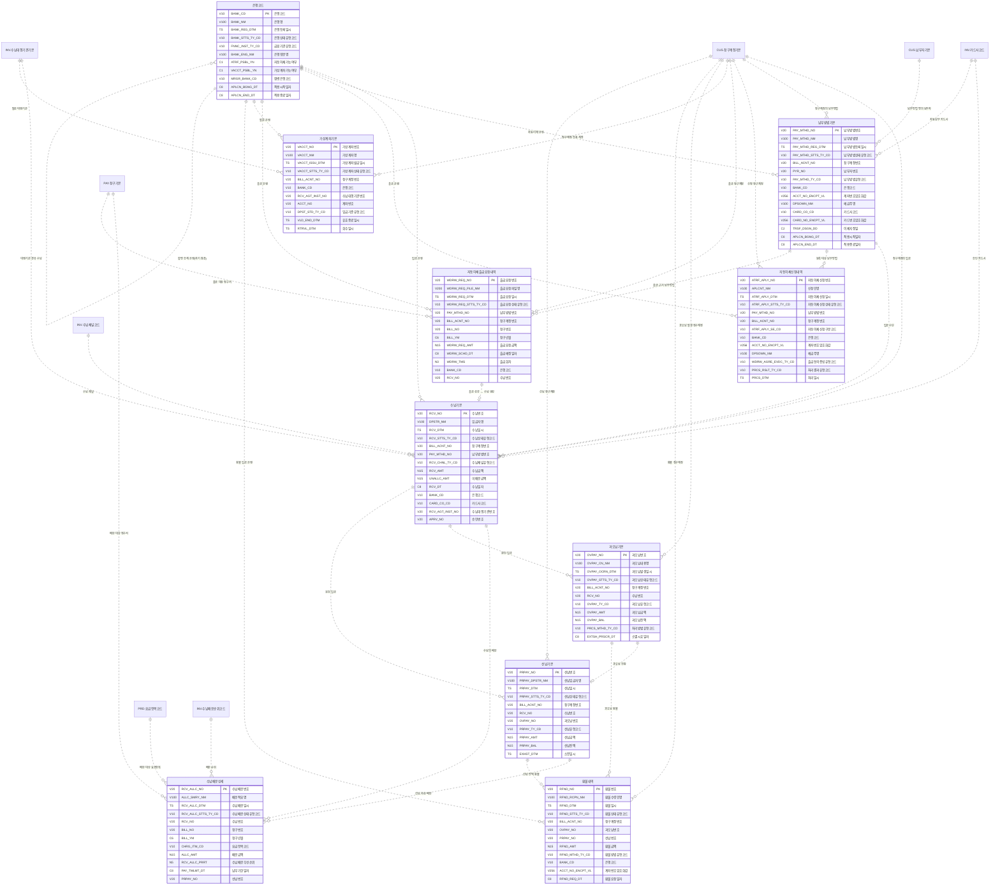

# 02. 개념 모델 — INV 수납

> 작성 2026-11-07 · subagent_subject_modeler · 02 관문 수정·재생성 masteragent_da_coordinator · 정본 `CONTEXT.md`(D1~D15·규칙 2절·형식 3절)
> 짝 산출물 : `model/conceptual/INV.json`(이 문서는 JSON 에서 생성 — 어긋나지 않음, 손으로 고치지 말고 JSON 을 고친 뒤 재생성) · 리뷰 : `reviews/02_conceptual.md`
> 요약 : 핵심 엔터티 **10개**(BASE 2 · REF 1 · ACT 7) · STL 표시 0건 · 이 영역이 걸린 주제영역 간 관계(areas.json crossRels) 15건

## 1. 핵심 엔터티

물리명 = 접두어 없는 `<약어>_<분류어 약어>`(분류어 약어 = 표준단어 사전 `model/std/words.json` : 기본 BAS·상세 DTL·이력 HIST·내역 DTLS·코드 CD·집계 AGG). 테이블명 접두어 `PTL_INV_` 는 물리 단계에서 붙인다.

| # | 엔터티 | 물리명 | 테이블명(물리 미리보기) | 유형 | 모듈 | 주식별자 | 정의 |
|---|---|---|---|---|---|---|---|
| 1 | 수납기본 | RCV_BAS | PTL_INV_RCV_M | ACT 행위 |  | 수납번호 | 청구계정으로 들어온 입금 1건. 수단(자동이체·카드·지로·가상계좌·매장·ARS)과 무관하게 모든 입금은 여기 한 곳에 모이고, 배분 전 미배분 금액을 가진다. 월 RANGE 파티션 후보(수납일시), 장애일 쏠림 S4. |
| 2 | 수납배분상세 | RCV_ALLC_DTL | PTL_INV_RCV_ALLC_D | ACT 행위 |  | 수납배분번호 | 수납액을 청구서×요금항목에 나눠 붙인 결과. 납기 경과 순 → 요금항목 순위(수납배분순위코드)로 배분, 수납 취소 시 음수 역배분 행. 월 RANGE 파티션 후보(수납배분일시). |
| 3 | 납부방법기본 | PAY_MTHD_BAS | PTL_INV_PAY_MTHD_M | BASE 실체 |  | 납부방법번호 | 청구계정이 요금을 내는 수단(자동이체·카드자동납부·지로·가상계좌). 청구계정당 현재 유효 1건 + 과거 행은 적용종료일자로 닫힘, 변경 상세는 납부방법이력. |
| 4 | 자동이체신청내역 | ATRF_APLY_DTLS | PTL_INV_ATRF_APLY_L | ACT 행위 |  | 자동이체신청번호 | 자동이체 신규·변경·해지 신청 1건과 금융결제원 CMS 출금이체 등록 처리 결과. 출금 동의 증빙(서면·녹취·ARS·전자서명) 보관 근거. |
| 5 | 자동이체출금요청내역 | ATRF_WDRW_REQ_DTLS | PTL_INV_ATRF_WDRW_REQ_L | ACT 행위 |  | 출금요청번호 | 청구월마다 자동이체 납부 청구서에 대해 금결원·은행에 보내는 출금 요청 라인(재출금 회차 포함). 결과는 자동이체출금결과내역, 성공분은 수납기본을 만든다. 월 RANGE 파티션 후보(청구년월). |
| 6 | 가상계좌기본 | VACCT_BAS | PTL_INV_VACCT_M | BASE 실체 |  | 가상계좌번호 | 청구계정별로 은행·대행기관에서 발급받은 가상계좌. 입금 통지(가상계좌입금내역)를 청구계정에 귀속시키는 키. 해지 계좌는 회수 후 재발급(S8 번호 재사용). |
| 7 | 과오납기본 | OVPAY_BAS | PTL_INV_OVPAY_M | ACT 행위 |  | 과오납번호 | 이중 납부·초과 납부·해지 후 납부·청구 취소로 생긴, 고객에게 돌려줄 돈 1건과 잔액. 다음 청구 대체·환불·선납 전환으로 정리, 상태 변경은 과오납이력. |
| 8 | 환불내역 | RFND_DTLS | PTL_INV_RFND_L | ACT 행위 |  | 환불번호 | 과오납·선납 잔액·해지 정산액을 고객에게 실제로 돌려준 행위 1건(계좌이체·카드 승인취소·현금·상계). |
| 9 | 선납기본 | PRPAY_BAS | PTL_INV_PRPAY_M | ACT 행위 |  | 선납번호 | 청구 전에 미리 받아 둔 돈(고객 예납·과오납 전환·법인 선결제)과 잔액. 다음 청구 시 선납사용내역으로 차감. |
| 10 | 은행코드 | BANK_CD | PTL_INV_BANK_C | REF 기준 |  | 은행코드 | 은행·금융기관 기준(D5 — 수납 영역 소유). 자동이체·가상계좌 가능 여부와 합병 승계를 가진다. 합병·폐지 은행도 과거 데이터 재현을 위해 남긴다. |

## 2. 참조 키 이름 규칙 (다른 주제영역과 공유)

다른 주제영역 핵심 엔터티를 참조할 때 PK 이름은 **소유 영역 이름 그대로**(`<엔터티 핵심어>번호`, 기준·코드형 `<핵심어>코드`, 역할명은 접두어 + 원 키 이름). 같은 키 = 같은 속성명·물리명·도메인.

| 구분 | 속성명 | 물리명 | 도메인 | 소유 엔터티 |
|---|---|---|---|---|
| INV 소유 | 수납번호 | RCV_NO | 번호V20 | INV.수납기본 |
| INV 소유 | 수납배분번호 | RCV_ALLC_NO | 번호V20 | INV.수납배분상세 |
| INV 소유 | 납부방법번호 | PAY_MTHD_NO | 번호V20 | INV.납부방법기본 |
| INV 소유 | 자동이체신청번호 | ATRF_APLY_NO | 번호V20 | INV.자동이체신청내역 |
| INV 소유 | 출금요청번호 | WDRW_REQ_NO | 번호V20 | INV.자동이체출금요청내역 |
| INV 소유 | 가상계좌번호 | VACCT_NO | 번호V20 | INV.가상계좌기본 |
| INV 소유 | 과오납번호 | OVPAY_NO | 번호V20 | INV.과오납기본 |
| INV 소유 | 환불번호 | RFND_NO | 번호V20 | INV.환불내역 |
| INV 소유 | 선납번호 | PRPAY_NO | 번호V20 | INV.선납기본 |
| INV 소유 | 은행코드 | BANK_CD | 코드V10 | INV.은행코드 |
| 외부 참조 | 요금항목코드 | CHRG_ITM_CD | 코드V10 | PRD.요금항목코드 |
| 외부 참조 | 청구계정번호 | BILL_ACNT_NO | 번호V20 | CUS.청구계정기본 |
| 외부 참조 | 납부자번호 | PYR_NO | 번호V20 | CUS.납부자기본 |
| 외부 참조 | 청구번호 | BILL_NO | 번호V20 | PAY.청구기본 |

## 3. 엔터티별 주요 속성

역할 : 주식별자·명칭·행위 일시·상태 = 필수 4종(규칙 2-5), 업무 = 업무 핵심 속성. 물리명·도메인은 후보 — 표준사전(`model/std`) 단계에서 확정.

### 3.1 수납기본 (RCV_BAS, ACT)

| 속성명 | 물리명 후보 | 역할 | 도메인 후보 |
|---|---|---|---|
| 수납번호 | RCV_NO | 주식별자 | 번호V20 |
| 입금자명 | DPSTR_NM | 명칭 | 명V100 |
| 수납일시 | RCV_DTM | 행위 일시 | 일시TS |
| 수납상태유형코드 | RCV_STTS_TY_CD | 상태 | 코드V10 |
| 청구계정번호 | BILL_ACNT_NO | 업무 | 번호V20 |
| 납부방법번호 | PAY_MTHD_NO | 업무 | 번호V20 |
| 수납채널유형코드 | RCV_CHNL_TY_CD | 업무 | 코드V10 |
| 수납금액 | RCV_AMT | 업무 | 금액N15 |
| 미배분금액 | UNALLC_AMT | 업무 | 금액N15 |
| 수납일자 | RCV_DT | 업무 | 일자C8 |
| 은행코드 | BANK_CD | 업무 | 코드V10 |
| 카드사코드 | CARD_CO_CD | 업무 | 코드V10 |
| 수납대행기관번호 | RCV_AGT_INST_NO | 업무 | 번호V20 |
| 승인번호 | APRV_NO | 업무 | 번호V20 |

### 3.2 수납배분상세 (RCV_ALLC_DTL, ACT)

| 속성명 | 물리명 후보 | 역할 | 도메인 후보 |
|---|---|---|---|
| 수납배분번호 | RCV_ALLC_NO | 주식별자 | 번호V20 |
| 배분적요명 | ALLC_SMRY_NM | 명칭 | 명V100 |
| 수납배분일시 | RCV_ALLC_DTM | 행위 일시 | 일시TS |
| 수납배분상태유형코드 | RCV_ALLC_STTS_TY_CD | 상태 | 코드V10 |
| 수납번호 | RCV_NO | 업무 | 번호V20 |
| 청구번호 | BILL_NO | 업무 | 번호V20 |
| 청구년월 | BILL_YM | 업무 | 년월C6 |
| 요금항목코드 | CHRG_ITM_CD | 업무 | 코드V10 |
| 배분금액 | ALLC_AMT | 업무 | 금액N15 |
| 수납배분우선순위 | RCV_ALLC_PRRT | 업무 | 순번N5 |
| 납부기한일자 | PAY_TMLMT_DT | 업무 | 일자C8 |
| 선납번호 | PRPAY_NO | 업무 | 번호V20 |

### 3.3 납부방법기본 (PAY_MTHD_BAS, BASE)

| 속성명 | 물리명 후보 | 역할 | 도메인 후보 |
|---|---|---|---|
| 납부방법번호 | PAY_MTHD_NO | 주식별자 | 번호V20 |
| 납부방법명 | PAY_MTHD_NM | 명칭 | 명V100 |
| 납부방법등록일시 | PAY_MTHD_REG_DTM | 행위 일시 | 일시TS |
| 납부방법상태유형코드 | PAY_MTHD_STTS_TY_CD | 상태 | 코드V10 |
| 청구계정번호 | BILL_ACNT_NO | 업무 | 번호V20 |
| 납부자번호 | PYR_NO | 업무 | 번호V20 |
| 납부방법유형코드 | PAY_MTHD_TY_CD | 업무 | 코드V10 |
| 은행코드 | BANK_CD | 업무 | 코드V10 |
| 계좌번호암호화값 | ACCT_NO_ENCPT_VL | 업무 | 값V256 |
| 예금주명 | DPSOWN_NM | 업무 | 명V100 |
| 카드사코드 | CARD_CO_CD | 업무 | 코드V10 |
| 카드번호암호화값 | CARD_NO_ENCPT_VL | 업무 | 값V256 |
| 이체지정일 | TRSF_DSGN_DD | 업무 | 일C2 |
| 적용시작일자 | APLCN_BGNG_DT | 업무 | 일자C8 |
| 적용종료일자 | APLCN_END_DT | 업무 | 일자C8 |

### 3.4 자동이체신청내역 (ATRF_APLY_DTLS, ACT)

| 속성명 | 물리명 후보 | 역할 | 도메인 후보 |
|---|---|---|---|
| 자동이체신청번호 | ATRF_APLY_NO | 주식별자 | 번호V20 |
| 신청인명 | APLCNT_NM | 명칭 | 명V100 |
| 자동이체신청일시 | ATRF_APLY_DTM | 행위 일시 | 일시TS |
| 자동이체신청상태유형코드 | ATRF_APLY_STTS_TY_CD | 상태 | 코드V10 |
| 납부방법번호 | PAY_MTHD_NO | 업무 | 번호V20 |
| 청구계정번호 | BILL_ACNT_NO | 업무 | 번호V20 |
| 자동이체신청구분코드 | ATRF_APLY_SE_CD | 업무 | 코드V10 |
| 은행코드 | BANK_CD | 업무 | 코드V10 |
| 계좌번호암호화값 | ACCT_NO_ENCPT_VL | 업무 | 값V256 |
| 예금주명 | DPSOWN_NM | 업무 | 명V100 |
| 출금동의증빙유형코드 | WDRW_AGRE_EVDC_TY_CD | 업무 | 코드V10 |
| 처리결과유형코드 | PRCS_RSLT_TY_CD | 업무 | 코드V10 |
| 처리일시 | PRCS_DTM | 업무 | 일시TS |

### 3.5 자동이체출금요청내역 (ATRF_WDRW_REQ_DTLS, ACT)

| 속성명 | 물리명 후보 | 역할 | 도메인 후보 |
|---|---|---|---|
| 출금요청번호 | WDRW_REQ_NO | 주식별자 | 번호V20 |
| 출금요청파일명 | WDRW_REQ_FILE_NM | 명칭 | 명V200 |
| 출금요청일시 | WDRW_REQ_DTM | 행위 일시 | 일시TS |
| 출금요청상태유형코드 | WDRW_REQ_STTS_TY_CD | 상태 | 코드V10 |
| 납부방법번호 | PAY_MTHD_NO | 업무 | 번호V20 |
| 청구계정번호 | BILL_ACNT_NO | 업무 | 번호V20 |
| 청구번호 | BILL_NO | 업무 | 번호V20 |
| 청구년월 | BILL_YM | 업무 | 년월C6 |
| 출금요청금액 | WDRW_REQ_AMT | 업무 | 금액N15 |
| 출금예정일자 | WDRW_SCHD_DT | 업무 | 일자C8 |
| 출금회차 | WDRW_TMS | 업무 | 회차N3 |
| 은행코드 | BANK_CD | 업무 | 코드V10 |
| 수납번호 | RCV_NO | 업무 | 번호V20 |

### 3.6 가상계좌기본 (VACCT_BAS, BASE)

| 속성명 | 물리명 후보 | 역할 | 도메인 후보 |
|---|---|---|---|
| 가상계좌번호 | VACCT_NO | 주식별자 | 번호V20 |
| 가상계좌명 | VACCT_NM | 명칭 | 명V100 |
| 가상계좌발급일시 | VACCT_ISSU_DTM | 행위 일시 | 일시TS |
| 가상계좌상태유형코드 | VACCT_STTS_TY_CD | 상태 | 코드V10 |
| 청구계정번호 | BILL_ACNT_NO | 업무 | 번호V20 |
| 은행코드 | BANK_CD | 업무 | 코드V10 |
| 수납대행기관번호 | RCV_AGT_INST_NO | 업무 | 번호V20 |
| 계좌번호 | ACCT_NO | 업무 | 번호V20 |
| 입금기준유형코드 | DPST_STD_TY_CD | 업무 | 코드V10 |
| 유효종료일시 | VLD_END_DTM | 업무 | 일시TS |
| 회수일시 | RTRVL_DTM | 업무 | 일시TS |

### 3.7 과오납기본 (OVPAY_BAS, ACT)

| 속성명 | 물리명 후보 | 역할 | 도메인 후보 |
|---|---|---|---|
| 과오납번호 | OVPAY_NO | 주식별자 | 번호V20 |
| 과오납내용명 | OVPAY_CN_NM | 명칭 | 명V100 |
| 과오납발생일시 | OVPAY_OCRN_DTM | 행위 일시 | 일시TS |
| 과오납상태유형코드 | OVPAY_STTS_TY_CD | 상태 | 코드V10 |
| 청구계정번호 | BILL_ACNT_NO | 업무 | 번호V20 |
| 수납번호 | RCV_NO | 업무 | 번호V20 |
| 과오납유형코드 | OVPAY_TY_CD | 업무 | 코드V10 |
| 과오납금액 | OVPAY_AMT | 업무 | 금액N15 |
| 과오납잔액 | OVPAY_BAL | 업무 | 금액N15 |
| 처리방법유형코드 | PRCS_MTHD_TY_CD | 업무 | 코드V10 |
| 소멸시효일자 | EXTSH_PRSCR_DT | 업무 | 일자C8 |

### 3.8 환불내역 (RFND_DTLS, ACT)

| 속성명 | 물리명 후보 | 역할 | 도메인 후보 |
|---|---|---|---|
| 환불번호 | RFND_NO | 주식별자 | 번호V20 |
| 환불수령인명 | RFND_RCPN_NM | 명칭 | 명V100 |
| 환불일시 | RFND_DTM | 행위 일시 | 일시TS |
| 환불상태유형코드 | RFND_STTS_TY_CD | 상태 | 코드V10 |
| 청구계정번호 | BILL_ACNT_NO | 업무 | 번호V20 |
| 과오납번호 | OVPAY_NO | 업무 | 번호V20 |
| 선납번호 | PRPAY_NO | 업무 | 번호V20 |
| 환불금액 | RFND_AMT | 업무 | 금액N15 |
| 환불방법유형코드 | RFND_MTHD_TY_CD | 업무 | 코드V10 |
| 은행코드 | BANK_CD | 업무 | 코드V10 |
| 계좌번호암호화값 | ACCT_NO_ENCPT_VL | 업무 | 값V256 |
| 환불요청일자 | RFND_REQ_DT | 업무 | 일자C8 |

### 3.9 선납기본 (PRPAY_BAS, ACT)

| 속성명 | 물리명 후보 | 역할 | 도메인 후보 |
|---|---|---|---|
| 선납번호 | PRPAY_NO | 주식별자 | 번호V20 |
| 선납입금자명 | PRPAY_DPSTR_NM | 명칭 | 명V100 |
| 선납일시 | PRPAY_DTM | 행위 일시 | 일시TS |
| 선납상태유형코드 | PRPAY_STTS_TY_CD | 상태 | 코드V10 |
| 청구계정번호 | BILL_ACNT_NO | 업무 | 번호V20 |
| 수납번호 | RCV_NO | 업무 | 번호V20 |
| 과오납번호 | OVPAY_NO | 업무 | 번호V20 |
| 선납유형코드 | PRPAY_TY_CD | 업무 | 코드V10 |
| 선납금액 | PRPAY_AMT | 업무 | 금액N15 |
| 선납잔액 | PRPAY_BAL | 업무 | 금액N15 |
| 소진일시 | EXHST_DTM | 업무 | 일시TS |

### 3.10 은행코드 (BANK_CD, REF)

| 속성명 | 물리명 후보 | 역할 | 도메인 후보 |
|---|---|---|---|
| 은행코드 | BANK_CD | 주식별자 | 코드V10 |
| 은행명 | BANK_NM | 명칭 | 명V100 |
| 은행등록일시 | BANK_REG_DTM | 행위 일시 | 일시TS |
| 은행상태유형코드 | BANK_STTS_TY_CD | 상태 | 코드V10 |
| 금융기관유형코드 | FNNC_INST_TY_CD | 업무 | 코드V10 |
| 은행영문명 | BANK_ENG_NM | 업무 | 명V100 |
| 자동이체가능여부 | ATRF_PSBL_YN | 업무 | 여부C1 |
| 가상계좌가능여부 | VACCT_PSBL_YN | 업무 | 여부C1 |
| 합병은행코드 | MRGR_BANK_CD | 업무 | 코드V10 |
| 적용시작일자 | APLCN_BGNG_DT | 업무 | 일자C8 |
| 적용종료일자 | APLCN_END_DT | 업무 | 일자C8 |

## 4. 관계

카디널리티는 이 엔터티(행) 기준. 식별 = 부모 키가 자식 PK 에 포함. 선택 = 상대가 없어도 됨. 상대가 다른 주제영역이면 `영역.엔터티`.

| 엔터티 | 상대 엔터티 | 차수 | 식별 | 선택 | 관계명 |
|---|---|---|---|---|---|
| 수납기본 | CUS.청구계정기본 | N:1 | 비식별 | 필수 | 청구계정의 입금 |
| 수납기본 | 납부방법기본 | N:1 | 비식별 | 선택 | 입금 수단 |
| 수납기본 | 수납채널코드 | N:1 | 비식별 | 필수 | 수납 채널 |
| 수납기본 | 은행코드 | N:1 | 비식별 | 선택 | 입금 은행 |
| 수납기본 | 카드사코드 | N:1 | 비식별 | 선택 | 승인 카드사 |
| 수납기본 | 수납대행기관기본 | N:1 | 비식별 | 선택 | 대행기관 경유 수납 |
| 수납기본 | 수납배분상세 | 1:N | 비식별 | 선택 | 수납의 배분 |
| 수납기본 | 자동이체출금요청내역 | 1:1 | 비식별 | 선택 | 출금 성공 → 수납 생성 |
| 수납기본 | 과오납기본 | 1:N | 비식별 | 선택 | 원인 입금 |
| 수납기본 | 선납기본 | 1:N | 비식별 | 선택 | 원천 입금 |
| 수납배분상세 | 수납기본 | N:1 | 비식별 | 필수 | 수납의 배분 |
| 수납배분상세 | PAY.청구기본 | N:1 | 비식별 | 필수 | 배분 대상 청구서 |
| 수납배분상세 | PRD.요금항목코드 | N:1 | 비식별 | 필수 | 배분 대상 요금항목 |
| 수납배분상세 | 수납배분순위코드 | N:1 | 비식별 | 필수 | 배분 순위 |
| 수납배분상세 | 선납기본 | N:1 | 비식별 | 선택 | 선납 차감 배분 |
| 납부방법기본 | CUS.청구계정기본 | N:1 | 비식별 | 필수 | 청구계정의 납부방법 |
| 납부방법기본 | CUS.납부자기본 | N:1 | 비식별 | 필수 | 납부방법 명의 납부자 |
| 납부방법기본 | 은행코드 | N:1 | 비식별 | 선택 | 자동이체 은행 |
| 납부방법기본 | 카드사코드 | N:1 | 비식별 | 선택 | 자동납부 카드사 |
| 납부방법기본 | 수납기본 | 1:N | 비식별 | 선택 | 입금 수단 |
| 납부방법기본 | 자동이체신청내역 | 1:N | 비식별 | 선택 | 등록 대상 납부방법 |
| 납부방법기본 | 자동이체출금요청내역 | 1:N | 비식별 | 선택 | 출금 근거 납부방법 |
| 자동이체신청내역 | 납부방법기본 | N:1 | 비식별 | 필수 | 등록 대상 납부방법 |
| 자동이체신청내역 | CUS.청구계정기본 | N:1 | 비식별 | 필수 | 신청 청구계정 |
| 자동이체신청내역 | 은행코드 | N:1 | 비식별 | 필수 | 출금 은행 |
| 자동이체출금요청내역 | 납부방법기본 | N:1 | 비식별 | 필수 | 출금 근거 납부방법 |
| 자동이체출금요청내역 | PAY.청구기본 | N:1 | 비식별 | 필수 | 출금 대상 청구서 |
| 자동이체출금요청내역 | CUS.청구계정기본 | N:1 | 비식별 | 필수 | 출금 청구계정 |
| 자동이체출금요청내역 | 수납기본 | 1:1 | 비식별 | 선택 | 출금 성공 → 수납 생성 |
| 자동이체출금요청내역 | 은행코드 | N:1 | 비식별 | 필수 | 출금 은행 |
| 가상계좌기본 | CUS.청구계정기본 | N:1 | 비식별 | 필수 | 청구계정 전용 계좌 |
| 가상계좌기본 | 은행코드 | N:1 | 비식별 | 필수 | 발급 은행 |
| 가상계좌기본 | 수납대행기관기본 | N:1 | 비식별 | 선택 | 발급 대행기관 |
| 과오납기본 | CUS.청구계정기본 | N:1 | 비식별 | 필수 | 과오납 발생 청구계정 |
| 과오납기본 | 수납기본 | N:1 | 비식별 | 선택 | 원인 입금 |
| 과오납기본 | 환불내역 | 1:N | 비식별 | 선택 | 과오납 환불 |
| 과오납기본 | 선납기본 | 1:1 | 비식별 | 선택 | 과오납 전환 |
| 환불내역 | CUS.청구계정기본 | N:1 | 비식별 | 필수 | 환불 청구계정 |
| 환불내역 | 과오납기본 | N:1 | 비식별 | 선택 | 과오납 환불 |
| 환불내역 | 선납기본 | N:1 | 비식별 | 선택 | 선납 잔액 환불 |
| 환불내역 | 은행코드 | N:1 | 비식별 | 선택 | 환불 입금 은행 |
| 선납기본 | CUS.청구계정기본 | N:1 | 비식별 | 필수 | 선납 청구계정 |
| 선납기본 | 수납기본 | N:1 | 비식별 | 선택 | 원천 입금 |
| 선납기본 | 과오납기본 | 1:1 | 비식별 | 선택 | 과오납 전환 |
| 선납기본 | 수납배분상세 | 1:N | 비식별 | 선택 | 선납 차감 배분 |
| 선납기본 | 환불내역 | 1:N | 비식별 | 선택 | 선납 잔액 환불 |
| 은행코드 | 은행코드 | N:1 | 비식별 | 선택 | 합병 승계 은행(자기 참조) |
| 은행코드 | 수납기본 | 1:N | 비식별 | 선택 | 입금 은행 |
| 은행코드 | 납부방법기본 | 1:N | 비식별 | 선택 | 자동이체 은행 |
| 은행코드 | 자동이체신청내역 | 1:N | 비식별 | 선택 | 출금 은행 |
| 은행코드 | 자동이체출금요청내역 | 1:N | 비식별 | 선택 | 출금 은행 |
| 은행코드 | 가상계좌기본 | 1:N | 비식별 | 선택 | 발급 은행 |
| 은행코드 | 환불내역 | 1:N | 비식별 | 선택 | 환불 입금 은행 |

### 4.1 기본 엔터티의 주제영역 간 관계 (논리 단계 엔터티 — 양끝 일관용 예약)

| 기본 엔터티 | 모듈 | 상대 엔터티 | 차수 | 식별 | 선택 | 관계명 |
|---|---|---|---|---|---|---|
| 선납사용내역 |  | PAY.청구기본 | N:1 | 비식별 | 선택 | 선납 잔액 차감 |

## 5. ERD (Mermaid, 개념)

실선 = 식별 관계, 점선 = 비식별. 다른 주제영역·기본 엔터티는 `X_<영역>_n` 별칭으로 참조만 표시(ERD 는 주제영역 1개 단위).

## 6. 공통코드 후보 (규칙 2-6 이름 3종)

값 후보는 표준사전 단계(`model/std/codes.json`)에서 확정 — 아래는 이 영역 속성에서 나온 공통코드 용어.

| 용어명 | 종류 | 쓰는 엔터티 |
|---|---|---|
| 수납상태유형코드 | 유형 | 수납기본 |
| 수납채널유형코드 | 유형 | 수납기본 |
| 수납배분상태유형코드 | 유형 | 수납배분상세 |
| 납부방법상태유형코드 | 유형 | 납부방법기본 |
| 납부방법유형코드 | 유형 | 납부방법기본 |
| 자동이체신청상태유형코드 | 유형 | 자동이체신청내역 |
| 자동이체신청구분코드 | 구분 | 자동이체신청내역 |
| 출금동의증빙유형코드 | 유형 | 자동이체신청내역 |
| 처리결과유형코드 | 유형 | 자동이체신청내역 |
| 출금요청상태유형코드 | 유형 | 자동이체출금요청내역 |
| 가상계좌상태유형코드 | 유형 | 가상계좌기본 |
| 입금기준유형코드 | 유형 | 가상계좌기본 |
| 과오납상태유형코드 | 유형 | 과오납기본 |
| 과오납유형코드 | 유형 | 과오납기본 |
| 처리방법유형코드 | 유형 | 과오납기본 |
| 환불상태유형코드 | 유형 | 환불내역 |
| 환불방법유형코드 | 유형 | 환불내역 |
| 선납상태유형코드 | 유형 | 선납기본 |
| 선납유형코드 | 유형 | 선납기본 |
| 은행상태유형코드 | 유형 | 은행코드 |
| 금융기관유형코드 | 유형 | 은행코드 |

## 7. 도메인 후보 (이 영역 사용분)

| 도메인 | 사용 속성 수 |
|---|---|
| 값V256 | 4 |
| 금액N15 | 9 |
| 년월C6 | 2 |
| 명V100 | 12 |
| 명V200 | 1 |
| 번호V20 | 35 |
| 순번N5 | 1 |
| 여부C1 | 2 |
| 일C2 | 1 |
| 일시TS | 14 |
| 일자C8 | 9 |
| 코드V10 | 32 |
| 회차N3 | 1 |

## 8. 결정 메모 (위임 자동 승인 — 근거)

### 8.1 원 작성 문서 메모 이관

> subagent_subject_modeler 원문을 옮김. 물리명은 02 관문 수정본으로 치환했고, 한글 속성명 변경은 9절을 따른다.

#### 결정 메모 (위임 자동 승인 — 근거)

| # | 결정 | 근거 |
|---|---|---|
| C1 | 핵심 10개 = planner 후보 그대로 확정(이름 유지) | 수납 원장(수납·배분) + 수단 실체(납부방법·가상계좌) + CMS 흐름(신청·출금요청) + 고객 돈 잔액(과오납·환불·선납) + 기준(은행)으로 SID Customer Payment·Payment Method 범위를 덮음. 카드사코드·수납채널코드는 행 수·변경 빈도가 낮아 기본 유지 |
| C2 | 모든 입금은 수납기본 한 곳(수단별 내역은 기본 엔터티가 원천 통지만 보관) | 수납 조회·배분·대사 경로 1개, CDC 시 수납 이벤트 단일 스트림 |
| C3 | 수납배분상세 = 청구서 × 요금항목코드 단위(청구상세 PK 를 직접 참조하지 않음) | 실무 배분 순위가 요금항목 기준, PAY 청구상세 식별자 확정 전 결합도 최소화. 청구상세 연결이 필요하면 논리 단계에서 (청구번호, 요금항목코드) 로 조인 |
| C4 | 수납배분상세 PK 는 단독 수납배분번호(비식별), 개념 관계 전부 비식별 | T4 월 파티션·CDC 행 식별 단순화. 수납번호는 필수 FK. 식별 관계 전환은 논리 단계 판단 |
| C5 | 수납 취소는 상태 + 음수 역배분 행(물리 삭제 없음) | 01 문서 5절-2 삭제 방식, S7 음수 조정 |
| C6 | 자동이체신청구분코드만 ~구분코드(신규·변경·해지 3값 고정), 나머지 상태·종류는 ~유형코드 | 공통코드 이름 3종 규칙(값 2~3개·안 늘어남 = 구분) |
| C7 | 계좌·카드번호 = ~암호화값(평문 금지), 가상계좌 번호는 평문 계좌번호 | D11 개인정보. 가상계좌는 개인 실명 계좌가 아님 |
| C8 | NM 역할은 업무에서 실제 쓰는 ~명(입금자명·신청인명·환불수취인명·출금요청파일명 등)으로 채움 | 행위 엔터티에 억지 "~명" 대신 실데이터가 있는 명칭 — 필수 4종 충족 |
| C9 | 청구년월(BILL_YM)을 배분·출금요청에 업무 키로 보존 | 01 문서 5절-4 — 반정규화 확정은 물리 단계 |
| C10 | 도메인 신규 후보 : 일C2(이체지정일)·계좌번호V20·파일명V200·회차N3·암호화값V256·년월C6 | 표준 도메인 사전에 없으면 표준 담당이 등재 — 후보로만 제시 |
| C11 | 물리명 약어 후보 : 수납 RCPT · 배분 ALLC · 납부 PAY · 방법 MTHD · 자동이체 ATRF(합성어) · 가상계좌 VACCT(합성어) · 과오납 OVPAY(합성어) · 선납 PRPAY · 환불 RFND · 계정 ACNT · 계좌 ACCT · 청구 BILL · 납부자 PAYR | 합성어는 `_` 없이(규칙 2-1). 계정(ACNT)·계좌(ACCT) 구분 유지. 표준 담당 검증 후 확정 |
| C12 | 엔터티 물리명은 분류어 접미어 없이 후보 표기(RCV_BAS 등) | 단어 사전 tbl_sfx_txt 미확정 — 논리 단계가 사전의 접미어(이력 _H 등)를 붙인다 |

## 9. 02 관문 수정 반영 (reviews/02_conceptual.md)

아래는 coordinator 02 관문 수정분(수정 전 → 관문 수정본). 이후 표준사전 단계가 적용한 이름 변경은 `model/std/_build_log.txt` 가 정본이고, 1~8절은 두 단계를 모두 반영한 현재 JSON 이다.

- 엔터티 수납기본 물리명 PTL_INV_RCPT → RCPT_BAS
- 수납기본.수납대행기관번호(RCPT_AGNC_NO/번호V20) → 수납대행기관번호(RCPT_PRXY_INST_NO/번호V20)
- 관계 추가 수납기본 → 수납배분상세 1:N(양끝 일관)
- 관계 추가 수납기본 → 자동이체출금요청내역 1:1(양끝 일관)
- 관계 추가 수납기본 → 과오납기본 1:N(양끝 일관)
- 관계 추가 수납기본 → 선납기본 1:N(양끝 일관)
- 엔터티 수납배분상세 물리명 PTL_INV_RCPT_ALLC → RCPT_ALLC_DTL
- 수납배분상세.요금항목코드(CHRG_ITEM_CD/코드V10) → 요금항목코드(CHRG_ITM_CD/코드V10)
- 수납배분상세.납기일자(PAY_DUE_DT/일자C8) → 납부기한일자(PAY_DDLN_DT/일자C8)
- 엔터티 납부방법기본 물리명 PTL_INV_PAY_MTHD → PAY_MTHD_BAS
- 납부방법기본.납부자번호(PAYR_NO/번호V20) → 납부자번호(PYR_NO/번호V20)
- 납부방법기본.계좌번호암호화값(ACCT_NO_ENCR_VAL/암호화값V256) → 계좌번호암호화값(ACCT_NO_ENCPT_VL/암호화값V256)
- 납부방법기본.카드번호암호화값(CARD_NO_ENCR_VAL/암호화값V256) → 카드번호암호화값(CARD_NO_ENCPT_VL/암호화값V256)
- 납부방법기본.이체지정일(TRSF_DSGN_DD/일C2) → 이체지정일(TRSF_DSGN_DAY/일N2)
- 관계 추가 납부방법기본 → 수납기본 1:N(양끝 일관)
- 관계 추가 납부방법기본 → 자동이체신청내역 1:N(양끝 일관)
- 관계 추가 납부방법기본 → 자동이체출금요청내역 1:N(양끝 일관)
- 엔터티 자동이체신청내역 물리명 PTL_INV_ATRF_APLY → ATRF_APLY_DTLS
- 자동이체신청내역.계좌번호암호화값(ACCT_NO_ENCR_VAL/암호화값V256) → 계좌번호암호화값(ACCT_NO_ENCPT_VL/암호화값V256)
- 엔터티 자동이체출금요청내역 물리명 PTL_INV_ATRF_WDRW_REQ → ATRF_WDRW_REQ_DTLS
- 엔터티 가상계좌기본 물리명 PTL_INV_VACCT → VACCT_BAS
- 가상계좌기본.수납대행기관번호(RCPT_AGNC_NO/번호V20) → 수납대행기관번호(RCPT_PRXY_INST_NO/번호V20)
- 가상계좌기본.회수일시(RTRVL_DTM/일시TS) → 회수일시(RCVR_DTM/일시TS)
- 엔터티 과오납기본 물리명 PTL_INV_OVPAY → OVPAY_BAS
- 과오납기본.소멸시효일자(EXTSH_PRSC_DT/일자C8) → 소멸시효일자(EXTNCT_PRSCR_DT/일자C8)
- 관계 추가 과오납기본 → 환불내역 1:N(양끝 일관)
- 관계 추가 과오납기본 → 선납기본 1:1(양끝 일관)
- 엔터티 환불내역 물리명 PTL_INV_RFND → RFND_DTLS
- 환불내역.계좌번호암호화값(ACCT_NO_ENCR_VAL/암호화값V256) → 계좌번호암호화값(ACCT_NO_ENCPT_VL/암호화값V256)
- 환불내역.환불요청일자(RFND_DMND_DT/일자C8) → 환불요청일자(RFND_REQ_DT/일자C8)
- 엔터티 선납기본 물리명 PTL_INV_PRPAY → PRPAY_BAS
- 관계 추가 선납기본 → 수납배분상세 1:N(양끝 일관)
- 관계 추가 선납기본 → 환불내역 1:N(양끝 일관)
- 엔터티 은행코드 물리명 PTL_INV_BANK → BANK_CD
- 관계 추가 은행코드 → 수납기본 1:N(양끝 일관)
- 관계 추가 은행코드 → 납부방법기본 1:N(양끝 일관)
- 관계 추가 은행코드 → 자동이체신청내역 1:N(양끝 일관)
- 관계 추가 은행코드 → 자동이체출금요청내역 1:N(양끝 일관)
- 관계 추가 은행코드 → 가상계좌기본 1:N(양끝 일관)
- 관계 추가 은행코드 → 환불내역 1:N(양끝 일관)
- 기본 엔터티 관계 예약 선납사용내역 → PAY.청구기본 N:1(K7 양끝 일관)
