# 02. 개념 모델 — ORD 가입

> 작성 2026-11-07 · subagent_subject_modeler · 02 관문 수정·재생성 masteragent_da_coordinator · 정본 `CONTEXT.md`(D1~D15·규칙 2절·형식 3절)
> 짝 산출물 : `model/conceptual/ORD.json`(이 문서는 JSON 에서 생성 — 어긋나지 않음, 손으로 고치지 말고 JSON 을 고친 뒤 재생성) · 리뷰 : `reviews/02_conceptual.md`
> 요약 : 핵심 엔터티 **10개**(BASE 2 · ACT 8) · STL 표시 0건 · 이 영역이 걸린 주제영역 간 관계(areas.json crossRels) 32건

## 1. 핵심 엔터티

물리명 = 접두어 없는 `<약어>_<분류어 약어>`(분류어 약어 = 표준단어 사전 `model/std/words.json` : 기본 BAS·상세 DTL·이력 HIST·내역 DTLS·코드 CD·집계 AGG). 테이블명 접두어 `PTL_ORD_` 는 물리 단계에서 붙인다.

| # | 엔터티 | 물리명 | 테이블명(물리 미리보기) | 유형 | 모듈 | 주식별자 | 정의 |
|---|---|---|---|---|---|---|---|
| 1 | 가입신청기본 | SBSC_APLY_BAS | PTL_ORD_SBSC_APLY_M | ACT 행위 |  | 가입신청번호 | 신규·번호이동·기기변경·재가입 등 가입 요청서. 판매점이 접수하고 실명인증·서류 확인을 거쳐 개통(가입계약 생성)으로 이어진다. 개통 전 철회·반려 건도 남는다. |
| 2 | 가입계약기본 | SBSC_CTRT_BAS | PTL_ORD_SBSC_CTRT_M | ACT 행위 |  | 가입계약번호 | 고객이 회선 하나를 이용하기 위해 맺은 이용 계약(회선 단위 계약). 청구계정·관리 대리점이 귀속되고 개통부터 해지까지의 계약 상태를 가진다. 명의변경은 기존 계약 종료 + 새 계약 생성(회선 유지). |
| 3 | 회선기본 | LINE_BAS | PTL_ORD_LINE_M | BASE 실체 |  | 서비스관리번호 | 서비스가 실제 제공되는 이동통신 회선 실체. 서비스관리번호로 식별하며 서비스번호·유심(IMSI)·단말(IMEI)이 연결된다. 사용량·요금계산·이용정지가 모두 이 회선을 기준으로 붙는다. 번호변경으로 서비스번호가 바뀌어도 서비스관리번호는 그대로. |
| 4 | 서비스번호기본 | SVC_NO_BAS | PTL_ORD_SVC_NO_M | BASE 실체 |  | 서비스번호 | 010 이동전화 번호 자원. 할당·사용·회수·재사용대기(해지 후 일정 기간 미할당)의 생애주기를 가진다. 같은 번호가 해지 후 다른 고객에게 재할당될 수 있다(S8). |
| 5 | 가입상품기본 | SBSC_PROD_BAS | PTL_ORD_SBSC_PROD_M | ACT 행위 |  | 가입상품번호 | 가입계약(회선)에 실제 가입된 상품 인스턴스 — 요금제 1개(대표)와 부가서비스·할인상품 여러 개. 요금계산의 근거가 되며 적용 기간(유효시작·종료)을 가진다. |
| 6 | 약정계약기본 | AGRMT_CTRT_BAS | PTL_ORD_AGRMT_CTRT_M | ACT 행위 |  | 약정계약번호 | 가입계약에 붙는 약정(12·24개월) 계약. 지원금 유형(공시지원금 또는 선택약정 25% 요금할인)과 약정 기간을 가지며 중도 해지·변경 시 위약금 부과 근거가 된다. |
| 7 | 단말할부계약기본 | EQP_INSTL_CTRT_BAS | PTL_ORD_EQP_INSTL_CTRT_M | ACT 행위 |  | 단말할부계약번호 | 단말 구매 대금을 월 요금과 함께 나눠 내는 할부 계약. 할부원금·개월수·이자율(할부수수료)을 가지며 회차별 계획은 단말할부상세, 회차 청구는 PAY 단말할부청구상세. |
| 8 | 번호이동신청기본 | MNP_APLY_BAS | PTL_ORD_MNP_APLY_M | ACT 행위 |  | 번호이동신청번호 | 번호이동(MNP) 전입·전출 신청. 번호이동 관리기관(KTOA) 중계로 본인인증·상대 사업자 승인을 거쳐 완료된다. 전입은 가입신청과, 전출은 기존 가입계약 해지와 짝을 이룬다. |
| 9 | 결합계약기본 | CMBN_CTRT_BAS | PTL_ORD_CMBN_CTRT_M | ACT 행위 |  | 결합계약번호 | 여러 회선(가족결합)·유무선(인터넷·IPTV 포함)을 묶어 할인받는 결합상품 계약. 구성 회선은 결합구성회선관계로 연결하고, 결합 할인은 PAY 결합할인배분내역에서 회선별로 배분한다. |
| 10 | 회선상태이력 | LINE_STTS_HIST | PTL_ORD_LINE_STTS_H | ACT 행위 |  | 서비스관리번호 + 회선상태이력순번 | 개통·일시정지·분실정지·미납 이용정지·해지 등 회선 상태가 바뀔 때마다 남는 이력. 원인 업무(ORD 고객 요청·COL 미납 처리)와 무관하게 이 한 곳에 통합하며(P2) 유효시작·종료일시로 SCD2 를 이룬다. |

## 2. 참조 키 이름 규칙 (다른 주제영역과 공유)

다른 주제영역 핵심 엔터티를 참조할 때 PK 이름은 **소유 영역 이름 그대로**(`<엔터티 핵심어>번호`, 기준·코드형 `<핵심어>코드`, 역할명은 접두어 + 원 키 이름). 같은 키 = 같은 속성명·물리명·도메인.

| 구분 | 속성명 | 물리명 | 도메인 | 소유 엔터티 |
|---|---|---|---|---|
| ORD 소유 | 가입신청번호 | SBSC_APLY_NO | 번호V20 | ORD.가입신청기본 |
| ORD 소유 | 가입계약번호 | SBSC_CTRT_NO | 번호V20 | ORD.가입계약기본 |
| ORD 소유 | 서비스관리번호 | SVC_MGMT_NO | 번호V20 | ORD.회선기본 |
| ORD 소유 | 서비스번호 | SVC_NO | 번호V20 | ORD.서비스번호기본 |
| ORD 소유 | 가입상품번호 | SBSC_PROD_NO | 번호V20 | ORD.가입상품기본 |
| ORD 소유 | 약정계약번호 | AGRMT_CTRT_NO | 번호V20 | ORD.약정계약기본 |
| ORD 소유 | 단말할부계약번호 | EQP_INSTL_CTRT_NO | 번호V20 | ORD.단말할부계약기본 |
| ORD 소유 | 번호이동신청번호 | MNP_APLY_NO | 번호V20 | ORD.번호이동신청기본 |
| ORD 소유 | 결합계약번호 | CMBN_CTRT_NO | 번호V20 | ORD.결합계약기본 |
| 외부 참조 | 상품코드 | PROD_CD | 코드V20 | PRD.유심상품기본 |
| 외부 참조 | 단말모델코드 | EQP_MDL_CD | 코드V20 | PRD.단말모델기본 |
| 외부 참조 | 고객번호 | CUST_NO | 번호V20 | CUS.법인고객상세 |
| 외부 참조 | 청구계정번호 | BILL_ACNT_NO | 번호V20 | CUS.청구계정기본 |
| 외부 참조 | 이용정지번호 | SUSP_NO | 번호V20 | COL.이용정지기본 |
| 외부 참조 | 직권해지번호 | EXOFTRMN_NO | 번호V20 | COL.직권해지기본 |
| 외부 참조 | 대리점번호 | AGNC_NO | 번호V20 | PRM.대리점기본 |
| 외부 참조 | 판매점번호 | SHOP_NO | 번호V20 | PRM.판매점기본 |
| 외부 참조 | 통신사업자번호 | CARR_NO | 번호V20 | PRM.통신사업자기본 |

## 3. 엔터티별 주요 속성

역할 : 주식별자·명칭·행위 일시·상태 = 필수 4종(규칙 2-5), 업무 = 업무 핵심 속성. 물리명·도메인은 후보 — 표준사전(`model/std`) 단계에서 확정.

### 3.1 가입신청기본 (SBSC_APLY_BAS, ACT)

| 속성명 | 물리명 후보 | 역할 | 도메인 후보 |
|---|---|---|---|
| 가입신청번호 | SBSC_APLY_NO | 주식별자 | 번호V20 |
| 가입신청명 | SBSC_APLY_NM | 명칭 | 명V100 |
| 가입신청일시 | SBSC_APLY_DTM | 행위 일시 | 일시TS |
| 가입신청상태유형코드 | SBSC_APLY_STTS_TY_CD | 상태 | 코드V10 |
| 가입신청유형코드 | SBSC_APLY_TY_CD | 업무 | 코드V10 |
| 고객번호 | CUST_NO | 업무 | 번호V20 |
| 청구계정번호 | BILL_ACNT_NO | 업무 | 번호V20 |
| 판매점번호 | SHOP_NO | 업무 | 번호V20 |
| 상품코드 | PROD_CD | 업무 | 코드V20 |
| 가입채널유형코드 | SBSC_CHNL_TY_CD | 업무 | 코드V10 |
| 희망서비스번호 | HOPE_SVC_NO | 업무 | 번호V20 |
| 실명인증여부 | RLNM_CRTF_YN | 업무 | 여부C1 |
| 개통희망일자 | OPNG_HOPE_DT | 업무 | 일자C8 |
| 가입신청취소일시 | SBSC_APLY_CNCL_DTM | 업무 | 일시TS |
| 가입신청반려사유유형코드 | SBSC_APLY_RJCT_RSN_TY_CD | 업무 | 코드V10 |

### 3.2 가입계약기본 (SBSC_CTRT_BAS, ACT)

| 속성명 | 물리명 후보 | 역할 | 도메인 후보 |
|---|---|---|---|
| 가입계약번호 | SBSC_CTRT_NO | 주식별자 | 번호V20 |
| 가입계약명 | SBSC_CTRT_NM | 명칭 | 명V100 |
| 가입계약일시 | SBSC_CTRT_DTM | 행위 일시 | 일시TS |
| 가입계약상태유형코드 | SBSC_CTRT_STTS_TY_CD | 상태 | 코드V10 |
| 고객번호 | CUST_NO | 업무 | 번호V20 |
| 청구계정번호 | BILL_ACNT_NO | 업무 | 번호V20 |
| 서비스관리번호 | SVC_MGMT_NO | 업무 | 번호V20 |
| 가입신청번호 | SBSC_APLY_NO | 업무 | 번호V20 |
| 대리점번호 | AGNC_NO | 업무 | 번호V20 |
| 가입계약유형코드 | SBSC_CTRT_TY_CD | 업무 | 코드V10 |
| 서비스유형코드 | SVC_TY_CD | 업무 | 코드V10 |
| 서비스번호 | SVC_NO | 업무 | 번호V20 |
| 개통일시 | OPNG_DTM | 업무 | 일시TS |
| 해지일시 | TRMN_DTM | 업무 | 일시TS |
| 해지사유유형코드 | TRMN_RSN_TY_CD | 업무 | 코드V10 |

### 3.3 회선기본 (LINE_BAS, BASE)

| 속성명 | 물리명 후보 | 역할 | 도메인 후보 |
|---|---|---|---|
| 서비스관리번호 | SVC_MGMT_NO | 주식별자 | 번호V20 |
| 회선명 | LINE_NM | 명칭 | 명V100 |
| 회선등록일시 | LINE_REG_DTM | 행위 일시 | 일시TS |
| 회선상태유형코드 | LINE_STTS_TY_CD | 상태 | 코드V10 |
| 서비스번호 | SVC_NO | 업무 | 번호V20 |
| 유심상품코드 | USIM_PROD_CD | 업무 | 코드V20 |
| 유심일련번호 | USIM_SN | 업무 | 일련번호V20 |
| IMSI번호 | IMSI_NO | 업무 | 번호V20 |
| 단말모델코드 | EQP_MDL_CD | 업무 | 코드V20 |
| IMEI번호 | IMEI_NO | 업무 | 번호V20 |
| 서비스유형코드 | SVC_TY_CD | 업무 | 코드V10 |
| 망유형코드 | NTWK_TY_CD | 업무 | 코드V10 |
| eSIM여부 | ESIM_YN | 업무 | 여부C1 |
| 개통일시 | OPNG_DTM | 업무 | 일시TS |
| 해지일시 | TRMN_DTM | 업무 | 일시TS |

### 3.4 서비스번호기본 (SVC_NO_BAS, BASE)

| 속성명 | 물리명 후보 | 역할 | 도메인 후보 |
|---|---|---|---|
| 서비스번호 | SVC_NO | 주식별자 | 번호V20 |
| 서비스번호명 | SVC_NO_NM | 명칭 | 명V100 |
| 서비스번호등록일시 | SVC_NO_REG_DTM | 행위 일시 | 일시TS |
| 서비스번호상태유형코드 | SVC_NO_STTS_TY_CD | 상태 | 코드V10 |
| 서비스번호등급유형코드 | SVC_NO_GRD_TY_CD | 업무 | 코드V10 |
| 국번호 | EXCH_NO | 업무 | 번호V20 |
| 원통신사업자번호 | ORGN_CARR_NO | 업무 | 번호V20 |
| 번호이동전입여부 | MNP_MVIN_YN | 업무 | 여부C1 |
| 최종할당일시 | LAST_ASGN_DTM | 업무 | 일시TS |
| 최종회수일시 | LAST_RTRVL_DTM | 업무 | 일시TS |
| 재사용가능일자 | RE_USE_PSBL_DT | 업무 | 일자C8 |
| 서비스번호할당횟수 | SVC_NO_ASGN_NMTM | 업무 | 수N5 |

### 3.5 가입상품기본 (SBSC_PROD_BAS, ACT)

| 속성명 | 물리명 후보 | 역할 | 도메인 후보 |
|---|---|---|---|
| 가입상품번호 | SBSC_PROD_NO | 주식별자 | 번호V20 |
| 가입상품명 | SBSC_PROD_NM | 명칭 | 명V100 |
| 상품가입일시 | PROD_SBSC_DTM | 행위 일시 | 일시TS |
| 가입상품상태유형코드 | SBSC_PROD_STTS_TY_CD | 상태 | 코드V10 |
| 가입계약번호 | SBSC_CTRT_NO | 업무 | 번호V20 |
| 서비스관리번호 | SVC_MGMT_NO | 업무 | 번호V20 |
| 상품코드 | PROD_CD | 업무 | 코드V20 |
| 상품유형코드 | PROD_TY_CD | 업무 | 코드V10 |
| 대표상품여부 | RPRS_PROD_YN | 업무 | 여부C1 |
| 유효시작일시 | VLD_BGNG_DTM | 업무 | 일시TS |
| 유효종료일시 | VLD_END_DTM | 업무 | 일시TS |
| 상품해지일시 | PROD_TRMN_DTM | 업무 | 일시TS |
| 상품해지사유유형코드 | PROD_TRMN_RSN_TY_CD | 업무 | 코드V10 |
| 판매점번호 | SHOP_NO | 업무 | 번호V20 |

### 3.6 약정계약기본 (AGRMT_CTRT_BAS, ACT)

| 속성명 | 물리명 후보 | 역할 | 도메인 후보 |
|---|---|---|---|
| 약정계약번호 | AGRMT_CTRT_NO | 주식별자 | 번호V20 |
| 약정계약명 | AGRMT_CTRT_NM | 명칭 | 명V100 |
| 약정계약일시 | AGRMT_CTRT_DTM | 행위 일시 | 일시TS |
| 약정계약상태유형코드 | AGRMT_CTRT_STTS_TY_CD | 상태 | 코드V10 |
| 가입계약번호 | SBSC_CTRT_NO | 업무 | 번호V20 |
| 약정상품코드 | AGRMT_PROD_CD | 업무 | 코드V20 |
| 지원금유형코드 | SUBSD_TY_CD | 업무 | 코드V10 |
| 약정개월수 | AGRMT_MCNT | 업무 | 수N5 |
| 약정시작일자 | AGRMT_BGNG_DT | 업무 | 일자C8 |
| 약정종료일자 | AGRMT_END_DT | 업무 | 일자C8 |
| 공시지원금 | PBANC_SUBSD | 업무 | 금액N15 |
| 추가지원금 | ADD_SUBSD | 업무 | 금액N15 |
| 선택약정할인율 | CHC_AGRMT_DSCNT_RT | 업무 | 율N5_2 |
| 재약정여부 | RE_AGRMT_YN | 업무 | 여부C1 |
| 약정해지일시 | AGRMT_TRMN_DTM | 업무 | 일시TS |

### 3.7 단말할부계약기본 (EQP_INSTL_CTRT_BAS, ACT)

| 속성명 | 물리명 후보 | 역할 | 도메인 후보 |
|---|---|---|---|
| 단말할부계약번호 | EQP_INSTL_CTRT_NO | 주식별자 | 번호V20 |
| 단말할부계약명 | EQP_INSTL_CTRT_NM | 명칭 | 명V100 |
| 단말할부계약일시 | EQP_INSTL_CTRT_DTM | 행위 일시 | 일시TS |
| 단말할부계약상태유형코드 | EQP_INSTL_CTRT_STTS_TY_CD | 상태 | 코드V10 |
| 가입계약번호 | SBSC_CTRT_NO | 업무 | 번호V20 |
| 단말모델코드 | EQP_MDL_CD | 업무 | 코드V20 |
| IMEI번호 | IMEI_NO | 업무 | 번호V20 |
| 단말출고가격 | EQP_SHPM_PRC | 업무 | 금액N15 |
| 할부원금 | INSTL_PRNC | 업무 | 금액N15 |
| 할부개월수 | INSTL_MCNT | 업무 | 수N5 |
| 할부이자율 | INSTL_INTRT | 업무 | 율N5_2 |
| 월할부금액 | MM_INSTL_AMT | 업무 | 금액N15 |
| 할부시작청구년월 | INSTL_BGNG_BILL_YM | 업무 | 년월C6 |
| 할부잔여원금 | INSTL_RMND_PRNC | 업무 | 금액N15 |
| 할부완료일자 | INSTL_CMPTN_DT | 업무 | 일자C8 |

### 3.8 번호이동신청기본 (MNP_APLY_BAS, ACT)

| 속성명 | 물리명 후보 | 역할 | 도메인 후보 |
|---|---|---|---|
| 번호이동신청번호 | MNP_APLY_NO | 주식별자 | 번호V20 |
| 번호이동신청명 | MNP_APLY_NM | 명칭 | 명V100 |
| 번호이동신청일시 | MNP_APLY_DTM | 행위 일시 | 일시TS |
| 번호이동신청상태유형코드 | MNP_APLY_STTS_TY_CD | 상태 | 코드V10 |
| 번호이동구분코드 | MNP_SE_CD | 업무 | 코드V10 |
| 서비스번호 | SVC_NO | 업무 | 번호V20 |
| 가입신청번호 | SBSC_APLY_NO | 업무 | 번호V20 |
| 가입계약번호 | SBSC_CTRT_NO | 업무 | 번호V20 |
| 통신사업자번호 | CARR_NO | 업무 | 번호V20 |
| 번호이동인증유형코드 | MNP_CRTF_TY_CD | 업무 | 코드V10 |
| 번호이동접수번호 | MNP_ACPT_NO | 업무 | 번호V20 |
| 번호이동완료일시 | MNP_CMPTN_DTM | 업무 | 일시TS |
| 번호이동거절사유유형코드 | MNP_RFSL_RSN_TY_CD | 업무 | 코드V10 |

### 3.9 결합계약기본 (CMBN_CTRT_BAS, ACT)

| 속성명 | 물리명 후보 | 역할 | 도메인 후보 |
|---|---|---|---|
| 결합계약번호 | CMBN_CTRT_NO | 주식별자 | 번호V20 |
| 결합계약명 | CMBN_CTRT_NM | 명칭 | 명V100 |
| 결합계약일시 | CMBN_CTRT_DTM | 행위 일시 | 일시TS |
| 결합계약상태유형코드 | CMBN_CTRT_STTS_TY_CD | 상태 | 코드V10 |
| 결합상품코드 | CMBN_PROD_CD | 업무 | 코드V20 |
| 대표고객번호 | RPRS_CUST_NO | 업무 | 번호V20 |
| 대표가입계약번호 | RPRS_SBSC_CTRT_NO | 업무 | 번호V20 |
| 결합유형코드 | CMBN_TY_CD | 업무 | 코드V10 |
| 결합회선수 | CMBN_LINE_CNT | 업무 | 수N5 |
| 결합시작일자 | CMBN_BGNG_DT | 업무 | 일자C8 |
| 결합종료일자 | CMBN_END_DT | 업무 | 일자C8 |
| 결합해지사유유형코드 | CMBN_TRMN_RSN_TY_CD | 업무 | 코드V10 |

### 3.10 회선상태이력 (LINE_STTS_HIST, ACT)

| 속성명 | 물리명 후보 | 역할 | 도메인 후보 |
|---|---|---|---|
| 서비스관리번호 | SVC_MGMT_NO | 주식별자 | 번호V20 |
| 회선상태이력순번 | LINE_STTS_HIST_SEQ | 주식별자 | 순번N10 |
| 회선상태이력명 | LINE_STTS_HIST_NM | 명칭 | 명V100 |
| 회선상태변경일시 | LINE_STTS_CHG_DTM | 행위 일시 | 일시TS |
| 회선상태유형코드 | LINE_STTS_TY_CD | 상태 | 코드V10 |
| 이전회선상태유형코드 | BFR_LINE_STTS_TY_CD | 업무 | 코드V10 |
| 회선상태변경사유유형코드 | LINE_STTS_CHG_RSN_TY_CD | 업무 | 코드V10 |
| 상태변경원인업무유형코드 | STTS_CHG_CAUS_TASK_TY_CD | 업무 | 코드V10 |
| 가입계약번호 | SBSC_CTRT_NO | 업무 | 번호V20 |
| 이용정지번호 | SUSP_NO | 업무 | 번호V20 |
| 직권해지번호 | EXOFTRMN_NO | 업무 | 번호V20 |
| 유효시작일시 | VLD_BGNG_DTM | 업무 | 일시TS |
| 유효종료일시 | VLD_END_DTM | 업무 | 일시TS |

## 4. 관계

카디널리티는 이 엔터티(행) 기준. 식별 = 부모 키가 자식 PK 에 포함. 선택 = 상대가 없어도 됨. 상대가 다른 주제영역이면 `영역.엔터티`.

| 엔터티 | 상대 엔터티 | 차수 | 식별 | 선택 | 관계명 |
|---|---|---|---|---|---|
| 가입신청기본 | CUS.고객기본 | N:1 | 비식별 | 선택 | 고객이 가입을 신청한다(신규 고객은 실명인증 뒤 확정 — 선택) |
| 가입신청기본 | CUS.청구계정기본 | N:1 | 비식별 | 선택 | 요금을 묶을 청구계정 지정(신규 계정 생성 전 선택) |
| 가입신청기본 | PRM.판매점기본 | N:1 | 비식별 | 필수 | 유치 판매점이 신청을 접수한다(유치 수수료 근거, STL) |
| 가입신청기본 | PRD.상품기본 | N:1 | 비식별 | 필수 | 신청 대표 요금제(세부 신청 상품은 가입신청상세) |
| 가입신청기본 | 가입계약기본 | 1:N | 비식별 | 선택 | 신청이 개통되면 가입계약이 생긴다(법인 다회선 신청 = 1:N, 반려·철회 = 0) |
| 가입신청기본 | 번호이동신청기본 | 1:1 | 비식별 | 선택 | 번호이동 전입 신청은 번호이동신청을 동반한다 |
| 가입계약기본 | CUS.고객기본 | N:1 | 비식별 | 필수 | 고객은 여러 회선 계약을 가진다(S1 멱법칙 — 법인 1곳 100만+) |
| 가입계약기본 | CUS.청구계정기본 | N:1 | 비식별 | 필수 | 계약 요금은 청구계정 하나에 묶여 청구된다 |
| 가입계약기본 | PRM.대리점기본 | N:1 | 비식별 | 선택 | 관리 대리점(관리수수료·유치 실적 귀속, S10) — 온라인 직영 개통은 없음 |
| 가입계약기본 | 회선기본 | N:1 | 비식별 | 필수 | 계약 대상 회선. 명의변경 시 회선은 유지되고 계약만 바뀌므로 회선 1 : 계약 N(시점별 활성 1) |
| 가입계약기본 | 가입신청기본 | N:1 | 비식별 | 선택 | 개통 근거 신청(이관·전환 데이터는 신청 없음) |
| 가입계약기본 | 가입상품기본 | 1:N | 비식별 | 필수 | 계약에 요금제·부가서비스·할인이 가입된다 |
| 가입계약기본 | 약정계약기본 | 1:N | 비식별 | 선택 | 약정·재약정(시점별 활성 1) |
| 가입계약기본 | 단말할부계약기본 | 1:N | 비식별 | 선택 | 기기변경마다 할부 계약이 생긴다 |
| 가입계약기본 | 결합구성회선관계 | 1:N | 비식별 | 선택 | 결합계약과의 N:M 을 결합구성회선관계(기본 엔터티)로 해소 |
| 가입계약기본 | PRM.유치수수료내역 | 1:N | 비식별 | 선택 | 개통 건별 유치 수수료(PRM 쪽 FK, STL) |
| 가입계약기본 | PRM.관리수수료내역 | 1:N | 비식별 | 선택 | 유지 회선 월 관리 수수료(PRM 쪽 FK, STL) |
| 가입계약기본 | COL.직권해지기본 | 1:N | 비식별 | 선택 | 미납 직권해지 대상 계약(COL 쪽 FK) |
| 가입계약기본 | 번호이동신청기본 | 1:N | 비식별 | 선택 | 전출 = 해지되는 기존 계약(전입은 NULL) |
| 가입계약기본 | 결합계약기본 | 1:N | 비식별 | 선택 | 대표 회선 계약(역할명 대표가입계약번호) |
| 가입계약기본 | 회선상태이력 | 1:N | 비식별 | 선택 | 변경 시점 계약(업무 키 보존) |
| 회선기본 | 서비스번호기본 | N:1 | 비식별 | 필수 | 회선이 쓰는 서비스번호 — 번호 재사용으로 한 번호에 시기별 여러 회선(S8) |
| 회선기본 | PRD.유심상품기본 | N:1 | 비식별 | 필수 | 장착 유심 종류(USIM·eSIM) |
| 회선기본 | PRD.단말모델기본 | N:1 | 비식별 | 선택 | 현재 단말 모델(자급제 미확인 단말은 NULL — S5) |
| 회선기본 | 회선상태이력 | 1:N | 식별 | 필수 | 회선 상태 변경은 원인과 무관하게 회선상태이력 한 곳에 남는다(P2) |
| 회선기본 | 가입계약기본 | 1:N | 비식별 | 필수 | 회선 1 : 계약 N(명의변경) |
| 회선기본 | PAY.사용내역 | 1:N | 비식별 | 선택 | 사용 발생 회선(초대용량 — PAY 쪽 FK) |
| 회선기본 | COL.이용정지기본 | 1:N | 비식별 | 선택 | 미납 이용정지 대상 회선(COL 쪽 FK, 결과는 회선상태이력) |
| 회선기본 | PAY.사용량월집계 | 1:N | 식별 | 선택 | 집계 대상 회선(식별) |
| 회선기본 | PAY.청구상세 | 1:N | 비식별 | 선택 | 라인 발생 회선(청구계정 단위 요금은 없음) |
| 서비스번호기본 | 회선기본 | 1:N | 비식별 | 선택 | 시기별로 여러 회선이 같은 번호를 쓴다(재사용, 동시 활성 1) |
| 서비스번호기본 | PRM.통신사업자기본 | N:1 | 비식별 | 선택 | 번호 원래 할당 사업자(역할명 원통신사업자번호, 번호이동 전입 번호만) |
| 서비스번호기본 | 번호이동신청기본 | 1:N | 비식별 | 선택 | 번호이동 대상 번호 |
| 가입상품기본 | 가입계약기본 | N:1 | 비식별 | 필수 | 계약에 속한 상품 인스턴스 |
| 가입상품기본 | PRD.상품기본 | N:1 | 비식별 | 필수 | 가입 인스턴스 ← 상품 정의(S2 요금제 1개 = 35%) |
| 가입상품기본 | PRM.판매점기본 | N:1 | 비식별 | 선택 | 부가서비스 유치 판매점(대부분 NULL — S5) |
| 가입상품기본 | PAY.요금계산내역 | 1:N | 비식별 | 선택 | 요금 근거 가입상품(PAY 쪽 FK) |
| 약정계약기본 | 가입계약기본 | N:1 | 비식별 | 필수 | 약정이 걸린 계약(재약정으로 시기별 N) |
| 약정계약기본 | PRD.약정상품기본 | N:1 | 비식별 | 필수 | 약정 규칙·위약금 기준 참조 |
| 약정계약기본 | PAY.위약금부과내역 | 1:N | 비식별 | 선택 | 해지·변경 시 위약금(PAY 쪽 FK) |
| 단말할부계약기본 | 가입계약기본 | N:1 | 비식별 | 필수 | 할부가 걸린 계약(기기변경마다 N) |
| 단말할부계약기본 | PRD.단말모델기본 | N:1 | 비식별 | 필수 | 할부 단말 모델 |
| 단말할부계약기본 | 단말할부상세 | 1:N | 식별 | 필수 | 회차별 원금·이자 계획(기본 엔터티, PAY 단말할부청구상세가 참조) |
| 번호이동신청기본 | 서비스번호기본 | N:1 | 비식별 | 필수 | 이동 대상 번호(같은 번호가 전입·전출을 반복 — N) |
| 번호이동신청기본 | 가입신청기본 | 1:1 | 비식별 | 선택 | 전입 = 가입신청 동반(전출은 NULL) |
| 번호이동신청기본 | 가입계약기본 | N:1 | 비식별 | 선택 | 전출 = 해지되는 기존 계약(전입은 NULL) |
| 번호이동신청기본 | PRM.통신사업자기본 | N:1 | 비식별 | 필수 | 전출·전입 상대 사업자 |
| 번호이동신청기본 | 번호이동이력 | 1:N | 식별 | 필수 | 인증·승인·완료 진행 상태(기본 엔터티) |
| 결합계약기본 | PRD.결합상품기본 | N:1 | 비식별 | 필수 | 결합 규칙·할인 기준 |
| 결합계약기본 | CUS.고객기본 | N:1 | 비식별 | 필수 | 결합 대표 고객(역할명 대표고객번호) |
| 결합계약기본 | 가입계약기본 | N:1 | 비식별 | 필수 | 대표 회선 계약(역할명 대표가입계약번호) |
| 결합계약기본 | 결합구성회선관계 | 1:N | 식별 | 필수 | 구성 회선 — 가입계약과의 N:M 해소(기본 엔터티) |
| 결합계약기본 | PAY.결합할인배분내역 | 1:N | 비식별 | 선택 | 결합 계약 단위 할인 배분(PAY 쪽 FK) |
| 회선상태이력 | 회선기본 | N:1 | 식별 | 필수 | 상태가 바뀐 회선(식별 관계) |
| 회선상태이력 | 가입계약기본 | N:1 | 비식별 | 선택 | 변경 시점 계약(업무 키 보존) |
| 회선상태이력 | COL.이용정지기본 | N:1 | 비식별 | 선택 | 미납 이용정지·해제가 원인일 때만(S5 NULL 쏠림) |
| 회선상태이력 | COL.직권해지기본 | N:1 | 비식별 | 선택 | 직권해지가 원인일 때만 |

## 5. ERD (Mermaid, 개념)

실선 = 식별 관계, 점선 = 비식별. 다른 주제영역·기본 엔터티는 `X_<영역>_n` 별칭으로 참조만 표시(ERD 는 주제영역 1개 단위).

```mermaid
erDiagram
  SBSC_APLY_BAS["가입신청기본"] {
    V20 SBSC_APLY_NO PK "가입신청번호"
    V100 SBSC_APLY_NM "가입신청명"
    TS SBSC_APLY_DTM "가입신청일시"
    V10 SBSC_APLY_STTS_TY_CD "가입신청상태유형코드"
    V10 SBSC_APLY_TY_CD "가입신청유형코드"
    V20 CUST_NO "고객번호"
    V20 BILL_ACNT_NO "청구계정번호"
    V20 SHOP_NO "판매점번호"
    V20 PROD_CD "상품코드"
    V10 SBSC_CHNL_TY_CD "가입채널유형코드"
    V20 HOPE_SVC_NO "희망서비스번호"
    C1 RLNM_CRTF_YN "실명인증여부"
    C8 OPNG_HOPE_DT "개통희망일자"
    TS SBSC_APLY_CNCL_DTM "가입신청취소일시"
    V10 SBSC_APLY_RJCT_RSN_TY_CD "가입신청반려사유유형코드"
  }
  SBSC_CTRT_BAS["가입계약기본"] {
    V20 SBSC_CTRT_NO PK "가입계약번호"
    V100 SBSC_CTRT_NM "가입계약명"
    TS SBSC_CTRT_DTM "가입계약일시"
    V10 SBSC_CTRT_STTS_TY_CD "가입계약상태유형코드"
    V20 CUST_NO "고객번호"
    V20 BILL_ACNT_NO "청구계정번호"
    V20 SVC_MGMT_NO "서비스관리번호"
    V20 SBSC_APLY_NO "가입신청번호"
    V20 AGNC_NO "대리점번호"
    V10 SBSC_CTRT_TY_CD "가입계약유형코드"
    V10 SVC_TY_CD "서비스유형코드"
    V20 SVC_NO "서비스번호"
    TS OPNG_DTM "개통일시"
    TS TRMN_DTM "해지일시"
    V10 TRMN_RSN_TY_CD "해지사유유형코드"
  }
  LINE_BAS["회선기본"] {
    V20 SVC_MGMT_NO PK "서비스관리번호"
    V100 LINE_NM "회선명"
    TS LINE_REG_DTM "회선등록일시"
    V10 LINE_STTS_TY_CD "회선상태유형코드"
    V20 SVC_NO "서비스번호"
    V20 USIM_PROD_CD "유심상품코드"
    V20 USIM_SN "유심일련번호"
    V20 IMSI_NO "IMSI번호"
    V20 EQP_MDL_CD "단말모델코드"
    V20 IMEI_NO "IMEI번호"
    V10 SVC_TY_CD "서비스유형코드"
    V10 NTWK_TY_CD "망유형코드"
    C1 ESIM_YN "eSIM여부"
    TS OPNG_DTM "개통일시"
    TS TRMN_DTM "해지일시"
  }
  SVC_NO_BAS["서비스번호기본"] {
    V20 SVC_NO PK "서비스번호"
    V100 SVC_NO_NM "서비스번호명"
    TS SVC_NO_REG_DTM "서비스번호등록일시"
    V10 SVC_NO_STTS_TY_CD "서비스번호상태유형코드"
    V10 SVC_NO_GRD_TY_CD "서비스번호등급유형코드"
    V20 EXCH_NO "국번호"
    V20 ORGN_CARR_NO "원통신사업자번호"
    C1 MNP_MVIN_YN "번호이동전입여부"
    TS LAST_ASGN_DTM "최종할당일시"
    TS LAST_RTRVL_DTM "최종회수일시"
    C8 RE_USE_PSBL_DT "재사용가능일자"
    N5 SVC_NO_ASGN_NMTM "서비스번호할당횟수"
  }
  SBSC_PROD_BAS["가입상품기본"] {
    V20 SBSC_PROD_NO PK "가입상품번호"
    V100 SBSC_PROD_NM "가입상품명"
    TS PROD_SBSC_DTM "상품가입일시"
    V10 SBSC_PROD_STTS_TY_CD "가입상품상태유형코드"
    V20 SBSC_CTRT_NO "가입계약번호"
    V20 SVC_MGMT_NO "서비스관리번호"
    V20 PROD_CD "상품코드"
    V10 PROD_TY_CD "상품유형코드"
    C1 RPRS_PROD_YN "대표상품여부"
    TS VLD_BGNG_DTM "유효시작일시"
    TS VLD_END_DTM "유효종료일시"
    TS PROD_TRMN_DTM "상품해지일시"
    V10 PROD_TRMN_RSN_TY_CD "상품해지사유유형코드"
    V20 SHOP_NO "판매점번호"
  }
  AGRMT_CTRT_BAS["약정계약기본"] {
    V20 AGRMT_CTRT_NO PK "약정계약번호"
    V100 AGRMT_CTRT_NM "약정계약명"
    TS AGRMT_CTRT_DTM "약정계약일시"
    V10 AGRMT_CTRT_STTS_TY_CD "약정계약상태유형코드"
    V20 SBSC_CTRT_NO "가입계약번호"
    V20 AGRMT_PROD_CD "약정상품코드"
    V10 SUBSD_TY_CD "지원금유형코드"
    N5 AGRMT_MCNT "약정개월수"
    C8 AGRMT_BGNG_DT "약정시작일자"
    C8 AGRMT_END_DT "약정종료일자"
    N15 PBANC_SUBSD "공시지원금"
    N15 ADD_SUBSD "추가지원금"
    N5_2 CHC_AGRMT_DSCNT_RT "선택약정할인율"
    C1 RE_AGRMT_YN "재약정여부"
    TS AGRMT_TRMN_DTM "약정해지일시"
  }
  EQP_INSTL_CTRT_BAS["단말할부계약기본"] {
    V20 EQP_INSTL_CTRT_NO PK "단말할부계약번호"
    V100 EQP_INSTL_CTRT_NM "단말할부계약명"
    TS EQP_INSTL_CTRT_DTM "단말할부계약일시"
    V10 EQP_INSTL_CTRT_STTS_TY_CD "단말할부계약상태유형코드"
    V20 SBSC_CTRT_NO "가입계약번호"
    V20 EQP_MDL_CD "단말모델코드"
    V20 IMEI_NO "IMEI번호"
    N15 EQP_SHPM_PRC "단말출고가격"
    N15 INSTL_PRNC "할부원금"
    N5 INSTL_MCNT "할부개월수"
    N5_2 INSTL_INTRT "할부이자율"
    N15 MM_INSTL_AMT "월할부금액"
    C6 INSTL_BGNG_BILL_YM "할부시작청구년월"
    N15 INSTL_RMND_PRNC "할부잔여원금"
    C8 INSTL_CMPTN_DT "할부완료일자"
  }
  MNP_APLY_BAS["번호이동신청기본"] {
    V20 MNP_APLY_NO PK "번호이동신청번호"
    V100 MNP_APLY_NM "번호이동신청명"
    TS MNP_APLY_DTM "번호이동신청일시"
    V10 MNP_APLY_STTS_TY_CD "번호이동신청상태유형코드"
    V10 MNP_SE_CD "번호이동구분코드"
    V20 SVC_NO "서비스번호"
    V20 SBSC_APLY_NO "가입신청번호"
    V20 SBSC_CTRT_NO "가입계약번호"
    V20 CARR_NO "통신사업자번호"
    V10 MNP_CRTF_TY_CD "번호이동인증유형코드"
    V20 MNP_ACPT_NO "번호이동접수번호"
    TS MNP_CMPTN_DTM "번호이동완료일시"
    V10 MNP_RFSL_RSN_TY_CD "번호이동거절사유유형코드"
  }
  CMBN_CTRT_BAS["결합계약기본"] {
    V20 CMBN_CTRT_NO PK "결합계약번호"
    V100 CMBN_CTRT_NM "결합계약명"
    TS CMBN_CTRT_DTM "결합계약일시"
    V10 CMBN_CTRT_STTS_TY_CD "결합계약상태유형코드"
    V20 CMBN_PROD_CD "결합상품코드"
    V20 RPRS_CUST_NO "대표고객번호"
    V20 RPRS_SBSC_CTRT_NO "대표가입계약번호"
    V10 CMBN_TY_CD "결합유형코드"
    N5 CMBN_LINE_CNT "결합회선수"
    C8 CMBN_BGNG_DT "결합시작일자"
    C8 CMBN_END_DT "결합종료일자"
    V10 CMBN_TRMN_RSN_TY_CD "결합해지사유유형코드"
  }
  LINE_STTS_HIST["회선상태이력"] {
    V20 SVC_MGMT_NO PK "서비스관리번호"
    N10 LINE_STTS_HIST_SEQ PK "회선상태이력순번"
    V100 LINE_STTS_HIST_NM "회선상태이력명"
    TS LINE_STTS_CHG_DTM "회선상태변경일시"
    V10 LINE_STTS_TY_CD "회선상태유형코드"
    V10 BFR_LINE_STTS_TY_CD "이전회선상태유형코드"
    V10 LINE_STTS_CHG_RSN_TY_CD "회선상태변경사유유형코드"
    V10 STTS_CHG_CAUS_TASK_TY_CD "상태변경원인업무유형코드"
    V20 SBSC_CTRT_NO "가입계약번호"
    V20 SUSP_NO "이용정지번호"
    V20 EXOFTRMN_NO "직권해지번호"
    TS VLD_BGNG_DTM "유효시작일시"
    TS VLD_END_DTM "유효종료일시"
  }
  X_CUS_1["CUS.고객기본"]
  X_CUS_2["CUS.청구계정기본"]
  X_PRM_3["PRM.판매점기본"]
  X_PRD_4["PRD.상품기본"]
  X_PRM_5["PRM.대리점기본"]
  X_ORD_6["ORD.결합구성회선관계"]
  X_PRM_7["PRM.유치수수료내역"]
  X_PRM_8["PRM.관리수수료내역"]
  X_COL_9["COL.직권해지기본"]
  X_PRD_10["PRD.유심상품기본"]
  X_PRD_11["PRD.단말모델기본"]
  X_PAY_12["PAY.사용내역"]
  X_COL_13["COL.이용정지기본"]
  X_PAY_14["PAY.사용량월집계"]
  X_PAY_15["PAY.청구상세"]
  X_PRM_16["PRM.통신사업자기본"]
  X_PAY_17["PAY.요금계산내역"]
  X_PRD_18["PRD.약정상품기본"]
  X_PAY_19["PAY.위약금부과내역"]
  X_ORD_20["ORD.단말할부상세"]
  X_ORD_21["ORD.번호이동이력"]
  X_PRD_22["PRD.결합상품기본"]
  X_PAY_23["PAY.결합할인배분내역"]
  X_CUS_1 ||..o{ SBSC_APLY_BAS : "고객이 가입을 신청한다(신규 고객은 실명인증 뒤 확정 — 선택)"
  X_CUS_2 ||..o{ SBSC_APLY_BAS : "요금을 묶을 청구계정 지정(신규 계정 생성 전 선택)"
  X_PRM_3 ||..o{ SBSC_APLY_BAS : "유치 판매점이 신청을 접수한다(유치 수수료 근거, STL)"
  X_PRD_4 ||..o{ SBSC_APLY_BAS : "신청 대표 요금제(세부 신청 상품은 가입신청상세)"
  X_CUS_1 ||..o{ SBSC_CTRT_BAS : "고객은 여러 회선 계약을 가진다(S1 멱법칙 — 법인 1곳 100만+)"
  X_CUS_2 ||..o{ SBSC_CTRT_BAS : "계약 요금은 청구계정 하나에 묶여 청구된다"
  X_PRM_5 ||..o{ SBSC_CTRT_BAS : "관리 대리점(관리수수료·유치 실적 귀속, S10) — 온라인 직영 개통은 없음"
  LINE_BAS ||..o{ SBSC_CTRT_BAS : "계약 대상 회선. 명의변경 시 회선은 유지되고 계약만 바뀌므로 회선 1 : 계약 N(시점별 활성 1)"
  SBSC_APLY_BAS ||..o{ SBSC_CTRT_BAS : "개통 근거 신청(이관·전환 데이터는 신청 없음)"
  SBSC_CTRT_BAS ||..o{ X_ORD_6 : "결합계약과의 N:M 을 결합구성회선관계(기본 엔터티)로 해소"
  SBSC_CTRT_BAS ||..o{ X_PRM_7 : "개통 건별 유치 수수료(PRM 쪽 FK, STL)"
  SBSC_CTRT_BAS ||..o{ X_PRM_8 : "유지 회선 월 관리 수수료(PRM 쪽 FK, STL)"
  SBSC_CTRT_BAS ||..o{ X_COL_9 : "미납 직권해지 대상 계약(COL 쪽 FK)"
  SVC_NO_BAS ||..o{ LINE_BAS : "회선이 쓰는 서비스번호 — 번호 재사용으로 한 번호에 시기별 여러 회선(S8)"
  X_PRD_10 ||..o{ LINE_BAS : "장착 유심 종류(USIM·eSIM)"
  X_PRD_11 ||..o{ LINE_BAS : "현재 단말 모델(자급제 미확인 단말은 NULL — S5)"
  LINE_BAS ||..o{ X_PAY_12 : "사용 발생 회선(초대용량 — PAY 쪽 FK)"
  LINE_BAS ||..o{ X_COL_13 : "미납 이용정지 대상 회선(COL 쪽 FK, 결과는 회선상태이력)"
  LINE_BAS ||--o{ X_PAY_14 : "집계 대상 회선(식별)"
  LINE_BAS ||..o{ X_PAY_15 : "라인 발생 회선(청구계정 단위 요금은 없음)"
  X_PRM_16 ||..o{ SVC_NO_BAS : "번호 원래 할당 사업자(역할명 원통신사업자번호, 번호이동 전입 번호만)"
  SBSC_CTRT_BAS ||..o{ SBSC_PROD_BAS : "계약에 속한 상품 인스턴스"
  X_PRD_4 ||..o{ SBSC_PROD_BAS : "가입 인스턴스 ← 상품 정의(S2 요금제 1개 = 35%)"
  X_PRM_3 ||..o{ SBSC_PROD_BAS : "부가서비스 유치 판매점(대부분 NULL — S5)"
  SBSC_PROD_BAS ||..o{ X_PAY_17 : "요금 근거 가입상품(PAY 쪽 FK)"
  SBSC_CTRT_BAS ||..o{ AGRMT_CTRT_BAS : "약정이 걸린 계약(재약정으로 시기별 N)"
  X_PRD_18 ||..o{ AGRMT_CTRT_BAS : "약정 규칙·위약금 기준 참조"
  AGRMT_CTRT_BAS ||..o{ X_PAY_19 : "해지·변경 시 위약금(PAY 쪽 FK)"
  SBSC_CTRT_BAS ||..o{ EQP_INSTL_CTRT_BAS : "할부가 걸린 계약(기기변경마다 N)"
  X_PRD_11 ||..o{ EQP_INSTL_CTRT_BAS : "할부 단말 모델"
  EQP_INSTL_CTRT_BAS ||--o{ X_ORD_20 : "회차별 원금·이자 계획(기본 엔터티, PAY 단말할부청구상세가 참조)"
  SVC_NO_BAS ||..o{ MNP_APLY_BAS : "이동 대상 번호(같은 번호가 전입·전출을 반복 — N)"
  MNP_APLY_BAS ||..o| SBSC_APLY_BAS : "전입 = 가입신청 동반(전출은 NULL)"
  SBSC_CTRT_BAS ||..o{ MNP_APLY_BAS : "전출 = 해지되는 기존 계약(전입은 NULL)"
  X_PRM_16 ||..o{ MNP_APLY_BAS : "전출·전입 상대 사업자"
  MNP_APLY_BAS ||--o{ X_ORD_21 : "인증·승인·완료 진행 상태(기본 엔터티)"
  X_PRD_22 ||..o{ CMBN_CTRT_BAS : "결합 규칙·할인 기준"
  X_CUS_1 ||..o{ CMBN_CTRT_BAS : "결합 대표 고객(역할명 대표고객번호)"
  SBSC_CTRT_BAS ||..o{ CMBN_CTRT_BAS : "대표 회선 계약(역할명 대표가입계약번호)"
  CMBN_CTRT_BAS ||--o{ X_ORD_6 : "구성 회선 — 가입계약과의 N:M 해소(기본 엔터티)"
  CMBN_CTRT_BAS ||..o{ X_PAY_23 : "결합 계약 단위 할인 배분(PAY 쪽 FK)"
  LINE_BAS ||--o{ LINE_STTS_HIST : "상태가 바뀐 회선(식별 관계)"
  SBSC_CTRT_BAS ||..o{ LINE_STTS_HIST : "변경 시점 계약(업무 키 보존)"
  X_COL_13 ||..o{ LINE_STTS_HIST : "미납 이용정지·해제가 원인일 때만(S5 NULL 쏠림)"
  X_COL_9 ||..o{ LINE_STTS_HIST : "직권해지가 원인일 때만"
```

## 6. 공통코드 후보 (규칙 2-6 이름 3종)

값 후보는 표준사전 단계(`model/std/codes.json`)에서 확정 — 아래는 이 영역 속성에서 나온 공통코드 용어.

| 용어명 | 종류 | 쓰는 엔터티 |
|---|---|---|
| 가입신청상태유형코드 | 유형 | 가입신청기본 |
| 가입신청유형코드 | 유형 | 가입신청기본 |
| 가입채널유형코드 | 유형 | 가입신청기본 |
| 가입신청반려사유유형코드 | 유형 | 가입신청기본 |
| 가입계약상태유형코드 | 유형 | 가입계약기본 |
| 가입계약유형코드 | 유형 | 가입계약기본 |
| 서비스유형코드 | 유형 | 가입계약기본·회선기본 |
| 해지사유유형코드 | 유형 | 가입계약기본 |
| 회선상태유형코드 | 유형 | 회선기본·회선상태이력 |
| 망유형코드 | 유형 | 회선기본 |
| 서비스번호상태유형코드 | 유형 | 서비스번호기본 |
| 서비스번호등급유형코드 | 유형 | 서비스번호기본 |
| 가입상품상태유형코드 | 유형 | 가입상품기본 |
| 상품유형코드 | 유형 | 가입상품기본 |
| 상품해지사유유형코드 | 유형 | 가입상품기본 |
| 약정계약상태유형코드 | 유형 | 약정계약기본 |
| 지원금유형코드 | 유형 | 약정계약기본 |
| 단말할부계약상태유형코드 | 유형 | 단말할부계약기본 |
| 번호이동신청상태유형코드 | 유형 | 번호이동신청기본 |
| 번호이동구분코드 | 구분 | 번호이동신청기본 |
| 번호이동인증유형코드 | 유형 | 번호이동신청기본 |
| 번호이동거절사유유형코드 | 유형 | 번호이동신청기본 |
| 결합계약상태유형코드 | 유형 | 결합계약기본 |
| 결합유형코드 | 유형 | 결합계약기본 |
| 결합해지사유유형코드 | 유형 | 결합계약기본 |
| 이전회선상태유형코드 | 유형 | 회선상태이력 |
| 회선상태변경사유유형코드 | 유형 | 회선상태이력 |
| 상태변경원인업무유형코드 | 유형 | 회선상태이력 |

## 7. 도메인 후보 (이 영역 사용분)

| 도메인 | 사용 속성 수 |
|---|---|
| 금액N15 | 6 |
| 년월C6 | 1 |
| 명V100 | 10 |
| 번호V20 | 41 |
| 수N5 | 4 |
| 순번N10 | 1 |
| 여부C1 | 5 |
| 율N5_2 | 2 |
| 일련번호V20 | 1 |
| 일시TS | 24 |
| 일자C8 | 7 |
| 코드V10 | 30 |
| 코드V20 | 7 |

## 8. 결정 메모 (위임 자동 승인 — 근거)

| # | 결정 | 근거 |
|---|---|---|
| O1 | 회선 주식별자 = 서비스관리번호(SVC_MGMT_NO), 회선번호라는 이름은 쓰지 않는다 | 국내 이동통신 실무에서 회선은 서비스관리번호로 식별하고 서비스번호(전화번호)는 번호변경·재사용으로 바뀐다. PAY 개념 모델도 서비스관리번호 사용. COL 개념 모델의 '회선번호(LINE_NO)'는 서비스관리번호로 통일 권고(coordinator) [02 관문 해소 — reviews/02_conceptual.md] |
| O2 | 회선 1 : 가입계약 N(시점별 활성 1) | 명의변경(양도·양수) 때 회선·번호·유심은 그대로 두고 계약만 종료·신규 — 사용내역·회선상태이력이 끊기지 않는다 |
| O3 | 서비스번호기본은 별도 실체(번호 자원), 회선 N : 서비스번호 1 | 해지 번호 재사용(S8)·골드번호·재사용 대기 기간 관리가 회선과 독립 생애주기 |
| O4 | 가입상품기본은 가입계약에 종속(N:1), 서비스관리번호는 업무 키로 함께 보존 | 요금 귀속(청구계정)은 계약 단위, 요금계산·레이크 파티셔닝은 회선 단위(01 문서 5-4 업무 키 보존) |
| O5 | 회선상태이력 = 서비스관리번호 + 회선상태이력순번 식별 관계, 원인 COL 참조는 선택 FK(이용정지번호·직권해지번호) | P2 원인 무관 통합. 원천업무유형코드로 ORD 고객 요청·COL 미납·시스템을 구분 |
| O6 | 결합계약 ↔ 가입계약 N:M 은 기본 엔터티 결합구성회선관계로 해소(논리 단계) | 규칙 2-7. 개념 단계에서는 대표가입계약번호만 핵심 속성으로 둠 |
| O7 | 약정의 지원금 유형(공시지원금·선택약정)은 약정계약 한 엔터티 + 지원금유형코드 | 국내 단말기유통법상 둘 중 택일 — 별도 엔터티로 나누면 배타 관계만 늘어남. 추가지원금 상세 적용은 지원금적용내역(기본) |
| O8 | 번호이동구분코드(전입·전출) = 구분코드, 그 밖의 분류는 유형코드 | 공통코드 3종 규칙 — 값 2개·절대 늘지 않음만 구분코드 |

### 8.1 원 작성 문서 메모 이관

> subagent_subject_modeler 원문을 옮김. 물리명은 02 관문 수정본으로 치환했고, 한글 속성명 변경은 9절을 따른다.

#### 다음 단계(논리) 인계

- 기본 엔터티 20개(candidates.basic)는 논리 단계에서 위 핵심 엔터티의 자식으로 붙인다 — 단말할부상세·번호이동이력·결합구성회선관계는 이미 관계로 예고.
- 회선기본·가입계약기본의 현재 상태 칼럼(회선상태유형코드·개통일시·해지일시)은 회선상태이력과 중복 성격 — 논리에서는 현재값으로 유지(조회 경로), 일관성은 이력의 최종 행이 정본.
- 가입계약기본.서비스번호·가입상품기본.서비스관리번호는 업무 키 보존용(01 문서 5-4) — 3NF 관점 이행 종속이므로 논리 단계에서 유지 여부를 판단하고, 유지하면 물리 반정규화로 사유 기록.
- crossRels 중 ORD 기본 엔터티가 부모인 2건은 논리 단계에서 연결 : PAY.단말할부청구상세 → ORD.단말할부상세(N:1, 키 = 단말할부계약번호 + 할부회차), PRM.수수료환수내역 → ORD.해지신청내역(N:1, 키 = 해지신청번호).
- [확인중] 서비스번호 재사용 대기 기간(약관상 해지 후 일정 기간)은 사업자별 상이 — 샘플 데이터에서 28일 가정.

## 9. 02 관문 수정 반영 (reviews/02_conceptual.md)

아래는 coordinator 02 관문 수정분(수정 전 → 관문 수정본). 이후 표준사전 단계가 적용한 이름 변경은 `model/std/_build_log.txt` 가 정본이고, 1~8절은 두 단계를 모두 반영한 현재 JSON 이다.

- 엔터티 가입신청기본 물리명 PTL_ORD_SBSC_APLY → SBSC_APLY_BAS
- 엔터티 가입계약기본 물리명 PTL_ORD_SBSC_CTRT → SBSC_CTRT_BAS
- 관계 추가 가입계약기본 → 번호이동신청기본 1:N(양끝 일관)
- 관계 추가 가입계약기본 → 결합계약기본 1:N(양끝 일관)
- 관계 추가 가입계약기본 → 회선상태이력 1:N(양끝 일관)
- 엔터티 회선기본 물리명 PTL_ORD_LINE → LINE_BAS
- 관계 추가 회선기본 → PAY.사용량월집계 1:N(양끝 일관)
- 관계 추가 회선기본 → PAY.청구상세 1:N(양끝 일관)
- 엔터티 서비스번호기본 물리명 PTL_ORD_SVC_NO → SVC_NO_BAS
- 서비스번호기본.최종회수일시(LAST_RCLM_DTM/일시TS) → 최종회수일시(LAST_RCVR_DTM/일시TS)
- 엔터티 가입상품기본 물리명 PTL_ORD_SBSC_PROD → SBSC_PROD_BAS
- 엔터티 약정계약기본 물리명 PTL_ORD_AGRMT_CTRT → AGRMT_CTRT_BAS
- 약정계약기본.공시지원금액(ANNC_SUBSD_AMT/금액N15) → 공시지원금액(PBANC_SUBSD_AMT/금액N15)
- 엔터티 단말할부계약기본 물리명 PTL_ORD_EQP_INSTL_CTRT → EQP_INSTL_CTRT_BAS
- 단말할부계약기본.월할부금액(MM_INSTL_AMT/금액N15) → 월할부금액(MNTH_INSTL_AMT/금액N15)
- 엔터티 번호이동신청기본 물리명 PTL_ORD_MNP_APLY → MNP_APLY_BAS
- 번호이동신청기본.번호이동접수번호(MNP_RCPT_NO/번호V20) → 번호이동접수번호(MNP_ACPT_NO/번호V20)
- 엔터티 결합계약기본 물리명 PTL_ORD_CMBN_CTRT → CMBN_CTRT_BAS
- 엔터티 회선상태이력 물리명 PTL_ORD_LINE_STTS_H → LINE_STTS_HST
- 회선상태이력.회선상태이력순번(LINE_STTS_HIST_SN/순번N10) → 회선상태이력순번(LINE_STTS_HST_SN/순번N10)
- 회선상태이력.회선상태이력명(LINE_STTS_HIST_NM/명V100) → 회선상태이력명(LINE_STTS_HST_NM/명V100)
- 회선상태이력.상태변경원천업무유형코드(STTS_CHG_ORGN_TASK_TY_CD/코드V10) → 상태변경원인업무유형코드(STTS_CHG_CAUS_TASK_TY_CD/코드V10)
