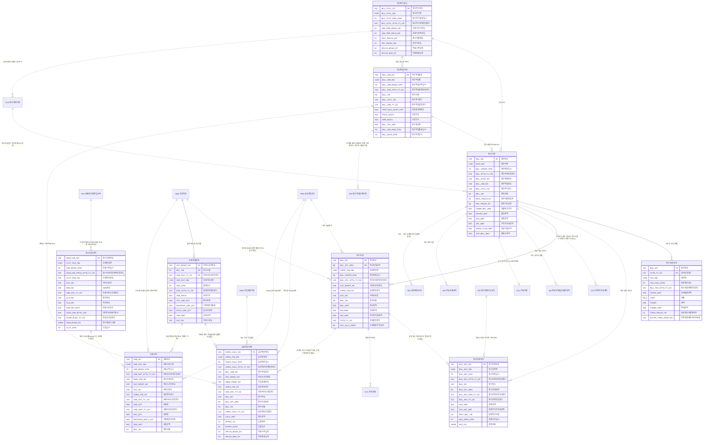

# 02. 개념 모델 — PAY 청구

> 작성 2026-11-07 · subagent_subject_modeler · 02 관문 수정·재생성 masteragent_da_coordinator · 정본 `CONTEXT.md`(D1~D15·규칙 2절·형식 3절)
> 짝 산출물 : `model/conceptual/PAY.json`(이 문서는 JSON 에서 생성 — 어긋나지 않음, 손으로 고치지 말고 JSON 을 고친 뒤 재생성) · 리뷰 : `reviews/02_conceptual.md`
> 요약 : 핵심 엔터티 **10개**(REF 1 · ACT 8 · PROC 1) · STL 표시 0건 · 이 영역이 걸린 주제영역 간 관계(areas.json crossRels) 23건

## 1. 핵심 엔터티

물리명 = 접두어 없는 `<약어>_<분류어 약어>`(분류어 약어 = 표준단어 사전 `model/std/words.json` : 기본 BAS·상세 DTL·이력 HIST·내역 DTLS·코드 CD·집계 AGG). 테이블명 접두어 `PTL_PAY_` 는 물리 단계에서 붙인다.

| # | 엔터티 | 물리명 | 테이블명(물리 미리보기) | 유형 | 모듈 | 주식별자 | 정의 |
|---|---|---|---|---|---|---|---|
| 1 | 원시사용내역 | RAW_USE_DTLS | PTL_PAY_RAW_USE_L | ACT 행위 |  | 원시사용번호 | 교환기(MSC·IMS)·PGW/SMF·SMSC 가 만든 원시 사용기록(CDR)을 중계(Mediation)로 수집한 원본 1건. Rating 전 상태와 처리 결과(정상·오류·중복·보류)를 가진다. |
| 2 | 사용내역 | USE_DTLS | PTL_PAY_USE_L | ACT 행위 |  | 사용번호 | 원시사용내역을 Rating(요금항목 결정·요율 적용·기본제공량 차감)한 과금 단위 사용 기록. 음성·데이터·문자·영상·로밍·콘텐츠 사용을 모두 담는 초대용량(T4) 엔터티 — 일 RANGE 파티션 후보. |
| 3 | 사용량월집계 | USE_QTY_MM_AGG | PTL_PAY_USE_QTY_MM_T | PROC 가공 |  | 서비스관리번호 + 청구년월 + 사용서비스유형코드 | 회선×청구년월×사용서비스유형 단위로 사용내역을 집계한 가공 엔터티. 요금계산(사용료·초과량)·기본제공 소진 판정·레이크 피처의 기준점. |
| 4 | 요금계산내역 | CHRG_CALC_DTLS | PTL_PAY_CHRG_CALC_L | ACT 행위 |  | 요금계산번호 | 청구작업(Bill Run)에서 가입상품×청구년월×요금항목 단위로 계산한 요금 결과(월정액·일할·사용료·할인·위약금·할부금). 청구상세 라인의 근거. |
| 5 | 청구주기코드 | BILL_CYCL_CD | PTL_PAY_BILL_CYCL_C | REF 기준 |  | 청구주기코드 | 사용기간 마감일·청구서 발행일·납부기한일을 정하는 청구주기 기준(예 1일~말일 사용, 익월 7일 발행, 익월 25일 납기). 적용 기간을 가진 이력형 기준. |
| 6 | 청구작업기본 | BILL_JOB_BAS | PTL_PAY_BILL_JOB_M | ACT 행위 |  | 청구작업번호 | 청구년월×청구주기 단위로 요금계산·청구서 생성·마감을 수행하는 청구작업(Bill Run) 1회. 정기·재청구·해지즉시 청구를 구분한다. |
| 7 | 청구기본 | BILL_BAS | PTL_PAY_BILL_M | ACT 행위 |  | 청구번호 | 청구계정×청구년월 단위 청구서(재청구·해지즉시 청구는 같은 월 추가 건). 당월요금·할인·조정·부가가치세·미납이월을 합한 총청구금액과 납부기한을 가진다. 수납배분·미납의 기준(S14 핫 키 — 법인 청구계정 1개에 수천 건). |
| 8 | 청구상세 | BILL_DTL | PTL_PAY_BILL_D | ACT 행위 |  | 청구번호 + 청구상세순번 | 청구서의 요금항목 라인 — 청구서×회선×요금항목 단위 금액. 수납배분·미납이 항목 순위(할부금·부가세 등)로 이뤄지므로 라인별 금액·수납순위를 가진다. |
| 9 | 청구조정내역 | BILL_ADJ_DTLS | PTL_PAY_BILL_ADJ_L | ACT 행위 |  | 청구조정번호 | 확정된 청구서·청구 라인에 대한 감액·증액·재청구·이월 조정 1건(민원 감면·오과금 정정·장애 보상 등). 감액은 음수 금액(S7), 승인 후 당월 또는 다음 청구서에 반영. |
| 10 | 청구세금상세 | BILL_TAX_DTL | PTL_PAY_BILL_TAX_D | ACT 행위 |  | 청구번호 + 과세유형코드 | 청구서의 과세 유형(과세·영세·면세)별 과세표준·세율·세액(부가가치세법). 법인 청구계정은 전자세금계산서 승인번호를 가진다. |

## 2. 참조 키 이름 규칙 (다른 주제영역과 공유)

다른 주제영역 핵심 엔터티를 참조할 때 PK 이름은 **소유 영역 이름 그대로**(`<엔터티 핵심어>번호`, 기준·코드형 `<핵심어>코드`, 역할명은 접두어 + 원 키 이름). 같은 키 = 같은 속성명·물리명·도메인.

| 구분 | 속성명 | 물리명 | 도메인 | 소유 엔터티 |
|---|---|---|---|---|
| PAY 소유 | 원시사용번호 | RAW_USE_NO | 번호V20 | PAY.원시사용내역 |
| PAY 소유 | 사용번호 | USE_NO | 번호V20 | PAY.사용내역 |
| PAY 소유 | 요금계산번호 | CHRG_CALC_NO | 번호V20 | PAY.요금계산내역 |
| PAY 소유 | 청구주기코드 | BILL_CYCL_CD | 코드V10 | PAY.청구주기코드 |
| PAY 소유 | 청구작업번호 | BILL_JOB_NO | 번호V20 | PAY.청구작업기본 |
| PAY 소유 | 청구번호 | BILL_NO | 번호V20 | PAY.청구기본 |
| PAY 소유 | 청구조정번호 | BILL_ADJ_NO | 번호V20 | PAY.청구조정내역 |
| 외부 참조 | 요금항목코드 | CHRG_ITM_CD | 코드V10 | PRD.요금항목코드 |
| 외부 참조 | 청구계정번호 | BILL_ACNT_NO | 번호V20 | CUS.청구계정기본 |
| 외부 참조 | 서비스관리번호 | SVC_MGMT_NO | 번호V20 | ORD.회선기본 |
| 외부 참조 | 서비스번호 | SVC_NO | 번호V20 | ORD.서비스번호기본 |
| 외부 참조 | 가입상품번호 | SBSC_PROD_NO | 번호V20 | ORD.가입상품기본 |

## 3. 엔터티별 주요 속성

역할 : 주식별자·명칭·행위 일시·상태 = 필수 4종(규칙 2-5), 업무 = 업무 핵심 속성. 물리명·도메인은 후보 — 표준사전(`model/std`) 단계에서 확정.

### 3.1 원시사용내역 (RAW_USE_DTLS, ACT)

| 속성명 | 물리명 후보 | 역할 | 도메인 후보 |
|---|---|---|---|
| 원시사용번호 | RAW_USE_NO | 주식별자 | 번호V20 |
| 수집파일명 | CLCT_FILE_NM | 명칭 | 명V100 |
| 사용시작일시 | USE_BGNG_DTM | 행위 일시 | 일시TS |
| 원시사용처리상태유형코드 | RAW_USE_PRCS_STTS_TY_CD | 상태 | 코드V10 |
| 수집파일번호 | CLCT_FILE_NO | 업무 | 번호V20 |
| 서비스번호 | SVC_NO | 업무 | 번호V20 |
| IMSI번호 | IMSI_NO | 업무 | 번호V20 |
| 사용서비스유형코드 | USE_SVC_TY_CD | 업무 | 코드V10 |
| 발신번호 | CLG_NO | 업무 | 번호V20 |
| 착신번호 | CLD_NO | 업무 | 번호V20 |
| 사용시간초수 | USE_HR_SCNT | 업무 | 수N10 |
| 데이터사용바이트수 | DATA_USE_BYTE_CNT | 업무 | 수N18 |
| 망요소유형코드 | NTWK_ELMT_TY_CD | 업무 | 코드V10 |
| 원시레코드내용 | RAW_RCRD_CN | 업무 | 내용V4000 |
| 수집일시 | CLCT_DTM | 업무 | 일시TS |

### 3.2 사용내역 (USE_DTLS, ACT)

| 속성명 | 물리명 후보 | 역할 | 도메인 후보 |
|---|---|---|---|
| 사용번호 | USE_NO | 주식별자 | 번호V20 |
| 사용서비스명 | USE_SVC_NM | 명칭 | 명V100 |
| 사용시작일시 | USE_BGNG_DTM | 행위 일시 | 일시TS |
| 사용과금상태유형코드 | USE_RAT_STTS_TY_CD | 상태 | 코드V10 |
| 원시사용번호 | RAW_USE_NO | 업무 | 번호V20 |
| 서비스관리번호 | SVC_MGMT_NO | 업무 | 번호V20 |
| 서비스번호 | SVC_NO | 업무 | 번호V20 |
| 요금항목코드 | CHRG_ITM_CD | 업무 | 코드V10 |
| 사용서비스유형코드 | USE_SVC_TY_CD | 업무 | 코드V10 |
| 사용량 | USE_QTY | 업무 | 수량N18 |
| 사용단위유형코드 | USE_UNIT_TY_CD | 업무 | 코드V10 |
| 과금량 | RAT_QTY | 업무 | 수량N18 |
| 기본제공차감량 | BSCPRVD_DDCT_QTY | 업무 | 수량N18 |
| 사용금액 | USE_AMT | 업무 | 금액N15 |
| 청구년월 | BILL_YM | 업무 | 년월C6 |

### 3.3 사용량월집계 (USE_QTY_MM_AGG, PROC)

| 속성명 | 물리명 후보 | 역할 | 도메인 후보 |
|---|---|---|---|
| 서비스관리번호 | SVC_MGMT_NO | 주식별자 | 번호V20 |
| 청구년월 | BILL_YM | 주식별자 | 년월C6 |
| 사용서비스유형코드 | USE_SVC_TY_CD | 주식별자 | 코드V10 |
| 사용서비스명 | USE_SVC_NM | 명칭 | 명V100 |
| 집계일시 | AGG_DTM | 행위 일시 | 일시TS |
| 집계상태유형코드 | AGG_STTS_TY_CD | 상태 | 코드V10 |
| 사용건수 | USE_NOCS | 업무 | 건수N10 |
| 총사용량 | TOT_USE_QTY | 업무 | 수량N18 |
| 기본제공사용량 | BSCPRVD_USE_QTY | 업무 | 수량N18 |
| 초과사용량 | EXCS_USE_QTY | 업무 | 수량N18 |
| 사용금액 | USE_AMT | 업무 | 금액N15 |
| 서비스번호 | SVC_NO | 업무 | 번호V20 |

### 3.4 요금계산내역 (CHRG_CALC_DTLS, ACT)

| 속성명 | 물리명 후보 | 역할 | 도메인 후보 |
|---|---|---|---|
| 요금계산번호 | CHRG_CALC_NO | 주식별자 | 번호V20 |
| 요금항목명 | CHRG_ITM_NM | 명칭 | 명V100 |
| 요금계산일시 | CHRG_CALC_DTM | 행위 일시 | 일시TS |
| 요금계산상태유형코드 | CHRG_CALC_STTS_TY_CD | 상태 | 코드V10 |
| 청구작업번호 | BILL_JOB_NO | 업무 | 번호V20 |
| 서비스관리번호 | SVC_MGMT_NO | 업무 | 번호V20 |
| 가입상품번호 | SBSC_PROD_NO | 업무 | 번호V20 |
| 요금항목코드 | CHRG_ITM_CD | 업무 | 코드V10 |
| 사용서비스유형코드 | USE_SVC_TY_CD | 업무 | 코드V10 |
| 청구번호 | BILL_NO | 업무 | 번호V20 |
| 청구상세순번 | BILL_DTL_SEQ | 업무 | 순번N5 |
| 청구년월 | BILL_YM | 업무 | 년월C6 |
| 요금계산유형코드 | CHRG_CALC_TY_CD | 업무 | 코드V10 |
| 계산금액 | CALC_AMT | 업무 | 금액N15 |
| 일할여부 | DYPRT_YN | 업무 | 여부C1 |
| 일할일수 | DYPRT_DCNT | 업무 | 일수N3 |
| 적용시작일자 | APLCN_BGNG_DT | 업무 | 일자C8 |
| 적용종료일자 | APLCN_END_DT | 업무 | 일자C8 |

### 3.5 청구주기코드 (BILL_CYCL_CD, REF)

| 속성명 | 물리명 후보 | 역할 | 도메인 후보 |
|---|---|---|---|
| 청구주기코드 | BILL_CYCL_CD | 주식별자 | 코드V10 |
| 청구주기명 | BILL_CYCL_NM | 명칭 | 명V100 |
| 청구주기등록일시 | BILL_CYCL_REG_DTM | 행위 일시 | 일시TS |
| 청구주기상태유형코드 | BILL_CYCL_STTS_TY_CD | 상태 | 코드V10 |
| 사용기간시작일 | USE_PRD_BGNG_DD | 업무 | 일C2 |
| 사용기간마감일 | USE_PRD_DDLN_DD | 업무 | 일C2 |
| 청구서발행일 | INVC_PBLCN_DD | 업무 | 일C2 |
| 납부기한일 | PAY_TMLMT_DD | 업무 | 일C2 |
| 적용시작일자 | APLCN_BGNG_DT | 업무 | 일자C8 |
| 적용종료일자 | APLCN_END_DT | 업무 | 일자C8 |

### 3.6 청구작업기본 (BILL_JOB_BAS, ACT)

| 속성명 | 물리명 후보 | 역할 | 도메인 후보 |
|---|---|---|---|
| 청구작업번호 | BILL_JOB_NO | 주식별자 | 번호V20 |
| 청구작업명 | BILL_JOB_NM | 명칭 | 명V100 |
| 청구작업시작일시 | BILL_JOB_BGNG_DTM | 행위 일시 | 일시TS |
| 청구작업상태유형코드 | BILL_JOB_STTS_TY_CD | 상태 | 코드V10 |
| 청구년월 | BILL_YM | 업무 | 년월C6 |
| 청구주기코드 | BILL_CYCL_CD | 업무 | 코드V10 |
| 청구작업유형코드 | BILL_JOB_TY_CD | 업무 | 코드V10 |
| 대상청구계정수 | TRGT_BILL_ACNT_CNT | 업무 | 수N10 |
| 처리건수 | PRCS_NOCS | 업무 | 건수N10 |
| 오류건수 | ERR_NOCS | 업무 | 건수N10 |
| 청구총금액 | BILL_TOT_AMT | 업무 | 금액N15 |
| 청구작업종료일시 | BILL_JOB_END_DTM | 업무 | 일시TS |
| 청구마감일시 | BILL_DDLN_DTM | 업무 | 일시TS |

### 3.7 청구기본 (BILL_BAS, ACT)

| 속성명 | 물리명 후보 | 역할 | 도메인 후보 |
|---|---|---|---|
| 청구번호 | BILL_NO | 주식별자 | 번호V20 |
| 청구서명 | INVC_NM | 명칭 | 명V100 |
| 청구확정일시 | BILL_CFMTN_DTM | 행위 일시 | 일시TS |
| 청구상태유형코드 | BILL_STTS_TY_CD | 상태 | 코드V10 |
| 청구계정번호 | BILL_ACNT_NO | 업무 | 번호V20 |
| 청구작업번호 | BILL_JOB_NO | 업무 | 번호V20 |
| 청구주기코드 | BILL_CYCL_CD | 업무 | 코드V10 |
| 청구년월 | BILL_YM | 업무 | 년월C6 |
| 청구서발행일자 | INVC_PBLCN_DT | 업무 | 일자C8 |
| 납부기한일자 | PAY_TMLMT_DT | 업무 | 일자C8 |
| 당월청구금액 | THMM_BILL_AMT | 업무 | 금액N15 |
| 할인금액 | DSCNT_AMT | 업무 | 금액N15 |
| 조정금액 | ADJ_AMT | 업무 | 금액N15 |
| 부가가치세금액 | VAT_AMT | 업무 | 금액N15 |
| 미납이월금액 | UNPD_CYOV_AMT | 업무 | 금액N15 |
| 총청구금액 | TOT_BILL_AMT | 업무 | 금액N15 |

### 3.8 청구상세 (BILL_DTL, ACT)

| 속성명 | 물리명 후보 | 역할 | 도메인 후보 |
|---|---|---|---|
| 청구번호 | BILL_NO | 주식별자 | 번호V20 |
| 청구상세순번 | BILL_DTL_SEQ | 주식별자 | 순번N5 |
| 요금항목명 | CHRG_ITM_NM | 명칭 | 명V100 |
| 청구확정일시 | BILL_CFMTN_DTM | 행위 일시 | 일시TS |
| 청구상세상태유형코드 | BILL_DTL_STTS_TY_CD | 상태 | 코드V10 |
| 서비스관리번호 | SVC_MGMT_NO | 업무 | 번호V20 |
| 요금항목코드 | CHRG_ITM_CD | 업무 | 코드V10 |
| 서비스번호 | SVC_NO | 업무 | 번호V20 |
| 청구년월 | BILL_YM | 업무 | 년월C6 |
| 청구금액 | BILL_AMT | 업무 | 금액N15 |
| 공급가액 | SPLYAMT | 업무 | 금액N15 |
| 부가가치세금액 | VAT_AMT | 업무 | 금액N15 |
| 과세유형코드 | TXTN_TY_CD | 업무 | 코드V10 |
| 수납배분우선순위 | RCV_ALLC_PRRT | 업무 | 순번N5 |

### 3.9 청구조정내역 (BILL_ADJ_DTLS, ACT)

| 속성명 | 물리명 후보 | 역할 | 도메인 후보 |
|---|---|---|---|
| 청구조정번호 | BILL_ADJ_NO | 주식별자 | 번호V20 |
| 청구조정명 | BILL_ADJ_NM | 명칭 | 명V100 |
| 청구조정일시 | BILL_ADJ_DTM | 행위 일시 | 일시TS |
| 청구조정상태유형코드 | BILL_ADJ_STTS_TY_CD | 상태 | 코드V10 |
| 청구번호 | BILL_NO | 업무 | 번호V20 |
| 청구상세순번 | BILL_DTL_SEQ | 업무 | 순번N5 |
| 청구조정사유유형코드 | BILL_ADJ_RSN_TY_CD | 업무 | 코드V10 |
| 청구조정유형코드 | BILL_ADJ_TY_CD | 업무 | 코드V10 |
| 조정금액 | ADJ_AMT | 업무 | 금액N15 |
| 조정부가가치세금액 | ADJ_VAT_AMT | 업무 | 금액N15 |
| 반영청구년월 | RFLT_BILL_YM | 업무 | 년월C6 |
| 조정승인일시 | ADJ_APRV_DTM | 업무 | 일시TS |
| 조정내용 | ADJ_CN | 업무 | 내용V4000 |

### 3.10 청구세금상세 (BILL_TAX_DTL, ACT)

| 속성명 | 물리명 후보 | 역할 | 도메인 후보 |
|---|---|---|---|
| 청구번호 | BILL_NO | 주식별자 | 번호V20 |
| 과세유형코드 | TXTN_TY_CD | 주식별자 | 코드V10 |
| 세금명 | TAX_NM | 명칭 | 명V100 |
| 세금계산일시 | TAX_CALC_DTM | 행위 일시 | 일시TS |
| 청구세금상태유형코드 | BILL_TAX_STTS_TY_CD | 상태 | 코드V10 |
| 과세표준금액 | TXSTD_AMT | 업무 | 금액N15 |
| 세율 | TXRT | 업무 | 율N5_2 |
| 세액 | TXAMT | 업무 | 금액N15 |
| 면세금액 | TXEMP_AMT | 업무 | 금액N15 |
| 세금계산서발행여부 | TXINV_PBLCN_YN | 업무 | 여부C1 |
| 전자세금계산서승인번호 | ELCTR_TXINV_APRV_NO | 업무 | 번호V30 |

## 4. 관계

카디널리티는 이 엔터티(행) 기준. 식별 = 부모 키가 자식 PK 에 포함. 선택 = 상대가 없어도 됨. 상대가 다른 주제영역이면 `영역.엔터티`.

| 엔터티 | 상대 엔터티 | 차수 | 식별 | 선택 | 관계명 |
|---|---|---|---|---|---|
| 원시사용내역 | 사용량수집파일내역 | N:1 | 비식별 | 필수 | 수집 파일에 담겨 들어옴(논리 단계 기본 엔터티) |
| 원시사용내역 | 사용내역 | 1:N | 비식별 | 선택 | Rating 결과(오류·중복이면 없음, 분할 과금이면 여러 건) |
| 사용내역 | 원시사용내역 | N:1 | 비식별 | 선택 | 원천 CDR(재Rating·수기 입력분은 없음) |
| 사용내역 | ORD.회선기본 | N:1 | 비식별 | 필수 | 사용 발생 회선(서비스관리번호) |
| 사용내역 | PRD.요금항목코드 | N:1 | 비식별 | 필수 | Rating 결과 요금항목 |
| 사용내역 | 사용량월집계 | N:1 | 비식별 | 필수 | 월 집계의 원천(PROC 재계산 기준) |
| 사용량월집계 | ORD.회선기본 | N:1 | 식별 | 필수 | 집계 대상 회선(식별) |
| 사용량월집계 | 사용내역 | 1:N | 비식별 | 필수 | 집계 원천 |
| 사용량월집계 | 요금계산내역 | 1:N | 비식별 | 선택 | 사용료·초과요금 계산 근거 |
| 요금계산내역 | 청구작업기본 | N:1 | 비식별 | 필수 | 계산을 수행한 Bill Run |
| 요금계산내역 | ORD.가입상품기본 | N:1 | 비식별 | 필수 | 요금 근거 가입상품 |
| 요금계산내역 | PRD.요금항목코드 | N:1 | 비식별 | 필수 | 계산 결과 요금항목 |
| 요금계산내역 | 청구상세 | N:1 | 비식별 | 선택 | 반영된 청구 라인(청구 확정 전·청구 제외분은 없음) |
| 요금계산내역 | 사용량월집계 | N:1 | 비식별 | 선택 | 사용료 계산 근거(월정액·일할분은 없음) |
| 청구주기코드 | 청구작업기본 | 1:N | 비식별 | 선택 | 주기별 Bill Run |
| 청구주기코드 | 청구기본 | 1:N | 비식별 | 선택 | 주기별 청구서 |
| 청구주기코드 | CUS.청구계정기본 | 1:N | 비식별 | 선택 | 청구계정에 지정된 청구주기 |
| 청구작업기본 | 청구주기코드 | N:1 | 비식별 | 필수 | 작업 대상 청구주기 |
| 청구작업기본 | 요금계산내역 | 1:N | 비식별 | 선택 | 작업이 만든 요금계산 결과 |
| 청구작업기본 | 청구기본 | 1:N | 비식별 | 선택 | 작업이 만든 청구서 |
| 청구작업기본 | 청구작업단계이력 | 1:N | 비식별 | 선택 | 단계별 처리 상태(논리 단계 기본 엔터티, 자식 쪽 식별 관계) |
| 청구기본 | CUS.청구계정기본 | N:1 | 비식별 | 필수 | 청구서를 받는 청구계정(S14 핫 키) |
| 청구기본 | 청구주기코드 | N:1 | 비식별 | 필수 | 청구주기 |
| 청구기본 | 청구작업기본 | N:1 | 비식별 | 필수 | 청구서를 만든 Bill Run |
| 청구기본 | 청구상세 | 1:N | 비식별 | 필수 | 청구 라인(청구서는 라인 1건 이상) |
| 청구기본 | 청구세금상세 | 1:N | 비식별 | 필수 | 과세 유형별 세금 |
| 청구기본 | 청구조정내역 | 1:N | 비식별 | 선택 | 감액·증액·재청구 조정 |
| 청구기본 | INV.수납배분상세 | 1:N | 비식별 | 선택 | 수납 → 청구서 배분(미수납이면 없음) |
| 청구기본 | INV.선납사용내역 | 1:N | 비식별 | 선택 | 선납 잔액 차감 |
| 청구기본 | COL.미납기본 | 1:1 | 비식별 | 선택 | 납기 경과 미수납 시에만 존재 |
| 청구기본 | INV.자동이체출금요청내역 | 1:N | 비식별 | 선택 | 출금 대상 청구서 |
| 청구기본 | COL.연체가산금내역 | 1:N | 비식별 | 선택 | 가산금이 실린 다음 달 청구서(청구 반영 전·면제 시 NULL) |
| 청구상세 | 청구기본 | N:1 | 식별 | 필수 | 소속 청구서(식별) |
| 청구상세 | ORD.회선기본 | N:1 | 비식별 | 선택 | 라인 발생 회선(청구계정 단위 요금은 없음) |
| 청구상세 | PRD.요금항목코드 | N:1 | 비식별 | 필수 | 라인 요금항목 |
| 청구상세 | 요금계산내역 | 1:N | 비식별 | 선택 | 라인을 이룬 요금계산 결과 |
| 청구상세 | 청구조정내역 | 1:N | 비식별 | 선택 | 라인 단위 조정 |
| 청구상세 | COL.미납상세 | 1:N | 비식별 | 선택 | 항목 단위 미납 |
| 청구조정내역 | 청구기본 | N:1 | 비식별 | 필수 | 조정 대상 청구서 |
| 청구조정내역 | 청구상세 | N:1 | 비식별 | 선택 | 조정 대상 라인(청구서 전체 조정은 없음) |
| 청구조정내역 | 청구조정사유코드 | N:1 | 비식별 | 필수 | 조정 사유(논리 단계 기본 REF) |
| 청구세금상세 | 청구기본 | N:1 | 식별 | 필수 | 소속 청구서(식별) |

### 4.1 기본 엔터티의 주제영역 간 관계 (논리 단계 엔터티 — 양끝 일관용 예약)

| 기본 엔터티 | 모듈 | 상대 엔터티 | 차수 | 식별 | 선택 | 관계명 |
|---|---|---|---|---|---|---|
| 할인적용내역 |  | PRD.할인상품기본 | N:1 | 비식별 | 선택 | 요금계산 때 적용된다 |
| 위약금부과내역 |  | ORD.약정계약기본 | N:1 | 비식별 | 선택 | 해지·변경 시 위약금(PAY 쪽 FK) |
| 결합할인배분내역 |  | ORD.결합계약기본 | N:1 | 비식별 | 선택 | 결합 계약 단위 할인 배분(PAY 쪽 FK) |
| 소액결제청구상세 | STL | PRM.콘텐츠제공사기본 | N:1 | 비식별 | 선택 | 소액결제 대금이 청구된다(STL) |
| 콘텐츠이용요금내역 | STL | PRM.콘텐츠제공사기본 | N:1 | 비식별 | 선택 | 정보이용료가 대신 청구된다(STL) |
| 로밍사용내역 | STL | PRM.로밍사업자기본 | N:1 | 비식별 | 선택 | 방문망 사업자로서 TAP 사용 기록을 보낸다(STL) |

## 5. ERD (Mermaid, 개념)

실선 = 식별 관계, 점선 = 비식별. 다른 주제영역·기본 엔터티는 `X_<영역>_n` 별칭으로 참조만 표시(ERD 는 주제영역 1개 단위).



## 6. 공통코드 후보 (규칙 2-6 이름 3종)

값 후보는 표준사전 단계(`model/std/codes.json`)에서 확정 — 아래는 이 영역 속성에서 나온 공통코드 용어.

| 용어명 | 종류 | 쓰는 엔터티 |
|---|---|---|
| 원시사용처리상태유형코드 | 유형 | 원시사용내역 |
| 사용서비스유형코드 | 유형 | 원시사용내역·사용내역·사용량월집계·요금계산내역 |
| 망요소유형코드 | 유형 | 원시사용내역 |
| 사용과금상태유형코드 | 유형 | 사용내역 |
| 사용단위유형코드 | 유형 | 사용내역 |
| 집계상태유형코드 | 유형 | 사용량월집계 |
| 요금계산상태유형코드 | 유형 | 요금계산내역 |
| 요금계산유형코드 | 유형 | 요금계산내역 |
| 청구주기상태유형코드 | 유형 | 청구주기코드 |
| 청구작업상태유형코드 | 유형 | 청구작업기본 |
| 청구작업유형코드 | 유형 | 청구작업기본 |
| 청구상태유형코드 | 유형 | 청구기본 |
| 청구상세상태유형코드 | 유형 | 청구상세 |
| 과세유형코드 | 유형 | 청구상세·청구세금상세 |
| 청구조정상태유형코드 | 유형 | 청구조정내역 |
| 청구조정사유유형코드 | 유형 | 청구조정내역 |
| 청구조정유형코드 | 유형 | 청구조정내역 |
| 청구세금상태유형코드 | 유형 | 청구세금상세 |

## 7. 도메인 후보 (이 영역 사용분)

| 도메인 | 사용 속성 수 |
|---|---|
| 건수N10 | 3 |
| 금액N15 | 18 |
| 내용V4000 | 2 |
| 년월C6 | 7 |
| 명V100 | 10 |
| 번호V20 | 27 |
| 번호V30 | 1 |
| 수N10 | 2 |
| 수N18 | 1 |
| 수량N18 | 6 |
| 순번N5 | 4 |
| 여부C1 | 2 |
| 율N5_2 | 1 |
| 일C2 | 4 |
| 일수N3 | 1 |
| 일시TS | 14 |
| 일자C8 | 6 |
| 코드V10 | 28 |

## 8. 결정 메모 (위임 자동 승인 — 근거)

### 8.1 원 작성 문서 메모 이관

> subagent_subject_modeler 원문을 옮김. 물리명은 02 관문 수정본으로 치환했고, 한글 속성명 변경은 9절을 따른다.

#### 범위와 흐름

```
CDR 수집(원시사용내역) → Rating(사용내역) → 월 집계(사용량월집계)
      ↓                                     ↓
청구주기코드 → 청구작업기본(Bill Run) → 요금계산내역(가입상품×요금항목)
                    ↓                         ↓
             청구기본(청구계정×청구년월) ← 청구상세(라인) ← 청구조정내역
                    ↓ 청구세금상세
             → INV 수납배분 · COL 미납
```

- 후보(`areas.json` candidates.core) 10개를 이름 그대로 확정 — 실무 검토 결과 Bill Run·청구서·라인·조정·세금·사용량 체인이 빠짐없이 핵심에 있어 교체 불필요.
- 기본 20개(사용량수집파일내역·청구조정사유코드·청구작업단계이력 등)는 논리 단계 몫. 이 문서의 관계에는 핵심이 직접 참조하는 기본 엔터티 3개만 이름으로 등장한다.

#### 결정 메모 (위임 자동 승인 — 근거)

| # | 결정 | 근거 |
|---|---|---|
| C1 | 후보 10개 이름 그대로 확정 | CDR→Rating→집계→Bill Run→요금계산→청구서·라인·조정·세금이 한 체인. 3GPP TS 32.240 과금 구조·TM Forum SID Customer Bill/Usage 와 1:1 대응되어 교체 이득 없음 |
| C2 | 회선 PK = **서비스관리번호**(SVC_MGMT_NO), 서비스번호(전화번호)는 업무 속성 | 번호이동·해지 번호 재사용(S8)으로 전화번호는 회선을 유일하게 식별 못 함 — 국내 3사 실무 관행(서비스관리번호) |
| C3 | 청구서 PK = 청구번호(단일 대리키), 청구계정번호+청구년월은 업무 키 | 재청구·해지즉시 청구로 같은 청구계정×청구년월에 여러 장 가능. 수납배분·미납이 짧은 단일 키로 참조 |
| C4 | 청구상세·청구세금상세 = 청구서 식별 관계(청구번호+순번 / 청구번호+과세유형코드) | 라인·세금은 청구서 없이 존재 불가. 세금은 과세 유형별 1행이 부가가치세법 신고 단위 |
| C5 | 사용량월집계 PK = 서비스관리번호+청구년월+사용서비스유형코드(회선 식별 관계) | PROC 는 집계 축이 곧 식별자 — 재집계 시 같은 키 UPSERT, 레이크 피처 키 그대로 |
| C6 | 청구년월·서비스번호 같은 업무 키를 행위 엔터티에 속성으로 남김(사용내역·청구상세·요금계산내역) | 01 5절 원칙 4 — 파티션 키·레이크 파티셔닝. 이행 종속(반정규화) 여부는 물리 단계가 사유와 함께 확정. 고객번호·청구서수령방법은 청구계정 경유로 얻을 수 있어 개념 단계에서는 뺌 |
| C7 | 요금계산내역 → 청구상세 N:1 선택 | 청구 확정 전·청구 제외(0원·이월)분은 라인이 없음. 라인은 여러 요금계산 결과를 합친 것 |
| C8 | 청구조정 금액은 음수 허용(감액), 사유는 기본 REF 청구조정사유코드로 | S7 음수 조정. 사유 체계는 늘어나므로 코드 엔터티(유형코드 아닌 별도 REF) |
| C9 | 물리 약어 결정 : 청구 = BILL, 요금 = CHRG, 상태 = STTS, 유형 = TP, 합성어 USEQTY(사용량)·CHRGQTY(과금량)·SPLYAMT(공급가액)·TXSTD(과세표준)·TXRT(세율)·TXAMT(세액)·TXINV(세금계산서)·BSCPRVD(기본제공)·DYPRT(일할)·VAT(부가가치세) | 통신 과금 실무 용어(Billing·Charge). 공공 표준의 청구 = CLM(Claim)은 보험·의료 청구 의미라 채택 안 함. 합성어는 '_' 없이(메모리 규칙). 표준사전 단계에서 최종 확정 |
| C10 | 테이블 접미어 = schema.pi sql/017 tbl_sfx_txt(기본 _M · 상세 _D · 내역 _L · 코드 _C · 집계 _T) | CONTEXT 규칙 2-4 |
| C11 | 할인상품기본 PK = 상품코드(PRD_CD) | 할인상품은 상품의 하위 유형 — 상품 코드 체계를 공유. PRD 개념 모델이 다르게 정하면 PRD 쪽을 따른다 |
| C12 | STL 표시 엔터티(로밍사용내역·소액결제청구상세·콘텐츠이용요금내역)는 기본 엔터티라 핵심에 없음 | areas.json candidates.basic — moduleCd 는 논리 단계 JSON 에 표시 |

미확인 [확인중] : 도메인 이름(번호V20·전화번호V20·수량N18·율N5_2·일N2·일수N3·번호V30·내용V4000)은 후보 — 도메인 사전(`model/std/domains.json`) 확정 시 맞춘다.

## 9. 02 관문 수정 반영 (reviews/02_conceptual.md)

아래는 coordinator 02 관문 수정분(수정 전 → 관문 수정본). 이후 표준사전 단계가 적용한 이름 변경은 `model/std/_build_log.txt` 가 정본이고, 1~8절은 두 단계를 모두 반영한 현재 JSON 이다.

- 엔터티 원시사용내역 물리명 PTL_PAY_RAW_USE_L → RAW_USE_DTLS
- 원시사용내역.원시사용처리상태유형코드(RAW_USE_PRCS_STTS_TP_CD/코드V10) → 원시사용처리상태유형코드(RAW_USE_PRCS_STTS_TY_CD/코드V10)
- 원시사용내역.서비스번호(SVC_NO/전화번호V20) → 서비스번호(SVC_NO/번호V20)
- 원시사용내역.국제이동가입자식별번호(IMSI_NO/번호V20) → IMSI(IMSI/번호V20)
- 원시사용내역.사용서비스유형코드(USE_SVC_TP_CD/코드V10) → 사용서비스유형코드(USE_SVC_TY_CD/코드V10)
- 원시사용내역.착신번호(RCPTN_NO/전화번호V20) → 착신번호(CLD_NO/전화번호V20)
- 엔터티 사용내역 물리명 PTL_PAY_USE_L → USE_DTLS
- 사용내역.사용과금상태유형코드(USE_CHRG_STTS_TP_CD/코드V10) → 사용과금상태유형코드(USE_CHRG_STTS_TY_CD/코드V10)
- 사용내역.서비스번호(SVC_NO/전화번호V20) → 서비스번호(SVC_NO/번호V20)
- 사용내역.사용서비스유형코드(USE_SVC_TP_CD/코드V10) → 사용서비스유형코드(USE_SVC_TY_CD/코드V10)
- 사용내역.사용단위유형코드(USE_UNIT_TP_CD/코드V10) → 사용단위유형코드(USE_UNIT_TY_CD/코드V10)
- 엔터티 사용량월집계 물리명 PTL_PAY_USEQTY_MM_T → USEQTY_MNTH_AGG
- 사용량월집계.사용서비스유형코드(USE_SVC_TP_CD/코드V10) → 사용서비스유형코드(USE_SVC_TY_CD/코드V10)
- 사용량월집계.집계상태유형코드(AGG_STTS_TP_CD/코드V10) → 집계상태유형코드(AGG_STTS_TY_CD/코드V10)
- 사용량월집계.서비스번호(SVC_NO/전화번호V20) → 서비스번호(SVC_NO/번호V20)
- 엔터티 요금계산내역 물리명 PTL_PAY_CHRG_CALC_L → CHRG_CALC_DTLS
- 요금계산내역.요금계산상태유형코드(CHRG_CALC_STTS_TP_CD/코드V10) → 요금계산상태유형코드(CHRG_CALC_STTS_TY_CD/코드V10)
- 요금계산내역.가입상품번호(SBSC_PRD_NO/번호V20) → 가입상품번호(SBSC_PROD_NO/번호V20)
- 요금계산내역.요금계산유형코드(CHRG_CALC_TP_CD/코드V10) → 요금계산유형코드(CHRG_CALC_TY_CD/코드V10)
- 요금계산내역.서비스관리번호 속성 추가(부모 키 보존 — K4)
- 요금계산내역.사용서비스유형코드 속성 추가(부모 키 보존 — K4)
- 엔터티 청구주기코드 물리명 PTL_PAY_BILL_CYCL_C → BILL_CYCL_CD
- 청구주기코드.등록일시(REG_DTM/일시TS) → 청구주기등록일시(BILL_CYCL_REG_DTM/일시TS)
- 청구주기코드.청구주기상태유형코드(BILL_CYCL_STTS_TP_CD/코드V10) → 청구주기상태유형코드(BILL_CYCL_STTS_TY_CD/코드V10)
- 청구주기코드.청구서발행일(BILL_ISSU_DAY/일N2) → 청구서발행일(BLST_ISSU_DAY/일N2)
- 엔터티 청구작업기본 물리명 PTL_PAY_BILL_JOB_M → BILL_JOB_BAS
- 청구작업기본.청구작업상태유형코드(BILL_JOB_STTS_TP_CD/코드V10) → 청구작업상태유형코드(BILL_JOB_STTS_TY_CD/코드V10)
- 청구작업기본.청구작업유형코드(BILL_JOB_TP_CD/코드V10) → 청구작업유형코드(BILL_JOB_TY_CD/코드V10)
- 엔터티 청구기본 물리명 PTL_PAY_BILL_M → BILL_BAS
- 청구기본.청구서명(BILL_NM/명V100) → 청구서명(BLST_NM/명V100)
- 청구기본.청구상태유형코드(BILL_STTS_TP_CD/코드V10) → 청구상태유형코드(BILL_STTS_TY_CD/코드V10)
- 청구기본.청구서발행일자(BILL_ISSU_DT/일자C8) → 청구서발행일자(BLST_ISSU_DT/일자C8)
- 관계 추가 청구기본 → INV.자동이체출금요청내역 1:N(양끝 일관)
- 관계 추가 청구기본 → COL.연체가산금내역 1:N(양끝 일관)
- 엔터티 청구상세 물리명 PTL_PAY_BILL_D → BILL_DTL
- 청구상세.청구상세상태유형코드(BILL_DTL_STTS_TP_CD/코드V10) → 청구상세상태유형코드(BILL_DTL_STTS_TY_CD/코드V10)
- 청구상세.서비스번호(SVC_NO/전화번호V20) → 서비스번호(SVC_NO/번호V20)
- 청구상세.과세유형코드(TXTN_TP_CD/코드V10) → 과세유형코드(TXTN_TY_CD/코드V10)
- 청구상세.수납순위(RCVPAY_RNK/순번N5) → 수납순위(RCPT_RNK/순번N5)
- 엔터티 청구조정내역 물리명 PTL_PAY_BILL_ADJ_L → BILL_ADJ_DTLS
- 청구조정내역.청구조정상태유형코드(BILL_ADJ_STTS_TP_CD/코드V10) → 청구조정상태유형코드(BILL_ADJ_STTS_TY_CD/코드V10)
- 청구조정내역.청구조정유형코드(BILL_ADJ_TP_CD/코드V10) → 청구조정유형코드(BILL_ADJ_TY_CD/코드V10)
- 청구조정내역.반영청구년월(RFLCT_BILL_YM/년월C6) → 반영청구년월(RFLT_BILL_YM/년월C6)
- 엔터티 청구세금상세 물리명 PTL_PAY_BILL_TAX_D → BILL_TAX_DTL
- 청구세금상세.과세유형코드(TXTN_TP_CD/코드V10) → 과세유형코드(TXTN_TY_CD/코드V10)
- 청구세금상세.청구세금상태유형코드(BILL_TAX_STTS_TP_CD/코드V10) → 청구세금상태유형코드(BILL_TAX_STTS_TY_CD/코드V10)
- 기본 엔터티 관계 예약 할인적용내역 → PRD.할인상품기본 N:1(K7 양끝 일관)
- 기본 엔터티 관계 예약 위약금부과내역 → ORD.약정계약기본 N:1(K7 양끝 일관)
- 기본 엔터티 관계 예약 결합할인배분내역 → ORD.결합계약기본 N:1(K7 양끝 일관)
- 기본 엔터티 관계 예약 소액결제청구상세 → PRM.콘텐츠제공사기본 N:1(K7 양끝 일관)
- 기본 엔터티 관계 예약 콘텐츠이용요금내역 → PRM.콘텐츠제공사기본 N:1(K7 양끝 일관)
- 기본 엔터티 관계 예약 로밍사용내역 → PRM.로밍사업자기본 N:1(K7 양끝 일관)
