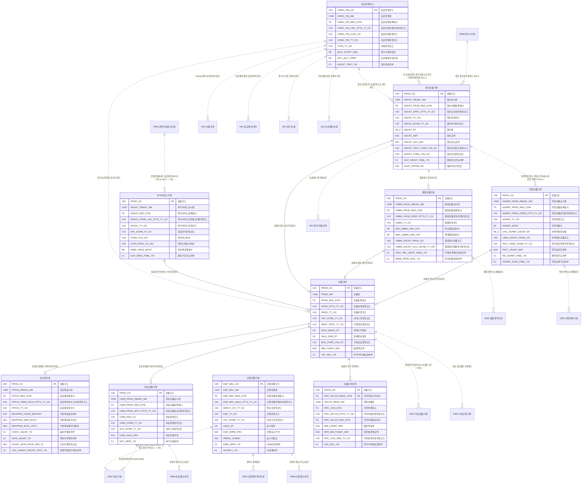

# 02. 개념 모델 — PRD 상품

> 작성 2026-11-07 · subagent_subject_modeler · 02 관문 수정·재생성 masteragent_da_coordinator · 정본 `CONTEXT.md`(D1~D15·규칙 2절·형식 3절)
> 짝 산출물 : `model/conceptual/PRD.json`(이 문서는 JSON 에서 생성 — 어긋나지 않음, 손으로 고치지 말고 JSON 을 고친 뒤 재생성) · 리뷰 : `reviews/02_conceptual.md`
> 요약 : 핵심 엔터티 **10개**(REF 10) · STL 표시 0건 · 이 영역이 걸린 주제영역 간 관계(areas.json crossRels) 16건

## 1. 핵심 엔터티

물리명 = 접두어 없는 `<약어>_<분류어 약어>`(분류어 약어 = 표준단어 사전 `model/std/words.json` : 기본 BAS·상세 DTL·이력 HIST·내역 DTLS·코드 CD·집계 AGG). 테이블명 접두어 `PTL_PRD_` 는 물리 단계에서 붙인다.

| # | 엔터티 | 물리명 | 테이블명(물리 미리보기) | 유형 | 모듈 | 주식별자 | 정의 |
|---|---|---|---|---|---|---|---|
| 1 | 상품기본 | PROD_BAS | PTL_PRD_PROD_M | REF 기준 |  | 상품코드 | 판매하는 모든 통신 상품(요금제·부가서비스·할인·결합·약정·유심)의 공통 정의(TM Forum SID Product Offering). 유형별 상세 6종의 상위(슈퍼타입). 판매 종료·폐지 후에도 행을 지우지 않고 상태·판매종료일자로 표현한다. 현재 월정액은 여기, 변경 이력은 상품가격이력. |
| 2 | 요금제기본 | RTPLN_BAS | PTL_PRD_RTPLN_M | REF 기준 |  | 상품코드 | 음성·문자·데이터 기본제공량과 소진 후 속도 제한(QoS)을 정한 월정액 요금제의 서브타입 상세. 이용약관 신고 대상. 초과 요율·시간대 요율·기본제공 상세 항목은 기본 엔터티(요금제기본제공상세·요금제초과요율상세)로 분리. |
| 3 | 부가서비스기본 | ADSVC_BAS | PTL_PRD_ADSVC_M | REF 기준 |  | 상품코드 | 요금제에 덧붙여 가입하는 부가서비스·옵션(통화연결음·데이터 옵션·로밍 요금제·휴대폰 보험·콘텐츠 구독 등)의 서브타입 상세. 망(HLR/HSS) 부가서비스 코드와 연동되며, 제3자 콘텐츠 상품은 PRM 콘텐츠제공사가 공급한다(S2 — 70% 미사용). |
| 4 | 할인상품기본 | DSCNT_PROD_BAS | PTL_PRD_DSCNT_PROD_M | REF 기준 |  | 상품코드 | 요금에서 빼 주는 할인 규칙(선택약정 25%·장기고객·복지·제휴카드·결합·임직원·프로모션)의 서브타입 상세. 정률·정액 방식과 한도, 대상 요금항목, 할인이 청구서에 찍히는 할인 요금항목을 정한다. 조건·구간별 할인율은 기본 엔터티(할인조건상세·할인율상세). |
| 5 | 결합상품기본 | CMBN_PROD_BAS | PTL_PRD_CMBN_PROD_M | REF 기준 |  | 상품코드 | 여러 회선·상품을 묶어 할인하는 결합 규칙(유무선 결합·가족 무선 결합·인터넷+IPTV·법인 결합)의 서브타입 상세. 결합 가능 회선 수·가족관계 확인·결합할인 상품과 배분 방식을 정한다. 구성 상품·회선별 할인은 기본 엔터티(결합구성상세·결합할인상세). |
| 6 | 약정상품기본 | AGRMT_PROD_BAS | PTL_PRD_AGRMT_PROD_M | REF 기준 |  | 상품코드 | 일정 기간 이용을 약속하고 혜택을 받는 약정 규칙(선택약정 요금할인 25%·공시지원금 약정·기기·요금·결합 약정)의 서브타입 상세. 약정 개월 수·위약금(할인반환금·지원금 반환) 산정 방식과 상한을 정한다. 경과 기간별 위약금 구간은 기본 엔터티(약정위약금상세). |
| 7 | 단말모델기본 | EQP_MDL_BAS | PTL_PRD_EQP_MDL_M | REF 기준 |  | 단말모델코드 | 판매·개통 가능한 단말 모델(스마트폰·피처폰·태블릿·웨어러블·라우터·IoT 모듈)의 기준 정보. 판매 상품(상품기본)이 아니라 단말 카탈로그라 별도 주식별자(단말모델코드). 현재 출고가·공시지원금은 여기, 변경 이력은 기본 엔터티(단말출고가이력·공시지원금이력 — 단말기유통법 공시). 개별 단말 재고는 PRM. |
| 8 | 유심상품기본 | USIM_PROD_BAS | PTL_PRD_USIM_PROD_M | REF 기준 |  | 상품코드 | 회선에 장착하는 가입자 식별 모듈 상품(USIM·eSIM·NFC 유심·IoT 유심)의 서브타입 상세. 종류·형태·판매가(유심비)를 정한다. 개별 유심 일련번호·재고는 PRM, 회선 장착은 ORD. |
| 9 | 요금항목코드 | CHRG_ITM_CD | PTL_PRD_CHRG_ITM_C | REF 기준 |  | 요금항목코드 | 청구서 한 줄이 되는 과금 항목 체계(월정액·통화료·데이터료·부가사용료·할인·단말할부금·위약금·조정·부가가치세·연체가산금·소액결제 대행). 사용량 Rating·요금계산·청구상세·수납배분이 모두 이 코드로 이어진다. 과세 유형·청구서 출력 순서·수납배분 우선순위를 가진다. |
| 10 | 상품가격이력 | PROD_PRC_HIST | PTL_PRD_PROD_PRC_H | REF 기준 |  | 상품코드 + 가격적용시작일시 | 상품별 월정액·가격 변경 이력(적용 시작·종료 일시, SCD2). 과거 청구월의 요금 재계산·소급 조정 때 그 시점 가격을 재현한다. 현재 가격은 상품기본.월정액금액. 단말 출고가·공시지원금 이력은 단말모델 쪽 기본 엔터티. |

## 2. 참조 키 이름 규칙 (다른 주제영역과 공유)

다른 주제영역 핵심 엔터티를 참조할 때 PK 이름은 **소유 영역 이름 그대로**(`<엔터티 핵심어>번호`, 기준·코드형 `<핵심어>코드`, 역할명은 접두어 + 원 키 이름). 같은 키 = 같은 속성명·물리명·도메인.

| 구분 | 속성명 | 물리명 | 도메인 | 소유 엔터티 |
|---|---|---|---|---|
| PRD 소유 | 상품코드 | PROD_CD | 코드V20 | PRD.유심상품기본 |
| PRD 소유 | 단말모델코드 | EQP_MDL_CD | 코드V20 | PRD.단말모델기본 |
| PRD 소유 | 요금항목코드 | CHRG_ITM_CD | 코드V10 | PRD.요금항목코드 |
| 외부 참조 | 콘텐츠제공사번호 | CNTS_PRVD_CO_NO | 번호V20 | PRM.콘텐츠제공사기본 |

## 3. 엔터티별 주요 속성

역할 : 주식별자·명칭·행위 일시·상태 = 필수 4종(규칙 2-5), 업무 = 업무 핵심 속성. 물리명·도메인은 후보 — 표준사전(`model/std`) 단계에서 확정.

### 3.1 상품기본 (PROD_BAS, REF)

| 속성명 | 물리명 후보 | 역할 | 도메인 후보 |
|---|---|---|---|
| 상품코드 | PROD_CD | 주식별자 | 코드V20 |
| 상품명 | PROD_NM | 명칭 | 명V200 |
| 상품등록일시 | PROD_REG_DTM | 행위 일시 | 일시TS |
| 상품상태유형코드 | PROD_STTS_TY_CD | 상태 | 코드V10 |
| 상품유형코드 | PROD_TY_CD | 업무 | 코드V10 |
| 서비스망유형코드 | SVC_NTWK_TY_CD | 업무 | 코드V10 |
| 가입대상유형코드 | SBSC_TRGT_TY_CD | 업무 | 코드V10 |
| 판매시작일자 | SALE_BGNG_DT | 업무 | 일자C8 |
| 판매종료일자 | SALE_END_DT | 업무 | 일자C8 |
| 기본요금항목코드 | BAS_CHRG_ITM_CD | 업무 | 코드V10 |
| 월정액금액 | MM_FXAMT_AMT | 업무 | 금액N15 |
| 부가가치세포함여부 | VAT_INCL_YN | 업무 | 여부C1 |

### 3.2 요금제기본 (RTPLN_BAS, REF)

| 속성명 | 물리명 후보 | 역할 | 도메인 후보 |
|---|---|---|---|
| 상품코드 | PROD_CD | 주식별자 | 코드V20 |
| 요금제공시명 | RTPLN_PBANC_NM | 명칭 | 명V200 |
| 요금제등록일시 | RTPLN_REG_DTM | 행위 일시 | 일시TS |
| 요금제약관신고상태유형코드 | RTPLN_TRMS_DCLR_STTS_TY_CD | 상태 | 코드V10 |
| 요금제유형코드 | RTPLN_TY_CD | 업무 | 코드V10 |
| 기본제공음성분수 | BSCPRVD_VOICE_MNTCNT | 업무 | 수N10 |
| 기본제공문자건수 | BSCPRVD_SMS_NOCS | 업무 | 건수N10 |
| 기본제공데이터용량 | BSCPRVD_DATA_CPCT | 업무 | 수량N18 |
| 음성무제한여부 | VOICE_UNLMT_YN | 업무 | 여부C1 |
| 데이터무제한여부 | DATA_UNLMT_YN | 업무 | 여부C1 |
| 소진후제한속도값 | EXHST_AFTR_RSTR_SPD_VL | 업무 | 값N10 |
| 선택약정할인대상여부 | CHC_AGRMT_DSCNT_TRGT_YN | 업무 | 여부C1 |

### 3.3 부가서비스기본 (ADSVC_BAS, REF)

| 속성명 | 물리명 후보 | 역할 | 도메인 후보 |
|---|---|---|---|
| 상품코드 | PROD_CD | 주식별자 | 코드V20 |
| 부가서비스공시명 | ADSVC_PBANC_NM | 명칭 | 명V200 |
| 부가서비스등록일시 | ADSVC_REG_DTM | 행위 일시 | 일시TS |
| 부가서비스망연동상태유형코드 | ADSVC_NTWK_LNK_STTS_TY_CD | 상태 | 코드V10 |
| 부가서비스유형코드 | ADSVC_TY_CD | 업무 | 코드V10 |
| 과금방식유형코드 | RAT_SCHM_TY_CD | 업무 | 코드V10 |
| 망서비스번호 | NTWK_SVC_NO | 업무 | 번호V20 |
| 콘텐츠제공사번호 | CNTS_PRVD_CO_NO | 업무 | 번호V20 |
| 무료제공개월수 | FREE_PRVD_MCNT | 업무 | 수N5 |
| 중복가입가능여부 | DUP_SBSC_PSBL_YN | 업무 | 여부C1 |

### 3.4 할인상품기본 (DSCNT_PROD_BAS, REF)

| 속성명 | 물리명 후보 | 역할 | 도메인 후보 |
|---|---|---|---|
| 상품코드 | PROD_CD | 주식별자 | 코드V20 |
| 할인공시명 | DSCNT_PBANC_NM | 명칭 | 명V200 |
| 할인상품등록일시 | DSCNT_PROD_REG_DTM | 행위 일시 | 일시TS |
| 할인승인상태유형코드 | DSCNT_APRV_STTS_TY_CD | 상태 | 코드V10 |
| 할인유형코드 | DSCNT_TY_CD | 업무 | 코드V10 |
| 할인방식유형코드 | DSCNT_SCHM_TY_CD | 업무 | 코드V10 |
| 할인율 | DSCNT_RT | 업무 | 율N5_2 |
| 할인금액 | DSCNT_AMT | 업무 | 금액N15 |
| 할인한도금액 | DSCNT_LMT_AMT | 업무 | 금액N15 |
| 할인대상요금항목코드 | DSCNT_TRGT_CHRG_ITM_CD | 업무 | 코드V10 |
| 할인요금항목코드 | DSCNT_CHRG_ITM_CD | 업무 | 코드V10 |
| 중복할인가능여부 | DUP_DSCNT_PSBL_YN | 업무 | 여부C1 |
| 제휴파트너번호 | ALNC_PRTNR_NO | 업무 | 번호V20 |

### 3.5 결합상품기본 (CMBN_PROD_BAS, REF)

| 속성명 | 물리명 후보 | 역할 | 도메인 후보 |
|---|---|---|---|
| 상품코드 | PROD_CD | 주식별자 | 코드V20 |
| 결합상품공시명 | CMBN_PROD_PBANC_NM | 명칭 | 명V200 |
| 결합상품등록일시 | CMBN_PROD_REG_DTM | 행위 일시 | 일시TS |
| 결합상품운영상태유형코드 | CMBN_PROD_OPER_STTS_TY_CD | 상태 | 코드V10 |
| 결합유형코드 | CMBN_TY_CD | 업무 | 코드V10 |
| 최소결합회선수 | MIN_CMBN_LINE_CNT | 업무 | 수N5 |
| 최대결합회선수 | MAX_CMBN_LINE_CNT | 업무 | 수N5 |
| 결합할인상품코드 | CMBN_DSCNT_PROD_CD | 업무 | 코드V20 |
| 결합할인배분방식유형코드 | CMBN_DSCNT_ALLC_SCHM_TY_CD | 업무 | 코드V10 |
| 가족관계확인필요여부 | FMLY_REL_IDNTF_NEED_YN | 업무 | 여부C1 |
| 유선상품포함여부 | WIRE_PROD_INCL_YN | 업무 | 여부C1 |

### 3.6 약정상품기본 (AGRMT_PROD_BAS, REF)

| 속성명 | 물리명 후보 | 역할 | 도메인 후보 |
|---|---|---|---|
| 상품코드 | PROD_CD | 주식별자 | 코드V20 |
| 약정상품공시명 | AGRMT_PROD_PBANC_NM | 명칭 | 명V200 |
| 약정상품등록일시 | AGRMT_PROD_REG_DTM | 행위 일시 | 일시TS |
| 약정상품운영상태유형코드 | AGRMT_PROD_OPER_STTS_TY_CD | 상태 | 코드V10 |
| 약정유형코드 | AGRMT_TY_CD | 업무 | 코드V10 |
| 약정개월수 | AGRMT_MCNT | 업무 | 수N5 |
| 선택약정할인율 | CHC_AGRMT_DSCNT_RT | 업무 | 율N5_2 |
| 연계할인상품코드 | LNKG_DSCNT_PROD_CD | 업무 | 코드V20 |
| 위약금산정방식유형코드 | PNLT_ASMT_SCHM_TY_CD | 업무 | 코드V10 |
| 위약금상한금액 | PNLT_UPLMT_AMT | 업무 | 금액N15 |
| 재약정가능여부 | RE_AGRMT_PSBL_YN | 업무 | 여부C1 |
| 약정승계가능여부 | AGRMT_SCSN_PSBL_YN | 업무 | 여부C1 |

### 3.7 단말모델기본 (EQP_MDL_BAS, REF)

| 속성명 | 물리명 후보 | 역할 | 도메인 후보 |
|---|---|---|---|
| 단말모델코드 | EQP_MDL_CD | 주식별자 | 코드V20 |
| 단말모델명 | EQP_MDL_NM | 명칭 | 명V100 |
| 단말모델등록일시 | EQP_MDL_REG_DTM | 행위 일시 | 일시TS |
| 단말모델판매상태유형코드 | EQP_MDL_SALE_STTS_TY_CD | 상태 | 코드V10 |
| 제조사유형코드 | MNFCT_CO_TY_CD | 업무 | 코드V10 |
| 단말유형코드 | EQP_TY_CD | 업무 | 코드V10 |
| 서비스망유형코드 | SVC_NTWK_TY_CD | 업무 | 코드V10 |
| 출시일자 | LNCH_DT | 업무 | 일자C8 |
| 단말출고가격 | EQP_SHPM_PRC | 업무 | 금액N15 |
| 공시지원금 | PBANC_SUBSD | 업무 | 금액N15 |
| eSIM지원여부 | ESIM_SPRT_YN | 업무 | 여부C1 |
| 자급제여부 | SLFSPLY_YN | 업무 | 여부C1 |

### 3.8 유심상품기본 (USIM_PROD_BAS, REF)

| 속성명 | 물리명 후보 | 역할 | 도메인 후보 |
|---|---|---|---|
| 상품코드 | PROD_CD | 주식별자 | 코드V20 |
| 유심상품공시명 | USIM_PROD_PBANC_NM | 명칭 | 명V200 |
| 유심상품등록일시 | USIM_PROD_REG_DTM | 행위 일시 | 일시TS |
| 유심상품공급상태유형코드 | USIM_PROD_SPLY_STTS_TY_CD | 상태 | 코드V10 |
| 유심종류코드 | USIM_KND_CD | 업무 | 코드V10 |
| 유심형태유형코드 | USIM_FORM_TY_CD | 업무 | 코드V10 |
| 서비스망유형코드 | SVC_NTWK_TY_CD | 업무 | 코드V10 |
| 유심판매가격 | USIM_SALE_PRC | 업무 | 금액N15 |
| NFC지원여부 | NFC_SPRT_YN | 업무 | 여부C1 |

### 3.9 요금항목코드 (CHRG_ITM_CD, REF)

| 속성명 | 물리명 후보 | 역할 | 도메인 후보 |
|---|---|---|---|
| 요금항목코드 | CHRG_ITM_CD | 주식별자 | 코드V10 |
| 요금항목명 | CHRG_ITM_NM | 명칭 | 명V100 |
| 요금항목등록일시 | CHRG_ITM_REG_DTM | 행위 일시 | 일시TS |
| 요금항목사용상태유형코드 | CHRG_ITM_USE_STTS_TY_CD | 상태 | 코드V10 |
| 요금항목분류코드 | CHRG_ITM_CLSF_CD | 업무 | 코드V10 |
| 요금항목유형코드 | CHRG_ITM_TY_CD | 업무 | 코드V10 |
| 과세유형코드 | TXTN_TY_CD | 업무 | 코드V10 |
| 청구서출력순번 | INVC_OUTPT_SEQ | 업무 | 순번N5 |
| 수납배분우선순위 | RCV_ALLC_PRRT | 업무 | 순번N5 |
| 할인대상여부 | DSCNT_TRGT_YN | 업무 | 여부C1 |

### 3.10 상품가격이력 (PROD_PRC_HIST, REF)

| 속성명 | 물리명 후보 | 역할 | 도메인 후보 |
|---|---|---|---|
| 상품코드 | PROD_CD | 주식별자 | 코드V20 |
| 가격적용시작일시 | PRC_APLCN_BGNG_DTM | 주식별자 | 일시TS |
| 적용상품명 | APLCN_PROD_NM | 명칭 | 명V200 |
| 가격변경일시 | PRC_CHG_DTM | 행위 일시 | 일시TS |
| 가격적용상태유형코드 | PRC_APLCN_STTS_TY_CD | 상태 | 코드V10 |
| 가격적용종료일시 | PRC_APLCN_END_DTM | 업무 | 일시TS |
| 월정액금액 | MM_FXAMT_AMT | 업무 | 금액N15 |
| 이전월정액금액 | BFR_MM_FXAMT_AMT | 업무 | 금액N15 |
| 가격변경사유유형코드 | PRC_CHG_RSN_TY_CD | 업무 | 코드V10 |
| 부가가치세포함여부 | VAT_INCL_YN | 업무 | 여부C1 |

## 4. 관계

카디널리티는 이 엔터티(행) 기준. 식별 = 부모 키가 자식 PK 에 포함. 선택 = 상대가 없어도 됨. 상대가 다른 주제영역이면 `영역.엔터티`.

| 엔터티 | 상대 엔터티 | 차수 | 식별 | 선택 | 관계명 |
|---|---|---|---|---|---|
| 상품기본 | 요금제기본 | 1:1 | 식별 | 선택 | 요금제 상세를 가진다(서브타입) |
| 상품기본 | 부가서비스기본 | 1:1 | 식별 | 선택 | 부가서비스 상세를 가진다(서브타입) |
| 상품기본 | 할인상품기본 | 1:1 | 식별 | 선택 | 할인 상세를 가진다(서브타입) |
| 상품기본 | 결합상품기본 | 1:1 | 식별 | 선택 | 결합 상세를 가진다(서브타입) |
| 상품기본 | 약정상품기본 | 1:1 | 식별 | 선택 | 약정 상세를 가진다(서브타입) |
| 상품기본 | 유심상품기본 | 1:1 | 식별 | 선택 | 유심 상세를 가진다(서브타입) |
| 상품기본 | 상품가격이력 | 1:N | 식별 | 선택 | 가격이 변경된다 |
| 상품기본 | 요금항목코드 | N:1 | 비식별 | 선택 | 기본 요금항목으로 청구된다 |
| 상품기본 | ORD.가입상품기본 | 1:N | 비식별 | 선택 | 회선에 가입된다(S2 요금제 1개 = 35%) |
| 상품기본 | ORD.가입신청기본 | 1:N | 비식별 | 선택 | 대표 요금제로 신청된다 |
| 요금제기본 | 상품기본 | 1:1 | 식별 | 필수 | 상품의 요금제 서브타입이다 |
| 부가서비스기본 | 상품기본 | 1:1 | 식별 | 필수 | 상품의 부가서비스 서브타입이다 |
| 부가서비스기본 | PRM.콘텐츠제공사기본 | N:1 | 비식별 | 선택 | 콘텐츠제공사가 공급한다(자사 서비스는 NULL — S5) |
| 할인상품기본 | 상품기본 | 1:1 | 식별 | 필수 | 상품의 할인 서브타입이다 |
| 할인상품기본 | 요금항목코드 | N:1 | 비식별 | 필수 | 할인 금액이 이 요금항목으로 청구된다 |
| 할인상품기본 | 요금항목코드 | N:1 | 비식별 | 선택 | 이 요금항목을 할인 대상으로 한다(전체 대상이면 NULL) |
| 할인상품기본 | 약정상품기본 | 1:N | 비식별 | 선택 | 약정에 연계된다(선택약정 25%) |
| 할인상품기본 | 결합상품기본 | 1:N | 비식별 | 선택 | 결합할인으로 쓰인다 |
| 할인상품기본 | PAY.할인적용내역 | 1:N | 비식별 | 선택 | 요금계산 때 적용된다 |
| 할인상품기본 | PRM.파트너기본 | N:1 | 비식별 | 선택 | 제휴 할인을 후원하는 파트너 |
| 결합상품기본 | 상품기본 | 1:1 | 식별 | 필수 | 상품의 결합 서브타입이다 |
| 결합상품기본 | 할인상품기본 | N:1 | 비식별 | 선택 | 결합할인 규칙을 쓴다 |
| 결합상품기본 | ORD.결합계약기본 | 1:N | 비식별 | 선택 | 결합 계약으로 체결된다 |
| 약정상품기본 | 상품기본 | 1:1 | 식별 | 필수 | 상품의 약정 서브타입이다 |
| 약정상품기본 | 할인상품기본 | N:1 | 비식별 | 선택 | 선택약정 할인 규칙을 쓴다(공시지원금 약정은 NULL) |
| 약정상품기본 | ORD.약정계약기본 | 1:N | 비식별 | 선택 | 약정 계약으로 체결된다 |
| 단말모델기본 | ORD.회선기본 | 1:N | 비식별 | 선택 | 회선에 장착된다(자급제 미확인 단말은 회선 쪽 NULL — S5) |
| 단말모델기본 | ORD.단말할부계약기본 | 1:N | 비식별 | 선택 | 할부로 판매된다 |
| 단말모델기본 | PRM.단말재고내역 | 1:N | 비식별 | 선택 | 유통망 재고로 입고된다 |
| 유심상품기본 | 상품기본 | 1:1 | 식별 | 필수 | 상품의 유심 서브타입이다 |
| 유심상품기본 | ORD.회선기본 | 1:N | 비식별 | 선택 | 회선에 장착된다(USIM·eSIM) |
| 유심상품기본 | PRM.유심재고내역 | 1:N | 비식별 | 선택 | 유통망 재고로 입고된다 |
| 요금항목코드 | 상품기본 | 1:N | 비식별 | 선택 | 상품의 기본 요금항목이 된다 |
| 요금항목코드 | 할인상품기본 | 1:N | 비식별 | 선택 | 할인 청구 항목이 된다 |
| 요금항목코드 | 할인상품기본 | 1:N | 비식별 | 선택 | 할인 대상 항목이 된다 |
| 요금항목코드 | PAY.사용내역 | 1:N | 비식별 | 선택 | Rating 결과 요금항목이 된다 |
| 요금항목코드 | PAY.요금계산내역 | 1:N | 비식별 | 선택 | 요금계산 결과 요금항목이 된다 |
| 요금항목코드 | PAY.청구상세 | 1:N | 비식별 | 선택 | 청구서 라인 항목이 된다 |
| 요금항목코드 | INV.수납배분상세 | 1:N | 비식별 | 선택 | 수납 배분 대상 항목이 된다 |
| 상품가격이력 | 상품기본 | N:1 | 식별 | 필수 | 상품의 가격 이력이다 |

## 5. ERD (Mermaid, 개념)

실선 = 식별 관계, 점선 = 비식별. 다른 주제영역·기본 엔터티는 `X_<영역>_n` 별칭으로 참조만 표시(ERD 는 주제영역 1개 단위).

## 6. 공통코드 후보 (규칙 2-6 이름 3종)

| 용어명 | 종류 | 값 후보 |
|---|---|---|
| 상품상태유형코드 | 유형 | 기획·판매중·신규가입중지·판매종료·폐지 |
| 상품유형코드 | 유형 | 요금제·부가서비스·할인·결합·약정·유심 |
| 서비스망유형코드 | 유형 | 3G·LTE·5G·공통·IoT |
| 가입대상유형코드 | 유형 | 전체·개인·법인·청소년·시니어·복지·외국인·임직원 |
| 요금제약관신고상태유형코드 | 유형 | 작성·신고·수리·인가·반려·폐지 |
| 요금제유형코드 | 유형 | 일반·데이터무제한·청소년·시니어·복지·데이터전용·선불·IoT |
| 부가서비스망연동상태유형코드 | 유형 | 미연동·연동·연동오류·연동해제 |
| 부가서비스유형코드 | 유형 | 음성부가·데이터옵션·콘텐츠·보험·로밍·안심서비스·소액결제 |
| 과금방식유형코드 | 유형 | 월정액·일정액·건별·사용량·무료 |
| 할인승인상태유형코드 | 유형 | 작성·승인요청·승인·반려·폐지 |
| 할인유형코드 | 유형 | 선택약정·장기고객·복지·제휴카드·결합·임직원·프로모션 |
| 할인방식유형코드 | 유형 | 정률·정액·면제·요금항목대체 |
| 결합상품운영상태유형코드 | 유형 | 준비·운영·신규중지·종료 |
| 결합유형코드 | 유형 | 유무선·가족무선·인터넷IPTV·법인·기타 |
| 결합할인배분방식유형코드 | 유형 | 대표회선·균등·요금비례·회선별지정 |
| 약정상품운영상태유형코드 | 유형 | 준비·운영·신규중지·종료 |
| 약정유형코드 | 유형 | 선택약정·공시지원금·기기약정·요금약정·결합약정 |
| 위약금산정방식유형코드 | 유형 | 할인반환금·지원금반환·잔여기간비례·정액·면제 |
| 단말모델판매상태유형코드 | 유형 | 출시예정·판매중·판매중지·단종 |
| 제조사유형코드 | 유형 | 삼성전자·애플·LG전자·모토로라·샤오미·기타 |
| 단말유형코드 | 유형 | 스마트폰·피처폰·태블릿·웨어러블·라우터·IoT모듈 |
| 유심상품공급상태유형코드 | 유형 | 공급중·공급중지·단종 |
| 유심종류코드 | 종류 | USIM·eSIM·NFC유심·IoT유심 |
| 유심형태유형코드 | 유형 | 표준·마이크로·나노·내장형 |
| 요금항목사용상태유형코드 | 유형 | 사용·사용중지·폐지 |
| 요금항목유형코드 | 유형 | 월정액·사용료·부가사용료·할인·단말할부금·위약금·조정·세금·연체가산금·대행수납 |
| 과세유형코드 | 유형 | 과세·면세·영세율·과세제외 |
| 가격적용상태유형코드 | 유형 | 예약·적용중·종료·취소 |
| 가격변경사유유형코드 | 유형 | 신규출시·요금인하·요금인상·약관변경·프로모션·정정 |

## 7. 도메인 후보 (이 영역 사용분)

| 도메인 | 사용 속성 수 |
|---|---|
| 값N10 | 1 |
| 건수N10 | 1 |
| 금액N15 | 9 |
| 명V100 | 2 |
| 명V200 | 8 |
| 번호V20 | 3 |
| 수N10 | 1 |
| 수N5 | 4 |
| 수량N18 | 1 |
| 순번N5 | 2 |
| 여부C1 | 15 |
| 율N5_2 | 2 |
| 일시TS | 12 |
| 일자C8 | 3 |
| 코드V10 | 36 |
| 코드V20 | 11 |

## 8. 결정 메모 (위임 자동 승인 — 근거)

| # | 결정 | 근거 |
|---|---|---|
| P1 | 핵심 10개는 planner 후보 그대로 확정(교체 없음) | crossRels 8건과 ORD·PAY·INV 개념 JSON 이 이미 이 이름으로 걸려 있음. 통화권역·로밍·요율 상세는 Rating 기준표라 기본 엔터티로 충분 |
| P2 | 요금제·부가서비스·할인·결합·약정·유심 = 상품기본의 1:1 식별 서브타입(PK = 상품코드 승계) | SID Product Offering 단일 카탈로그 + ORD.가입상품기본 이 상품코드 하나로 요금제·부가·할인을 모두 참조. 다른 영역은 역할명(유심상품코드·약정상품코드·결합상품코드·할인상품코드)으로 같은 상품코드를 가리킨다 |
| P3 | 단말모델기본은 서브타입이 아닌 독립 기준 엔터티(PK 단말모델코드) | 단말은 판매 상품이 아니라 하드웨어 카탈로그(출고가·공시지원금 공시 단위). ORD 가 이미 EQP_MDL_CD 로 참조 |
| P4 | 소유 키 물리명 = PROD_CD(코드V20)·CHRG_ITM_CD(코드V10)·EQP_MDL_CD(코드V20) — ORD·PAY 다수 표기를 정본으로 채택 | 키 소유자(PRD) 확정. 불일치는 각 영역 수정 대상 : PAY extKeys 할인상품 PRD_CD/코드V10 → DSCNT_PROD_CD/코드V20, INV 수납배분상세 CHRG_ITEM_CD → CHRG_ITM_CD, (참고·PRD 무관) PAY SBSC_PRD_NO ↔ ORD SBSC_PROD_NO [02 관문 해소 — reviews/02_conceptual.md] |
| P5 | 서브타입 NM = 공시명(이용약관·홈페이지 공시 명칭), 상품기본.상품명 = 내부 관리명 | 필수 4종 ~명을 중복 없이 업무 의미로 채움(CUS C8 과 같은 방식). 공시명은 약관 신고 단위라 내부명과 실무상 다름 |
| P6 | 서브타입 STS = 서브타입 고유 생애주기(약관 신고·망 연동·할인 승인·운영·공급) | 판매 상태는 상품기본.상품상태유형코드 한 곳(이행 종속 방지), 서브타입은 다른 축의 상태만 |
| P7 | 현재 가격 = 상품기본.월정액금액, 이력 = 상품가격이력(적용 시작·종료, SCD2), 이력 NM = 적용상품명(당시 이름 보존) | 현재값 기본 + 변경 이력 쌍(CUS C3·C9 와 동일 원칙), 소급 요금 재계산 근거 |
| P8 | 할인상품기본 → 요금항목코드 2관계(할인 청구 항목 필수 / 할인 대상 항목 선택) | 할인도 청구상세 한 줄(음수)로 찍히고, 대상 항목 한정 할인(데이터료만 등)이 실무에 있음 |
| P9 | 선택약정 = 약정상품기본(선택약정할인율 25.00) + 연계할인상품코드 → 할인상품기본 | 약정(위약금 규칙)과 할인(요금 차감 규칙)은 생애주기가 달라 분리, ORD.약정계약기본 의 CHC_AGRMT_DSCNT_RT 와 이름 일치 |
| P10 | 신규 교차 관계 제안 3건 : PRD.부가서비스기본→PRM.콘텐츠제공사기본, PRM.단말재고내역→PRD.단말모델기본, PRM.유심재고내역→PRD.유심상품기본 | areas.json crossRels 에 없음 — 제3자 콘텐츠 정산(STL)과 유통망 재고의 부모 키 공식에 필요. coordinator 가 crossRels 추가 판단 |
| P11 | 상태 약어 STTS_TY_CD(CUS·ORD 관행) 채택, 일자 접미 _DT(ORD·PAY 관행) 채택 | 영역 간 표기 흔들림(PAY STTS_TP_CD, CUS _YMD) — 표준사전 단계에서 하나로 확정 [02 관문 해소 — reviews/02_conceptual.md] |
| P12 | STL 정산 엔터티 없음(moduleCd 표시 대상 0건), 개인정보 속성 없음(D11 해당 없음) | areas.json PRD moduleEnts.STL = [], 상품은 기준 정보 |

## 9. 02 관문 수정 반영 (reviews/02_conceptual.md)

아래는 coordinator 02 관문 수정분(수정 전 → 관문 수정본). 이후 표준사전 단계가 적용한 이름 변경은 `model/std/_build_log.txt` 가 정본이고, 1~8절은 두 단계를 모두 반영한 현재 JSON 이다.

- 할인상품기본.제휴파트너번호 속성 추가(부모 키 보존 — K4)
- 관계 추가 할인상품기본 → PRM.파트너기본 N:1(양끝 일관)
- 단말모델기본.공시지원금액(PBANC_SPRT_AMT/금액N15) → 공시지원금액(PBANC_SUBSD_AMT/금액N15)
- 요금항목코드.과세유형코드(TAXN_TY_CD/코드V10) → 과세유형코드(TXTN_TY_CD/코드V10)
- 요금항목코드.청구서출력순서(BILL_OUTPT_SEQ/수N5) → 청구서출력순서(BLST_OUTPT_SEQ/수N5)
- 상품가격이력.변경전월정액금액(CHG_BFR_MNTH_FXAMT_AMT/금액N15) → 이전월정액금액(BFR_MNTH_FXAMT_AMT/금액N15)
