# 02. 개념 모델 — PRM 파트너

> 작성 2026-11-07 · subagent_subject_modeler · 02 관문 수정·재생성 masteragent_da_coordinator · 정본 `CONTEXT.md`(D1~D15·규칙 2절·형식 3절)
> 짝 산출물 : `model/conceptual/PRM.json`(이 문서는 JSON 에서 생성 — 어긋나지 않음, 손으로 고치지 말고 JSON 을 고친 뒤 재생성) · 리뷰 : `reviews/02_conceptual.md`
> 요약 : 핵심 엔터티 **10개**(BASE 6 · REF 1 · ACT 3) · STL 표시 2건 · 이 영역이 걸린 주제영역 간 관계(areas.json crossRels) 18건

## 1. 핵심 엔터티

물리명 = 접두어 없는 `<약어>_<분류어 약어>`(분류어 약어 = 표준단어 사전 `model/std/words.json` : 기본 BAS·상세 DTL·이력 HIST·내역 DTLS·코드 CD·집계 AGG). 테이블명 접두어 `PTL_PRM_` 는 물리 단계에서 붙인다.

| # | 엔터티 | 물리명 | 테이블명(물리 미리보기) | 유형 | 모듈 | 주식별자 | 정의 |
|---|---|---|---|---|---|---|---|
| 1 | 파트너기본 | PRTNR_BAS | PTL_PRM_PRTNR_M | BASE 실체 |  | 파트너번호 | 통신사와 거래하는 모든 외부 당사자(대리점·판매점·제휴사·콘텐츠·소액결제 제공사·타 통신사·국제로밍 사업자·수납대행기관)의 공통 실체. 유형별 상세(서브타입)의 상위(슈퍼타입)이며 사업자등록·과세유형·관리 조직처럼 정산·세금계산서에 공통으로 쓰는 속성을 가진다. 제휴사는 별도 상세 없이 파트너유형코드로만 구분한다. 거래 종료 후에도 행을 지우지 않는다. |
| 2 | 조직기본 | ORG_BAS | PTL_PRM_ORG_M | REF 기준 |  | 조직코드 | 사내 영업 조직(본사·본부·지사·영업팀·직영매장)의 기준 정보(D5 — 파트너 관리 주체라 PRM 에 둔다). 상위 조직 자기 참조로 계층을 이루고, 개편 시 행을 닫고(유효종료일자) 새 코드를 연다. |
| 3 | 대리점기본 | AGNC_BAS | PTL_PRM_AGNC_M | BASE 실체 |  | 대리점번호 | 통신사와 위탁 계약을 맺고 개통·사후관리를 대행하는 1차 유통망(대리점)의 서브타입 상세. 관리 대리점으로서 회선의 관리수수료·유치 실적이 귀속되고(S10), 산하 판매점(2차점)을 거느린다. |
| 4 | 판매점기본 | SHOP_BAS | PTL_PRM_SHOP_M | BASE 실체 |  | 판매점번호 | 대리점 산하 또는 통신사 직계약으로 가입을 유치하는 판매 채널(판매점·양판점·온라인·방문판매)의 서브타입 상세. 단말기유통법 사전승낙 정보를 가지며 가입신청·부가서비스 유치의 귀속처(유치수수료 근거)다. |
| 5 | 콘텐츠제공사기본 | CNTS_PRVD_CO_BAS | PTL_PRM_CNTS_PRVD_CO_M | BASE 실체 |  | 콘텐츠제공사번호 | 부가서비스 콘텐츠(통화연결음·음악·영상·게임)와 휴대폰 소액결제를 제공하는 사업자(CP·PG·앱마켓)의 서브타입 상세. 고객 청구서에 정보이용료로 대신 청구하고 수수료를 뗀 금액을 정산해 준다(STL). |
| 6 | 통신사업자기본 | CARR_BAS | PTL_PRM_CARR_M | BASE 실체 |  | 통신사업자번호 | 국내 기간·별정 통신사업자(MNO·MVNO·유선·인터넷전화·국제전화)의 서브타입 상세. 번호이동 상대 사업자, 번호 원 할당 사업자, 상호접속료 정산 상대(STL)로 쓰인다. MVNO 는 망을 빌려주는 상위 사업자를 가진다. |
| 7 | 로밍사업자기본 | ROAM_BZMN_BAS | PTL_PRM_ROAM_BZMN_M | BASE 실체 |  | 로밍사업자번호 | 국제로밍 협정을 맺은 해외 이동통신사업자의 서브타입 상세. GSMA TADIG 코드로 TAP(사용 기록)·RAP(반송) 파일을 주고받으며, 방문망 사업자로서 우리 고객의 로밍 사용료를 청구하고(아웃바운드) 해외 고객의 사용료를 우리가 청구한다(인바운드, STL). |
| 8 | 파트너계약기본 | PRTNR_CTRT_BAS | PTL_PRM_PRTNR_CTRT_M | ACT 행위 |  | 파트너계약번호 | 파트너와 맺은 거래 계약(대리점·판매점 위탁, 콘텐츠 제공, 상호접속, 국제로밍 협정, 제휴, 수납대행) 한 건. 계약 기간·자동갱신·정산주기·지급조건이 정산의 기준이 되고, 변경은 파트너계약이력(논리 단계)에 남긴다. |
| 9 | 정산기본 | STLM_BAS | PTL_PRM_STLM_M | ACT 행위 | STL | 정산번호 | 파트너 1곳 × 정산년월 × 정산유형(유치·관리수수료, 장려금, 상호접속료, 국제로밍, 콘텐츠, 환수)의 정산 머리 건. 건별 산출 근거는 정산상세, 확정 단계는 정산확정이력, 실제 송금은 정산지급내역(논리 단계)에 둔다. 확정 시점의 공급가액·부가가치세액은 세금계산서 발행 근거라 스냅샷으로 보존한다. |
| 10 | 세금계산서기본 | TXINV_BAS | PTL_PRM_TXINV_M | ACT 행위 | STL | 세금계산서번호 | 정산 확정 금액에 대해 파트너와 주고받는 (전자)세금계산서 한 장(부가가치세법). 매출(통신사 발행 — 상호접속료·로밍 수취 등)과 매입(파트너 발행·역발행 — 수수료·장려금·콘텐츠 정산)을 모두 담고, 수정세금계산서는 원 세금계산서를 자기 참조한다. |

## 2. 참조 키 이름 규칙 (다른 주제영역과 공유)

다른 주제영역 핵심 엔터티를 참조할 때 PK 이름은 **소유 영역 이름 그대로**(`<엔터티 핵심어>번호`, 기준·코드형 `<핵심어>코드`, 역할명은 접두어 + 원 키 이름). 같은 키 = 같은 속성명·물리명·도메인.

| 구분 | 속성명 | 물리명 | 도메인 | 소유 엔터티 |
|---|---|---|---|---|
| PRM 소유 | 파트너번호 | PRTNR_NO | 번호V20 | PRM.파트너기본 |
| PRM 소유 | 조직코드 | ORG_CD | 코드V10 | PRM.조직기본 |
| PRM 소유 | 대리점번호 | AGNC_NO | 번호V20 | PRM.대리점기본 |
| PRM 소유 | 판매점번호 | SHOP_NO | 번호V20 | PRM.판매점기본 |
| PRM 소유 | 콘텐츠제공사번호 | CNTS_PRVD_CO_NO | 번호V20 | PRM.콘텐츠제공사기본 |
| PRM 소유 | 통신사업자번호 | CARR_NO | 번호V20 | PRM.통신사업자기본 |
| PRM 소유 | 로밍사업자번호 | ROAM_BZMN_NO | 번호V20 | PRM.로밍사업자기본 |
| PRM 소유 | 파트너계약번호 | PRTNR_CTRT_NO | 번호V20 | PRM.파트너계약기본 |
| PRM 소유 | 정산번호 | STLM_NO | 번호V20 | PRM.정산기본 |
| PRM 소유 | 세금계산서번호 | TXINV_NO | 번호V20 | PRM.세금계산서기본 |
| 외부 참조 | 지역코드 | RGN_CD | 코드V10 | CUS.지역코드 |

## 3. 엔터티별 주요 속성

역할 : 주식별자·명칭·행위 일시·상태 = 필수 4종(규칙 2-5), 업무 = 업무 핵심 속성. 물리명·도메인은 후보 — 표준사전(`model/std`) 단계에서 확정.

### 3.1 파트너기본 (PRTNR_BAS, BASE)

| 속성명 | 물리명 후보 | 역할 | 도메인 후보 |
|---|---|---|---|
| 파트너번호 | PRTNR_NO | 주식별자 | 번호V20 |
| 파트너명 | PRTNR_NM | 명칭 | 명V200 |
| 파트너등록일시 | PRTNR_REG_DTM | 행위 일시 | 일시TS |
| 파트너상태유형코드 | PRTNR_STTS_TY_CD | 상태 | 코드V10 |
| 파트너유형코드 | PRTNR_TY_CD | 업무 | 코드V10 |
| 사업자등록번호 | BRNO | 업무 | 번호V20 |
| 법인등록번호 | CRNO | 업무 | 번호V20 |
| 대표자명 | RPRSV_NM | 업무 | 명V100 |
| 사업자과세유형코드 | BZMN_TXTN_TY_CD | 업무 | 코드V10 |
| 국가코드 | NATN_CD | 업무 | 코드V10 |
| 지역코드 | RGN_CD | 업무 | 코드V10 |
| 관리조직코드 | MGMT_ORG_CD | 업무 | 코드V10 |
| 대표전화번호 | RPRS_TELNO | 업무 | 전화번호V20 |
| 사업장주소 | BPLC_ADDR | 업무 | 주소V200 |
| 거래시작일자 | TRD_BGNG_DT | 업무 | 일자C8 |
| 거래종료일자 | TRD_END_DT | 업무 | 일자C8 |

### 3.2 조직기본 (ORG_BAS, REF)

| 속성명 | 물리명 후보 | 역할 | 도메인 후보 |
|---|---|---|---|
| 조직코드 | ORG_CD | 주식별자 | 코드V10 |
| 조직명 | ORG_NM | 명칭 | 명V100 |
| 조직등록일시 | ORG_REG_DTM | 행위 일시 | 일시TS |
| 조직상태유형코드 | ORG_STTS_TY_CD | 상태 | 코드V10 |
| 조직유형코드 | ORG_TY_CD | 업무 | 코드V10 |
| 상위조직코드 | UP_ORG_CD | 업무 | 코드V10 |
| 조직장명 | ORG_HD_NM | 업무 | 명V100 |
| 비용센터코드 | CST_CTR_CD | 업무 | 코드V10 |
| 유효시작일자 | VLD_BGNG_DT | 업무 | 일자C8 |
| 유효종료일자 | VLD_END_DT | 업무 | 일자C8 |

### 3.3 대리점기본 (AGNC_BAS, BASE)

| 속성명 | 물리명 후보 | 역할 | 도메인 후보 |
|---|---|---|---|
| 대리점번호 | AGNC_NO | 주식별자 | 번호V20 |
| 대리점명 | AGNC_NM | 명칭 | 명V100 |
| 대리점등록일시 | AGNC_REG_DTM | 행위 일시 | 일시TS |
| 대리점상태유형코드 | AGNC_STTS_TY_CD | 상태 | 코드V10 |
| 대리점유형코드 | AGNC_TY_CD | 업무 | 코드V10 |
| 대리점등급유형코드 | AGNC_GRD_TY_CD | 업무 | 코드V10 |
| 개설일자 | OPN_DT | 업무 | 일자C8 |
| 폐쇄일자 | CLSR_DT | 업무 | 일자C8 |
| 담보금액 | CLTRL_AMT | 업무 | 금액N15 |
| 전속대리점여부 | EXCL_AGNC_YN | 업무 | 여부C1 |

### 3.4 판매점기본 (SHOP_BAS, BASE)

| 속성명 | 물리명 후보 | 역할 | 도메인 후보 |
|---|---|---|---|
| 판매점번호 | SHOP_NO | 주식별자 | 번호V20 |
| 판매점명 | SHOP_NM | 명칭 | 명V100 |
| 판매점등록일시 | SHOP_REG_DTM | 행위 일시 | 일시TS |
| 판매점상태유형코드 | SHOP_STTS_TY_CD | 상태 | 코드V10 |
| 대리점번호 | AGNC_NO | 업무 | 번호V20 |
| 판매점유형코드 | SHOP_TY_CD | 업무 | 코드V10 |
| 사전승낙번호 | PRAPRV_NO | 업무 | 번호V20 |
| 사전승낙일자 | PRAPRV_DT | 업무 | 일자C8 |
| 개설일자 | OPN_DT | 업무 | 일자C8 |
| 폐쇄일자 | CLSR_DT | 업무 | 일자C8 |
| 신분증스캐너보유여부 | IDCD_SCNR_HOLD_YN | 업무 | 여부C1 |

### 3.5 콘텐츠제공사기본 (CNTS_PRVD_CO_BAS, BASE)

| 속성명 | 물리명 후보 | 역할 | 도메인 후보 |
|---|---|---|---|
| 콘텐츠제공사번호 | CNTS_PRVD_CO_NO | 주식별자 | 번호V20 |
| 콘텐츠제공사명 | CNTS_PRVD_CO_NM | 명칭 | 명V100 |
| 콘텐츠제공사등록일시 | CNTS_PRVD_CO_REG_DTM | 행위 일시 | 일시TS |
| 콘텐츠제공사상태유형코드 | CNTS_PRVD_CO_STTS_TY_CD | 상태 | 코드V10 |
| 콘텐츠제공사유형코드 | CNTS_PRVD_CO_TY_CD | 업무 | 코드V10 |
| 부가통신사업신고번호 | VASB_DCLR_NO | 업무 | 번호V20 |
| 정산수수료율 | STLM_FEE_RT | 업무 | 율N5_2 |
| 휴대폰결제가맹여부 | HP_PYMT_AFLT_YN | 업무 | 여부C1 |
| 고객센터전화번호 | CUST_CTR_TELNO | 업무 | 전화번호V20 |

### 3.6 통신사업자기본 (CARR_BAS, BASE)

| 속성명 | 물리명 후보 | 역할 | 도메인 후보 |
|---|---|---|---|
| 통신사업자번호 | CARR_NO | 주식별자 | 번호V20 |
| 통신사업자명 | CARR_NM | 명칭 | 명V100 |
| 통신사업자등록일시 | CARR_REG_DTM | 행위 일시 | 일시TS |
| 통신사업자상태유형코드 | CARR_STTS_TY_CD | 상태 | 코드V10 |
| 통신사업자유형코드 | CARR_TY_CD | 업무 | 코드V10 |
| 상위통신사업자번호 | UP_CARR_NO | 업무 | 번호V20 |
| 번호이동사업자코드 | MNP_BZMN_CD | 업무 | 코드V10 |
| 망식별코드 | NTWK_IDFC_CD | 업무 | 코드V10 |
| 상호접속계약일자 | INTCN_CTRT_DT | 업무 | 일자C8 |
| 상호접속정산대상여부 | INTCN_STLM_TRGT_YN | 업무 | 여부C1 |

### 3.7 로밍사업자기본 (ROAM_BZMN_BAS, BASE)

| 속성명 | 물리명 후보 | 역할 | 도메인 후보 |
|---|---|---|---|
| 로밍사업자번호 | ROAM_BZMN_NO | 주식별자 | 번호V20 |
| 로밍사업자명 | ROAM_BZMN_NM | 명칭 | 명V100 |
| 로밍사업자등록일시 | ROAM_BZMN_REG_DTM | 행위 일시 | 일시TS |
| 로밍사업자상태유형코드 | ROAM_BZMN_STTS_TY_CD | 상태 | 코드V10 |
| TADIG코드 | TADIG_CD | 업무 | 코드V10 |
| 망식별코드 | NTWK_IDFC_CD | 업무 | 코드V10 |
| 로밍방향구분코드 | ROAM_DRCT_SE_CD | 업무 | 코드V10 |
| 로밍계약일자 | ROAM_CTRT_DT | 업무 | 일자C8 |
| 정산통화코드 | STLM_CRNCY_CD | 업무 | 코드V10 |
| 데이터청산사명 | DATA_CLRH_CO_NM | 업무 | 명V100 |

### 3.8 파트너계약기본 (PRTNR_CTRT_BAS, ACT)

| 속성명 | 물리명 후보 | 역할 | 도메인 후보 |
|---|---|---|---|
| 파트너계약번호 | PRTNR_CTRT_NO | 주식별자 | 번호V20 |
| 파트너계약명 | PRTNR_CTRT_NM | 명칭 | 명V100 |
| 파트너계약일시 | PRTNR_CTRT_DTM | 행위 일시 | 일시TS |
| 파트너계약상태유형코드 | PRTNR_CTRT_STTS_TY_CD | 상태 | 코드V10 |
| 파트너번호 | PRTNR_NO | 업무 | 번호V20 |
| 파트너계약유형코드 | PRTNR_CTRT_TY_CD | 업무 | 코드V10 |
| 계약시작일자 | CTRT_BGNG_DT | 업무 | 일자C8 |
| 계약종료일자 | CTRT_END_DT | 업무 | 일자C8 |
| 자동갱신여부 | ATMT_RNW_YN | 업무 | 여부C1 |
| 정산주기유형코드 | STLM_CYCL_TY_CD | 업무 | 코드V10 |
| 지급조건내용 | GIVE_CND_CN | 업무 | 내용V200 |
| 계약해지일자 | CTRT_TRMN_DT | 업무 | 일자C8 |

### 3.9 정산기본 (STLM_BAS, ACT, STL)

| 속성명 | 물리명 후보 | 역할 | 도메인 후보 |
|---|---|---|---|
| 정산번호 | STLM_NO | 주식별자 | 번호V20 |
| 정산명 | STLM_NM | 명칭 | 명V100 |
| 정산일시 | STLM_DTM | 행위 일시 | 일시TS |
| 정산상태유형코드 | STLM_STTS_TY_CD | 상태 | 코드V10 |
| 파트너번호 | PRTNR_NO | 업무 | 번호V20 |
| 파트너계약번호 | PRTNR_CTRT_NO | 업무 | 번호V20 |
| 정산년월 | STLM_YM | 업무 | 년월C6 |
| 정산유형코드 | STLM_TY_CD | 업무 | 코드V10 |
| 정산방향구분코드 | STLM_DRCT_SE_CD | 업무 | 코드V10 |
| 정산대상금액 | STLM_TRGT_AMT | 업무 | 금액N15 |
| 공제금액 | DDTN_AMT | 업무 | 금액N15 |
| 공급가액 | SPLYAMT | 업무 | 금액N15 |
| 부가가치세금액 | VAT_AMT | 업무 | 금액N15 |
| 통화코드 | CRNCY_CD | 업무 | 코드V10 |
| 정산확정일시 | STLM_CFMTN_DTM | 업무 | 일시TS |
| 지급예정일자 | GIVE_SCHD_DT | 업무 | 일자C8 |

### 3.10 세금계산서기본 (TXINV_BAS, ACT, STL)

| 속성명 | 물리명 후보 | 역할 | 도메인 후보 |
|---|---|---|---|
| 세금계산서번호 | TXINV_NO | 주식별자 | 번호V20 |
| 세금계산서품목명 | TXINV_PRDLST_NM | 명칭 | 명V200 |
| 세금계산서발행일시 | TXINV_PBLCN_DTM | 행위 일시 | 일시TS |
| 세금계산서상태유형코드 | TXINV_STTS_TY_CD | 상태 | 코드V10 |
| 정산번호 | STLM_NO | 업무 | 번호V20 |
| 파트너번호 | PRTNR_NO | 업무 | 번호V20 |
| 세금계산서유형코드 | TXINV_TY_CD | 업무 | 코드V10 |
| 매입매출구분코드 | PRCHS_SLS_SE_CD | 업무 | 코드V10 |
| 작성일자 | WRT_DT | 업무 | 일자C8 |
| 공급가액 | SPLYAMT | 업무 | 금액N15 |
| 세액 | TXAMT | 업무 | 금액N15 |
| 전자세금계산서승인번호 | ELCTR_TXINV_APRV_NO | 업무 | 번호V30 |
| 국세청전송일시 | NTS_TRNM_DTM | 업무 | 일시TS |
| 수정사유유형코드 | MDFCN_RSN_TY_CD | 업무 | 코드V10 |
| 원세금계산서번호 | ORGN_TXINV_NO | 업무 | 번호V20 |

## 4. 관계

카디널리티는 이 엔터티(행) 기준. 식별 = 부모 키가 자식 PK 에 포함. 선택 = 상대가 없어도 됨. 상대가 다른 주제영역이면 `영역.엔터티`.

| 엔터티 | 상대 엔터티 | 차수 | 식별 | 선택 | 관계명 |
|---|---|---|---|---|---|
| 파트너기본 | 대리점기본 | 1:1 | 식별 | 선택 | 대리점 상세를 가진다(서브타입) |
| 파트너기본 | 판매점기본 | 1:1 | 식별 | 선택 | 판매점 상세를 가진다(서브타입) |
| 파트너기본 | 콘텐츠제공사기본 | 1:1 | 식별 | 선택 | 콘텐츠제공사 상세를 가진다(서브타입) |
| 파트너기본 | 통신사업자기본 | 1:1 | 식별 | 선택 | 통신사업자 상세를 가진다(서브타입) |
| 파트너기본 | 로밍사업자기본 | 1:1 | 식별 | 선택 | 로밍사업자 상세를 가진다(서브타입) |
| 파트너기본 | 조직기본 | N:1 | 비식별 | 선택 | 사내 영업 조직이 관리한다(역할명 관리조직코드, 해외 사업자는 NULL) |
| 파트너기본 | 파트너계약기본 | 1:N | 비식별 | 선택 | 거래 계약을 체결한다 |
| 파트너기본 | 정산기본 | 1:N | 비식별 | 선택 | 정산 당사자가 된다(STL) |
| 파트너기본 | 세금계산서기본 | 1:N | 비식별 | 선택 | 세금계산서를 주고받는다(STL) |
| 파트너기본 | CUS.지역코드 | N:1 | 비식별 | 선택 | 소재 지역에 속한다(S10 지역↔대리점 상관, 해외 사업자는 NULL) |
| 파트너기본 | PRD.할인상품기본 | 1:N | 비식별 | 선택 | 제휴 할인의 제휴사가 된다(역할명 제휴파트너번호 ALNC_PRTNR_NO) |
| 조직기본 | 조직기본 | N:1 | 비식별 | 선택 | 상위 조직에 속한다(자기 참조, 본사는 NULL) |
| 조직기본 | 파트너기본 | 1:N | 비식별 | 선택 | 관할 파트너를 관리한다 |
| 대리점기본 | 파트너기본 | 1:1 | 식별 | 필수 | 대리점의 파트너 서브타입이다(PK = 파트너번호 역할명) |
| 대리점기본 | 판매점기본 | 1:N | 비식별 | 선택 | 산하 판매점(2차점)을 관리한다 |
| 대리점기본 | ORD.가입계약기본 | 1:N | 비식별 | 선택 | 관리 대리점이 된다(관리수수료·유치 실적 귀속, S10) |
| 대리점기본 | 관리수수료내역 | 1:N | 비식별 | 선택 | 월 관리수수료를 받는다(STL, 논리 단계 기본 엔터티) |
| 판매점기본 | 파트너기본 | 1:1 | 식별 | 필수 | 판매점의 파트너 서브타입이다(PK = 파트너번호 역할명) |
| 판매점기본 | 대리점기본 | N:1 | 비식별 | 선택 | 상위 대리점에 속한다(양판점·직계약 판매점은 NULL — S5) |
| 판매점기본 | ORD.가입신청기본 | 1:N | 비식별 | 선택 | 가입신청을 유치·접수한다(유치 수수료 근거, STL) |
| 판매점기본 | ORD.가입상품기본 | 1:N | 비식별 | 선택 | 부가서비스 가입을 유치한다(대부분 NULL — S5) |
| 판매점기본 | 유치수수료내역 | 1:N | 비식별 | 선택 | 개통 건별 유치수수료를 받는다(STL, 논리 단계 기본 엔터티) |
| 콘텐츠제공사기본 | 파트너기본 | 1:1 | 식별 | 필수 | 콘텐츠제공사의 파트너 서브타입이다(PK = 파트너번호 역할명) |
| 콘텐츠제공사기본 | PRD.부가서비스기본 | 1:N | 비식별 | 선택 | 콘텐츠형 부가서비스를 제공한다(STL 정산 근거) |
| 콘텐츠제공사기본 | PAY.소액결제청구상세 | 1:N | 비식별 | 선택 | 소액결제 대금이 청구된다(STL) |
| 콘텐츠제공사기본 | PAY.콘텐츠이용요금내역 | 1:N | 비식별 | 선택 | 정보이용료가 대신 청구된다(STL) |
| 콘텐츠제공사기본 | 콘텐츠정산내역 | 1:N | 비식별 | 선택 | 월 콘텐츠 정산을 받는다(STL, 논리 단계 기본 엔터티) |
| 통신사업자기본 | 파트너기본 | 1:1 | 식별 | 필수 | 통신사업자의 파트너 서브타입이다(PK = 파트너번호 역할명) |
| 통신사업자기본 | 통신사업자기본 | N:1 | 비식별 | 선택 | 망을 빌린 상위 사업자에 속한다(MVNO→MNO 자기 참조, MNO 는 NULL) |
| 통신사업자기본 | ORD.번호이동신청기본 | 1:N | 비식별 | 선택 | 번호이동 전출·전입 상대가 된다 |
| 통신사업자기본 | ORD.서비스번호기본 | 1:N | 비식별 | 선택 | 번호를 원래 할당한 사업자가 된다(역할명 원통신사업자번호 ORGN_CARR_NO) |
| 통신사업자기본 | 상호접속사용집계 | 1:N | 비식별 | 선택 | 접속통화가 집계된다(STL, 논리 단계 기본 엔터티) |
| 통신사업자기본 | 상호접속요율상세 | 1:N | 비식별 | 선택 | 상호접속 요율을 적용받는다(STL, 논리 단계 기본 엔터티) |
| 로밍사업자기본 | 파트너기본 | 1:1 | 식별 | 필수 | 로밍사업자의 파트너 서브타입이다(PK = 파트너번호 역할명) |
| 로밍사업자기본 | PAY.로밍사용내역 | 1:N | 비식별 | 선택 | 방문망 사업자로서 TAP 사용 기록을 보낸다(STL) |
| 로밍사업자기본 | 로밍정산파일내역 | 1:N | 비식별 | 선택 | TAP·RAP 파일을 주고받는다(STL, 논리 단계 기본 엔터티) |
| 로밍사업자기본 | 로밍정산내역 | 1:N | 비식별 | 선택 | 사업자×월 로밍 정산을 한다(STL, 논리 단계 기본 엔터티) |
| 파트너계약기본 | 파트너기본 | N:1 | 비식별 | 필수 | 파트너와 체결한다 |
| 파트너계약기본 | 정산기본 | 1:N | 비식별 | 선택 | 계약 조건으로 정산한다(STL) |
| 파트너계약기본 | 파트너계약이력 | 1:N | 식별 | 선택 | 계약 변경 이력을 남긴다(논리 단계 기본 엔터티) |
| 정산기본 | 파트너기본 | N:1 | 비식별 | 필수 | 정산 당사자다 |
| 정산기본 | 파트너계약기본 | N:1 | 비식별 | 필수 | 계약 조건을 따른다 |
| 정산기본 | 세금계산서기본 | 1:N | 비식별 | 선택 | 세금계산서를 발행·수취한다(수정 발행 포함) |
| 정산기본 | 정산상세 | 1:N | 식별 | 선택 | 건별 산출 근거를 가진다(논리 단계 기본 엔터티) |
| 정산기본 | 정산확정이력 | 1:N | 식별 | 선택 | 검증·이의·확정 단계를 남긴다(논리 단계 기본 엔터티) |
| 정산기본 | 정산지급내역 | 1:N | 비식별 | 선택 | 지급·수취 송금이 일어난다(논리 단계 기본 엔터티) |
| 세금계산서기본 | 정산기본 | N:1 | 비식별 | 필수 | 정산 확정 금액으로 발행한다 |
| 세금계산서기본 | 파트너기본 | N:1 | 비식별 | 필수 | 거래 상대 파트너와 주고받는다 |
| 세금계산서기본 | 세금계산서기본 | N:1 | 비식별 | 선택 | 원 세금계산서를 수정 발행한다(자기 참조, 정발행은 NULL) |
| 세금계산서기본 | 세금계산서상세 | 1:N | 식별 | 선택 | 품목 줄을 가진다(논리 단계 기본 엔터티) |

### 4.1 기본 엔터티의 주제영역 간 관계 (논리 단계 엔터티 — 양끝 일관용 예약)

| 기본 엔터티 | 모듈 | 상대 엔터티 | 차수 | 식별 | 선택 | 관계명 |
|---|---|---|---|---|---|---|
| 단말재고내역 |  | PRD.단말모델기본 | N:1 | 비식별 | 선택 | 유통망 재고로 입고된다 |
| 유심재고내역 |  | PRD.유심상품기본 | N:1 | 비식별 | 선택 | 유통망 재고로 입고된다 |
| 유치수수료내역 | STL | ORD.가입계약기본 | N:1 | 비식별 | 선택 | 개통 건별 유치 수수료(PRM 쪽 FK, STL) |
| 관리수수료내역 | STL | ORD.가입계약기본 | N:1 | 비식별 | 선택 | 유지 회선 월 관리 수수료(PRM 쪽 FK, STL) |

## 5. ERD (Mermaid, 개념)

실선 = 식별 관계, 점선 = 비식별. 다른 주제영역·기본 엔터티는 `X_<영역>_n` 별칭으로 참조만 표시(ERD 는 주제영역 1개 단위).

```mermaid
erDiagram
  PRTNR_BAS["파트너기본"] {
    V20 PRTNR_NO PK "파트너번호"
    V200 PRTNR_NM "파트너명"
    TS PRTNR_REG_DTM "파트너등록일시"
    V10 PRTNR_STTS_TY_CD "파트너상태유형코드"
    V10 PRTNR_TY_CD "파트너유형코드"
    V20 BRNO "사업자등록번호"
    V20 CRNO "법인등록번호"
    V100 RPRSV_NM "대표자명"
    V10 BZMN_TXTN_TY_CD "사업자과세유형코드"
    V10 NATN_CD "국가코드"
    V10 RGN_CD "지역코드"
    V10 MGMT_ORG_CD "관리조직코드"
    V20 RPRS_TELNO "대표전화번호"
    V200 BPLC_ADDR "사업장주소"
    C8 TRD_BGNG_DT "거래시작일자"
    C8 TRD_END_DT "거래종료일자"
  }
  ORG_BAS["조직기본"] {
    V10 ORG_CD PK "조직코드"
    V100 ORG_NM "조직명"
    TS ORG_REG_DTM "조직등록일시"
    V10 ORG_STTS_TY_CD "조직상태유형코드"
    V10 ORG_TY_CD "조직유형코드"
    V10 UP_ORG_CD "상위조직코드"
    V100 ORG_HD_NM "조직장명"
    V10 CST_CTR_CD "비용센터코드"
    C8 VLD_BGNG_DT "유효시작일자"
    C8 VLD_END_DT "유효종료일자"
  }
  AGNC_BAS["대리점기본"] {
    V20 AGNC_NO PK "대리점번호"
    V100 AGNC_NM "대리점명"
    TS AGNC_REG_DTM "대리점등록일시"
    V10 AGNC_STTS_TY_CD "대리점상태유형코드"
    V10 AGNC_TY_CD "대리점유형코드"
    V10 AGNC_GRD_TY_CD "대리점등급유형코드"
    C8 OPN_DT "개설일자"
    C8 CLSR_DT "폐쇄일자"
    N15 CLTRL_AMT "담보금액"
    C1 EXCL_AGNC_YN "전속대리점여부"
  }
  SHOP_BAS["판매점기본"] {
    V20 SHOP_NO PK "판매점번호"
    V100 SHOP_NM "판매점명"
    TS SHOP_REG_DTM "판매점등록일시"
    V10 SHOP_STTS_TY_CD "판매점상태유형코드"
    V20 AGNC_NO "대리점번호"
    V10 SHOP_TY_CD "판매점유형코드"
    V20 PRAPRV_NO "사전승낙번호"
    C8 PRAPRV_DT "사전승낙일자"
    C8 OPN_DT "개설일자"
    C8 CLSR_DT "폐쇄일자"
    C1 IDCD_SCNR_HOLD_YN "신분증스캐너보유여부"
  }
  CNTS_PRVD_CO_BAS["콘텐츠제공사기본"] {
    V20 CNTS_PRVD_CO_NO PK "콘텐츠제공사번호"
    V100 CNTS_PRVD_CO_NM "콘텐츠제공사명"
    TS CNTS_PRVD_CO_REG_DTM "콘텐츠제공사등록일시"
    V10 CNTS_PRVD_CO_STTS_TY_CD "콘텐츠제공사상태유형코드"
    V10 CNTS_PRVD_CO_TY_CD "콘텐츠제공사유형코드"
    V20 VASB_DCLR_NO "부가통신사업신고번호"
    N5_2 STLM_FEE_RT "정산수수료율"
    C1 HP_PYMT_AFLT_YN "휴대폰결제가맹여부"
    V20 CUST_CTR_TELNO "고객센터전화번호"
  }
  CARR_BAS["통신사업자기본"] {
    V20 CARR_NO PK "통신사업자번호"
    V100 CARR_NM "통신사업자명"
    TS CARR_REG_DTM "통신사업자등록일시"
    V10 CARR_STTS_TY_CD "통신사업자상태유형코드"
    V10 CARR_TY_CD "통신사업자유형코드"
    V20 UP_CARR_NO "상위통신사업자번호"
    V10 MNP_BZMN_CD "번호이동사업자코드"
    V10 NTWK_IDFC_CD "망식별코드"
    C8 INTCN_CTRT_DT "상호접속계약일자"
    C1 INTCN_STLM_TRGT_YN "상호접속정산대상여부"
  }
  ROAM_BZMN_BAS["로밍사업자기본"] {
    V20 ROAM_BZMN_NO PK "로밍사업자번호"
    V100 ROAM_BZMN_NM "로밍사업자명"
    TS ROAM_BZMN_REG_DTM "로밍사업자등록일시"
    V10 ROAM_BZMN_STTS_TY_CD "로밍사업자상태유형코드"
    V10 TADIG_CD "TADIG코드"
    V10 NTWK_IDFC_CD "망식별코드"
    V10 ROAM_DRCT_SE_CD "로밍방향구분코드"
    C8 ROAM_CTRT_DT "로밍계약일자"
    V10 STLM_CRNCY_CD "정산통화코드"
    V100 DATA_CLRH_CO_NM "데이터청산사명"
  }
  PRTNR_CTRT_BAS["파트너계약기본"] {
    V20 PRTNR_CTRT_NO PK "파트너계약번호"
    V100 PRTNR_CTRT_NM "파트너계약명"
    TS PRTNR_CTRT_DTM "파트너계약일시"
    V10 PRTNR_CTRT_STTS_TY_CD "파트너계약상태유형코드"
    V20 PRTNR_NO "파트너번호"
    V10 PRTNR_CTRT_TY_CD "파트너계약유형코드"
    C8 CTRT_BGNG_DT "계약시작일자"
    C8 CTRT_END_DT "계약종료일자"
    C1 ATMT_RNW_YN "자동갱신여부"
    V10 STLM_CYCL_TY_CD "정산주기유형코드"
    V200 GIVE_CND_CN "지급조건내용"
    C8 CTRT_TRMN_DT "계약해지일자"
  }
  STLM_BAS["정산기본"] {
    V20 STLM_NO PK "정산번호"
    V100 STLM_NM "정산명"
    TS STLM_DTM "정산일시"
    V10 STLM_STTS_TY_CD "정산상태유형코드"
    V20 PRTNR_NO "파트너번호"
    V20 PRTNR_CTRT_NO "파트너계약번호"
    C6 STLM_YM "정산년월"
    V10 STLM_TY_CD "정산유형코드"
    V10 STLM_DRCT_SE_CD "정산방향구분코드"
    N15 STLM_TRGT_AMT "정산대상금액"
    N15 DDTN_AMT "공제금액"
    N15 SPLYAMT "공급가액"
    N15 VAT_AMT "부가가치세금액"
    V10 CRNCY_CD "통화코드"
    TS STLM_CFMTN_DTM "정산확정일시"
    C8 GIVE_SCHD_DT "지급예정일자"
  }
  TXINV_BAS["세금계산서기본"] {
    V20 TXINV_NO PK "세금계산서번호"
    V200 TXINV_PRDLST_NM "세금계산서품목명"
    TS TXINV_PBLCN_DTM "세금계산서발행일시"
    V10 TXINV_STTS_TY_CD "세금계산서상태유형코드"
    V20 STLM_NO "정산번호"
    V20 PRTNR_NO "파트너번호"
    V10 TXINV_TY_CD "세금계산서유형코드"
    V10 PRCHS_SLS_SE_CD "매입매출구분코드"
    C8 WRT_DT "작성일자"
    N15 SPLYAMT "공급가액"
    N15 TXAMT "세액"
    V30 ELCTR_TXINV_APRV_NO "전자세금계산서승인번호"
    TS NTS_TRNM_DTM "국세청전송일시"
    V10 MDFCN_RSN_TY_CD "수정사유유형코드"
    V20 ORGN_TXINV_NO "원세금계산서번호"
  }
  X_CUS_1["CUS.지역코드"]
  X_PRD_2["PRD.할인상품기본"]
  X_ORD_3["ORD.가입계약기본"]
  X_PRM_4["PRM.관리수수료내역"]
  X_ORD_5["ORD.가입신청기본"]
  X_ORD_6["ORD.가입상품기본"]
  X_PRM_7["PRM.유치수수료내역"]
  X_PRD_8["PRD.부가서비스기본"]
  X_PAY_9["PAY.소액결제청구상세"]
  X_PAY_10["PAY.콘텐츠이용요금내역"]
  X_PRM_11["PRM.콘텐츠정산내역"]
  X_ORD_12["ORD.번호이동신청기본"]
  X_ORD_13["ORD.서비스번호기본"]
  X_PRM_14["PRM.상호접속사용집계"]
  X_PRM_15["PRM.상호접속요율상세"]
  X_PAY_16["PAY.로밍사용내역"]
  X_PRM_17["PRM.로밍정산파일내역"]
  X_PRM_18["PRM.로밍정산내역"]
  X_PRM_19["PRM.파트너계약이력"]
  X_PRM_20["PRM.정산상세"]
  X_PRM_21["PRM.정산확정이력"]
  X_PRM_22["PRM.정산지급내역"]
  X_PRM_23["PRM.세금계산서상세"]
  PRTNR_BAS ||--o| SHOP_BAS : "판매점 상세를 가진다(서브타입)"
  PRTNR_BAS ||--o| ROAM_BZMN_BAS : "로밍사업자 상세를 가진다(서브타입)"
  ORG_BAS ||..o{ PRTNR_BAS : "사내 영업 조직이 관리한다(역할명 관리조직코드, 해외 사업자는 NULL)"
  X_CUS_1 ||..o{ PRTNR_BAS : "소재 지역에 속한다(S10 지역↔대리점 상관, 해외 사업자는 NULL)"
  PRTNR_BAS ||..o{ X_PRD_2 : "제휴 할인의 제휴사가 된다(역할명 제휴파트너번호 ALNC_PRTNR_NO)"
  ORG_BAS ||..o{ ORG_BAS : "상위 조직에 속한다(자기 참조, 본사는 NULL)"
  AGNC_BAS ||--o| PRTNR_BAS : "대리점의 파트너 서브타입이다(PK = 파트너번호 역할명)"
  AGNC_BAS ||..o{ X_ORD_3 : "관리 대리점이 된다(관리수수료·유치 실적 귀속, S10)"
  AGNC_BAS ||..o{ X_PRM_4 : "월 관리수수료를 받는다(STL, 논리 단계 기본 엔터티)"
  AGNC_BAS ||..o{ SHOP_BAS : "상위 대리점에 속한다(양판점·직계약 판매점은 NULL — S5)"
  SHOP_BAS ||..o{ X_ORD_5 : "가입신청을 유치·접수한다(유치 수수료 근거, STL)"
  SHOP_BAS ||..o{ X_ORD_6 : "부가서비스 가입을 유치한다(대부분 NULL — S5)"
  SHOP_BAS ||..o{ X_PRM_7 : "개통 건별 유치수수료를 받는다(STL, 논리 단계 기본 엔터티)"
  CNTS_PRVD_CO_BAS ||--o| PRTNR_BAS : "콘텐츠제공사의 파트너 서브타입이다(PK = 파트너번호 역할명)"
  CNTS_PRVD_CO_BAS ||..o{ X_PRD_8 : "콘텐츠형 부가서비스를 제공한다(STL 정산 근거)"
  CNTS_PRVD_CO_BAS ||..o{ X_PAY_9 : "소액결제 대금이 청구된다(STL)"
  CNTS_PRVD_CO_BAS ||..o{ X_PAY_10 : "정보이용료가 대신 청구된다(STL)"
  CNTS_PRVD_CO_BAS ||..o{ X_PRM_11 : "월 콘텐츠 정산을 받는다(STL, 논리 단계 기본 엔터티)"
  CARR_BAS ||--o| PRTNR_BAS : "통신사업자의 파트너 서브타입이다(PK = 파트너번호 역할명)"
  CARR_BAS ||..o{ CARR_BAS : "망을 빌린 상위 사업자에 속한다(MVNO→MNO 자기 참조, MNO 는 NULL)"
  CARR_BAS ||..o{ X_ORD_12 : "번호이동 전출·전입 상대가 된다"
  CARR_BAS ||..o{ X_ORD_13 : "번호를 원래 할당한 사업자가 된다(역할명 원통신사업자번호 ORGN_CARR_NO)"
  CARR_BAS ||..o{ X_PRM_14 : "접속통화가 집계된다(STL, 논리 단계 기본 엔터티)"
  CARR_BAS ||..o{ X_PRM_15 : "상호접속 요율을 적용받는다(STL, 논리 단계 기본 엔터티)"
  ROAM_BZMN_BAS ||..o{ X_PAY_16 : "방문망 사업자로서 TAP 사용 기록을 보낸다(STL)"
  ROAM_BZMN_BAS ||..o{ X_PRM_17 : "TAP·RAP 파일을 주고받는다(STL, 논리 단계 기본 엔터티)"
  ROAM_BZMN_BAS ||..o{ X_PRM_18 : "사업자×월 로밍 정산을 한다(STL, 논리 단계 기본 엔터티)"
  PRTNR_BAS ||..o{ PRTNR_CTRT_BAS : "파트너와 체결한다"
  PRTNR_CTRT_BAS ||--o{ X_PRM_19 : "계약 변경 이력을 남긴다(논리 단계 기본 엔터티)"
  PRTNR_BAS ||..o{ STLM_BAS : "정산 당사자다"
  PRTNR_CTRT_BAS ||..o{ STLM_BAS : "계약 조건을 따른다"
  STLM_BAS ||--o{ X_PRM_20 : "건별 산출 근거를 가진다(논리 단계 기본 엔터티)"
  STLM_BAS ||--o{ X_PRM_21 : "검증·이의·확정 단계를 남긴다(논리 단계 기본 엔터티)"
  STLM_BAS ||..o{ X_PRM_22 : "지급·수취 송금이 일어난다(논리 단계 기본 엔터티)"
  STLM_BAS ||..o{ TXINV_BAS : "정산 확정 금액으로 발행한다"
  PRTNR_BAS ||..o{ TXINV_BAS : "거래 상대 파트너와 주고받는다"
  TXINV_BAS ||..o{ TXINV_BAS : "원 세금계산서를 수정 발행한다(자기 참조, 정발행은 NULL)"
  TXINV_BAS ||--o{ X_PRM_23 : "품목 줄을 가진다(논리 단계 기본 엔터티)"
```

## 6. 공통코드 후보 (규칙 2-6 이름 3종)

| 용어명 | 종류 | 값 후보 |
|---|---|---|
| 파트너상태유형코드 | 유형 | 정상·거래정지·거래종료·휴업·폐업 |
| 파트너유형코드 | 유형 | 대리점·판매점·제휴사·콘텐츠제공사·통신사업자·로밍사업자·수납대행기관 |
| 사업자과세유형코드 | 유형 | 일반과세·간이과세·면세·영세율·해외사업자 |
| 조직상태유형코드 | 유형 | 운영·통합·폐지·개편예정 |
| 조직유형코드 | 유형 | 본사·본부·지사·영업팀·직영매장·고객센터 |
| 대리점상태유형코드 | 유형 | 정상·영업정지·신규개통정지·계약해지·폐업 |
| 대리점유형코드 | 유형 | 일반대리점·직영점·법인영업대리점·온라인대리점·도매대리점 |
| 대리점등급유형코드 | 유형 | S·A·B·C·D |
| 판매점상태유형코드 | 유형 | 정상·사전승낙대기·사전승낙철회·영업정지·폐점 |
| 판매점유형코드 | 유형 | 일반판매점·양판점·온라인판매점·방문판매·특수채널 |
| 콘텐츠제공사상태유형코드 | 유형 | 정상·신규중지·결제차단·계약해지 |
| 콘텐츠제공사유형코드 | 유형 | CP·결제대행PG·앱마켓·부가서비스제휴사·정보이용료CP |
| 통신사업자상태유형코드 | 유형 | 운영·일시중단·합병·사업폐지 |
| 통신사업자유형코드 | 유형 | MNO·MVNO·유선사업자·인터넷전화·국제전화 |
| 로밍사업자상태유형코드 | 유형 | 협정중·운영·일시중지·협정해지 |
| 로밍방향구분코드 | 구분 | 양방향·인바운드·아웃바운드 |
| 파트너계약상태유형코드 | 유형 | 작성·체결·유효·갱신·해지·만료 |
| 파트너계약유형코드 | 유형 | 대리점위탁·판매점위탁·콘텐츠제공·상호접속·국제로밍·제휴·수납대행 |
| 정산주기유형코드 | 유형 | 월·반월·주·분기·건별 |
| 정산상태유형코드 | 유형 | 생성·검증중·이의제기·확정·세금계산서발행·지급완료·취소 |
| 정산유형코드 | 유형 | 유치수수료·관리수수료·장려금·상호접속료·국제로밍·콘텐츠·수수료환수 |
| 정산방향구분코드 | 구분 | 지급·수취 |
| 세금계산서상태유형코드 | 유형 | 작성·발행·국세청전송·전송완료·전송실패·취소 |
| 세금계산서유형코드 | 유형 | 정발행·역발행·수정세금계산서·영세율세금계산서·계산서 |
| 매입매출구분코드 | 구분 | 매입·매출 |
| 수정사유유형코드 | 유형 | 기재사항착오·공급가액변동·환입·계약해제·내국신용장사후개설·착오중복발급 |

## 7. 도메인 후보 (이 영역 사용분)

| 도메인 | 사용 속성 수 |
|---|---|
| 금액N15 | 7 |
| 내용V200 | 1 |
| 년월C6 | 1 |
| 명V100 | 11 |
| 명V200 | 2 |
| 번호V20 | 21 |
| 번호V30 | 1 |
| 여부C1 | 5 |
| 율N5_2 | 1 |
| 일시TS | 12 |
| 일자C8 | 16 |
| 전화번호V20 | 2 |
| 주소V200 | 1 |
| 코드V10 | 38 |

## 8. 결정 메모 (위임 자동 승인 — 근거)

| # | 결정 | 근거 |
|---|---|---|
| P1 | 핵심 10개는 planner 후보(candidates.core) 그대로 확정, STL 2건(정산기본·세금계산서기본)은 엔터티 객체에 moduleCd:"STL" | 01 관문 승인 조건 2(STL moduleCd 필수), crossRels 가 이 이름으로 걸려 있음 |
| P2 | 파트너기본 = 슈퍼타입, 대리점·판매점·콘텐츠제공사·통신사업자·로밍사업자 = 1:1 식별 서브타입. 서브타입 PK 는 파트너번호의 역할명(대리점번호 AGNC_NO·판매점번호 SHOP_NO·콘텐츠제공사번호 CNTS_PRVDR_NO·통신사업자번호 CARR_NO·로밍사업자번호 ROAM_BZOPR_NO, 값 = 파트너번호) | ORD·PAY·PRD 가 이미 이 이름으로 참조(ORD 참조키 note "값은 파트너번호와 같음(역할명)")하므로 소유자가 그 이름을 그대로 받는다. 공통 속성(사업자등록·과세유형·관리조직)은 슈퍼타입 한 곳 |
| P3 | 제휴사·수납대행기관은 서브타입 없이 파트너유형코드 값으로만 | areas.json PRM scope F4(제휴사 상세 없음). 수납대행기관 실체는 INV 소유 — 사업자 공통 속성이 필요하면 논리 단계에서 파트너번호 참조 추가 검토 |
| P4 | 약어는 다수안·공통표준 관행 : 유형 TY(88건 vs TP 45건), 일자 DT(33 vs YMD 7), 시작 BGNG, 정산 EXCCLC·결제 STLM(공통표준 — 계산 CALC 와 충돌 회피), 지급 GIVE | 여러 영역이 이미 쓴 약어 중 다수안 채택. PAY 과세유형코드 TXTN_TP_CD 와 달리 TXTN_TY_CD 로 적고 표준사전 단계에 TP→TY 통일 요청 [02 관문 해소 — reviews/02_conceptual.md] |
| P5 | 단어 충돌 2건 기록(다른 영역 수정 안 함) : ① 대리점 AGNC(ORD·PRM) vs INV 수납대행기관번호 RCPT_AGNC_NO 의 AGNC ② 사업자 BZMN(CUS 사업자상태유형코드) vs BZOPR(PAY 로밍사업자번호) [02 관문 해소 — reviews/02_conceptual.md] | 키 소유자로서 AGNC_NO·ROAM_BZOPR_NO 는 다른 영역 이름 그대로 유지. 표준사전 단계에서 동음이의 정리 권고(예 : 대행기관 → 별도 약어, 사업자 = 등록 의미 BZMN / 통신 운영자 의미 BZOPR 를 별개 단어로 등재) |
| P6 | 엔터티 phyNm 은 CUS 모범 형식(분류어 접미 _BAS, 접두 없음). 테이블명 PTL_PRM_<약어>[_접미] 는 물리 단계 | 영역마다 형식이 3가지(CUST_BAS / PTL_ORD_… / UNPD_M)로 갈려 있음 — 지시된 모범 사례를 따르고 물리 단계에서 일괄 정리 [02 관문 해소 — reviews/02_conceptual.md] |
| P7 | 판매점→대리점 N:1 은 선택(양판점·직계약 판매점 NULL), 파트너→조직·지역은 선택(해외 로밍사업자·해외 CP 는 국내 조직·지역 없음) | 국내 유통 구조(1차 대리점·2차 판매점·직계약 양판점) + S5 FK NULL 쏠림 근거 |
| P8 | 정산기본의 공급가액·부가가치세액은 확정 시점 스냅샷(정산상세 합계의 계산값이지만 보존) | 세금계산서·지급의 법적 근거 금액은 확정 후 바뀌면 안 됨 — 이행 종속이 아니라 시점 보존(CUS C9 와 같은 원칙). 논리 단계 normNote 에 명시 |
| P9 | 등급은 대리점등급유형코드(AGNC_GRD_TY_CD)로 명명 | 공통코드 이름 3종 규칙(2-6) — CUS 고객등급코드는 규칙 밖 이름이라 따르지 않음(표준 단계 정정 대상) |
| P10 | 국가코드·통화코드·TADIG코드·망식별코드(PLMN)·번호이동사업자코드는 외부 표준 기준코드라 공통코드 후보에서 제외 | ISO 3166·ISO 4217·GSMA TD.13·KAIT 번호이동 사업자 코드 — 값 체계를 외부가 소유 |

## 9. 02 관문 수정 반영 (reviews/02_conceptual.md)

아래는 coordinator 02 관문 수정분(수정 전 → 관문 수정본). 이후 표준사전 단계가 적용한 이름 변경은 `model/std/_build_log.txt` 가 정본이고, 1~8절은 두 단계를 모두 반영한 현재 JSON 이다.

- 기본 엔터티 관계 예약 단말재고내역 → PRD.단말모델기본 N:1(K7 양끝 일관)
- 기본 엔터티 관계 예약 유심재고내역 → PRD.유심상품기본 N:1(K7 양끝 일관)
- 기본 엔터티 관계 예약 유치수수료내역 → ORD.가입계약기본 N:1(K7 양끝 일관)
- 기본 엔터티 관계 예약 관리수수료내역 → ORD.가입계약기본 N:1(K7 양끝 일관)
