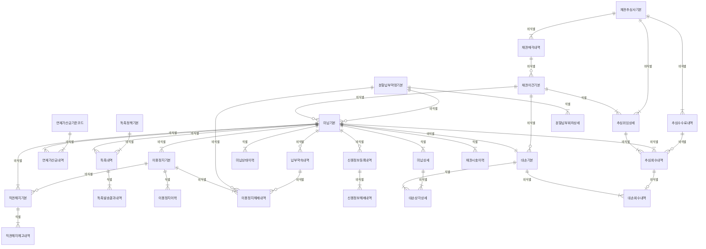

# 04. 논리 모델 — COL 미납

> 작성 2026-11-07 · subagent_logical_modeler(작성) · masteragent_da_coordinator 03 논리 관문 재생성 · 정본 `model/logical/COL.json` — 이 문서는 JSON 에서 생성(손수정 금지)
> 엔터티 30(핵심 10 · 기본·일반 20 · 정산 STL 1) · 속성 285 · 관계 53 · 관문 리뷰 `reviews/03_logical.md`

## 1. 엔터티 목록

| ID | 엔터티 | 물리명 | 테이블명(미리보기) | 유형 | 단계 | 모듈 | PK | 속성 수 | 설명 |
|---|---|---|---|---|---|---|---|---|---|
| COL-001 | 미납기본 | `UNPD_BAS` | `PTL_COL_UNPD_M` | ACT | CNCP |  | 미납번호 | 11 | 납부기한까지 완납되지 않은 청구서 1건 = 미납 채권 1건(청구기본과 1:1, 미납 발생 시에만 생성). 미납 채권의 현재 상태·잔액·진행 단계를 관리하는 COL 의 중심 엔터티 |
| COL-002 | 미납상세 | `UNPD_DTL` | `PTL_COL_UNPD_D` | ACT | CNCP |  | 미납번호 + 미납상세순번 | 12 | 미납 채권의 요금항목 단위 미납액. 수납배분이 항목 순위(할부금·부가세 등)로 이뤄지므로 항목별 잔액을 관리 |
| COL-003 | 연체가산금내역 | `OVDU_ADCHG_DTLS` | `PTL_COL_OVDU_ADCHG_L` | ACT | CNCP |  | 연체가산금번호 | 13 | 미납 채권에 월 단위로 부과한 연체가산금 1건(이용약관 가산금율·상한 적용). 부과액은 다음 청구서에 실려 청구된다 |
| COL-004 | 독촉내역 | `DUN_DTLS` | `PTL_COL_DUN_L` | ACT | CNCP |  | 독촉번호 | 11 | 미납 채권에 대한 독촉 발송 1건(문자·우편·전화·알림톡). 경과일별 독촉정책에 따라 단계를 진행 |
| COL-005 | 이용정지기본 | `SUSP_BAS` | `PTL_COL_SUSP_M` | ACT | CNCP |  | 이용정지번호 | 13 | 미납으로 인한 회선 이용정지 1건(발신정지→착발신정지 단계, 수납 시 해제). 처리 행위는 COL, 결과 회선 상태는 ORD 회선상태이력에 기록 |
| COL-006 | 직권해지기본 | `EXOFTRMN_BAS` | `PTL_COL_EXOFTRMN_M` | ACT | CNCP |  | 직권해지번호 | 12 | 미납 이용정지가 일정 기간 지속된 가입계약을 사업자가 직권으로 해지하는 처리 1건(사전 예고 → 확정 또는 철회). 확정 시 ORD 가입계약 종료 |
| COL-007 | 채권이관기본 | `RCVB_TRNSF_BAS` | `PTL_COL_RCVB_TRNSF_M` | ACT | CNCP |  | 채권이관번호 | 10 | 해지 고객의 미납 채권을 채권관리 단계로 이관(내부 관리·외부 추심 위임·매각 대상)하는 묶음 1건. 고객 단위로 여러 미납을 묶는다 |
| COL-008 | 분할납부약정기본 | `DIV_PAY_AGRMT_BAS` | `PTL_COL_DIV_PAY_AGRMT_M` | ACT | CNCP |  | 분할납부약정번호 | 9 | 청구계정의 누적 미납액을 여러 회차로 나눠 내기로 한 약정 1건(약정 시 이용정지 해제 조건 부여 가능). 회차별 계획·실적은 분할납부회차상세 |
| COL-009 | 대손기본 | `BDDT_BAS` | `PTL_COL_BDDT_M` | ACT | CNCP |  | 대손번호 | 11 | 회수 불능으로 판정해 대손 상각을 확정한 미납 채권 1건(소멸시효 완성·파산·행방불명·회수비용 초과·매각). 법인세법 대손금 요건 판정과 대손 후 회수를 추적 |
| COL-010 | 미납상태이력 | `UNPD_STTS_HIST` | `PTL_COL_UNPD_STTS_H` | ACT | CNCP |  | 미납번호 + 상태변경순번 | 11 | 미납 채권 상태(미납→독촉→정지→해지→이관→대손·완납) 변경 1건. 유효시작·종료일시 쌍으로 레이크 SCD2 에 바로 쓰는 이력 |
| COL-011 | 연체가산금기준코드 | `OVDU_ADCHG_STD_CD` | `PTL_COL_OVDU_ADCHG_STD_C` | REF | LGCL |  | 연체가산금기준유형코드 | 8 | 연체가산금 부과 기준(가산금율·상한율·감면 기준). 이용약관 개정 시 새 기준유형코드로 등록 |
| COL-012 | 독촉정책기본 | `DUN_PLCY_BAS` | `PTL_COL_DUN_PLCY_M` | REF | LGCL |  | 독촉정책번호 | 10 | 납기 경과일·고객유형별 독촉 단계 정책(몇 일 경과 시 어떤 단계·매체로 독촉) |
| COL-013 | 독촉발송결과내역 | `DUN_SNDNG_RSLT_DTLS` | `PTL_COL_DUN_SNDNG_RSLT_L` | ACT | LGCL |  | 독촉번호 + 발송결과순번 | 7 | 독촉 1건의 발송 시도별 결과(성공·실패·반송·재발송) |
| COL-014 | 이용정지이력 | `SUSP_HIST` | `PTL_COL_SUSP_H` | ACT | LGCL |  | 이용정지번호 + 이용정지이력순번 | 8 | 이용정지 1건의 단계·상태 변경 이력(발신정지→착발신정지 등) |
| COL-015 | 이용정지해제내역 | `SUSP_RLS_DTLS` | `PTL_COL_SUSP_RLS_L` | ACT | LGCL |  | 이용정지해제번호 | 10 | 이용정지 해제 처리 1건(수납·분할납부 약정·납부 약속에 따른 해제, 단계 완화 부분 해제 포함, 망 반영 결과) |
| COL-016 | 직권해지예고내역 | `EXOFTRMN_PRNTC_DTLS` | `PTL_COL_EXOFTRMN_PRNTC_L` | ACT | LGCL |  | 직권해지번호 + 예고순번 | 8 | 직권해지 사전 통지 발송 1건(전기통신사업법 사전 통지 — 우편·문자 복수 발송) |
| COL-017 | 채권추심사기본 | `RCVB_COLL_CO_BAS` | `PTL_COL_RCVB_COLL_CO_M` | REF | LGCL |  | 채권추심사번호 | 9 | 미납 채권 추심을 위임받거나 채권을 매입하는 외부 기관(신용정보회사·자산관리회사) |
| COL-018 | 추심위임상세 | `COLL_DLGT_DTL` | `PTL_COL_COLL_DLGT_D` | ACT | LGCL |  | 채권이관번호 + 추심위임순번 | 8 | 채권이관 묶음을 추심사에 위임한 1건(재위임 시 순번 증가) — 채권이관기본 × 채권추심사기본 N:M 해소 |
| COL-019 | 추심회수내역 | `COLL_RTRVL_DTLS` | `PTL_COL_COLL_RTRVL_L` | ACT | LGCL |  | 추심회수번호 | 10 | 추심사가 회수한 금액 1건(어떤 위임으로 어떤 미납을 회수했는지, 수납 처리 연결) |
| COL-020 | 추심수수료내역 | `COLL_FEE_DTLS` | `PTL_COL_COLL_FEE_L` | ACT | LGCL | STL | 추심수수료번호 | 9 | [STL] 추심사별 월 회수 수수료 정산 1건 — 회수액 × 수수료율, PRM 정산·세금계산서로 지급 |
| COL-021 | 분할납부회차상세 | `DIV_PAY_TMS_DTL` | `PTL_COL_DIV_PAY_TMS_D` | ACT | LGCL |  | 분할납부약정번호 + 분할납부회차 | 8 | 분할납부 약정의 회차별 납부 계획·실적 |
| COL-022 | 납부약속내역 | `PAY_PRMS_DTLS` | `PTL_COL_PAY_PRMS_L` | ACT | LGCL |  | 납부약속번호 | 10 | 고객이 미납액을 특정일까지 내겠다고 한 약속 1건(약속 기간 동안 정지·독촉 유예) |
| COL-023 | 신용정보등록내역 | `CRINFO_REG_DTLS` | `PTL_COL_CRINFO_REG_L` | ACT | LGCL |  | 신용정보등록번호 | 9 | 통신 채무 불이행 정보를 신용정보 집중기관에 등록한 1건(등록 전 사전 통지 포함) |
| COL-024 | 신용정보해제내역 | `CRINFO_RLS_DTLS` | `PTL_COL_CRINFO_RLS_L` | ACT | LGCL |  | 신용정보해제번호 | 6 | 신용정보 등록 해제 처리 1건(완납·정정·시효) — 기관 회신 실패 시 재요청으로 1:N |
| COL-025 | 대손상각상세 | `BDDT_DPRC_DTL` | `PTL_COL_BDDT_DPRC_D` | ACT | LGCL |  | 대손번호 + 대손상각상세순번 | 6 | 대손 1건의 미납 항목별 상각 금액·부가세 대손세액공제 |
| COL-026 | 대손회수내역 | `BDDT_RTRVL_DTLS` | `PTL_COL_BDDT_RTRVL_L` | ACT | LGCL |  | 대손회수번호 | 8 | 대손 상각 후 회수한 금액 1건(대손 환입 회계 처리) |
| COL-027 | 채권매각내역 | `RCVB_DSPSL_DTLS` | `PTL_COL_RCVB_DSPSL_L` | ACT | LGCL |  | 채권매각번호 | 8 | 부실 채권을 매입사에 매각한 1건(여러 이관 묶음을 한 번에 매각) |
| COL-028 | 채권시효이력 | `RCVB_PRSCR_HIST` | `PTL_COL_RCVB_PRSCR_H` | ACT | LGCL |  | 미납번호 + 시효변경순번 | 8 | 미납 채권 소멸시효의 기산·중단(청구·압류·승인)·재기산 이력 |
| COL-029 | 미납월집계 | `UNPD_MM_AGG` | `PTL_COL_UNPD_MM_T` | PROC | LGCL |  | 기준년월 + 청구계정번호 | 10 | 월말 기준 청구계정별 미납 잔액·연령(Aging) 스냅샷 |
| COL-030 | 미납회수월통계 | `UNPD_RTRVL_MM_STATS` | `PTL_COL_UNPD_RTRVL_MM_S` | PROC | LGCL |  | 기준년월 + 미납경과구간유형코드 + 고객유형코드 | 12 | 월·연령 구간·고객유형별 미납 발생·회수율·단계 전환(정지·해지·대손) 통계 |

## 2. 엔터티별 속성

속성 순서 = PK → FK → 일반(규칙 2-9). FK 표기 = `<영역>.<엔터티>.<속성>`. NULL Y = 선택. 시스템 칼럼 4개는 DDL 생성 때만 붙는다(D7).

### COL-001 미납기본 `UNPD_BAS` (ACT·CNCP)

납부기한까지 완납되지 않은 청구서 1건 = 미납 채권 1건(청구기본과 1:1, 미납 발생 시에만 생성). 미납 채권의 현재 상태·잔액·진행 단계를 관리하는 COL 의 중심 엔터티

| # | 속성 | 물리명 | 도메인 | PK | FK | NULL | 설명 |
|---|---|---|---|---|---|---|---|
| 1 | 미납번호 | UNPD_NO | 번호V20 | PK |  | N | 미납 채권 식별 번호 |
| 2 | 청구번호 | BILL_NO | 번호V20 |  | PAY.청구기본.청구번호 | N | 미납 원천 청구서(청구기본 1:1 — 대체키) |
| 3 | 채권이관번호 | RCVB_TRNSF_NO | 번호V20 |  | COL.채권이관기본.채권이관번호 | Y | 해지 후 이관 묶음(이관 전 NULL — S5) |
| 4 | 분할납부약정번호 | DIV_PAY_AGRMT_NO | 번호V20 |  | COL.분할납부약정기본.분할납부약정번호 | Y | 분할납부 약정 대상이면 그 약정(대부분 NULL — S5) |
| 5 | 미납채권명 | UNPD_RCVB_NM | 명V100 |  |  | N | 미납 채권 표시명(청구년월·청구계정 표시 조합) |
| 6 | 미납발생일시 | UNPD_OCRN_DTM | 일시TS |  |  | N | 납부기한 경과로 미납이 확정된 일시(행위 일시) |
| 7 | 미납상태유형코드 | UNPD_STTS_TY_CD | 코드V10 |  |  | N | 미납·일부납부·완납·분할납부중·채권이관·대손·소멸(S3 저선택도 — 완납 다수) |
| 8 | 최초미납금액 | FRST_UNPD_AMT | 금액N15 |  |  | N | 미납 확정 시점의 미납 원금(청구금액 중 미수납분) |
| 9 | 독촉단계유형코드 | DUN_STEP_TY_CD | 코드V10 |  |  | Y | 현재 도달한 독촉 단계(독촉 전 NULL) |
| 10 | 완납일시 | CMPLPAY_DTM | 일시TS |  |  | Y | 잔여 0 이 된 일시(미완납 NULL) |
| 11 | 소멸시효만료일자 | EXTSH_PRSCR_EXPRY_DT | 일자C8 |  |  | N | 현재 소멸시효 만료 예정일(통신요금 채권 3년 — 중단 시 채권시효이력으로 갱신) |

정규화 : 1NF: 반복 항목은 미납상세로 분리. 2NF: 단일 PK. 3NF: 청구년월·납부기한일자는 청구기본 속성(이행 종속)이라 제거. [04 관문] 파생 집계 속성(미납잔여금액·연체가산금누적금액)은 반정규화라 논리에서 제거 — 물리 단계 반정규화 후보(규칙 2-7)

변경 메모 : 개념 속성 청구년월·납부기한일자 제거 — 청구번호→청구기본에 이행 종속(3NF). 물리 단계 반정규화 후보(파티션 키·월 조회)

### COL-002 미납상세 `UNPD_DTL` (ACT·CNCP)

미납 채권의 요금항목 단위 미납액. 수납배분이 항목 순위(할부금·부가세 등)로 이뤄지므로 항목별 잔액을 관리

| # | 속성 | 물리명 | 도메인 | PK | FK | NULL | 설명 |
|---|---|---|---|---|---|---|---|
| 1 | 미납번호 | UNPD_NO | 번호V20 | PK | COL.미납기본.미납번호 | N | 소속 미납 채권 |
| 2 | 미납상세순번 | UNPD_DTL_SEQ | 순번N10 | PK |  | N | 미납 채권 내 항목 순번 |
| 3 | 청구번호 | BILL_NO | 번호V20 |  | PAY.청구상세.청구번호 | N | 원천 청구상세 복합키 구성 1(값 = 미납기본.청구번호) |
| 4 | 청구상세순번 | BILL_DTL_SEQ | 순번N5 |  | PAY.청구상세.청구상세순번 | N | 원천 청구상세 복합키 구성 2(요금항목은 청구상세 경유) |
| 5 | 미납항목명 | UNPD_ITM_NM | 명V100 |  |  | N | 미납 요금항목 표시명 |
| 6 | 최종수납반영일시 | LAST_RCV_RFLT_DTM | 일시TS |  |  | Y | 마지막으로 수납이 배분된 일시 |
| 7 | 미납항목상태유형코드 | UNPD_ITM_STTS_TY_CD | 코드V10 |  |  | N | 항목 미납 상태 |
| 8 | 최초미납금액 | FRST_UNPD_AMT | 금액N15 |  |  | N | 항목 미납 확정 금액 |
| 9 | 누적수납금액 | ACML_RCV_AMT | 금액N15 |  |  | N | 항목에 배분된 수납 누계 |
| 10 | 미납조정금액 | UNPD_ADJ_AMT | 금액N15 |  |  | N | 감면·정정 조정 누계(음수 가능 — S7) |
| 11 | 분할납부대상여부 | DIV_PAY_TRGT_YN | 여부C1 |  |  | N | 분할납부 약정에 포함된 항목 여부 |
| 12 | 대손처리여부 | BDDT_PRCS_YN | 여부C1 |  |  | N | 대손상각된 항목 여부 |

정규화 : 1NF 만족. 2NF: 청구번호는 미납번호에 부분 종속이나 청구상세 참조 복합 FK 의 구성 속성이라 유지 — 무결성 규칙 V1(미납상세.청구번호 = 미납기본.청구번호). 3NF: 요금항목코드·항목금액은 청구상세 경유(이행 종속 배제). [04 관문] 파생 집계 속성(미납잔여금액)은 반정규화라 논리에서 제거 — 물리 단계 반정규화 후보(규칙 2-7)

### COL-003 연체가산금내역 `OVDU_ADCHG_DTLS` (ACT·CNCP)

미납 채권에 월 단위로 부과한 연체가산금 1건(이용약관 가산금율·상한 적용). 부과액은 다음 청구서에 실려 청구된다

| # | 속성 | 물리명 | 도메인 | PK | FK | NULL | 설명 |
|---|---|---|---|---|---|---|---|
| 1 | 연체가산금번호 | OVDU_ADCHG_NO | 번호V20 | PK |  | N | 가산금 부과 식별 번호 |
| 2 | 미납번호 | UNPD_NO | 번호V20 |  | COL.미납기본.미납번호 | N | 부과 대상 미납 채권 |
| 3 | 반영청구번호 | RFLT_BILL_NO | 번호V20 |  | PAY.청구기본.청구번호 | Y | 가산금이 실린 다음 달 청구서(반영 전·면제 NULL — 역할명 FK) |
| 4 | 연체가산금기준유형코드 | OVDU_ADCHG_STD_TY_CD | 코드V10 |  | COL.연체가산금기준코드.연체가산금기준유형코드 | N | 적용 가산금 기준 |
| 5 | 연체가산금명 | OVDU_ADCHG_NM | 명V100 |  |  | N | 부과 건 표시명 |
| 6 | 가산금부과일시 | ADCHG_IMPS_DTM | 일시TS |  |  | N | 부과 일시(행위 일시) |
| 7 | 가산금부과상태유형코드 | ADCHG_IMPS_STTS_TY_CD | 코드V10 |  |  | N | 부과·청구반영·감면·취소 |
| 8 | 부과년월 | IMPS_YM | 년월C6 |  |  | N | 부과 대상 년월(미납 채권당 월 1건 — 대체키 미납번호+부과년월) |
| 9 | 가산대상금액 | ADTN_TRGT_AMT | 금액N15 |  |  | N | 가산금 산정 기준 미납 원금 |
| 10 | 적용가산금율 | APLCN_ADCHG_RT | 율N5_2 |  |  | N | 부과 시점 적용 율(기준 변경 뒤에도 유지되는 시점 값 — 이행 종속 아님) |
| 11 | 부과금액 | IMPS_AMT | 금액N15 |  |  | N | 부과 연체가산금 |
| 12 | 감면금액 | RDCT_AMT | 금액N15 |  |  | N | 감면·면제 금액 |
| 13 | 가산금상한적용여부 | ADCHG_UPLMT_APLCN_YN | 여부C1 |  |  | N | 약관 상한(미납액의 일정 %) 도달로 잘린 여부 |

정규화 : 1NF·2NF 만족(단일 PK). 3NF: 적용가산금율은 부과 시점 스냅샷이라 기준코드의 현재 율과 독립 — 이행 종속 아님. 대체키(미납번호, 부과년월) 유일

### COL-004 독촉내역 `DUN_DTLS` (ACT·CNCP)

미납 채권에 대한 독촉 발송 1건(문자·우편·전화·알림톡). 경과일별 독촉정책에 따라 단계를 진행

| # | 속성 | 물리명 | 도메인 | PK | FK | NULL | 설명 |
|---|---|---|---|---|---|---|---|
| 1 | 독촉번호 | DUN_NO | 번호V20 | PK |  | N | 독촉 발송 식별 번호 |
| 2 | 미납번호 | UNPD_NO | 번호V20 |  | COL.미납기본.미납번호 | N | 독촉 대상 미납(청구계정 합산 독촉은 가장 오래된 미납을 대표로) |
| 3 | 독촉정책번호 | DUN_PLCY_NO | 번호V20 |  | COL.독촉정책기본.독촉정책번호 | N | 적용 독촉 정책(단계는 정책 경유) |
| 4 | 독촉제목명 | DUN_TTL_NM | 명V100 |  |  | N | 발송 제목 |
| 5 | 독촉발송일시 | DUN_SNDNG_DTM | 일시TS |  |  | N | 발송 일시(행위 일시 — S4 말일·1일 급증) |
| 6 | 독촉발송상태유형코드 | DUN_SNDNG_STTS_TY_CD | 코드V10 |  |  | N | 발송 상태 |
| 7 | 독촉매체유형코드 | DUN_MDM_TY_CD | 코드V10 |  |  | N | 실제 발송 매체(정책 기본 매체와 다를 수 있음 — 문자 실패 시 우편 대체) |
| 8 | 독촉대상금액 | DUN_TRGT_AMT | 금액N15 |  |  | N | 독촉 시점 미납 금액 |
| 9 | 수신전화번호암호화값 | RCPTN_TELNO_ENCPT_VL | 값V256 |  |  | Y | 문자·알림톡 수신 번호 암호화 값(우편 NULL) |
| 10 | 독촉내용 | DUN_CN | 내용V4000 |  |  | Y | 발송 본문(S9 넓은 행 일부) |
| 11 | 발송결과수신일시 | SNDNG_RSLT_RCPTN_DTM | 일시TS |  |  | Y | 최종 발송 결과 수신 일시(시도별 결과는 독촉발송결과내역) |

정규화 : 1NF·2NF 만족. 3NF: 독촉단계유형코드는 정책 속성(이행 종속)이라 제거, 매체는 실발송 값이 정책과 달라질 수 있어 유지. 발송 시도별 결과는 독촉발송결과내역으로 분리(반복 그룹 제거)

변경 메모 : 개념 속성 독촉단계유형코드 제거 — 독촉정책번호→독촉정책기본.독촉단계유형코드 이행 종속(3NF)

### COL-005 이용정지기본 `SUSP_BAS` (ACT·CNCP)

미납으로 인한 회선 이용정지 1건(발신정지→착발신정지 단계, 수납 시 해제). 처리 행위는 COL, 결과 회선 상태는 ORD 회선상태이력에 기록

| # | 속성 | 물리명 | 도메인 | PK | FK | NULL | 설명 |
|---|---|---|---|---|---|---|---|
| 1 | 이용정지번호 | SUSP_NO | 번호V20 | PK |  | N | 미납 이용정지 식별 번호 |
| 2 | 서비스관리번호 | SVC_MGMT_NO | 번호V20 |  | ORD.회선기본.서비스관리번호 | N | 정지 대상 회선 |
| 3 | 미납번호 | UNPD_NO | 번호V20 |  | COL.미납기본.미납번호 | N | 정지 원인 미납(대표 미납) |
| 4 | 이용정지명 | SUSP_NM | 명V100 |  |  | N | 정지 건 표시명 |
| 5 | 이용정지일시 | SUSP_DTM | 일시TS |  |  | N | 정지 시행 일시(행위 일시) |
| 6 | 이용정지상태유형코드 | SUSP_STTS_TY_CD | 코드V10 |  |  | N | 예고·정지중·해제·해지전환 |
| 7 | 이용정지단계유형코드 | SUSP_STEP_TY_CD | 코드V10 |  |  | N | 현재 정지 단계(단계 변경은 이용정지이력) |
| 8 | 이용정지예고일시 | SUSP_PRNTC_DTM | 일시TS |  |  | Y | 사전 통지 일시(전기통신사업법 사전 통지) |
| 9 | 이용정지기준미납금액 | SUSP_STD_UNPD_AMT | 금액N15 |  |  | N | 정지 판정 시점 미납 금액 |
| 10 | 이용정지기준경과일수 | SUSP_STD_ELPS_DCNT | 일수N5 |  |  | N | 정지 판정 시점 납기 경과 일수 |
| 11 | 이용정지해제일시 | SUSP_RLS_DTM | 일시TS |  |  | Y | 정지가 끝난 일시(정지 건 종료 사실 — 해제 처리 단위는 이용정지해제내역) |
| 12 | 이용정지해제사유유형코드 | SUSP_RLS_RSN_TY_CD | 코드V10 |  |  | Y | 정지 종료 사유 |
| 13 | 회선상태반영여부 | LINE_STTS_RFLT_YN | 여부C1 |  |  | N | ORD 회선상태이력 반영 완료 여부 |

정규화 : 1NF·2NF 만족. 3NF: 회선 속성(서비스번호 등)은 회선기본 경유. 해제일시·해제사유는 정지 건 자체의 종료 사실(정지 1건당 1개) — 해제 처리 단위(부분 해제·망 반영 재처리)는 이용정지해제내역 1:N 으로 분리

### COL-006 직권해지기본 `EXOFTRMN_BAS` (ACT·CNCP)

미납 이용정지가 일정 기간 지속된 가입계약을 사업자가 직권으로 해지하는 처리 1건(사전 예고 → 확정 또는 철회). 확정 시 ORD 가입계약 종료

| # | 속성 | 물리명 | 도메인 | PK | FK | NULL | 설명 |
|---|---|---|---|---|---|---|---|
| 1 | 직권해지번호 | EXOFTRMN_NO | 번호V20 | PK |  | N | 직권해지 식별 번호 |
| 2 | 가입계약번호 | SBSC_CTRT_NO | 번호V20 |  | ORD.가입계약기본.가입계약번호 | N | 해지 대상 가입계약 |
| 3 | 미납번호 | UNPD_NO | 번호V20 |  | COL.미납기본.미납번호 | N | 해지 원인 미납(대표 미납) |
| 4 | 이용정지번호 | SUSP_NO | 번호V20 |  | COL.이용정지기본.이용정지번호 | Y | 선행 미납 이용정지(정지 없이 해지되는 예외는 NULL) |
| 5 | 직권해지명 | EXOFTRMN_NM | 명V100 |  |  | N | 해지 건 표시명 |
| 6 | 직권해지일시 | EXOFTRMN_DTM | 일시TS |  |  | N | 해지 확정 일시(행위 일시) |
| 7 | 직권해지상태유형코드 | EXOFTRMN_STTS_TY_CD | 코드V10 |  |  | N | 예고·확정·철회 |
| 8 | 직권해지사유유형코드 | EXOFTRMN_RSN_TY_CD | 코드V10 |  |  | N | 해지 사유 |
| 9 | 직권해지예고일시 | EXOFTRMN_PRNTC_DTM | 일시TS |  |  | Y | 법정 사전 통지 기준 일시(최초 예고 — 통지 발송 건은 직권해지예고내역) |
| 10 | 직권해지예정일자 | EXOFTRMN_SCHD_DT | 일자C8 |  |  | N | 예고상 해지 예정일 |
| 11 | 해지기준미납금액 | TRMN_STD_UNPD_AMT | 금액N15 |  |  | N | 해지 판정 시점 미납 금액 |
| 12 | 직권해지철회일시 | EXOFTRMN_WTHDR_DTM | 일시TS |  |  | Y | 납부로 철회된 일시 |

정규화 : 1NF·2NF 만족. 3NF: 직권해지예고일시는 해지 예정일 산정 기준이 되는 법정 통지 기준일(해지 건 속성)이고, 통지 발송 시도는 직권해지예고내역 1:N 으로 분리

### COL-007 채권이관기본 `RCVB_TRNSF_BAS` (ACT·CNCP)

해지 고객의 미납 채권을 채권관리 단계로 이관(내부 관리·외부 추심 위임·매각 대상)하는 묶음 1건. 고객 단위로 여러 미납을 묶는다

| # | 속성 | 물리명 | 도메인 | PK | FK | NULL | 설명 |
|---|---|---|---|---|---|---|---|
| 1 | 채권이관번호 | RCVB_TRNSF_NO | 번호V20 | PK |  | N | 채권 이관 묶음 식별 번호 |
| 2 | 고객번호 | CUST_NO | 번호V20 |  | CUS.고객기본.고객번호 | N | 채권 귀속 고객(해지 고객) |
| 3 | 채권매각번호 | RCVB_DSPSL_NO | 번호V20 |  | COL.채권매각내역.채권매각번호 | Y | 매각된 경우 그 매각 건(대부분 NULL) |
| 4 | 채권이관명 | RCVB_TRNSF_NM | 명V100 |  |  | N | 이관 묶음 표시명 |
| 5 | 채권이관일시 | RCVB_TRNSF_DTM | 일시TS |  |  | N | 이관 일시(행위 일시) |
| 6 | 채권이관상태유형코드 | RCVB_TRNSF_STTS_TY_CD | 코드V10 |  |  | N | 이관 상태 |
| 7 | 채권이관유형코드 | RCVB_TRNSF_TY_CD | 코드V10 |  |  | N | 추심위탁·채권매각·소송·신용정보사등록 |
| 8 | 이관채권금액 | TRNSF_RCVB_AMT | 금액N15 |  |  | N | 이관 시점 채권 합계 |
| 9 | 이관채권건수 | TRNSF_RCVB_NOCS | 건수N10 |  |  | N | 묶인 미납 건수 |
| 10 | 회수종료일자 | RTRVL_END_DT | 일자C8 |  |  | Y | 회수 종료(완제·대손·매각) 일자 |

정규화 : 1NF: 추심사 위임 반복(재위임)을 추심위임상세로 분리. 2NF 만족. 3NF: 고객 속성은 고객기본 경유. [04 관문] 파생 집계 속성(누적회수금액)은 반정규화라 논리에서 제거 — 물리 단계 반정규화 후보(규칙 2-7)

변경 메모 : 개념 속성 채권추심사번호·추심위임일자 → 추심위임상세로 이동(N:M 해소 — 한 묶음이 재위임으로 여러 추심사에 위임됨). 채권매각번호 FK 추가

### COL-008 분할납부약정기본 `DIV_PAY_AGRMT_BAS` (ACT·CNCP)

청구계정의 누적 미납액을 여러 회차로 나눠 내기로 한 약정 1건(약정 시 이용정지 해제 조건 부여 가능). 회차별 계획·실적은 분할납부회차상세

| # | 속성 | 물리명 | 도메인 | PK | FK | NULL | 설명 |
|---|---|---|---|---|---|---|---|
| 1 | 분할납부약정번호 | DIV_PAY_AGRMT_NO | 번호V20 | PK |  | N | 분할납부 약정 식별 번호 |
| 2 | 청구계정번호 | BILL_ACNT_NO | 번호V20 |  | CUS.청구계정기본.청구계정번호 | N | 약정 단위 청구계정 |
| 3 | 분할납부약정명 | DIV_PAY_AGRMT_NM | 명V100 |  |  | N | 약정 표시명 |
| 4 | 분할납부약정일시 | DIV_PAY_AGRMT_DTM | 일시TS |  |  | N | 약정 체결 일시(행위 일시) |
| 5 | 분할납부약정상태유형코드 | DIV_PAY_AGRMT_STTS_TY_CD | 코드V10 |  |  | N | 약정 상태 |
| 6 | 약정대상금액 | AGRMT_TRGT_AMT | 금액N15 |  |  | N | 분할 대상 미납 합계 |
| 7 | 분할회차수 | DIV_TMS_CNT | 수N3 |  |  | N | 분할 회차 수 |
| 8 | 최초납부예정일자 | FRST_PAY_SCHD_DT | 일자C8 |  |  | N | 1회차 납부 예정일 |
| 9 | 이용정지해제조건여부 | SUSP_RLS_CND_YN | 여부C1 |  |  | N | 약정 체결을 조건으로 이용정지를 해제했는지 |

정규화 : 1NF: 회차 반복은 분할납부회차상세로 분리. 2NF 만족. 3NF: 청구계정 속성은 청구계정기본 경유. [04 관문] 파생 집계 속성(최종납부예정일자·납부완료회차수·누적납부금액·불이행회차수)은 반정규화라 논리에서 제거 — 물리 단계 반정규화 후보(규칙 2-7)

### COL-009 대손기본 `BDDT_BAS` (ACT·CNCP)

회수 불능으로 판정해 대손 상각을 확정한 미납 채권 1건(소멸시효 완성·파산·행방불명·회수비용 초과·매각). 법인세법 대손금 요건 판정과 대손 후 회수를 추적

| # | 속성 | 물리명 | 도메인 | PK | FK | NULL | 설명 |
|---|---|---|---|---|---|---|---|
| 1 | 대손번호 | BDDT_NO | 번호V20 | PK |  | N | 대손 식별 번호 |
| 2 | 미납번호 | UNPD_NO | 번호V20 |  | COL.미납기본.미납번호 | N | 대손 확정 미납 채권(미납 1건당 대손 최대 1건 — 대체키) |
| 3 | 채권이관번호 | RCVB_TRNSF_NO | 번호V20 |  | COL.채권이관기본.채권이관번호 | Y | 대손 시점의 이관 묶음(이관 없이 대손 NULL) |
| 4 | 대손명 | BDDT_NM | 명V100 |  |  | N | 대손 건 표시명 |
| 5 | 대손상각일시 | BDDT_DPRC_DTM | 일시TS |  |  | N | 상각 처리 일시(행위 일시) |
| 6 | 대손상태유형코드 | BDDT_STTS_TY_CD | 코드V10 |  |  | N | 대손 상태 |
| 7 | 대손사유유형코드 | BDDT_RSN_TY_CD | 코드V10 |  |  | N | 대손 사유(법인세법 요건) |
| 8 | 대손확정일자 | BDDT_CFMTN_DT | 일자C8 |  |  | N | 대손 확정 일자 |
| 9 | 대손금액 | BDDT_AMT | 금액N15 |  |  | N | 상각 금액 |
| 10 | 세무손금인정여부 | TXAF_LSEXP_RCGTN_YN | 여부C1 |  |  | N | 세무상 손금 인정 여부 |
| 11 | 회계전표번호 | ACNTG_SLIP_NO | 번호V20 |  |  | Y | 상각 회계 전표 번호(회계 연계 전 NULL) |

정규화 : 1NF: 항목별 상각은 대손상각상세로 분리. 2NF 만족. 3NF: 채권이관번호는 대손 시점 이관 묶음 기록 — 미납기본.채권이관번호(현재 값)와 의미가 달라 유지(재이관 시 달라질 수 있음). [04 관문] 파생 집계 속성(대손회수누적금액)은 반정규화라 논리에서 제거 — 물리 단계 반정규화 후보(규칙 2-7)

### COL-010 미납상태이력 `UNPD_STTS_HIST` (ACT·CNCP)

미납 채권 상태(미납→독촉→정지→해지→이관→대손·완납) 변경 1건. 유효시작·종료일시 쌍으로 레이크 SCD2 에 바로 쓰는 이력

| # | 속성 | 물리명 | 도메인 | PK | FK | NULL | 설명 |
|---|---|---|---|---|---|---|---|
| 1 | 미납번호 | UNPD_NO | 번호V20 | PK | COL.미납기본.미납번호 | N | 대상 미납 채권 |
| 2 | 상태변경순번 | STTS_CHG_SEQ | 순번N10 | PK |  | N | 미납 채권 내 변경 순번 |
| 3 | 상태변경사유명 | STTS_CHG_RSN_NM | 명V100 |  |  | N | 변경 사유 설명 |
| 4 | 상태변경일시 | STTS_CHG_DTM | 일시TS |  |  | N | 변경 일시(행위 일시) |
| 5 | 미납상태유형코드 | UNPD_STTS_TY_CD | 코드V10 |  |  | N | 변경 후 상태 |
| 6 | 이전미납상태유형코드 | BFR_UNPD_STTS_TY_CD | 코드V10 |  |  | Y | 변경 전 상태(최초 NULL) |
| 7 | 유효시작일시 | VLD_BGNG_DTM | 일시TS |  |  | N | 이 상태의 유효 시작 |
| 8 | 유효종료일시 | VLD_END_DTM | 일시TS |  |  | N | 이 상태의 유효 종료(현재 행 9999-12-31) |
| 9 | 변경시점미납잔여금액 | CHG_PNT_UNPD_RMND_AMT | 금액N15 |  |  | N | 변경 시점 잔액 스냅샷 |
| 10 | 원인업무유형코드 | CAUS_TASK_TY_CD | 코드V10 |  |  | N | 변경을 일으킨 업무(독촉·정지·해지·이관·수납·대손·분할) |
| 11 | 원인업무번호 | CAUS_TASK_NO | 번호V20 |  |  | Y | 원인 업무 건 번호(업무별 다른 엔터티 — 다형 참조라 FK 정의 없음) |

정규화 : 1NF·2NF 만족(전 속성이 미납번호+상태변경순번 전체에 종속). 3NF 만족. 원인업무번호는 원인업무유형코드에 따라 대상이 바뀌는 다형 참조 — FK 미정의, 무결성 규칙 V2 로 관리

### COL-011 연체가산금기준코드 `OVDU_ADCHG_STD_CD` (REF·LGCL)

연체가산금 부과 기준(가산금율·상한율·감면 기준). 이용약관 개정 시 새 기준유형코드로 등록

| # | 속성 | 물리명 | 도메인 | PK | FK | NULL | 설명 |
|---|---|---|---|---|---|---|---|
| 1 | 연체가산금기준유형코드 | OVDU_ADCHG_STD_TY_CD | 코드V10 | PK |  | N | 가산금 기준 코드 |
| 2 | 연체가산금기준명 | OVDU_ADCHG_STD_NM | 명V100 |  |  | N | 기준 이름 |
| 3 | 기준가산금율 | STD_ADCHG_RT | 율N5_2 |  |  | N | 월 가산금율(%) |
| 4 | 가산금상한율 | ADCHG_UPLMT_RT | 율N5_2 |  |  | N | 미납 원금 대비 가산금 상한(%) |
| 5 | 가산금감면기준금액 | ADCHG_RDCT_STD_AMT | 금액N15 |  |  | N | 이 금액 미만 미납은 가산금 면제 |
| 6 | 적용시작일자 | APLCN_BGNG_DT | 일자C8 |  |  | N | 기준 적용 시작 |
| 7 | 적용종료일자 | APLCN_END_DT | 일자C8 |  |  | N | 기준 적용 종료(현행 99991231) |
| 8 | 사용여부 | USE_YN | 여부C1 |  |  | N | 현재 사용 여부 |

정규화 : 1NF·2NF·3NF 만족 — 모든 속성이 기준유형코드에만 종속

### COL-012 독촉정책기본 `DUN_PLCY_BAS` (REF·LGCL)

납기 경과일·고객유형별 독촉 단계 정책(몇 일 경과 시 어떤 단계·매체로 독촉)

| # | 속성 | 물리명 | 도메인 | PK | FK | NULL | 설명 |
|---|---|---|---|---|---|---|---|
| 1 | 독촉정책번호 | DUN_PLCY_NO | 번호V20 | PK |  | N | 독촉 정책 식별 번호 |
| 2 | 독촉정책명 | DUN_PLCY_NM | 명V100 |  |  | N | 정책 이름 |
| 3 | 독촉단계유형코드 | DUN_STEP_TY_CD | 코드V10 |  |  | N | 이 정책이 정하는 독촉 단계 |
| 4 | 고객유형코드 | CUST_TY_CD | 코드V10 |  |  | N | 적용 고객 유형(CUS 공통코드) |
| 5 | 독촉기준경과일수 | DUN_STD_ELPS_DCNT | 일수N5 |  |  | N | 납기 경과 일수 기준 |
| 6 | 독촉기준미납금액 | DUN_STD_UNPD_AMT | 금액N15 |  |  | N | 이 금액 이상일 때 적용 |
| 7 | 독촉매체유형코드 | DUN_MDM_TY_CD | 코드V10 |  |  | N | 기본 발송 매체 |
| 8 | 적용시작일자 | APLCN_BGNG_DT | 일자C8 |  |  | N | 정책 적용 시작 |
| 9 | 적용종료일자 | APLCN_END_DT | 일자C8 |  |  | N | 정책 적용 종료 |
| 10 | 사용여부 | USE_YN | 여부C1 |  |  | N | 현재 사용 여부 |

정규화 : 1NF·2NF·3NF 만족. 대체키(독촉단계유형코드, 고객유형코드, 적용시작일자)

### COL-013 독촉발송결과내역 `DUN_SNDNG_RSLT_DTLS` (ACT·LGCL)

독촉 1건의 발송 시도별 결과(성공·실패·반송·재발송)

| # | 속성 | 물리명 | 도메인 | PK | FK | NULL | 설명 |
|---|---|---|---|---|---|---|---|
| 1 | 독촉번호 | DUN_NO | 번호V20 | PK | COL.독촉내역.독촉번호 | N | 대상 독촉 |
| 2 | 발송결과순번 | SNDNG_RSLT_SEQ | 순번N5 | PK |  | N | 독촉 내 시도 순번 |
| 3 | 독촉매체유형코드 | DUN_MDM_TY_CD | 코드V10 |  |  | N | 이 시도의 매체 |
| 4 | 발송결과유형코드 | SNDNG_RSLT_TY_CD | 코드V10 |  |  | N | 성공·실패·반송·수신거부·번호없음 |
| 5 | 발송결과수신일시 | SNDNG_RSLT_RCPTN_DTM | 일시TS |  |  | N | 결과 수신 일시(행위 일시) |
| 6 | 발송오류내용 | SNDNG_ERR_CN | 내용V200 |  |  | Y | 실패·반송 사유 원문(성공 NULL — S5) |
| 7 | 재발송여부 | RE_SNDNG_YN | 여부C1 |  |  | N | 재발송 시도인지 |

정규화 : 1NF·2NF·3NF 만족(독촉번호+순번 전체 종속)

### COL-014 이용정지이력 `SUSP_HIST` (ACT·LGCL)

이용정지 1건의 단계·상태 변경 이력(발신정지→착발신정지 등)

| # | 속성 | 물리명 | 도메인 | PK | FK | NULL | 설명 |
|---|---|---|---|---|---|---|---|
| 1 | 이용정지번호 | SUSP_NO | 번호V20 | PK | COL.이용정지기본.이용정지번호 | N | 대상 이용정지 |
| 2 | 이용정지이력순번 | SUSP_HIST_SEQ | 순번N5 | PK |  | N | 변경 순번 |
| 3 | 이용정지상태유형코드 | SUSP_STTS_TY_CD | 코드V10 |  |  | N | 변경 후 상태 |
| 4 | 이용정지단계유형코드 | SUSP_STEP_TY_CD | 코드V10 |  |  | N | 변경 후 단계 |
| 5 | 이전이용정지단계유형코드 | BFR_SUSP_STEP_TY_CD | 코드V10 |  |  | Y | 변경 전 단계(최초 NULL) |
| 6 | 상태변경사유명 | STTS_CHG_RSN_NM | 명V100 |  |  | N | 변경 사유 |
| 7 | 유효시작일시 | VLD_BGNG_DTM | 일시TS |  |  | N | 유효 시작(행위 일시) |
| 8 | 유효종료일시 | VLD_END_DTM | 일시TS |  |  | N | 유효 종료 |

정규화 : 1NF·2NF·3NF 만족

### COL-015 이용정지해제내역 `SUSP_RLS_DTLS` (ACT·LGCL)

이용정지 해제 처리 1건(수납·분할납부 약정·납부 약속에 따른 해제, 단계 완화 부분 해제 포함, 망 반영 결과)

| # | 속성 | 물리명 | 도메인 | PK | FK | NULL | 설명 |
|---|---|---|---|---|---|---|---|
| 1 | 이용정지해제번호 | SUSP_RLS_NO | 번호V20 | PK |  | N | 해제 처리 식별 번호 |
| 2 | 이용정지번호 | SUSP_NO | 번호V20 |  | COL.이용정지기본.이용정지번호 | N | 해제 대상 정지 |
| 3 | 수납번호 | RCV_NO | 번호V20 |  | INV.수납기본.수납번호 | Y | 해제 원인 수납(약정·약속 해제 NULL) |
| 4 | 분할납부약정번호 | DIV_PAY_AGRMT_NO | 번호V20 |  | COL.분할납부약정기본.분할납부약정번호 | Y | 약정 조건 해제 시 |
| 5 | 납부약속번호 | PAY_PRMS_NO | 번호V20 |  | COL.납부약속내역.납부약속번호 | Y | 납부 약속 조건 해제 시 |
| 6 | 이용정지해제일시 | SUSP_RLS_DTM | 일시TS |  |  | N | 해제 처리 일시(행위 일시) |
| 7 | 이용정지해제사유유형코드 | SUSP_RLS_RSN_TY_CD | 코드V10 |  |  | N | 해제 사유 |
| 8 | 해제요청일시 | RLS_REQ_DTM | 일시TS |  |  | N | 망 해제 요청 일시 |
| 9 | 회선상태반영여부 | LINE_STTS_RFLT_YN | 여부C1 |  |  | N | 회선 상태 반영 완료 여부 |
| 10 | 처리결과유형코드 | PRCS_RSLT_TY_CD | 코드V10 |  |  | N | 망 처리 결과 |

정규화 : 1NF·2NF·3NF 만족. 해제 원인 3종(수납·약정·약속)은 서로 다른 엔터티라 각각 선택 FK(배타 관계 — 규칙 V3 : 셋 중 최대 하나)

### COL-016 직권해지예고내역 `EXOFTRMN_PRNTC_DTLS` (ACT·LGCL)

직권해지 사전 통지 발송 1건(전기통신사업법 사전 통지 — 우편·문자 복수 발송)

| # | 속성 | 물리명 | 도메인 | PK | FK | NULL | 설명 |
|---|---|---|---|---|---|---|---|
| 1 | 직권해지번호 | EXOFTRMN_NO | 번호V20 | PK | COL.직권해지기본.직권해지번호 | N | 대상 직권해지 |
| 2 | 예고순번 | PRNTC_SEQ | 순번N5 | PK |  | N | 통지 순번 |
| 3 | 직권해지예고일시 | EXOFTRMN_PRNTC_DTM | 일시TS |  |  | N | 통지 발송 일시(행위 일시) |
| 4 | 독촉매체유형코드 | DUN_MDM_TY_CD | 코드V10 |  |  | N | 통지 매체 |
| 5 | 예고발송상태유형코드 | PRNTC_SNDNG_STTS_TY_CD | 코드V10 |  |  | N | 통지 발송 상태 |
| 6 | 수신전화번호암호화값 | RCPTN_TELNO_ENCPT_VL | 값V256 |  |  | Y | 문자 수신 번호 암호화 값(우편 NULL) |
| 7 | 예고내용 | PRNTC_CN | 내용V4000 |  |  | Y | 통지 본문 |
| 8 | 발송결과수신일시 | SNDNG_RSLT_RCPTN_DTM | 일시TS |  |  | Y | 발송 결과 수신 일시 |

정규화 : 1NF·2NF·3NF 만족

### COL-017 채권추심사기본 `RCVB_COLL_CO_BAS` (REF·LGCL)

미납 채권 추심을 위임받거나 채권을 매입하는 외부 기관(신용정보회사·자산관리회사)

| # | 속성 | 물리명 | 도메인 | PK | FK | NULL | 설명 |
|---|---|---|---|---|---|---|---|
| 1 | 채권추심사번호 | RCVB_COLL_CO_NO | 번호V20 | PK |  | N | 추심사 식별 번호 |
| 2 | 채권추심사명 | RCVB_COLL_CO_NM | 명V100 |  |  | N | 추심사 이름 |
| 3 | 채권추심사유형코드 | RCVB_COLL_CO_TY_CD | 코드V10 |  |  | N | 추심위탁·채권매입·신용정보집중 |
| 4 | 채권추심사상태유형코드 | RCVB_COLL_CO_STTS_TY_CD | 코드V10 |  |  | N | 거래 상태 |
| 5 | 사업자등록번호 | BRNO | 번호V20 |  |  | N | 사업자등록번호(S12 앞자리 0) |
| 6 | 대표전화번호 | RPRS_TELNO | 전화번호V20 |  |  | Y | 대표 전화 |
| 7 | 추심수수료율 | COLL_FEE_RT | 율N5_2 |  |  | N | 계약 기본 수수료율(회수액 대비 %) |
| 8 | 계약시작일자 | CTRT_BGNG_DT | 일자C8 |  |  | N | 위탁 계약 시작 |
| 9 | 계약종료일자 | CTRT_END_DT | 일자C8 |  |  | Y | 위탁 계약 종료 |

정규화 : 1NF·2NF·3NF 만족. PRM 파트너유형코드에 추심사 값이 없어(대리점~수납대행기관 7종) PRM 파트너기본과 분리한 COL 기준 엔터티 — 파트너 통합 시 파트너번호 FK 추가 검토(결정 메모)

### COL-018 추심위임상세 `COLL_DLGT_DTL` (ACT·LGCL)

채권이관 묶음을 추심사에 위임한 1건(재위임 시 순번 증가) — 채권이관기본 × 채권추심사기본 N:M 해소

| # | 속성 | 물리명 | 도메인 | PK | FK | NULL | 설명 |
|---|---|---|---|---|---|---|---|
| 1 | 채권이관번호 | RCVB_TRNSF_NO | 번호V20 | PK | COL.채권이관기본.채권이관번호 | N | 위임 대상 이관 묶음 |
| 2 | 추심위임순번 | COLL_DLGT_SEQ | 순번N5 | PK |  | N | 묶음 내 위임 순번 |
| 3 | 채권추심사번호 | RCVB_COLL_CO_NO | 번호V20 |  | COL.채권추심사기본.채권추심사번호 | N | 위임 추심사 |
| 4 | 추심위임일자 | COLL_DLGT_DT | 일자C8 |  |  | N | 위임 시작 일자 |
| 5 | 추심위임종료일자 | COLL_DLGT_END_DT | 일자C8 |  |  | Y | 위임 종료 일자(진행 중 NULL) |
| 6 | 위임채권금액 | DLGT_RCVB_AMT | 금액N15 |  |  | N | 위임 시점 채권 금액 |
| 7 | 적용추심수수료율 | APLCN_COLL_FEE_RT | 율N5_2 |  |  | N | 이 위임에 적용한 수수료율(계약 율 시점 스냅샷) |
| 8 | 추심위임상태유형코드 | COLL_DLGT_STTS_TY_CD | 코드V10 |  |  | N | 위임 상태 |

정규화 : N:M(이관 묶음 ↔ 추심사) 해소 관계 엔터티. 1NF·2NF·3NF 만족. 적용추심수수료율은 위임 시점 값

### COL-019 추심회수내역 `COLL_RTRVL_DTLS` (ACT·LGCL)

추심사가 회수한 금액 1건(어떤 위임으로 어떤 미납을 회수했는지, 수납 처리 연결)

| # | 속성 | 물리명 | 도메인 | PK | FK | NULL | 설명 |
|---|---|---|---|---|---|---|---|
| 1 | 추심회수번호 | COLL_RTRVL_NO | 번호V20 | PK |  | N | 추심 회수 식별 번호 |
| 2 | 채권이관번호 | RCVB_TRNSF_NO | 번호V20 |  | COL.추심위임상세.채권이관번호 | N | 회수한 위임(복합키 1) |
| 3 | 추심위임순번 | COLL_DLGT_SEQ | 순번N5 |  | COL.추심위임상세.추심위임순번 | N | 회수한 위임(복합키 2) |
| 4 | 미납번호 | UNPD_NO | 번호V20 |  | COL.미납기본.미납번호 | N | 회수 대상 미납 채권 |
| 5 | 수납번호 | RCV_NO | 번호V20 |  | INV.수납기본.수납번호 | Y | 회수금 수납 처리(입금 확인 전 NULL) |
| 6 | 추심수수료번호 | COLL_FEE_NO | 번호V20 |  | COL.추심수수료내역.추심수수료번호 | Y | 수수료 정산에 묶인 건(월 정산 전 NULL) |
| 7 | 추심회수일시 | COLL_RTRVL_DTM | 일시TS |  |  | N | 회수 일시(행위 일시) |
| 8 | 추심회수금액 | COLL_RTRVL_AMT | 금액N15 |  |  | N | 회수 금액 |
| 9 | 회수방법유형코드 | RTRVL_MTHD_TY_CD | 코드V10 |  |  | N | 가상계좌·계좌이체·카드·현금·상계 |
| 10 | 추심회수상태유형코드 | COLL_RTRVL_STTS_TY_CD | 코드V10 |  |  | N | 회수 상태 |

정규화 : 1NF·2NF 만족. 3NF: 추심사번호는 추심위임상세 경유(이행 종속 배제). 규칙 V4 : 미납기본.채권이관번호 = 회수.채권이관번호

### COL-020 추심수수료내역 `COLL_FEE_DTLS` (ACT·LGCL·STL)

[STL] 추심사별 월 회수 수수료 정산 1건 — 회수액 × 수수료율, PRM 정산·세금계산서로 지급

| # | 속성 | 물리명 | 도메인 | PK | FK | NULL | 설명 |
|---|---|---|---|---|---|---|---|
| 1 | 추심수수료번호 | COLL_FEE_NO | 번호V20 | PK |  | N | 추심 수수료 정산 식별 번호 |
| 2 | 채권추심사번호 | RCVB_COLL_CO_NO | 번호V20 |  | COL.채권추심사기본.채권추심사번호 | N | 정산 대상 추심사 |
| 3 | 정산번호 | STLM_NO | 번호V20 |  | PRM.정산기본.정산번호 | Y | 지급 정산 건(정산 확정 전 NULL) |
| 4 | 정산년월 | STLM_YM | 년월C6 |  |  | N | 정산 대상 년월(대체키 추심사+정산년월) |
| 5 | 수수료대상금액 | FEE_TRGT_AMT | 금액N15 |  |  | N | 해당 월 회수 합계 |
| 6 | 추심수수료금액 | COLL_FEE_AMT | 금액N15 |  |  | N | 산정 수수료(공급가액) |
| 7 | 세액 | TXAMT | 금액N15 |  |  | N | 부가가치세 |
| 8 | 추심수수료상태유형코드 | COLL_FEE_STTS_TY_CD | 코드V10 |  |  | N | 산정·확정·지급·취소 |
| 9 | 추심수수료확정일시 | COLL_FEE_CFMTN_DTM | 일시TS |  |  | Y | 수수료 확정 일시(행위 일시) |

정규화 : 1NF·2NF·3NF 만족. 적용율은 위임별로 다를 수 있어(재위임) 추심위임상세에 두고 여기선 금액만

### COL-021 분할납부회차상세 `DIV_PAY_TMS_DTL` (ACT·LGCL)

분할납부 약정의 회차별 납부 계획·실적

| # | 속성 | 물리명 | 도메인 | PK | FK | NULL | 설명 |
|---|---|---|---|---|---|---|---|
| 1 | 분할납부약정번호 | DIV_PAY_AGRMT_NO | 번호V20 | PK | COL.분할납부약정기본.분할납부약정번호 | N | 대상 약정 |
| 2 | 분할납부회차 | DIV_PAY_TMS | 회차N3 | PK |  | N | 회차 |
| 3 | 수납번호 | RCV_NO | 번호V20 |  | INV.수납기본.수납번호 | Y | 회차 납부 수납(미납 NULL) |
| 4 | 납부예정일자 | PAY_SCHD_DT | 일자C8 |  |  | N | 회차 납부 예정일 |
| 5 | 납부예정금액 | PAY_SCHD_AMT | 금액N15 |  |  | N | 회차 납부 예정 금액 |
| 6 | 회차납부금액 | TMS_PAY_AMT | 금액N15 |  |  | N | 회차 실제 납부 금액 |
| 7 | 납부완료일시 | PAY_CMPTN_DTM | 일시TS |  |  | Y | 회차 납부 완료 일시 |
| 8 | 분할납부회차상태유형코드 | DIV_PAY_TMS_STTS_TY_CD | 코드V10 |  |  | N | 예정·완납·일부납·불이행 |

정규화 : 1NF·2NF·3NF 만족

### COL-022 납부약속내역 `PAY_PRMS_DTLS` (ACT·LGCL)

고객이 미납액을 특정일까지 내겠다고 한 약속 1건(약속 기간 동안 정지·독촉 유예)

| # | 속성 | 물리명 | 도메인 | PK | FK | NULL | 설명 |
|---|---|---|---|---|---|---|---|
| 1 | 납부약속번호 | PAY_PRMS_NO | 번호V20 | PK |  | N | 납부 약속 식별 번호 |
| 2 | 청구계정번호 | BILL_ACNT_NO | 번호V20 |  | CUS.청구계정기본.청구계정번호 | N | 약속 단위 청구계정 |
| 3 | 미납번호 | UNPD_NO | 번호V20 |  | COL.미납기본.미납번호 | Y | 대표 미납(청구계정 합산 약속은 NULL 가능) |
| 4 | 수납번호 | RCV_NO | 번호V20 |  | INV.수납기본.수납번호 | Y | 약속 이행 수납(미이행 NULL) |
| 5 | 납부약속일시 | PAY_PRMS_DTM | 일시TS |  |  | N | 약속 접수 일시(행위 일시) |
| 6 | 납부약속일자 | PAY_PRMS_DT | 일자C8 |  |  | N | 약속한 납부일 |
| 7 | 납부약속금액 | PAY_PRMS_AMT | 금액N15 |  |  | N | 약속 금액 |
| 8 | 납부약속상태유형코드 | PAY_PRMS_STTS_TY_CD | 코드V10 |  |  | N | 약속·이행·일부이행·불이행·취소 |
| 9 | 이용정지유예여부 | SUSP_DFRM_YN | 여부C1 |  |  | N | 약속 기간 정지 유예 여부 |
| 10 | 약속이행일시 | PRMS_FLFL_DTM | 일시TS |  |  | Y | 약속 이행 일시 |

정규화 : 1NF·2NF·3NF 만족

### COL-023 신용정보등록내역 `CRINFO_REG_DTLS` (ACT·LGCL)

통신 채무 불이행 정보를 신용정보 집중기관에 등록한 1건(등록 전 사전 통지 포함)

| # | 속성 | 물리명 | 도메인 | PK | FK | NULL | 설명 |
|---|---|---|---|---|---|---|---|
| 1 | 신용정보등록번호 | CRINFO_REG_NO | 번호V20 | PK |  | N | 신용정보 등록 식별 번호 |
| 2 | 고객번호 | CUST_NO | 번호V20 |  | CUS.고객기본.고객번호 | N | 등록 대상 고객 |
| 3 | 미납번호 | UNPD_NO | 번호V20 |  | COL.미납기본.미납번호 | Y | 대표 미납(고객 합산 등록은 NULL 가능) |
| 4 | 신용정보등록일시 | CRINFO_REG_DTM | 일시TS |  |  | N | 등록 일시(행위 일시) |
| 5 | 신용정보등록상태유형코드 | CRINFO_REG_STTS_TY_CD | 코드V10 |  |  | N | 예고·등록·해제·취소 |
| 6 | 신용정보기관유형코드 | CRINFO_INST_TY_CD | 코드V10 |  |  | N | 등록 기관 |
| 7 | 신용정보등록사유유형코드 | CRINFO_REG_RSN_TY_CD | 코드V10 |  |  | N | 등록 사유 |
| 8 | 신용정보등록금액 | CRINFO_REG_AMT | 금액N15 |  |  | N | 등록 채무 금액 |
| 9 | 등록예고일시 | REG_PRNTC_DTM | 일시TS |  |  | Y | 사전 통지 일시 |

정규화 : 1NF·2NF·3NF 만족

### COL-024 신용정보해제내역 `CRINFO_RLS_DTLS` (ACT·LGCL)

신용정보 등록 해제 처리 1건(완납·정정·시효) — 기관 회신 실패 시 재요청으로 1:N

| # | 속성 | 물리명 | 도메인 | PK | FK | NULL | 설명 |
|---|---|---|---|---|---|---|---|
| 1 | 신용정보해제번호 | CRINFO_RLS_NO | 번호V20 | PK |  | N | 해제 처리 식별 번호 |
| 2 | 신용정보등록번호 | CRINFO_REG_NO | 번호V20 |  | COL.신용정보등록내역.신용정보등록번호 | N | 해제 대상 등록 |
| 3 | 수납번호 | RCV_NO | 번호V20 |  | INV.수납기본.수납번호 | Y | 완납 해제 원인 수납 |
| 4 | 신용정보해제일시 | CRINFO_RLS_DTM | 일시TS |  |  | N | 해제 처리 일시(행위 일시) |
| 5 | 신용정보해제사유유형코드 | CRINFO_RLS_RSN_TY_CD | 코드V10 |  |  | N | 해제 사유 |
| 6 | 처리결과유형코드 | PRCS_RSLT_TY_CD | 코드V10 |  |  | N | 기관 처리 결과 |

정규화 : 1NF·2NF·3NF 만족

### COL-025 대손상각상세 `BDDT_DPRC_DTL` (ACT·LGCL)

대손 1건의 미납 항목별 상각 금액·부가세 대손세액공제

| # | 속성 | 물리명 | 도메인 | PK | FK | NULL | 설명 |
|---|---|---|---|---|---|---|---|
| 1 | 대손번호 | BDDT_NO | 번호V20 | PK | COL.대손기본.대손번호 | N | 대상 대손 |
| 2 | 대손상각상세순번 | BDDT_DPRC_DTL_SEQ | 순번N5 | PK |  | N | 항목 순번 |
| 3 | 미납번호 | UNPD_NO | 번호V20 |  | COL.미납상세.미납번호 | N | 상각 미납 항목(복합키 1 — 값 = 대손기본.미납번호) |
| 4 | 미납상세순번 | UNPD_DTL_SEQ | 순번N10 |  | COL.미납상세.미납상세순번 | N | 상각 미납 항목(복합키 2) |
| 5 | 대손상각금액 | BDDT_DPRC_AMT | 금액N15 |  |  | N | 항목 상각 금액 |
| 6 | 대손세액공제금액 | BDDT_TXAMT_DDTN_AMT | 금액N15 |  |  | N | 부가가치세법 대손세액공제 금액 |

정규화 : 1NF 만족. 2NF: 미납번호는 대손번호에 부분 종속이나 미납상세 복합 FK 구성 속성이라 유지(규칙 V5). 3NF 만족

### COL-026 대손회수내역 `BDDT_RTRVL_DTLS` (ACT·LGCL)

대손 상각 후 회수한 금액 1건(대손 환입 회계 처리)

| # | 속성 | 물리명 | 도메인 | PK | FK | NULL | 설명 |
|---|---|---|---|---|---|---|---|
| 1 | 대손회수번호 | BDDT_RTRVL_NO | 번호V20 | PK |  | N | 대손 회수 식별 번호 |
| 2 | 대손번호 | BDDT_NO | 번호V20 |  | COL.대손기본.대손번호 | N | 회수 대상 대손 |
| 3 | 수납번호 | RCV_NO | 번호V20 |  | INV.수납기본.수납번호 | Y | 회수금 수납 |
| 4 | 추심회수번호 | COLL_RTRVL_NO | 번호V20 |  | COL.추심회수내역.추심회수번호 | Y | 추심으로 회수한 경우 |
| 5 | 대손회수일시 | BDDT_RTRVL_DTM | 일시TS |  |  | N | 회수 일시(행위 일시) |
| 6 | 대손회수금액 | BDDT_RTRVL_AMT | 금액N15 |  |  | N | 회수 금액 |
| 7 | 회수방법유형코드 | RTRVL_MTHD_TY_CD | 코드V10 |  |  | N | 회수 방법 |
| 8 | 회계전표번호 | ACNTG_SLIP_NO | 번호V20 |  |  | Y | 대손 환입 전표 번호 |

정규화 : 1NF·2NF·3NF 만족

### COL-027 채권매각내역 `RCVB_DSPSL_DTLS` (ACT·LGCL)

부실 채권을 매입사에 매각한 1건(여러 이관 묶음을 한 번에 매각)

| # | 속성 | 물리명 | 도메인 | PK | FK | NULL | 설명 |
|---|---|---|---|---|---|---|---|
| 1 | 채권매각번호 | RCVB_DSPSL_NO | 번호V20 | PK |  | N | 채권 매각 식별 번호 |
| 2 | 채권추심사번호 | RCVB_COLL_CO_NO | 번호V20 |  | COL.채권추심사기본.채권추심사번호 | N | 매입사(채권추심사유형 = 채권매입) |
| 3 | 채권매각일시 | RCVB_DSPSL_DTM | 일시TS |  |  | N | 매각 일시(행위 일시) |
| 4 | 채권매각상태유형코드 | RCVB_DSPSL_STTS_TY_CD | 코드V10 |  |  | N | 매각 상태 |
| 5 | 매각채권금액 | DSPSL_RCVB_AMT | 금액N15 |  |  | N | 매각 채권 원금 합계 |
| 6 | 매각채권건수 | DSPSL_RCVB_NOCS | 건수N10 |  |  | N | 매각 미납 건수 |
| 7 | 매각금액 | DSPSL_AMT | 금액N15 |  |  | N | 매각 대금 |
| 8 | 회계전표번호 | ACNTG_SLIP_NO | 번호V20 |  |  | Y | 매각 회계 전표 |

정규화 : 1NF·2NF·3NF 만족. 매각율은 매각금액÷매각채권금액 파생이라 두지 않음

### COL-028 채권시효이력 `RCVB_PRSCR_HIST` (ACT·LGCL)

미납 채권 소멸시효의 기산·중단(청구·압류·승인)·재기산 이력

| # | 속성 | 물리명 | 도메인 | PK | FK | NULL | 설명 |
|---|---|---|---|---|---|---|---|
| 1 | 미납번호 | UNPD_NO | 번호V20 | PK | COL.미납기본.미납번호 | N | 대상 미납 채권 |
| 2 | 시효변경순번 | PRSCR_CHG_SEQ | 순번N5 | PK |  | N | 변경 순번 |
| 3 | 시효기산일자 | PRSCR_RCKN_DT | 일자C8 |  |  | N | 시효 기산(재기산) 일자 |
| 4 | 시효중단사유유형코드 | PRSCR_INTRPT_RSN_TY_CD | 코드V10 |  |  | Y | 중단 사유(최초 기산 NULL) |
| 5 | 시효중단일자 | PRSCR_INTRPT_DT | 일자C8 |  |  | Y | 중단 일자 |
| 6 | 소멸시효만료일자 | EXTSH_PRSCR_EXPRY_DT | 일자C8 |  |  | N | 이 변경 기준 만료 예정일 |
| 7 | 유효시작일시 | VLD_BGNG_DTM | 일시TS |  |  | N | 유효 시작(행위 일시) |
| 8 | 유효종료일시 | VLD_END_DTM | 일시TS |  |  | N | 유효 종료 |

정규화 : 1NF·2NF·3NF 만족. 미납기본.소멸시효만료일자 = 현재 유효 행의 값(현재 상태 승계 속성)

### COL-029 미납월집계 `UNPD_MM_AGG` (PROC·LGCL)

월말 기준 청구계정별 미납 잔액·연령(Aging) 스냅샷

| # | 속성 | 물리명 | 도메인 | PK | FK | NULL | 설명 |
|---|---|---|---|---|---|---|---|
| 1 | 기준년월 | STD_YM | 년월C6 | PK |  | N | 집계 기준 년월 |
| 2 | 청구계정번호 | BILL_ACNT_NO | 번호V20 | PK | CUS.청구계정기본.청구계정번호 | N | 집계 대상 청구계정 |
| 3 | 미납건수 | UNPD_NOCS | 건수N10 |  |  | N | 월말 미납 채권 건수 |
| 4 | 미납잔여금액 | UNPD_RMND_AMT | 금액N15 |  |  | N | 월말 미납 잔액 합계 |
| 5 | 연체가산금누적금액 | OVDU_ADCHG_ACML_AMT | 금액N15 |  |  | N | 월말 가산금 누계 |
| 6 | 최대미납경과일수 | MAX_UNPD_ELPS_DCNT | 일수N5 |  |  | N | 가장 오래된 미납의 납기 경과 일수 |
| 7 | 미납경과구간유형코드 | UNPD_ELPS_SCTN_TY_CD | 코드V10 |  |  | N | 연령 구간(30·60·90·180·365일 초과) |
| 8 | 이용정지여부 | SUSP_YN | 여부C1 |  |  | N | 월말 이용정지 중 회선 보유 여부 |
| 9 | 집계상태유형코드 | AGG_STTS_TY_CD | 코드V10 |  |  | N | 집계 상태 |
| 10 | 집계일시 | AGG_DTM | 일시TS |  |  | N | 집계 실행 일시(행위 일시) |

정규화 : 가공(PROC) — 원천에서 재계산 가능한 집계라 정규화 대상 아님. 미납경과구간유형코드는 최대미납경과일수에서 결정(이행 종속)이나 분석 차원 키로 의도 유지(가공 엔터티 예외 기록)

### COL-030 미납회수월통계 `UNPD_RTRVL_MM_STATS` (PROC·LGCL)

월·연령 구간·고객유형별 미납 발생·회수율·단계 전환(정지·해지·대손) 통계

| # | 속성 | 물리명 | 도메인 | PK | FK | NULL | 설명 |
|---|---|---|---|---|---|---|---|
| 1 | 기준년월 | STD_YM | 년월C6 | PK |  | N | 통계 년월 |
| 2 | 미납경과구간유형코드 | UNPD_ELPS_SCTN_TY_CD | 코드V10 | PK |  | N | 연령 구간 |
| 3 | 고객유형코드 | CUST_TY_CD | 코드V10 | PK |  | N | 고객 유형(CUS 공통코드) |
| 4 | 이월미납금액 | CYOV_UNPD_AMT | 금액N15 |  |  | N | 전월 말 미납 잔액 |
| 5 | 당월발생미납금액 | THMM_OCRN_UNPD_AMT | 금액N15 |  |  | N | 당월 새로 발생한 미납 |
| 6 | 당월회수금액 | THMM_RTRVL_AMT | 금액N15 |  |  | N | 당월 회수(수납·추심) 합계 |
| 7 | 회수율 | RTRVL_RT | 율N5_2 |  |  | N | 당월회수금액 ÷ (이월+당월발생) × 100 |
| 8 | 미납건수 | UNPD_NOCS | 건수N10 |  |  | N | 월말 미납 건수 |
| 9 | 이용정지전환건수 | SUSP_CNVR_NOCS | 건수N10 |  |  | N | 당월 정지로 넘어간 건수 |
| 10 | 직권해지전환건수 | EXOFTRMN_CNVR_NOCS | 건수N10 |  |  | N | 당월 직권해지로 넘어간 건수 |
| 11 | 대손전환금액 | BDDT_CNVR_AMT | 금액N15 |  |  | N | 당월 대손 전환 금액 |
| 12 | 집계일시 | AGG_DTM | 일시TS |  |  | N | 통계 생성 일시 |

정규화 : 가공(PROC) 통계 — 정규화 대상 아님(회수율은 파생 지표를 의도적으로 저장)

## 3. 관계

rels 는 자식(FK 보유) 엔터티에 기록. card = 부모:자식, 식별 = FK 가 자식 PK 에 포함, 선택 = 자식 FK NULL 허용.

| 부모 | 자식 | 관계명 | 카디널리티 | 식별 | 선택 | FK 속성 |
|---|---|---|---|---|---|---|
| PAY.청구기본 | COL.미납기본 | 납기 경과 미완납 청구서가 미납 채권이 된다 | 1:1 | N | N | 청구번호 |
| COL.채권이관기본 | COL.미납기본 | 이관 묶음이 여러 미납 채권을 묶는다 | 1:N | N | Y | 채권이관번호 |
| COL.분할납부약정기본 | COL.미납기본 | 분할납부 약정이 여러 미납 채권을 묶는다 | 1:N | N | Y | 분할납부약정번호 |
| COL.미납기본 | COL.미납상세 | 미납 채권은 요금항목별 미납상세로 구성된다 | 1:N | Y | N | 미납번호 |
| PAY.청구상세 | COL.미납상세 | 청구 항목이 미납 항목으로 이어진다(미납 시에만) | 1:N | N | N | 청구번호 + 청구상세순번 |
| COL.미납기본 | COL.연체가산금내역 | 미납 채권에 월마다 연체가산금을 부과한다 | 1:N | N | N | 미납번호 |
| PAY.청구기본 | COL.연체가산금내역 | 부과된 가산금이 다음 청구서에 반영된다 | 1:N | N | Y | 반영청구번호 |
| COL.연체가산금기준코드 | COL.연체가산금내역 | 가산금 기준이 부과 건에 적용된다 | 1:N | N | N | 연체가산금기준유형코드 |
| COL.미납기본 | COL.독촉내역 | 미납 채권에 독촉을 발송한다 | 1:N | N | N | 미납번호 |
| COL.독촉정책기본 | COL.독촉내역 | 독촉 정책에 따라 독촉을 발송한다 | 1:N | N | N | 독촉정책번호 |
| ORD.회선기본 | COL.이용정지기본 | 회선이 미납으로 이용정지된다 | 1:N | N | N | 서비스관리번호 |
| COL.미납기본 | COL.이용정지기본 | 미납 채권이 이용정지의 원인이 된다 | 1:N | N | N | 미납번호 |
| ORD.가입계약기본 | COL.직권해지기본 | 가입계약이 미납으로 직권해지된다 | 1:N | N | N | 가입계약번호 |
| COL.미납기본 | COL.직권해지기본 | 미납 채권이 직권해지의 원인이 된다 | 1:N | N | N | 미납번호 |
| COL.이용정지기본 | COL.직권해지기본 | 이용정지가 직권해지로 이어진다 | 1:N | N | Y | 이용정지번호 |
| CUS.고객기본 | COL.채권이관기본 | 해지 고객의 채권을 이관한다 | 1:N | N | N | 고객번호 |
| COL.채권매각내역 | COL.채권이관기본 | 채권 매각 1건이 여러 이관 묶음을 넘긴다 | 1:N | N | Y | 채권매각번호 |
| CUS.청구계정기본 | COL.분할납부약정기본 | 청구계정의 미납을 분할납부 약정으로 묶는다 | 1:N | N | N | 청구계정번호 |
| COL.미납기본 | COL.대손기본 | 회수 불능 미납 채권을 대손 상각한다(미납 1건당 최대 1건) | 1:1 | N | N | 미납번호 |
| COL.채권이관기본 | COL.대손기본 | 이관 묶음의 채권이 대손된다 | 1:N | N | Y | 채권이관번호 |
| COL.미납기본 | COL.미납상태이력 | 미납 채권의 상태 변경을 이력으로 남긴다 | 1:N | Y | N | 미납번호 |
| COL.독촉내역 | COL.독촉발송결과내역 | 독촉 발송 시도마다 결과를 남긴다 | 1:N | Y | N | 독촉번호 |
| COL.이용정지기본 | COL.이용정지이력 | 이용정지 단계 변경을 이력으로 남긴다 | 1:N | Y | N | 이용정지번호 |
| COL.이용정지기본 | COL.이용정지해제내역 | 이용정지를 해제한다 | 1:N | N | N | 이용정지번호 |
| INV.수납기본 | COL.이용정지해제내역 | 수납이 정지 해제의 원인이 된다 | 1:N | N | Y | 수납번호 |
| COL.분할납부약정기본 | COL.이용정지해제내역 | 분할납부 약정을 조건으로 해제한다 | 1:N | N | Y | 분할납부약정번호 |
| COL.납부약속내역 | COL.이용정지해제내역 | 납부 약속을 조건으로 해제한다 | 1:N | N | Y | 납부약속번호 |
| COL.직권해지기본 | COL.직권해지예고내역 | 직권해지를 사전 통지한다 | 1:N | Y | N | 직권해지번호 |
| COL.채권이관기본 | COL.추심위임상세 | 이관 묶음을 추심사에 위임한다 | 1:N | Y | N | 채권이관번호 |
| COL.채권추심사기본 | COL.추심위임상세 | 추심사가 이관 묶음을 위임받는다 | 1:N | N | N | 채권추심사번호 |
| COL.추심위임상세 | COL.추심회수내역 | 위임 건으로 채권을 회수한다 | 1:N | N | N | 채권이관번호 + 추심위임순번 |
| COL.미납기본 | COL.추심회수내역 | 미납 채권이 추심으로 회수된다 | 1:N | N | N | 미납번호 |
| INV.수납기본 | COL.추심회수내역 | 추심 회수금을 수납 처리한다 | 1:N | N | Y | 수납번호 |
| COL.추심수수료내역 | COL.추심회수내역 | 회수 건이 월 수수료 정산에 묶인다 | 1:N | N | Y | 추심수수료번호 |
| COL.채권추심사기본 | COL.추심수수료내역 | 추심사에 회수 수수료를 정산한다 | 1:N | N | N | 채권추심사번호 |
| PRM.정산기본 | COL.추심수수료내역 | 추심 수수료가 파트너 정산으로 지급된다 | 1:N | N | Y | 정산번호 |
| COL.분할납부약정기본 | COL.분할납부회차상세 | 분할납부 약정은 회차로 구성된다 | 1:N | Y | N | 분할납부약정번호 |
| INV.수납기본 | COL.분할납부회차상세 | 수납으로 회차를 납부한다 | 1:N | N | Y | 수납번호 |
| CUS.청구계정기본 | COL.납부약속내역 | 청구계정 단위로 납부를 약속한다 | 1:N | N | N | 청구계정번호 |
| COL.미납기본 | COL.납부약속내역 | 미납 채권에 대해 납부를 약속한다 | 1:N | N | Y | 미납번호 |
| INV.수납기본 | COL.납부약속내역 | 수납으로 약속을 이행한다 | 1:N | N | Y | 수납번호 |
| CUS.고객기본 | COL.신용정보등록내역 | 고객의 채무 불이행 정보가 등록된다 | 1:N | N | N | 고객번호 |
| COL.미납기본 | COL.신용정보등록내역 | 미납 채권이 신용정보 등록의 원인이 된다 | 1:N | N | Y | 미납번호 |
| COL.신용정보등록내역 | COL.신용정보해제내역 | 신용정보 등록을 해제한다 | 1:N | N | N | 신용정보등록번호 |
| INV.수납기본 | COL.신용정보해제내역 | 완납 수납이 해제 원인이 된다 | 1:N | N | Y | 수납번호 |
| COL.대손기본 | COL.대손상각상세 | 대손은 항목별 상각상세로 구성된다 | 1:N | Y | N | 대손번호 |
| COL.미납상세 | COL.대손상각상세 | 미납 항목이 대손 상각된다 | 1:N | N | N | 미납번호 + 미납상세순번 |
| COL.대손기본 | COL.대손회수내역 | 대손 채권을 회수한다 | 1:N | N | N | 대손번호 |
| INV.수납기본 | COL.대손회수내역 | 수납으로 대손을 회수한다 | 1:N | N | Y | 수납번호 |
| COL.추심회수내역 | COL.대손회수내역 | 추심 회수가 대손 회수가 된다 | 1:1 | N | Y | 추심회수번호 |
| COL.채권추심사기본 | COL.채권매각내역 | 매입사가 채권을 매입한다 | 1:N | N | N | 채권추심사번호 |
| COL.미납기본 | COL.채권시효이력 | 미납 채권의 시효 기산·중단을 이력으로 남긴다 | 1:N | Y | N | 미납번호 |
| CUS.청구계정기본 | COL.미납월집계 | 청구계정별로 월 미납을 집계한다 | 1:N | Y | N | 청구계정번호 |

## 4. 다른 주제영역과의 관계(areas.json crossRels 19건)

| 자식(from) | 부모(to) | 카디널리티 | 비고 |
|---|---|---|---|
| COL.미납기본 | PAY.청구기본 | 1:1 | 납기 경과 청구서 = 미납 채권(미납 시에만 존재) |
| COL.미납상세 | PAY.청구상세 | N:1 | 항목 단위 미납 |
| COL.이용정지기본 | ORD.회선기본 | N:1 | 미납 정지 → 회선상태이력에 결과 기록 |
| COL.직권해지기본 | ORD.가입계약기본 | N:1 | 직권해지 → 계약 종료 |
| COL.채권이관기본 | CUS.고객기본 | N:1 | 해지 고객 채권 |
| COL.신용정보등록내역 | CUS.고객기본 | N:1 | 채무 불이행 등록 |
| COL.분할납부약정기본 | CUS.청구계정기본 | N:1 | 약정 단위 청구계정(그 청구계정의 미납을 묶음) (02 개념 관문 추가) |
| ORD.회선상태이력 | COL.이용정지기본 | N:1 | 미납 이용정지·해제가 원인일 때만(S5 NULL 쏠림) (02 개념 관문 추가) |
| ORD.회선상태이력 | COL.직권해지기본 | N:1 | 직권해지가 원인일 때만 (02 개념 관문 추가) |
| COL.연체가산금내역 | PAY.청구기본 | N:1 | 가산금이 실린 다음 달 청구서(청구 반영 전·면제 시 NULL) (02 개념 관문 추가) |
| COL.이용정지해제내역 | INV.수납기본 | N:1 | 수납이 정지 해제의 원인이 된다(선택 FK) (04 COL 논리 관문 추가) |
| COL.추심회수내역 | INV.수납기본 | N:1 | 추심 회수금을 수납 처리한다(선택 FK) (04 COL 논리 관문 추가) |
| COL.추심수수료내역 | PRM.정산기본 | N:1 | 추심 수수료가 파트너 정산으로 지급된다(선택 FK) (04 COL 논리 관문 추가) |
| COL.분할납부회차상세 | INV.수납기본 | N:1 | 수납으로 회차를 납부한다(선택 FK) (04 COL 논리 관문 추가) |
| COL.납부약속내역 | CUS.청구계정기본 | N:1 | 청구계정 단위로 납부를 약속한다 (04 COL 논리 관문 추가) |
| COL.납부약속내역 | INV.수납기본 | N:1 | 수납으로 약속을 이행한다(선택 FK) (04 COL 논리 관문 추가) |
| COL.신용정보해제내역 | INV.수납기본 | N:1 | 완납 수납이 해제 원인이 된다(선택 FK) (04 COL 논리 관문 추가) |
| COL.대손회수내역 | INV.수납기본 | N:1 | 수납으로 대손을 회수한다(선택 FK) (04 COL 논리 관문 추가) |
| COL.미납월집계 | CUS.청구계정기본 | N:1 | 청구계정별로 월 미납을 집계한다 (04 COL 논리 관문 추가) |

## 5. Mermaid ERD(영역 내 관계)

## 6. 결정 메모

- 채권추심사기본 = COL 기준(REF) 엔터티 — PRM 파트너유형코드에 추심사 값이 없음. PRM 이 추심사를 파트너로 받으면 파트너번호 FK 추가
- 채권 매입사는 채권추심사기본(채권추심사유형코드 = 채권매입)으로 통합 — 별도 매입사 엔터티 없음
- 채권매각 1건 : 이관 묶음 N 건 → 채권이관기본에 채권매각번호(선택 FK)
- 이용정지해제내역 = 해제 처리 단위(1:N), 이용정지기본 해제일시·해제사유 = 정지 건 종료 사실(1:1) — 다른 사실이라 중복 아님
- 미납월집계 = 청구계정 × 월 Aging 스냅샷, 미납회수월통계 = 월 × 경과 구간 × 고객유형 — 지역·조직 차원은 CUS·PRM 조인
- 추심수수료내역(STL) = 추심사 × 정산년월, PRM 정산기본 선택 FK. 추심회수내역이 추심수수료번호를 가져 1:N
- ORD 회선상태이력 → 이용정지기본·직권해지기본 관계는 ORD 쪽 FK(02 관문 확정)
- 개념 basicEntRels(신용정보등록내역→CUS.고객기본) 를 해당 엔터티 rels 로 옮기고 키 삭제(02 관문 승계 이슈 3)
- [04 자체 점검] 신용 = CRDT 는 표준단어 원장 여신 CRDT 와 약어 충돌 → 신용정보법 용어인 합성어 신용정보 = CRINFO 로 등재(신용 단독 사용 없음). 엔터티 2·속성 9 물리명 CRDT_INFO_ → CRINFO_
- [04 관문 F1] 파생 집계 속성 9개(drvYn)는 저장형 반정규화라 규칙 2-7(반정규화 = 물리 단계만)에 따라 논리에서 제거, 물리 반정규화 후보로 인계 — COL-001 미납기본: 미납잔여금액(UNPD_RMND_AMT), 연체가산금누적금액(OVDU_ADCHG_ACML_AMT) / COL-002 미납상세: 미납잔여금액(UNPD_RMND_AMT) / COL-007 채권이관기본: 누적회수금액(ACML_RTRVL_AMT) / COL-008 분할납부약정기본: 최종납부예정일자(LAST_PAY_SCHD_DT), 납부완료회차수(PAY_CMPTN_TMS_CNT), 누적납부금액(ACML_PAY_AMT), 불이행회차수(NFLFL_TMS_CNT) / COL-009 대손기본: 대손회수누적금액(BDDT_RTRVL_ACML_AMT)
- [04 관문 F2] 이용정지기본·직권해지기본 rels 의 자식 = ORD.회선상태이력 관계 2건 제거 — ORD.json 회선상태이력 rels 에 같은 관계가 정의돼 있어 적재 시 중복. 관계 소유 = FK 를 가진 자식 엔터티(ORD)

## 7. 물리 단계 인계

3NF 예외·반정규화 근거는 2절 엔터티별 "정규화" 줄과 아래 부록(원 작성 문서 이관)을 함께 본다. 반정규화 결정은 물리 단계에서만 한다(규칙 2-7).

## 8. 표준사전 반영

03 논리 관문 표준사전 2차 병합 완료(2026-11-07) — 이 영역 신규 단어 8·용어 89·코드 18을 tools/std_words.js·std_codes.js 원장에 등재하고 tools/std_build.js 로 model/std 재생성(docs/03_standards.md 8절). 비운 배열은 다음 단계 신규 요청용

## 부록. 원 작성 문서의 정규화·물리 인계 절(03 관문 이관 — 원문 그대로, 이름이 JSON 과 다르면 JSON 이 정본)

### 원문 4. 정규화·무결성 메모

- **N:M 해소** : 채권이관기본 × 채권추심사기본(재위임으로 한 묶음이 여러 추심사, 한 추심사가 여러 묶음) → 추심위임상세(COL-018). 개념 모델의 채권이관기본.채권추심사번호·추심위임일자는 추심위임상세로 이동
- **이행 종속 제거(3NF)** : 미납기본의 청구년월·납부기한일자(청구번호→청구기본), 독촉내역의 독촉단계유형코드(독촉정책번호→독촉정책기본) 제거 — 물리 단계 반정규화 후보로 넘김(미납기본 청구년월 = 월 파티션·조회 키 후보)
- **파생 속성 → 물리 반정규화 후보(04 관문 F1)** : 미납기본.미납잔여금액·연체가산금누적금액, 미납상세.미납잔여금액, 채권이관기본.누적회수금액, 분할납부약정기본.최종납부예정일자·납부완료회차수·누적납부금액·불이행회차수, 대손기본.대손회수누적금액 — 자식 합계·행 내 계산으로 결정되는 저장형 파생이라 논리(3NF)에서 제거. 독촉·정지·약정 해제 판정이 매번 읽는 채권 원장 잔액이므로 물리 단계가 반정규화 칼럼으로 다시 넣고 갱신 규칙(수납배분·조정·대손 시점)·사유를 기록한다. 용어는 표준 사전에 이미 있어(미납월집계 등이 사용) 사전 변경 없음
- **복합 FK 구성 속성(2NF 예외 기록)** : 미납상세.청구번호(청구상세 참조), 대손상각상세.미납번호(미납상세 참조)는 PK 일부에 종속되지만 부모 복합 PK 상속 속성이라 유지 — 아래 V1·V5 로 일관성 보장
- **무결성 규칙(RI 물리 미구현 D6 — 적재·검증 쿼리로 점검)**
  - V1 : 미납상세.청구번호 = 미납기본.청구번호
  - V2 : 미납상태이력.원인업무번호는 원인업무유형코드가 가리키는 엔터티(독촉·이용정지·직권해지·채권이관·수납·대손·분할납부약정)의 PK 에 존재(다형 참조 — FK 미정의)
  - V3 : 이용정지해제내역의 수납번호·분할납부약정번호·납부약속번호는 최대 하나만 값
  - V4 : 추심회수내역.채권이관번호 = 해당 미납기본.채권이관번호
  - V5 : 대손상각상세.미납번호 = 대손기본.미납번호
  - 대체키(물리 UNIQUE 후보) : 미납기본(청구번호) · 대손기본(미납번호) · 연체가산금내역(미납번호, 부과년월) · 추심수수료내역(채권추심사번호, 정산년월) · 독촉정책기본(독촉단계유형코드, 고객유형코드, 적용시작일자)
