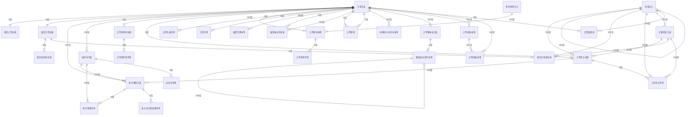

# 04. 논리 모델 — CUS 고객

> 작성 2026-11-07 · subagent_logical_modeler(작성) · masteragent_da_coordinator 03 논리 관문 재생성 · 정본 `model/logical/CUS.json` — 이 문서는 JSON 에서 생성(손수정 금지)
> 엔터티 30(핵심 10 · 기본·일반 20 · 정산 STL 0) · 속성 310 · 관계 51 · 관문 리뷰 `reviews/03_logical.md`

## 1. 엔터티 목록

| ID | 엔터티 | 물리명 | 테이블명(미리보기) | 유형 | 단계 | 모듈 | PK | 속성 수 | 설명 |
|---|---|---|---|---|---|---|---|---|---|
| CUS-001 | 고객기본 | `CUST_BAS` | `PTL_CUS_CUST_M` | BASE | CNCP |  | 고객번호 | 13 | 통신 서비스를 계약하고 요금 채무를 지는 당사자(개인·개인사업자·법인·외국인·공공기관)의 공통 실체. 개인·법인 상세의 상위(슈퍼타입). 해지·사망 후에도 행을 지우지 않고 상태·파기 일시로 표현한다. |
| CUS-002 | 개인고객상세 | `INDV_CUST_DTL` | `PTL_CUS_INDV_CUST_D` | BASE | CNCP |  | 고객번호 | 11 | 개인·외국인 고객의 서브타입 상세. 생년월일·성별·실명확인 값(암호화 자리 표시 — D11, 실제 주민번호 미보관)·복지 대상 여부 등 개인에게만 있는 속성. |
| CUS-003 | 법인고객상세 | `CORP_CUST_DTL` | `PTL_CUS_CORP_CUST_D` | BASE | CNCP |  | 고객번호 | 12 | 법인·개인사업자·공공기관 고객의 서브타입 상세. 사업자등록·대표자·업종·규모 등 법인에게만 있는 속성(법인 1곳이 회선 100만+ 보유하는 S1 핫 키의 주인). |
| CUS-004 | 청구계정기본 | `BILL_ACNT_BAS` | `PTL_CUS_BILL_ACNT_M` | BASE | CNCP |  | 청구계정번호 | 14 | 청구서를 묶어 발행하는 단위(TM Forum Customer Account). 한 고객이 여러 청구계정을, 한 청구계정이 여러 회선(가입계약)을 가진다. 청구주기·청구서 수령 방법·납부자를 정한다. 납부방법 실체는 INV(P1). |
| CUS-005 | 납부자기본 | `PYR_BAS` | `PTL_CUS_PYR_M` | BASE | CNCP |  | 납부자번호 | 11 | 요금을 실제로 내는 사람·법인. 명의 고객과 다를 수 있다(부모가 자녀 요금 납부, 법인이 임직원 요금 납부). 자사 고객이면 고객번호를 참조하고, 아니면 이름·연락처만 가진다. |
| CUS-006 | 고객연락처상세 | `CUST_CNTC_DTL` | `PTL_CUS_CUST_CNTC_D` | BASE | CNCP |  | 고객번호 + 연락처순번 | 10 | 고객의 연락 수단(휴대전화·자택·직장·이메일·팩스) 현재값. 한 고객 여러 건, 유형별 대표 1건. 변경 이력은 기본 엔터티 고객연락처이력(논리 단계). |
| CUS-007 | 고객주소상세 | `CUST_ADDR_DTL` | `PTL_CUS_CUST_ADDR_D` | BASE | CNCP |  | 고객번호 + 주소순번 | 14 | 고객의 주소(거주지·청구지·직장·사업장·배송지) 현재값. 청구계정의 청구지 주소가 이 엔터티를 가리킨다. 변경 이력은 고객주소이력(논리 단계). |
| CUS-008 | 고객동의내역 | `CUST_AGRE_DTLS` | `PTL_CUS_CUST_AGRE_L` | ACT | CNCP |  | 고객동의번호 | 12 | 고객이 개인정보 수집·이용, 마케팅 수신, 제3자 제공 등 동의 항목에 동의·거부한 행위 1건. 철회·만료·파기는 상태유형코드와 일시로 표현(행 삭제 없음 — 동의 증빙 보존 의무). |
| CUS-009 | 고객등급이력 | `CUST_GRD_HIST` | `PTL_CUS_CUST_GRD_H` | ACT | CNCP |  | 고객번호 + 등급적용시작일시 | 11 | 고객 등급(VVIP·VIP·골드·실버·일반) 산정·부여 이력. 적용 기간(시작·종료)을 가져 과거 시점 등급 재현(SCD2)이 가능하다. 현재 등급은 고객기본.고객등급코드에 둔다. |
| CUS-010 | 지역코드 | `RGN_CD` | `PTL_CUS_RGN_C` | REF | CNCP |  | 지역코드 | 10 | 시도·시군구·읍면동 행정구역 기준(행정표준코드 법정동 10자리 기준, D5 — 고객 영역 소유). 상위지역코드로 계층을 이룬다. 폐지·통합은 상태·적용 기간으로 표현. |
| CUS-011 | 고객이력 | `CUST_HIST` | `PTL_CUS_CUST_H` | ACT | LGCL |  | 고객번호 + 유효시작일시 | 10 | 고객기본 주요 속성(이름·상태·유형·등급·명의도용)의 변경 전후를 유효 기간(SCD2)으로 보존. 현재행은 유효종료일시 = 9999-12-31 23:59:59. |
| CUS-012 | 실명인증내역 | `RLNM_CRTF_DTLS` | `PTL_CUS_RLNM_CRTF_L` | ACT | LGCL |  | 실명인증번호 | 12 | 가입·명의변경·본인확인 시 수행한 실명인증(신분증 진위확인·휴대폰 본인확인 등) 1건. 신규 가입 전 인증은 고객번호가 없다(가입신청번호로 연결, 확정 후 고객번호 채움). |
| CUS-013 | 법정대리인상세 | `LGLRP_DTL` | `PTL_CUS_LGLRP_D` | BASE | LGCL |  | 고객번호 + 법정대리인순번 | 9 | 미성년(만 19세 미만)·피후견 고객의 법정대리인. 가입·요금제 변경 동의 주체. 대리인이 자사 고객이면 대리인고객번호(역할명)로 연결. |
| CUS-014 | 법인담당자상세 | `CORP_PIC_DTL` | `PTL_CUS_CORP_PIC_D` | BASE | LGCL |  | 고객번호 + 담당자순번 | 11 | 법인 고객의 업무 담당자(계약·요금·기술). 법인 1곳에 여러 명, 담당 유형별 대표 1명. |
| CUS-015 | 법인사업장상세 | `CORP_BPLC_DTL` | `PTL_CUS_CORP_BPLC_D` | BASE | LGCL |  | 고객번호 + 사업장순번 | 12 | 법인 고객의 사업장(본사·지점). 사업장별 사업자등록번호·주소를 갖고 법인 회선의 설치·청구 위치가 된다. |
| CUS-016 | 고객관계 | `CUST_REL` | `PTL_CUS_CUST_R` | BASE | LGCL |  | 고객번호 + 관계고객번호 + 고객관계유형코드 | 8 | 고객과 고객 사이의 관계(가족·법인 소속 임직원·법정대리) — 고객↔고객 N:M 해소. 가족결합·법인 임직원 요금 대납의 근거. |
| CUS-017 | 청구계정이력 | `BILL_ACNT_HIST` | `PTL_CUS_BILL_ACNT_H` | ACT | LGCL |  | 청구계정번호 + 유효시작일시 | 10 | 청구계정 속성(이름·상태·납부자·청구주기·유형·통합청구)의 변경 이력(SCD2). 청구주기 변경은 다음 청구월부터 적용. |
| CUS-018 | 청구서수령방법이력 | `INVC_RCPT_MTHD_HIST` | `PTL_CUS_INVC_RCPT_MTHD_H` | ACT | LGCL |  | 청구계정번호 + 유효시작일시 | 7 | 청구서 수령 방법(우편·이메일·모바일·문자·미발행)과 수령처 변경 이력(SCD2). 청구 시점 수령 방법 재현용. |
| CUS-019 | 납부자이력 | `PYR_HIST` | `PTL_CUS_PYR_H` | ACT | LGCL |  | 납부자번호 + 유효시작일시 | 9 | 납부자 속성(이름·상태·유형·명의자 관계·연락처) 변경 이력(SCD2). |
| CUS-020 | 고객연락처이력 | `CUST_CNTC_HIST` | `PTL_CUS_CUST_CNTC_H` | ACT | LGCL |  | 고객번호 + 연락처순번 + 유효시작일시 | 9 | 고객연락처상세 1건(고객번호+연락처순번)의 값·상태 변경 이력(SCD2). 개인정보 — 파기 시 연락처내용 마스킹. |
| CUS-021 | 고객주소이력 | `CUST_ADDR_HIST` | `PTL_CUS_CUST_ADDR_H` | ACT | LGCL |  | 고객번호 + 주소순번 + 유효시작일시 | 12 | 고객주소상세 1건(고객번호+주소순번)의 주소 변경 이력(SCD2). 반송·이사 추적. |
| CUS-022 | 동의항목코드 | `AGRE_ITM_CD` | `PTL_CUS_AGRE_ITM_C` | REF | LGCL |  | 동의항목유형코드 + 동의항목버전번호 | 10 | 동의 항목(개인정보 수집·이용 필수/선택, 마케팅 수신, 제3자 제공, 위치정보 등)과 그 약관 버전. 같은 항목의 약관 개정 = 새 버전 행. |
| CUS-023 | 고객동의이력 | `CUST_AGRE_HIST` | `PTL_CUS_CUST_AGRE_H` | ACT | LGCL |  | 고객동의번호 + 유효시작일시 | 7 | 고객동의내역 1건의 상태 변경(동의→철회·만료·파기, 재동의) 이력(SCD2). 동의 증빙 보존 의무로 삭제 없음. |
| CUS-024 | 마케팅수신거부내역 | `MKT_RCPTN_DENY_DTLS` | `PTL_CUS_MKT_RCPTN_DENY_L` | ACT | LGCL |  | 수신거부번호 | 8 | 광고성 정보 수신거부(정보통신망법 제50조) 1건 — 080 수신거부·고객센터·앱. 비고객 번호의 거부도 받으므로 고객번호는 선택. |
| CUS-025 | 우편번호기본 | `ZIP_BAS` | `PTL_CUS_ZIP_M` | REF | LGCL |  | 우편번호 | 7 | 도로명주소 기초구역 우편번호(5자리)와 소속 지역. 주소 정제·도서산간 배송 판정 기준. |
| CUS-026 | 고객멤버십기본 | `CUST_MBSP_BAS` | `PTL_CUS_CUST_MBSP_M` | BASE | LGCL |  | 멤버십번호 | 8 | 고객의 멤버십 가입(1고객 1멤버십). 등급은 고객 등급·회선 요금 기준으로 매년 산정. 포인트 잔액은 포인트내역 합계(파생 — 물리 단계 반정규화 후보). |
| CUS-027 | 멤버십포인트내역 | `MBSP_POINT_DTLS` | `PTL_CUS_MBSP_POINT_L` | ACT | LGCL |  | 멤버십번호 + 포인트거래순번 | 8 | 멤버십 포인트 적립·사용·소멸·취소·조정 거래 1건. 사용처는 제휴사(PRM 파트너). 취소 거래는 원거래 순번을 가리킨다. |
| CUS-028 | 고객상담내역 | `CUST_CNSL_DTLS` | `PTL_CUS_CUST_CNSL_L` | ACT | LGCL |  | 상담번호 | 11 | 고객센터·매장·채팅 상담 1건. 비고객(가입 문의)도 있어 고객번호 선택, 회선 관련 상담이면 서비스관리번호. 상담내용은 자유 서술(S9 넓은 행). |
| CUS-029 | 고객민원내역 | `CUST_CVLCPT_DTLS` | `PTL_CUS_CUST_CVLCPT_L` | ACT | LGCL |  | 민원번호 | 13 | 민원(요금 이의·부당 가입·해지 지연·품질) 접수·처리 1건. 외부 기관(방송통신위원회·한국소비자원) 이관 민원 포함. 상담에서 전환되면 상담번호. |
| CUS-030 | 고객월통계 | `CUST_MM_STATS` | `PTL_CUS_CUST_MM_S` | PROC | LGCL |  | 고객번호 + 기준년월 | 11 | 고객 × 기준년월 집계(세분·회선 수·청구·수납). 월 마감 배치가 ORD·PAY·INV 원천에서 산출하는 가공 엔터티(ARPU = 청구금액÷회선수는 저장하지 않음 — 행 내 파생). |

## 2. 엔터티별 속성

속성 순서 = PK → FK → 일반(규칙 2-9). FK 표기 = `<영역>.<엔터티>.<속성>`. NULL Y = 선택. 시스템 칼럼 4개는 DDL 생성 때만 붙는다(D7).

### CUS-001 고객기본 `CUST_BAS` (BASE·CNCP)

통신 서비스를 계약하고 요금 채무를 지는 당사자(개인·개인사업자·법인·외국인·공공기관)의 공통 실체. 개인·법인 상세의 상위(슈퍼타입). 해지·사망 후에도 행을 지우지 않고 상태·파기 일시로 표현한다.

| # | 속성 | 물리명 | 도메인 | PK | FK | NULL | 설명 |
|---|---|---|---|---|---|---|---|
| 1 | 고객번호 | CUST_NO | 번호V20 | PK |  | N | 고객의 번호 — 대상을 식별하거나 외부에서 부여받은 번호 |
| 2 | 고객명 | CUST_NM | 명V100 |  |  | N | 고객의 명 — 대상을 부르는 이름 |
| 3 | 고객등록일시 | CUST_REG_DTM | 일시TS |  |  | N | 고객 등록의 일시 — 연월일 시분초까지의 시점 |
| 4 | 고객상태유형코드 | CUST_STTS_TY_CD | 코드V10 |  |  | N | 고객 상태의 유형 코드 — 공통코드(codes.json) |
| 5 | 고객유형코드 | CUST_TY_CD | 코드V10 |  |  | N | 고객의 유형 코드 — 공통코드(codes.json) |
| 6 | 내외국인구분코드 | DMFRGN_SE_CD | 코드V10 |  |  | N | 내외국인의 구분 코드 — 공통코드(codes.json) |
| 7 | 국가코드 | NATN_CD | 코드V10 |  |  | Y | 국가 코드 — 외부 표준 ISO 3166-1 alpha-2 값을 그대로 쓴다(공통코드 아님) |
| 8 | 고객등급유형코드 | CUST_GRD_TY_CD | 코드V10 |  |  | Y | 고객 등급의 유형 코드 — 공통코드(codes.json) |
| 9 | 최초가입일자 | FRST_SBSC_DT | 일자C8 |  |  | Y | 최초 가입의 일자 — 연월일(YYYYMMDD) |
| 10 | 고객해지일시 | CUST_TRMN_DTM | 일시TS |  |  | Y | 고객 해지의 일시 — 연월일 시분초까지의 시점 |
| 11 | 휴면전환일자 | DRMT_CNVR_DT | 일자C8 |  |  | Y | 휴면 전환의 일자 — 연월일(YYYYMMDD) |
| 12 | 개인정보파기일시 | PRVC_DSTR_DTM | 일시TS |  |  | Y | 개인정보 파기의 일시 — 연월일 시분초까지의 시점 |
| 13 | 명의도용신고여부 | NMNE_THFT_DCLR_YN | 여부C1 |  |  | N | 명의 도용 신고의 여부 — 해당 여부(Y/N) |

정규화 : 1NF: 연락처·주소·동의 반복 그룹을 상세 엔터티로 분리. 2NF: 단일 PK. 3NF: 고객등급명은 코드값에서 파생되어 두지 않음(등급유형코드만). 현재 등급(고객등급유형코드)은 고객등급이력 현재행과 중복이지만 개념 결정 C3(현재값+이력 쌍) 유지 — 이력이 정본, 기본은 현재 스냅숏.

### CUS-002 개인고객상세 `INDV_CUST_DTL` (BASE·CNCP)

개인·외국인 고객의 서브타입 상세. 생년월일·성별·실명확인 값(암호화 자리 표시 — D11, 실제 주민번호 미보관)·복지 대상 여부 등 개인에게만 있는 속성.

| # | 속성 | 물리명 | 도메인 | PK | FK | NULL | 설명 |
|---|---|---|---|---|---|---|---|
| 1 | 고객번호 | CUST_NO | 번호V20 | PK | CUS.고객기본.고객번호 | N | 고객의 번호 — 대상을 식별하거나 외부에서 부여받은 번호 |
| 2 | 영문고객명 | ENG_CUST_NM | 명V100 |  |  | N | 영문 고객의 명 — 대상을 부르는 이름 |
| 3 | 개인고객등록일시 | INDV_CUST_REG_DTM | 일시TS |  |  | N | 개인 고객 등록의 일시 — 연월일 시분초까지의 시점 |
| 4 | 실명인증상태유형코드 | RLNM_CRTF_STTS_TY_CD | 코드V10 |  |  | N | 실명 인증 상태의 유형 코드 — 공통코드(codes.json) |
| 5 | 생년월일 | BRDT | 일자C8 |  |  | Y | 태어난 연월일 |
| 6 | 성별구분코드 | GNDR_SE_CD | 코드V10 |  |  | Y | 성별의 구분 코드 — 공통코드(codes.json) |
| 7 | 실명확인번호암호화값 | RLNM_IDNTF_NO_ENCPT_VL | 값V256 |  |  | Y | 실명 확인 번호 암호화의 값 — 측정·설정·암호화된 값 |
| 8 | 신분증종류코드 | IDCD_KND_CD | 코드V10 |  |  | Y | 신분증의 종류 코드 — 공통코드(codes.json) |
| 9 | 실명인증일시 | RLNM_CRTF_DTM | 일시TS |  |  | Y | 실명 인증의 일시 — 연월일 시분초까지의 시점 |
| 10 | 외국인체류만료일자 | FRGNR_STAY_EXPRY_DT | 일자C8 |  |  | Y | 외국인 체류 만료의 일자 — 연월일(YYYYMMDD) |
| 11 | 복지대상유형코드 | WLFR_TRGT_TY_CD | 코드V10 |  |  | Y | 복지 대상의 유형 코드 — 공통코드(codes.json) |

정규화 : 1NF·2NF 충족(PK = 고객번호 1:1 서브타입). 3NF: 성별·생년월일은 실명확인번호에서 파생 가능하나 원본은 암호화값이라 복호 없이 쓰도록 별도 보관(D11 — 파생 아님으로 판정).

### CUS-003 법인고객상세 `CORP_CUST_DTL` (BASE·CNCP)

법인·개인사업자·공공기관 고객의 서브타입 상세. 사업자등록·대표자·업종·규모 등 법인에게만 있는 속성(법인 1곳이 회선 100만+ 보유하는 S1 핫 키의 주인).

| # | 속성 | 물리명 | 도메인 | PK | FK | NULL | 설명 |
|---|---|---|---|---|---|---|---|
| 1 | 고객번호 | CUST_NO | 번호V20 | PK | CUS.고객기본.고객번호 | N | 고객의 번호 — 대상을 식별하거나 외부에서 부여받은 번호 |
| 2 | 법인명 | CORP_NM | 명V200 |  |  | N | 법인의 명 — 대상을 부르는 이름 |
| 3 | 법인고객등록일시 | CORP_CUST_REG_DTM | 일시TS |  |  | N | 법인 고객 등록의 일시 — 연월일 시분초까지의 시점 |
| 4 | 사업자상태유형코드 | BZMN_STTS_TY_CD | 코드V10 |  |  | N | 사업자 상태의 유형 코드 — 공통코드(codes.json) |
| 5 | 사업자등록번호 | BRNO | 번호V20 |  |  | Y | 국세청 사업자등록번호 10자리 |
| 6 | 법인등록번호 | CRNO | 번호V20 |  |  | Y | 법원 법인등록번호 13자리 |
| 7 | 대표자명 | RPRSV_NM | 명V100 |  |  | Y | 대표자의 명 — 대상을 부르는 이름 |
| 8 | 업종코드 | TPBIZ_CD | 코드V10 |  |  | Y | 업종 코드 — 외부 표준 통계청 KSIC 대분류 값을 그대로 쓴다(공통코드 아님) |
| 9 | 법인규모유형코드 | CORP_SCL_TY_CD | 코드V10 |  |  | Y | 법인 규모의 유형 코드 — 공통코드(codes.json) |
| 10 | 설립일자 | FNDN_DT | 일자C8 |  |  | Y | 설립의 일자 — 연월일(YYYYMMDD) |
| 11 | 종업원수 | EMP_CNT | 수N10 |  |  | Y | 종업원의 수 — 개수·인원 등 셀 수 있는 수 |
| 12 | 대표전화번호 | RPRS_TELNO | 전화번호V20 |  |  | Y | 대표의 전화번호 — 전화번호(숫자 문자열) |

정규화 : 1NF: 사업장·담당자 반복 그룹을 법인사업장상세·법인담당자상세로 분리. 2NF·3NF 충족(업종명은 업종코드에서 파생 — 두지 않음).

### CUS-004 청구계정기본 `BILL_ACNT_BAS` (BASE·CNCP)

청구서를 묶어 발행하는 단위(TM Forum Customer Account). 한 고객이 여러 청구계정을, 한 청구계정이 여러 회선(가입계약)을 가진다. 청구주기·청구서 수령 방법·납부자를 정한다. 납부방법 실체는 INV(P1).

| # | 속성 | 물리명 | 도메인 | PK | FK | NULL | 설명 |
|---|---|---|---|---|---|---|---|
| 1 | 청구계정번호 | BILL_ACNT_NO | 번호V20 | PK |  | N | 청구 계정의 번호 — 대상을 식별하거나 외부에서 부여받은 번호 |
| 2 | 고객번호 | CUST_NO | 번호V20 |  | CUS.고객기본.고객번호 CUS.고객주소상세.고객번호 | N | 고객의 번호 — 대상을 식별하거나 외부에서 부여받은 번호 |
| 3 | 납부자번호 | PYR_NO | 번호V20 |  | CUS.납부자기본.납부자번호 | N | 납부자의 번호 — 대상을 식별하거나 외부에서 부여받은 번호 |
| 4 | 청구주기코드 | BILL_CYCL_CD | 코드V10 |  | PAY.청구주기코드.청구주기코드 | N | 청구 주기의 코드 — 업무 분류 값을 식별하는 부호, 엔터티에서는 기준 코드 집합 |
| 5 | 청구지주소순번 | BILL_PLC_ADDR_SEQ | 순번N5 |  | CUS.고객주소상세.주소순번 | Y | 청구 지 주소의 순번 — 부모 안의 처리·표시 순서 |
| 6 | 청구계정명 | BILL_ACNT_NM | 명V100 |  |  | N | 청구 계정의 명 — 대상을 부르는 이름 |
| 7 | 청구계정등록일시 | BILL_ACNT_REG_DTM | 일시TS |  |  | N | 청구 계정 등록의 일시 — 연월일 시분초까지의 시점 |
| 8 | 청구계정상태유형코드 | BILL_ACNT_STTS_TY_CD | 코드V10 |  |  | N | 청구 계정 상태의 유형 코드 — 공통코드(codes.json) |
| 9 | 청구계정유형코드 | BILL_ACNT_TY_CD | 코드V10 |  |  | N | 청구 계정의 유형 코드 — 공통코드(codes.json) |
| 10 | 청구서수령방법유형코드 | INVC_RCPT_MTHD_TY_CD | 코드V10 |  |  | N | 청구서 수령 방법의 유형 코드 — 공통코드(codes.json) |
| 11 | 청구서이메일주소 | INVC_EML_ADDR | 주소V100 |  |  | Y | 청구서 이메일의 주소 — 우편·전자 주소 |
| 12 | 통합청구여부 | INTGR_BILL_YN | 여부C1 |  |  | N | 통합 청구의 여부 — 해당 여부(Y/N) |
| 13 | 최초청구년월 | FRST_BILL_YM | 년월C6 |  |  | Y | 최초 청구의 년월 — 연월(YYYYMM) |
| 14 | 청구계정해지일시 | BILL_ACNT_TRMN_DTM | 일시TS |  |  | Y | 청구 계정 해지의 일시 — 연월일 시분초까지의 시점 |

정규화 : 2NF: 단일 PK. 3NF: 청구지 주소 본문은 고객주소상세 참조(청구지주소순번)로만 두어 이행 종속 제거. 납부자 이름·연락처는 납부자기본 소유.

### CUS-005 납부자기본 `PYR_BAS` (BASE·CNCP)

요금을 실제로 내는 사람·법인. 명의 고객과 다를 수 있다(부모가 자녀 요금 납부, 법인이 임직원 요금 납부). 자사 고객이면 고객번호를 참조하고, 아니면 이름·연락처만 가진다.

| # | 속성 | 물리명 | 도메인 | PK | FK | NULL | 설명 |
|---|---|---|---|---|---|---|---|
| 1 | 납부자번호 | PYR_NO | 번호V20 | PK |  | N | 납부자의 번호 — 대상을 식별하거나 외부에서 부여받은 번호 |
| 2 | 고객번호 | CUST_NO | 번호V20 |  | CUS.고객기본.고객번호 | Y | 고객의 번호 — 대상을 식별하거나 외부에서 부여받은 번호 |
| 3 | 납부자명 | PYR_NM | 명V100 |  |  | N | 납부자의 명 — 대상을 부르는 이름 |
| 4 | 납부자등록일시 | PYR_REG_DTM | 일시TS |  |  | N | 납부자 등록의 일시 — 연월일 시분초까지의 시점 |
| 5 | 납부자상태유형코드 | PYR_STTS_TY_CD | 코드V10 |  |  | N | 납부자 상태의 유형 코드 — 공통코드(codes.json) |
| 6 | 납부자유형코드 | PYR_TY_CD | 코드V10 |  |  | N | 납부자의 유형 코드 — 공통코드(codes.json) |
| 7 | 명의자관계유형코드 | NMNE_PRSN_REL_TY_CD | 코드V10 |  |  | Y | 명의 자 관계의 유형 코드 — 공통코드(codes.json) |
| 8 | 납부자생년월일 | PYR_BRDT | 일자C8 |  |  | Y | 납부자의 생년월일 — 태어난 연월일 |
| 9 | 납부자사업자등록번호 | PYR_BRNO | 번호V20 |  |  | Y | 납부자의 사업자등록번호 — 국세청 사업자등록번호 10자리 |
| 10 | 납부자휴대전화번호 | PYR_MBL_TELNO | 전화번호V20 |  |  | Y | 납부자 휴대의 전화번호 — 전화번호(숫자 문자열) |
| 11 | 납부자이메일주소 | PYR_EML_ADDR | 주소V100 |  |  | Y | 납부자 이메일의 주소 — 우편·전자 주소 |

정규화 : 3NF: 자사 고객 납부자의 이름·생년월일은 고객기본과 중복될 수 있으나 비고객 납부자 공통 속성이고 청구 시점 납부자 명의 보존 목적 — 이행 종속 아님(고객번호 → 납부자명 함수 종속이 성립하지 않음, 법인 대납 등).

### CUS-006 고객연락처상세 `CUST_CNTC_DTL` (BASE·CNCP)

고객의 연락 수단(휴대전화·자택·직장·이메일·팩스) 현재값. 한 고객 여러 건, 유형별 대표 1건. 변경 이력은 기본 엔터티 고객연락처이력(논리 단계).

| # | 속성 | 물리명 | 도메인 | PK | FK | NULL | 설명 |
|---|---|---|---|---|---|---|---|
| 1 | 고객번호 | CUST_NO | 번호V20 | PK | CUS.고객기본.고객번호 | N | 고객의 번호 — 대상을 식별하거나 외부에서 부여받은 번호 |
| 2 | 연락처순번 | CNTC_SEQ | 순번N5 | PK |  | N | 연락처의 순번 — 부모 안의 처리·표시 순서 |
| 3 | 연락처명 | CNTC_NM | 명V100 |  |  | N | 연락처의 명 — 대상을 부르는 이름 |
| 4 | 연락처등록일시 | CNTC_REG_DTM | 일시TS |  |  | N | 연락처 등록의 일시 — 연월일 시분초까지의 시점 |
| 5 | 연락처상태유형코드 | CNTC_STTS_TY_CD | 코드V10 |  |  | N | 연락처 상태의 유형 코드 — 공통코드(codes.json) |
| 6 | 연락처유형코드 | CNTC_TY_CD | 코드V10 |  |  | N | 연락처의 유형 코드 — 공통코드(codes.json) |
| 7 | 연락처내용 | CNTC_CN | 내용V200 |  |  | N | 연락처의 내용 — 자유 서술 내용 |
| 8 | 대표연락처여부 | RPRS_CNTC_YN | 여부C1 |  |  | N | 대표 연락처의 여부 — 해당 여부(Y/N) |
| 9 | 본인연락처여부 | SELF_CNTC_YN | 여부C1 |  |  | Y | 본인 연락처의 여부 — 해당 여부(Y/N) |
| 10 | 연락처검증일시 | CNTC_VRFC_DTM | 일시TS |  |  | Y | 연락처 검증의 일시 — 연월일 시분초까지의 시점 |

정규화 : 1NF: 연락 수단마다 1행(반복 그룹 해소). 2NF: 비키 속성은 (고객번호, 연락처순번) 전체에 종속. 3NF 충족.

### CUS-007 고객주소상세 `CUST_ADDR_DTL` (BASE·CNCP)

고객의 주소(거주지·청구지·직장·사업장·배송지) 현재값. 청구계정의 청구지 주소가 이 엔터티를 가리킨다. 변경 이력은 고객주소이력(논리 단계).

| # | 속성 | 물리명 | 도메인 | PK | FK | NULL | 설명 |
|---|---|---|---|---|---|---|---|
| 1 | 고객번호 | CUST_NO | 번호V20 | PK | CUS.고객기본.고객번호 | N | 고객의 번호 — 대상을 식별하거나 외부에서 부여받은 번호 |
| 2 | 주소순번 | ADDR_SEQ | 순번N5 | PK |  | N | 주소의 순번 — 부모 안의 처리·표시 순서 |
| 3 | 지역코드 | RGN_CD | 코드V10 |  | CUS.지역코드.지역코드 | N | 지역의 코드 — 업무 분류 값을 식별하는 부호, 엔터티에서는 기준 코드 집합 |
| 4 | 우편번호 | ZIP | 우편번호C5 |  | CUS.우편번호기본.우편번호 | Y | 우편번호 5자리 |
| 5 | 수령인명 | RCPN_NM | 명V100 |  |  | N | 수령인의 명 — 대상을 부르는 이름 |
| 6 | 주소등록일시 | ADDR_REG_DTM | 일시TS |  |  | N | 주소 등록의 일시 — 연월일 시분초까지의 시점 |
| 7 | 주소상태유형코드 | ADDR_STTS_TY_CD | 코드V10 |  |  | N | 주소 상태의 유형 코드 — 공통코드(codes.json) |
| 8 | 주소유형코드 | ADDR_TY_CD | 코드V10 |  |  | N | 주소의 유형 코드 — 공통코드(codes.json) |
| 9 | 도로명주소 | ROAD_NM_ADDR | 주소V200 |  |  | Y | 도로 명의 주소 — 우편·전자 주소 |
| 10 | 상세주소 | DADDR | 주소V200 |  |  | Y | 도로명주소 뒤의 동·호 등 상세 주소 |
| 11 | 건물관리번호 | BLDG_MGMT_NO | 번호V30 |  |  | Y | 건물 관리의 번호 — 대상을 식별하거나 외부에서 부여받은 번호 |
| 12 | 대표주소여부 | RPRS_ADDR_YN | 여부C1 |  |  | N | 대표 주소의 여부 — 해당 여부(Y/N) |
| 13 | 반송횟수 | RTRN_NMTM | 수N5 |  |  | Y | 반송의 횟수 — 반복 발생한 횟수 |
| 14 | 고객주소변경사유유형코드 | CUST_ADDR_CHG_RSN_TY_CD | 코드V10 |  |  | Y | 주소 변경 사유(이사·반송·정정) — 현재값의 마지막 변경 사유 |

정규화 : 1NF: 주소마다 1행. 3NF: 지역명은 지역코드, 도서산간은 우편번호기본에서 조회(두지 않음). 지역코드(법정동 10자리)는 우편번호(기초구역)로 결정되지 않아 이행 종속 아님.

### CUS-008 고객동의내역 `CUST_AGRE_DTLS` (ACT·CNCP)

고객이 개인정보 수집·이용, 마케팅 수신, 제3자 제공 등 동의 항목에 동의·거부한 행위 1건. 철회·만료·파기는 상태유형코드와 일시로 표현(행 삭제 없음 — 동의 증빙 보존 의무).

| # | 속성 | 물리명 | 도메인 | PK | FK | NULL | 설명 |
|---|---|---|---|---|---|---|---|
| 1 | 고객동의번호 | CUST_AGRE_NO | 번호V20 | PK |  | N | 고객 동의의 번호 — 대상을 식별하거나 외부에서 부여받은 번호 |
| 2 | 고객번호 | CUST_NO | 번호V20 |  | CUS.고객기본.고객번호 | N | 고객의 번호 — 대상을 식별하거나 외부에서 부여받은 번호 |
| 3 | 동의항목유형코드 | AGRE_ITM_TY_CD | 코드V10 |  | CUS.동의항목코드.동의항목유형코드 | N | 동의 항목의 유형 코드 — 공통코드(codes.json) |
| 4 | 동의항목버전번호 | AGRE_ITM_VER_NO | 번호V20 |  | CUS.동의항목코드.동의항목버전번호 | N | 동의 항목 버전의 번호 — 대상을 식별하거나 외부에서 부여받은 번호 |
| 5 | 동의자명 | AGRE_PRSN_NM | 명V100 |  |  | N | 동의 자의 명 — 대상을 부르는 이름 |
| 6 | 동의일시 | AGRE_DTM | 일시TS |  |  | N | 동의의 일시 — 연월일 시분초까지의 시점 |
| 7 | 동의상태유형코드 | AGRE_STTS_TY_CD | 코드V10 |  |  | N | 동의 상태의 유형 코드 — 공통코드(codes.json) |
| 8 | 동의여부 | AGRE_YN | 여부C1 |  |  | N | 동의의 여부 — 해당 여부(Y/N) |
| 9 | 동의채널유형코드 | AGRE_CHNL_TY_CD | 코드V10 |  |  | Y | 동의 채널의 유형 코드 — 공통코드(codes.json) |
| 10 | 법정대리인동의여부 | LGLRP_AGRE_YN | 여부C1 |  |  | Y | 법정대리인 동의의 여부 — 해당 여부(Y/N) |
| 11 | 동의철회일시 | AGRE_WTHDR_DTM | 일시TS |  |  | Y | 동의 철회의 일시 — 연월일 시분초까지의 시점 |
| 12 | 동의만료일자 | AGRE_EXPRY_DT | 일자C8 |  |  | Y | 동의 만료의 일자 — 연월일(YYYYMMDD) |

정규화 : 2NF: 행위 번호 단일 PK. 3NF: 동의항목명·필수여부는 동의항목코드(유형코드+버전)로 이동, 여기에는 FK만.

### CUS-009 고객등급이력 `CUST_GRD_HIST` (ACT·CNCP)

고객 등급(VVIP·VIP·골드·실버·일반) 산정·부여 이력. 적용 기간(시작·종료)을 가져 과거 시점 등급 재현(SCD2)이 가능하다. 현재 등급은 고객기본.고객등급코드에 둔다.

| # | 속성 | 물리명 | 도메인 | PK | FK | NULL | 설명 |
|---|---|---|---|---|---|---|---|
| 1 | 고객번호 | CUST_NO | 번호V20 | PK | CUS.고객기본.고객번호 | N | 고객의 번호 — 대상을 식별하거나 외부에서 부여받은 번호 |
| 2 | 등급적용시작일시 | GRD_APLCN_BGNG_DTM | 일시TS | PK |  | N | 등급 적용 시작의 일시 — 연월일 시분초까지의 시점 |
| 3 | 고객등급명 | CUST_GRD_NM | 명V100 |  |  | N | 고객 등급의 명 — 대상을 부르는 이름 |
| 4 | 등급산정일시 | GRD_ASMT_DTM | 일시TS |  |  | N | 등급 산정의 일시 — 연월일 시분초까지의 시점 |
| 5 | 등급적용상태유형코드 | GRD_APLCN_STTS_TY_CD | 코드V10 |  |  | N | 등급 적용 상태의 유형 코드 — 공통코드(codes.json) |
| 6 | 고객등급유형코드 | CUST_GRD_TY_CD | 코드V10 |  |  | N | 고객 등급의 유형 코드 — 공통코드(codes.json) |
| 7 | 등급적용종료일시 | GRD_APLCN_END_DTM | 일시TS |  |  | Y | 등급 적용 종료의 일시 — 연월일 시분초까지의 시점 |
| 8 | 등급산정기준년월 | GRD_ASMT_STD_YM | 년월C6 |  |  | Y | 등급 산정 기준의 년월 — 연월(YYYYMM) |
| 9 | 산정청구금액 | ASMT_BILL_AMT | 금액N15 |  |  | Y | 산정 청구의 금액 — 원화 금액(원 단위 정수) |
| 10 | 가입기간개월수 | SBSC_PRD_MCNT | 수N5 |  |  | Y | 가입 기간의 개월수 — 기간의 개월 수 |
| 11 | 등급변경사유유형코드 | GRD_CHG_RSN_TY_CD | 코드V10 |  |  | Y | 등급 변경 사유의 유형 코드 — 공통코드(codes.json) |

정규화 : 2NF: (고객번호, 등급적용시작일시) 전체 종속. 고객등급명은 산정 당시 명칭 보존(개념 C9 — 시점 스냅숏, 이행 종속 예외로 기록).

### CUS-010 지역코드 `RGN_CD` (REF·CNCP)

시도·시군구·읍면동 행정구역 기준(행정표준코드 법정동 10자리 기준, D5 — 고객 영역 소유). 상위지역코드로 계층을 이룬다. 폐지·통합은 상태·적용 기간으로 표현.

| # | 속성 | 물리명 | 도메인 | PK | FK | NULL | 설명 |
|---|---|---|---|---|---|---|---|
| 1 | 지역코드 | RGN_CD | 코드V10 | PK |  | N | 지역의 코드 — 업무 분류 값을 식별하는 부호, 엔터티에서는 기준 코드 집합 |
| 2 | 상위지역코드 | UP_RGN_CD | 코드V10 |  | CUS.지역코드.지역코드 | Y | 상위 지역의 코드 — 업무 분류 값을 식별하는 부호, 엔터티에서는 기준 코드 집합 |
| 3 | 지역명 | RGN_NM | 명V100 |  |  | N | 지역의 명 — 대상을 부르는 이름 |
| 4 | 지역등록일시 | RGN_REG_DTM | 일시TS |  |  | N | 지역 등록의 일시 — 연월일 시분초까지의 시점 |
| 5 | 지역상태유형코드 | RGN_STTS_TY_CD | 코드V10 |  |  | N | 지역 상태의 유형 코드 — 공통코드(codes.json) |
| 6 | 지역단계구분코드 | RGN_STEP_SE_CD | 코드V10 |  |  | N | 지역 단계의 구분 코드 — 공통코드(codes.json) |
| 7 | 영문지역명 | ENG_RGN_NM | 명V100 |  |  | Y | 영문 지역의 명 — 대상을 부르는 이름 |
| 8 | 적용시작일자 | APLCN_BGNG_DT | 일자C8 |  |  | Y | 적용 시작의 일자 — 연월일(YYYYMMDD) |
| 9 | 적용종료일자 | APLCN_END_DT | 일자C8 |  |  | Y | 적용 종료의 일자 — 연월일(YYYYMMDD) |
| 10 | 도서산간여부 | ISLND_MNTN_YN | 여부C1 |  |  | Y | 도서 산간의 여부 — 해당 여부(Y/N) |

정규화 : 3NF: 상위 지역 이름은 자기 참조로 조회(두지 않음). 계층 = 자기 참조 1:N.

### CUS-011 고객이력 `CUST_HIST` (ACT·LGCL)

고객기본 주요 속성(이름·상태·유형·등급·명의도용)의 변경 전후를 유효 기간(SCD2)으로 보존. 현재행은 유효종료일시 = 9999-12-31 23:59:59.

| # | 속성 | 물리명 | 도메인 | PK | FK | NULL | 설명 |
|---|---|---|---|---|---|---|---|
| 1 | 고객번호 | CUST_NO | 번호V20 | PK | CUS.고객기본.고객번호 | N | 고객의 번호 — 대상을 식별하거나 외부에서 부여받은 번호 |
| 2 | 유효시작일시 | VLD_BGNG_DTM | 일시TS | PK |  | N | 유효 시작의 일시 — 연월일 시분초까지의 시점 |
| 3 | 유효종료일시 | VLD_END_DTM | 일시TS |  |  | N | 유효 종료의 일시 — 연월일 시분초까지의 시점 |
| 4 | 고객명 | CUST_NM | 명V100 |  |  | N | 고객의 명 — 대상을 부르는 이름 |
| 5 | 고객상태유형코드 | CUST_STTS_TY_CD | 코드V10 |  |  | N | 고객 상태의 유형 코드 — 공통코드(codes.json) |
| 6 | 고객유형코드 | CUST_TY_CD | 코드V10 |  |  | N | 고객의 유형 코드 — 공통코드(codes.json) |
| 7 | 고객등급유형코드 | CUST_GRD_TY_CD | 코드V10 |  |  | Y | 고객 등급의 유형 코드 — 공통코드(codes.json) |
| 8 | 명의도용신고여부 | NMNE_THFT_DCLR_YN | 여부C1 |  |  | N | 명의 도용 신고의 여부 — 해당 여부(Y/N) |
| 9 | 고객변경사유유형코드 | CUST_CHG_RSN_TY_CD | 코드V10 |  |  | N | 고객 변경 사유의 유형 코드 — 공통코드(codes.json 신규 등재 필요) |
| 10 | 변경채널유형코드 | CHG_CHNL_TY_CD | 코드V10 |  |  | Y | 변경 채널의 유형 코드 — 공통코드(codes.json 신규 등재 필요) |

정규화 : 2NF: (고객번호, 유효시작일시) 전체 종속. 이력 엔터티는 변경 시점 스냅숏이라 고객기본과의 값 중복은 이행 종속 아님.

### CUS-012 실명인증내역 `RLNM_CRTF_DTLS` (ACT·LGCL)

가입·명의변경·본인확인 시 수행한 실명인증(신분증 진위확인·휴대폰 본인확인 등) 1건. 신규 가입 전 인증은 고객번호가 없다(가입신청번호로 연결, 확정 후 고객번호 채움).

| # | 속성 | 물리명 | 도메인 | PK | FK | NULL | 설명 |
|---|---|---|---|---|---|---|---|
| 1 | 실명인증번호 | RLNM_CRTF_NO | 번호V20 | PK |  | N | 실명 인증의 번호 — 대상을 식별하거나 외부에서 부여받은 번호 |
| 2 | 고객번호 | CUST_NO | 번호V20 |  | CUS.고객기본.고객번호 | Y | 고객의 번호 — 대상을 식별하거나 외부에서 부여받은 번호 |
| 3 | 가입신청번호 | SBSC_APLY_NO | 번호V20 |  | ORD.가입신청기본.가입신청번호 | Y | 가입 신청의 번호 — 대상을 식별하거나 외부에서 부여받은 번호 |
| 4 | 파트너번호 | PRTNR_NO | 번호V20 |  | PRM.파트너기본.파트너번호 | Y | 인증을 수행한 매장(유통망) — 온라인 인증은 NULL |
| 5 | 인증대상명 | CRTF_TRGT_NM | 명V100 |  |  | N | 인증 대상의 명 — 대상을 부르는 이름 |
| 6 | 실명인증일시 | RLNM_CRTF_DTM | 일시TS |  |  | N | 실명 인증의 일시 — 연월일 시분초까지의 시점 |
| 7 | 실명인증결과유형코드 | RLNM_CRTF_RSLT_TY_CD | 코드V10 |  |  | N | 실명 인증 결과의 유형 코드 — 공통코드(codes.json 신규 등재 필요) |
| 8 | 실명인증수단유형코드 | RLNM_CRTF_MEANS_TY_CD | 코드V10 |  |  | N | 실명 인증 수단의 유형 코드 — 공통코드(codes.json 신규 등재 필요) |
| 9 | 신분증종류코드 | IDCD_KND_CD | 코드V10 |  |  | Y | 신분증의 종류 코드 — 공통코드(codes.json) |
| 10 | 신분증발급일자 | IDCD_ISSU_DT | 일자C8 |  |  | Y | 신분증 발급의 일자 — 연월일(YYYYMMDD) |
| 11 | 실명확인번호암호화값 | RLNM_IDNTF_NO_ENCPT_VL | 값V256 |  |  | N | 실명 확인 번호 암호화의 값 — 측정·설정·암호화된 값 |
| 12 | 인증실패사유유형코드 | CRTF_FAIL_RSN_TY_CD | 코드V10 |  |  | Y | 인증 실패 사유의 유형 코드 — 공통코드(codes.json 신규 등재 필요) |

정규화 : 1NF·2NF 충족(행위 번호 PK). 3NF: 인증 매장 이름은 파트너기본에서 조회. 인증대상명은 고객 확정 전 값이라 고객기본과 별개.

### CUS-013 법정대리인상세 `LGLRP_DTL` (BASE·LGCL)

미성년(만 19세 미만)·피후견 고객의 법정대리인. 가입·요금제 변경 동의 주체. 대리인이 자사 고객이면 대리인고객번호(역할명)로 연결.

| # | 속성 | 물리명 | 도메인 | PK | FK | NULL | 설명 |
|---|---|---|---|---|---|---|---|
| 1 | 고객번호 | CUST_NO | 번호V20 | PK | CUS.고객기본.고객번호 | N | 고객의 번호 — 대상을 식별하거나 외부에서 부여받은 번호 |
| 2 | 법정대리인순번 | LGLRP_SEQ | 순번N5 | PK |  | N | 법정대리인의 순번 — 부모 안의 처리·표시 순서 |
| 3 | 법정대리인고객번호 | LGLRP_CUST_NO | 번호V20 |  | CUS.고객기본.고객번호 | Y | 법정대리인 고객의 번호 — 대상을 식별하거나 외부에서 부여받은 번호 |
| 4 | 법정대리인명 | LGLRP_NM | 명V100 |  |  | N | 법정대리인의 명 — 대상을 부르는 이름 |
| 5 | 법정대리인관계유형코드 | LGLRP_REL_TY_CD | 코드V10 |  |  | N | 법정대리인 관계의 유형 코드 — 공통코드(codes.json 신규 등재 필요) |
| 6 | 법정대리인생년월일 | LGLRP_BRDT | 일자C8 |  |  | Y | 법정대리인의 생년월일 — 태어난 연월일 |
| 7 | 법정대리인휴대전화번호 | LGLRP_MBL_TELNO | 전화번호V20 |  |  | Y | 법정대리인 휴대의 전화번호 — 전화번호(숫자 문자열) |
| 8 | 법정대리인동의일시 | LGLRP_AGRE_DTM | 일시TS |  |  | N | 법정대리인 동의의 일시 — 연월일 시분초까지의 시점 |
| 9 | 법정대리인관계종료일자 | LGLRP_REL_END_DT | 일자C8 |  |  | Y | 법정대리인 관계 종료의 일자 — 연월일(YYYYMMDD) |

정규화 : 1NF: 대리인 2명(부·모) 반복 → 순번 행. 3NF: 대리인이 자사 고객이어도 이름·생년월일을 남기는 이유 = 동의 당시 증빙(스냅숏).

### CUS-014 법인담당자상세 `CORP_PIC_DTL` (BASE·LGCL)

법인 고객의 업무 담당자(계약·요금·기술). 법인 1곳에 여러 명, 담당 유형별 대표 1명.

| # | 속성 | 물리명 | 도메인 | PK | FK | NULL | 설명 |
|---|---|---|---|---|---|---|---|
| 1 | 고객번호 | CUST_NO | 번호V20 | PK | CUS.법인고객상세.고객번호 | N | 고객의 번호 — 대상을 식별하거나 외부에서 부여받은 번호 |
| 2 | 담당자순번 | PIC_SEQ | 순번N5 | PK |  | N | 담당자의 순번 — 부모 안의 처리·표시 순서 |
| 3 | 담당자명 | PIC_NM | 명V100 |  |  | N | 담당자의 명 — 대상을 부르는 이름 |
| 4 | 담당자유형코드 | PIC_TY_CD | 코드V10 |  |  | N | 담당자의 유형 코드 — 공통코드(codes.json 신규 등재 필요) |
| 5 | 담당자부서명 | PIC_DEPT_NM | 명V100 |  |  | Y | 담당자 부서의 명 — 대상을 부르는 이름 |
| 6 | 담당자직위명 | PIC_JBPS_NM | 명V100 |  |  | Y | 담당자 직위의 명 — 대상을 부르는 이름 |
| 7 | 담당자휴대전화번호 | PIC_MBL_TELNO | 전화번호V20 |  |  | Y | 담당자 휴대의 전화번호 — 전화번호(숫자 문자열) |
| 8 | 담당자이메일주소 | PIC_EML_ADDR | 주소V100 |  |  | Y | 담당자 이메일의 주소 — 우편·전자 주소 |
| 9 | 대표담당자여부 | RPRS_PIC_YN | 여부C1 |  |  | N | 대표 담당자의 여부 — 해당 여부(Y/N) |
| 10 | 담당자등록일시 | PIC_REG_DTM | 일시TS |  |  | N | 담당자 등록의 일시 — 연월일 시분초까지의 시점 |
| 11 | 담당자상태유형코드 | PIC_STTS_TY_CD | 코드V10 |  |  | N | 담당자 상태의 유형 코드 — 공통코드(codes.json 신규 등재 필요) |

정규화 : 1NF: 담당자마다 1행. 2NF·3NF 충족.

### CUS-015 법인사업장상세 `CORP_BPLC_DTL` (BASE·LGCL)

법인 고객의 사업장(본사·지점). 사업장별 사업자등록번호·주소를 갖고 법인 회선의 설치·청구 위치가 된다.

| # | 속성 | 물리명 | 도메인 | PK | FK | NULL | 설명 |
|---|---|---|---|---|---|---|---|
| 1 | 고객번호 | CUST_NO | 번호V20 | PK | CUS.법인고객상세.고객번호 | N | 고객의 번호 — 대상을 식별하거나 외부에서 부여받은 번호 |
| 2 | 사업장순번 | BPLC_SEQ | 순번N5 | PK |  | N | 사업장의 순번 — 부모 안의 처리·표시 순서 |
| 3 | 지역코드 | RGN_CD | 코드V10 |  | CUS.지역코드.지역코드 | N | 지역의 코드 — 업무 분류 값을 식별하는 부호, 엔터티에서는 기준 코드 집합 |
| 4 | 우편번호 | ZIP | 우편번호C5 |  | CUS.우편번호기본.우편번호 | Y | 우편번호 5자리 |
| 5 | 사업장명 | BPLC_NM | 명V100 |  |  | N | 사업장의 명 — 대상을 부르는 이름 |
| 6 | 사업장사업자등록번호 | BPLC_BRNO | 번호V20 |  |  | Y | 사업장의 사업자등록번호 — 국세청 사업자등록번호 10자리 |
| 7 | 도로명주소 | ROAD_NM_ADDR | 주소V200 |  |  | Y | 도로 명의 주소 — 우편·전자 주소 |
| 8 | 상세주소 | DADDR | 주소V200 |  |  | Y | 도로명주소 뒤의 동·호 등 상세 주소 |
| 9 | 사업장대표전화번호 | BPLC_RPRS_TELNO | 전화번호V20 |  |  | Y | 사업장 대표의 전화번호 — 전화번호(숫자 문자열) |
| 10 | 본사여부 | HQ_YN | 여부C1 |  |  | N | 본사의 여부 — 해당 여부(Y/N) |
| 11 | 사업장등록일시 | BPLC_REG_DTM | 일시TS |  |  | N | 사업장 등록의 일시 — 연월일 시분초까지의 시점 |
| 12 | 사업장상태유형코드 | BPLC_STTS_TY_CD | 코드V10 |  |  | N | 사업장 상태의 유형 코드 — 공통코드(codes.json 신규 등재 필요) |

정규화 : 1NF: 사업장마다 1행. 3NF: 지역명·도서산간은 지역코드·우편번호기본에서 조회.

### CUS-016 고객관계 `CUST_REL` (BASE·LGCL)

고객과 고객 사이의 관계(가족·법인 소속 임직원·법정대리) — 고객↔고객 N:M 해소. 가족결합·법인 임직원 요금 대납의 근거.

| # | 속성 | 물리명 | 도메인 | PK | FK | NULL | 설명 |
|---|---|---|---|---|---|---|---|
| 1 | 고객번호 | CUST_NO | 번호V20 | PK | CUS.고객기본.고객번호 | N | 고객의 번호 — 대상을 식별하거나 외부에서 부여받은 번호 |
| 2 | 관계고객번호 | REL_CUST_NO | 번호V20 | PK | CUS.고객기본.고객번호 | N | 관계 고객의 번호 — 대상을 식별하거나 외부에서 부여받은 번호 |
| 3 | 고객관계유형코드 | CUST_REL_TY_CD | 코드V10 | PK |  | N | 고객 관계의 유형 코드 — 공통코드(codes.json 신규 등재 필요) |
| 4 | 관계시작일자 | REL_BGNG_DT | 일자C8 |  |  | N | 관계 시작의 일자 — 연월일(YYYYMMDD) |
| 5 | 관계종료일자 | REL_END_DT | 일자C8 |  |  | Y | 관계 종료의 일자 — 연월일(YYYYMMDD) |
| 6 | 관계증빙유형코드 | REL_EVDC_TY_CD | 코드V10 |  |  | Y | 관계 증빙의 유형 코드 — 공통코드(codes.json 신규 등재 필요) |
| 7 | 관계확인일시 | REL_IDNTF_DTM | 일시TS |  |  | Y | 관계 확인의 일시 — 연월일 시분초까지의 시점 |
| 8 | 관계상태유형코드 | REL_STTS_TY_CD | 코드V10 |  |  | N | 관계 상태의 유형 코드 — 공통코드(codes.json 신규 등재 필요) |

정규화 : N:M 해소(고객↔고객). PK = (고객번호, 관계고객번호, 고객관계유형코드) — 같은 두 고객이 가족이면서 법정대리 관계일 수 있어 유형까지 키. 2NF·3NF 충족.

### CUS-017 청구계정이력 `BILL_ACNT_HIST` (ACT·LGCL)

청구계정 속성(이름·상태·납부자·청구주기·유형·통합청구)의 변경 이력(SCD2). 청구주기 변경은 다음 청구월부터 적용.

| # | 속성 | 물리명 | 도메인 | PK | FK | NULL | 설명 |
|---|---|---|---|---|---|---|---|
| 1 | 청구계정번호 | BILL_ACNT_NO | 번호V20 | PK | CUS.청구계정기본.청구계정번호 | N | 청구 계정의 번호 — 대상을 식별하거나 외부에서 부여받은 번호 |
| 2 | 유효시작일시 | VLD_BGNG_DTM | 일시TS | PK |  | N | 유효 시작의 일시 — 연월일 시분초까지의 시점 |
| 3 | 납부자번호 | PYR_NO | 번호V20 |  | CUS.납부자기본.납부자번호 | N | 납부자의 번호 — 대상을 식별하거나 외부에서 부여받은 번호 |
| 4 | 청구주기코드 | BILL_CYCL_CD | 코드V10 |  | PAY.청구주기코드.청구주기코드 | N | 청구 주기의 코드 — 업무 분류 값을 식별하는 부호, 엔터티에서는 기준 코드 집합 |
| 5 | 유효종료일시 | VLD_END_DTM | 일시TS |  |  | N | 유효 종료의 일시 — 연월일 시분초까지의 시점 |
| 6 | 청구계정명 | BILL_ACNT_NM | 명V100 |  |  | N | 청구 계정의 명 — 대상을 부르는 이름 |
| 7 | 청구계정상태유형코드 | BILL_ACNT_STTS_TY_CD | 코드V10 |  |  | N | 청구 계정 상태의 유형 코드 — 공통코드(codes.json) |
| 8 | 청구계정유형코드 | BILL_ACNT_TY_CD | 코드V10 |  |  | N | 청구 계정의 유형 코드 — 공통코드(codes.json) |
| 9 | 통합청구여부 | INTGR_BILL_YN | 여부C1 |  |  | N | 통합 청구의 여부 — 해당 여부(Y/N) |
| 10 | 청구계정변경사유유형코드 | BILL_ACNT_CHG_RSN_TY_CD | 코드V10 |  |  | N | 청구 계정 변경 사유의 유형 코드 — 공통코드(codes.json 신규 등재 필요) |

정규화 : 2NF·3NF 충족(변경 시점 스냅숏). 청구주기 이름 등은 PAY.청구주기코드 조회.

### CUS-018 청구서수령방법이력 `INVC_RCPT_MTHD_HIST` (ACT·LGCL)

청구서 수령 방법(우편·이메일·모바일·문자·미발행)과 수령처 변경 이력(SCD2). 청구 시점 수령 방법 재현용.

| # | 속성 | 물리명 | 도메인 | PK | FK | NULL | 설명 |
|---|---|---|---|---|---|---|---|
| 1 | 청구계정번호 | BILL_ACNT_NO | 번호V20 | PK | CUS.청구계정기본.청구계정번호 | N | 청구 계정의 번호 — 대상을 식별하거나 외부에서 부여받은 번호 |
| 2 | 유효시작일시 | VLD_BGNG_DTM | 일시TS | PK |  | N | 유효 시작의 일시 — 연월일 시분초까지의 시점 |
| 3 | 유효종료일시 | VLD_END_DTM | 일시TS |  |  | N | 유효 종료의 일시 — 연월일 시분초까지의 시점 |
| 4 | 청구서수령방법유형코드 | INVC_RCPT_MTHD_TY_CD | 코드V10 |  |  | N | 청구서 수령 방법의 유형 코드 — 공통코드(codes.json) |
| 5 | 청구서이메일주소 | INVC_EML_ADDR | 주소V100 |  |  | Y | 청구서 이메일의 주소 — 우편·전자 주소 |
| 6 | 청구서수신휴대전화번호 | INVC_RCPTN_MBL_TELNO | 전화번호V20 |  |  | Y | 청구서 수신 휴대의 전화번호 — 전화번호(숫자 문자열) |
| 7 | 변경채널유형코드 | CHG_CHNL_TY_CD | 코드V10 |  |  | Y | 변경 채널의 유형 코드 — 공통코드(codes.json 신규 등재 필요) |

정규화 : 청구계정기본에서 수령 방법 변경만 따로 떼어 빈도 높은 변경을 분리(청구계정이력 행 폭증 방지). 2NF·3NF 충족.

### CUS-019 납부자이력 `PYR_HIST` (ACT·LGCL)

납부자 속성(이름·상태·유형·명의자 관계·연락처) 변경 이력(SCD2).

| # | 속성 | 물리명 | 도메인 | PK | FK | NULL | 설명 |
|---|---|---|---|---|---|---|---|
| 1 | 납부자번호 | PYR_NO | 번호V20 | PK | CUS.납부자기본.납부자번호 | N | 납부자의 번호 — 대상을 식별하거나 외부에서 부여받은 번호 |
| 2 | 유효시작일시 | VLD_BGNG_DTM | 일시TS | PK |  | N | 유효 시작의 일시 — 연월일 시분초까지의 시점 |
| 3 | 유효종료일시 | VLD_END_DTM | 일시TS |  |  | N | 유효 종료의 일시 — 연월일 시분초까지의 시점 |
| 4 | 납부자명 | PYR_NM | 명V100 |  |  | N | 납부자의 명 — 대상을 부르는 이름 |
| 5 | 납부자상태유형코드 | PYR_STTS_TY_CD | 코드V10 |  |  | N | 납부자 상태의 유형 코드 — 공통코드(codes.json) |
| 6 | 납부자유형코드 | PYR_TY_CD | 코드V10 |  |  | N | 납부자의 유형 코드 — 공통코드(codes.json) |
| 7 | 명의자관계유형코드 | NMNE_PRSN_REL_TY_CD | 코드V10 |  |  | Y | 명의 자 관계의 유형 코드 — 공통코드(codes.json) |
| 8 | 납부자휴대전화번호 | PYR_MBL_TELNO | 전화번호V20 |  |  | Y | 납부자 휴대의 전화번호 — 전화번호(숫자 문자열) |
| 9 | 납부자이메일주소 | PYR_EML_ADDR | 주소V100 |  |  | Y | 납부자 이메일의 주소 — 우편·전자 주소 |

정규화 : 2NF·3NF 충족(변경 시점 스냅숏).

### CUS-020 고객연락처이력 `CUST_CNTC_HIST` (ACT·LGCL)

고객연락처상세 1건(고객번호+연락처순번)의 값·상태 변경 이력(SCD2). 개인정보 — 파기 시 연락처내용 마스킹.

| # | 속성 | 물리명 | 도메인 | PK | FK | NULL | 설명 |
|---|---|---|---|---|---|---|---|
| 1 | 고객번호 | CUST_NO | 번호V20 | PK | CUS.고객연락처상세.고객번호 | N | 고객의 번호 — 대상을 식별하거나 외부에서 부여받은 번호 |
| 2 | 연락처순번 | CNTC_SEQ | 순번N5 | PK | CUS.고객연락처상세.연락처순번 | N | 연락처의 순번 — 부모 안의 처리·표시 순서 |
| 3 | 유효시작일시 | VLD_BGNG_DTM | 일시TS | PK |  | N | 유효 시작의 일시 — 연월일 시분초까지의 시점 |
| 4 | 유효종료일시 | VLD_END_DTM | 일시TS |  |  | N | 유효 종료의 일시 — 연월일 시분초까지의 시점 |
| 5 | 연락처유형코드 | CNTC_TY_CD | 코드V10 |  |  | N | 연락처의 유형 코드 — 공통코드(codes.json) |
| 6 | 연락처내용 | CNTC_CN | 내용V200 |  |  | N | 연락처의 내용 — 자유 서술 내용 |
| 7 | 연락처상태유형코드 | CNTC_STTS_TY_CD | 코드V10 |  |  | N | 연락처 상태의 유형 코드 — 공통코드(codes.json) |
| 8 | 대표연락처여부 | RPRS_CNTC_YN | 여부C1 |  |  | N | 대표 연락처의 여부 — 해당 여부(Y/N) |
| 9 | 변경채널유형코드 | CHG_CHNL_TY_CD | 코드V10 |  |  | Y | 변경 채널의 유형 코드 — 공통코드(codes.json 신규 등재 필요) |

정규화 : 부모 = 고객연락처상세(복합 PK 상속, 식별). 2NF: 비키 속성은 키 전체(유효시작일시 포함)에 종속. 3NF 충족.

### CUS-021 고객주소이력 `CUST_ADDR_HIST` (ACT·LGCL)

고객주소상세 1건(고객번호+주소순번)의 주소 변경 이력(SCD2). 반송·이사 추적.

| # | 속성 | 물리명 | 도메인 | PK | FK | NULL | 설명 |
|---|---|---|---|---|---|---|---|
| 1 | 고객번호 | CUST_NO | 번호V20 | PK | CUS.고객주소상세.고객번호 | N | 고객의 번호 — 대상을 식별하거나 외부에서 부여받은 번호 |
| 2 | 주소순번 | ADDR_SEQ | 순번N5 | PK | CUS.고객주소상세.주소순번 | N | 주소의 순번 — 부모 안의 처리·표시 순서 |
| 3 | 유효시작일시 | VLD_BGNG_DTM | 일시TS | PK |  | N | 유효 시작의 일시 — 연월일 시분초까지의 시점 |
| 4 | 지역코드 | RGN_CD | 코드V10 |  | CUS.지역코드.지역코드 | N | 지역의 코드 — 업무 분류 값을 식별하는 부호, 엔터티에서는 기준 코드 집합 |
| 5 | 우편번호 | ZIP | 우편번호C5 |  | CUS.우편번호기본.우편번호 | Y | 우편번호 5자리 |
| 6 | 유효종료일시 | VLD_END_DTM | 일시TS |  |  | N | 유효 종료의 일시 — 연월일 시분초까지의 시점 |
| 7 | 주소유형코드 | ADDR_TY_CD | 코드V10 |  |  | N | 주소의 유형 코드 — 공통코드(codes.json) |
| 8 | 도로명주소 | ROAD_NM_ADDR | 주소V200 |  |  | Y | 도로 명의 주소 — 우편·전자 주소 |
| 9 | 상세주소 | DADDR | 주소V200 |  |  | Y | 도로명주소 뒤의 동·호 등 상세 주소 |
| 10 | 주소상태유형코드 | ADDR_STTS_TY_CD | 코드V10 |  |  | N | 주소 상태의 유형 코드 — 공통코드(codes.json) |
| 11 | 고객주소변경사유유형코드 | CUST_ADDR_CHG_RSN_TY_CD | 코드V10 |  |  | N | 고객 주소 변경 사유의 유형 코드 — 공통코드(codes.json 신규 등재 필요) |
| 12 | 변경채널유형코드 | CHG_CHNL_TY_CD | 코드V10 |  |  | Y | 변경 채널의 유형 코드 — 공통코드(codes.json 신규 등재 필요) |

정규화 : 부모 = 고객주소상세(복합 PK 상속, 식별). 3NF: 지역명 등은 코드 조회.

### CUS-022 동의항목코드 `AGRE_ITM_CD` (REF·LGCL)

동의 항목(개인정보 수집·이용 필수/선택, 마케팅 수신, 제3자 제공, 위치정보 등)과 그 약관 버전. 같은 항목의 약관 개정 = 새 버전 행.

| # | 속성 | 물리명 | 도메인 | PK | FK | NULL | 설명 |
|---|---|---|---|---|---|---|---|
| 1 | 동의항목유형코드 | AGRE_ITM_TY_CD | 코드V10 | PK |  | N | 동의 항목의 유형 코드 — 공통코드(codes.json) |
| 2 | 동의항목버전번호 | AGRE_ITM_VER_NO | 번호V20 | PK |  | N | 동의 항목 버전의 번호 — 대상을 식별하거나 외부에서 부여받은 번호 |
| 3 | 동의항목명 | AGRE_ITM_NM | 명V100 |  |  | N | 동의 항목의 명 — 대상을 부르는 이름 |
| 4 | 필수동의여부 | ESNTL_AGRE_YN | 여부C1 |  |  | N | 필수 동의의 여부 — 해당 여부(Y/N) |
| 5 | 동의항목내용 | AGRE_ITM_CN | 내용V4000 |  |  | Y | 동의 항목의 내용 — 자유 서술 내용 |
| 6 | 동의유효개월수 | AGRE_VLD_MCNT | 수N10 |  |  | Y | 동의 유효의 개월수 — 기간의 개월 수 |
| 7 | 적용시작일자 | APLCN_BGNG_DT | 일자C8 |  |  | N | 적용 시작의 일자 — 연월일(YYYYMMDD) |
| 8 | 적용종료일자 | APLCN_END_DT | 일자C8 |  |  | Y | 적용 종료의 일자 — 연월일(YYYYMMDD) |
| 9 | 동의항목등록일시 | AGRE_ITM_REG_DTM | 일시TS |  |  | N | 동의 항목 등록의 일시 — 연월일 시분초까지의 시점 |
| 10 | 동의항목상태유형코드 | AGRE_ITM_STTS_TY_CD | 코드V10 |  |  | N | 동의 항목 상태의 유형 코드 — 공통코드(codes.json 신규 등재 필요) |

정규화 : 2NF: 동의항목명·필수동의여부는 (유형코드, 버전) 전체에 종속 — 개정 시 명칭·필수 여부가 바뀔 수 있음. 3NF 충족.

### CUS-023 고객동의이력 `CUST_AGRE_HIST` (ACT·LGCL)

고객동의내역 1건의 상태 변경(동의→철회·만료·파기, 재동의) 이력(SCD2). 동의 증빙 보존 의무로 삭제 없음.

| # | 속성 | 물리명 | 도메인 | PK | FK | NULL | 설명 |
|---|---|---|---|---|---|---|---|
| 1 | 고객동의번호 | CUST_AGRE_NO | 번호V20 | PK | CUS.고객동의내역.고객동의번호 | N | 고객 동의의 번호 — 대상을 식별하거나 외부에서 부여받은 번호 |
| 2 | 유효시작일시 | VLD_BGNG_DTM | 일시TS | PK |  | N | 유효 시작의 일시 — 연월일 시분초까지의 시점 |
| 3 | 유효종료일시 | VLD_END_DTM | 일시TS |  |  | N | 유효 종료의 일시 — 연월일 시분초까지의 시점 |
| 4 | 동의상태유형코드 | AGRE_STTS_TY_CD | 코드V10 |  |  | N | 동의 상태의 유형 코드 — 공통코드(codes.json) |
| 5 | 동의여부 | AGRE_YN | 여부C1 |  |  | N | 동의의 여부 — 해당 여부(Y/N) |
| 6 | 동의채널유형코드 | AGRE_CHNL_TY_CD | 코드V10 |  |  | N | 동의 채널의 유형 코드 — 공통코드(codes.json) |
| 7 | 동의변경사유유형코드 | AGRE_CHG_RSN_TY_CD | 코드V10 |  |  | Y | 동의 변경 사유의 유형 코드 — 공통코드(codes.json 신규 등재 필요) |

정규화 : 2NF·3NF 충족. 동의항목·고객은 부모 고객동의내역에서 조회(중복 보관하지 않음).

### CUS-024 마케팅수신거부내역 `MKT_RCPTN_DENY_DTLS` (ACT·LGCL)

광고성 정보 수신거부(정보통신망법 제50조) 1건 — 080 수신거부·고객센터·앱. 비고객 번호의 거부도 받으므로 고객번호는 선택.

| # | 속성 | 물리명 | 도메인 | PK | FK | NULL | 설명 |
|---|---|---|---|---|---|---|---|
| 1 | 수신거부번호 | RCPTN_DENY_NO | 번호V20 | PK |  | N | 수신 거부의 번호 — 대상을 식별하거나 외부에서 부여받은 번호 |
| 2 | 고객번호 | CUST_NO | 번호V20 |  | CUS.고객기본.고객번호 | Y | 고객의 번호 — 대상을 식별하거나 외부에서 부여받은 번호 |
| 3 | 수신거부전화번호 | RCPTN_DENY_TELNO | 전화번호V20 |  |  | N | 수신 거부의 전화번호 — 전화번호(숫자 문자열) |
| 4 | 수신거부일시 | RCPTN_DENY_DTM | 일시TS |  |  | N | 수신 거부의 일시 — 연월일 시분초까지의 시점 |
| 5 | 수신거부매체유형코드 | RCPTN_DENY_MDM_TY_CD | 코드V10 |  |  | N | 수신 거부 매체의 유형 코드 — 공통코드(codes.json 신규 등재 필요) |
| 6 | 수신거부채널유형코드 | RCPTN_DENY_CHNL_TY_CD | 코드V10 |  |  | N | 수신 거부 채널의 유형 코드 — 공통코드(codes.json 신규 등재 필요) |
| 7 | 수신거부상태유형코드 | RCPTN_DENY_STTS_TY_CD | 코드V10 |  |  | N | 수신 거부 상태의 유형 코드 — 공통코드(codes.json 신규 등재 필요) |
| 8 | 수신거부해제일시 | RCPTN_DENY_RLS_DTM | 일시TS |  |  | Y | 수신 거부 해제의 일시 — 연월일 시분초까지의 시점 |

정규화 : 3NF: 수신거부전화번호는 비고객 거부 때문에 고객번호로 결정되지 않음 — 이행 종속 아님.

### CUS-025 우편번호기본 `ZIP_BAS` (REF·LGCL)

도로명주소 기초구역 우편번호(5자리)와 소속 지역. 주소 정제·도서산간 배송 판정 기준.

| # | 속성 | 물리명 | 도메인 | PK | FK | NULL | 설명 |
|---|---|---|---|---|---|---|---|
| 1 | 우편번호 | ZIP | 우편번호C5 | PK |  | N | 우편번호 5자리 |
| 2 | 지역코드 | RGN_CD | 코드V10 |  | CUS.지역코드.지역코드 | N | 지역의 코드 — 업무 분류 값을 식별하는 부호, 엔터티에서는 기준 코드 집합 |
| 3 | 도서산간여부 | ISLND_MNTN_YN | 여부C1 |  |  | N | 도서 산간의 여부 — 해당 여부(Y/N) |
| 4 | 적용시작일자 | APLCN_BGNG_DT | 일자C8 |  |  | N | 적용 시작의 일자 — 연월일(YYYYMMDD) |
| 5 | 적용종료일자 | APLCN_END_DT | 일자C8 |  |  | Y | 적용 종료의 일자 — 연월일(YYYYMMDD) |
| 6 | 우편번호등록일시 | ZIP_REG_DTM | 일시TS |  |  | N | 우편번호 등록의 일시 — 연월일 시분초까지의 시점 |
| 7 | 우편번호상태유형코드 | ZIP_STTS_TY_CD | 코드V10 |  |  | N | 우편번호 상태의 유형 코드 — 공통코드(codes.json 신규 등재 필요) |

정규화 : 3NF: 시도·시군구 이름은 지역코드 → 지역코드 엔터티로 이행 종속이라 두지 않음.

### CUS-026 고객멤버십기본 `CUST_MBSP_BAS` (BASE·LGCL)

고객의 멤버십 가입(1고객 1멤버십). 등급은 고객 등급·회선 요금 기준으로 매년 산정. 포인트 잔액은 포인트내역 합계(파생 — 물리 단계 반정규화 후보).

| # | 속성 | 물리명 | 도메인 | PK | FK | NULL | 설명 |
|---|---|---|---|---|---|---|---|
| 1 | 멤버십번호 | MBSP_NO | 번호V20 | PK |  | N | 멤버십의 번호 — 대상을 식별하거나 외부에서 부여받은 번호 |
| 2 | 고객번호 | CUST_NO | 번호V20 |  | CUS.고객기본.고객번호 | N | 고객의 번호 — 대상을 식별하거나 외부에서 부여받은 번호 |
| 3 | 멤버십카드번호 | MBSP_CARD_NO | 번호V20 |  |  | Y | 멤버십 카드의 번호 — 대상을 식별하거나 외부에서 부여받은 번호 |
| 4 | 멤버십가입일시 | MBSP_SBSC_DTM | 일시TS |  |  | N | 멤버십 가입의 일시 — 연월일 시분초까지의 시점 |
| 5 | 멤버십등급유형코드 | MBSP_GRD_TY_CD | 코드V10 |  |  | N | 멤버십 등급의 유형 코드 — 공통코드(codes.json 신규 등재 필요) |
| 6 | 멤버십상태유형코드 | MBSP_STTS_TY_CD | 코드V10 |  |  | N | 멤버십 상태의 유형 코드 — 공통코드(codes.json 신규 등재 필요) |
| 7 | 멤버십유효종료일자 | MBSP_VLD_END_DT | 일자C8 |  |  | Y | 멤버십 유효 종료의 일자 — 연월일(YYYYMMDD) |
| 8 | 멤버십해지일시 | MBSP_TRMN_DTM | 일시TS |  |  | Y | 멤버십 해지의 일시 — 연월일 시분초까지의 시점 |

정규화 : 3NF: 포인트 잔액은 멤버십포인트내역 합계(파생)라 논리 모델에서 제외 — 물리 반정규화 후보.

### CUS-027 멤버십포인트내역 `MBSP_POINT_DTLS` (ACT·LGCL)

멤버십 포인트 적립·사용·소멸·취소·조정 거래 1건. 사용처는 제휴사(PRM 파트너). 취소 거래는 원거래 순번을 가리킨다.

| # | 속성 | 물리명 | 도메인 | PK | FK | NULL | 설명 |
|---|---|---|---|---|---|---|---|
| 1 | 멤버십번호 | MBSP_NO | 번호V20 | PK | CUS.고객멤버십기본.멤버십번호 CUS.멤버십포인트내역.멤버십번호 | N | 멤버십의 번호 — 대상을 식별하거나 외부에서 부여받은 번호 |
| 2 | 포인트거래순번 | POINT_TRD_SEQ | 순번N10 | PK |  | N | 포인트 거래의 순번 — 부모 안의 처리·표시 순서 |
| 3 | 파트너번호 | PRTNR_NO | 번호V20 |  | PRM.파트너기본.파트너번호 | Y | 포인트 사용 제휴처 — 적립·소멸은 NULL(S5) |
| 4 | 원포인트거래순번 | ORGN_POINT_TRD_SEQ | 순번N10 |  | CUS.멤버십포인트내역.포인트거래순번 | Y | 취소·조정 대상 원거래(같은 멤버십 안) |
| 5 | 포인트거래일시 | POINT_TRD_DTM | 일시TS |  |  | N | 포인트 거래의 일시 — 연월일 시분초까지의 시점 |
| 6 | 포인트거래유형코드 | POINT_TRD_TY_CD | 코드V10 |  |  | N | 포인트 거래의 유형 코드 — 공통코드(codes.json 신규 등재 필요) |
| 7 | 거래포인트수 | TRD_POINT_CNT | 수N10 |  |  | N | 거래 포인트의 수 — 개수·인원 등 셀 수 있는 수 |
| 8 | 포인트소멸예정일자 | POINT_EXTSH_SCHD_DT | 일자C8 |  |  | Y | 포인트 소멸 예정의 일자 — 연월일(YYYYMMDD) |

정규화 : 2NF: (멤버십번호, 포인트거래순번) 전체 종속. 3NF: 제휴처 이름은 PRM 조회.

### CUS-028 고객상담내역 `CUST_CNSL_DTLS` (ACT·LGCL)

고객센터·매장·채팅 상담 1건. 비고객(가입 문의)도 있어 고객번호 선택, 회선 관련 상담이면 서비스관리번호. 상담내용은 자유 서술(S9 넓은 행).

| # | 속성 | 물리명 | 도메인 | PK | FK | NULL | 설명 |
|---|---|---|---|---|---|---|---|
| 1 | 상담번호 | CNSL_NO | 번호V20 | PK |  | N | 상담의 번호 — 대상을 식별하거나 외부에서 부여받은 번호 |
| 2 | 고객번호 | CUST_NO | 번호V20 |  | CUS.고객기본.고객번호 | Y | 고객의 번호 — 대상을 식별하거나 외부에서 부여받은 번호 |
| 3 | 서비스관리번호 | SVC_MGMT_NO | 번호V20 |  | ORD.회선기본.서비스관리번호 | Y | 서비스 관리의 번호 — 대상을 식별하거나 외부에서 부여받은 번호 |
| 4 | 조직코드 | ORG_CD | 코드V10 |  | PRM.조직기본.조직코드 | Y | 상담을 처리한 조직(고객센터·매장) |
| 5 | 상담일시 | CNSL_DTM | 일시TS |  |  | N | 상담의 일시 — 연월일 시분초까지의 시점 |
| 6 | 상담채널유형코드 | CNSL_CHNL_TY_CD | 코드V10 |  |  | N | 상담 채널의 유형 코드 — 공통코드(codes.json 신규 등재 필요) |
| 7 | 상담유형코드 | CNSL_TY_CD | 코드V10 |  |  | N | 상담의 유형 코드 — 공통코드(codes.json 신규 등재 필요) |
| 8 | 상담결과유형코드 | CNSL_RSLT_TY_CD | 코드V10 |  |  | N | 상담 결과의 유형 코드 — 공통코드(codes.json 신규 등재 필요) |
| 9 | 상담초수 | CNSL_SCNT | 수N10 |  |  | Y | 상담의 초수 — 시간의 초 수 |
| 10 | 상담내용 | CNSL_CN | 내용V4000 |  |  | Y | 상담의 내용 — 자유 서술 내용 |
| 11 | 민원전환여부 | CVLCPT_CNVR_YN | 여부C1 |  |  | N | 민원 전환의 여부 — 해당 여부(Y/N) |

정규화 : 3NF: 고객·회선·조직 이름은 각 부모에서 조회. 상담내용 1건 = 원자값(1NF).

### CUS-029 고객민원내역 `CUST_CVLCPT_DTLS` (ACT·LGCL)

민원(요금 이의·부당 가입·해지 지연·품질) 접수·처리 1건. 외부 기관(방송통신위원회·한국소비자원) 이관 민원 포함. 상담에서 전환되면 상담번호.

| # | 속성 | 물리명 | 도메인 | PK | FK | NULL | 설명 |
|---|---|---|---|---|---|---|---|
| 1 | 민원번호 | CVLCPT_NO | 번호V20 | PK |  | N | 민원의 번호 — 대상을 식별하거나 외부에서 부여받은 번호 |
| 2 | 고객번호 | CUST_NO | 번호V20 |  | CUS.고객기본.고객번호 | N | 고객의 번호 — 대상을 식별하거나 외부에서 부여받은 번호 |
| 3 | 상담번호 | CNSL_NO | 번호V20 |  | CUS.고객상담내역.상담번호 | Y | 상담의 번호 — 대상을 식별하거나 외부에서 부여받은 번호 |
| 4 | 서비스관리번호 | SVC_MGMT_NO | 번호V20 |  | ORD.회선기본.서비스관리번호 | Y | 서비스 관리의 번호 — 대상을 식별하거나 외부에서 부여받은 번호 |
| 5 | 민원접수일시 | CVLCPT_ACPT_DTM | 일시TS |  |  | N | 민원 접수의 일시 — 연월일 시분초까지의 시점 |
| 6 | 민원유형코드 | CVLCPT_TY_CD | 코드V10 |  |  | N | 민원의 유형 코드 — 공통코드(codes.json 신규 등재 필요) |
| 7 | 민원접수채널유형코드 | CVLCPT_ACPT_CHNL_TY_CD | 코드V10 |  |  | N | 민원 접수 채널의 유형 코드 — 공통코드(codes.json 신규 등재 필요) |
| 8 | 민원처리상태유형코드 | CVLCPT_PRCS_STTS_TY_CD | 코드V10 |  |  | N | 민원 처리 상태의 유형 코드 — 공통코드(codes.json 신규 등재 필요) |
| 9 | 민원내용 | CVLCPT_CN | 내용V4000 |  |  | Y | 민원의 내용 — 자유 서술 내용 |
| 10 | 처리기한일자 | PRCS_TMLMT_DT | 일자C8 |  |  | Y | 처리 기한의 일자 — 연월일(YYYYMMDD) |
| 11 | 처리완료일시 | PRCS_CMPTN_DTM | 일시TS |  |  | Y | 처리 완료의 일시 — 연월일 시분초까지의 시점 |
| 12 | 처리결과내용 | PRCS_RSLT_CN | 내용V4000 |  |  | Y | 처리 결과의 내용 — 자유 서술 내용 |
| 13 | 보상금액 | CMPNS_AMT | 금액N15 |  |  | Y | 보상의 금액 — 원화 금액(원 단위 정수) |

정규화 : 3NF 충족. 상담번호로 상담과 1:N(한 상담에서 여러 민원 가능성 낮으나 허용).

### CUS-030 고객월통계 `CUST_MM_STATS` (PROC·LGCL)

고객 × 기준년월 집계(세분·회선 수·청구·수납). 월 마감 배치가 ORD·PAY·INV 원천에서 산출하는 가공 엔터티(ARPU = 청구금액÷회선수는 저장하지 않음 — 행 내 파생).

| # | 속성 | 물리명 | 도메인 | PK | FK | NULL | 설명 |
|---|---|---|---|---|---|---|---|
| 1 | 고객번호 | CUST_NO | 번호V20 | PK | CUS.고객기본.고객번호 | N | 고객의 번호 — 대상을 식별하거나 외부에서 부여받은 번호 |
| 2 | 기준년월 | STD_YM | 년월C6 | PK |  | N | 기준의 년월 — 연월(YYYYMM) |
| 3 | 지역코드 | RGN_CD | 코드V10 |  | CUS.지역코드.지역코드 | Y | 기준월 대표 주소의 지역(집계 시점 스냅숏) |
| 4 | 고객유형코드 | CUST_TY_CD | 코드V10 |  |  | N | 고객의 유형 코드 — 공통코드(codes.json) |
| 5 | 고객등급유형코드 | CUST_GRD_TY_CD | 코드V10 |  |  | Y | 고객 등급의 유형 코드 — 공통코드(codes.json) |
| 6 | 회선수 | LINE_CNT | 수N10 |  |  | N | 회선의 수 — 개수·인원 등 셀 수 있는 수 |
| 7 | 활성회선수 | ACTV_LINE_CNT | 수N10 |  |  | N | 활성 회선의 수 — 개수·인원 등 셀 수 있는 수 |
| 8 | 청구금액 | BILL_AMT | 금액N15 |  |  | N | 청구의 금액 — 원화 금액(원 단위 정수) |
| 9 | 수납금액 | RCV_AMT | 금액N15 |  |  | N | 수납의 금액 — 원화 금액(원 단위 정수) |
| 10 | 미납금액 | UNPD_AMT | 금액N15 |  |  | N | 미납의 금액 — 원화 금액(원 단위 정수) |
| 11 | 가입기간개월수 | SBSC_PRD_MCNT | 수N5 |  |  | Y | 가입 기간의 개월수 — 기간의 개월 수 |

정규화 : PROC 가공 엔터티 — 집계값은 원천 대비 파생이지만 월 마감 스냅숏이 정본(재계산 불가 시점 보존). 행 내 파생(ARPU) 제외로 3NF 형태 유지. 고객유형·등급·지역은 기준월 스냅숏.

## 3. 관계

rels 는 자식(FK 보유) 엔터티에 기록. card = 부모:자식, 식별 = FK 가 자식 PK 에 포함, 선택 = 자식 FK NULL 허용.

| 부모 | 자식 | 관계명 | 카디널리티 | 식별 | 선택 | FK 속성 |
|---|---|---|---|---|---|---|
| CUS.고객기본 | CUS.개인고객상세 | 고객기본의 개인고객상세 | 1:1 | Y | N | 고객번호 |
| CUS.고객기본 | CUS.법인고객상세 | 고객기본의 법인고객상세 | 1:1 | Y | N | 고객번호 |
| CUS.고객기본 | CUS.청구계정기본 | 고객기본의 청구계정기본 | 1:N | N | N | 고객번호 |
| CUS.고객주소상세 | CUS.청구계정기본 | 청구지 주소로 발송한다(우편 수령만 — 역할명 청구지주소순번) | 1:N | N | Y | 고객번호 + 청구지주소순번 |
| CUS.납부자기본 | CUS.청구계정기본 | 납부자기본의 청구계정기본 | 1:N | N | N | 납부자번호 |
| PAY.청구주기코드 | CUS.청구계정기본 | 청구주기코드의 청구계정기본 | 1:N | N | N | 청구주기코드 |
| CUS.고객기본 | CUS.납부자기본 | 고객기본의 납부자기본 | 1:N | N | Y | 고객번호 |
| CUS.고객기본 | CUS.고객연락처상세 | 고객기본의 고객연락처상세 | 1:N | Y | N | 고객번호 |
| CUS.고객기본 | CUS.고객주소상세 | 고객기본의 고객주소상세 | 1:N | Y | N | 고객번호 |
| CUS.지역코드 | CUS.고객주소상세 | 지역코드의 고객주소상세 | 1:N | N | N | 지역코드 |
| CUS.우편번호기본 | CUS.고객주소상세 | 우편번호기본의 고객주소상세 | 1:N | N | Y | 우편번호 |
| CUS.고객기본 | CUS.고객동의내역 | 고객기본의 고객동의내역 | 1:N | N | N | 고객번호 |
| CUS.동의항목코드 | CUS.고객동의내역 | 동의항목코드의 고객동의내역 | 1:N | N | N | 동의항목유형코드 + 동의항목버전번호 |
| CUS.고객기본 | CUS.고객등급이력 | 고객기본의 고객등급이력 | 1:N | Y | N | 고객번호 |
| CUS.지역코드 | CUS.지역코드 | 상위 지역에 속한다(자기 참조, 시도는 NULL) | 1:N | N | Y | 상위지역코드 |
| CUS.고객기본 | CUS.고객이력 | 고객기본의 고객이력 | 1:N | Y | N | 고객번호 |
| CUS.고객기본 | CUS.실명인증내역 | 고객기본의 실명인증내역 | 1:N | N | Y | 고객번호 |
| ORD.가입신청기본 | CUS.실명인증내역 | 가입신청기본의 실명인증내역 | 1:N | N | Y | 가입신청번호 |
| PRM.파트너기본 | CUS.실명인증내역 | 파트너기본의 실명인증내역 | 1:N | N | Y | 파트너번호 |
| CUS.고객기본 | CUS.법정대리인상세 | 고객기본의 법정대리인상세 | 1:N | Y | N | 고객번호 |
| CUS.고객기본 | CUS.법정대리인상세 | 자사 고객이 법정대리인이 된다(역할명 법정대리인고객번호) | 1:N | N | Y | 법정대리인고객번호 |
| CUS.법인고객상세 | CUS.법인담당자상세 | 법인고객상세의 법인담당자상세 | 1:N | Y | N | 고객번호 |
| CUS.법인고객상세 | CUS.법인사업장상세 | 법인고객상세의 법인사업장상세 | 1:N | Y | N | 고객번호 |
| CUS.지역코드 | CUS.법인사업장상세 | 지역코드의 법인사업장상세 | 1:N | N | N | 지역코드 |
| CUS.우편번호기본 | CUS.법인사업장상세 | 우편번호기본의 법인사업장상세 | 1:N | N | Y | 우편번호 |
| CUS.고객기본 | CUS.고객관계 | 고객기본의 고객관계 | 1:N | Y | N | 고객번호 |
| CUS.고객기본 | CUS.고객관계 | 관계 상대 고객이 된다(역할명 관계고객번호) | 1:N | Y | N | 관계고객번호 |
| CUS.청구계정기본 | CUS.청구계정이력 | 청구계정기본의 청구계정이력 | 1:N | Y | N | 청구계정번호 |
| CUS.납부자기본 | CUS.청구계정이력 | 납부자기본의 청구계정이력 | 1:N | N | N | 납부자번호 |
| PAY.청구주기코드 | CUS.청구계정이력 | 청구주기코드의 청구계정이력 | 1:N | N | N | 청구주기코드 |
| CUS.청구계정기본 | CUS.청구서수령방법이력 | 청구계정기본의 청구서수령방법이력 | 1:N | Y | N | 청구계정번호 |
| CUS.납부자기본 | CUS.납부자이력 | 납부자기본의 납부자이력 | 1:N | Y | N | 납부자번호 |
| CUS.고객연락처상세 | CUS.고객연락처이력 | 고객연락처상세의 고객연락처이력 | 1:N | Y | N | 고객번호 + 연락처순번 |
| CUS.고객주소상세 | CUS.고객주소이력 | 고객주소상세의 고객주소이력 | 1:N | Y | N | 고객번호 + 주소순번 |
| CUS.지역코드 | CUS.고객주소이력 | 지역코드의 고객주소이력 | 1:N | N | N | 지역코드 |
| CUS.우편번호기본 | CUS.고객주소이력 | 우편번호기본의 고객주소이력 | 1:N | N | Y | 우편번호 |
| CUS.고객동의내역 | CUS.고객동의이력 | 고객동의내역의 고객동의이력 | 1:N | Y | N | 고객동의번호 |
| CUS.고객기본 | CUS.마케팅수신거부내역 | 고객기본의 마케팅수신거부내역 | 1:N | N | Y | 고객번호 |
| CUS.지역코드 | CUS.우편번호기본 | 지역코드의 우편번호기본 | 1:N | N | N | 지역코드 |
| CUS.고객기본 | CUS.고객멤버십기본 | 고객기본의 고객멤버십기본 | 1:N | N | N | 고객번호 |
| CUS.고객멤버십기본 | CUS.멤버십포인트내역 | 고객멤버십기본의 멤버십포인트내역 | 1:N | Y | N | 멤버십번호 |
| CUS.멤버십포인트내역 | CUS.멤버십포인트내역 | 취소·조정이 원거래를 가리킨다(자기 참조) | 1:N | N | Y | 멤버십번호 + 원포인트거래순번 |
| PRM.파트너기본 | CUS.멤버십포인트내역 | 파트너기본의 멤버십포인트내역 | 1:N | N | Y | 파트너번호 |
| CUS.고객기본 | CUS.고객상담내역 | 고객기본의 고객상담내역 | 1:N | N | Y | 고객번호 |
| ORD.회선기본 | CUS.고객상담내역 | 회선기본의 고객상담내역 | 1:N | N | Y | 서비스관리번호 |
| PRM.조직기본 | CUS.고객상담내역 | 조직기본의 고객상담내역 | 1:N | N | Y | 조직코드 |
| CUS.고객기본 | CUS.고객민원내역 | 고객기본의 고객민원내역 | 1:N | N | N | 고객번호 |
| CUS.고객상담내역 | CUS.고객민원내역 | 고객상담내역의 고객민원내역 | 1:N | N | Y | 상담번호 |
| ORD.회선기본 | CUS.고객민원내역 | 회선기본의 고객민원내역 | 1:N | N | Y | 서비스관리번호 |
| CUS.고객기본 | CUS.고객월통계 | 고객기본의 고객월통계 | 1:N | Y | N | 고객번호 |
| CUS.지역코드 | CUS.고객월통계 | 지역코드의 고객월통계 | 1:N | N | Y | 지역코드 |

## 4. 다른 주제영역과의 관계(areas.json crossRels 35건)

| 자식(from) | 부모(to) | 카디널리티 | 비고 |
|---|---|---|---|
| ORD.가입계약기본 | CUS.고객기본 | N:1 | 고객이 여러 회선 계약(S1 멱법칙) |
| ORD.가입계약기본 | CUS.청구계정기본 | N:1 | 회선 요금을 청구계정에 묶음 |
| PAY.청구기본 | CUS.청구계정기본 | N:1 | 청구계정×청구월(S14 핫 키) |
| INV.납부방법기본 | CUS.청구계정기본 | N:1 | 청구계정 납부방법 |
| COL.채권이관기본 | CUS.고객기본 | N:1 | 해지 고객 채권 |
| COL.신용정보등록내역 | CUS.고객기본 | N:1 | 채무 불이행 등록 |
| PRM.파트너기본 | CUS.지역코드 | N:1 | 유통망 소재 지역(S10 지역↔대리점 상관) |
| INV.수납기본 | CUS.청구계정기본 | N:1 | 수납 단위 = 청구계정(수납배분 전 입금 귀속) |
| INV.과오납기본 | CUS.청구계정기본 | N:1 | 과오납 발생 청구계정(환불·다음 달 대체) |
| ORD.가입신청기본 | CUS.고객기본 | N:1 | 고객이 가입을 신청한다(신규 고객은 실명인증 뒤 확정 — 선택) (02 개념 관문 추가) |
| ORD.결합계약기본 | CUS.고객기본 | N:1 | 결합 대표 고객(역할명 대표고객번호) (02 개념 관문 추가) |
| CUS.청구계정기본 | PAY.청구주기코드 | N:1 | 청구주기를 따른다(신규 교차 관계 제안) (02 개념 관문 추가) |
| ORD.가입신청기본 | CUS.청구계정기본 | N:1 | 요금을 묶을 청구계정 지정(신규 계정 생성 전 선택) (02 개념 관문 추가) |
| INV.자동이체신청내역 | CUS.청구계정기본 | N:1 | 신청 청구계정 (02 개념 관문 추가) |
| INV.자동이체출금요청내역 | CUS.청구계정기본 | N:1 | 출금 청구계정 (02 개념 관문 추가) |
| INV.가상계좌기본 | CUS.청구계정기본 | N:1 | 청구계정 전용 계좌 (02 개념 관문 추가) |
| INV.환불내역 | CUS.청구계정기본 | N:1 | 환불 청구계정 (02 개념 관문 추가) |
| INV.선납기본 | CUS.청구계정기본 | N:1 | 선납 청구계정 (02 개념 관문 추가) |
| COL.분할납부약정기본 | CUS.청구계정기본 | N:1 | 약정 단위 청구계정(그 청구계정의 미납을 묶음) (02 개념 관문 추가) |
| INV.납부방법기본 | CUS.납부자기본 | N:1 | 납부방법 명의 납부자 (02 개념 관문 추가) |
| CUS.실명인증내역 | ORD.가입신청기본 | N:1 | 가입 신청 시 본인확인 결과(선택 — 신청 전 인증 가능) (04 CUS 논리 관문 추가) |
| CUS.실명인증내역 | PRM.파트너기본 | N:1 | 인증을 수행한 매장·대리점(선택) (04 CUS 논리 관문 추가) |
| CUS.청구계정이력 | PAY.청구주기코드 | N:1 | 변경 시점 청구주기 스냅숏 (04 CUS 논리 관문 추가) |
| CUS.멤버십포인트내역 | PRM.파트너기본 | N:1 | 포인트 적립·사용 제휴처(선택) (04 CUS 논리 관문 추가) |
| CUS.고객상담내역 | ORD.회선기본 | N:1 | 상담 대상 회선(선택) (04 CUS 논리 관문 추가) |
| CUS.고객상담내역 | PRM.조직기본 | N:1 | 상담 처리 조직(고객센터) (04 CUS 논리 관문 추가) |
| CUS.고객민원내역 | ORD.회선기본 | N:1 | 민원 대상 회선(선택) (04 CUS 논리 관문 추가) |
| INV.환불계좌상세 | CUS.청구계정기본 | N:1 | 청구계정의 환불계좌(논리 추가 — 식별) (04 INV 논리 관문 반영) |
| COL.납부약속내역 | CUS.청구계정기본 | N:1 | 청구계정 단위로 납부를 약속한다 (04 COL 논리 관문 추가) |
| COL.미납월집계 | CUS.청구계정기본 | N:1 | 청구계정별로 월 미납을 집계한다 (04 COL 논리 관문 추가) |
| PRM.파트너이력 | CUS.지역코드 | N:1 | 시점별 소재 지역(SCD2 스냅숏) (04 PRM 논리 관문 추가) |
| ORD.가입계약이력 | CUS.청구계정기본 | N:1 | 청구계정기본-가입계약이력 (03 논리 관문 추가) |
| ORD.명의변경내역 | CUS.고객기본 | N:1 | 고객기본-명의변경내역 (03 논리 관문 추가) |
| PAY.요금계산내역 | CUS.청구계정기본 | N:1 | 청구계정에 귀속된다(청구계정 단위 요금 포함) (03 논리 관문 추가) |
| PAY.청구계정월집계 | CUS.청구계정기본 | N:1 | 청구계정의 월 청구를 집계한다 (03 논리 관문 추가) |

## 5. Mermaid ERD(영역 내 관계)

## 6. 결정 메모

- **L1** 핵심 10개 = 개념 모델 그대로 승계(속성·PK 무변경), 논리 단계에서 FK·필수 여부·관계·정규화만 확정, 고객주소상세에 고객주소변경사유유형코드 1개 보강 — 확정 엔터티 무단 재설계 금지(재호출 지침), 주소 이력의 변경 사유를 현재값에도 남겨 반송 처리 판단
- **L2** 이력(_H) 7개는 부모 PK + 유효시작일시 SCD2 키 — 표준사전에 이미 있는 유효시작일시·유효종료일시 용어 재사용(신규 용어 0), 시점 조회(BETWEEN) 단일 패턴. ORD 회선상태이력의 순번 방식은 상태 전이 순서가 업무 키인 경우라 다름
- **L3** 고객동의내역 FK = 동의항목코드(동의항목유형코드 + 동의항목버전번호) 복합 참조 — 개정된 약관 버전별 동의 증빙(개인정보보호법 제22조) — 유형코드만 참조하면 어느 약관에 동의했는지 잃음
- **L4** 청구계정기본.청구지주소순번 → 고객주소상세(고객번호, 주소순번) 역할명 복합 FK, 고객번호는 고객기본 FK 와 겸용 — 청구지는 반드시 소유 고객의 주소 중 하나(타 고객 주소 지정 차단)
- **L5** 고객관계 = 고객↔고객 N:M 해소, PK 에 관계유형 포함 — 가족결합(PRD·ORD)·법인 임직원 대납·법정대리 근거를 하나로, 같은 두 사람의 복수 관계 허용
- **L6** 고객멤버십기본은 1고객 1멤버십이지만 대리 키 멤버십번호 사용 — 멤버십 카드·포인트 거래가 해지 후 재가입 시 새 번호로 분리(국내 3사 멤버십 관행)
- **L7** 포인트 잔액·ARPU 등 파생값은 논리 모델 제외 — 3NF — 물리 단계 반정규화 후보로 문서에 기록
- **L8** 법인담당자·법인사업장의 부모 = 법인고객상세(서브타입) — 법인에게만 존재하는 실체 — 개인 고객 번호로 담당자가 생기는 것을 관계로 차단
- **L9** 시스템 칼럼 4개는 넣지 않음(D7), 삭제여부도 두지 않음 — 상태유형코드·종료일시로 생애 표현 — CONTEXT D7·규칙 2절

## 7. 물리 단계 인계

3NF 예외·반정규화 근거는 2절 엔터티별 "정규화" 줄과 아래 부록(원 작성 문서 이관)을 함께 본다. 반정규화 결정은 물리 단계에서만 한다(규칙 2-7).

## 8. 표준사전 반영

03 논리 관문 표준사전 2차 병합 완료(2026-11-07) — 이 영역 신규 단어 15·용어 94·코드 29을 tools/std_words.js·std_codes.js 원장에 등재하고 tools/std_build.js 로 model/std 재생성(docs/03_standards.md 8절). 비운 배열은 다음 단계 신규 요청용

## 부록. 원 작성 문서의 정규화·물리 인계 절(03 관문 이관 — 원문 그대로, 이름이 JSON 과 다르면 JSON 이 정본)

### 원문 7. 물리 단계 인계

- 반정규화 후보 : 고객멤버십기본.포인트잔액(포인트내역 합계, 조회 빈도 높음), 고객월통계 ARPU.
- 데이터 편향 대상 : 고객기본(S8 같은 이름 다수·S13 표기 흔들림), 납부자기본.고객번호(S5 NULL 쏠림), 고객상담내역.상담내용·고객민원내역(S9 넓은 행), 고객기본.고객상태유형코드(S3 정상 98%), 우편번호·지역(S10 대리점 상관·S12 앞자리 0).
- 파티션 후보 : 고객상담내역·멤버십포인트내역(상담일시·포인트거래일시 RANGE 연), 고객월통계(기준년월 RANGE).
- 이력 엔터티 현재행 조회용 부분 인덱스(유효종료일시 = 9999-12-31) 검토.
