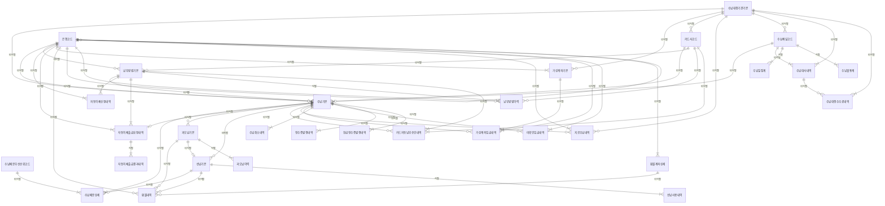

# 04. 논리 모델 — INV 수납

> 작성 2026-11-07 · subagent_logical_modeler(작성) · masteragent_da_coordinator 03 논리 관문 재생성 · 정본 `model/logical/INV.json` — 이 문서는 JSON 에서 생성(손수정 금지)
> 엔터티 30(핵심 10 · 기본·일반 20 · 정산 STL 2) · 속성 303 · 관계 71 · 관문 리뷰 `reviews/03_logical.md`

## 1. 엔터티 목록

| ID | 엔터티 | 물리명 | 테이블명(미리보기) | 유형 | 단계 | 모듈 | PK | 속성 수 | 설명 |
|---|---|---|---|---|---|---|---|---|---|
| INV-001 | 수납기본 | `RCV_BAS` | `PTL_INV_RCV_M` | ACT | CNCP |  | 수납번호 | 14 | 청구계정으로 들어온 입금 1건. 수단(자동이체·카드·지로·가상계좌·매장·ARS)과 무관하게 모든 입금은 여기 한 곳에 모이고, 배분 전 미배분 금액을 가진다. 월 RANGE 파티션 후보(수납일시), 장애일 쏠림 S4. |
| INV-002 | 수납배분상세 | `RCV_ALLC_DTL` | `PTL_INV_RCV_ALLC_D` | ACT | CNCP |  | 수납배분번호 | 11 | 수납액을 청구서×요금항목에 나눠 붙인 결과. 납기 경과 순 → 요금항목 순위(수납배분순위코드)로 배분, 수납 취소 시 음수 역배분 행. 월 RANGE 파티션 후보(수납배분일시). |
| INV-003 | 납부방법기본 | `PAY_MTHD_BAS` | `PTL_INV_PAY_MTHD_M` | BASE | CNCP |  | 납부방법번호 | 15 | 청구계정이 요금을 내는 수단(자동이체·카드자동납부·지로·가상계좌). 청구계정당 현재 유효 1건 + 과거 행은 적용종료일자로 닫힘, 변경 상세는 납부방법이력. |
| INV-004 | 자동이체신청내역 | `ATRF_APLY_DTLS` | `PTL_INV_ATRF_APLY_L` | ACT | CNCP |  | 자동이체신청번호 | 13 | 자동이체 신규·변경·해지 신청 1건과 금융결제원 CMS 출금이체 등록 처리 결과. 출금 동의 증빙(서면·녹취·ARS·전자서명) 보관 근거. |
| INV-005 | 자동이체출금요청내역 | `ATRF_WDRW_REQ_DTLS` | `PTL_INV_ATRF_WDRW_REQ_L` | ACT | CNCP |  | 출금요청번호 | 13 | 청구월마다 자동이체 납부 청구서에 대해 금결원·은행에 보내는 출금 요청 라인(재출금 회차 포함). 결과는 자동이체출금결과내역, 성공분은 수납기본을 만든다. 월 RANGE 파티션 후보(청구년월). |
| INV-006 | 가상계좌기본 | `VACCT_BAS` | `PTL_INV_VACCT_M` | BASE | CNCP |  | 가상계좌번호 | 11 | 청구계정별로 은행·대행기관에서 발급받은 가상계좌. 입금 통지(가상계좌입금내역)를 청구계정에 귀속시키는 키. 해지 계좌는 회수 후 재발급(S8 번호 재사용). |
| INV-007 | 과오납기본 | `OVPAY_BAS` | `PTL_INV_OVPAY_M` | ACT | CNCP |  | 과오납번호 | 11 | 이중 납부·초과 납부·해지 후 납부·청구 취소로 생긴, 고객에게 돌려줄 돈 1건과 잔액. 다음 청구 대체·환불·선납 전환으로 정리, 상태 변경은 과오납이력. |
| INV-008 | 환불내역 | `RFND_DTLS` | `PTL_INV_RFND_L` | ACT | CNCP |  | 환불번호 | 13 | 과오납·선납 잔액·해지 정산액을 고객에게 실제로 돌려준 행위 1건(계좌이체·카드 승인취소·현금·상계). |
| INV-009 | 선납기본 | `PRPAY_BAS` | `PTL_INV_PRPAY_M` | ACT | CNCP |  | 선납번호 | 11 | 청구 전에 미리 받아 둔 돈(고객 예납·과오납 전환·법인 선결제)과 잔액. 다음 청구 시 선납사용내역으로 차감. |
| INV-010 | 은행코드 | `BANK_CD` | `PTL_INV_BANK_C` | REF | CNCP |  | 은행코드 | 11 | 은행·금융기관 기준(D5 — 수납 영역 소유). 자동이체·가상계좌 가능 여부와 합병 승계를 가진다. 합병·폐지 은행도 과거 데이터 재현을 위해 남긴다. |
| INV-011 | 카드사코드 | `CARD_CO_CD` | `PTL_INV_CARD_CO_C` | REF | LGCL |  | 카드사코드 | 10 | 카드 자동납부·카드 수납 승인을 처리하는 신용카드사 기준(D5 — 수납 영역 소유). 자사 가맹점번호와 경유 대행기관(PG·VAN)을 가진다. |
| INV-012 | 납부방법이력 | `PAY_MTHD_HIST` | `PTL_INV_PAY_MTHD_H` | ACT | LGCL |  | 납부방법번호 + 유효시작일시 | 12 | 납부방법기본의 상태·계좌·카드·이체지정일 변경 전후를 유효 기간(SCD2)으로 보존. 현재행 유효종료일시 = 9999-12-31 23:59:59. |
| INV-013 | 자동이체출금결과내역 | `ATRF_WDRW_RSLT_DTLS` | `PTL_INV_ATRF_WDRW_RSLT_L` | ACT | LGCL |  | 출금요청번호 + 출금결과순번 | 7 | 출금 요청 1건에 대해 금결원·은행이 돌려준 결과 통지. 부분출금 후 추가 출금 통지가 올 수 있어 요청 아래 순번(식별 관계). |
| INV-014 | 카드자동납부승인내역 | `CARD_ATMT_PAY_APRV_DTLS` | `PTL_INV_CARD_ATMT_PAY_APRV_L` | ACT | LGCL |  | 카드자동납부승인번호 | 12 | 카드 자동납부 납부방법의 청구서 1건에 대한 카드사 승인 요청·결과. 승인 성공분은 수납기본을 만든다. 월 RANGE 파티션 후보(청구년월). |
| INV-015 | 지로수납내역 | `GIRO_RCV_DTLS` | `PTL_INV_GIRO_RCV_L` | ACT | LGCL |  | 지로수납번호 | 10 | 지로 청구서로 금융기관 창구·인터넷뱅킹·전자납부에서 들어온 수납 통지 1건(금결원 지로 수납 파일). 청구서 단위 수납이라 청구번호를 가진다. |
| INV-016 | 가상계좌입금내역 | `VACCT_DPST_DTLS` | `PTL_INV_VACCT_DPST_L` | ACT | LGCL |  | 가상계좌입금번호 | 9 | 가상계좌로 들어온 입금 통지 1건. 청구계정 귀속은 가상계좌기본으로 결정, 정상 입금은 수납기본 생성(과입금·부족입금 표시). |
| INV-017 | 수납취소내역 | `RCV_CNCL_DTLS` | `PTL_INV_RCV_CNCL_L` | ACT | LGCL |  | 수납취소번호 | 7 | 이미 확정된 수납을 취소한 행위 1건(이중 수납·오입금·카드 승인취소·부도). 취소 시 수납배분상세에 음수 역배분 행이 생긴다. |
| INV-018 | 미확인입금내역 | `UNIDNTF_DPST_DTLS` | `PTL_INV_UNIDNTF_DPST_L` | ACT | LGCL |  | 미확인입금번호 | 10 | 입금은 됐으나 청구계정을 특정하지 못한 돈(입금자명 불일치·계좌 불명 등). 귀속 확인되면 수납기본을 만들고 수납번호를 채운다, 미귀속은 반환·잡이익 처리. |
| INV-019 | 과오납이력 | `OVPAY_HIST` | `PTL_INV_OVPAY_H` | ACT | LGCL |  | 과오납번호 + 유효시작일시 | 8 | 과오납기본의 상태·잔액 변동(대체·환불·선납전환·소멸)을 유효 기간(SCD2)으로 보존. |
| INV-020 | 환불계좌상세 | `RFND_ACCT_DTL` | `PTL_INV_RFND_ACCT_D` | BASE | LGCL |  | 청구계정번호 + 환불계좌순번 | 9 | 청구계정이 등록한 환불 받을 계좌(복수 가능, 대표 1). 실명 확인 결과를 가진다. |
| INV-021 | 선납사용내역 | `PRPAY_USE_DTLS` | `PTL_INV_PRPAY_USE_L` | ACT | LGCL |  | 선납번호 + 선납사용순번 | 7 | 선납 잔액을 청구서에 차감·환불·소멸시킨 사용 1건(개념 basicEntRels 승계 — PAY.청구기본 N:1 선택). |
| INV-022 | 수납대행기관기본 | `RCV_AGT_INST_BAS` | `PTL_INV_RCV_AGT_INST_M` | REF | LGCL |  | 수납대행기관번호 | 9 | 수납을 대행하는 기관(금결원·PG·VAN·편의점·은행 대행). 대사·수수료 정산 상대방. |
| INV-023 | 수납채널코드 | `RCV_CHNL_CD` | `PTL_INV_RCV_CHNL_C` | REF | LGCL |  | 수납채널유형코드 | 7 | 수납이 들어오는 경로 기준(자동이체·카드·지로·가상계좌·매장·ARS·간편결제). PK = 공통코드 수납채널유형코드 값에 운영 속성을 더한 코드 엔터티. |
| INV-024 | 수납배분우선순위코드 | `RCV_ALLC_PRRT_CD` | `PTL_INV_RCV_ALLC_PRRT_C` | REF | LGCL |  | 수납배분우선순위 | 6 | 수납액을 청구서 안 요금항목에 나눌 때의 순위 기준(연체가산금 → 이전 미납 → 당월 단말할부 → 당월 통신요금 …). 후보명 수납배분순위코드를 표준 용어(우선순위)로 정리. |
| INV-025 | 수납대사내역 | `RCV_RCNCL_DTLS` | `PTL_INV_RCV_RCNCL_L` | ACT | LGCL | STL | 수납대사번호 | 11 | 대행기관·채널별 기준일 하루치 수납을 기관 통지와 자사 수납 원장으로 맞춘 결과(STL). 차이는 파생값이라 두지 않는다. |
| INV-026 | 수납대행수수료내역 | `RCV_AGT_FEE_DTLS` | `PTL_INV_RCV_AGT_FEE_L` | ACT | LGCL | STL | 수납대행수수료번호 | 13 | 대행기관에 줄 수납대행 수수료 정산 1건(월·기관 단위, STL). 세금계산서 승인번호로 PRM 정산과 대조. |
| INV-027 | 영수증발행내역 | `RCIPT_PBLCN_DTLS` | `PTL_INV_RCIPT_PBLCN_L` | ACT | LGCL |  | 영수증발행번호 | 7 | 수납 1건에 대한 납부 영수증 발행(종이·이메일·문자·앱) 1건, 재발행은 회차 증가. |
| INV-028 | 현금영수증발행내역 | `CASH_RCIPT_PBLCN_DTLS` | `PTL_INV_CASH_RCIPT_PBLCN_L` | ACT | LGCL |  | 현금영수증발행번호 | 9 | 현금성 수납(지로·가상계좌·매장 현금·계좌이체)에 대한 현금영수증 발급·국세청 전송 1건. |
| INV-029 | 수납일집계 | `RCV_DD_AGG` | `PTL_INV_RCV_DD_T` | PROC | LGCL |  | 수납채널유형코드 + 수납일자 + 납부방법유형코드 | 8 | 수납일자 × 수납채널 × 납부방법유형별 수납·취소 건수와 금액 일 마감 집계. |
| INV-030 | 수납월통계 | `RCV_MM_STATS` | `PTL_INV_RCV_MM_S` | PROC | LGCL |  | 수납채널유형코드 + 수납년월 + 납부방법유형코드 | 9 | 수납년월 × 수납채널 × 납부방법유형별 월 마감 통계(수납·과오납 발생·환불). |

## 2. 엔터티별 속성

속성 순서 = PK → FK → 일반(규칙 2-9). FK 표기 = `<영역>.<엔터티>.<속성>`. NULL Y = 선택. 시스템 칼럼 4개는 DDL 생성 때만 붙는다(D7).

### INV-001 수납기본 `RCV_BAS` (ACT·CNCP)

청구계정으로 들어온 입금 1건. 수단(자동이체·카드·지로·가상계좌·매장·ARS)과 무관하게 모든 입금은 여기 한 곳에 모이고, 배분 전 미배분 금액을 가진다. 월 RANGE 파티션 후보(수납일시), 장애일 쏠림 S4.

| # | 속성 | 물리명 | 도메인 | PK | FK | NULL | 설명 |
|---|---|---|---|---|---|---|---|
| 1 | 수납번호 | RCV_NO | 번호V20 | PK |  | N | 수납의 번호 — 대상을 식별하거나 외부에서 부여받은 번호 |
| 2 | 청구계정번호 | BILL_ACNT_NO | 번호V20 |  | CUS.청구계정기본.청구계정번호 | N | 청구 계정의 번호 — 대상을 식별하거나 외부에서 부여받은 번호 — FK → CUS.청구계정기본 |
| 3 | 납부방법번호 | PAY_MTHD_NO | 번호V20 |  | INV.납부방법기본.납부방법번호 | Y | 납부 방법의 번호 — 대상을 식별하거나 외부에서 부여받은 번호 — FK → 납부방법기본(매장·지로 현금은 NULL — S5) |
| 4 | 수납채널유형코드 | RCV_CHNL_TY_CD | 코드V10 |  | INV.수납채널코드.수납채널유형코드 | N | 수납 채널의 유형 코드 — 공통코드(codes.json) — FK → INV.수납채널코드(기본 엔터티) |
| 5 | 은행코드 | BANK_CD | 코드V10 |  | INV.은행코드.은행코드 | Y | 은행의 코드 — 업무 분류 값을 식별하는 부호, 엔터티에서는 기준 코드 집합 — FK → INV.은행코드 |
| 6 | 카드사코드 | CARD_CO_CD | 코드V10 |  | INV.카드사코드.카드사코드 | Y | 카드 사의 코드 — 업무 분류 값을 식별하는 부호, 엔터티에서는 기준 코드 집합 — FK → INV.카드사코드(기본 엔터티) |
| 7 | 수납대행기관번호 | RCV_AGT_INST_NO | 번호V20 |  | INV.수납대행기관기본.수납대행기관번호 | Y | 수납 대행 기관의 번호 — 대상을 식별하거나 외부에서 부여받은 번호 — FK → INV.수납대행기관기본(기본 엔터티) |
| 8 | 입금자명 | DPSTR_NM | 명V100 |  |  | N | 입금자의 명 — 대상을 부르는 이름 — 입금 통지상의 입금자 표시명(S13 표기 흔들림 대상) |
| 9 | 수납일시 | RCV_DTM | 일시TS |  |  | N | 수납의 일시 — 연월일 시분초까지의 시점 |
| 10 | 수납상태유형코드 | RCV_STTS_TY_CD | 코드V10 |  |  | N | 수납 상태의 유형 코드 — 공통코드(codes.json) — 배분대기·배분완료·일부배분·취소·미확인 — 98% 배분완료(S3) |
| 11 | 수납금액 | RCV_AMT | 금액N15 |  |  | N | 수납의 금액 — 원화 금액(원 단위 정수) |
| 12 | 미배분금액 | UNALLC_AMT | 금액N15 |  |  | N | 미배분의 금액 — 원화 금액(원 단위 정수) — 배분 후 남은 금액 → 과오납·선납 전환 근거 |
| 13 | 수납일자 | RCV_DT | 일자C8 |  |  | N | 수납의 일자 — 연월일(YYYYMMDD) — 회계 귀속일(은행 영업일, 수납일시와 다를 수 있음) |
| 14 | 승인번호 | APRV_NO | 번호V20 |  |  | Y | 승인의 번호 — 대상을 식별하거나 외부에서 부여받은 번호 — 카드 승인·지로 수납 고유번호 |

정규화 : 1NF: 수단별 반복(은행·카드·대행기관)은 FK 단일값, 배분은 수납배분상세로 분리. 2NF: 단일 PK. 3NF: 은행·카드사·채널 이름은 코드 엔터티 조회. 청구계정번호는 납부방법번호에서 유도 가능하나 매장·지로 현금은 납부방법이 NULL 이라 함수 종속이 성립하지 않음 — 이행 종속 아님. 미배분금액은 수납금액 − 배분 합계(파생)이지만 개념 확정 속성·배분 잠금 시점 값이라 유지(물리 반정규화 성격으로 인계).

### INV-002 수납배분상세 `RCV_ALLC_DTL` (ACT·CNCP)

수납액을 청구서×요금항목에 나눠 붙인 결과. 납기 경과 순 → 요금항목 순위(수납배분순위코드)로 배분, 수납 취소 시 음수 역배분 행. 월 RANGE 파티션 후보(수납배분일시).

| # | 속성 | 물리명 | 도메인 | PK | FK | NULL | 설명 |
|---|---|---|---|---|---|---|---|
| 1 | 수납배분번호 | RCV_ALLC_NO | 번호V20 | PK |  | N | 수납 배분의 번호 — 대상을 식별하거나 외부에서 부여받은 번호 |
| 2 | 수납번호 | RCV_NO | 번호V20 |  | INV.수납기본.수납번호 | N | 수납의 번호 — 대상을 식별하거나 외부에서 부여받은 번호 — FK → 수납기본 |
| 3 | 청구번호 | BILL_NO | 번호V20 |  | PAY.청구기본.청구번호 | N | 청구의 번호 — 대상을 식별하거나 외부에서 부여받은 번호 — FK → PAY.청구기본 |
| 4 | 요금항목코드 | CHRG_ITM_CD | 코드V10 |  | PRD.요금항목코드.요금항목코드 | N | 요금 항목의 코드 — 업무 분류 값을 식별하는 부호, 엔터티에서는 기준 코드 집합 — FK → PRD.요금항목코드 |
| 5 | 수납배분우선순위 | RCV_ALLC_PRRT | 순번N5 |  | INV.수납배분우선순위코드.수납배분우선순위 | N | 수납 배분의 우선순위 — 여러 대상 중 먼저 처리하는 순서 — FK → INV.수납배분순위코드(기본 엔터티) |
| 6 | 선납번호 | PRPAY_NO | 번호V20 |  | INV.선납기본.선납번호 | Y | 선납의 번호 — 대상을 식별하거나 외부에서 부여받은 번호 — FK → 선납기본(선납 차감 배분일 때만, 99% NULL S5) |
| 7 | 배분적요명 | ALLC_SMRY_NM | 명V100 |  |  | N | 배분 적요의 명 — 대상을 부르는 이름 — 배분 사유 요약(정기배분·역배분·과오납대체 등 표시) |
| 8 | 수납배분일시 | RCV_ALLC_DTM | 일시TS |  |  | N | 수납 배분의 일시 — 연월일 시분초까지의 시점 |
| 9 | 수납배분상태유형코드 | RCV_ALLC_STTS_TY_CD | 코드V10 |  |  | N | 수납 배분 상태의 유형 코드 — 공통코드(codes.json) — 배분·역배분·과오납대체·선납대체 |
| 10 | 청구년월 | BILL_YM | 년월C6 |  |  | N | 청구의 년월 — 연월(YYYYMM) — 업무 키 보존(01 문서 5절-4) — 파티션·레이크 키 후보 |
| 11 | 배분금액 | ALLC_AMT | 금액N15 |  |  | N | 배분의 금액 — 원화 금액(원 단위 정수) — 역배분은 음수(S7) |

정규화 : N:M 해소(수납 ↔ 청구서×요금항목). 2NF: 단일 PK. 3NF: 청구년월은 청구번호 → PAY.청구기본 이행 종속이나 업무 키(01 문서 5절-4 청구월) 보존 예외. 납부기한일자는 업무 키가 아닌 이행 종속 속성이라 제거(관문 G1) — 배분 순서 판정 시 PAY.청구기본.납부기한일자 조회, 물리 반정규화 후보로 인계.

### INV-003 납부방법기본 `PAY_MTHD_BAS` (BASE·CNCP)

청구계정이 요금을 내는 수단(자동이체·카드자동납부·지로·가상계좌). 청구계정당 현재 유효 1건 + 과거 행은 적용종료일자로 닫힘, 변경 상세는 납부방법이력.

| # | 속성 | 물리명 | 도메인 | PK | FK | NULL | 설명 |
|---|---|---|---|---|---|---|---|
| 1 | 납부방법번호 | PAY_MTHD_NO | 번호V20 | PK |  | N | 납부 방법의 번호 — 대상을 식별하거나 외부에서 부여받은 번호 |
| 2 | 청구계정번호 | BILL_ACNT_NO | 번호V20 |  | CUS.청구계정기본.청구계정번호 | N | 청구 계정의 번호 — 대상을 식별하거나 외부에서 부여받은 번호 — FK → CUS.청구계정기본 |
| 3 | 납부자번호 | PYR_NO | 번호V20 |  | CUS.납부자기본.납부자번호 | N | 납부자의 번호 — 대상을 식별하거나 외부에서 부여받은 번호 — FK → CUS.납부자기본 |
| 4 | 은행코드 | BANK_CD | 코드V10 |  | INV.은행코드.은행코드 | Y | 은행의 코드 — 업무 분류 값을 식별하는 부호, 엔터티에서는 기준 코드 집합 — FK → INV.은행코드 |
| 5 | 카드사코드 | CARD_CO_CD | 코드V10 |  | INV.카드사코드.카드사코드 | Y | 카드 사의 코드 — 업무 분류 값을 식별하는 부호, 엔터티에서는 기준 코드 집합 — FK → INV.카드사코드(기본 엔터티) |
| 6 | 납부방법명 | PAY_MTHD_NM | 명V100 |  |  | N | 납부 방법의 명 — 대상을 부르는 이름 — 화면 표시명(예 "국민 자동이체 ****1234") |
| 7 | 납부방법등록일시 | PAY_MTHD_REG_DTM | 일시TS |  |  | N | 납부 방법 등록의 일시 — 연월일 시분초까지의 시점 |
| 8 | 납부방법상태유형코드 | PAY_MTHD_STTS_TY_CD | 코드V10 |  |  | N | 납부 방법 상태의 유형 코드 — 공통코드(codes.json) — 신청중·사용·정지·해지·등록오류 |
| 9 | 납부방법유형코드 | PAY_MTHD_TY_CD | 코드V10 |  |  | N | 납부 방법의 유형 코드 — 공통코드(codes.json) — 자동이체·카드자동납부·지로·가상계좌·매장 — 4개 이상 → 유형 |
| 10 | 계좌번호암호화값 | ACCT_NO_ENCPT_VL | 값V256 |  |  | Y | 계좌 번호 암호화의 값 — 측정·설정·암호화된 값 — D11 — 평문 계좌번호 저장 금지 |
| 11 | 예금주명 | DPSOWN_NM | 명V100 |  |  | Y | 예금주의 명 — 대상을 부르는 이름 |
| 12 | 카드번호암호화값 | CARD_NO_ENCPT_VL | 값V256 |  |  | Y | 카드 번호 암호화의 값 — 측정·설정·암호화된 값 — D11 |
| 13 | 이체지정일 | TRSF_DSGN_DD | 일C2 |  |  | Y | 이체 지정의 일 — 월 중의 일(DD, 01~31) — 자동이체 출금일(01~31, S12 앞자리 0 함정) |
| 14 | 적용시작일자 | APLCN_BGNG_DT | 일자C8 |  |  | N | 적용 시작의 일자 — 연월일(YYYYMMDD) |
| 15 | 적용종료일자 | APLCN_END_DT | 일자C8 |  |  | N | 적용 종료의 일자 — 연월일(YYYYMMDD) — 현재 유효 = 99991231 |

정규화 : 1NF: 수단별 속성은 한 행(유형코드로 구분, 해당 없으면 NULL). 2NF: 단일 PK. 3NF: 은행명·카드사명은 코드 조회. 변경 상세는 납부방법이력으로 분리.

### INV-004 자동이체신청내역 `ATRF_APLY_DTLS` (ACT·CNCP)

자동이체 신규·변경·해지 신청 1건과 금융결제원 CMS 출금이체 등록 처리 결과. 출금 동의 증빙(서면·녹취·ARS·전자서명) 보관 근거.

| # | 속성 | 물리명 | 도메인 | PK | FK | NULL | 설명 |
|---|---|---|---|---|---|---|---|
| 1 | 자동이체신청번호 | ATRF_APLY_NO | 번호V20 | PK |  | N | 자동이체 신청의 번호 — 대상을 식별하거나 외부에서 부여받은 번호 |
| 2 | 납부방법번호 | PAY_MTHD_NO | 번호V20 |  | INV.납부방법기본.납부방법번호 | N | 납부 방법의 번호 — 대상을 식별하거나 외부에서 부여받은 번호 — FK → 납부방법기본 |
| 3 | 청구계정번호 | BILL_ACNT_NO | 번호V20 |  | CUS.청구계정기본.청구계정번호 | N | 청구 계정의 번호 — 대상을 식별하거나 외부에서 부여받은 번호 — FK → CUS.청구계정기본 |
| 4 | 은행코드 | BANK_CD | 코드V10 |  | INV.은행코드.은행코드 | N | 은행의 코드 — 업무 분류 값을 식별하는 부호, 엔터티에서는 기준 코드 집합 — FK → INV.은행코드 |
| 5 | 신청인명 | APLCNT_NM | 명V100 |  |  | N | 신청인의 명 — 대상을 부르는 이름 |
| 6 | 자동이체신청일시 | ATRF_APLY_DTM | 일시TS |  |  | N | 자동이체 신청의 일시 — 연월일 시분초까지의 시점 |
| 7 | 자동이체신청상태유형코드 | ATRF_APLY_STTS_TY_CD | 코드V10 |  |  | N | 자동이체 신청 상태의 유형 코드 — 공통코드(codes.json) — 접수·금결원요청·등록완료·등록실패·철회 |
| 8 | 자동이체신청구분코드 | ATRF_APLY_SE_CD | 코드V10 |  |  | N | 자동이체 신청의 구분 코드 — 공통코드(codes.json) — 신규·변경·해지 — 값 3개 고정 → 구분 |
| 9 | 계좌번호암호화값 | ACCT_NO_ENCPT_VL | 값V256 |  |  | N | 계좌 번호 암호화의 값 — 측정·설정·암호화된 값 — D11 — 평문 계좌번호 저장 금지 |
| 10 | 예금주명 | DPSOWN_NM | 명V100 |  |  | N | 예금주의 명 — 대상을 부르는 이름 |
| 11 | 출금동의증빙유형코드 | WDRW_AGRE_EVDC_TY_CD | 코드V10 |  |  | N | 출금 동의 증빙의 유형 코드 — 공통코드(codes.json) — 서면·녹취·ARS·전자서명·공동인증 |
| 12 | 처리결과유형코드 | PRCS_RSLT_TY_CD | 코드V10 |  |  | Y | 처리 결과의 유형 코드 — 공통코드(codes.json) — 금결원 응답 결과(정상·계좌없음·예금주불일치·해지계좌 등) |
| 13 | 처리일시 | PRCS_DTM | 일시TS |  |  | Y | 처리의 일시 — 연월일 시분초까지의 시점 |

정규화 : 2NF: 단일 PK. 3NF: 청구계정번호는 납부방법번호에서 유도되나 신규 신청은 납부방법 생성 전 접수(신청이 납부방법을 만든다) — 개념 확정 승계, 은행·계좌는 신청 당시 값(스냅숏).

### INV-005 자동이체출금요청내역 `ATRF_WDRW_REQ_DTLS` (ACT·CNCP)

청구월마다 자동이체 납부 청구서에 대해 금결원·은행에 보내는 출금 요청 라인(재출금 회차 포함). 결과는 자동이체출금결과내역, 성공분은 수납기본을 만든다. 월 RANGE 파티션 후보(청구년월).

| # | 속성 | 물리명 | 도메인 | PK | FK | NULL | 설명 |
|---|---|---|---|---|---|---|---|
| 1 | 출금요청번호 | WDRW_REQ_NO | 번호V20 | PK |  | N | 출금 요청의 번호 — 대상을 식별하거나 외부에서 부여받은 번호 |
| 2 | 납부방법번호 | PAY_MTHD_NO | 번호V20 |  | INV.납부방법기본.납부방법번호 | N | 납부 방법의 번호 — 대상을 식별하거나 외부에서 부여받은 번호 — FK → 납부방법기본 |
| 3 | 청구계정번호 | BILL_ACNT_NO | 번호V20 |  | CUS.청구계정기본.청구계정번호 | N | 청구 계정의 번호 — 대상을 식별하거나 외부에서 부여받은 번호 — FK → CUS.청구계정기본 |
| 4 | 청구번호 | BILL_NO | 번호V20 |  | PAY.청구기본.청구번호 | N | 청구의 번호 — 대상을 식별하거나 외부에서 부여받은 번호 — FK → PAY.청구기본 |
| 5 | 은행코드 | BANK_CD | 코드V10 |  | INV.은행코드.은행코드 | N | 은행의 코드 — 업무 분류 값을 식별하는 부호, 엔터티에서는 기준 코드 집합 — FK → INV.은행코드 |
| 6 | 수납번호 | RCV_NO | 번호V20 |  | INV.수납기본.수납번호 | Y | 수납의 번호 — 대상을 식별하거나 외부에서 부여받은 번호 — FK → 수납기본(출금 성공 시만) |
| 7 | 출금요청파일명 | WDRW_REQ_FILE_NM | 명V200 |  |  | N | 출금 요청 파일의 명 — 대상을 부르는 이름 — CMS 전송 파일(묶음) 이름 |
| 8 | 출금요청일시 | WDRW_REQ_DTM | 일시TS |  |  | N | 출금 요청의 일시 — 연월일 시분초까지의 시점 |
| 9 | 출금요청상태유형코드 | WDRW_REQ_STTS_TY_CD | 코드V10 |  |  | N | 출금 요청 상태의 유형 코드 — 공통코드(codes.json) — 생성·전송·출금완료·부분출금·출금실패·취소 |
| 10 | 청구년월 | BILL_YM | 년월C6 |  |  | N | 청구의 년월 — 연월(YYYYMM) — 업무 키 보존(01 문서 5절-4) — 파티션·레이크 키 후보 |
| 11 | 출금요청금액 | WDRW_REQ_AMT | 금액N15 |  |  | N | 출금 요청의 금액 — 원화 금액(원 단위 정수) |
| 12 | 출금예정일자 | WDRW_SCHD_DT | 일자C8 |  |  | N | 출금 예정의 일자 — 연월일(YYYYMMDD) — 이체지정일 → 영업일 보정, 말일·1일 쏠림 S4 |
| 13 | 출금회차 | WDRW_TMS | 회차N3 |  |  | N | 출금의 회차 — 분할·반복 거래의 차례 번호 — 1 = 정기, 2~ = 재출금 |

정규화 : 2NF: 단일 PK. 3NF: 청구계정번호·청구년월은 청구번호 이행 종속 — 개념 확정(crossRels 승인) 승계, 물리 반정규화 항목으로 인계(결정 L4). 결과 통지는 자동이체출금결과내역으로 분리(반복 그룹 해소).

### INV-006 가상계좌기본 `VACCT_BAS` (BASE·CNCP)

청구계정별로 은행·대행기관에서 발급받은 가상계좌. 입금 통지(가상계좌입금내역)를 청구계정에 귀속시키는 키. 해지 계좌는 회수 후 재발급(S8 번호 재사용).

| # | 속성 | 물리명 | 도메인 | PK | FK | NULL | 설명 |
|---|---|---|---|---|---|---|---|
| 1 | 가상계좌번호 | VACCT_NO | 번호V20 | PK |  | N | 가상계좌의 번호 — 대상을 식별하거나 외부에서 부여받은 번호 — 내부 관리번호(실제 은행 계좌번호는 계좌번호 속성) |
| 2 | 청구계정번호 | BILL_ACNT_NO | 번호V20 |  | CUS.청구계정기본.청구계정번호 | N | 청구 계정의 번호 — 대상을 식별하거나 외부에서 부여받은 번호 — FK → CUS.청구계정기본 |
| 3 | 은행코드 | BANK_CD | 코드V10 |  | INV.은행코드.은행코드 | N | 은행의 코드 — 업무 분류 값을 식별하는 부호, 엔터티에서는 기준 코드 집합 — FK → INV.은행코드 |
| 4 | 수납대행기관번호 | RCV_AGT_INST_NO | 번호V20 |  | INV.수납대행기관기본.수납대행기관번호 | Y | 수납 대행 기관의 번호 — 대상을 식별하거나 외부에서 부여받은 번호 — FK → INV.수납대행기관기본(기본 엔터티) |
| 5 | 가상계좌명 | VACCT_NM | 명V100 |  |  | N | 가상계좌의 명 — 대상을 부르는 이름 — 입금 화면 예금주 표시명 |
| 6 | 가상계좌발급일시 | VACCT_ISSU_DTM | 일시TS |  |  | N | 가상계좌 발급의 일시 — 연월일 시분초까지의 시점 |
| 7 | 가상계좌상태유형코드 | VACCT_STTS_TY_CD | 코드V10 |  |  | N | 가상계좌 상태의 유형 코드 — 공통코드(codes.json) — 발급·사용·정지·회수·만료 |
| 8 | 계좌번호 | ACCT_NO | 번호V20 |  |  | N | 계좌의 번호 — 대상을 식별하거나 외부에서 부여받은 번호 — 가상계좌 번호 자체(실명 계좌 아님 → 평문, 은행코드+계좌번호 유일) |
| 9 | 입금기준유형코드 | DPST_STD_TY_CD | 코드V10 |  |  | N | 입금 기준의 유형 코드 — 공통코드(codes.json) — 청구금액일치·이상입금허용·자유입금·1회용 |
| 10 | 유효종료일시 | VLD_END_DTM | 일시TS |  |  | N | 유효 종료의 일시 — 연월일 시분초까지의 시점 |
| 11 | 회수일시 | RTRVL_DTM | 일시TS |  |  | Y | 회수의 일시 — 연월일 시분초까지의 시점 — 95% NULL(S5) |

정규화 : 2NF·3NF 충족. 은행명·대행기관명은 코드 조회. 은행코드 + 계좌번호는 대체 키(유일).

### INV-007 과오납기본 `OVPAY_BAS` (ACT·CNCP)

이중 납부·초과 납부·해지 후 납부·청구 취소로 생긴, 고객에게 돌려줄 돈 1건과 잔액. 다음 청구 대체·환불·선납 전환으로 정리, 상태 변경은 과오납이력.

| # | 속성 | 물리명 | 도메인 | PK | FK | NULL | 설명 |
|---|---|---|---|---|---|---|---|
| 1 | 과오납번호 | OVPAY_NO | 번호V20 | PK |  | N | 과오납의 번호 — 대상을 식별하거나 외부에서 부여받은 번호 |
| 2 | 청구계정번호 | BILL_ACNT_NO | 번호V20 |  | CUS.청구계정기본.청구계정번호 | N | 청구 계정의 번호 — 대상을 식별하거나 외부에서 부여받은 번호 — FK → CUS.청구계정기본 |
| 3 | 수납번호 | RCV_NO | 번호V20 |  | INV.수납기본.수납번호 | Y | 수납의 번호 — 대상을 식별하거나 외부에서 부여받은 번호 — FK → 수납기본(발생 원인 입금) |
| 4 | 과오납내용명 | OVPAY_CN_NM | 명V100 |  |  | N | 과오납 내용의 명 — 대상을 부르는 이름 — 발생 사유 요약 |
| 5 | 과오납발생일시 | OVPAY_OCRN_DTM | 일시TS |  |  | N | 과오납 발생의 일시 — 연월일 시분초까지의 시점 |
| 6 | 과오납상태유형코드 | OVPAY_STTS_TY_CD | 코드V10 |  |  | N | 과오납 상태의 유형 코드 — 공통코드(codes.json) — 발생·대체중·환불요청·환불완료·선납전환·소멸 |
| 7 | 과오납유형코드 | OVPAY_TY_CD | 코드V10 |  |  | N | 과오납의 유형 코드 — 공통코드(codes.json) — 이중납부·초과납부·해지후납부·청구취소·조정감액 |
| 8 | 과오납금액 | OVPAY_AMT | 금액N15 |  |  | N | 과오납의 금액 — 원화 금액(원 단위 정수) |
| 9 | 과오납잔액 | OVPAY_BAL | 금액N15 |  |  | N | 과오납의 잔액 — 사용·정리하고 남은 금액 |
| 10 | 처리방법유형코드 | PRCS_MTHD_TY_CD | 코드V10 |  |  | Y | 처리 방법의 유형 코드 — 공통코드(codes.json) — 다음청구대체·환불·선납전환·잡이익처리 |
| 11 | 소멸시효일자 | EXTSH_PRSCR_DT | 일자C8 |  |  | Y | 소멸 시효의 일자 — 연월일(YYYYMMDD) — 미청구 환급금 소멸시효(상사 5년) 기산 결과 |

정규화 : 2NF: 단일 PK. 3NF: 상태 변동·잔액 증감은 과오납이력으로 분리. 과오납잔액은 이력의 마지막 잔액과 같은 현재 스냅숏(정본 = 이력).

### INV-008 환불내역 `RFND_DTLS` (ACT·CNCP)

과오납·선납 잔액·해지 정산액을 고객에게 실제로 돌려준 행위 1건(계좌이체·카드 승인취소·현금·상계).

| # | 속성 | 물리명 | 도메인 | PK | FK | NULL | 설명 |
|---|---|---|---|---|---|---|---|
| 1 | 환불번호 | RFND_NO | 번호V20 | PK |  | N | 환불의 번호 — 대상을 식별하거나 외부에서 부여받은 번호 |
| 2 | 청구계정번호 | BILL_ACNT_NO | 번호V20 |  | CUS.청구계정기본.청구계정번호 INV.환불계좌상세.청구계정번호 | N | 청구 계정의 번호 — 대상을 식별하거나 외부에서 부여받은 번호 — FK → CUS.청구계정기본 |
| 3 | 과오납번호 | OVPAY_NO | 번호V20 |  | INV.과오납기본.과오납번호 | Y | 과오납의 번호 — 대상을 식별하거나 외부에서 부여받은 번호 — FK → 과오납기본(선납 환불이면 NULL) |
| 4 | 선납번호 | PRPAY_NO | 번호V20 |  | INV.선납기본.선납번호 | Y | 선납의 번호 — 대상을 식별하거나 외부에서 부여받은 번호 — FK → 선납기본(과오납 환불이면 NULL) |
| 5 | 은행코드 | BANK_CD | 코드V10 |  | INV.은행코드.은행코드 | Y | 은행의 코드 — 업무 분류 값을 식별하는 부호, 엔터티에서는 기준 코드 집합 — FK → INV.은행코드 |
| 6 | 환불계좌순번 | RFND_ACCT_SEQ | 순번N5 |  | INV.환불계좌상세.환불계좌순번 | Y | 환불 계좌의 순번 — 부모 안의 처리·표시 순서 — 환불계좌상세 참조(청구계정번호와 복합 FK) — 현장 현금·상계 환불은 NULL |
| 7 | 환불수령인명 | RFND_RCPN_NM | 명V100 |  |  | N | 환불 수령인의 명 — 대상을 부르는 이름 |
| 8 | 환불일시 | RFND_DTM | 일시TS |  |  | N | 환불의 일시 — 연월일 시분초까지의 시점 |
| 9 | 환불상태유형코드 | RFND_STTS_TY_CD | 코드V10 |  |  | N | 환불 상태의 유형 코드 — 공통코드(codes.json) — 요청·승인·이체완료·이체실패·취소 |
| 10 | 환불금액 | RFND_AMT | 금액N15 |  |  | N | 환불의 금액 — 원화 금액(원 단위 정수) |
| 11 | 환불방법유형코드 | RFND_MTHD_TY_CD | 코드V10 |  |  | N | 환불 방법의 유형 코드 — 공통코드(codes.json) — 계좌이체·카드승인취소·현금·상계 |
| 12 | 계좌번호암호화값 | ACCT_NO_ENCPT_VL | 값V256 |  |  | Y | 계좌 번호 암호화의 값 — 측정·설정·암호화된 값 — D11 — 평문 계좌번호 저장 금지 |
| 13 | 환불요청일자 | RFND_REQ_DT | 일자C8 |  |  | Y | 환불 요청의 일자 — 연월일(YYYYMMDD) |

정규화 : 2NF: 단일 PK. 3NF: 은행코드·계좌번호암호화값은 환불 시점 스냅숏(등록 계좌가 바뀌어도 실제 이체 계좌 보존) — 환불계좌순번에서의 이행 종속 아님. 과오납·선납 원천은 배타 FK(둘 중 하나).

### INV-009 선납기본 `PRPAY_BAS` (ACT·CNCP)

청구 전에 미리 받아 둔 돈(고객 예납·과오납 전환·법인 선결제)과 잔액. 다음 청구 시 선납사용내역으로 차감.

| # | 속성 | 물리명 | 도메인 | PK | FK | NULL | 설명 |
|---|---|---|---|---|---|---|---|
| 1 | 선납번호 | PRPAY_NO | 번호V20 | PK |  | N | 선납의 번호 — 대상을 식별하거나 외부에서 부여받은 번호 |
| 2 | 청구계정번호 | BILL_ACNT_NO | 번호V20 |  | CUS.청구계정기본.청구계정번호 | N | 청구 계정의 번호 — 대상을 식별하거나 외부에서 부여받은 번호 — FK → CUS.청구계정기본 |
| 3 | 수납번호 | RCV_NO | 번호V20 |  | INV.수납기본.수납번호 | Y | 수납의 번호 — 대상을 식별하거나 외부에서 부여받은 번호 — FK → 수납기본(원천 입금, 과오납 전환이면 NULL) |
| 4 | 과오납번호 | OVPAY_NO | 번호V20 |  | INV.과오납기본.과오납번호 | Y | 과오납의 번호 — 대상을 식별하거나 외부에서 부여받은 번호 — FK → 과오납기본(전환분만) |
| 5 | 선납입금자명 | PRPAY_DPSTR_NM | 명V100 |  |  | N | 선납 입금자의 명 — 대상을 부르는 이름 |
| 6 | 선납일시 | PRPAY_DTM | 일시TS |  |  | N | 선납의 일시 — 연월일 시분초까지의 시점 |
| 7 | 선납상태유형코드 | PRPAY_STTS_TY_CD | 코드V10 |  |  | N | 선납 상태의 유형 코드 — 공통코드(codes.json) — 사용중·소진·환불·해지정리 |
| 8 | 선납유형코드 | PRPAY_TY_CD | 코드V10 |  |  | N | 선납의 유형 코드 — 공통코드(codes.json) — 고객예납·과오납전환·해지예치·법인선결제 |
| 9 | 선납금액 | PRPAY_AMT | 금액N15 |  |  | N | 선납의 금액 — 원화 금액(원 단위 정수) |
| 10 | 선납잔액 | PRPAY_BAL | 금액N15 |  |  | N | 선납의 잔액 — 사용·정리하고 남은 금액 |
| 11 | 소진일시 | EXHST_DTM | 일시TS |  |  | Y | 소진의 일시 — 연월일 시분초까지의 시점 |

정규화 : 2NF·3NF 충족. 사용·차감은 선납사용내역으로 분리(반복 그룹 해소). 선납잔액 = 현재 스냅숏(정본 = 사용내역 합계와 대사).

### INV-010 은행코드 `BANK_CD` (REF·CNCP)

은행·금융기관 기준(D5 — 수납 영역 소유). 자동이체·가상계좌 가능 여부와 합병 승계를 가진다. 합병·폐지 은행도 과거 데이터 재현을 위해 남긴다.

| # | 속성 | 물리명 | 도메인 | PK | FK | NULL | 설명 |
|---|---|---|---|---|---|---|---|
| 1 | 은행코드 | BANK_CD | 코드V10 | PK |  | N | 은행의 코드 — 업무 분류 값을 식별하는 부호, 엔터티에서는 기준 코드 집합 — 금결원 3자리 표준 코드(S12 앞자리 0) |
| 2 | 합병은행코드 | MRGR_BANK_CD | 코드V10 |  | INV.은행코드.은행코드 | Y | 합병 은행의 코드 — 업무 분류 값을 식별하는 부호, 엔터티에서는 기준 코드 집합 — 자기 참조 — 합병 후 승계 은행 |
| 3 | 은행명 | BANK_NM | 명V100 |  |  | N | 은행의 명 — 대상을 부르는 이름 |
| 4 | 은행등록일시 | BANK_REG_DTM | 일시TS |  |  | N | 은행 등록의 일시 — 연월일 시분초까지의 시점 |
| 5 | 은행상태유형코드 | BANK_STTS_TY_CD | 코드V10 |  |  | N | 은행 상태의 유형 코드 — 공통코드(codes.json) — 사용·거래중지·합병·폐지 |
| 6 | 금융기관유형코드 | FNNC_INST_TY_CD | 코드V10 |  |  | N | 금융 기관의 유형 코드 — 공통코드(codes.json) — 시중은행·지방은행·특수은행·저축은행·상호금융·증권사·우체국 |
| 7 | 은행영문명 | BANK_ENG_NM | 명V100 |  |  | Y | 은행 영문의 명 — 대상을 부르는 이름 |
| 8 | 자동이체가능여부 | ATRF_PSBL_YN | 여부C1 |  |  | N | 자동이체 가능의 여부 — 해당 여부(Y/N) |
| 9 | 가상계좌가능여부 | VACCT_PSBL_YN | 여부C1 |  |  | N | 가상계좌 가능의 여부 — 해당 여부(Y/N) |
| 10 | 적용시작일자 | APLCN_BGNG_DT | 일자C8 |  |  | N | 적용 시작의 일자 — 연월일(YYYYMMDD) |
| 11 | 적용종료일자 | APLCN_END_DT | 일자C8 |  |  | N | 적용 종료의 일자 — 연월일(YYYYMMDD) |

정규화 : 3NF: 합병 승계 은행 이름은 자기 참조로 조회. 계층 = 자기 참조 1:N.

### INV-011 카드사코드 `CARD_CO_CD` (REF·LGCL)

카드 자동납부·카드 수납 승인을 처리하는 신용카드사 기준(D5 — 수납 영역 소유). 자사 가맹점번호와 경유 대행기관(PG·VAN)을 가진다.

| # | 속성 | 물리명 | 도메인 | PK | FK | NULL | 설명 |
|---|---|---|---|---|---|---|---|
| 1 | 카드사코드 | CARD_CO_CD | 코드V10 | PK |  | N | 카드 사의 코드 — 업무 분류 값을 식별하는 부호, 엔터티에서는 기준 코드 집합 — 여신금융협회 카드사 코드(앞자리 0 — S12) |
| 2 | 수납대행기관번호 | RCV_AGT_INST_NO | 번호V20 |  | INV.수납대행기관기본.수납대행기관번호 | Y | 수납 대행 기관의 번호 — 대상을 식별하거나 외부에서 부여받은 번호 — PG·VAN 경유 시 대행기관, 직접 연동이면 NULL |
| 3 | 카드사명 | CARD_CO_NM | 명V100 |  |  | N | 카드 사의 명 — 대상을 부르는 이름 |
| 4 | 카드사영문명 | CARD_CO_ENG_NM | 명V100 |  |  | Y | 카드 사 영문의 명 — 대상을 부르는 이름 |
| 5 | 카드사등록일시 | CARD_CO_REG_DTM | 일시TS |  |  | N | 카드 사 등록의 일시 — 연월일 시분초까지의 시점 |
| 6 | 카드사상태유형코드 | CARD_CO_STTS_TY_CD | 코드V10 |  |  | N | 카드 사 상태의 유형 코드 — 공통코드(newCodes 신규 등재) |
| 7 | 자동납부가능여부 | ATMT_PAY_PSBL_YN | 여부C1 |  |  | N | 자동 납부 가능의 여부 — 해당 여부(Y/N) |
| 8 | 가맹점번호 | MRCH_NO | 번호V20 |  |  | Y | 가맹점의 번호 — 대상을 식별하거나 외부에서 부여받은 번호 — 카드사별 자사 가맹점번호 |
| 9 | 적용시작일자 | APLCN_BGNG_DT | 일자C8 |  |  | N | 적용 시작의 일자 — 연월일(YYYYMMDD) |
| 10 | 적용종료일자 | APLCN_END_DT | 일자C8 |  |  | N | 적용 종료의 일자 — 연월일(YYYYMMDD) |

정규화 : 2NF·3NF 충족. 대행기관 이름은 수납대행기관기본 조회.

### INV-012 납부방법이력 `PAY_MTHD_HIST` (ACT·LGCL)

납부방법기본의 상태·계좌·카드·이체지정일 변경 전후를 유효 기간(SCD2)으로 보존. 현재행 유효종료일시 = 9999-12-31 23:59:59.

| # | 속성 | 물리명 | 도메인 | PK | FK | NULL | 설명 |
|---|---|---|---|---|---|---|---|
| 1 | 납부방법번호 | PAY_MTHD_NO | 번호V20 | PK | INV.납부방법기본.납부방법번호 | N | 납부 방법의 번호 — 대상을 식별하거나 외부에서 부여받은 번호 |
| 2 | 유효시작일시 | VLD_BGNG_DTM | 일시TS | PK |  | N | 유효 시작의 일시 — 연월일 시분초까지의 시점 |
| 3 | 은행코드 | BANK_CD | 코드V10 |  | INV.은행코드.은행코드 | Y | 은행의 코드 — 업무 분류 값을 식별하는 부호, 엔터티에서는 기준 코드 집합 |
| 4 | 카드사코드 | CARD_CO_CD | 코드V10 |  | INV.카드사코드.카드사코드 | Y | 카드 사의 코드 — 업무 분류 값을 식별하는 부호, 엔터티에서는 기준 코드 집합 |
| 5 | 유효종료일시 | VLD_END_DTM | 일시TS |  |  | N | 유효 종료의 일시 — 연월일 시분초까지의 시점 |
| 6 | 납부방법유형코드 | PAY_MTHD_TY_CD | 코드V10 |  |  | N | 납부 방법의 유형 코드 — 공통코드(codes.json) |
| 7 | 납부방법상태유형코드 | PAY_MTHD_STTS_TY_CD | 코드V10 |  |  | N | 납부 방법 상태의 유형 코드 — 공통코드(codes.json) |
| 8 | 계좌번호암호화값 | ACCT_NO_ENCPT_VL | 값V256 |  |  | Y | 계좌 번호 암호화의 값 — 측정·설정·암호화된 값 |
| 9 | 카드번호암호화값 | CARD_NO_ENCPT_VL | 값V256 |  |  | Y | 카드 번호 암호화의 값 — 측정·설정·암호화된 값 |
| 10 | 예금주명 | DPSOWN_NM | 명V100 |  |  | Y | 예금주의 명 — 대상을 부르는 이름 |
| 11 | 이체지정일 | TRSF_DSGN_DD | 일C2 |  |  | Y | 이체 지정의 일 — 월 중의 일(DD, 01~31) |
| 12 | 납부방법변경사유유형코드 | PAY_MTHD_CHG_RSN_TY_CD | 코드V10 |  |  | N | 납부 방법 변경 사유의 유형 코드 — 공통코드(newCodes 신규 등재) |

정규화 : 부모 = 납부방법기본(PK 상속 + 유효시작일시, 식별). 2NF: 비키 속성은 키 전체에 종속. 이력은 변경 시점 스냅숏이라 기본과의 값 중복은 이행 종속 아님.

### INV-013 자동이체출금결과내역 `ATRF_WDRW_RSLT_DTLS` (ACT·LGCL)

출금 요청 1건에 대해 금결원·은행이 돌려준 결과 통지. 부분출금 후 추가 출금 통지가 올 수 있어 요청 아래 순번(식별 관계).

| # | 속성 | 물리명 | 도메인 | PK | FK | NULL | 설명 |
|---|---|---|---|---|---|---|---|
| 1 | 출금요청번호 | WDRW_REQ_NO | 번호V20 | PK | INV.자동이체출금요청내역.출금요청번호 | N | 출금 요청의 번호 — 대상을 식별하거나 외부에서 부여받은 번호 |
| 2 | 출금결과순번 | WDRW_RSLT_SEQ | 순번N5 | PK |  | N | 출금 결과의 순번 — 부모 안의 처리·표시 순서 |
| 3 | 출금결과일시 | WDRW_RSLT_DTM | 일시TS |  |  | N | 출금 결과의 일시 — 연월일 시분초까지의 시점 |
| 4 | 출금결과유형코드 | WDRW_RSLT_TY_CD | 코드V10 |  |  | N | 출금 결과의 유형 코드 — 공통코드(newCodes 신규 등재) — 정상·잔액부족·계좌해지·예금주불일치·출금동의없음 등 금결원 응답 |
| 5 | 출금금액 | WDRW_AMT | 금액N15 |  |  | N | 출금의 금액 — 원화 금액(원 단위 정수) — 실제 출금액(부분출금이면 요청금액보다 작음) |
| 6 | 출금결과파일명 | WDRW_RSLT_FILE_NM | 명V200 |  |  | Y | 출금 결과 파일의 명 — 대상을 부르는 이름 |
| 7 | 재출금대상여부 | RE_WDRW_TRGT_YN | 여부C1 |  |  | N | 재 출금 대상의 여부 — 해당 여부(Y/N) |

정규화 : 1NF: 요청당 결과 통지 반복 → 순번 행(식별 관계). 2NF·3NF 충족(은행·청구는 요청에서 조회 — 두지 않음). 미출금액 = 요청금액 − 출금금액 파생이라 제외.

### INV-014 카드자동납부승인내역 `CARD_ATMT_PAY_APRV_DTLS` (ACT·LGCL)

카드 자동납부 납부방법의 청구서 1건에 대한 카드사 승인 요청·결과. 승인 성공분은 수납기본을 만든다. 월 RANGE 파티션 후보(청구년월).

| # | 속성 | 물리명 | 도메인 | PK | FK | NULL | 설명 |
|---|---|---|---|---|---|---|---|
| 1 | 카드자동납부승인번호 | CARD_ATMT_PAY_APRV_NO | 번호V20 | PK |  | N | 카드 자동 납부 승인의 번호 — 대상을 식별하거나 외부에서 부여받은 번호 |
| 2 | 납부방법번호 | PAY_MTHD_NO | 번호V20 |  | INV.납부방법기본.납부방법번호 | N | 납부 방법의 번호 — 대상을 식별하거나 외부에서 부여받은 번호 |
| 3 | 청구번호 | BILL_NO | 번호V20 |  | PAY.청구기본.청구번호 | N | 청구의 번호 — 대상을 식별하거나 외부에서 부여받은 번호 |
| 4 | 카드사코드 | CARD_CO_CD | 코드V10 |  | INV.카드사코드.카드사코드 | N | 카드 사의 코드 — 업무 분류 값을 식별하는 부호, 엔터티에서는 기준 코드 집합 — 승인 시점 카드사(납부방법 변경 이력과 무관한 사실값) |
| 5 | 수납번호 | RCV_NO | 번호V20 |  | INV.수납기본.수납번호 | Y | 수납의 번호 — 대상을 식별하거나 외부에서 부여받은 번호 — 승인 성공분만 |
| 6 | 청구년월 | BILL_YM | 년월C6 |  |  | N | 청구의 년월 — 연월(YYYYMM) |
| 7 | 카드승인요청일시 | CARD_APRV_REQ_DTM | 일시TS |  |  | N | 카드 승인 요청의 일시 — 연월일 시분초까지의 시점 |
| 8 | 카드승인일시 | CARD_APRV_DTM | 일시TS |  |  | Y | 카드 승인의 일시 — 연월일 시분초까지의 시점 |
| 9 | 카드승인금액 | CARD_APRV_AMT | 금액N15 |  |  | N | 카드 승인의 금액 — 원화 금액(원 단위 정수) |
| 10 | 승인번호 | APRV_NO | 번호V20 |  |  | Y | 승인의 번호 — 대상을 식별하거나 외부에서 부여받은 번호 — 카드사 승인번호 |
| 11 | 카드승인상태유형코드 | CARD_APRV_STTS_TY_CD | 코드V10 |  |  | N | 카드 승인 상태의 유형 코드 — 공통코드(newCodes 신규 등재) |
| 12 | 카드승인거절사유유형코드 | CARD_APRV_RFSL_RSN_TY_CD | 코드V10 |  |  | Y | 카드 승인 거절 사유의 유형 코드 — 공통코드(newCodes 신규 등재) |

정규화 : 2NF: 단일 PK. 3NF: 청구계정은 청구번호·납부방법번호에서 조회(두지 않음). 카드사코드는 승인 시점 사실값(납부방법 이력 변경과 독립). 청구년월은 파티션 업무 키 보존(결정 L4).

### INV-015 지로수납내역 `GIRO_RCV_DTLS` (ACT·LGCL)

지로 청구서로 금융기관 창구·인터넷뱅킹·전자납부에서 들어온 수납 통지 1건(금결원 지로 수납 파일). 청구서 단위 수납이라 청구번호를 가진다.

| # | 속성 | 물리명 | 도메인 | PK | FK | NULL | 설명 |
|---|---|---|---|---|---|---|---|
| 1 | 지로수납번호 | GIRO_RCV_NO | 번호V20 | PK |  | N | 지로 수납의 번호 — 대상을 식별하거나 외부에서 부여받은 번호 |
| 2 | 청구번호 | BILL_NO | 번호V20 |  | PAY.청구기본.청구번호 | N | 청구의 번호 — 대상을 식별하거나 외부에서 부여받은 번호 |
| 3 | 수납번호 | RCV_NO | 번호V20 |  | INV.수납기본.수납번호 | Y | 수납의 번호 — 대상을 식별하거나 외부에서 부여받은 번호 — 수납 반영 후 채움(오류·미반영은 NULL) |
| 4 | 은행코드 | BANK_CD | 코드V10 |  | INV.은행코드.은행코드 | N | 은행의 코드 — 업무 분류 값을 식별하는 부호, 엔터티에서는 기준 코드 집합 — 수납 은행 |
| 5 | 수납대행기관번호 | RCV_AGT_INST_NO | 번호V20 |  | INV.수납대행기관기본.수납대행기관번호 | Y | 수납 대행 기관의 번호 — 대상을 식별하거나 외부에서 부여받은 번호 |
| 6 | 청구년월 | BILL_YM | 년월C6 |  |  | N | 청구의 년월 — 연월(YYYYMM) |
| 7 | 지로수납일시 | GIRO_RCV_DTM | 일시TS |  |  | N | 지로 수납의 일시 — 연월일 시분초까지의 시점 |
| 8 | 지로수납금액 | GIRO_RCV_AMT | 금액N15 |  |  | N | 지로 수납의 금액 — 원화 금액(원 단위 정수) |
| 9 | 지로수납상태유형코드 | GIRO_RCV_STTS_TY_CD | 코드V10 |  |  | N | 지로 수납 상태의 유형 코드 — 공통코드(newCodes 신규 등재) |
| 10 | 지로수납파일명 | GIRO_RCV_FILE_NM | 명V200 |  |  | Y | 지로 수납 파일의 명 — 대상을 부르는 이름 |

정규화 : 2NF: 단일 PK. 3NF: 청구계정은 청구번호에서 조회(두지 않음). 청구년월은 파티션 업무 키 보존(결정 L4).

### INV-016 가상계좌입금내역 `VACCT_DPST_DTLS` (ACT·LGCL)

가상계좌로 들어온 입금 통지 1건. 청구계정 귀속은 가상계좌기본으로 결정, 정상 입금은 수납기본 생성(과입금·부족입금 표시).

| # | 속성 | 물리명 | 도메인 | PK | FK | NULL | 설명 |
|---|---|---|---|---|---|---|---|
| 1 | 가상계좌입금번호 | VACCT_DPST_NO | 번호V20 | PK |  | N | 가상계좌 입금의 번호 — 대상을 식별하거나 외부에서 부여받은 번호 |
| 2 | 가상계좌번호 | VACCT_NO | 번호V20 |  | INV.가상계좌기본.가상계좌번호 | N | 가상계좌의 번호 — 대상을 식별하거나 외부에서 부여받은 번호 |
| 3 | 수납번호 | RCV_NO | 번호V20 |  | INV.수납기본.수납번호 | Y | 수납의 번호 — 대상을 식별하거나 외부에서 부여받은 번호 |
| 4 | 은행코드 | BANK_CD | 코드V10 |  | INV.은행코드.은행코드 | N | 은행의 코드 — 업무 분류 값을 식별하는 부호, 엔터티에서는 기준 코드 집합 — 송금 은행 |
| 5 | 입금일시 | DPST_DTM | 일시TS |  |  | N | 입금의 일시 — 연월일 시분초까지의 시점 |
| 6 | 입금금액 | DPST_AMT | 금액N15 |  |  | N | 입금의 금액 — 원화 금액(원 단위 정수) |
| 7 | 입금자명 | DPSTR_NM | 명V100 |  |  | Y | 입금자의 명 — 대상을 부르는 이름 |
| 8 | 은행거래번호 | BANK_TRD_NO | 번호V20 |  |  | N | 은행 거래의 번호 — 대상을 식별하거나 외부에서 부여받은 번호 |
| 9 | 가상계좌입금상태유형코드 | VACCT_DPST_STTS_TY_CD | 코드V10 |  |  | N | 가상계좌 입금 상태의 유형 코드 — 공통코드(newCodes 신규 등재) |

정규화 : 2NF·3NF 충족. 청구계정은 가상계좌번호에서 조회(두지 않음). 과입금·부족 판정은 청구금액과의 비교 결과라 상태유형코드로만 표현.

### INV-017 수납취소내역 `RCV_CNCL_DTLS` (ACT·LGCL)

이미 확정된 수납을 취소한 행위 1건(이중 수납·오입금·카드 승인취소·부도). 취소 시 수납배분상세에 음수 역배분 행이 생긴다.

| # | 속성 | 물리명 | 도메인 | PK | FK | NULL | 설명 |
|---|---|---|---|---|---|---|---|
| 1 | 수납취소번호 | RCV_CNCL_NO | 번호V20 | PK |  | N | 수납 취소의 번호 — 대상을 식별하거나 외부에서 부여받은 번호 |
| 2 | 수납번호 | RCV_NO | 번호V20 |  | INV.수납기본.수납번호 | N | 수납의 번호 — 대상을 식별하거나 외부에서 부여받은 번호 |
| 3 | 수납취소일시 | RCV_CNCL_DTM | 일시TS |  |  | N | 수납 취소의 일시 — 연월일 시분초까지의 시점 |
| 4 | 수납취소금액 | RCV_CNCL_AMT | 금액N15 |  |  | N | 수납 취소의 금액 — 원화 금액(원 단위 정수) |
| 5 | 수납취소사유유형코드 | RCV_CNCL_RSN_TY_CD | 코드V10 |  |  | N | 수납 취소 사유의 유형 코드 — 공통코드(newCodes 신규 등재) |
| 6 | 수납취소상태유형코드 | RCV_CNCL_STTS_TY_CD | 코드V10 |  |  | N | 수납 취소 상태의 유형 코드 — 공통코드(newCodes 신규 등재) |
| 7 | 수납취소요청일자 | RCV_CNCL_REQ_DT | 일자C8 |  |  | Y | 수납 취소 요청의 일자 — 연월일(YYYYMMDD) |

정규화 : 2NF·3NF 충족. 취소된 수납의 청구계정·금액 원본은 수납기본 조회.

### INV-018 미확인입금내역 `UNIDNTF_DPST_DTLS` (ACT·LGCL)

입금은 됐으나 청구계정을 특정하지 못한 돈(입금자명 불일치·계좌 불명 등). 귀속 확인되면 수납기본을 만들고 수납번호를 채운다, 미귀속은 반환·잡이익 처리.

| # | 속성 | 물리명 | 도메인 | PK | FK | NULL | 설명 |
|---|---|---|---|---|---|---|---|
| 1 | 미확인입금번호 | UNIDNTF_DPST_NO | 번호V20 | PK |  | N | 미확인 입금의 번호 — 대상을 식별하거나 외부에서 부여받은 번호 |
| 2 | 은행코드 | BANK_CD | 코드V10 |  | INV.은행코드.은행코드 | N | 은행의 코드 — 업무 분류 값을 식별하는 부호, 엔터티에서는 기준 코드 집합 |
| 3 | 수납번호 | RCV_NO | 번호V20 |  | INV.수납기본.수납번호 | Y | 수납의 번호 — 대상을 식별하거나 외부에서 부여받은 번호 — 귀속 확정 후 생성된 수납 |
| 4 | 입금일시 | DPST_DTM | 일시TS |  |  | N | 입금의 일시 — 연월일 시분초까지의 시점 |
| 5 | 입금금액 | DPST_AMT | 금액N15 |  |  | N | 입금의 금액 — 원화 금액(원 단위 정수) |
| 6 | 입금자명 | DPSTR_NM | 명V100 |  |  | Y | 입금자의 명 — 대상을 부르는 이름 |
| 7 | 은행거래번호 | BANK_TRD_NO | 번호V20 |  |  | N | 은행 거래의 번호 — 대상을 식별하거나 외부에서 부여받은 번호 |
| 8 | 미확인사유유형코드 | UNIDNTF_RSN_TY_CD | 코드V10 |  |  | N | 미확인 사유의 유형 코드 — 공통코드(newCodes 신규 등재) |
| 9 | 미확인입금상태유형코드 | UNIDNTF_DPST_STTS_TY_CD | 코드V10 |  |  | N | 미확인 입금 상태의 유형 코드 — 공통코드(newCodes 신규 등재) |
| 10 | 미확인입금확인일시 | UNIDNTF_DPST_IDNTF_DTM | 일시TS |  |  | Y | 미확인 입금 확인의 일시 — 연월일 시분초까지의 시점 |

정규화 : 2NF·3NF 충족. 귀속 청구계정은 수납번호 → 수납기본에서 조회(청구계정번호를 두지 않아 이행 종속 제거).

### INV-019 과오납이력 `OVPAY_HIST` (ACT·LGCL)

과오납기본의 상태·잔액 변동(대체·환불·선납전환·소멸)을 유효 기간(SCD2)으로 보존.

| # | 속성 | 물리명 | 도메인 | PK | FK | NULL | 설명 |
|---|---|---|---|---|---|---|---|
| 1 | 과오납번호 | OVPAY_NO | 번호V20 | PK | INV.과오납기본.과오납번호 | N | 과오납의 번호 — 대상을 식별하거나 외부에서 부여받은 번호 |
| 2 | 유효시작일시 | VLD_BGNG_DTM | 일시TS | PK |  | N | 유효 시작의 일시 — 연월일 시분초까지의 시점 |
| 3 | 유효종료일시 | VLD_END_DTM | 일시TS |  |  | N | 유효 종료의 일시 — 연월일 시분초까지의 시점 |
| 4 | 과오납상태유형코드 | OVPAY_STTS_TY_CD | 코드V10 |  |  | N | 과오납 상태의 유형 코드 — 공통코드(codes.json) |
| 5 | 과오납변경금액 | OVPAY_CHG_AMT | 금액N15 |  |  | N | 과오납 변경의 금액 — 원화 금액(원 단위 정수) — 이 변경으로 증감한 금액(대체·환불은 음수) |
| 6 | 과오납잔액 | OVPAY_BAL | 금액N15 |  |  | N | 과오납의 잔액 — 사용·정리하고 남은 금액 |
| 7 | 처리방법유형코드 | PRCS_MTHD_TY_CD | 코드V10 |  |  | Y | 처리 방법의 유형 코드 — 공통코드(codes.json) |
| 8 | 과오납변경사유유형코드 | OVPAY_CHG_RSN_TY_CD | 코드V10 |  |  | N | 과오납 변경 사유의 유형 코드 — 공통코드(newCodes 신규 등재) |

정규화 : 부모 = 과오납기본(식별, SCD2). 2NF·3NF 충족(변경 시점 스냅숏).

### INV-020 환불계좌상세 `RFND_ACCT_DTL` (BASE·LGCL)

청구계정이 등록한 환불 받을 계좌(복수 가능, 대표 1). 실명 확인 결과를 가진다.

| # | 속성 | 물리명 | 도메인 | PK | FK | NULL | 설명 |
|---|---|---|---|---|---|---|---|
| 1 | 청구계정번호 | BILL_ACNT_NO | 번호V20 | PK | CUS.청구계정기본.청구계정번호 | N | 청구 계정의 번호 — 대상을 식별하거나 외부에서 부여받은 번호 |
| 2 | 환불계좌순번 | RFND_ACCT_SEQ | 순번N5 | PK |  | N | 환불 계좌의 순번 — 부모 안의 처리·표시 순서 |
| 3 | 은행코드 | BANK_CD | 코드V10 |  | INV.은행코드.은행코드 | N | 은행의 코드 — 업무 분류 값을 식별하는 부호, 엔터티에서는 기준 코드 집합 |
| 4 | 계좌번호암호화값 | ACCT_NO_ENCPT_VL | 값V256 |  |  | N | 계좌 번호 암호화의 값 — 측정·설정·암호화된 값 |
| 5 | 예금주명 | DPSOWN_NM | 명V100 |  |  | N | 예금주의 명 — 대상을 부르는 이름 |
| 6 | 환불계좌등록일시 | RFND_ACCT_REG_DTM | 일시TS |  |  | N | 환불 계좌 등록의 일시 — 연월일 시분초까지의 시점 |
| 7 | 환불계좌상태유형코드 | RFND_ACCT_STTS_TY_CD | 코드V10 |  |  | N | 환불 계좌 상태의 유형 코드 — 공통코드(newCodes 신규 등재) |
| 8 | 계좌실명확인여부 | ACCT_RLNM_IDNTF_YN | 여부C1 |  |  | N | 계좌 실명 확인의 여부 — 해당 여부(Y/N) |
| 9 | 대표환불계좌여부 | RPRS_RFND_ACCT_YN | 여부C1 |  |  | N | 대표 환불 계좌의 여부 — 해당 여부(Y/N) |

정규화 : 1NF: 청구계정당 여러 계좌 → 순번 행. 2NF: 비키 속성은 (청구계정번호, 환불계좌순번) 전체 종속. 3NF: 은행명은 코드 조회.

### INV-021 선납사용내역 `PRPAY_USE_DTLS` (ACT·LGCL)

선납 잔액을 청구서에 차감·환불·소멸시킨 사용 1건(개념 basicEntRels 승계 — PAY.청구기본 N:1 선택).

| # | 속성 | 물리명 | 도메인 | PK | FK | NULL | 설명 |
|---|---|---|---|---|---|---|---|
| 1 | 선납번호 | PRPAY_NO | 번호V20 | PK | INV.선납기본.선납번호 | N | 선납의 번호 — 대상을 식별하거나 외부에서 부여받은 번호 |
| 2 | 선납사용순번 | PRPAY_USE_SEQ | 순번N5 | PK |  | N | 선납 사용의 순번 — 부모 안의 처리·표시 순서 |
| 3 | 청구번호 | BILL_NO | 번호V20 |  | PAY.청구기본.청구번호 | Y | 청구의 번호 — 대상을 식별하거나 외부에서 부여받은 번호 — 청구 차감일 때만(환불·소멸은 NULL) |
| 4 | 청구년월 | BILL_YM | 년월C6 |  |  | Y | 청구의 년월 — 연월(YYYYMM) |
| 5 | 선납사용일시 | PRPAY_USE_DTM | 일시TS |  |  | N | 선납 사용의 일시 — 연월일 시분초까지의 시점 |
| 6 | 선납사용금액 | PRPAY_USE_AMT | 금액N15 |  |  | N | 선납 사용의 금액 — 원화 금액(원 단위 정수) |
| 7 | 선납사용유형코드 | PRPAY_USE_TY_CD | 코드V10 |  |  | N | 선납 사용의 유형 코드 — 공통코드(newCodes 신규 등재) |

정규화 : 부모 = 선납기본(식별, 순번). 3NF: 청구년월은 청구번호 이행 종속 — 파티션 업무 키 보존(결정 L4), 청구 차감이 아니면 둘 다 NULL.

### INV-022 수납대행기관기본 `RCV_AGT_INST_BAS` (REF·LGCL)

수납을 대행하는 기관(금결원·PG·VAN·편의점·은행 대행). 대사·수수료 정산 상대방.

| # | 속성 | 물리명 | 도메인 | PK | FK | NULL | 설명 |
|---|---|---|---|---|---|---|---|
| 1 | 수납대행기관번호 | RCV_AGT_INST_NO | 번호V20 | PK |  | N | 수납 대행 기관의 번호 — 대상을 식별하거나 외부에서 부여받은 번호 |
| 2 | 수납대행기관명 | RCV_AGT_INST_NM | 명V100 |  |  | N | 수납 대행 기관의 명 — 대상을 부르는 이름 |
| 3 | 수납대행기관등록일시 | RCV_AGT_INST_REG_DTM | 일시TS |  |  | N | 수납 대행 기관 등록의 일시 — 연월일 시분초까지의 시점 |
| 4 | 수납대행기관상태유형코드 | RCV_AGT_INST_STTS_TY_CD | 코드V10 |  |  | N | 수납 대행 기관 상태의 유형 코드 — 공통코드(newCodes 신규 등재) |
| 5 | 수납대행기관유형코드 | RCV_AGT_INST_TY_CD | 코드V10 |  |  | N | 수납 대행 기관의 유형 코드 — 공통코드(newCodes 신규 등재) |
| 6 | 사업자등록번호 | BRNO | 번호V20 |  |  | Y | 국세청 사업자등록번호 10자리 |
| 7 | 대표전화번호 | RPRS_TELNO | 전화번호V20 |  |  | Y | 대표의 전화번호 — 전화번호(숫자 문자열) |
| 8 | 적용시작일자 | APLCN_BGNG_DT | 일자C8 |  |  | N | 적용 시작의 일자 — 연월일(YYYYMMDD) |
| 9 | 적용종료일자 | APLCN_END_DT | 일자C8 |  |  | N | 적용 종료의 일자 — 연월일(YYYYMMDD) |

정규화 : 2NF·3NF 충족.

### INV-023 수납채널코드 `RCV_CHNL_CD` (REF·LGCL)

수납이 들어오는 경로 기준(자동이체·카드·지로·가상계좌·매장·ARS·간편결제). PK = 공통코드 수납채널유형코드 값에 운영 속성을 더한 코드 엔터티.

| # | 속성 | 물리명 | 도메인 | PK | FK | NULL | 설명 |
|---|---|---|---|---|---|---|---|
| 1 | 수납채널유형코드 | RCV_CHNL_TY_CD | 코드V10 | PK |  | N | 수납 채널의 유형 코드 — 공통코드(codes.json) |
| 2 | 수납대행기관번호 | RCV_AGT_INST_NO | 번호V20 |  | INV.수납대행기관기본.수납대행기관번호 | Y | 수납 대행 기관의 번호 — 대상을 식별하거나 외부에서 부여받은 번호 — 기본 경유 대행기관 |
| 3 | 수납채널명 | RCV_CHNL_NM | 명V100 |  |  | N | 수납 채널의 명 — 대상을 부르는 이름 |
| 4 | 수납채널상태유형코드 | RCV_CHNL_STTS_TY_CD | 코드V10 |  |  | N | 수납 채널 상태의 유형 코드 — 공통코드(newCodes 신규 등재) |
| 5 | 수납반영일수 | RCV_RFLT_DCNT | 일수N5 |  |  | N | 수납 반영의 일수 — 기간의 일 수 — 입금 → 수납 확정까지 영업일 수(실시간 0) |
| 6 | 적용시작일자 | APLCN_BGNG_DT | 일자C8 |  |  | N | 적용 시작의 일자 — 연월일(YYYYMMDD) |
| 7 | 적용종료일자 | APLCN_END_DT | 일자C8 |  |  | N | 적용 종료의 일자 — 연월일(YYYYMMDD) |

정규화 : 2NF·3NF 충족. PK = 공통코드 값(수납채널유형코드) — 코드 엔터티가 운영 속성만 더함.

### INV-024 수납배분우선순위코드 `RCV_ALLC_PRRT_CD` (REF·LGCL)

수납액을 청구서 안 요금항목에 나눌 때의 순위 기준(연체가산금 → 이전 미납 → 당월 단말할부 → 당월 통신요금 …). 후보명 수납배분순위코드를 표준 용어(우선순위)로 정리.

| # | 속성 | 물리명 | 도메인 | PK | FK | NULL | 설명 |
|---|---|---|---|---|---|---|---|
| 1 | 수납배분우선순위 | RCV_ALLC_PRRT | 순번N5 | PK |  | N | 수납 배분의 우선순위 — 여러 대상 중 먼저 처리하는 순서 |
| 2 | 요금항목분류코드 | CHRG_ITM_CLSF_CD | 코드V10 |  | PRD.요금항목분류코드.요금항목분류코드 | N | 이 순위가 적용되는 요금항목 분류 — FK → PRD.요금항목분류코드(관문 G2: 같은 개념의 공통코드 요금항목분류유형코드 대신 소유 영역 코드 엔터티 키) |
| 3 | 수납배분우선순위명 | RCV_ALLC_PRRT_NM | 명V100 |  |  | N | 수납 배분 우선순위의 명 — 대상을 부르는 이름 |
| 4 | 수납배분우선순위내용 | RCV_ALLC_PRRT_CN | 내용V200 |  |  | Y | 수납 배분 우선순위의 내용 — 자유 서술 내용 |
| 5 | 적용시작일자 | APLCN_BGNG_DT | 일자C8 |  |  | N | 적용 시작의 일자 — 연월일(YYYYMMDD) |
| 6 | 적용종료일자 | APLCN_END_DT | 일자C8 |  |  | N | 적용 종료의 일자 — 연월일(YYYYMMDD) |

정규화 : 2NF·3NF 충족. 순위 값 자체가 키(배분 순서 정렬 키).

### INV-025 수납대사내역 `RCV_RCNCL_DTLS` (ACT·LGCL·STL)

대행기관·채널별 기준일 하루치 수납을 기관 통지와 자사 수납 원장으로 맞춘 결과(STL). 차이는 파생값이라 두지 않는다.

| # | 속성 | 물리명 | 도메인 | PK | FK | NULL | 설명 |
|---|---|---|---|---|---|---|---|
| 1 | 수납대사번호 | RCV_RCNCL_NO | 번호V20 | PK |  | N | 수납 대사의 번호 — 대상을 식별하거나 외부에서 부여받은 번호 |
| 2 | 수납대행기관번호 | RCV_AGT_INST_NO | 번호V20 |  | INV.수납대행기관기본.수납대행기관번호 | N | 수납 대행 기관의 번호 — 대상을 식별하거나 외부에서 부여받은 번호 |
| 3 | 수납채널유형코드 | RCV_CHNL_TY_CD | 코드V10 |  | INV.수납채널코드.수납채널유형코드 | N | 수납 채널의 유형 코드 — 공통코드(codes.json) |
| 4 | 수납대사기준일자 | RCV_RCNCL_STD_DT | 일자C8 |  |  | N | 수납 대사 기준의 일자 — 연월일(YYYYMMDD) |
| 5 | 수납대사일시 | RCV_RCNCL_DTM | 일시TS |  |  | N | 수납 대사의 일시 — 연월일 시분초까지의 시점 |
| 6 | 기관수납건수 | INST_RCV_NOCS | 건수N10 |  |  | N | 기관 수납의 건수 — 처리·발생 건의 수 — 대행기관 통지 건수 |
| 7 | 기관수납금액 | INST_RCV_AMT | 금액N15 |  |  | N | 기관 수납의 금액 — 원화 금액(원 단위 정수) — 대행기관 통지 금액 |
| 8 | 수납건수 | RCV_NOCS | 건수N10 |  |  | N | 수납의 건수 — 처리·발생 건의 수 — 자사 수납 원장 건수 |
| 9 | 수납금액 | RCV_AMT | 금액N15 |  |  | N | 수납의 금액 — 원화 금액(원 단위 정수) — 자사 수납 원장 금액 |
| 10 | 수납대사결과유형코드 | RCV_RCNCL_RSLT_TY_CD | 코드V10 |  |  | N | 수납 대사 결과의 유형 코드 — 공통코드(newCodes 신규 등재) |
| 11 | 수납대사상태유형코드 | RCV_RCNCL_STTS_TY_CD | 코드V10 |  |  | N | 수납 대사 상태의 유형 코드 — 공통코드(newCodes 신규 등재) |

정규화 : 2NF·3NF 충족. 대사 차이 건수·금액은 기관값 − 자사값 파생이라 제외(결과유형코드로만 표현).

### INV-026 수납대행수수료내역 `RCV_AGT_FEE_DTLS` (ACT·LGCL·STL)

대행기관에 줄 수납대행 수수료 정산 1건(월·기관 단위, STL). 세금계산서 승인번호로 PRM 정산과 대조.

| # | 속성 | 물리명 | 도메인 | PK | FK | NULL | 설명 |
|---|---|---|---|---|---|---|---|
| 1 | 수납대행수수료번호 | RCV_AGT_FEE_NO | 번호V20 | PK |  | N | 수납 대행 수수료의 번호 — 대상을 식별하거나 외부에서 부여받은 번호 |
| 2 | 수납대행기관번호 | RCV_AGT_INST_NO | 번호V20 |  | INV.수납대행기관기본.수납대행기관번호 | N | 수납 대행 기관의 번호 — 대상을 식별하거나 외부에서 부여받은 번호 |
| 3 | 수납대사번호 | RCV_RCNCL_NO | 번호V20 |  | INV.수납대사내역.수납대사번호 | Y | 수납 대사의 번호 — 대상을 식별하거나 외부에서 부여받은 번호 — 대사 확정분 근거(월 일괄 정산은 NULL) |
| 4 | 정산년월 | STLM_YM | 년월C6 |  |  | N | 정산의 년월 — 연월(YYYYMM) |
| 5 | 수수료산정일시 | FEE_ASMT_DTM | 일시TS |  |  | N | 수수료 산정의 일시 — 연월일 시분초까지의 시점 |
| 6 | 수수료대상건수 | FEE_TRGT_NOCS | 건수N10 |  |  | N | 수수료 대상의 건수 — 처리·발생 건의 수 |
| 7 | 수수료대상금액 | FEE_TRGT_AMT | 금액N15 |  |  | N | 수수료 대상의 금액 — 원화 금액(원 단위 정수) |
| 8 | 수수료율 | FEE_RT | 율N5_2 |  |  | Y | 수수료의 율 — 비율(백분율, 소수 2자리) — 정률 계약만(정액은 NULL) |
| 9 | 수수료금액 | FEE_AMT | 금액N15 |  |  | N | 수수료의 금액 — 원화 금액(원 단위 정수) — 대행기관 청구 확정액(정액·정률·단수 처리 결과 — 파생 아님) |
| 10 | 부가가치세금액 | VAT_AMT | 금액N15 |  |  | N | 부가가치세의 금액 — 원화 금액(원 단위 정수) |
| 11 | 수납대행수수료상태유형코드 | RCV_AGT_FEE_STTS_TY_CD | 코드V10 |  |  | N | 수납 대행 수수료 상태의 유형 코드 — 공통코드(newCodes 신규 등재) |
| 12 | 지급예정일자 | GIVE_SCHD_DT | 일자C8 |  |  | Y | 지급 예정의 일자 — 연월일(YYYYMMDD) |
| 13 | 전자세금계산서승인번호 | ELCTR_TXINV_APRV_NO | 번호V30 |  |  | Y | 전자 세금계산서 승인의 번호 — 대상을 식별하거나 외부에서 부여받은 번호 |

정규화 : 2NF·3NF 충족. 수수료금액·부가가치세금액은 대행기관 세금계산서 확정값(정액·정률·단수 처리 결과)이라 대상금액 × 율 파생으로 보지 않음.

### INV-027 영수증발행내역 `RCIPT_PBLCN_DTLS` (ACT·LGCL)

수납 1건에 대한 납부 영수증 발행(종이·이메일·문자·앱) 1건, 재발행은 회차 증가.

| # | 속성 | 물리명 | 도메인 | PK | FK | NULL | 설명 |
|---|---|---|---|---|---|---|---|
| 1 | 영수증발행번호 | RCIPT_PBLCN_NO | 번호V20 | PK |  | N | 영수증 발행의 번호 — 대상을 식별하거나 외부에서 부여받은 번호 |
| 2 | 수납번호 | RCV_NO | 번호V20 |  | INV.수납기본.수납번호 | N | 수납의 번호 — 대상을 식별하거나 외부에서 부여받은 번호 |
| 3 | 영수증발행일시 | RCIPT_PBLCN_DTM | 일시TS |  |  | N | 영수증 발행의 일시 — 연월일 시분초까지의 시점 |
| 4 | 영수증발행유형코드 | RCIPT_PBLCN_TY_CD | 코드V10 |  |  | N | 영수증 발행의 유형 코드 — 공통코드(newCodes 신규 등재) |
| 5 | 영수증발행금액 | RCIPT_PBLCN_AMT | 금액N15 |  |  | N | 영수증 발행의 금액 — 원화 금액(원 단위 정수) |
| 6 | 영수증발행회차 | RCIPT_PBLCN_TMS | 회차N3 |  |  | N | 영수증 발행의 회차 — 분할·반복 거래의 차례 번호 |
| 7 | 영수증발행상태유형코드 | RCIPT_PBLCN_STTS_TY_CD | 코드V10 |  |  | N | 영수증 발행 상태의 유형 코드 — 공통코드(newCodes 신규 등재) |

정규화 : 2NF·3NF 충족. 청구계정·납부자는 수납번호에서 조회.

### INV-028 현금영수증발행내역 `CASH_RCIPT_PBLCN_DTLS` (ACT·LGCL)

현금성 수납(지로·가상계좌·매장 현금·계좌이체)에 대한 현금영수증 발급·국세청 전송 1건.

| # | 속성 | 물리명 | 도메인 | PK | FK | NULL | 설명 |
|---|---|---|---|---|---|---|---|
| 1 | 현금영수증발행번호 | CASH_RCIPT_PBLCN_NO | 번호V20 | PK |  | N | 현금 영수증 발행의 번호 — 대상을 식별하거나 외부에서 부여받은 번호 |
| 2 | 수납번호 | RCV_NO | 번호V20 |  | INV.수납기본.수납번호 | N | 수납의 번호 — 대상을 식별하거나 외부에서 부여받은 번호 |
| 3 | 현금영수증발행일시 | CASH_RCIPT_PBLCN_DTM | 일시TS |  |  | N | 현금 영수증 발행의 일시 — 연월일 시분초까지의 시점 |
| 4 | 현금영수증승인번호 | CASH_RCIPT_APRV_NO | 번호V20 |  |  | Y | 현금 영수증 승인의 번호 — 대상을 식별하거나 외부에서 부여받은 번호 |
| 5 | 현금영수증거래구분코드 | CASH_RCIPT_TRD_SE_CD | 코드V10 |  |  | N | 현금 영수증 거래의 구분 코드 — 공통코드(newCodes 신규 등재) |
| 6 | 현금영수증식별번호암호화값 | CASH_RCIPT_IDFC_NO_ENCPT_VL | 값V256 |  |  | N | 현금 영수증 식별 번호 암호화의 값 — 측정·설정·암호화된 값 — D11 — 휴대전화·카드·사업자번호 평문 금지 |
| 7 | 현금영수증발행금액 | CASH_RCIPT_PBLCN_AMT | 금액N15 |  |  | N | 현금 영수증 발행의 금액 — 원화 금액(원 단위 정수) |
| 8 | 현금영수증발행상태유형코드 | CASH_RCIPT_PBLCN_STTS_TY_CD | 코드V10 |  |  | N | 현금 영수증 발행 상태의 유형 코드 — 공통코드(newCodes 신규 등재) |
| 9 | 국세청전송일시 | NTS_TRNM_DTM | 일시TS |  |  | Y | 국세청 전송의 일시 — 연월일 시분초까지의 시점 |

정규화 : 2NF·3NF 충족. 거래구분(소득공제·지출증빙)은 값 2개 고정 → 구분코드.

### INV-029 수납일집계 `RCV_DD_AGG` (PROC·LGCL)

수납일자 × 수납채널 × 납부방법유형별 수납·취소 건수와 금액 일 마감 집계.

| # | 속성 | 물리명 | 도메인 | PK | FK | NULL | 설명 |
|---|---|---|---|---|---|---|---|
| 1 | 수납채널유형코드 | RCV_CHNL_TY_CD | 코드V10 | PK | INV.수납채널코드.수납채널유형코드 | N | 수납 채널의 유형 코드 — 공통코드(codes.json) |
| 2 | 수납일자 | RCV_DT | 일자C8 | PK |  | N | 수납의 일자 — 연월일(YYYYMMDD) |
| 3 | 납부방법유형코드 | PAY_MTHD_TY_CD | 코드V10 | PK |  | N | 납부 방법의 유형 코드 — 공통코드(codes.json) |
| 4 | 수납건수 | RCV_NOCS | 건수N10 |  |  | N | 수납의 건수 — 처리·발생 건의 수 |
| 5 | 수납금액 | RCV_AMT | 금액N15 |  |  | N | 수납의 금액 — 원화 금액(원 단위 정수) |
| 6 | 수납취소건수 | RCV_CNCL_NOCS | 건수N10 |  |  | N | 수납 취소의 건수 — 처리·발생 건의 수 |
| 7 | 수납취소금액 | RCV_CNCL_AMT | 금액N15 |  |  | N | 수납 취소의 금액 — 원화 금액(원 단위 정수) |
| 8 | 집계일시 | AGG_DTM | 일시TS |  |  | N | 집계의 일시 — 연월일 시분초까지의 시점 |

정규화 : PROC 가공 — 일 마감 스냅숏이 정본(원천 재계산 불가 시점 보존). 2NF: 집계값은 3중 키 전체에 종속.

### INV-030 수납월통계 `RCV_MM_STATS` (PROC·LGCL)

수납년월 × 수납채널 × 납부방법유형별 월 마감 통계(수납·과오납 발생·환불).

| # | 속성 | 물리명 | 도메인 | PK | FK | NULL | 설명 |
|---|---|---|---|---|---|---|---|
| 1 | 수납채널유형코드 | RCV_CHNL_TY_CD | 코드V10 | PK | INV.수납채널코드.수납채널유형코드 | N | 수납 채널의 유형 코드 — 공통코드(codes.json) |
| 2 | 수납년월 | RCV_YM | 년월C6 | PK |  | N | 수납의 년월 — 연월(YYYYMM) |
| 3 | 납부방법유형코드 | PAY_MTHD_TY_CD | 코드V10 | PK |  | N | 납부 방법의 유형 코드 — 공통코드(codes.json) |
| 4 | 수납청구계정건수 | RCV_BILL_ACNT_NOCS | 건수N10 |  |  | N | 수납 청구 계정의 건수 — 처리·발생 건의 수 |
| 5 | 수납건수 | RCV_NOCS | 건수N10 |  |  | N | 수납의 건수 — 처리·발생 건의 수 |
| 6 | 수납금액 | RCV_AMT | 금액N15 |  |  | N | 수납의 금액 — 원화 금액(원 단위 정수) |
| 7 | 과오납발생금액 | OVPAY_OCRN_AMT | 금액N15 |  |  | N | 과오납 발생의 금액 — 원화 금액(원 단위 정수) |
| 8 | 환불금액 | RFND_AMT | 금액N15 |  |  | N | 환불의 금액 — 원화 금액(원 단위 정수) |
| 9 | 집계일시 | AGG_DTM | 일시TS |  |  | N | 집계의 일시 — 연월일 시분초까지의 시점 |

정규화 : PROC 가공 — 월 마감 스냅숏. 수납률 등 비율은 파생이라 제외. 2NF: 통계값은 3중 키 전체에 종속.

## 3. 관계

rels 는 자식(FK 보유) 엔터티에 기록. card = 부모:자식, 식별 = FK 가 자식 PK 에 포함, 선택 = 자식 FK NULL 허용.

| 부모 | 자식 | 관계명 | 카디널리티 | 식별 | 선택 | FK 속성 |
|---|---|---|---|---|---|---|
| CUS.청구계정기본 | INV.수납기본 | 청구계정의 입금 | 1:N | N | N | 청구계정번호 |
| INV.납부방법기본 | INV.수납기본 | 입금 수단 | 1:N | N | Y | 납부방법번호 |
| INV.수납채널코드 | INV.수납기본 | 수납 채널 | 1:N | N | N | 수납채널유형코드 |
| INV.은행코드 | INV.수납기본 | 입금 은행 | 1:N | N | Y | 은행코드 |
| INV.카드사코드 | INV.수납기본 | 승인 카드사 | 1:N | N | Y | 카드사코드 |
| INV.수납대행기관기본 | INV.수납기본 | 대행기관 경유 수납 | 1:N | N | Y | 수납대행기관번호 |
| INV.수납기본 | INV.수납배분상세 | 수납의 배분 | 1:N | N | N | 수납번호 |
| PAY.청구기본 | INV.수납배분상세 | 배분 대상 청구서 | 1:N | N | N | 청구번호 |
| PRD.요금항목코드 | INV.수납배분상세 | 배분 대상 요금항목 | 1:N | N | N | 요금항목코드 |
| INV.수납배분우선순위코드 | INV.수납배분상세 | 배분 순위 | 1:N | N | N | 수납배분우선순위 |
| INV.선납기본 | INV.수납배분상세 | 선납 차감 배분 | 1:N | N | Y | 선납번호 |
| CUS.청구계정기본 | INV.납부방법기본 | 청구계정기본이(가) 납부방법기본을(를) 가진다 | 1:N | N | N | 청구계정번호 |
| CUS.납부자기본 | INV.납부방법기본 | 납부자기본이(가) 납부방법기본을(를) 가진다 | 1:N | N | N | 납부자번호 |
| INV.은행코드 | INV.납부방법기본 | 은행코드이(가) 납부방법기본을(를) 가진다 | 1:N | N | Y | 은행코드 |
| INV.카드사코드 | INV.납부방법기본 | 카드사코드이(가) 납부방법기본을(를) 가진다 | 1:N | N | Y | 카드사코드 |
| INV.납부방법기본 | INV.자동이체신청내역 | 납부방법기본이(가) 자동이체신청내역을(를) 가진다 | 1:N | N | N | 납부방법번호 |
| CUS.청구계정기본 | INV.자동이체신청내역 | 청구계정기본이(가) 자동이체신청내역을(를) 가진다 | 1:N | N | N | 청구계정번호 |
| INV.은행코드 | INV.자동이체신청내역 | 은행코드이(가) 자동이체신청내역을(를) 가진다 | 1:N | N | N | 은행코드 |
| INV.납부방법기본 | INV.자동이체출금요청내역 | 납부방법기본이(가) 자동이체출금요청내역을(를) 가진다 | 1:N | N | N | 납부방법번호 |
| CUS.청구계정기본 | INV.자동이체출금요청내역 | 청구계정기본이(가) 자동이체출금요청내역을(를) 가진다 | 1:N | N | N | 청구계정번호 |
| PAY.청구기본 | INV.자동이체출금요청내역 | 청구기본이(가) 자동이체출금요청내역을(를) 가진다 | 1:N | N | N | 청구번호 |
| INV.은행코드 | INV.자동이체출금요청내역 | 은행코드이(가) 자동이체출금요청내역을(를) 가진다 | 1:N | N | N | 은행코드 |
| INV.수납기본 | INV.자동이체출금요청내역 | 출금 성공 → 수납 생성 | 1:1 | N | Y | 수납번호 |
| CUS.청구계정기본 | INV.가상계좌기본 | 청구계정기본이(가) 가상계좌기본을(를) 가진다 | 1:N | N | N | 청구계정번호 |
| INV.은행코드 | INV.가상계좌기본 | 은행코드이(가) 가상계좌기본을(를) 가진다 | 1:N | N | N | 은행코드 |
| INV.수납대행기관기본 | INV.가상계좌기본 | 수납대행기관기본이(가) 가상계좌기본을(를) 가진다 | 1:N | N | Y | 수납대행기관번호 |
| CUS.청구계정기본 | INV.과오납기본 | 청구계정기본이(가) 과오납기본을(를) 가진다 | 1:N | N | N | 청구계정번호 |
| INV.수납기본 | INV.과오납기본 | 원인 입금 | 1:N | N | Y | 수납번호 |
| CUS.청구계정기본 | INV.환불내역 | 청구계정기본이(가) 환불내역을(를) 가진다 | 1:N | N | N | 청구계정번호 |
| INV.환불계좌상세 | INV.환불내역 | 환불계좌상세이(가) 환불내역을(를) 가진다 | 1:N | N | Y | 청구계정번호 + 환불계좌순번 |
| INV.과오납기본 | INV.환불내역 | 과오납 환불 | 1:N | N | Y | 과오납번호 |
| INV.선납기본 | INV.환불내역 | 선납 잔액 환불 | 1:N | N | Y | 선납번호 |
| INV.은행코드 | INV.환불내역 | 은행코드이(가) 환불내역을(를) 가진다 | 1:N | N | Y | 은행코드 |
| CUS.청구계정기본 | INV.선납기본 | 청구계정기본이(가) 선납기본을(를) 가진다 | 1:N | N | N | 청구계정번호 |
| INV.수납기본 | INV.선납기본 | 원천 입금 | 1:N | N | Y | 수납번호 |
| INV.과오납기본 | INV.선납기본 | 과오납 전환 | 1:1 | N | Y | 과오납번호 |
| INV.은행코드 | INV.은행코드 | 합병 승계 은행(자기 참조) | 1:N | N | Y | 합병은행코드 |
| INV.수납대행기관기본 | INV.카드사코드 | 수납대행기관기본이(가) 카드사코드을(를) 가진다 | 1:N | N | Y | 수납대행기관번호 |
| INV.납부방법기본 | INV.납부방법이력 | 납부방법기본이(가) 납부방법이력을(를) 가진다 | 1:N | Y | N | 납부방법번호 |
| INV.은행코드 | INV.납부방법이력 | 은행코드이(가) 납부방법이력을(를) 가진다 | 1:N | N | Y | 은행코드 |
| INV.카드사코드 | INV.납부방법이력 | 카드사코드이(가) 납부방법이력을(를) 가진다 | 1:N | N | Y | 카드사코드 |
| INV.자동이체출금요청내역 | INV.자동이체출금결과내역 | 자동이체출금요청내역이(가) 자동이체출금결과내역을(를) 가진다 | 1:N | Y | N | 출금요청번호 |
| INV.납부방법기본 | INV.카드자동납부승인내역 | 납부방법기본이(가) 카드자동납부승인내역을(를) 가진다 | 1:N | N | N | 납부방법번호 |
| PAY.청구기본 | INV.카드자동납부승인내역 | 청구기본이(가) 카드자동납부승인내역을(를) 가진다 | 1:N | N | N | 청구번호 |
| INV.카드사코드 | INV.카드자동납부승인내역 | 카드사코드이(가) 카드자동납부승인내역을(를) 가진다 | 1:N | N | N | 카드사코드 |
| INV.수납기본 | INV.카드자동납부승인내역 | 수납기본이(가) 카드자동납부승인내역을(를) 가진다 | 1:N | N | Y | 수납번호 |
| PAY.청구기본 | INV.지로수납내역 | 청구기본이(가) 지로수납내역을(를) 가진다 | 1:N | N | N | 청구번호 |
| INV.수납기본 | INV.지로수납내역 | 수납기본이(가) 지로수납내역을(를) 가진다 | 1:N | N | Y | 수납번호 |
| INV.은행코드 | INV.지로수납내역 | 은행코드이(가) 지로수납내역을(를) 가진다 | 1:N | N | N | 은행코드 |
| INV.수납대행기관기본 | INV.지로수납내역 | 수납대행기관기본이(가) 지로수납내역을(를) 가진다 | 1:N | N | Y | 수납대행기관번호 |
| INV.가상계좌기본 | INV.가상계좌입금내역 | 가상계좌기본이(가) 가상계좌입금내역을(를) 가진다 | 1:N | N | N | 가상계좌번호 |
| INV.수납기본 | INV.가상계좌입금내역 | 수납기본이(가) 가상계좌입금내역을(를) 가진다 | 1:N | N | Y | 수납번호 |
| INV.은행코드 | INV.가상계좌입금내역 | 은행코드이(가) 가상계좌입금내역을(를) 가진다 | 1:N | N | N | 은행코드 |
| INV.수납기본 | INV.수납취소내역 | 수납기본이(가) 수납취소내역을(를) 가진다 | 1:N | N | N | 수납번호 |
| INV.은행코드 | INV.미확인입금내역 | 은행코드이(가) 미확인입금내역을(를) 가진다 | 1:N | N | N | 은행코드 |
| INV.수납기본 | INV.미확인입금내역 | 수납기본이(가) 미확인입금내역을(를) 가진다 | 1:N | N | Y | 수납번호 |
| INV.과오납기본 | INV.과오납이력 | 과오납기본이(가) 과오납이력을(를) 가진다 | 1:N | Y | N | 과오납번호 |
| CUS.청구계정기본 | INV.환불계좌상세 | 청구계정기본이(가) 환불계좌상세을(를) 가진다 | 1:N | Y | N | 청구계정번호 |
| INV.은행코드 | INV.환불계좌상세 | 은행코드이(가) 환불계좌상세을(를) 가진다 | 1:N | N | N | 은행코드 |
| INV.선납기본 | INV.선납사용내역 | 선납기본이(가) 선납사용내역을(를) 가진다 | 1:N | Y | N | 선납번호 |
| PAY.청구기본 | INV.선납사용내역 | 선납 잔액 차감 | 1:N | N | Y | 청구번호 |
| INV.수납대행기관기본 | INV.수납채널코드 | 수납대행기관기본이(가) 수납채널코드을(를) 가진다 | 1:N | N | Y | 수납대행기관번호 |
| PRD.요금항목분류코드 | INV.수납배분우선순위코드 | 요금항목분류코드이(가) 수납배분우선순위코드를 가진다 | 1:N | N | N | 요금항목분류코드 |
| INV.수납대행기관기본 | INV.수납대사내역 | 수납대행기관기본이(가) 수납대사내역을(를) 가진다 | 1:N | N | N | 수납대행기관번호 |
| INV.수납채널코드 | INV.수납대사내역 | 수납채널코드이(가) 수납대사내역을(를) 가진다 | 1:N | N | N | 수납채널유형코드 |
| INV.수납대행기관기본 | INV.수납대행수수료내역 | 수납대행기관기본이(가) 수납대행수수료내역을(를) 가진다 | 1:N | N | N | 수납대행기관번호 |
| INV.수납대사내역 | INV.수납대행수수료내역 | 수납대사내역이(가) 수납대행수수료내역을(를) 가진다 | 1:N | N | Y | 수납대사번호 |
| INV.수납기본 | INV.영수증발행내역 | 수납기본이(가) 영수증발행내역을(를) 가진다 | 1:N | N | N | 수납번호 |
| INV.수납기본 | INV.현금영수증발행내역 | 수납기본이(가) 현금영수증발행내역을(를) 가진다 | 1:N | N | N | 수납번호 |
| INV.수납채널코드 | INV.수납일집계 | 수납채널코드이(가) 수납일집계을(를) 가진다 | 1:N | Y | N | 수납채널유형코드 |
| INV.수납채널코드 | INV.수납월통계 | 수납채널코드이(가) 수납월통계을(를) 가진다 | 1:N | Y | N | 수납채널유형코드 |

## 4. 다른 주제영역과의 관계(areas.json crossRels 24건)

| 자식(from) | 부모(to) | 카디널리티 | 비고 |
|---|---|---|---|
| INV.납부방법기본 | CUS.청구계정기본 | N:1 | 청구계정 납부방법 |
| INV.수납배분상세 | PAY.청구기본 | N:1 | 수납 → 청구서 배분 |
| INV.선납사용내역 | PAY.청구기본 | N:1 | 선납 차감 |
| INV.수납기본 | CUS.청구계정기본 | N:1 | 수납 단위 = 청구계정(수납배분 전 입금 귀속) |
| INV.과오납기본 | CUS.청구계정기본 | N:1 | 과오납 발생 청구계정(환불·다음 달 대체) |
| INV.수납배분상세 | PRD.요금항목코드 | N:1 | 수납 배분 대상 항목이 된다 (02 개념 관문 추가) |
| INV.자동이체신청내역 | CUS.청구계정기본 | N:1 | 신청 청구계정 (02 개념 관문 추가) |
| INV.자동이체출금요청내역 | CUS.청구계정기본 | N:1 | 출금 청구계정 (02 개념 관문 추가) |
| INV.가상계좌기본 | CUS.청구계정기본 | N:1 | 청구계정 전용 계좌 (02 개념 관문 추가) |
| INV.환불내역 | CUS.청구계정기본 | N:1 | 환불 청구계정 (02 개념 관문 추가) |
| INV.선납기본 | CUS.청구계정기본 | N:1 | 선납 청구계정 (02 개념 관문 추가) |
| INV.납부방법기본 | CUS.납부자기본 | N:1 | 납부방법 명의 납부자 (02 개념 관문 추가) |
| INV.자동이체출금요청내역 | PAY.청구기본 | N:1 | 출금 대상 청구서 (02 개념 관문 추가) |
| INV.환불계좌상세 | CUS.청구계정기본 | N:1 | 청구계정의 환불계좌(논리 추가 — 식별) (04 INV 논리 관문 반영) |
| INV.카드자동납부승인내역 | PAY.청구기본 | N:1 | 승인 대상 청구서(논리 추가) (04 INV 논리 관문 반영) |
| INV.지로수납내역 | PAY.청구기본 | N:1 | 지로 청구서 단위 수납(논리 추가) (04 INV 논리 관문 반영) |
| INV.수납배분우선순위코드 | PRD.요금항목분류코드 | N:1 | 배분 순위 적용 요금항목 분류 (04 INV 논리 관문 추가 G2) |
| COL.이용정지해제내역 | INV.수납기본 | N:1 | 수납이 정지 해제의 원인이 된다(선택 FK) (04 COL 논리 관문 추가) |
| COL.추심회수내역 | INV.수납기본 | N:1 | 추심 회수금을 수납 처리한다(선택 FK) (04 COL 논리 관문 추가) |
| COL.분할납부회차상세 | INV.수납기본 | N:1 | 수납으로 회차를 납부한다(선택 FK) (04 COL 논리 관문 추가) |
| COL.납부약속내역 | INV.수납기본 | N:1 | 수납으로 약속을 이행한다(선택 FK) (04 COL 논리 관문 추가) |
| COL.신용정보해제내역 | INV.수납기본 | N:1 | 완납 수납이 해제 원인이 된다(선택 FK) (04 COL 논리 관문 추가) |
| COL.대손회수내역 | INV.수납기본 | N:1 | 수납으로 대손을 회수한다(선택 FK) (04 COL 논리 관문 추가) |
| PRM.파트너계좌상세 | INV.은행코드 | N:1 | 지급 계좌 은행(D5 은행 = INV) (04 PRM 논리 관문 추가) |

## 5. Mermaid ERD(영역 내 관계)

## 6. 결정 메모

- **L1** 핵심 10개 = 개념 모델 keyAttrs 그대로 승계(이름·물리명·도메인 무변경), FK·필수 여부·관계·정규화만 확정. 환불내역에 환불계좌순번 1개 보강 — 확정 엔터티 무단 재설계 금지. 등록 환불계좌(환불계좌상세)와 실제 환불을 잇는 경로가 없으면 환불계좌 엔터티가 고립됨
- **L2** basicEntRels(선납사용내역 → PAY.청구기본 N:1 선택)를 선납사용내역 rels 로 옮기고 키 삭제 — 02 관문 승계 이슈 3
- **L3** 기본 후보 "수납배분순위코드" → 엔터티명 "수납배분우선순위코드"(RCV_ALLC_PRRT_CD), PK = 수납배분우선순위(순번N5) — 표준사전 5절 "순위 = 우선순위"(순위 단어 미등재), 개념 수납배분상세의 FK 속성 수납배분우선순위와 PK 이름 일치
- **L4** 개념 확정 속성 중 청구번호에서 유도되는 청구년월·납부기한일자·청구계정번호는 논리에 유지하고 normNote 에 이행 종속 예외로 기록, 물리 단계 반정규화 항목으로 인계. 새 기본 엔터티에는 파티션 키 청구년월만 같은 규칙으로 두고 그 밖의 유도 속성(청구계정번호·은행코드 등)은 두지 않음 — 개념 관문이 "업무 키 보존(파티션·레이크 키)"으로 승인한 속성 — 지우면 crossRels·개념 승인과 어긋남. 규칙 2-7 반정규화는 물리 단계
- **L5** 수납채널코드 = PK 가 공통코드 수납채널유형코드인 코드 엔터티(REF) — 개념 수납기본이 수납채널유형코드 → 수납채널코드 FK 로 확정, 공통코드 3종 규칙(유형코드)과 코드 엔터티(반영일수·대행기관 운영 속성)를 동시 충족 — CUS 동의항목코드와 같은 방식
- **L6** 이력 2개(납부방법이력·과오납이력)는 부모 PK + 유효시작일시 SCD2 — CUS 결정 L2 와 같은 패턴, 표준용어 유효시작일시·유효종료일시 재사용
- **L7** 자동이체출금결과내역 = 출금요청번호 + 출금결과순번 식별 관계 — 부분출금 후 추가 출금 통지 등 요청 1건에 결과 여러 건(금결원 CMS 재통지)
- **L8** 미확인입금내역·가상계좌입금내역·지로수납내역·카드자동납부승인내역은 수납기본과 별도 원천 통지 엔터티, 수납 생성 시 수납번호(선택 FK)로 연결 — 수납기본은 청구계정이 필수(개념 opt=false) — 귀속 전 입금·실패 승인을 담을 수 없음
- **L9** 파생값 제외 : 미출금액·대사 차이·수납률·포인트 등 — 3NF — 필요 시 물리 반정규화
- **L10** 교차 관계 3건 추가 요청(crossRelReq) : 환불계좌상세→CUS.청구계정기본, 카드자동납부승인내역·지로수납내역→PAY.청구기본 — 부모 키 공식(5절) 정의에 필요 — areas.json 수정 금지라 coordinator 반영 요청
- **L11** 시스템 칼럼 4개·삭제여부 없음 — D7 — 생애는 상태유형코드·종료일자로 표현
- **G1** 수납배분상세.납부기한일자 제거(물리 반정규화 후보로만 인계) — masteragent_da_coordinator 04 관문 — 청구번호 → PAY.청구기본 이행 종속이고 01 문서 5절-4 업무 키(서비스번호·청구월·청구계정번호)에 해당하지 않음. 규칙 2-7 반정규화는 물리 단계에서만
- **G2** 수납배분우선순위코드.요금항목분류유형코드 → 요금항목분류코드(FK PRD.요금항목분류코드) + 관계·crossRels 추가 — 04 관문 — PRD 에 같은 개념의 코드 엔터티(PRD-029)가 있는데 다른 이름 공통코드로 두면 동의어·관계 단절. 같은 키 = 소유 영역 이름(02 관문 K4)
- **G3** crossRelReq 3건 + G2 1건을 areas.json crossRels 에 반영, crossRelReq 비움 — 04 관문 — L10 요청 처리(관계 양끝 존재, 6절)

## 7. 물리 단계 인계

3NF 예외·반정규화 근거는 2절 엔터티별 "정규화" 줄과 아래 부록(원 작성 문서 이관)을 함께 본다. 반정규화 결정은 물리 단계에서만 한다(규칙 2-7).

## 8. 표준사전 반영

03 논리 관문 표준사전 2차 병합 완료(2026-11-07) — 이 영역 신규 단어 6·용어 91·코드 24을 tools/std_words.js·std_codes.js 원장에 등재하고 tools/std_build.js 로 model/std 재생성(docs/03_standards.md 8절). 비운 배열은 다음 단계 신규 요청용

## 부록. 원 작성 문서의 정규화·물리 인계 절(03 관문 이관 — 원문 그대로, 이름이 JSON 과 다르면 JSON 이 정본)

### 원문 4. 정규화 요약

- 1NF : 수단별 반복(출금 결과·선납 사용·환불계좌·이력)은 순번·유효시작일시 자식 엔터티로 분리.
- 2NF : 복합 PK 엔터티(이력·결과·선납사용·환불계좌·집계·통계)의 비키 속성은 키 전체에 종속.
- 3NF : 코드 이름·청구계정 귀속은 부모 조회. 예외 = 업무 키(청구년월·청구계정번호, 01 문서 5절-4). 납부기한일자는 관문 G1 로 제거 — 결정 L4, 물리 반정규화 인계.
- N:M : 수납 ↔ 청구서×요금항목 = 수납배분상세.

### 원문 7. 물리 단계 인계

- 반정규화 후보 : 수납배분상세·자동이체출금요청내역·카드자동납부승인내역·지로수납내역·선납사용내역의 청구년월(파티션 키), 수납배분상세.납부기한일자(배분 순서 — 논리에서 제거, PAY.청구기본 원천, G1), 수납기본.미배분금액.
- 파티션 후보 : 수납기본(수납일시 월 RANGE), 수납배분상세(수납배분일시 월), 자동이체출금요청내역·카드자동납부승인내역·지로수납내역(청구년월 RANGE).
- 편향 : 수납기본 상태 98% 배분완료(S3)·장애일 수납 5%(S4)·입금자명 표기 흔들림(S13), 은행코드·카드사코드 앞자리 0(S12), 가상계좌 번호 재사용(S8), 수납배분상세.선납번호 99% NULL(S5), 역배분 음수(S7).
- 대체 키(유일) 후보 : 가상계좌기본(은행코드, 계좌번호), 수납대사내역(수납대행기관번호, 수납채널유형코드, 수납대사기준일자).
