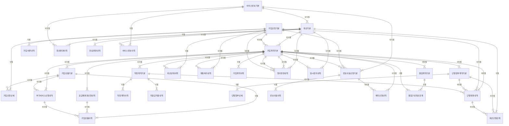

# 04. 논리 모델 — ORD 가입

> 작성 2026-11-07 · subagent_logical_modeler(작성) · masteragent_da_coordinator 03 논리 관문 재생성 · 정본 `model/logical/ORD.json` — 이 문서는 JSON 에서 생성(손수정 금지)
> 엔터티 30(핵심 10 · 기본·일반 20 · 정산 STL 0) · 속성 318 · 관계 91 · 관문 리뷰 `reviews/03_logical.md`

## 1. 엔터티 목록

| ID | 엔터티 | 물리명 | 테이블명(미리보기) | 유형 | 단계 | 모듈 | PK | 속성 수 | 설명 |
|---|---|---|---|---|---|---|---|---|---|
| ORD-001 | 가입신청기본 | `SBSC_APLY_BAS` | `PTL_ORD_SBSC_APLY_M` | ACT | CNCP |  | 가입신청번호 | 16 | 신규·번호이동·기기변경·재가입 등 가입 요청서. 판매점이 접수하고 실명인증·서류 확인을 거쳐 개통(가입계약 생성)으로 이어진다. 개통 전 철회·반려 건도 남는다. |
| ORD-002 | 가입계약기본 | `SBSC_CTRT_BAS` | `PTL_ORD_SBSC_CTRT_M` | ACT | CNCP |  | 가입계약번호 | 13 | 고객이 회선 하나를 이용하기 위해 맺은 이용 계약(회선 단위 계약). 청구계정·관리 대리점이 귀속되고 개통부터 해지까지의 계약 상태를 가진다. 명의변경은 기존 계약 종료 + 새 계약 생성(회선 유지). |
| ORD-003 | 회선기본 | `LINE_BAS` | `PTL_ORD_LINE_M` | BASE | CNCP |  | 서비스관리번호 | 15 | 서비스가 실제 제공되는 이동통신 회선 실체. 서비스관리번호로 식별하며 서비스번호·유심(IMSI)·단말(IMEI)이 연결된다. 사용량·요금계산·이용정지가 모두 이 회선을 기준으로 붙는다. 번호변경으로 서비스번호가 바뀌어도 서비스관리번호는 그대로. |
| ORD-004 | 서비스번호기본 | `SVC_NO_BAS` | `PTL_ORD_SVC_NO_M` | BASE | CNCP |  | 서비스번호 | 11 | 010 이동전화 번호 자원. 할당·사용·회수·재사용대기(해지 후 일정 기간 미할당)의 생애주기를 가진다. 같은 번호가 해지 후 다른 고객에게 재할당될 수 있다(S8). |
| ORD-005 | 가입상품기본 | `SBSC_PROD_BAS` | `PTL_ORD_SBSC_PROD_M` | ACT | CNCP |  | 가입상품번호 | 11 | 가입계약(회선)에 실제 가입된 상품 인스턴스 — 요금제 1개(대표)와 부가서비스·할인상품 여러 개. 요금계산의 근거가 되며 적용 기간(유효시작·종료)을 가진다. |
| ORD-006 | 약정계약기본 | `AGRMT_CTRT_BAS` | `PTL_ORD_AGRMT_CTRT_M` | ACT | CNCP |  | 약정계약번호 | 13 | 가입계약에 붙는 약정(12·24개월) 계약. 지원금 유형(공시지원금 또는 선택약정 25% 요금할인)과 약정 기간을 가지며 중도 해지·변경 시 위약금 부과 근거가 된다. |
| ORD-007 | 단말할부계약기본 | `EQP_INSTL_CTRT_BAS` | `PTL_ORD_EQP_INSTL_CTRT_M` | ACT | CNCP |  | 단말할부계약번호 | 15 | 단말 구매 대금을 월 요금과 함께 나눠 내는 할부 계약. 할부원금·개월수·이자율(할부수수료)을 가지며 회차별 계획은 단말할부상세, 회차 청구는 PAY 단말할부청구상세. |
| ORD-008 | 번호이동신청기본 | `MNP_APLY_BAS` | `PTL_ORD_MNP_APLY_M` | ACT | CNCP |  | 번호이동신청번호 | 13 | 번호이동(MNP) 전입·전출 신청. 번호이동 관리기관(KTOA) 중계로 본인인증·상대 사업자 승인을 거쳐 완료된다. 전입은 가입신청과, 전출은 기존 가입계약 해지와 짝을 이룬다. |
| ORD-009 | 결합계약기본 | `CMBN_CTRT_BAS` | `PTL_ORD_CMBN_CTRT_M` | ACT | CNCP |  | 결합계약번호 | 10 | 여러 회선(가족결합)·유무선(인터넷·IPTV 포함)을 묶어 할인받는 결합상품 계약. 구성 회선은 결합구성회선관계로 연결하고, 결합 할인은 PAY 결합할인배분내역에서 회선별로 배분한다. |
| ORD-010 | 회선상태이력 | `LINE_STTS_HIST` | `PTL_ORD_LINE_STTS_H` | ACT | CNCP |  | 서비스관리번호 + 회선상태이력순번 | 13 | 개통·일시정지·분실정지·미납 이용정지·해지 등 회선 상태가 바뀔 때마다 남는 이력. 원인 업무(ORD 고객 요청·COL 미납 처리)와 무관하게 이 한 곳에 통합하며(P2) 유효시작·종료일시로 SCD2 를 이룬다. |
| ORD-011 | 가입신청상세 | `SBSC_APLY_DTL` | `PTL_ORD_SBSC_APLY_D` | ACT | LGCL |  | 가입신청번호 + 가입신청상세순번 | 5 | 가입신청서에 적힌 신청 상품 항목(요금제·부가서비스·할인). 개통되면 가입상품 인스턴스로 이어진다. |
| ORD-012 | 가입서류내역 | `SBSC_DOC_DTLS` | `PTL_ORD_SBSC_DOC_L` | ACT | LGCL |  | 가입신청번호 + 가입서류순번 | 8 | 가입·명의변경 신청 때 제출된 서류(신분증·위임장·법정대리인 동의서·법인 서류) 접수·검증 내역. 개인정보라 파기 예정일을 둔다. |
| ORD-013 | 개통처리내역 | `OPNG_PRCS_DTLS` | `PTL_ORD_OPNG_PRCS_L` | ACT | LGCL |  | 개통처리번호 | 9 | 가입신청을 망(HLR·HSS·PCRF)·과금 시스템에 반영하는 개통 작업 결과. 실패·재처리도 모두 남는다. |
| ORD-014 | 가입계약이력 | `SBSC_CTRT_HIST` | `PTL_ORD_SBSC_CTRT_H` | ACT | LGCL |  | 가입계약번호 + 가입계약이력순번 | 9 | 가입계약의 상태·청구계정·관리 대리점 변경 이력(SCD2). |
| ORD-015 | 회선변경이력 | `LINE_CHG_HIST` | `PTL_ORD_LINE_CHG_H` | ACT | LGCL |  | 서비스관리번호 + 회선변경이력순번 | 13 | 회선 속성(서비스번호·유심·IMSI·단말·망) 변경 스냅숏 이력(SCD2). 개별 업무 처리 내역(유심변경·단말변경)의 결과가 여기 모인다. |
| ORD-016 | 가입상품이력 | `SBSC_PROD_HIST` | `PTL_ORD_SBSC_PROD_H` | ACT | LGCL |  | 가입상품번호 + 가입상품이력순번 | 10 | 가입상품의 가입·변경·정지·해지 이력(SCD2). 요금계산의 일할 근거 기간이 된다. |
| ORD-017 | 요금제변경신청내역 | `RTPLN_CHG_APLY_DTLS` | `PTL_ORD_RTPLN_CHG_APLY_L` | ACT | LGCL |  | 요금제변경신청번호 | 11 | 회선의 요금제 변경 신청(즉시·익월 적용). 처리되면 가입상품이력에 반영된다. |
| ORD-018 | 부가서비스신청내역 | `ADSVC_APLY_DTLS` | `PTL_ORD_ADSVC_APLY_L` | ACT | LGCL |  | 부가서비스신청번호 | 10 | 부가서비스 가입·해지·변경 신청. 처리되면 가입상품(인스턴스)이 생기거나 종료된다. |
| ORD-019 | 약정계약이력 | `AGRMT_CTRT_HIST` | `PTL_ORD_AGRMT_CTRT_H` | ACT | LGCL |  | 약정계약번호 + 약정계약이력순번 | 10 | 약정 신규·재약정·연장·승계·해지 등 약정 조건 변경 이력. |
| ORD-020 | 지원금적용내역 | `SUBSD_APLCN_DTLS` | `PTL_ORD_SUBSD_APLCN_L` | ACT | LGCL |  | 약정계약번호 + 지원금적용순번 | 8 | 약정에 적용된 지원금(공시지원금·추가지원금·전환지원금 등) 종류별 금액. 추가지원금은 공시지원금의 15% 한도(단말기유통법). |
| ORD-021 | 단말할부상세 | `EQP_INSTL_DTL` | `PTL_ORD_EQP_INSTL_D` | ACT | LGCL |  | 단말할부계약번호 + 할부회차 | 8 | 단말할부계약의 회차별 원금·할부수수료 계획과 청구 상태. PAY 단말할부청구상세가 (단말할부계약번호, 할부회차)로 참조한다. |
| ORD-022 | 회선단말관계 | `LINE_EQP_REL` | `PTL_ORD_LINE_EQP_R` | ACT | LGCL |  | 서비스관리번호 + 회선단말관계순번 | 9 | 회선에 장착된 단말(IMEI)의 기간 이력 — 회선과 단말 개체의 시간 축 관계. |
| ORD-023 | 단말변경내역 | `EQP_CHG_DTLS` | `PTL_ORD_EQP_CHG_L` | ACT | LGCL |  | 단말변경번호 | 13 | 기기변경(업무명) 처리 — 같은 회선에서 단말을 바꾸고 약정·할부를 새로 맺는 행위. 표준단어 원칙(기기 = 단말)에 따라 엔터티명은 단말변경내역. |
| ORD-024 | 유심변경내역 | `USIM_CHG_DTLS` | `PTL_ORD_USIM_CHG_L` | ACT | LGCL |  | 유심변경번호 | 13 | 유심·eSIM 교체(분실·파손·eSIM 전환) 처리. |
| ORD-025 | 번호이동이력 | `MNP_HIST` | `PTL_ORD_MNP_H` | ACT | LGCL |  | 번호이동신청번호 + 번호이동이력순번 | 7 | 번호이동 신청의 진행 단계(사전동의·인증·승인·개통·완료·거절) 변경 이력. |
| ORD-026 | 명의변경내역 | `NMNE_CHG_DTLS` | `PTL_ORD_NMNE_CHG_L` | ACT | LGCL |  | 명의변경번호 | 13 | 양도·양수·상속·법인전환 명의변경. 회선·번호는 유지하고 기존 계약 종료 + 새 계약 생성(결정 O2). |
| ORD-027 | 일시정지내역 | `PAUS_DTLS` | `PTL_ORD_PAUS_L` | ACT | LGCL |  | 일시정지번호 | 9 | 고객 요청 일시정지(해외 체류·군 입대·분실 등)·해제. 이용약관상 연간 횟수·일수 제한(미납 이용정지는 COL). |
| ORD-028 | 해지신청내역 | `TRMN_APLY_DTLS` | `PTL_ORD_TRMN_APLY_L` | ACT | LGCL |  | 해지신청번호 | 9 | 고객 해지 신청·사유·예정일. PRM 수수료환수내역(STL)이 조기 해지 환수 근거로 참조한다. |
| ORD-029 | 결합구성회선관계 | `CMBN_CMPS_LINE_REL` | `PTL_ORD_CMBN_CMPS_LINE_R` | ACT | LGCL |  | 결합계약번호 + 가입계약번호 | 6 | 결합계약과 가입계약의 N:M 해소 관계 — 결합에 묶인 회선(계약)과 가족 관계·결합 기간. |
| ORD-030 | 서비스번호이력 | `SVC_NO_HIST` | `PTL_ORD_SVC_NO_H` | ACT | LGCL |  | 서비스번호 + 서비스번호이력순번 | 8 | 010 번호 자원의 할당·회수·재사용대기·번호이동 전입·전출 이력(S8 재사용 추적). |

## 2. 엔터티별 속성

속성 순서 = PK → FK → 일반(규칙 2-9). FK 표기 = `<영역>.<엔터티>.<속성>`. NULL Y = 선택. 시스템 칼럼 4개는 DDL 생성 때만 붙는다(D7).

### ORD-001 가입신청기본 `SBSC_APLY_BAS` (ACT·CNCP)

신규·번호이동·기기변경·재가입 등 가입 요청서. 판매점이 접수하고 실명인증·서류 확인을 거쳐 개통(가입계약 생성)으로 이어진다. 개통 전 철회·반려 건도 남는다.

| # | 속성 | 물리명 | 도메인 | PK | FK | NULL | 설명 |
|---|---|---|---|---|---|---|---|
| 1 | 가입신청번호 | SBSC_APLY_NO | 번호V20 | PK |  | N | 가입 신청의 번호 — 대상을 식별하거나 외부에서 부여받은 번호 |
| 2 | 고객번호 | CUST_NO | 번호V20 |  | CUS.고객기본.고객번호 | Y | 신청 고객(신규 고객은 실명인증 뒤 확정 — S5 NULL) |
| 3 | 청구계정번호 | BILL_ACNT_NO | 번호V20 |  | CUS.청구계정기본.청구계정번호 | Y | 요금을 묶을 청구계정(신규 계정 생성 전 NULL) |
| 4 | 판매점번호 | SHOP_NO | 번호V20 |  | PRM.판매점기본.판매점번호 | N | 신청을 접수한 유치 판매점(유치 수수료 근거, STL 입력) |
| 5 | 상품코드 | PROD_CD | 코드V20 |  | PRD.상품기본.상품코드 | N | 신청 대표 요금제(세부 신청 상품은 가입신청상세) |
| 6 | 가입신청명 | SBSC_APLY_NM | 명V100 |  |  | N | 가입 신청의 명 — 대상을 부르는 이름 |
| 7 | 가입신청일시 | SBSC_APLY_DTM | 일시TS |  |  | N | 가입 신청의 일시 — 연월일 시분초까지의 시점 |
| 8 | 가입신청상태유형코드 | SBSC_APLY_STTS_TY_CD | 코드V10 |  |  | N | 가입 신청 상태의 유형 코드 — 공통코드(codes.json) |
| 9 | 가입신청유형코드 | SBSC_APLY_TY_CD | 코드V10 |  |  | N | 가입 신청의 유형 코드 — 공통코드(codes.json) |
| 10 | 가입채널유형코드 | SBSC_CHNL_TY_CD | 코드V10 |  |  | N | 가입 채널의 유형 코드 — 공통코드(codes.json) |
| 11 | 신청회선수 | APLY_LINE_CNT | 수N5 |  |  | N | 한 신청서로 개통할 회선 수(법인 다회선 = N) |
| 12 | 희망서비스번호 | HOPE_SVC_NO | 번호V20 |  |  | Y | 고객이 고른 희망 번호(번호이동 전입은 이동 번호, 미지정 NULL) |
| 13 | 실명인증여부 | RLNM_CRTF_YN | 여부C1 |  |  | N | 실명 인증의 여부 — 해당 여부(Y/N) |
| 14 | 개통희망일자 | OPNG_HOPE_DT | 일자C8 |  |  | Y | 개통 희망의 일자 — 연월일(YYYYMMDD) |
| 15 | 가입신청취소일시 | SBSC_APLY_CNCL_DTM | 일시TS |  |  | Y | 가입 신청 취소의 일시 — 연월일 시분초까지의 시점 |
| 16 | 가입신청반려사유유형코드 | SBSC_APLY_RJCT_RSN_TY_CD | 코드V10 |  |  | Y | 가입 신청 반려 사유의 유형 코드 — 공통코드(codes.json) |

정규화 : 1NF : 신청 상품(요금제·부가서비스 여러 개)은 반복 그룹 → 가입신청상세로 분리, 제출 서류 → 가입서류내역. 2NF : 단일 PK. 3NF : 관리 대리점은 판매점→대리점(PRM)으로 결정되는 이행 종속이라 두지 않음. 상품코드(대표 요금제)는 상세의 대표 행과 같은 값이지만 개념 관문 crossRel(PRD.상품기본→가입신청기본) 유지를 위해 헤더 FK 로 둠(엔터티 간 중복, 속성 종속 위반 아님).

### ORD-002 가입계약기본 `SBSC_CTRT_BAS` (ACT·CNCP)

고객이 회선 하나를 이용하기 위해 맺은 이용 계약(회선 단위 계약). 청구계정·관리 대리점이 귀속되고 개통부터 해지까지의 계약 상태를 가진다. 명의변경은 기존 계약 종료 + 새 계약 생성(회선 유지).

| # | 속성 | 물리명 | 도메인 | PK | FK | NULL | 설명 |
|---|---|---|---|---|---|---|---|
| 1 | 가입계약번호 | SBSC_CTRT_NO | 번호V20 | PK |  | N | 가입 계약의 번호 — 대상을 식별하거나 외부에서 부여받은 번호 |
| 2 | 고객번호 | CUST_NO | 번호V20 |  | CUS.고객기본.고객번호 | N | 계약 명의 고객(S1 멱법칙 — 법인 1곳 100만+) |
| 3 | 청구계정번호 | BILL_ACNT_NO | 번호V20 |  | CUS.청구계정기본.청구계정번호 | N | 요금이 묶여 청구되는 청구계정(명의 고객과 다를 수 있음 — 대납) |
| 4 | 서비스관리번호 | SVC_MGMT_NO | 번호V20 |  | ORD.회선기본.서비스관리번호 | N | 계약 대상 회선 |
| 5 | 가입신청번호 | SBSC_APLY_NO | 번호V20 |  | ORD.가입신청기본.가입신청번호 | Y | 개통 근거 신청(이관·전환·명의변경 계약은 NULL) |
| 6 | 대리점번호 | AGNC_NO | 번호V20 |  | PRM.대리점기본.대리점번호 | Y | 관리 대리점(관리수수료 귀속 — S10 지역 상관) |
| 7 | 가입계약명 | SBSC_CTRT_NM | 명V100 |  |  | N | 가입 계약의 명 — 대상을 부르는 이름 |
| 8 | 가입계약일시 | SBSC_CTRT_DTM | 일시TS |  |  | N | 가입 계약의 일시 — 연월일 시분초까지의 시점 |
| 9 | 가입계약상태유형코드 | SBSC_CTRT_STTS_TY_CD | 코드V10 |  |  | N | 가입 계약 상태의 유형 코드 — 공통코드(codes.json) |
| 10 | 가입계약유형코드 | SBSC_CTRT_TY_CD | 코드V10 |  |  | N | 가입 계약의 유형 코드 — 공통코드(codes.json) |
| 11 | 개통일시 | OPNG_DTM | 일시TS |  |  | Y | 개통의 일시 — 연월일 시분초까지의 시점 |
| 12 | 해지일시 | TRMN_DTM | 일시TS |  |  | Y | 해지의 일시 — 연월일 시분초까지의 시점 |
| 13 | 해지사유유형코드 | TRMN_RSN_TY_CD | 코드V10 |  |  | Y | 해지 사유의 유형 코드 — 공통코드(codes.json) |

정규화 : 1NF : 가입상품·약정·할부·결합은 반복 → 각 엔터티로 분리. 2NF : 단일 PK. 3NF : 개념 모델의 서비스번호·서비스유형코드는 서비스관리번호(회선)가 결정하는 이행 종속 → 제거(회선기본 소유, 번호변경 시 계약 갱신 불필요). 고객번호와 청구계정번호는 대납(명의≠납부자) 때문에 서로 독립.

### ORD-003 회선기본 `LINE_BAS` (BASE·CNCP)

서비스가 실제 제공되는 이동통신 회선 실체. 서비스관리번호로 식별하며 서비스번호·유심(IMSI)·단말(IMEI)이 연결된다. 사용량·요금계산·이용정지가 모두 이 회선을 기준으로 붙는다. 번호변경으로 서비스번호가 바뀌어도 서비스관리번호는 그대로.

| # | 속성 | 물리명 | 도메인 | PK | FK | NULL | 설명 |
|---|---|---|---|---|---|---|---|
| 1 | 서비스관리번호 | SVC_MGMT_NO | 번호V20 | PK |  | N | 서비스 관리의 번호 — 대상을 식별하거나 외부에서 부여받은 번호 |
| 2 | 서비스번호 | SVC_NO | 번호V20 |  | ORD.서비스번호기본.서비스번호 | N | 현재 쓰는 010 번호(재사용 — S8) |
| 3 | 유심상품코드 | USIM_PROD_CD | 코드V20 |  | PRD.유심상품기본.상품코드 | N | 장착 유심 종류(USIM·eSIM) — 역할명, PRD.유심상품기본.상품코드 |
| 4 | 단말모델코드 | EQP_MDL_CD | 코드V20 |  | PRD.단말모델기본.단말모델코드 | Y | 현재 단말 모델(자급제 미확인 단말 NULL — S5) |
| 5 | 회선명 | LINE_NM | 명V100 |  |  | N | 회선의 명 — 대상을 부르는 이름 |
| 6 | 회선등록일시 | LINE_REG_DTM | 일시TS |  |  | N | 회선 등록의 일시 — 연월일 시분초까지의 시점 |
| 7 | 회선상태유형코드 | LINE_STTS_TY_CD | 코드V10 |  |  | N | 회선 상태의 유형 코드 — 공통코드(codes.json) |
| 8 | 유심일련번호 | USIM_SN | 일련번호V20 |  |  | N | 유심의 일련번호 — 부모 안에서 등록 차례로 매기는 번호 또는 기기 일련번호 |
| 9 | IMSI번호 | IMSI_NO | 번호V20 |  |  | N | IMSI의 번호 — 대상을 식별하거나 외부에서 부여받은 번호 |
| 10 | IMEI번호 | IMEI_NO | 번호V20 |  |  | Y | IMEI의 번호 — 대상을 식별하거나 외부에서 부여받은 번호 |
| 11 | 서비스유형코드 | SVC_TY_CD | 코드V10 |  |  | N | 서비스의 유형 코드 — 공통코드(codes.json) |
| 12 | 망유형코드 | NTWK_TY_CD | 코드V10 |  |  | N | 망의 유형 코드 — 공통코드(codes.json) |
| 13 | eSIM여부 | ESIM_YN | 여부C1 |  |  | N | eSIM의 여부 — 해당 여부(Y/N) |
| 14 | 개통일시 | OPNG_DTM | 일시TS |  |  | N | 개통의 일시 — 연월일 시분초까지의 시점 |
| 15 | 해지일시 | TRMN_DTM | 일시TS |  |  | Y | 해지의 일시 — 연월일 시분초까지의 시점 |

정규화 : 1NF : 단말 장착 기간 이력은 반복 → 회선단말관계, 속성 변경은 회선변경이력, 상태는 회선상태이력으로 분리. 2NF : 단일 PK. 3NF : IMSI 는 유심 개체가 결정하지만 유심 개체 엔터티는 PRM 유통 재고에 있고 eSIM 재발급 때 회선 기준으로 바뀌므로 회선 귀속 속성으로 둠. 단말모델코드는 IMEI(TAC)로 추정 가능하나 IMEI 미확인 회선이 있어 독립 속성.

### ORD-004 서비스번호기본 `SVC_NO_BAS` (BASE·CNCP)

010 이동전화 번호 자원. 할당·사용·회수·재사용대기(해지 후 일정 기간 미할당)의 생애주기를 가진다. 같은 번호가 해지 후 다른 고객에게 재할당될 수 있다(S8).

| # | 속성 | 물리명 | 도메인 | PK | FK | NULL | 설명 |
|---|---|---|---|---|---|---|---|
| 1 | 서비스번호 | SVC_NO | 번호V20 | PK |  | N | 서비스의 번호 — 대상을 식별하거나 외부에서 부여받은 번호 |
| 2 | 원통신사업자번호 | ORGN_CARR_NO | 번호V20 |  | PRM.통신사업자기본.통신사업자번호 | Y | 번호를 원래 할당받은 사업자(번호이동 전입 번호만) — 역할명, PRM.통신사업자기본.통신사업자번호 |
| 3 | 서비스번호명 | SVC_NO_NM | 명V100 |  |  | N | 서비스 번호의 명 — 대상을 부르는 이름 |
| 4 | 서비스번호등록일시 | SVC_NO_REG_DTM | 일시TS |  |  | N | 서비스 번호 등록의 일시 — 연월일 시분초까지의 시점 |
| 5 | 서비스번호상태유형코드 | SVC_NO_STTS_TY_CD | 코드V10 |  |  | N | 서비스 번호 상태의 유형 코드 — 공통코드(codes.json) |
| 6 | 서비스번호등급유형코드 | SVC_NO_GRD_TY_CD | 코드V10 |  |  | N | 서비스 번호 등급의 유형 코드 — 공통코드(codes.json) |
| 7 | 국번호 | EXCH_NO | 번호V20 |  |  | N | 번호 가운데 국번(서비스번호에서 추출, 번호 대역 관리 키) |
| 8 | 번호이동전입여부 | MNP_MVIN_YN | 여부C1 |  |  | N | 번호이동 전입의 여부 — 해당 여부(Y/N) |
| 9 | 최종할당일시 | LAST_ASGN_DTM | 일시TS |  |  | Y | 최종 할당의 일시 — 연월일 시분초까지의 시점 |
| 10 | 최종회수일시 | LAST_RTRVL_DTM | 일시TS |  |  | Y | 최종 회수의 일시 — 연월일 시분초까지의 시점 |
| 11 | 재사용가능일자 | RE_USE_PSBL_DT | 일자C8 |  |  | Y | 재 사용 가능의 일자 — 연월일(YYYYMMDD) |

정규화 : 1NF : 할당·회수 반복 → 서비스번호이력. 2NF : 단일 PK. 3NF : 개념 모델의 서비스번호할당횟수는 서비스번호이력 COUNT 로 유도되는 추출 속성 → 제거(물리 반정규화 후보). 국번호는 PK 값 일부(PK 에 함수 종속, 이행 종속 아님).

### ORD-005 가입상품기본 `SBSC_PROD_BAS` (ACT·CNCP)

가입계약(회선)에 실제 가입된 상품 인스턴스 — 요금제 1개(대표)와 부가서비스·할인상품 여러 개. 요금계산의 근거가 되며 적용 기간(유효시작·종료)을 가진다.

| # | 속성 | 물리명 | 도메인 | PK | FK | NULL | 설명 |
|---|---|---|---|---|---|---|---|
| 1 | 가입상품번호 | SBSC_PROD_NO | 번호V20 | PK |  | N | 가입 상품의 번호 — 대상을 식별하거나 외부에서 부여받은 번호 |
| 2 | 가입계약번호 | SBSC_CTRT_NO | 번호V20 |  | ORD.가입계약기본.가입계약번호 | N | 가입 계약의 번호 — 대상을 식별하거나 외부에서 부여받은 번호 |
| 3 | 상품코드 | PROD_CD | 코드V20 |  | PRD.상품기본.상품코드 | N | 가입 상품(S2 요금제 1개 = 35%) |
| 4 | 판매점번호 | SHOP_NO | 번호V20 |  | PRM.판매점기본.판매점번호 | Y | 부가서비스 유치 판매점(대부분 NULL — S5) |
| 5 | 가입상품명 | SBSC_PROD_NM | 명V100 |  |  | N | 가입 상품의 명 — 대상을 부르는 이름 |
| 6 | 상품가입일시 | PROD_SBSC_DTM | 일시TS |  |  | N | 상품 가입의 일시 — 연월일 시분초까지의 시점 |
| 7 | 가입상품상태유형코드 | SBSC_PROD_STTS_TY_CD | 코드V10 |  |  | N | 가입 상품 상태의 유형 코드 — 공통코드(codes.json) |
| 8 | 유효시작일시 | VLD_BGNG_DTM | 일시TS |  |  | N | 유효 시작의 일시 — 연월일 시분초까지의 시점 |
| 9 | 유효종료일시 | VLD_END_DTM | 일시TS |  |  | Y | 유효 종료의 일시 — 연월일 시분초까지의 시점 |
| 10 | 상품해지일시 | PROD_TRMN_DTM | 일시TS |  |  | Y | 상품 해지의 일시 — 연월일 시분초까지의 시점 |
| 11 | 상품해지사유유형코드 | PROD_TRMN_RSN_TY_CD | 코드V10 |  |  | Y | 상품 해지 사유의 유형 코드 — 공통코드(codes.json) |

정규화 : 1NF : 상태·상품 변경 반복 → 가입상품이력. 2NF : 단일 PK. 3NF : 상품유형코드·대표상품여부는 상품코드(PRD)가 결정 → 제거. 서비스관리번호는 가입계약번호가 결정하는 이행 종속 → 논리에서 제거, 개념 결정 O4(업무 키 보존·회선 단위 파티셔닝)는 물리 반정규화 후보로 넘김.

### ORD-006 약정계약기본 `AGRMT_CTRT_BAS` (ACT·CNCP)

가입계약에 붙는 약정(12·24개월) 계약. 지원금 유형(공시지원금 또는 선택약정 25% 요금할인)과 약정 기간을 가지며 중도 해지·변경 시 위약금 부과 근거가 된다.

| # | 속성 | 물리명 | 도메인 | PK | FK | NULL | 설명 |
|---|---|---|---|---|---|---|---|
| 1 | 약정계약번호 | AGRMT_CTRT_NO | 번호V20 | PK |  | N | 약정 계약의 번호 — 대상을 식별하거나 외부에서 부여받은 번호 |
| 2 | 가입계약번호 | SBSC_CTRT_NO | 번호V20 |  | ORD.가입계약기본.가입계약번호 | N | 가입 계약의 번호 — 대상을 식별하거나 외부에서 부여받은 번호 |
| 3 | 약정상품코드 | AGRMT_PROD_CD | 코드V20 |  | PRD.약정상품기본.상품코드 | N | 약정 규칙·위약금 기준 상품 — 역할명, PRD.약정상품기본.상품코드 |
| 4 | 약정계약명 | AGRMT_CTRT_NM | 명V100 |  |  | N | 약정 계약의 명 — 대상을 부르는 이름 |
| 5 | 약정계약일시 | AGRMT_CTRT_DTM | 일시TS |  |  | N | 약정 계약의 일시 — 연월일 시분초까지의 시점 |
| 6 | 약정계약상태유형코드 | AGRMT_CTRT_STTS_TY_CD | 코드V10 |  |  | N | 약정 계약 상태의 유형 코드 — 공통코드(codes.json) |
| 7 | 지원금유형코드 | SUBSD_TY_CD | 코드V10 |  |  | N | 지원금의 유형 코드 — 공통코드(codes.json) |
| 8 | 약정개월수 | AGRMT_MCNT | 수N5 |  |  | N | 약정의 개월수 — 기간의 개월 수 |
| 9 | 약정시작일자 | AGRMT_BGNG_DT | 일자C8 |  |  | N | 약정 시작의 일자 — 연월일(YYYYMMDD) |
| 10 | 약정종료일자 | AGRMT_END_DT | 일자C8 |  |  | N | 약정 종료의 일자 — 연월일(YYYYMMDD) |
| 11 | 선택약정할인율 | CHC_AGRMT_DSCNT_RT | 율N5_2 |  |  | Y | 선택약정 요금할인율(계약 시점 약관값 고정 — 20%→25% 변경 전 계약 보존), 공시지원금 약정은 NULL |
| 12 | 재약정여부 | RE_AGRMT_YN | 여부C1 |  |  | N | 재 약정의 여부 — 해당 여부(Y/N) |
| 13 | 약정해지일시 | AGRMT_TRMN_DTM | 일시TS |  |  | Y | 약정 해지의 일시 — 연월일 시분초까지의 시점 |

정규화 : 1NF : 개념 모델의 공시지원금·추가지원금(지원금 종류별 금액 반복) → 지원금적용내역으로 분리. 2NF : 단일 PK. 3NF : 약정종료일자는 시작+개월수로 계산되지만 일시정지 기간만큼 연장·단축 조정이 있어 독립 사실로 둠. 선택약정할인율은 약정상품이 아닌 계약 시점 약관값(이력 보존 필요).

### ORD-007 단말할부계약기본 `EQP_INSTL_CTRT_BAS` (ACT·CNCP)

단말 구매 대금을 월 요금과 함께 나눠 내는 할부 계약. 할부원금·개월수·이자율(할부수수료)을 가지며 회차별 계획은 단말할부상세, 회차 청구는 PAY 단말할부청구상세.

| # | 속성 | 물리명 | 도메인 | PK | FK | NULL | 설명 |
|---|---|---|---|---|---|---|---|
| 1 | 단말할부계약번호 | EQP_INSTL_CTRT_NO | 번호V20 | PK |  | N | 단말 할부 계약의 번호 — 대상을 식별하거나 외부에서 부여받은 번호 |
| 2 | 가입계약번호 | SBSC_CTRT_NO | 번호V20 |  | ORD.가입계약기본.가입계약번호 | N | 가입 계약의 번호 — 대상을 식별하거나 외부에서 부여받은 번호 |
| 3 | 단말모델코드 | EQP_MDL_CD | 코드V20 |  | PRD.단말모델기본.단말모델코드 | N | 단말 모델의 코드 — 업무 분류 값을 식별하는 부호, 엔터티에서는 기준 코드 집합 |
| 4 | 단말할부계약명 | EQP_INSTL_CTRT_NM | 명V100 |  |  | N | 단말 할부 계약의 명 — 대상을 부르는 이름 |
| 5 | 단말할부계약일시 | EQP_INSTL_CTRT_DTM | 일시TS |  |  | N | 단말 할부 계약의 일시 — 연월일 시분초까지의 시점 |
| 6 | 단말할부계약상태유형코드 | EQP_INSTL_CTRT_STTS_TY_CD | 코드V10 |  |  | N | 단말 할부 계약 상태의 유형 코드 — 공통코드(codes.json) |
| 7 | IMEI번호 | IMEI_NO | 번호V20 |  |  | N | IMEI의 번호 — 대상을 식별하거나 외부에서 부여받은 번호 |
| 8 | 단말출고가격 | EQP_SHPM_PRC | 금액N15 |  |  | N | 계약 시점 단말 출고가(PRD 가격 이력의 그 시점 값 — 계약 사실로 고정) |
| 9 | 단말선납금액 | EQP_PRPAY_AMT | 금액N15 |  |  | N | 할부원금에서 빼고 개통 때 먼저 낸 금액 |
| 10 | 할부원금 | INSTL_PRNC | 금액N15 |  |  | N | 할부의 원금 — 이자를 제외한 원래 금액 |
| 11 | 할부개월수 | INSTL_MCNT | 수N5 |  |  | N | 할부의 개월수 — 기간의 개월 수 |
| 12 | 할부이자율 | INSTL_INTRT | 율N5_2 |  |  | N | 할부의 이자율 — 할부 등에 적용하는 연 이자율 |
| 13 | 월할부금액 | MM_INSTL_AMT | 금액N15 |  |  | N | 월 할부의 금액 — 원화 금액(원 단위 정수) |
| 14 | 할부시작청구년월 | INSTL_BGNG_BILL_YM | 년월C6 |  |  | N | 할부 시작 청구의 년월 — 연월(YYYYMM) |
| 15 | 할부완료일자 | INSTL_CMPTN_DT | 일자C8 |  |  | Y | 할부 완료의 일자 — 연월일(YYYYMMDD) |

정규화 : 1NF : 회차별 원금·수수료 계획 → 단말할부상세. 2NF : 단일 PK. 3NF : 개념 모델의 할부잔여원금은 단말할부상세의 미청구 회차 원금 합으로 유도 → 제거(물리 반정규화 후보). 단말출고가격·월할부금액은 계약 체결 시점 확정값.

### ORD-008 번호이동신청기본 `MNP_APLY_BAS` (ACT·CNCP)

번호이동(MNP) 전입·전출 신청. 번호이동 관리기관(KTOA) 중계로 본인인증·상대 사업자 승인을 거쳐 완료된다. 전입은 가입신청과, 전출은 기존 가입계약 해지와 짝을 이룬다.

| # | 속성 | 물리명 | 도메인 | PK | FK | NULL | 설명 |
|---|---|---|---|---|---|---|---|
| 1 | 번호이동신청번호 | MNP_APLY_NO | 번호V20 | PK |  | N | 번호이동 신청의 번호 — 대상을 식별하거나 외부에서 부여받은 번호 |
| 2 | 서비스번호 | SVC_NO | 번호V20 |  | ORD.서비스번호기본.서비스번호 | N | 서비스의 번호 — 대상을 식별하거나 외부에서 부여받은 번호 |
| 3 | 가입신청번호 | SBSC_APLY_NO | 번호V20 |  | ORD.가입신청기본.가입신청번호 | Y | 전입 = 동반 가입신청(전출 NULL) |
| 4 | 가입계약번호 | SBSC_CTRT_NO | 번호V20 |  | ORD.가입계약기본.가입계약번호 | Y | 전출 = 해지되는 기존 계약(전입 NULL) |
| 5 | 통신사업자번호 | CARR_NO | 번호V20 |  | PRM.통신사업자기본.통신사업자번호 | N | 전입 원 사업자 또는 전출 상대 사업자 |
| 6 | 번호이동신청명 | MNP_APLY_NM | 명V100 |  |  | N | 번호이동 신청의 명 — 대상을 부르는 이름 |
| 7 | 번호이동신청일시 | MNP_APLY_DTM | 일시TS |  |  | N | 번호이동 신청의 일시 — 연월일 시분초까지의 시점 |
| 8 | 번호이동신청상태유형코드 | MNP_APLY_STTS_TY_CD | 코드V10 |  |  | N | 번호이동 신청 상태의 유형 코드 — 공통코드(codes.json) |
| 9 | 번호이동구분코드 | MNP_SE_CD | 코드V10 |  |  | N | 번호이동의 구분 코드 — 공통코드(codes.json) |
| 10 | 번호이동인증유형코드 | MNP_CRTF_TY_CD | 코드V10 |  |  | N | 번호이동 인증의 유형 코드 — 공통코드(codes.json) |
| 11 | 번호이동접수번호 | MNP_ACPT_NO | 번호V20 |  |  | N | 번호이동 접수의 번호 — 대상을 식별하거나 외부에서 부여받은 번호 |
| 12 | 번호이동완료일시 | MNP_CMPTN_DTM | 일시TS |  |  | Y | 번호이동 완료의 일시 — 연월일 시분초까지의 시점 |
| 13 | 번호이동거절사유유형코드 | MNP_RFSL_RSN_TY_CD | 코드V10 |  |  | Y | 번호이동 거절 사유의 유형 코드 — 공통코드(codes.json) |

정규화 : 1NF : 인증·승인·완료 진행 상태 반복 → 번호이동이력. 2NF : 단일 PK. 3NF : 이행 종속 없음(가입신청·가입계약 FK 는 구분코드에 따라 배타 — 둘 중 하나만 값).

### ORD-009 결합계약기본 `CMBN_CTRT_BAS` (ACT·CNCP)

여러 회선(가족결합)·유무선(인터넷·IPTV 포함)을 묶어 할인받는 결합상품 계약. 구성 회선은 결합구성회선관계로 연결하고, 결합 할인은 PAY 결합할인배분내역에서 회선별로 배분한다.

| # | 속성 | 물리명 | 도메인 | PK | FK | NULL | 설명 |
|---|---|---|---|---|---|---|---|
| 1 | 결합계약번호 | CMBN_CTRT_NO | 번호V20 | PK |  | N | 결합 계약의 번호 — 대상을 식별하거나 외부에서 부여받은 번호 |
| 2 | 결합상품코드 | CMBN_PROD_CD | 코드V20 |  | PRD.결합상품기본.상품코드 | N | 결합 규칙·할인 기준 — 역할명, PRD.결합상품기본.상품코드 |
| 3 | 대표고객번호 | RPRS_CUST_NO | 번호V20 |  | CUS.고객기본.고객번호 | N | 결합 명의 대표 고객 — 역할명, CUS.고객기본.고객번호(대표 회선 명의자와 다를 수 있음) |
| 4 | 대표가입계약번호 | RPRS_SBSC_CTRT_NO | 번호V20 |  | ORD.가입계약기본.가입계약번호 | N | 대표 회선 계약 — 역할명, ORD.가입계약기본.가입계약번호 |
| 5 | 결합계약명 | CMBN_CTRT_NM | 명V100 |  |  | N | 결합 계약의 명 — 대상을 부르는 이름 |
| 6 | 결합계약일시 | CMBN_CTRT_DTM | 일시TS |  |  | N | 결합 계약의 일시 — 연월일 시분초까지의 시점 |
| 7 | 결합계약상태유형코드 | CMBN_CTRT_STTS_TY_CD | 코드V10 |  |  | N | 결합 계약 상태의 유형 코드 — 공통코드(codes.json) |
| 8 | 결합시작일자 | CMBN_BGNG_DT | 일자C8 |  |  | N | 결합 시작의 일자 — 연월일(YYYYMMDD) |
| 9 | 결합종료일자 | CMBN_END_DT | 일자C8 |  |  | Y | 결합 종료의 일자 — 연월일(YYYYMMDD) |
| 10 | 결합해지사유유형코드 | CMBN_TRMN_RSN_TY_CD | 코드V10 |  |  | Y | 결합 해지 사유의 유형 코드 — 공통코드(codes.json) |

정규화 : 1NF : 구성 회선 반복 → 결합구성회선관계(가입계약과 N:M 해소). 2NF : 단일 PK. 3NF : 개념 모델의 결합유형코드는 결합상품코드(PRD.결합상품기본)가 결정하는 이행 종속 → 제거. 결합회선수는 구성 관계 COUNT 로 유도 → 제거(물리 반정규화 후보). 대표고객번호는 유무선 결합에서 대표 회선 명의자와 다를 수 있어 대표가입계약번호에 종속되지 않음.

### ORD-010 회선상태이력 `LINE_STTS_HIST` (ACT·CNCP)

개통·일시정지·분실정지·미납 이용정지·해지 등 회선 상태가 바뀔 때마다 남는 이력. 원인 업무(ORD 고객 요청·COL 미납 처리)와 무관하게 이 한 곳에 통합하며(P2) 유효시작·종료일시로 SCD2 를 이룬다.

| # | 속성 | 물리명 | 도메인 | PK | FK | NULL | 설명 |
|---|---|---|---|---|---|---|---|
| 1 | 서비스관리번호 | SVC_MGMT_NO | 번호V20 | PK | ORD.회선기본.서비스관리번호 | N | 서비스 관리의 번호 — 대상을 식별하거나 외부에서 부여받은 번호 |
| 2 | 회선상태이력순번 | LINE_STTS_HIST_SEQ | 순번N10 | PK |  | N | 회선 상태 이력의 순번 — 부모 안의 처리·표시 순서 |
| 3 | 가입계약번호 | SBSC_CTRT_NO | 번호V20 |  | ORD.가입계약기본.가입계약번호 | Y | 변경 시점 계약(시점 사실 — 명의변경 전후 구분) |
| 4 | 이용정지번호 | SUSP_NO | 번호V20 |  | COL.이용정지기본.이용정지번호 | Y | 미납 이용정지·해제가 원인일 때만(S5) |
| 5 | 직권해지번호 | EXOFTRMN_NO | 번호V20 |  | COL.직권해지기본.직권해지번호 | Y | 직권해지가 원인일 때만 |
| 6 | 회선상태이력명 | LINE_STTS_HIST_NM | 명V100 |  |  | N | 회선 상태 이력의 명 — 대상을 부르는 이름 |
| 7 | 회선상태변경일시 | LINE_STTS_CHG_DTM | 일시TS |  |  | N | 회선 상태 변경의 일시 — 연월일 시분초까지의 시점 |
| 8 | 회선상태유형코드 | LINE_STTS_TY_CD | 코드V10 |  |  | N | 회선 상태의 유형 코드 — 공통코드(codes.json) |
| 9 | 이전회선상태유형코드 | BFR_LINE_STTS_TY_CD | 코드V10 |  |  | Y | 이전 회선 상태의 유형 코드 — 공통코드(codes.json) |
| 10 | 회선상태변경사유유형코드 | LINE_STTS_CHG_RSN_TY_CD | 코드V10 |  |  | N | 회선 상태 변경 사유의 유형 코드 — 공통코드(codes.json) |
| 11 | 상태변경원인업무유형코드 | STTS_CHG_CAUS_TASK_TY_CD | 코드V10 |  |  | N | 상태 변경 원인 업무의 유형 코드 — 공통코드(codes.json) |
| 12 | 유효시작일시 | VLD_BGNG_DTM | 일시TS |  |  | N | 유효 시작의 일시 — 연월일 시분초까지의 시점 |
| 13 | 유효종료일시 | VLD_END_DTM | 일시TS |  |  | Y | 유효 종료의 일시 — 연월일 시분초까지의 시점 |

정규화 : 1NF 충족. 2NF : 복합 PK(서비스관리번호+순번)의 부분 종속 없음 — 회선 속성은 두지 않음. 3NF : 이전회선상태유형코드는 직전 이력 행에서 유도 가능하나 SCD2 조회 단순화 목적의 개념 승계 속성이라 유지(이행 종속 아님 — 다른 행 값). 가입계약번호는 유효기간별 사실.

### ORD-011 가입신청상세 `SBSC_APLY_DTL` (ACT·LGCL)

가입신청서에 적힌 신청 상품 항목(요금제·부가서비스·할인). 개통되면 가입상품 인스턴스로 이어진다.

| # | 속성 | 물리명 | 도메인 | PK | FK | NULL | 설명 |
|---|---|---|---|---|---|---|---|
| 1 | 가입신청번호 | SBSC_APLY_NO | 번호V20 | PK | ORD.가입신청기본.가입신청번호 | N | 가입 신청의 번호 — 대상을 식별하거나 외부에서 부여받은 번호 |
| 2 | 가입신청상세순번 | SBSC_APLY_DTL_SEQ | 순번N5 | PK |  | N | 가입 신청 상세의 순번 — 부모 안의 처리·표시 순서 |
| 3 | 상품코드 | PROD_CD | 코드V20 |  | PRD.상품기본.상품코드 | N | 상품의 코드 — 업무 분류 값을 식별하는 부호, 엔터티에서는 기준 코드 집합 |
| 4 | 가입상품번호 | SBSC_PROD_NO | 번호V20 |  | ORD.가입상품기본.가입상품번호 | Y | 개통 뒤 생성된 가입상품(반려·철회 NULL) |
| 5 | 신청상품수 | APLY_PROD_CNT | 수N10 |  |  | N | 같은 상품 신청 개수(법인 다회선 = 회선 수) |

정규화 : 1NF : 신청 상품 반복 그룹을 행으로 분리. 2NF : 모든 속성이 (가입신청번호, 순번) 전체에 종속. 3NF : 상품명·상품유형은 상품코드 종속이라 두지 않음. 대표상품여부는 헤더(가입신청기본) 상품코드와 같은 행으로 유도되는 중복 사실 → 제거(관문 R1, 대표 요금제는 헤더 상품코드 한 곳).

### ORD-012 가입서류내역 `SBSC_DOC_DTLS` (ACT·LGCL)

가입·명의변경 신청 때 제출된 서류(신분증·위임장·법정대리인 동의서·법인 서류) 접수·검증 내역. 개인정보라 파기 예정일을 둔다.

| # | 속성 | 물리명 | 도메인 | PK | FK | NULL | 설명 |
|---|---|---|---|---|---|---|---|
| 1 | 가입신청번호 | SBSC_APLY_NO | 번호V20 | PK | ORD.가입신청기본.가입신청번호 | N | 가입 신청의 번호 — 대상을 식별하거나 외부에서 부여받은 번호 |
| 2 | 가입서류순번 | SBSC_DOC_SEQ | 순번N5 | PK |  | N | 가입 서류의 순번 — 부모 안의 처리·표시 순서 |
| 3 | 서류유형코드 | DOC_TY_CD | 코드V10 |  |  | N | 서류의 유형 코드 — 공통코드(codes.json) |
| 4 | 서류제출일시 | DOC_SBMSN_DTM | 일시TS |  |  | N | 서류 제출의 일시 — 연월일 시분초까지의 시점 |
| 5 | 서류검증여부 | DOC_VRFC_YN | 여부C1 |  |  | N | 서류 검증의 여부 — 해당 여부(Y/N) |
| 6 | 서류검증일시 | DOC_VRFC_DTM | 일시TS |  |  | Y | 서류 검증의 일시 — 연월일 시분초까지의 시점 |
| 7 | 서류파일명 | DOC_FILE_NM | 명V100 |  |  | Y | 서류 파일의 명 — 대상을 부르는 이름 |
| 8 | 파기예정일자 | DSTR_SCHD_DT | 일자C8 |  |  | N | 파기 예정의 일자 — 연월일(YYYYMMDD) |

정규화 : 1NF : 서류 반복 → 행 분리. 2NF·3NF : 신청×순번 전체 종속, 이행 종속 없음.

### ORD-013 개통처리내역 `OPNG_PRCS_DTLS` (ACT·LGCL)

가입신청을 망(HLR·HSS·PCRF)·과금 시스템에 반영하는 개통 작업 결과. 실패·재처리도 모두 남는다.

| # | 속성 | 물리명 | 도메인 | PK | FK | NULL | 설명 |
|---|---|---|---|---|---|---|---|
| 1 | 개통처리번호 | OPNG_PRCS_NO | 번호V20 | PK |  | N | 개통 처리의 번호 — 대상을 식별하거나 외부에서 부여받은 번호 |
| 2 | 가입신청번호 | SBSC_APLY_NO | 번호V20 |  | ORD.가입신청기본.가입신청번호 | N | 가입 신청의 번호 — 대상을 식별하거나 외부에서 부여받은 번호 |
| 3 | 가입계약번호 | SBSC_CTRT_NO | 번호V20 |  | ORD.가입계약기본.가입계약번호 | Y | 개통 성공 때 생성된 계약(실패 NULL) |
| 4 | 개통처리일시 | OPNG_PRCS_DTM | 일시TS |  |  | N | 개통 처리의 일시 — 연월일 시분초까지의 시점 |
| 5 | 개통처리상태유형코드 | OPNG_PRCS_STTS_TY_CD | 코드V10 |  |  | N | 개통 처리 상태의 유형 코드 — 공통코드(codes.json) |
| 6 | 개통처리유형코드 | OPNG_PRCS_TY_CD | 코드V10 |  |  | N | 개통 처리의 유형 코드 — 공통코드(codes.json) |
| 7 | 망연동결과유형코드 | NTWK_LNK_RSLT_TY_CD | 코드V10 |  |  | N | 망 연동 결과의 유형 코드 — 공통코드(codes.json) |
| 8 | 개통처리완료일시 | OPNG_PRCS_CMPTN_DTM | 일시TS |  |  | Y | 개통 처리 완료의 일시 — 연월일 시분초까지의 시점 |
| 9 | 개통오류내용 | OPNG_ERR_CN | 내용V4000 |  |  | Y | 망 연동 실패 메시지(S9 넓은 행·S13 표기 흔들림 대상) |

정규화 : 1NF·2NF·3NF : 단일 PK, 회선은 가입계약번호로 유도되므로 서비스관리번호를 두지 않음.

### ORD-014 가입계약이력 `SBSC_CTRT_HIST` (ACT·LGCL)

가입계약의 상태·청구계정·관리 대리점 변경 이력(SCD2).

| # | 속성 | 물리명 | 도메인 | PK | FK | NULL | 설명 |
|---|---|---|---|---|---|---|---|
| 1 | 가입계약번호 | SBSC_CTRT_NO | 번호V20 | PK | ORD.가입계약기본.가입계약번호 | N | 가입 계약의 번호 — 대상을 식별하거나 외부에서 부여받은 번호 |
| 2 | 가입계약이력순번 | SBSC_CTRT_HIST_SEQ | 순번N10 | PK |  | N | 가입 계약 이력의 순번 — 부모 안의 처리·표시 순서 |
| 3 | 청구계정번호 | BILL_ACNT_NO | 번호V20 |  | CUS.청구계정기본.청구계정번호 | N | 그 기간 청구계정 |
| 4 | 대리점번호 | AGNC_NO | 번호V20 |  | PRM.대리점기본.대리점번호 | Y | 그 기간 관리 대리점 |
| 5 | 가입계약변경일시 | SBSC_CTRT_CHG_DTM | 일시TS |  |  | N | 가입 계약 변경의 일시 — 연월일 시분초까지의 시점 |
| 6 | 가입계약변경유형코드 | SBSC_CTRT_CHG_TY_CD | 코드V10 |  |  | N | 가입 계약 변경의 유형 코드 — 공통코드(codes.json) |
| 7 | 가입계약상태유형코드 | SBSC_CTRT_STTS_TY_CD | 코드V10 |  |  | N | 가입 계약 상태의 유형 코드 — 공통코드(codes.json) |
| 8 | 유효시작일시 | VLD_BGNG_DTM | 일시TS |  |  | N | 유효 시작의 일시 — 연월일 시분초까지의 시점 |
| 9 | 유효종료일시 | VLD_END_DTM | 일시TS |  |  | Y | 유효 종료의 일시 — 연월일 시분초까지의 시점 |

정규화 : 2NF : 이력 속성은 (계약, 순번) 전체에 종속. 3NF : 이행 종속 없음.

### ORD-015 회선변경이력 `LINE_CHG_HIST` (ACT·LGCL)

회선 속성(서비스번호·유심·IMSI·단말·망) 변경 스냅숏 이력(SCD2). 개별 업무 처리 내역(유심변경·단말변경)의 결과가 여기 모인다.

| # | 속성 | 물리명 | 도메인 | PK | FK | NULL | 설명 |
|---|---|---|---|---|---|---|---|
| 1 | 서비스관리번호 | SVC_MGMT_NO | 번호V20 | PK | ORD.회선기본.서비스관리번호 | N | 서비스 관리의 번호 — 대상을 식별하거나 외부에서 부여받은 번호 |
| 2 | 회선변경이력순번 | LINE_CHG_HIST_SEQ | 순번N10 | PK |  | N | 회선 변경 이력의 순번 — 부모 안의 처리·표시 순서 |
| 3 | 서비스번호 | SVC_NO | 번호V20 |  | ORD.서비스번호기본.서비스번호 | N | 그 기간 서비스번호 |
| 4 | 유심상품코드 | USIM_PROD_CD | 코드V20 |  | PRD.유심상품기본.상품코드 | N | 유심 상품의 코드 — 업무 분류 값을 식별하는 부호, 엔터티에서는 기준 코드 집합 |
| 5 | 단말모델코드 | EQP_MDL_CD | 코드V20 |  | PRD.단말모델기본.단말모델코드 | Y | 단말 모델의 코드 — 업무 분류 값을 식별하는 부호, 엔터티에서는 기준 코드 집합 |
| 6 | 회선변경일시 | LINE_CHG_DTM | 일시TS |  |  | N | 회선 변경의 일시 — 연월일 시분초까지의 시점 |
| 7 | 회선변경유형코드 | LINE_CHG_TY_CD | 코드V10 |  |  | N | 회선 변경의 유형 코드 — 공통코드(codes.json) |
| 8 | 유심일련번호 | USIM_SN | 일련번호V20 |  |  | N | 유심의 일련번호 — 부모 안에서 등록 차례로 매기는 번호 또는 기기 일련번호 |
| 9 | IMSI번호 | IMSI_NO | 번호V20 |  |  | N | IMSI의 번호 — 대상을 식별하거나 외부에서 부여받은 번호 |
| 10 | IMEI번호 | IMEI_NO | 번호V20 |  |  | Y | IMEI의 번호 — 대상을 식별하거나 외부에서 부여받은 번호 |
| 11 | 망유형코드 | NTWK_TY_CD | 코드V10 |  |  | N | 망의 유형 코드 — 공통코드(codes.json) |
| 12 | 유효시작일시 | VLD_BGNG_DTM | 일시TS |  |  | N | 유효 시작의 일시 — 연월일 시분초까지의 시점 |
| 13 | 유효종료일시 | VLD_END_DTM | 일시TS |  |  | Y | 유효 종료의 일시 — 연월일 시분초까지의 시점 |

정규화 : 2NF : (회선, 순번) 전체 종속. 3NF : 이전 값은 직전 행에서 얻으므로 이전~ 속성을 두지 않음.

### ORD-016 가입상품이력 `SBSC_PROD_HIST` (ACT·LGCL)

가입상품의 가입·변경·정지·해지 이력(SCD2). 요금계산의 일할 근거 기간이 된다.

| # | 속성 | 물리명 | 도메인 | PK | FK | NULL | 설명 |
|---|---|---|---|---|---|---|---|
| 1 | 가입상품번호 | SBSC_PROD_NO | 번호V20 | PK | ORD.가입상품기본.가입상품번호 | N | 가입 상품의 번호 — 대상을 식별하거나 외부에서 부여받은 번호 |
| 2 | 가입상품이력순번 | SBSC_PROD_HIST_SEQ | 순번N10 | PK |  | N | 가입 상품 이력의 순번 — 부모 안의 처리·표시 순서 |
| 3 | 상품코드 | PROD_CD | 코드V20 |  | PRD.상품기본.상품코드 | N | 그 기간 상품 |
| 4 | 요금제변경신청번호 | RTPLN_CHG_APLY_NO | 번호V20 |  | ORD.요금제변경신청내역.요금제변경신청번호 | Y | 요금제 변경이 원인일 때 |
| 5 | 부가서비스신청번호 | ADSVC_APLY_NO | 번호V20 |  | ORD.부가서비스신청내역.부가서비스신청번호 | Y | 부가서비스 신청이 원인일 때 |
| 6 | 가입상품변경일시 | SBSC_PROD_CHG_DTM | 일시TS |  |  | N | 가입 상품 변경의 일시 — 연월일 시분초까지의 시점 |
| 7 | 가입상품변경유형코드 | SBSC_PROD_CHG_TY_CD | 코드V10 |  |  | N | 가입 상품 변경의 유형 코드 — 공통코드(codes.json) |
| 8 | 가입상품상태유형코드 | SBSC_PROD_STTS_TY_CD | 코드V10 |  |  | N | 가입 상품 상태의 유형 코드 — 공통코드(codes.json) |
| 9 | 유효시작일시 | VLD_BGNG_DTM | 일시TS |  |  | N | 유효 시작의 일시 — 연월일 시분초까지의 시점 |
| 10 | 유효종료일시 | VLD_END_DTM | 일시TS |  |  | Y | 유효 종료의 일시 — 연월일 시분초까지의 시점 |

정규화 : 2NF·3NF 충족. 원인 신청 FK 둘은 배타(S5 NULL 쏠림).

### ORD-017 요금제변경신청내역 `RTPLN_CHG_APLY_DTLS` (ACT·LGCL)

회선의 요금제 변경 신청(즉시·익월 적용). 처리되면 가입상품이력에 반영된다.

| # | 속성 | 물리명 | 도메인 | PK | FK | NULL | 설명 |
|---|---|---|---|---|---|---|---|
| 1 | 요금제변경신청번호 | RTPLN_CHG_APLY_NO | 번호V20 | PK |  | N | 요금제 변경 신청의 번호 — 대상을 식별하거나 외부에서 부여받은 번호 |
| 2 | 가입계약번호 | SBSC_CTRT_NO | 번호V20 |  | ORD.가입계약기본.가입계약번호 | N | 가입 계약의 번호 — 대상을 식별하거나 외부에서 부여받은 번호 |
| 3 | 이전상품코드 | BFR_PROD_CD | 코드V20 |  | PRD.상품기본.상품코드 | N | 변경 전 요금제 — 역할명, PRD.상품기본.상품코드 |
| 4 | 변경상품코드 | CHG_PROD_CD | 코드V20 |  | PRD.상품기본.상품코드 | N | 변경 후 요금제 — 역할명, PRD.상품기본.상품코드 |
| 5 | 판매점번호 | SHOP_NO | 번호V20 |  | PRM.판매점기본.판매점번호 | Y | 매장 접수 때만(고객센터·앱 = NULL) |
| 6 | 요금제변경신청일시 | RTPLN_CHG_APLY_DTM | 일시TS |  |  | N | 요금제 변경 신청의 일시 — 연월일 시분초까지의 시점 |
| 7 | 요금제변경신청상태유형코드 | RTPLN_CHG_APLY_STTS_TY_CD | 코드V10 |  |  | N | 요금제 변경 신청 상태의 유형 코드 — 공통코드(codes.json) |
| 8 | 신청채널유형코드 | APLY_CHNL_TY_CD | 코드V10 |  |  | N | 신청 채널의 유형 코드 — 공통코드(codes.json) |
| 9 | 적용시점구분코드 | APLCN_PNT_SE_CD | 코드V10 |  |  | N | 적용 시점의 구분 코드 — 공통코드(codes.json) |
| 10 | 적용예정일자 | APLCN_SCHD_DT | 일자C8 |  |  | N | 적용 예정의 일자 — 연월일(YYYYMMDD) |
| 11 | 요금제변경신청취소일시 | RTPLN_CHG_APLY_CNCL_DTM | 일시TS |  |  | Y | 요금제 변경 신청 취소의 일시 — 연월일 시분초까지의 시점 |

정규화 : 3NF : 회선은 가입계약번호로 유도 → 서비스관리번호 두지 않음. 이전·변경 상품코드는 같은 부모의 서로 다른 역할.

### ORD-018 부가서비스신청내역 `ADSVC_APLY_DTLS` (ACT·LGCL)

부가서비스 가입·해지·변경 신청. 처리되면 가입상품(인스턴스)이 생기거나 종료된다.

| # | 속성 | 물리명 | 도메인 | PK | FK | NULL | 설명 |
|---|---|---|---|---|---|---|---|
| 1 | 부가서비스신청번호 | ADSVC_APLY_NO | 번호V20 | PK |  | N | 부가서비스 신청의 번호 — 대상을 식별하거나 외부에서 부여받은 번호 |
| 2 | 가입계약번호 | SBSC_CTRT_NO | 번호V20 |  | ORD.가입계약기본.가입계약번호 | N | 가입 계약의 번호 — 대상을 식별하거나 외부에서 부여받은 번호 |
| 3 | 상품코드 | PROD_CD | 코드V20 |  | PRD.부가서비스기본.상품코드 | N | 신청 부가서비스 — PRD.부가서비스기본.상품코드(S2 70% 미사용) |
| 4 | 가입상품번호 | SBSC_PROD_NO | 번호V20 |  | ORD.가입상품기본.가입상품번호 | Y | 처리 결과 가입상품(해지 신청은 대상 인스턴스) |
| 5 | 판매점번호 | SHOP_NO | 번호V20 |  | PRM.판매점기본.판매점번호 | Y | 판매점의 번호 — 대상을 식별하거나 외부에서 부여받은 번호 |
| 6 | 부가서비스신청일시 | ADSVC_APLY_DTM | 일시TS |  |  | N | 부가서비스 신청의 일시 — 연월일 시분초까지의 시점 |
| 7 | 부가서비스신청상태유형코드 | ADSVC_APLY_STTS_TY_CD | 코드V10 |  |  | N | 부가서비스 신청 상태의 유형 코드 — 공통코드(codes.json) |
| 8 | 부가서비스신청유형코드 | ADSVC_APLY_TY_CD | 코드V10 |  |  | N | 부가서비스 신청의 유형 코드 — 공통코드(codes.json) |
| 9 | 신청채널유형코드 | APLY_CHNL_TY_CD | 코드V10 |  |  | N | 신청 채널의 유형 코드 — 공통코드(codes.json) |
| 10 | 적용예정일자 | APLCN_SCHD_DT | 일자C8 |  |  | N | 적용 예정의 일자 — 연월일(YYYYMMDD) |

정규화 : 3NF : 단일 PK, 이행 종속 없음.

### ORD-019 약정계약이력 `AGRMT_CTRT_HIST` (ACT·LGCL)

약정 신규·재약정·연장·승계·해지 등 약정 조건 변경 이력.

| # | 속성 | 물리명 | 도메인 | PK | FK | NULL | 설명 |
|---|---|---|---|---|---|---|---|
| 1 | 약정계약번호 | AGRMT_CTRT_NO | 번호V20 | PK | ORD.약정계약기본.약정계약번호 | N | 약정 계약의 번호 — 대상을 식별하거나 외부에서 부여받은 번호 |
| 2 | 약정계약이력순번 | AGRMT_CTRT_HIST_SEQ | 순번N10 | PK |  | N | 약정 계약 이력의 순번 — 부모 안의 처리·표시 순서 |
| 3 | 약정계약변경일시 | AGRMT_CTRT_CHG_DTM | 일시TS |  |  | N | 약정 계약 변경의 일시 — 연월일 시분초까지의 시점 |
| 4 | 약정계약변경유형코드 | AGRMT_CTRT_CHG_TY_CD | 코드V10 |  |  | N | 약정 계약 변경의 유형 코드 — 공통코드(codes.json) |
| 5 | 약정계약상태유형코드 | AGRMT_CTRT_STTS_TY_CD | 코드V10 |  |  | N | 약정 계약 상태의 유형 코드 — 공통코드(codes.json) |
| 6 | 약정시작일자 | AGRMT_BGNG_DT | 일자C8 |  |  | N | 약정 시작의 일자 — 연월일(YYYYMMDD) |
| 7 | 약정종료일자 | AGRMT_END_DT | 일자C8 |  |  | N | 약정 종료의 일자 — 연월일(YYYYMMDD) |
| 8 | 선택약정할인율 | CHC_AGRMT_DSCNT_RT | 율N5_2 |  |  | Y | 선택 약정 할인의 율 — 비율(백분율, 소수 2자리) |
| 9 | 유효시작일시 | VLD_BGNG_DTM | 일시TS |  |  | N | 유효 시작의 일시 — 연월일 시분초까지의 시점 |
| 10 | 유효종료일시 | VLD_END_DTM | 일시TS |  |  | Y | 유효 종료의 일시 — 연월일 시분초까지의 시점 |

정규화 : 2NF·3NF 충족.

### ORD-020 지원금적용내역 `SUBSD_APLCN_DTLS` (ACT·LGCL)

약정에 적용된 지원금(공시지원금·추가지원금·전환지원금 등) 종류별 금액. 추가지원금은 공시지원금의 15% 한도(단말기유통법).

| # | 속성 | 물리명 | 도메인 | PK | FK | NULL | 설명 |
|---|---|---|---|---|---|---|---|
| 1 | 약정계약번호 | AGRMT_CTRT_NO | 번호V20 | PK | ORD.약정계약기본.약정계약번호 | N | 약정 계약의 번호 — 대상을 식별하거나 외부에서 부여받은 번호 |
| 2 | 지원금적용순번 | SUBSD_APLCN_SEQ | 순번N5 | PK |  | N | 지원금 적용의 순번 — 부모 안의 처리·표시 순서 |
| 3 | 단말모델코드 | EQP_MDL_CD | 코드V20 |  | PRD.단말모델기본.단말모델코드 | N | 단말 모델의 코드 — 업무 분류 값을 식별하는 부호, 엔터티에서는 기준 코드 집합 |
| 4 | 판매점번호 | SHOP_NO | 번호V20 |  | PRM.판매점기본.판매점번호 | Y | 추가지원금 지급 유통점(공시지원금 NULL) |
| 5 | 지원금적용일시 | SUBSD_APLCN_DTM | 일시TS |  |  | N | 지원금 적용의 일시 — 연월일 시분초까지의 시점 |
| 6 | 지원금적용유형코드 | SUBSD_APLCN_TY_CD | 코드V10 |  |  | N | 지원금 적용의 유형 코드 — 공통코드(codes.json) |
| 7 | 지원금적용상태유형코드 | SUBSD_APLCN_STTS_TY_CD | 코드V10 |  |  | N | 지원금 적용 상태의 유형 코드 — 공통코드(codes.json) |
| 8 | 지원금적용금액 | SUBSD_APLCN_AMT | 금액N15 |  |  | N | 지원금 적용의 금액 — 원화 금액(원 단위 정수) |

정규화 : 1NF : 약정계약의 지원금 종류별 금액 반복을 행으로 분리(개념 공시지원금·추가지원금 속성 대체). 2NF·3NF 충족.

### ORD-021 단말할부상세 `EQP_INSTL_DTL` (ACT·LGCL)

단말할부계약의 회차별 원금·할부수수료 계획과 청구 상태. PAY 단말할부청구상세가 (단말할부계약번호, 할부회차)로 참조한다.

| # | 속성 | 물리명 | 도메인 | PK | FK | NULL | 설명 |
|---|---|---|---|---|---|---|---|
| 1 | 단말할부계약번호 | EQP_INSTL_CTRT_NO | 번호V20 | PK | ORD.단말할부계약기본.단말할부계약번호 | N | 단말 할부 계약의 번호 — 대상을 식별하거나 외부에서 부여받은 번호 |
| 2 | 할부회차 | INSTL_TMS | 회차N3 | PK |  | N | 할부의 회차 — 분할·반복 거래의 차례 번호 |
| 3 | 할부청구년월 | INSTL_BILL_YM | 년월C6 |  |  | N | 할부 청구의 년월 — 연월(YYYYMM) |
| 4 | 회차원금 | TMS_PRNC | 금액N15 |  |  | N | 이 회차 상환 원금 |
| 5 | 회차할부수수료금액 | TMS_INSTL_FEE_AMT | 금액N15 |  |  | N | 회차 할부 수수료의 금액 — 원화 금액(원 단위 정수) |
| 6 | 회차청구금액 | TMS_BILL_AMT | 금액N15 |  |  | N | 회차 청구의 금액 — 원화 금액(원 단위 정수) |
| 7 | 할부잔여원금 | INSTL_RMND_PRNC | 금액N15 |  |  | N | 이 회차 청구 뒤 남는 원금(계획값 — 회차 행의 사실) |
| 8 | 할부회차상태유형코드 | INSTL_TMS_STTS_TY_CD | 코드V10 |  |  | N | 할부 회차 상태의 유형 코드 — 공통코드(codes.json) |

정규화 : 2NF : (계약, 회차) 전체 종속. 3NF : 회차청구금액 = 원금+수수료 유도 가능하나 절사·조정 반영 확정값이라 유지(유도 규칙 메모).

### ORD-022 회선단말관계 `LINE_EQP_REL` (ACT·LGCL)

회선에 장착된 단말(IMEI)의 기간 이력 — 회선과 단말 개체의 시간 축 관계.

| # | 속성 | 물리명 | 도메인 | PK | FK | NULL | 설명 |
|---|---|---|---|---|---|---|---|
| 1 | 서비스관리번호 | SVC_MGMT_NO | 번호V20 | PK | ORD.회선기본.서비스관리번호 | N | 서비스 관리의 번호 — 대상을 식별하거나 외부에서 부여받은 번호 |
| 2 | 회선단말관계순번 | LINE_EQP_REL_SEQ | 순번N5 | PK |  | N | 회선 단말 관계의 순번 — 부모 안의 처리·표시 순서 |
| 3 | 단말모델코드 | EQP_MDL_CD | 코드V20 |  | PRD.단말모델기본.단말모델코드 | Y | 단말 모델의 코드 — 업무 분류 값을 식별하는 부호, 엔터티에서는 기준 코드 집합 |
| 4 | 단말할부계약번호 | EQP_INSTL_CTRT_NO | 번호V20 |  | ORD.단말할부계약기본.단말할부계약번호 | Y | 할부 구매 단말일 때 |
| 5 | 단말변경번호 | EQP_CHG_NO | 번호V20 |  | ORD.단말변경내역.단말변경번호 | Y | 단말변경 처리로 생긴 관계일 때 |
| 6 | IMEI번호 | IMEI_NO | 번호V20 |  |  | N | IMEI의 번호 — 대상을 식별하거나 외부에서 부여받은 번호 |
| 7 | 자급제여부 | SLFSPLY_YN | 여부C1 |  |  | N | 자급제의 여부 — 해당 여부(Y/N) |
| 8 | 유효시작일시 | VLD_BGNG_DTM | 일시TS |  |  | N | 유효 시작의 일시 — 연월일 시분초까지의 시점 |
| 9 | 유효종료일시 | VLD_END_DTM | 일시TS |  |  | Y | 유효 종료의 일시 — 연월일 시분초까지의 시점 |

정규화 : 2NF·3NF 충족. 단말 개체(IMEI) 실체가 ORD 범위 밖이라 IMEI번호를 속성으로 둠.

### ORD-023 단말변경내역 `EQP_CHG_DTLS` (ACT·LGCL)

기기변경(업무명) 처리 — 같은 회선에서 단말을 바꾸고 약정·할부를 새로 맺는 행위. 표준단어 원칙(기기 = 단말)에 따라 엔터티명은 단말변경내역.

| # | 속성 | 물리명 | 도메인 | PK | FK | NULL | 설명 |
|---|---|---|---|---|---|---|---|
| 1 | 단말변경번호 | EQP_CHG_NO | 번호V20 | PK |  | N | 단말 변경의 번호 — 대상을 식별하거나 외부에서 부여받은 번호 |
| 2 | 가입계약번호 | SBSC_CTRT_NO | 번호V20 |  | ORD.가입계약기본.가입계약번호 | N | 가입 계약의 번호 — 대상을 식별하거나 외부에서 부여받은 번호 |
| 3 | 가입신청번호 | SBSC_APLY_NO | 번호V20 |  | ORD.가입신청기본.가입신청번호 | Y | 기기변경 신청서(매장 접수) |
| 4 | 이전단말모델코드 | BFR_EQP_MDL_CD | 코드V20 |  | PRD.단말모델기본.단말모델코드 | Y | 역할명, PRD.단말모델기본.단말모델코드 |
| 5 | 단말모델코드 | EQP_MDL_CD | 코드V20 |  | PRD.단말모델기본.단말모델코드 | N | 단말 모델의 코드 — 업무 분류 값을 식별하는 부호, 엔터티에서는 기준 코드 집합 |
| 6 | 판매점번호 | SHOP_NO | 번호V20 |  | PRM.판매점기본.판매점번호 | N | 판매점의 번호 — 대상을 식별하거나 외부에서 부여받은 번호 |
| 7 | 단말할부계약번호 | EQP_INSTL_CTRT_NO | 번호V20 |  | ORD.단말할부계약기본.단말할부계약번호 | Y | 단말 할부 계약의 번호 — 대상을 식별하거나 외부에서 부여받은 번호 |
| 8 | 약정계약번호 | AGRMT_CTRT_NO | 번호V20 |  | ORD.약정계약기본.약정계약번호 | Y | 약정 계약의 번호 — 대상을 식별하거나 외부에서 부여받은 번호 |
| 9 | 단말변경일시 | EQP_CHG_DTM | 일시TS |  |  | N | 단말 변경의 일시 — 연월일 시분초까지의 시점 |
| 10 | 단말변경상태유형코드 | EQP_CHG_STTS_TY_CD | 코드V10 |  |  | N | 단말 변경 상태의 유형 코드 — 공통코드(codes.json) |
| 11 | 단말변경유형코드 | EQP_CHG_TY_CD | 코드V10 |  |  | N | 단말 변경의 유형 코드 — 공통코드(codes.json) |
| 12 | 이전IMEI번호 | BFR_IMEI_NO | 번호V20 |  |  | Y | 이전 IMEI의 번호 — 대상을 식별하거나 외부에서 부여받은 번호 |
| 13 | IMEI번호 | IMEI_NO | 번호V20 |  |  | N | IMEI의 번호 — 대상을 식별하거나 외부에서 부여받은 번호 |

정규화 : 3NF : 회선은 가입계약번호로 유도 → 서비스관리번호 두지 않음.

### ORD-024 유심변경내역 `USIM_CHG_DTLS` (ACT·LGCL)

유심·eSIM 교체(분실·파손·eSIM 전환) 처리.

| # | 속성 | 물리명 | 도메인 | PK | FK | NULL | 설명 |
|---|---|---|---|---|---|---|---|
| 1 | 유심변경번호 | USIM_CHG_NO | 번호V20 | PK |  | N | 유심 변경의 번호 — 대상을 식별하거나 외부에서 부여받은 번호 |
| 2 | 서비스관리번호 | SVC_MGMT_NO | 번호V20 |  | ORD.회선기본.서비스관리번호 | N | 서비스 관리의 번호 — 대상을 식별하거나 외부에서 부여받은 번호 |
| 3 | 이전유심상품코드 | BFR_USIM_PROD_CD | 코드V20 |  | PRD.유심상품기본.상품코드 | N | 역할명, PRD.유심상품기본.상품코드 |
| 4 | 유심상품코드 | USIM_PROD_CD | 코드V20 |  | PRD.유심상품기본.상품코드 | N | 유심 상품의 코드 — 업무 분류 값을 식별하는 부호, 엔터티에서는 기준 코드 집합 |
| 5 | 판매점번호 | SHOP_NO | 번호V20 |  | PRM.판매점기본.판매점번호 | Y | 판매점의 번호 — 대상을 식별하거나 외부에서 부여받은 번호 |
| 6 | 유심변경일시 | USIM_CHG_DTM | 일시TS |  |  | N | 유심 변경의 일시 — 연월일 시분초까지의 시점 |
| 7 | 유심변경상태유형코드 | USIM_CHG_STTS_TY_CD | 코드V10 |  |  | N | 유심 변경 상태의 유형 코드 — 공통코드(codes.json) |
| 8 | 유심변경사유유형코드 | USIM_CHG_RSN_TY_CD | 코드V10 |  |  | N | 유심 변경 사유의 유형 코드 — 공통코드(codes.json) |
| 9 | 이전유심일련번호 | BFR_USIM_SN | 일련번호V20 |  |  | N | 이전 유심의 일련번호 — 부모 안에서 등록 차례로 매기는 번호 또는 기기 일련번호 |
| 10 | 유심일련번호 | USIM_SN | 일련번호V20 |  |  | N | 유심의 일련번호 — 부모 안에서 등록 차례로 매기는 번호 또는 기기 일련번호 |
| 11 | 이전IMSI번호 | BFR_IMSI_NO | 번호V20 |  |  | N | 이전 IMSI의 번호 — 대상을 식별하거나 외부에서 부여받은 번호 |
| 12 | IMSI번호 | IMSI_NO | 번호V20 |  |  | N | IMSI의 번호 — 대상을 식별하거나 외부에서 부여받은 번호 |
| 13 | eSIM여부 | ESIM_YN | 여부C1 |  |  | N | eSIM의 여부 — 해당 여부(Y/N) |

정규화 : 3NF 충족(회선 단위 행위라 계약이 아닌 회선 FK).

### ORD-025 번호이동이력 `MNP_HIST` (ACT·LGCL)

번호이동 신청의 진행 단계(사전동의·인증·승인·개통·완료·거절) 변경 이력.

| # | 속성 | 물리명 | 도메인 | PK | FK | NULL | 설명 |
|---|---|---|---|---|---|---|---|
| 1 | 번호이동신청번호 | MNP_APLY_NO | 번호V20 | PK | ORD.번호이동신청기본.번호이동신청번호 | N | 번호이동 신청의 번호 — 대상을 식별하거나 외부에서 부여받은 번호 |
| 2 | 번호이동이력순번 | MNP_HIST_SEQ | 순번N5 | PK |  | N | 번호이동 이력의 순번 — 부모 안의 처리·표시 순서 |
| 3 | 번호이동상태변경일시 | MNP_STTS_CHG_DTM | 일시TS |  |  | N | 번호이동 상태 변경의 일시 — 연월일 시분초까지의 시점 |
| 4 | 번호이동신청상태유형코드 | MNP_APLY_STTS_TY_CD | 코드V10 |  |  | N | 번호이동 신청 상태의 유형 코드 — 공통코드(codes.json) |
| 5 | 번호이동단계유형코드 | MNP_STEP_TY_CD | 코드V10 |  |  | N | 번호이동 단계의 유형 코드 — 공통코드(codes.json) |
| 6 | 번호이동거절사유유형코드 | MNP_RFSL_RSN_TY_CD | 코드V10 |  |  | Y | 번호이동 거절 사유의 유형 코드 — 공통코드(codes.json) |
| 7 | 번호이동처리결과내용 | MNP_PRCS_RSLT_CN | 내용V200 |  |  | Y | 번호이동 처리 결과의 내용 — 자유 서술 내용 |

정규화 : 2NF·3NF 충족.

### ORD-026 명의변경내역 `NMNE_CHG_DTLS` (ACT·LGCL)

양도·양수·상속·법인전환 명의변경. 회선·번호는 유지하고 기존 계약 종료 + 새 계약 생성(결정 O2).

| # | 속성 | 물리명 | 도메인 | PK | FK | NULL | 설명 |
|---|---|---|---|---|---|---|---|
| 1 | 명의변경번호 | NMNE_CHG_NO | 번호V20 | PK |  | N | 명의 변경의 번호 — 대상을 식별하거나 외부에서 부여받은 번호 |
| 2 | 서비스관리번호 | SVC_MGMT_NO | 번호V20 |  | ORD.회선기본.서비스관리번호 | N | 서비스 관리의 번호 — 대상을 식별하거나 외부에서 부여받은 번호 |
| 3 | 이전가입계약번호 | BFR_SBSC_CTRT_NO | 번호V20 |  | ORD.가입계약기본.가입계약번호 | N | 종료되는 양도인 계약 — 역할명 |
| 4 | 가입계약번호 | SBSC_CTRT_NO | 번호V20 |  | ORD.가입계약기본.가입계약번호 | Y | 새 양수인 계약(완료 전 NULL) |
| 5 | 이전고객번호 | BFR_CUST_NO | 번호V20 |  | CUS.고객기본.고객번호 | N | 양도인 — 역할명, CUS.고객기본.고객번호 |
| 6 | 고객번호 | CUST_NO | 번호V20 |  | CUS.고객기본.고객번호 | N | 양수인 |
| 7 | 가입신청번호 | SBSC_APLY_NO | 번호V20 |  | ORD.가입신청기본.가입신청번호 | Y | 가입 신청의 번호 — 대상을 식별하거나 외부에서 부여받은 번호 |
| 8 | 명의변경일시 | NMNE_CHG_DTM | 일시TS |  |  | N | 명의 변경의 일시 — 연월일 시분초까지의 시점 |
| 9 | 명의변경상태유형코드 | NMNE_CHG_STTS_TY_CD | 코드V10 |  |  | N | 명의 변경 상태의 유형 코드 — 공통코드(codes.json) |
| 10 | 명의변경유형코드 | NMNE_CHG_TY_CD | 코드V10 |  |  | N | 명의 변경의 유형 코드 — 공통코드(codes.json) |
| 11 | 미납승계여부 | UNPD_SCSN_YN | 여부C1 |  |  | N | 미납 승계의 여부 — 해당 여부(Y/N) |
| 12 | 약정승계여부 | AGRMT_SCSN_YN | 여부C1 |  |  | N | 약정 승계의 여부 — 해당 여부(Y/N) |
| 13 | 할부승계여부 | INSTL_SCSN_YN | 여부C1 |  |  | N | 할부 승계의 여부 — 해당 여부(Y/N) |

정규화 : 3NF : 고객번호는 계약에서 유도 가능하나 새 계약 생성 전(신청·심사 단계)에도 필요해 유지 — 완료 뒤에는 계약 고객과 같은 값(정합 점검 규칙).

### ORD-027 일시정지내역 `PAUS_DTLS` (ACT·LGCL)

고객 요청 일시정지(해외 체류·군 입대·분실 등)·해제. 이용약관상 연간 횟수·일수 제한(미납 이용정지는 COL).

| # | 속성 | 물리명 | 도메인 | PK | FK | NULL | 설명 |
|---|---|---|---|---|---|---|---|
| 1 | 일시정지번호 | PAUS_NO | 번호V20 | PK |  | N | 일시정지의 번호 — 대상을 식별하거나 외부에서 부여받은 번호 |
| 2 | 서비스관리번호 | SVC_MGMT_NO | 번호V20 |  | ORD.회선기본.서비스관리번호 | N | 서비스 관리의 번호 — 대상을 식별하거나 외부에서 부여받은 번호 |
| 3 | 가입계약번호 | SBSC_CTRT_NO | 번호V20 |  | ORD.가입계약기본.가입계약번호 | N | 가입 계약의 번호 — 대상을 식별하거나 외부에서 부여받은 번호 |
| 4 | 일시정지신청일시 | PAUS_APLY_DTM | 일시TS |  |  | N | 일시정지 신청의 일시 — 연월일 시분초까지의 시점 |
| 5 | 일시정지상태유형코드 | PAUS_STTS_TY_CD | 코드V10 |  |  | N | 일시정지 상태의 유형 코드 — 공통코드(codes.json) |
| 6 | 일시정지사유유형코드 | PAUS_RSN_TY_CD | 코드V10 |  |  | N | 일시정지 사유의 유형 코드 — 공통코드(codes.json) |
| 7 | 일시정지시작일시 | PAUS_BGNG_DTM | 일시TS |  |  | N | 일시정지 시작의 일시 — 연월일 시분초까지의 시점 |
| 8 | 일시정지종료예정일자 | PAUS_END_SCHD_DT | 일자C8 |  |  | N | 일시정지 종료 예정의 일자 — 연월일(YYYYMMDD) |
| 9 | 일시정지해제일시 | PAUS_RLS_DTM | 일시TS |  |  | Y | 일시정지 해제의 일시 — 연월일 시분초까지의 시점 |

정규화 : 3NF : 정지 일수는 시작·해제 일시로 유도 → 두지 않음. 연간 횟수는 집계. 회선 FK 는 결과가 회선상태이력에 남는 단위라 둠, 계약 FK 는 약정 연장(정지 기간) 계산 단위.

### ORD-028 해지신청내역 `TRMN_APLY_DTLS` (ACT·LGCL)

고객 해지 신청·사유·예정일. PRM 수수료환수내역(STL)이 조기 해지 환수 근거로 참조한다.

| # | 속성 | 물리명 | 도메인 | PK | FK | NULL | 설명 |
|---|---|---|---|---|---|---|---|
| 1 | 해지신청번호 | TRMN_APLY_NO | 번호V20 | PK |  | N | 해지 신청의 번호 — 대상을 식별하거나 외부에서 부여받은 번호 |
| 2 | 가입계약번호 | SBSC_CTRT_NO | 번호V20 |  | ORD.가입계약기본.가입계약번호 | N | 가입 계약의 번호 — 대상을 식별하거나 외부에서 부여받은 번호 |
| 3 | 번호이동신청번호 | MNP_APLY_NO | 번호V20 |  | ORD.번호이동신청기본.번호이동신청번호 | Y | 번호이동 전출로 인한 해지일 때 |
| 4 | 해지신청일시 | TRMN_APLY_DTM | 일시TS |  |  | N | 해지 신청의 일시 — 연월일 시분초까지의 시점 |
| 5 | 해지신청상태유형코드 | TRMN_APLY_STTS_TY_CD | 코드V10 |  |  | N | 해지 신청 상태의 유형 코드 — 공통코드(codes.json) |
| 6 | 해지사유유형코드 | TRMN_RSN_TY_CD | 코드V10 |  |  | N | 해지 사유의 유형 코드 — 공통코드(codes.json) |
| 7 | 해지접수채널유형코드 | TRMN_ACPT_CHNL_TY_CD | 코드V10 |  |  | N | 해지 접수 채널의 유형 코드 — 공통코드(codes.json) |
| 8 | 해지예정일자 | TRMN_SCHD_DT | 일자C8 |  |  | N | 해지 예정의 일자 — 연월일(YYYYMMDD) |
| 9 | 해지처리일시 | TRMN_PRCS_DTM | 일시TS |  |  | Y | 해지 처리의 일시 — 연월일 시분초까지의 시점 |

정규화 : 3NF : 회선·고객은 가입계약번호로 유도 → 두지 않음.

### ORD-029 결합구성회선관계 `CMBN_CMPS_LINE_REL` (ACT·LGCL)

결합계약과 가입계약의 N:M 해소 관계 — 결합에 묶인 회선(계약)과 가족 관계·결합 기간.

| # | 속성 | 물리명 | 도메인 | PK | FK | NULL | 설명 |
|---|---|---|---|---|---|---|---|
| 1 | 결합계약번호 | CMBN_CTRT_NO | 번호V20 | PK | ORD.결합계약기본.결합계약번호 | N | 결합 계약의 번호 — 대상을 식별하거나 외부에서 부여받은 번호 |
| 2 | 가입계약번호 | SBSC_CTRT_NO | 번호V20 | PK | ORD.가입계약기본.가입계약번호 | N | 가입 계약의 번호 — 대상을 식별하거나 외부에서 부여받은 번호 |
| 3 | 결합구성상태유형코드 | CMBN_CMPS_STTS_TY_CD | 코드V10 |  |  | N | 결합 구성 상태의 유형 코드 — 공통코드(codes.json) |
| 4 | 가족관계유형코드 | FMLY_REL_TY_CD | 코드V10 |  |  | Y | 가족 관계의 유형 코드 — 공통코드(codes.json) |
| 5 | 결합시작일자 | CMBN_BGNG_DT | 일자C8 |  |  | N | 결합 시작의 일자 — 연월일(YYYYMMDD) |
| 6 | 결합종료일자 | CMBN_END_DT | 일자C8 |  |  | Y | 결합 종료의 일자 — 연월일(YYYYMMDD) |

정규화 : N:M 해소(두 부모 PK 상속 식별 관계). 2NF : 모든 속성이 (결합, 계약) 전체에 종속. 같은 계약의 같은 결합 재가입은 행 재사용(기간 갱신) — 재가입 이력이 필요하면 물리에서 순번 추가. 3NF : 회선은 가입계약번호로 유도. 대표회선여부는 결합계약기본.대표가입계약번호와 같은 사실의 중복 → 제거(관문 R2, 대표 회선은 결합계약기본 한 곳).

### ORD-030 서비스번호이력 `SVC_NO_HIST` (ACT·LGCL)

010 번호 자원의 할당·회수·재사용대기·번호이동 전입·전출 이력(S8 재사용 추적).

| # | 속성 | 물리명 | 도메인 | PK | FK | NULL | 설명 |
|---|---|---|---|---|---|---|---|
| 1 | 서비스번호 | SVC_NO | 번호V20 | PK | ORD.서비스번호기본.서비스번호 | N | 서비스의 번호 — 대상을 식별하거나 외부에서 부여받은 번호 |
| 2 | 서비스번호이력순번 | SVC_NO_HIST_SEQ | 순번N5 | PK |  | N | 서비스 번호 이력의 순번 — 부모 안의 처리·표시 순서 |
| 3 | 서비스관리번호 | SVC_MGMT_NO | 번호V20 |  | ORD.회선기본.서비스관리번호 | Y | 할당된 회선(회수·대기 행 NULL) |
| 4 | 서비스번호상태변경일시 | SVC_NO_STTS_CHG_DTM | 일시TS |  |  | N | 서비스 번호 상태 변경의 일시 — 연월일 시분초까지의 시점 |
| 5 | 서비스번호상태유형코드 | SVC_NO_STTS_TY_CD | 코드V10 |  |  | N | 서비스 번호 상태의 유형 코드 — 공통코드(codes.json) |
| 6 | 서비스번호변경사유유형코드 | SVC_NO_CHG_RSN_TY_CD | 코드V10 |  |  | N | 서비스 번호 변경 사유의 유형 코드 — 공통코드(codes.json) |
| 7 | 유효시작일시 | VLD_BGNG_DTM | 일시TS |  |  | N | 유효 시작의 일시 — 연월일 시분초까지의 시점 |
| 8 | 유효종료일시 | VLD_END_DTM | 일시TS |  |  | Y | 유효 종료의 일시 — 연월일 시분초까지의 시점 |

정규화 : 2NF·3NF 충족. 고객은 회선→계약으로 유도.

## 3. 관계

rels 는 자식(FK 보유) 엔터티에 기록. card = 부모:자식, 식별 = FK 가 자식 PK 에 포함, 선택 = 자식 FK NULL 허용.

| 부모 | 자식 | 관계명 | 카디널리티 | 식별 | 선택 | FK 속성 |
|---|---|---|---|---|---|---|
| CUS.고객기본 | ORD.가입신청기본 | 고객기본-가입신청기본 | 1:N | N | Y | 고객번호 |
| CUS.청구계정기본 | ORD.가입신청기본 | 청구계정기본-가입신청기본 | 1:N | N | Y | 청구계정번호 |
| PRM.판매점기본 | ORD.가입신청기본 | 판매점기본-가입신청기본 | 1:N | N | N | 판매점번호 |
| PRD.상품기본 | ORD.가입신청기본 | 상품기본-가입신청기본 | 1:N | N | N | 상품코드 |
| CUS.고객기본 | ORD.가입계약기본 | 고객기본-가입계약기본 | 1:N | N | N | 고객번호 |
| CUS.청구계정기본 | ORD.가입계약기본 | 청구계정기본-가입계약기본 | 1:N | N | N | 청구계정번호 |
| ORD.회선기본 | ORD.가입계약기본 | 회선기본-가입계약기본 | 1:N | N | N | 서비스관리번호 |
| ORD.가입신청기본 | ORD.가입계약기본 | 가입신청기본-가입계약기본 | 1:N | N | Y | 가입신청번호 |
| PRM.대리점기본 | ORD.가입계약기본 | 대리점기본-가입계약기본 | 1:N | N | Y | 대리점번호 |
| ORD.서비스번호기본 | ORD.회선기본 | 서비스번호기본-회선기본 | 1:N | N | N | 서비스번호 |
| PRD.유심상품기본 | ORD.회선기본 | 유심상품기본-회선기본(유심상품코드) | 1:N | N | N | 유심상품코드 |
| PRD.단말모델기본 | ORD.회선기본 | 단말모델기본-회선기본 | 1:N | N | Y | 단말모델코드 |
| PRM.통신사업자기본 | ORD.서비스번호기본 | 통신사업자기본-서비스번호기본(원통신사업자번호) | 1:N | N | Y | 원통신사업자번호 |
| ORD.가입계약기본 | ORD.가입상품기본 | 가입계약기본-가입상품기본 | 1:N | N | N | 가입계약번호 |
| PRD.상품기본 | ORD.가입상품기본 | 상품기본-가입상품기본 | 1:N | N | N | 상품코드 |
| PRM.판매점기본 | ORD.가입상품기본 | 판매점기본-가입상품기본 | 1:N | N | Y | 판매점번호 |
| ORD.가입계약기본 | ORD.약정계약기본 | 가입계약기본-약정계약기본 | 1:N | N | N | 가입계약번호 |
| PRD.약정상품기본 | ORD.약정계약기본 | 약정상품기본-약정계약기본(약정상품코드) | 1:N | N | N | 약정상품코드 |
| ORD.가입계약기본 | ORD.단말할부계약기본 | 가입계약기본-단말할부계약기본 | 1:N | N | N | 가입계약번호 |
| PRD.단말모델기본 | ORD.단말할부계약기본 | 단말모델기본-단말할부계약기본 | 1:N | N | N | 단말모델코드 |
| ORD.서비스번호기본 | ORD.번호이동신청기본 | 서비스번호기본-번호이동신청기본 | 1:N | N | N | 서비스번호 |
| ORD.가입신청기본 | ORD.번호이동신청기본 | 가입신청기본-번호이동신청기본 | 1:N | N | Y | 가입신청번호 |
| ORD.가입계약기본 | ORD.번호이동신청기본 | 가입계약기본-번호이동신청기본 | 1:N | N | Y | 가입계약번호 |
| PRM.통신사업자기본 | ORD.번호이동신청기본 | 통신사업자기본-번호이동신청기본 | 1:N | N | N | 통신사업자번호 |
| PRD.결합상품기본 | ORD.결합계약기본 | 결합상품기본-결합계약기본(결합상품코드) | 1:N | N | N | 결합상품코드 |
| CUS.고객기본 | ORD.결합계약기본 | 고객기본-결합계약기본(대표고객번호) | 1:N | N | N | 대표고객번호 |
| ORD.가입계약기본 | ORD.결합계약기본 | 가입계약기본-결합계약기본(대표가입계약번호) | 1:N | N | N | 대표가입계약번호 |
| ORD.회선기본 | ORD.회선상태이력 | 회선기본-회선상태이력 | 1:N | Y | N | 서비스관리번호 |
| ORD.가입계약기본 | ORD.회선상태이력 | 가입계약기본-회선상태이력 | 1:N | N | Y | 가입계약번호 |
| COL.이용정지기본 | ORD.회선상태이력 | 이용정지기본-회선상태이력 | 1:N | N | Y | 이용정지번호 |
| COL.직권해지기본 | ORD.회선상태이력 | 직권해지기본-회선상태이력 | 1:N | N | Y | 직권해지번호 |
| ORD.가입신청기본 | ORD.가입신청상세 | 가입신청기본-가입신청상세 | 1:N | Y | N | 가입신청번호 |
| PRD.상품기본 | ORD.가입신청상세 | 상품기본-가입신청상세 | 1:N | N | N | 상품코드 |
| ORD.가입상품기본 | ORD.가입신청상세 | 가입상품기본-가입신청상세 | 1:N | N | Y | 가입상품번호 |
| ORD.가입신청기본 | ORD.가입서류내역 | 가입신청기본-가입서류내역 | 1:N | Y | N | 가입신청번호 |
| ORD.가입신청기본 | ORD.개통처리내역 | 가입신청기본-개통처리내역 | 1:N | N | N | 가입신청번호 |
| ORD.가입계약기본 | ORD.개통처리내역 | 가입계약기본-개통처리내역 | 1:N | N | Y | 가입계약번호 |
| ORD.가입계약기본 | ORD.가입계약이력 | 가입계약기본-가입계약이력 | 1:N | Y | N | 가입계약번호 |
| CUS.청구계정기본 | ORD.가입계약이력 | 청구계정기본-가입계약이력 | 1:N | N | N | 청구계정번호 |
| PRM.대리점기본 | ORD.가입계약이력 | 대리점기본-가입계약이력 | 1:N | N | Y | 대리점번호 |
| ORD.회선기본 | ORD.회선변경이력 | 회선기본-회선변경이력 | 1:N | Y | N | 서비스관리번호 |
| ORD.서비스번호기본 | ORD.회선변경이력 | 서비스번호기본-회선변경이력 | 1:N | N | N | 서비스번호 |
| PRD.유심상품기본 | ORD.회선변경이력 | 유심상품기본-회선변경이력(유심상품코드) | 1:N | N | N | 유심상품코드 |
| PRD.단말모델기본 | ORD.회선변경이력 | 단말모델기본-회선변경이력 | 1:N | N | Y | 단말모델코드 |
| ORD.가입상품기본 | ORD.가입상품이력 | 가입상품기본-가입상품이력 | 1:N | Y | N | 가입상품번호 |
| PRD.상품기본 | ORD.가입상품이력 | 상품기본-가입상품이력 | 1:N | N | N | 상품코드 |
| ORD.요금제변경신청내역 | ORD.가입상품이력 | 요금제변경신청내역-가입상품이력 | 1:N | N | Y | 요금제변경신청번호 |
| ORD.부가서비스신청내역 | ORD.가입상품이력 | 부가서비스신청내역-가입상품이력 | 1:N | N | Y | 부가서비스신청번호 |
| ORD.가입계약기본 | ORD.요금제변경신청내역 | 가입계약기본-요금제변경신청내역 | 1:N | N | N | 가입계약번호 |
| PRD.상품기본 | ORD.요금제변경신청내역 | 상품기본-요금제변경신청내역(이전상품코드) | 1:N | N | N | 이전상품코드 |
| PRD.상품기본 | ORD.요금제변경신청내역 | 상품기본-요금제변경신청내역(변경상품코드) | 1:N | N | N | 변경상품코드 |
| PRM.판매점기본 | ORD.요금제변경신청내역 | 판매점기본-요금제변경신청내역 | 1:N | N | Y | 판매점번호 |
| ORD.가입계약기본 | ORD.부가서비스신청내역 | 가입계약기본-부가서비스신청내역 | 1:N | N | N | 가입계약번호 |
| PRD.부가서비스기본 | ORD.부가서비스신청내역 | 부가서비스기본-부가서비스신청내역 | 1:N | N | N | 상품코드 |
| ORD.가입상품기본 | ORD.부가서비스신청내역 | 가입상품기본-부가서비스신청내역 | 1:N | N | Y | 가입상품번호 |
| PRM.판매점기본 | ORD.부가서비스신청내역 | 판매점기본-부가서비스신청내역 | 1:N | N | Y | 판매점번호 |
| ORD.약정계약기본 | ORD.약정계약이력 | 약정계약기본-약정계약이력 | 1:N | Y | N | 약정계약번호 |
| ORD.약정계약기본 | ORD.지원금적용내역 | 약정계약기본-지원금적용내역 | 1:N | Y | N | 약정계약번호 |
| PRD.단말모델기본 | ORD.지원금적용내역 | 단말모델기본-지원금적용내역 | 1:N | N | N | 단말모델코드 |
| PRM.판매점기본 | ORD.지원금적용내역 | 판매점기본-지원금적용내역 | 1:N | N | Y | 판매점번호 |
| ORD.단말할부계약기본 | ORD.단말할부상세 | 단말할부계약기본-단말할부상세 | 1:N | Y | N | 단말할부계약번호 |
| ORD.회선기본 | ORD.회선단말관계 | 회선기본-회선단말관계 | 1:N | Y | N | 서비스관리번호 |
| PRD.단말모델기본 | ORD.회선단말관계 | 단말모델기본-회선단말관계 | 1:N | N | Y | 단말모델코드 |
| ORD.단말할부계약기본 | ORD.회선단말관계 | 단말할부계약기본-회선단말관계 | 1:N | N | Y | 단말할부계약번호 |
| ORD.단말변경내역 | ORD.회선단말관계 | 단말변경내역-회선단말관계 | 1:N | N | Y | 단말변경번호 |
| ORD.가입계약기본 | ORD.단말변경내역 | 가입계약기본-단말변경내역 | 1:N | N | N | 가입계약번호 |
| ORD.가입신청기본 | ORD.단말변경내역 | 가입신청기본-단말변경내역 | 1:N | N | Y | 가입신청번호 |
| PRD.단말모델기본 | ORD.단말변경내역 | 단말모델기본-단말변경내역(이전단말모델코드) | 1:N | N | Y | 이전단말모델코드 |
| PRD.단말모델기본 | ORD.단말변경내역 | 단말모델기본-단말변경내역 | 1:N | N | N | 단말모델코드 |
| PRM.판매점기본 | ORD.단말변경내역 | 판매점기본-단말변경내역 | 1:N | N | N | 판매점번호 |
| ORD.단말할부계약기본 | ORD.단말변경내역 | 단말할부계약기본-단말변경내역 | 1:N | N | Y | 단말할부계약번호 |
| ORD.약정계약기본 | ORD.단말변경내역 | 약정계약기본-단말변경내역 | 1:N | N | Y | 약정계약번호 |
| ORD.회선기본 | ORD.유심변경내역 | 회선기본-유심변경내역 | 1:N | N | N | 서비스관리번호 |
| PRD.유심상품기본 | ORD.유심변경내역 | 유심상품기본-유심변경내역(이전유심상품코드) | 1:N | N | N | 이전유심상품코드 |
| PRD.유심상품기본 | ORD.유심변경내역 | 유심상품기본-유심변경내역(유심상품코드) | 1:N | N | N | 유심상품코드 |
| PRM.판매점기본 | ORD.유심변경내역 | 판매점기본-유심변경내역 | 1:N | N | Y | 판매점번호 |
| ORD.번호이동신청기본 | ORD.번호이동이력 | 번호이동신청기본-번호이동이력 | 1:N | Y | N | 번호이동신청번호 |
| ORD.회선기본 | ORD.명의변경내역 | 회선기본-명의변경내역 | 1:N | N | N | 서비스관리번호 |
| ORD.가입계약기본 | ORD.명의변경내역 | 가입계약기본-명의변경내역(이전가입계약번호) | 1:N | N | N | 이전가입계약번호 |
| ORD.가입계약기본 | ORD.명의변경내역 | 가입계약기본-명의변경내역 | 1:N | N | Y | 가입계약번호 |
| CUS.고객기본 | ORD.명의변경내역 | 고객기본-명의변경내역(이전고객번호) | 1:N | N | N | 이전고객번호 |
| CUS.고객기본 | ORD.명의변경내역 | 고객기본-명의변경내역 | 1:N | N | N | 고객번호 |
| ORD.가입신청기본 | ORD.명의변경내역 | 가입신청기본-명의변경내역 | 1:N | N | Y | 가입신청번호 |
| ORD.회선기본 | ORD.일시정지내역 | 회선기본-일시정지내역 | 1:N | N | N | 서비스관리번호 |
| ORD.가입계약기본 | ORD.일시정지내역 | 가입계약기본-일시정지내역 | 1:N | N | N | 가입계약번호 |
| ORD.가입계약기본 | ORD.해지신청내역 | 가입계약기본-해지신청내역 | 1:N | N | N | 가입계약번호 |
| ORD.번호이동신청기본 | ORD.해지신청내역 | 번호이동신청기본-해지신청내역 | 1:N | N | Y | 번호이동신청번호 |
| ORD.결합계약기본 | ORD.결합구성회선관계 | 결합계약기본-결합구성회선관계 | 1:N | Y | N | 결합계약번호 |
| ORD.가입계약기본 | ORD.결합구성회선관계 | 가입계약기본-결합구성회선관계 | 1:N | Y | N | 가입계약번호 |
| ORD.서비스번호기본 | ORD.서비스번호이력 | 서비스번호기본-서비스번호이력 | 1:N | Y | N | 서비스번호 |
| ORD.회선기본 | ORD.서비스번호이력 | 회선기본-서비스번호이력 | 1:N | N | Y | 서비스관리번호 |

## 4. 다른 주제영역과의 관계(areas.json crossRels 62건)

| 자식(from) | 부모(to) | 카디널리티 | 비고 |
|---|---|---|---|
| ORD.가입계약기본 | CUS.고객기본 | N:1 | 고객이 여러 회선 계약(S1 멱법칙) |
| ORD.가입계약기본 | CUS.청구계정기본 | N:1 | 회선 요금을 청구계정에 묶음 |
| ORD.가입상품기본 | PRD.상품기본 | N:1 | 가입 인스턴스 ← 상품 정의(S2 인기 상품 쏠림) |
| ORD.약정계약기본 | PRD.약정상품기본 | N:1 | 약정 규칙 참조 |
| ORD.단말할부계약기본 | PRD.단말모델기본 | N:1 | 할부 단말 모델 |
| ORD.회선기본 | PRD.유심상품기본 | N:1 | 장착 유심 종류 |
| ORD.결합계약기본 | PRD.결합상품기본 | N:1 | 결합 규칙 |
| ORD.가입신청기본 | PRM.판매점기본 | N:1 | 유치 채널(유치 수수료 근거) |
| PAY.사용내역 | ORD.회선기본 | N:1 | 사용 발생 회선(초대용량) |
| PAY.요금계산내역 | ORD.가입상품기본 | N:1 | 요금 근거 가입상품 |
| PAY.위약금부과내역 | ORD.약정계약기본 | N:1 | 해지·변경 시 위약금 |
| PAY.단말할부청구상세 | ORD.단말할부상세 | 1:1 | 할부 회차 청구 |
| COL.이용정지기본 | ORD.회선기본 | N:1 | 미납 정지 → 회선상태이력에 결과 기록 |
| COL.직권해지기본 | ORD.가입계약기본 | N:1 | 직권해지 → 계약 종료 |
| PRM.유치수수료내역 | ORD.가입계약기본 | N:1 | 개통 건별 수수료(STL) |
| PRM.수수료환수내역 | ORD.해지신청내역 | N:1 | 조기 해지 환수(STL) |
| ORD.번호이동신청기본 | PRM.통신사업자기본 | N:1 | 번호이동 전출·전입 상대 사업자 |
| ORD.가입계약기본 | PRM.대리점기본 | N:1 | 관리 대리점(관리수수료·유치 실적 귀속, S10) |
| PRM.관리수수료내역 | ORD.가입계약기본 | N:1 | 유지 회선 기반 월 관리 수수료(STL) |
| PAY.결합할인배분내역 | ORD.결합계약기본 | N:1 | 결합 계약 단위 할인 배분 |
| ORD.가입신청기본 | PRD.상품기본 | N:1 | 대표 요금제로 신청된다 (02 개념 관문 추가) |
| ORD.회선기본 | PRD.단말모델기본 | N:1 | 회선에 장착된다(자급제 미확인 단말은 회선 쪽 NULL — S5) (02 개념 관문 추가) |
| ORD.가입신청기본 | CUS.고객기본 | N:1 | 고객이 가입을 신청한다(신규 고객은 실명인증 뒤 확정 — 선택) (02 개념 관문 추가) |
| ORD.결합계약기본 | CUS.고객기본 | N:1 | 결합 대표 고객(역할명 대표고객번호) (02 개념 관문 추가) |
| ORD.가입신청기본 | CUS.청구계정기본 | N:1 | 요금을 묶을 청구계정 지정(신규 계정 생성 전 선택) (02 개념 관문 추가) |
| PAY.사용량월집계 | ORD.회선기본 | N:1 | 집계 대상 회선(식별) (02 개념 관문 추가) |
| PAY.청구상세 | ORD.회선기본 | N:1 | 라인 발생 회선(청구계정 단위 요금은 없음) (02 개념 관문 추가) |
| ORD.서비스번호기본 | PRM.통신사업자기본 | N:1 | 번호 원래 할당 사업자(역할명 원통신사업자번호, 번호이동 전입 번호만) (02 개념 관문 추가) |
| ORD.가입상품기본 | PRM.판매점기본 | N:1 | 부가서비스 유치 판매점(대부분 NULL — S5) (02 개념 관문 추가) |
| ORD.회선상태이력 | COL.이용정지기본 | N:1 | 미납 이용정지·해제가 원인일 때만(S5 NULL 쏠림) (02 개념 관문 추가) |
| ORD.회선상태이력 | COL.직권해지기본 | N:1 | 직권해지가 원인일 때만 (02 개념 관문 추가) |
| CUS.실명인증내역 | ORD.가입신청기본 | N:1 | 가입 신청 시 본인확인 결과(선택 — 신청 전 인증 가능) (04 CUS 논리 관문 추가) |
| CUS.고객상담내역 | ORD.회선기본 | N:1 | 상담 대상 회선(선택) (04 CUS 논리 관문 추가) |
| CUS.고객민원내역 | ORD.회선기본 | N:1 | 민원 대상 회선(선택) (04 CUS 논리 관문 추가) |
| PRM.장려금지급내역 | ORD.가입계약기본 | N:1 | 개통 건 귀속 장려금(선택, STL) (04 PRM 논리 관문 추가) |
| ORD.가입신청상세 | PRD.상품기본 | N:1 | 상품기본-가입신청상세 (03 논리 관문 추가) |
| ORD.가입계약이력 | CUS.청구계정기본 | N:1 | 청구계정기본-가입계약이력 (03 논리 관문 추가) |
| ORD.가입계약이력 | PRM.대리점기본 | N:1 | 대리점기본-가입계약이력(선택) (03 논리 관문 추가) |
| ORD.회선변경이력 | PRD.유심상품기본 | N:1 | 유심상품기본-회선변경이력(유심상품코드) (03 논리 관문 추가) |
| ORD.회선변경이력 | PRD.단말모델기본 | N:1 | 단말모델기본-회선변경이력(선택) (03 논리 관문 추가) |
| ORD.가입상품이력 | PRD.상품기본 | N:1 | 상품기본-가입상품이력 (03 논리 관문 추가) |
| ORD.요금제변경신청내역 | PRD.상품기본 | N:1 | 상품기본-요금제변경신청내역(변경상품코드) (03 논리 관문 추가) |
| ORD.요금제변경신청내역 | PRM.판매점기본 | N:1 | 판매점기본-요금제변경신청내역(선택) (03 논리 관문 추가) |
| ORD.부가서비스신청내역 | PRD.부가서비스기본 | N:1 | 부가서비스기본-부가서비스신청내역 (03 논리 관문 추가) |
| ORD.부가서비스신청내역 | PRM.판매점기본 | N:1 | 판매점기본-부가서비스신청내역(선택) (03 논리 관문 추가) |
| ORD.지원금적용내역 | PRD.단말모델기본 | N:1 | 단말모델기본-지원금적용내역 (03 논리 관문 추가) |
| ORD.지원금적용내역 | PRM.판매점기본 | N:1 | 판매점기본-지원금적용내역(선택) (03 논리 관문 추가) |
| ORD.회선단말관계 | PRD.단말모델기본 | N:1 | 단말모델기본-회선단말관계(선택) (03 논리 관문 추가) |
| ORD.단말변경내역 | PRD.단말모델기본 | N:1 | 단말모델기본-단말변경내역 (03 논리 관문 추가) |
| ORD.단말변경내역 | PRM.판매점기본 | N:1 | 판매점기본-단말변경내역 (03 논리 관문 추가) |
| ORD.유심변경내역 | PRD.유심상품기본 | N:1 | 유심상품기본-유심변경내역(유심상품코드) (03 논리 관문 추가) |
| ORD.유심변경내역 | PRM.판매점기본 | N:1 | 판매점기본-유심변경내역(선택) (03 논리 관문 추가) |
| ORD.명의변경내역 | CUS.고객기본 | N:1 | 고객기본-명의변경내역 (03 논리 관문 추가) |
| PAY.요금계산내역 | ORD.회선기본 | N:1 | 회선 요금이다(청구계정 단위 요금은 없음)(선택) (03 논리 관문 추가) |
| PAY.사용량일집계 | ORD.회선기본 | N:1 | 회선의 일 사용량을 집계한다 (03 논리 관문 추가) |
| PAY.기본제공소진내역 | ORD.가입상품기본 | N:1 | 가입상품이 기본제공량을 준다 (03 논리 관문 추가) |
| PAY.할인적용내역 | ORD.가입상품기본 | N:1 | 가입한 할인상품 인스턴스(자동 프로모션은 없음)(선택) (03 논리 관문 추가) |
| PAY.결합할인배분내역 | ORD.회선기본 | N:1 | 구성 회선에 배분된다 (03 논리 관문 추가) |
| PAY.위약금부과내역 | ORD.회선기본 | N:1 | 위약금 부과 회선 (03 논리 관문 추가) |
| PAY.로밍사용내역 | ORD.회선기본 | N:1 | 로밍 사용 회선, STL (03 논리 관문 추가) |
| PAY.소액결제청구상세 | ORD.회선기본 | N:1 | 결제 회선, STL (03 논리 관문 추가) |
| PAY.콘텐츠이용요금내역 | ORD.회선기본 | N:1 | 이용 회선, STL (03 논리 관문 추가) |

## 5. Mermaid ERD(영역 내 관계)

## 6. 결정 메모

- **L1** 개념 모델 핵심 10 의 이행 종속 속성 제거 : 가입계약의 서비스번호·서비스유형코드, 가입상품의 서비스관리번호·상품유형코드·대표상품여부, 결합계약의 결합유형코드 — 규칙 2-7 (3NF, 반정규화는 물리 단계에서만). 결합유형코드는 결합상품코드(PRD.결합상품기본)가 결정. 개념 결정 O4(가입상품 업무 키 서비스관리번호 보존)는 물리 반정규화 후보로 넘김 — 회선 단위 요금계산·파티셔닝 근거
- **L2** 추출(유도) 속성 제거 : 서비스번호할당횟수·결합회선수·할부잔여원금(계약) — 이력·상세 집계로 유도. 물리 반정규화 후보(번호 재사용 점검·결합 할인 산정·할부 잔액 조회)
- **L3** 약정계약의 공시지원금·추가지원금 → 지원금적용내역(행) — 1NF 반복 그룹(지원금 종류별 금액). 전환지원금 같은 새 종류에 칼럼 추가 없이 대응
- **L4** 후보명 "기기변경내역" → 엔터티명 단말변경내역 — 표준단어 원칙(한 개념 한 단어 — 기기 = 단말 EQP, 사전에 기기 없음). 업무 화면 라벨은 "기기변경" 그대로. 01 문서·areas.json 후보명과 다름 — 다른 영역 참조 없음
- **L5** 일시정지 = 새 합성어 PAUS — 미납 이용정지(SUSP, COL)와 다른 업무. 일시+정지로 나누면 일시(DTM) 분류어와 섞여 의미가 깨짐
- **L6** 역할명 FK 는 부모 PK 이름 앞에 접두어(이전·변경·대표·원), 도메인은 부모 PK 상속 — 다른 주제영역 부모 키 이름·도메인 그대로(개념 refPkRule). PRD 상품류 부모 PK 는 모두 상품코드 — ORD 의 약정상품코드·유심상품코드·결합상품코드는 역할명
- **L7** 결합구성회선관계 PK = (결합계약번호, 가입계약번호) — N:M 해소 표준형. 같은 결합 재가입은 기간 갱신(희소) — 재가입 이력이 필요하면 물리에서 순번 추가
- **L8** 가입계약 고객번호·청구계정번호, 결합계약 대표고객번호·대표가입계약번호는 서로 독립으로 유지 — 대납(명의≠납부자), 유무선 결합 대표자≠대표 회선 명의자 — 이행 종속 아님
- **L9** 상태 이력은 원인 무관 회선상태이력 한 곳(P2), 업무 처리 내역(일시정지·유심변경·단말변경·명의변경·해지신청)은 별도 행위 엔터티 — 상태 조회 경로 1개 + 업무 처리 근거 보존
- **L10** nullYn = true 가 NULL 허용, 관계 opt = FK NULL 허용 — CONTEXT 3절 키 이름 해석
- **L11** 개념 basicEntRels 승계 대상 없음(ORD 개념 JSON 에 basicEntRels 키 없음) — 02 관문 승계 이슈 3 — PAY·PRM·COL·INV 만 해당. ORD 기본 엔터티를 가리키는 다른 영역 관계(PAY 단말할부청구상세→단말할부상세, PRM 수수료환수내역→해지신청내역)는 그 영역이 crossKeys 의 키 이름으로 FK 를 둔다
- **L12** 관문 수정(coordinator) : 가입신청상세.대표상품여부·결합구성회선관계.대표회선여부 제거, 미사용 새 용어 대표회선여부 삭제 — 같은 사실 두 곳 저장(헤더 상품코드 / 결합계약기본.대표가입계약번호) — 갱신 이상. 조회 편의가 필요하면 물리 반정규화로 사유와 함께(reviews/04_logical_ORD.md R1·R2)

## 7. 물리 단계 인계

| 반정규화 후보 칼럼 | 대상 테이블 | 원천 | 사유 |
|---|---|---|---|
| 서비스관리번호 | PTL_ORD_SBSC_PROD_M | 가입계약기본 | 개념 결정 O4 — PAY 요금계산·레이크 파티셔닝이 회선 단위, 조인 1단계 제거 |
| 서비스번호 | PTL_ORD_SBSC_CTRT_M | 회선기본 | 계약 조회 화면·상담 검색(번호로 계약 찾기) |
| 서비스번호할당횟수 | PTL_ORD_SVC_NO_M | 서비스번호이력 COUNT | 재사용 번호 골라내기(S8) |
| 결합유형코드 | PTL_ORD_CMBN_CTRT_M | PRD 결합상품기본 | 결합 유형별 집계·할인 산정 조회 |
| 결합회선수 | PTL_ORD_CMBN_CTRT_M | 결합구성회선관계 COUNT | 결합 할인 단계 산정 |
| 할부잔여원금 | PTL_ORD_EQP_INSTL_CTRT_M | 단말할부상세 | 잔액 조회·위약금·해지 정산 |

다른 영역이 참조하는 키 :

- 회선기본 — 서비스관리번호 SVC_MGMT_NO 번호V20 ← PAY 사용내역·사용량월집계(식별)·요금계산내역·청구상세, COL 이용정지기본
- 서비스번호기본 — 서비스번호 SVC_NO 번호V20 ← (업무 키 — PAY 사용내역 등 속성 보존)
- 가입계약기본 — 가입계약번호 SBSC_CTRT_NO 번호V20 ← COL 직권해지기본, PRM 유치수수료내역·관리수수료내역(STL)
- 가입상품기본 — 가입상품번호 SBSC_PROD_NO 번호V20 ← PAY 요금계산내역
- 약정계약기본 — 약정계약번호 AGRMT_CTRT_NO 번호V20 ← PAY 위약금부과내역
- 단말할부상세 — 단말할부계약번호 EQP_INSTL_CTRT_NO 번호V20 + 할부회차 INSTL_TMS 회차N3 ← PAY 단말할부청구상세
- 결합계약기본 — 결합계약번호 CMBN_CTRT_NO 번호V20 ← PAY 결합할인배분내역
- 해지신청내역 — 해지신청번호 TRMN_APLY_NO 번호V20 ← PRM 수수료환수내역(STL)

3NF 예외·반정규화 근거는 2절 엔터티별 "정규화" 줄과 아래 부록(원 작성 문서 이관)을 함께 본다. 반정규화 결정은 물리 단계에서만 한다(규칙 2-7).

## 8. 표준사전 반영

03 논리 관문 표준사전 2차 병합 완료(2026-11-07) — 이 영역 신규 단어 4·용어 98·코드 30을 tools/std_words.js·std_codes.js 원장에 등재하고 tools/std_build.js 로 model/std 재생성(docs/03_standards.md 8절). 비운 배열은 다음 단계 신규 요청용

## 부록. 원 작성 문서의 정규화·물리 인계 절(03 관문 이관 — 원문 그대로, 이름이 JSON 과 다르면 JSON 이 정본)

### 원문 9. 물리 단계로 넘기는 반정규화 후보

| 칼럼 | 대상 테이블 | 원천 | 사유 |
|---|---|---|---|
| 서비스관리번호 | PTL_ORD_SBSC_PROD_M | 가입계약기본 | 개념 결정 O4 — PAY 요금계산·레이크 파티셔닝이 회선 단위, 조인 1단계 제거 |
| 서비스번호 | PTL_ORD_SBSC_CTRT_M | 회선기본 | 계약 조회 화면·상담 검색(번호로 계약 찾기) |
| 서비스번호할당횟수 | PTL_ORD_SVC_NO_M | 서비스번호이력 COUNT | 재사용 번호 골라내기(S8) |
| 결합유형코드 | PTL_ORD_CMBN_CTRT_M | PRD 결합상품기본 | 결합 유형별 집계·할인 산정 조회 |
| 결합회선수 | PTL_ORD_CMBN_CTRT_M | 결합구성회선관계 COUNT | 결합 할인 단계 산정 |
| 할부잔여원금 | PTL_ORD_EQP_INSTL_CTRT_M | 단말할부상세 | 잔액 조회·위약금·해지 정산 |
