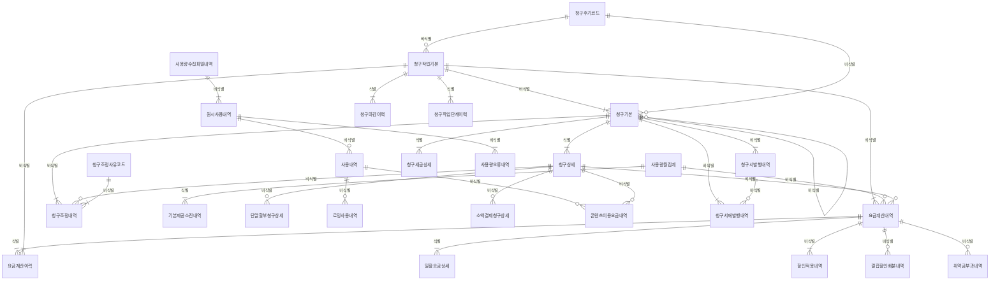

# 04. 논리 모델 — PAY 청구

> 작성 2026-11-07 · subagent_logical_modeler(작성) · masteragent_da_coordinator 03 논리 관문 재생성 · 정본 `model/logical/PAY.json` — 이 문서는 JSON 에서 생성(손수정 금지)
> 엔터티 30(핵심 10 · 기본·일반 20 · 정산 STL 3) · 속성 333 · 관계 59 · 관문 리뷰 `reviews/03_logical.md`

## 1. 엔터티 목록

| ID | 엔터티 | 물리명 | 테이블명(미리보기) | 유형 | 단계 | 모듈 | PK | 속성 수 | 설명 |
|---|---|---|---|---|---|---|---|---|---|
| PAY-001 | 원시사용내역 | `RAW_USE_DTLS` | `PTL_PAY_RAW_USE_L` | ACT | CNCP |  | 원시사용번호 | 15 | 교환기(MSC·IMS)·PGW/SMF·SMSC 가 만든 원시 사용기록(CDR)을 중계(Mediation)로 수집한 원본 1건. Rating 전 상태와 처리 결과(정상·오류·중복·보류)를 가진다. |
| PAY-002 | 사용내역 | `USE_DTLS` | `PTL_PAY_USE_L` | ACT | CNCP |  | 사용번호 | 18 | 원시사용내역을 Rating(요금항목 결정·요율 적용·기본제공량 차감)한 과금 단위 사용 기록. 음성·데이터·문자·영상·로밍·콘텐츠 사용을 모두 담는 초대용량(T4) 엔터티 — 일 RANGE 파티션 후보. |
| PAY-003 | 사용량월집계 | `USE_QTY_MM_AGG` | `PTL_PAY_USE_QTY_MM_T` | PROC | CNCP |  | 서비스관리번호 + 청구년월 + 사용서비스유형코드 | 12 | 회선×청구년월×사용서비스유형 단위로 사용내역을 집계한 가공 엔터티. 요금계산(사용료·초과량)·기본제공 소진 판정·레이크 피처의 기준점. |
| PAY-004 | 요금계산내역 | `CHRG_CALC_DTLS` | `PTL_PAY_CHRG_CALC_L` | ACT | CNCP |  | 요금계산번호 | 18 | 청구작업(Bill Run)에서 회선(가입상품)×청구년월×요금항목 단위로 계산한 요금 결과(월정액·일할·사용료·할인·위약금·할부금). 청구상세 라인의 근거. |
| PAY-005 | 청구주기코드 | `BILL_CYCL_CD` | `PTL_PAY_BILL_CYCL_C` | REF | CNCP |  | 청구주기코드 | 10 | 사용기간 마감일·청구서 발행일·납부기한일을 정하는 청구주기 기준(예 1일~말일 사용, 익월 7일 발행, 익월 25일 납기). 적용 기간을 가진 이력형 기준. |
| PAY-006 | 청구작업기본 | `BILL_JOB_BAS` | `PTL_PAY_BILL_JOB_M` | ACT | CNCP |  | 청구작업번호 | 13 | 청구년월×청구주기 단위로 요금계산·청구서 생성·마감을 수행하는 청구작업(Bill Run) 1회. 정기·재청구·해지즉시 청구를 구분한다. |
| PAY-007 | 청구기본 | `BILL_BAS` | `PTL_PAY_BILL_M` | ACT | CNCP |  | 청구번호 | 18 | 청구계정×청구년월 단위 청구서(재청구·해지즉시 청구는 같은 월 추가 건). 당월요금·할인·조정·부가가치세·미납이월을 합한 총청구금액과 납부기한을 가진다. 수납배분·미납의 기준(S14 핫 키 — 법인 청구계정 1개에 수천 건). |
| PAY-008 | 청구상세 | `BILL_DTL` | `PTL_PAY_BILL_D` | ACT | CNCP |  | 청구번호 + 청구상세순번 | 11 | 청구서의 요금항목 라인 — 청구서×회선×요금항목 단위 금액. 수납배분·미납이 항목 순위(할부금·부가세 등)로 이뤄지므로 라인별 금액을 가진다. |
| PAY-009 | 청구조정내역 | `BILL_ADJ_DTLS` | `PTL_PAY_BILL_ADJ_L` | ACT | CNCP |  | 청구조정번호 | 13 | 확정된 청구서·청구 라인에 대한 감액·증액·재청구·이월 조정 1건(민원 감면·오과금 정정·장애 보상 등). 감액은 음수 금액(S7), 승인 후 당월 또는 다음 청구서에 반영. |
| PAY-010 | 청구세금상세 | `BILL_TAX_DTL` | `PTL_PAY_BILL_TAX_D` | ACT | CNCP |  | 청구번호 + 과세유형코드 | 11 | 청구서의 과세 유형(과세·영세·면세)별 과세표준·세율·세액(부가가치세법). 법인 청구계정은 전자세금계산서 승인번호를 가진다. |
| PAY-011 | 사용량수집파일내역 | `USE_QTY_CLCT_FILE_DTLS` | `PTL_PAY_USE_QTY_CLCT_FILE_L` | ACT | LGCL |  | 수집파일번호 | 11 | 중계(Mediation) 시스템이 망요소에서 수집한 CDR 파일 1개(TS 32.297 파일 전송). 파일 단위 건수 대사·재수집의 기준. |
| PAY-012 | 사용량오류내역 | `USE_QTY_ERR_DTLS` | `PTL_PAY_USE_QTY_ERR_L` | ACT | LGCL |  | 사용량오류번호 | 8 | Rating 실패·보류된 CDR 1건의 오류 발생 기록(회선 미매칭·요금항목 미정의·중복 의심 등). 재처리 횟수와 결과를 관리한다. |
| PAY-013 | 사용량일집계 | `USE_QTY_DD_AGG` | `PTL_PAY_USE_QTY_DD_T` | PROC | LGCL |  | 서비스관리번호 + 사용일자 + 사용서비스유형코드 | 8 | 회선×사용일자×사용서비스유형 단위 일 사용량 집계. 실시간 사용량 조회·데이터 소진 알림·이상 사용 탐지(FDS) 피처의 기준. |
| PAY-014 | 기본제공소진내역 | `BSCPRVD_EXHST_DTLS` | `PTL_PAY_BSCPRVD_EXHST_L` | ACT | LGCL |  | 서비스관리번호 + 청구년월 + 사용서비스유형코드 + 가입상품번호 | 9 | 회선×청구년월×사용서비스유형×가입상품(요금제·데이터 부가팩) 단위 기본제공량·사용량·이월량과 소진 시점. 초과요금·QoS 제한·소진 알림의 근거. |
| PAY-015 | 요금계산이력 | `CHRG_CALC_HIST` | `PTL_PAY_CHRG_CALC_H` | ACT | LGCL |  | 요금계산번호 + 요금계산이력순번 | 8 | 요금계산내역의 재계산(재Rating·소급 정정) 이력 — 계산 회차별 금액과 사유. 최초 계산도 1회차로 남긴다. |
| PAY-016 | 일할요금상세 | `DYPRT_CHRG_DTL` | `PTL_PAY_DYPRT_CHRG_D` | ACT | LGCL |  | 요금계산번호 + 일할요금상세순번 | 9 | 개통·해지·요금제 변경·정지가 있는 달의 월정액 일할 계산 구간(구간별 적용일수·일할금액). 요금계산내역 1건에 구간 여러 개. |
| PAY-017 | 할인적용내역 | `DSCNT_APLCN_DTLS` | `PTL_PAY_DSCNT_APLCN_L` | ACT | LGCL |  | 할인적용번호 | 9 | 요금계산 결과에 적용된 할인 1건(선택약정 25%·결합·복지·프로모션 등) — 할인 대상 금액·할인율·할인금액. |
| PAY-018 | 결합할인배분내역 | `CMBN_DSCNT_ALLC_DTLS` | `PTL_PAY_CMBN_DSCNT_ALLC_L` | ACT | LGCL |  | 결합할인배분번호 | 10 | 결합계약(가족·유무선 결합) 단위로 계산된 결합할인을 구성 회선에 배분한 결과 — 회선×청구년월 배분 금액·배분율. |
| PAY-019 | 위약금부과내역 | `PNLT_IMPS_DTLS` | `PTL_PAY_PNLT_IMPS_L` | ACT | LGCL |  | 위약금부과번호 | 12 | 약정 해지·요금제 하향 시 위약금(할인반환금·공시지원금 반환금) 부과 1건 — 약정 잔여일수 기준 산정 금액·감면. |
| PAY-020 | 단말할부청구상세 | `EQP_INSTL_BILL_DTL` | `PTL_PAY_EQP_INSTL_BILL_D` | ACT | LGCL |  | 단말할부계약번호 + 할부회차 | 10 | 단말 할부계약의 회차별 할부금(원금·할부이자) 청구 결과 — ORD 단말할부상세(회차 계획)와 1:1, 청구서 라인으로 반영. |
| PAY-021 | 로밍사용내역 | `ROAM_USE_DTLS` | `PTL_PAY_ROAM_USE_L` | ACT | LGCL | STL | 로밍사용번호 | 17 | 국외 로밍 사용 기록(방문망 사업자가 GSMA TAP3 파일로 보낸 사용분) — 정산통화(SDR) 금액·환율·원화 사용금액. 고객 청구 근거이자 로밍 정산(PRM) 입력. |
| PAY-022 | 소액결제청구상세 | `MCPAY_BILL_DTL` | `PTL_PAY_MCPAY_BILL_D` | ACT | LGCL | STL | 소액결제번호 | 11 | 휴대폰 소액결제(통신과금서비스) 1건과 그 청구 반영 — 결제 제공사(PG·콘텐츠제공사)·결제금액·취소. 제공사 정산(PRM) 입력. |
| PAY-023 | 콘텐츠이용요금내역 | `CNTS_UTLZ_CHRG_DTLS` | `PTL_PAY_CNTS_UTLZ_CHRG_L` | ACT | LGCL | STL | 콘텐츠이용번호 | 12 | 콘텐츠 제공사 서비스(음악·영상·게임 등) 이용료(정보이용료)를 통신요금과 함께 대신 청구하는 이용 1건. 제공사 정산(PRM) 입력. |
| PAY-024 | 청구조정사유코드 | `BILL_ADJ_RSN_CD` | `PTL_PAY_BILL_ADJ_RSN_C` | REF | LGCL |  | 청구조정사유유형코드 | 9 | 청구조정 사유 체계(민원감면·오과금정정·장애보상·재청구·이월 등)와 사유별 기본 조정유형·승인 필요 여부·한도. 공통코드 청구조정사유유형코드의 확장 기준. |
| PAY-025 | 청구마감이력 | `BILL_DDLN_HIST` | `PTL_PAY_BILL_DDLN_H` | ACT | LGCL |  | 청구작업번호 + 청구마감이력순번 | 6 | 청구작업의 청구월 마감·재오픈 이력(마감 후 민원 정정을 위한 재오픈 포함). |
| PAY-026 | 청구서발행내역 | `INVC_PBLCN_DTLS` | `PTL_PAY_INVC_PBLCN_L` | ACT | LGCL |  | 청구서발행번호 | 8 | 청구서 발송 1건(우편·이메일·모바일(MMS·앱)) — 매체·발송 결과·반송. |
| PAY-027 | 청구서재발행내역 | `INVC_RE_PBLCN_DTLS` | `PTL_PAY_INVC_RE_PBLCN_L` | ACT | LGCL |  | 청구서재발행번호 | 7 | 고객 요청·분실·반송에 따른 청구서 재발행 1건 — 원 발행 건과 재발행 매체·상태. |
| PAY-028 | 청구계정월집계 | `BILL_ACNT_MM_AGG` | `PTL_PAY_BILL_ACNT_MM_T` | PROC | LGCL |  | 청구계정번호 + 청구년월 | 12 | 청구계정×청구년월 청구·할인·조정·세금 집계 — 고객 가치·연체 예측 피처, 청구 대사의 기준점. |
| PAY-029 | 요금항목월통계 | `CHRG_ITM_MM_STATS` | `PTL_PAY_CHRG_ITM_MM_S` | PROC | LGCL |  | 요금항목코드 + 청구년월 | 9 | 요금항목×청구년월 매출 통계(청구 라인 기준) — 매출 분석·회계 대사. |
| PAY-030 | 청구작업단계이력 | `BILL_JOB_STEP_HIST` | `PTL_PAY_BILL_JOB_STEP_H` | ACT | LGCL |  | 청구작업번호 + 청구작업단계순번 | 9 | Bill Run 단계(사용량 마감·요금계산·할인·결합배분·청구서 생성·세금·마감)별 처리 시작·종료·건수·오류. |

## 2. 엔터티별 속성

속성 순서 = PK → FK → 일반(규칙 2-9). FK 표기 = `<영역>.<엔터티>.<속성>`. NULL Y = 선택. 시스템 칼럼 4개는 DDL 생성 때만 붙는다(D7).

### PAY-001 원시사용내역 `RAW_USE_DTLS` (ACT·CNCP)

교환기(MSC·IMS)·PGW/SMF·SMSC 가 만든 원시 사용기록(CDR)을 중계(Mediation)로 수집한 원본 1건. Rating 전 상태와 처리 결과(정상·오류·중복·보류)를 가진다.

| # | 속성 | 물리명 | 도메인 | PK | FK | NULL | 설명 |
|---|---|---|---|---|---|---|---|
| 1 | 원시사용번호 | RAW_USE_NO | 번호V20 | PK |  | N | 원시 사용의 번호 — 대상을 식별하거나 외부에서 부여받은 번호 |
| 2 | 수집파일번호 | CLCT_FILE_NO | 번호V20 |  | PAY.사용량수집파일내역.수집파일번호 | N | 수집 파일의 번호 — 대상을 식별하거나 외부에서 부여받은 번호 |
| 3 | 원시사용명 | RAW_USE_NM | 명V100 |  |  | N | 원시 사용 건 표시명 — 중계가 부여한 레코드 표기(레코드 유형·발신번호 등 조합, 건별 고정) |
| 4 | 사용시작일시 | USE_BGNG_DTM | 일시TS |  |  | N | 사용 시작의 일시 — 연월일 시분초까지의 시점 |
| 5 | 원시사용처리상태유형코드 | RAW_USE_PRCS_STTS_TY_CD | 코드V10 |  |  | N | 원시 사용 처리 상태의 유형 코드 — 공통코드(codes.json) |
| 6 | 서비스번호 | SVC_NO | 번호V20 |  |  | Y | 서비스의 번호 — 대상을 식별하거나 외부에서 부여받은 번호 |
| 7 | IMSI번호 | IMSI_NO | 번호V20 |  |  | Y | IMSI의 번호 — 대상을 식별하거나 외부에서 부여받은 번호 |
| 8 | 사용서비스유형코드 | USE_SVC_TY_CD | 코드V10 |  |  | N | 사용 서비스의 유형 코드 — 공통코드(codes.json) |
| 9 | 발신번호 | CLG_NO | 번호V20 |  |  | Y | 발신의 번호 — 대상을 식별하거나 외부에서 부여받은 번호 |
| 10 | 착신번호 | CLD_NO | 번호V20 |  |  | Y | 착신의 번호 — 대상을 식별하거나 외부에서 부여받은 번호 |
| 11 | 사용종료일시 | USE_END_DTM | 일시TS |  |  | Y | CDR 상 사용(통화·세션) 종료 시점 |
| 12 | 사용시간초수 | USE_HR_SCNT | 수N10 |  |  | Y | 사용 시간의 초수 — 시간의 초 수 |
| 13 | 데이터사용바이트수 | DATA_USE_BYTE_CNT | 수N18 |  |  | Y | 데이터 사용 바이트의 수 — 개수·인원 등 셀 수 있는 수 |
| 14 | 원시레코드내용 | RAW_RCRD_CN | 내용V4000 |  |  | Y | 원시 레코드의 내용 — 자유 서술 내용 |
| 15 | 수집일시 | CLCT_DTM | 일시TS |  |  | N | 수집의 일시 — 연월일 시분초까지의 시점 |

정규화 : 1NF : CDR 1건 = 1행, 반복 그룹 없음(원시레코드내용은 원문 보존용 단일 값). 2NF : 단일 PK. 3NF : (04 관문) 수집파일명·망요소유형코드는 수집파일번호 → 사용량수집파일내역 이행 종속 → 제거, 필수 명칭은 건 자신의 원시사용명으로 교체(E1 폐지). 서비스번호·IMSI번호는 CDR 원문 사실값(회선 매칭 전, 번호 재사용 S8)이라 회선에서 유도 불가 — 유지.

### PAY-002 사용내역 `USE_DTLS` (ACT·CNCP)

원시사용내역을 Rating(요금항목 결정·요율 적용·기본제공량 차감)한 과금 단위 사용 기록. 음성·데이터·문자·영상·로밍·콘텐츠 사용을 모두 담는 초대용량(T4) 엔터티 — 일 RANGE 파티션 후보.

| # | 속성 | 물리명 | 도메인 | PK | FK | NULL | 설명 |
|---|---|---|---|---|---|---|---|
| 1 | 사용번호 | USE_NO | 번호V20 | PK |  | N | 사용의 번호 — 대상을 식별하거나 외부에서 부여받은 번호 |
| 2 | 원시사용번호 | RAW_USE_NO | 번호V20 |  | PAY.원시사용내역.원시사용번호 | Y | 원시 사용의 번호 — 대상을 식별하거나 외부에서 부여받은 번호 |
| 3 | 서비스관리번호 | SVC_MGMT_NO | 번호V20 |  | ORD.회선기본.서비스관리번호 | N | 서비스 관리의 번호 — 대상을 식별하거나 외부에서 부여받은 번호 |
| 4 | 요금항목코드 | CHRG_ITM_CD | 코드V10 |  | PRD.요금항목코드.요금항목코드 | N | 요금 항목의 코드 — 업무 분류 값을 식별하는 부호, 엔터티에서는 기준 코드 집합 |
| 5 | 청구년월 | BILL_YM | 년월C6 |  |  | N | 청구의 년월 — 연월(YYYYMM) |
| 6 | 사용서비스유형코드 | USE_SVC_TY_CD | 코드V10 |  |  | N | 사용 서비스의 유형 코드 — 공통코드(codes.json) |
| 7 | 사용내역명 | USE_DTLS_NM | 명V100 |  |  | N | 사용 건 표시명 — 상세 사용내역서에 찍히는 문구(예 음성 발신 3분), Rating 시점 고정 |
| 8 | 사용시작일시 | USE_BGNG_DTM | 일시TS |  |  | N | 사용 시작의 일시 — 연월일 시분초까지의 시점 |
| 9 | 사용과금상태유형코드 | USE_RAT_STTS_TY_CD | 코드V10 |  |  | N | 사용 과금 상태의 유형 코드 — 공통코드(codes.json) |
| 10 | 사용종료일시 | USE_END_DTM | 일시TS |  |  | Y | 사용종료일시 |
| 11 | 서비스번호 | SVC_NO | 번호V20 |  |  | N | 서비스의 번호 — 대상을 식별하거나 외부에서 부여받은 번호 |
| 12 | 착신번호 | CLD_NO | 번호V20 |  |  | Y | 착신의 번호 — 대상을 식별하거나 외부에서 부여받은 번호 |
| 13 | 사용량 | USE_QTY | 수량N18 |  |  | N | 사용의 량 — 사용·과금 대상 물리량(초·바이트·건) |
| 14 | 사용단위유형코드 | USE_UNIT_TY_CD | 코드V10 |  |  | N | 사용 단위의 유형 코드 — 공통코드(codes.json) |
| 15 | 과금량 | RAT_QTY | 수량N18 |  |  | N | 과금의 량 — 사용·과금 대상 물리량(초·바이트·건) |
| 16 | 기본제공차감량 | BSCPRVD_DDCT_QTY | 수량N18 |  |  | N | 기본제공 차감의 량 — 사용·과금 대상 물리량(초·바이트·건) |
| 17 | 사용금액 | USE_AMT | 금액N15 |  |  | N | 사용의 금액 — 원화 금액(원 단위 정수) |
| 18 | 과금일시 | RAT_DTM | 일시TS |  |  | N | Rating 이 완료된 시점 |

정규화 : 1NF : 사용 1건 1행. 2NF : 단일 PK. 3NF : (04 관문) 사용서비스명은 사용서비스유형코드 이행 종속 → 제거, 필수 명칭은 사용내역명(건 자신의 표시명)으로 교체(E1 폐지). 사용시작일시·서비스번호는 원시사용번호에서 유도되는 듯 보이나 분할 과금(한 CDR → 여러 건, 구간별 시작일시)·수기 입력(원천 없음)이 있어 함수 종속 아님. (04 관문) 사용량월집계는 이 엔터티를 집계한 가공(PROC) 결과라 유도 관계 — FK·관계 제거(사용량일집계·PRM 상호접속사용집계와 같은 처리, 상세가 집계보다 먼저 생기므로 RI 역전 방지). 청구년월·사용서비스유형코드는 건의 귀속 사실로 유지.

### PAY-003 사용량월집계 `USE_QTY_MM_AGG` (PROC·CNCP)

회선×청구년월×사용서비스유형 단위로 사용내역을 집계한 가공 엔터티. 요금계산(사용료·초과량)·기본제공 소진 판정·레이크 피처의 기준점.

| # | 속성 | 물리명 | 도메인 | PK | FK | NULL | 설명 |
|---|---|---|---|---|---|---|---|
| 1 | 서비스관리번호 | SVC_MGMT_NO | 번호V20 | PK | ORD.회선기본.서비스관리번호 | N | 서비스 관리의 번호 — 대상을 식별하거나 외부에서 부여받은 번호 |
| 2 | 청구년월 | BILL_YM | 년월C6 | PK |  | N | 청구의 년월 — 연월(YYYYMM) |
| 3 | 사용서비스유형코드 | USE_SVC_TY_CD | 코드V10 | PK |  | N | 사용 서비스의 유형 코드 — 공통코드(codes.json) |
| 4 | 사용량집계명 | USE_QTY_AGG_NM | 명V100 |  |  | N | 집계 행 표시명 — 회선·월·서비스 조합 표기(집계 시점 고정) |
| 5 | 집계일시 | AGG_DTM | 일시TS |  |  | N | 집계의 일시 — 연월일 시분초까지의 시점 |
| 6 | 집계상태유형코드 | AGG_STTS_TY_CD | 코드V10 |  |  | N | 집계 상태의 유형 코드 — 공통코드(codes.json) |
| 7 | 사용건수 | USE_NOCS | 건수N10 |  |  | N | 사용의 건수 — 처리·발생 건의 수 |
| 8 | 총사용량 | TOT_USE_QTY | 수량N18 |  |  | N | 총 사용의 량 — 사용·과금 대상 물리량(초·바이트·건) |
| 9 | 총과금량 | TOT_RAT_QTY | 수량N18 |  |  | N | 집계 대상 사용내역 과금량 합계 |
| 10 | 기본제공사용량 | BSCPRVD_USE_QTY | 수량N18 |  |  | N | 기본제공 사용의 량 — 사용·과금 대상 물리량(초·바이트·건) |
| 11 | 초과사용량 | EXCS_USE_QTY | 수량N18 |  |  | N | 초과 사용의 량 — 사용·과금 대상 물리량(초·바이트·건) |
| 12 | 사용금액 | USE_AMT | 금액N15 |  |  | N | 사용의 금액 — 원화 금액(원 단위 정수) |

정규화 : 1NF 충족. 2NF : 개념 단계의 서비스번호는 서비스관리번호(+월)에만 종속 = 부분 종속 → 제거(물리 단계 반정규화 후보, 조회 키 보존 목적). (04 관문) 사용서비스명은 사용서비스유형코드(PK 일부)에만 종속 = 부분 종속 → 제거, 필수 명칭은 사용량집계명(행 전체 키 종속)으로 교체. 3NF : 초과사용량 = 총사용량 − 기본제공사용량 이 아닌 경우(데이터 이월·QoS 무제한 구간)가 있어 독립 속성으로 유지.

### PAY-004 요금계산내역 `CHRG_CALC_DTLS` (ACT·CNCP)

청구작업(Bill Run)에서 회선(가입상품)×청구년월×요금항목 단위로 계산한 요금 결과(월정액·일할·사용료·할인·위약금·할부금). 청구상세 라인의 근거.

| # | 속성 | 물리명 | 도메인 | PK | FK | NULL | 설명 |
|---|---|---|---|---|---|---|---|
| 1 | 요금계산번호 | CHRG_CALC_NO | 번호V20 | PK |  | N | 요금 계산의 번호 — 대상을 식별하거나 외부에서 부여받은 번호 |
| 2 | 청구작업번호 | BILL_JOB_NO | 번호V20 |  | PAY.청구작업기본.청구작업번호 | N | 청구 작업의 번호 — 대상을 식별하거나 외부에서 부여받은 번호 |
| 3 | 청구계정번호 | BILL_ACNT_NO | 번호V20 |  | CUS.청구계정기본.청구계정번호 | N | 청구 계정의 번호 — 대상을 식별하거나 외부에서 부여받은 번호 |
| 4 | 서비스관리번호 | SVC_MGMT_NO | 번호V20 |  | ORD.회선기본.서비스관리번호 PAY.사용량월집계.서비스관리번호 | Y | 서비스 관리의 번호 — 대상을 식별하거나 외부에서 부여받은 번호 |
| 5 | 가입상품번호 | SBSC_PROD_NO | 번호V20 |  | ORD.가입상품기본.가입상품번호 | Y | 가입 상품의 번호 — 대상을 식별하거나 외부에서 부여받은 번호 |
| 6 | 요금항목코드 | CHRG_ITM_CD | 코드V10 |  | PRD.요금항목코드.요금항목코드 | N | 요금 항목의 코드 — 업무 분류 값을 식별하는 부호, 엔터티에서는 기준 코드 집합 |
| 7 | 사용서비스유형코드 | USE_SVC_TY_CD | 코드V10 |  | PAY.사용량월집계.사용서비스유형코드 | Y | 사용 서비스의 유형 코드 — 공통코드(codes.json) |
| 8 | 청구번호 | BILL_NO | 번호V20 |  | PAY.청구상세.청구번호 | Y | 청구의 번호 — 대상을 식별하거나 외부에서 부여받은 번호 |
| 9 | 청구상세순번 | BILL_DTL_SEQ | 순번N5 |  | PAY.청구상세.청구상세순번 | Y | 청구 상세의 순번 — 부모 안의 처리·표시 순서 |
| 10 | 청구년월 | BILL_YM | 년월C6 |  | PAY.사용량월집계.청구년월 | N | 청구의 년월 — 연월(YYYYMM) |
| 11 | 요금계산명 | CHRG_CALC_NM | 명V100 |  |  | N | 요금계산 건 표시명 — 청구서 출력 문구의 근거(계산 시점 고정, 예 5G 프리미엄 월정액 일할) |
| 12 | 요금계산일시 | CHRG_CALC_DTM | 일시TS |  |  | N | 요금 계산의 일시 — 연월일 시분초까지의 시점 |
| 13 | 요금계산상태유형코드 | CHRG_CALC_STTS_TY_CD | 코드V10 |  |  | N | 요금 계산 상태의 유형 코드 — 공통코드(codes.json) |
| 14 | 요금계산유형코드 | CHRG_CALC_TY_CD | 코드V10 |  |  | N | 요금 계산의 유형 코드 — 공통코드(codes.json) |
| 15 | 계산금액 | CALC_AMT | 금액N15 |  |  | N | 계산의 금액 — 원화 금액(원 단위 정수) |
| 16 | 일할여부 | DYPRT_YN | 여부C1 |  |  | N | 일할의 여부 — 해당 여부(Y/N) |
| 17 | 적용시작일자 | APLCN_BGNG_DT | 일자C8 |  |  | N | 적용 시작의 일자 — 연월일(YYYYMMDD) |
| 18 | 적용종료일자 | APLCN_END_DT | 일자C8 |  |  | N | 적용 종료의 일자 — 연월일(YYYYMMDD) |

정규화 : 1NF : 개념 단계의 일할일수(일할 구간이 여러 개일 때 반복)를 일할요금상세로 분리. 2NF : 단일 PK. 3NF : (04 관문) 요금항목명은 요금항목코드 이행 종속 → 제거, 필수 명칭은 요금계산명(건 자신의 표시명)으로 교체. 청구계정번호는 회선→가입계약→청구계정으로 유도되는 듯하나 청구계정 변경(명의·계정 분리)이 월 중 일어나고 청구계정 단위 요금은 회선이 없어 계산 시점 귀속을 독립 사실로 유지. 서비스관리번호는 가입상품번호에서 유도 가능하나 월집계·회선 FK 구성 칼럼이고 가입상품 없는 요금(위약금·할부금)에도 필요 — 유지.

### PAY-005 청구주기코드 `BILL_CYCL_CD` (REF·CNCP)

사용기간 마감일·청구서 발행일·납부기한일을 정하는 청구주기 기준(예 1일~말일 사용, 익월 7일 발행, 익월 25일 납기). 적용 기간을 가진 이력형 기준.

| # | 속성 | 물리명 | 도메인 | PK | FK | NULL | 설명 |
|---|---|---|---|---|---|---|---|
| 1 | 청구주기코드 | BILL_CYCL_CD | 코드V10 | PK |  | N | 청구 주기의 코드 — 업무 분류 값을 식별하는 부호, 엔터티에서는 기준 코드 집합 |
| 2 | 청구주기명 | BILL_CYCL_NM | 명V100 |  |  | N | 청구 주기의 명 — 대상을 부르는 이름 |
| 3 | 청구주기등록일시 | BILL_CYCL_REG_DTM | 일시TS |  |  | N | 청구 주기 등록의 일시 — 연월일 시분초까지의 시점 |
| 4 | 청구주기상태유형코드 | BILL_CYCL_STTS_TY_CD | 코드V10 |  |  | N | 청구 주기 상태의 유형 코드 — 공통코드(codes.json) |
| 5 | 사용기간시작일 | USE_PRD_BGNG_DD | 일C2 |  |  | N | 사용 기간 시작의 일 — 월 중의 일(DD, 01~31) |
| 6 | 사용기간마감일 | USE_PRD_DDLN_DD | 일C2 |  |  | N | 사용 기간 마감의 일 — 월 중의 일(DD, 01~31) |
| 7 | 청구서발행일 | INVC_PBLCN_DD | 일C2 |  |  | N | 청구서 발행의 일 — 월 중의 일(DD, 01~31) |
| 8 | 납부기한일 | PAY_TMLMT_DD | 일C2 |  |  | N | 납부 기한의 일 — 월 중의 일(DD, 01~31) |
| 9 | 적용시작일자 | APLCN_BGNG_DT | 일자C8 |  |  | N | 적용 시작의 일자 — 연월일(YYYYMMDD) |
| 10 | 적용종료일자 | APLCN_END_DT | 일자C8 |  |  | Y | 적용 종료의 일자 — 연월일(YYYYMMDD) |

정규화 : 1NF·2NF·3NF 충족(단일 PK, 모든 일자 속성이 주기 자체의 규칙). 주기 규칙 변경은 적용시작·종료일자로 표현 — 같은 코드의 시점별 규칙이 여러 개가 되면 물리 단계에서 청구주기이력(_H) 분리 검토(현재 값 변경 빈도 극히 낮음 — 논리 단계 미분리).

### PAY-006 청구작업기본 `BILL_JOB_BAS` (ACT·CNCP)

청구년월×청구주기 단위로 요금계산·청구서 생성·마감을 수행하는 청구작업(Bill Run) 1회. 정기·재청구·해지즉시 청구를 구분한다.

| # | 속성 | 물리명 | 도메인 | PK | FK | NULL | 설명 |
|---|---|---|---|---|---|---|---|
| 1 | 청구작업번호 | BILL_JOB_NO | 번호V20 | PK |  | N | 청구 작업의 번호 — 대상을 식별하거나 외부에서 부여받은 번호 |
| 2 | 청구주기코드 | BILL_CYCL_CD | 코드V10 |  | PAY.청구주기코드.청구주기코드 | Y | 청구 주기의 코드 — 업무 분류 값을 식별하는 부호, 엔터티에서는 기준 코드 집합 |
| 3 | 청구작업명 | BILL_JOB_NM | 명V100 |  |  | N | 청구 작업의 명 — 대상을 부르는 이름 |
| 4 | 청구작업시작일시 | BILL_JOB_BGNG_DTM | 일시TS |  |  | N | 청구 작업 시작의 일시 — 연월일 시분초까지의 시점 |
| 5 | 청구작업상태유형코드 | BILL_JOB_STTS_TY_CD | 코드V10 |  |  | N | 청구 작업 상태의 유형 코드 — 공통코드(codes.json) |
| 6 | 청구년월 | BILL_YM | 년월C6 |  |  | N | 청구의 년월 — 연월(YYYYMM) |
| 7 | 청구작업유형코드 | BILL_JOB_TY_CD | 코드V10 |  |  | N | 청구 작업의 유형 코드 — 공통코드(codes.json) |
| 8 | 대상청구계정수 | TRGT_BILL_ACNT_CNT | 수N10 |  |  | N | 대상 청구 계정의 수 — 개수·인원 등 셀 수 있는 수 |
| 9 | 처리건수 | PRCS_NOCS | 건수N10 |  |  | N | 처리의 건수 — 처리·발생 건의 수 |
| 10 | 오류건수 | ERR_NOCS | 건수N10 |  |  | N | 오류의 건수 — 처리·발생 건의 수 |
| 11 | 청구총금액 | BILL_TOT_AMT | 금액N15 |  |  | N | 청구 총의 금액 — 원화 금액(원 단위 정수) |
| 12 | 청구작업종료일시 | BILL_JOB_END_DTM | 일시TS |  |  | Y | 청구 작업 종료의 일시 — 연월일 시분초까지의 시점 |
| 13 | 청구마감일시 | BILL_DDLN_DTM | 일시TS |  |  | Y | 청구 마감의 일시 — 연월일 시분초까지의 시점 |

정규화 : 1NF : 단계별 반복(시작·종료·건수)은 청구작업단계이력으로, 마감·재오픈 반복은 청구마감이력으로 분리. 2NF : 단일 PK. 3NF : 처리건수·오류건수·청구총금액은 단계이력·청구기본의 합으로 유도 가능하나 작업 종료 시 확정되는 통제 수치(대사 기준)라 유지 — 물리 단계에서 반정규화로 재분류 여부 결정(D1 메모).

### PAY-007 청구기본 `BILL_BAS` (ACT·CNCP)

청구계정×청구년월 단위 청구서(재청구·해지즉시 청구는 같은 월 추가 건). 당월요금·할인·조정·부가가치세·미납이월을 합한 총청구금액과 납부기한을 가진다. 수납배분·미납의 기준(S14 핫 키 — 법인 청구계정 1개에 수천 건).

| # | 속성 | 물리명 | 도메인 | PK | FK | NULL | 설명 |
|---|---|---|---|---|---|---|---|
| 1 | 청구번호 | BILL_NO | 번호V20 | PK |  | N | 청구의 번호 — 대상을 식별하거나 외부에서 부여받은 번호 |
| 2 | 청구계정번호 | BILL_ACNT_NO | 번호V20 |  | CUS.청구계정기본.청구계정번호 | N | 청구 계정의 번호 — 대상을 식별하거나 외부에서 부여받은 번호 |
| 3 | 청구작업번호 | BILL_JOB_NO | 번호V20 |  | PAY.청구작업기본.청구작업번호 | N | 청구 작업의 번호 — 대상을 식별하거나 외부에서 부여받은 번호 |
| 4 | 청구주기코드 | BILL_CYCL_CD | 코드V10 |  | PAY.청구주기코드.청구주기코드 | Y | 청구 주기의 코드 — 업무 분류 값을 식별하는 부호, 엔터티에서는 기준 코드 집합 |
| 5 | 원청구번호 | ORGN_BILL_NO | 번호V20 |  | PAY.청구기본.청구번호 | Y | 재청구·정정 청구서가 대체하는 원 청구서의 청구번호(역할명) |
| 6 | 청구서명 | INVC_NM | 명V100 |  |  | N | 청구서의 명 — 대상을 부르는 이름 |
| 7 | 청구확정일시 | BILL_CFMTN_DTM | 일시TS |  |  | N | 청구 확정의 일시 — 연월일 시분초까지의 시점 |
| 8 | 청구상태유형코드 | BILL_STTS_TY_CD | 코드V10 |  |  | N | 청구 상태의 유형 코드 — 공통코드(codes.json) |
| 9 | 청구유형코드 | BILL_TY_CD | 코드V10 |  |  | N | 정기·재청구·해지즉시·정정 — 공통코드(유형) |
| 10 | 청구년월 | BILL_YM | 년월C6 |  |  | N | 청구의 년월 — 연월(YYYYMM) |
| 11 | 청구서발행일자 | INVC_PBLCN_DT | 일자C8 |  |  | N | 청구서 발행의 일자 — 연월일(YYYYMMDD) |
| 12 | 납부기한일자 | PAY_TMLMT_DT | 일자C8 |  |  | N | 납부 기한의 일자 — 연월일(YYYYMMDD) |
| 13 | 당월청구금액 | THMM_BILL_AMT | 금액N15 |  |  | N | 당월 청구의 금액 — 원화 금액(원 단위 정수) |
| 14 | 할인금액 | DSCNT_AMT | 금액N15 |  |  | N | 할인의 금액 — 원화 금액(원 단위 정수) |
| 15 | 조정금액 | ADJ_AMT | 금액N15 |  |  | N | 조정의 금액 — 원화 금액(원 단위 정수) |
| 16 | 부가가치세금액 | VAT_AMT | 금액N15 |  |  | N | 부가가치세의 금액 — 원화 금액(원 단위 정수) |
| 17 | 미납이월금액 | UNPD_CYOV_AMT | 금액N15 |  |  | N | 미납 이월의 금액 — 원화 금액(원 단위 정수) |
| 18 | 총청구금액 | TOT_BILL_AMT | 금액N15 |  |  | N | 총 청구의 금액 — 원화 금액(원 단위 정수) |

정규화 : 1NF : 라인은 청구상세, 과세 유형별 세액은 청구세금상세로 분리. 2NF : 단일 PK. 3NF : 청구주기코드·청구년월은 청구작업에서 유도되는 듯하나 재청구·해지즉시 작업은 여러 주기·과거 월을 함께 처리 → 함수 종속 아님. 할인·조정·부가가치세·총청구금액은 라인 합계로 유도 가능하나 청구서에 법정 기재되는 확정 금액(사후 라인 조정이 청구서를 바꾸지 않음) — 확정 금액 스냅샷(E2)으로 유지.

### PAY-008 청구상세 `BILL_DTL` (ACT·CNCP)

청구서의 요금항목 라인 — 청구서×회선×요금항목 단위 금액. 수납배분·미납이 항목 순위(할부금·부가세 등)로 이뤄지므로 라인별 금액을 가진다.

| # | 속성 | 물리명 | 도메인 | PK | FK | NULL | 설명 |
|---|---|---|---|---|---|---|---|
| 1 | 청구번호 | BILL_NO | 번호V20 | PK | PAY.청구기본.청구번호 | N | 청구의 번호 — 대상을 식별하거나 외부에서 부여받은 번호 |
| 2 | 청구상세순번 | BILL_DTL_SEQ | 순번N5 | PK |  | N | 청구 상세의 순번 — 부모 안의 처리·표시 순서 |
| 3 | 서비스관리번호 | SVC_MGMT_NO | 번호V20 |  | ORD.회선기본.서비스관리번호 | Y | 서비스 관리의 번호 — 대상을 식별하거나 외부에서 부여받은 번호 |
| 4 | 요금항목코드 | CHRG_ITM_CD | 코드V10 |  | PRD.요금항목코드.요금항목코드 | N | 요금 항목의 코드 — 업무 분류 값을 식별하는 부호, 엔터티에서는 기준 코드 집합 |
| 5 | 청구상세명 | BILL_DTL_NM | 명V100 |  |  | N | 청구서에 인쇄된 라인 표시명 — 발행 시점 고정(요금항목명 변경과 무관) |
| 6 | 청구상세생성일시 | BILL_DTL_CRT_DTM | 일시TS |  |  | N | 청구 라인이 만들어진 시점(요금계산 결과 → 라인 확정) |
| 7 | 청구상세상태유형코드 | BILL_DTL_STTS_TY_CD | 코드V10 |  |  | N | 청구 상세 상태의 유형 코드 — 공통코드(codes.json) |
| 8 | 청구금액 | BILL_AMT | 금액N15 |  |  | N | 청구의 금액 — 원화 금액(원 단위 정수) |
| 9 | 공급가액 | SPLYAMT | 금액N15 |  |  | N | 부가가치세를 제외한 공급 대가 금액 |
| 10 | 부가가치세금액 | VAT_AMT | 금액N15 |  |  | N | 부가가치세의 금액 — 원화 금액(원 단위 정수) |
| 11 | 과세유형코드 | TXTN_TY_CD | 코드V10 |  |  | N | 과세의 유형 코드 — 공통코드(codes.json) |

정규화 : 2NF : 개념 단계의 청구확정일시·청구년월은 청구번호(PK 일부)에만 종속 = 부분 종속 → 제거, 행위 일시는 라인 자신의 청구상세생성일시로 교체(청구년월은 물리 단계 파티션 키 반정규화 후보). 3NF : 개념 단계의 수납배분우선순위는 요금항목코드 → PRD.요금항목코드 이행 종속 → 제거(수납배분 시 요금항목에서 조회, 물리 반정규화 후보). 서비스번호도 회선·시점에서 유도 → 제거(청구서 출력용 반정규화 후보). 과세유형코드는 요금항목 기본 과세와 다를 수 있음(영세율·면세 고객 적용) → 라인의 적용 값으로 유지. (04 관문) 요금항목명(요금항목코드 이행 종속) → 라인 자신의 인쇄 표시명 청구상세명으로 교체.

### PAY-009 청구조정내역 `BILL_ADJ_DTLS` (ACT·CNCP)

확정된 청구서·청구 라인에 대한 감액·증액·재청구·이월 조정 1건(민원 감면·오과금 정정·장애 보상 등). 감액은 음수 금액(S7), 승인 후 당월 또는 다음 청구서에 반영.

| # | 속성 | 물리명 | 도메인 | PK | FK | NULL | 설명 |
|---|---|---|---|---|---|---|---|
| 1 | 청구조정번호 | BILL_ADJ_NO | 번호V20 | PK |  | N | 청구 조정의 번호 — 대상을 식별하거나 외부에서 부여받은 번호 |
| 2 | 청구번호 | BILL_NO | 번호V20 |  | PAY.청구기본.청구번호 | N | 청구의 번호 — 대상을 식별하거나 외부에서 부여받은 번호 |
| 3 | 청구상세순번 | BILL_DTL_SEQ | 순번N5 |  | PAY.청구상세.청구상세순번 | Y | 청구 상세의 순번 — 부모 안의 처리·표시 순서 |
| 4 | 청구조정사유유형코드 | BILL_ADJ_RSN_TY_CD | 코드V10 |  | PAY.청구조정사유코드.청구조정사유유형코드 | N | 청구 조정 사유의 유형 코드 — 공통코드(codes.json) |
| 5 | 청구조정명 | BILL_ADJ_NM | 명V100 |  |  | N | 청구 조정의 명 — 대상을 부르는 이름 |
| 6 | 청구조정일시 | BILL_ADJ_DTM | 일시TS |  |  | N | 청구 조정의 일시 — 연월일 시분초까지의 시점 |
| 7 | 청구조정상태유형코드 | BILL_ADJ_STTS_TY_CD | 코드V10 |  |  | N | 청구 조정 상태의 유형 코드 — 공통코드(codes.json) |
| 8 | 청구조정유형코드 | BILL_ADJ_TY_CD | 코드V10 |  |  | N | 청구 조정의 유형 코드 — 공통코드(codes.json) |
| 9 | 조정금액 | ADJ_AMT | 금액N15 |  |  | N | 조정의 금액 — 원화 금액(원 단위 정수) |
| 10 | 조정부가가치세금액 | ADJ_VAT_AMT | 금액N15 |  |  | N | 조정 부가가치세의 금액 — 원화 금액(원 단위 정수) |
| 11 | 반영청구년월 | RFLT_BILL_YM | 년월C6 |  |  | Y | 반영 청구의 년월 — 연월(YYYYMM) |
| 12 | 조정승인일시 | ADJ_APRV_DTM | 일시TS |  |  | Y | 조정 승인의 일시 — 연월일 시분초까지의 시점 |
| 13 | 조정내용 | ADJ_CN | 내용V4000 |  |  | Y | 조정의 내용 — 자유 서술 내용 |

정규화 : 1NF·2NF 충족(단일 PK). 3NF : 청구조정유형코드(감액·증액·재청구·이월)는 사유코드의 기본 유형과 다르게 처리될 수 있어(같은 장애 보상이 감액 또는 다음 달 이월) 건별 사실로 유지. 반영청구년월은 반영 청구서가 생기기 전에도 정해지는 예정 값이라 별도 FK 대신 유지. 청구조정명 = 필수 명칭(조정 건 제목, 건별 입력값).

### PAY-010 청구세금상세 `BILL_TAX_DTL` (ACT·CNCP)

청구서의 과세 유형(과세·영세·면세)별 과세표준·세율·세액(부가가치세법). 법인 청구계정은 전자세금계산서 승인번호를 가진다.

| # | 속성 | 물리명 | 도메인 | PK | FK | NULL | 설명 |
|---|---|---|---|---|---|---|---|
| 1 | 청구번호 | BILL_NO | 번호V20 | PK | PAY.청구기본.청구번호 | N | 청구의 번호 — 대상을 식별하거나 외부에서 부여받은 번호 |
| 2 | 과세유형코드 | TXTN_TY_CD | 코드V10 | PK |  | N | 과세의 유형 코드 — 공통코드(codes.json) |
| 3 | 청구세금명 | BILL_TAX_NM | 명V100 |  |  | N | 청구서 세금 라인 표시명 — 발행 시점 고정(예 부가가치세 과세분) |
| 4 | 세금계산일시 | TAX_CALC_DTM | 일시TS |  |  | N | 세금 계산의 일시 — 연월일 시분초까지의 시점 |
| 5 | 청구세금상태유형코드 | BILL_TAX_STTS_TY_CD | 코드V10 |  |  | N | 청구 세금 상태의 유형 코드 — 공통코드(codes.json) |
| 6 | 과세표준금액 | TXSTD_AMT | 금액N15 |  |  | N | 과세표준의 금액 — 원화 금액(원 단위 정수) |
| 7 | 세율 | TXRT | 율N5_2 |  |  | N | 과세표준에 적용하는 세금 비율 |
| 8 | 세액 | TXAMT | 금액N15 |  |  | N | 과세표준에 세율을 곱한 세금 금액 |
| 9 | 면세금액 | TXEMP_AMT | 금액N15 |  |  | N | 면세의 금액 — 원화 금액(원 단위 정수) |
| 10 | 세금계산서발행여부 | TXINV_PBLCN_YN | 여부C1 |  |  | N | 세금계산서 발행의 여부 — 해당 여부(Y/N) |
| 11 | 전자세금계산서승인번호 | ELCTR_TXINV_APRV_NO | 번호V30 |  |  | Y | 전자 세금계산서 승인의 번호 — 대상을 식별하거나 외부에서 부여받은 번호 |

정규화 : 1NF : 과세 유형별 반복을 행으로(청구서당 1~3행). 2NF : (04 관문) 세금명은 과세유형코드(PK 일부)에만 종속 = 부분 종속 → 제거, 청구세금명(행 전체 키의 인쇄 표시명)으로 교체. 세금계산서발행여부·전자세금계산서승인번호는 청구서 단위 사실이지만 과세·영세 행마다 별도 계산서가 발행되는 법인 실무(영세율 세금계산서 분리)가 있어 (청구번호, 과세유형코드) 전체 종속으로 판단. 3NF : 세율은 과세유형에서 유도되는 듯하나 세법 개정 시점 세율을 보존해야 하므로 계산 당시 값 유지.

### PAY-011 사용량수집파일내역 `USE_QTY_CLCT_FILE_DTLS` (ACT·LGCL)

중계(Mediation) 시스템이 망요소에서 수집한 CDR 파일 1개(TS 32.297 파일 전송). 파일 단위 건수 대사·재수집의 기준.

| # | 속성 | 물리명 | 도메인 | PK | FK | NULL | 설명 |
|---|---|---|---|---|---|---|---|
| 1 | 수집파일번호 | CLCT_FILE_NO | 번호V20 | PK |  | N | 수집 파일의 번호 — 대상을 식별하거나 외부에서 부여받은 번호 |
| 2 | 수집파일명 | CLCT_FILE_NM | 명V100 |  |  | N | 수집 파일의 명 — 대상을 부르는 이름 |
| 3 | 망요소유형코드 | NTWK_ELMT_TY_CD | 코드V10 |  |  | N | 망 요소의 유형 코드 — 공통코드(codes.json) |
| 4 | 파일생성일시 | FILE_CRT_DTM | 일시TS |  |  | N | 망요소가 CDR 파일을 닫은(생성한) 시점 |
| 5 | 수집일시 | CLCT_DTM | 일시TS |  |  | N | 수집의 일시 — 연월일 시분초까지의 시점 |
| 6 | 수집파일처리상태유형코드 | CLCT_FILE_PRCS_STTS_TY_CD | 코드V10 |  |  | N | 수집·검증·Rating완료·오류·재수집 — 공통코드(유형) |
| 7 | 레코드건수 | RCRD_NOCS | 건수N10 |  |  | N | 파일에 담긴 CDR 레코드 수 |
| 8 | 정상건수 | NRML_NOCS | 건수N10 |  |  | N | 정상 처리된 레코드 수 |
| 9 | 오류건수 | ERR_NOCS | 건수N10 |  |  | N | 오류의 건수 — 처리·발생 건의 수 |
| 10 | 중복건수 | DUP_NOCS | 건수N10 |  |  | N | 중복으로 판정된 레코드 수 |
| 11 | 처리완료일시 | PRCS_CMPTN_DTM | 일시TS |  |  | Y | 파일 내 레코드 처리가 끝난 시점 |

정규화 : 1NF·2NF·3NF 충족. 건수 3종은 원시사용내역 상태별 건수로 유도 가능하나 망요소 헤더 건수와의 대사 값(수집 시점 확정)이라 유지.

### PAY-012 사용량오류내역 `USE_QTY_ERR_DTLS` (ACT·LGCL)

Rating 실패·보류된 CDR 1건의 오류 발생 기록(회선 미매칭·요금항목 미정의·중복 의심 등). 재처리 횟수와 결과를 관리한다.

| # | 속성 | 물리명 | 도메인 | PK | FK | NULL | 설명 |
|---|---|---|---|---|---|---|---|
| 1 | 사용량오류번호 | USE_QTY_ERR_NO | 번호V20 | PK |  | N | 사용량 오류 1건을 식별하는 번호 |
| 2 | 원시사용번호 | RAW_USE_NO | 번호V20 |  | PAY.원시사용내역.원시사용번호 | N | 원시 사용의 번호 — 대상을 식별하거나 외부에서 부여받은 번호 |
| 3 | 사용량오류유형코드 | USE_QTY_ERR_TY_CD | 코드V10 |  |  | N | 회선미매칭·요금항목미정의·형식오류·중복의심·한도초과 — 공통코드(유형) |
| 4 | 오류발생일시 | ERR_OCRN_DTM | 일시TS |  |  | N | Rating 오류가 발생한 시점 |
| 5 | 오류처리상태유형코드 | ERR_PRCS_STTS_TY_CD | 코드V10 |  |  | N | 미처리·재처리중·재처리완료·폐기 — 공통코드(유형) |
| 6 | 재처리횟수 | RE_PRCS_NMTM | 수N10 |  |  | N | 오류 건을 재처리한 횟수 |
| 7 | 최종재처리일시 | LAST_RE_PRCS_DTM | 일시TS |  |  | Y | 마지막으로 재처리한 시점 |
| 8 | 오류내용 | ERR_CN | 내용V4000 |  |  | Y | 오류 상세 메시지 |

정규화 : 1NF·2NF 충족. 3NF : 수집파일번호는 원시사용번호 → 수집파일로 유도되므로 두지 않음(이행 종속 제거).

### PAY-013 사용량일집계 `USE_QTY_DD_AGG` (PROC·LGCL)

회선×사용일자×사용서비스유형 단위 일 사용량 집계. 실시간 사용량 조회·데이터 소진 알림·이상 사용 탐지(FDS) 피처의 기준.

| # | 속성 | 물리명 | 도메인 | PK | FK | NULL | 설명 |
|---|---|---|---|---|---|---|---|
| 1 | 서비스관리번호 | SVC_MGMT_NO | 번호V20 | PK | ORD.회선기본.서비스관리번호 | N | 서비스 관리의 번호 — 대상을 식별하거나 외부에서 부여받은 번호 |
| 2 | 사용일자 | USE_DT | 일자C8 | PK |  | N | 사용이 발생한 날짜 |
| 3 | 사용서비스유형코드 | USE_SVC_TY_CD | 코드V10 | PK |  | N | 사용 서비스의 유형 코드 — 공통코드(codes.json) |
| 4 | 집계일시 | AGG_DTM | 일시TS |  |  | N | 집계의 일시 — 연월일 시분초까지의 시점 |
| 5 | 사용건수 | USE_NOCS | 건수N10 |  |  | N | 사용의 건수 — 처리·발생 건의 수 |
| 6 | 총사용량 | TOT_USE_QTY | 수량N18 |  |  | N | 총 사용의 량 — 사용·과금 대상 물리량(초·바이트·건) |
| 7 | 총과금량 | TOT_RAT_QTY | 수량N18 |  |  | N | 총과금량 |
| 8 | 사용금액 | USE_AMT | 금액N15 |  |  | N | 사용의 금액 — 원화 금액(원 단위 정수) |

정규화 : 1NF·2NF·3NF 충족. 청구년월은 사용일자와 회선의 청구주기로 정해지는 유도 값이라 두지 않음(월집계와의 관계도 유도 관계라 FK 없음).

### PAY-014 기본제공소진내역 `BSCPRVD_EXHST_DTLS` (ACT·LGCL)

회선×청구년월×사용서비스유형×가입상품(요금제·데이터 부가팩) 단위 기본제공량·사용량·이월량과 소진 시점. 초과요금·QoS 제한·소진 알림의 근거.

| # | 속성 | 물리명 | 도메인 | PK | FK | NULL | 설명 |
|---|---|---|---|---|---|---|---|
| 1 | 서비스관리번호 | SVC_MGMT_NO | 번호V20 | PK | PAY.사용량월집계.서비스관리번호 | N | 서비스 관리의 번호 — 대상을 식별하거나 외부에서 부여받은 번호 |
| 2 | 청구년월 | BILL_YM | 년월C6 | PK | PAY.사용량월집계.청구년월 | N | 청구의 년월 — 연월(YYYYMM) |
| 3 | 사용서비스유형코드 | USE_SVC_TY_CD | 코드V10 | PK | PAY.사용량월집계.사용서비스유형코드 | N | 사용 서비스의 유형 코드 — 공통코드(codes.json) |
| 4 | 가입상품번호 | SBSC_PROD_NO | 번호V20 | PK | ORD.가입상품기본.가입상품번호 | N | 가입 상품의 번호 — 대상을 식별하거나 외부에서 부여받은 번호 |
| 5 | 기본제공량 | BSCPRVD_QTY | 수량N18 |  |  | N | 해당 가입상품이 그 달 제공하는 기본제공량(일할 반영) |
| 6 | 기본제공이월량 | BSCPRVD_CYOV_QTY | 수량N18 |  |  | N | 전월에서 이월된 기본제공량(데이터 이월) |
| 7 | 기본제공사용량 | BSCPRVD_USE_QTY | 수량N18 |  |  | N | 기본제공 사용의 량 — 사용·과금 대상 물리량(초·바이트·건) |
| 8 | 기본제공소진상태유형코드 | BSCPRVD_EXHST_STTS_TY_CD | 코드V10 |  |  | N | 여유·80%도달·소진·QoS제한 — 공통코드(유형) |
| 9 | 소진일시 | EXHST_DTM | 일시TS |  |  | Y | 소진의 일시 — 연월일 시분초까지의 시점 |

정규화 : 1NF : 제공 상품별 반복을 행으로. 2NF : 모든 속성이 4개 키 전체(상품·월·유형·회선)에 종속. 3NF : 잔여량 = 기본제공량 + 이월량 − 사용량 으로 유도 → 두지 않음(조회 성능은 물리 단계 판단). 회선↔가입상품 N:M(한 달 여러 제공 상품)을 이 엔터티가 해소.

### PAY-015 요금계산이력 `CHRG_CALC_HIST` (ACT·LGCL)

요금계산내역의 재계산(재Rating·소급 정정) 이력 — 계산 회차별 금액과 사유. 최초 계산도 1회차로 남긴다.

| # | 속성 | 물리명 | 도메인 | PK | FK | NULL | 설명 |
|---|---|---|---|---|---|---|---|
| 1 | 요금계산번호 | CHRG_CALC_NO | 번호V20 | PK | PAY.요금계산내역.요금계산번호 | N | 요금 계산의 번호 — 대상을 식별하거나 외부에서 부여받은 번호 |
| 2 | 요금계산이력순번 | CHRG_CALC_HIST_SEQ | 순번N10 | PK |  | N | 요금계산 1건 안의 계산 회차 순번 |
| 3 | 청구작업번호 | BILL_JOB_NO | 번호V20 |  | PAY.청구작업기본.청구작업번호 | N | 청구 작업의 번호 — 대상을 식별하거나 외부에서 부여받은 번호 |
| 4 | 요금계산일시 | CHRG_CALC_DTM | 일시TS |  |  | N | 요금 계산의 일시 — 연월일 시분초까지의 시점 |
| 5 | 재계산사유유형코드 | RE_CALC_RSN_TY_CD | 코드V10 |  |  | Y | 최초 계산은 NULL, 요율 정정·사용량 추가 수집·가입정보 소급·민원 — 공통코드(유형) |
| 6 | 요금계산상태유형코드 | CHRG_CALC_STTS_TY_CD | 코드V10 |  |  | N | 요금 계산 상태의 유형 코드 — 공통코드(codes.json) |
| 7 | 계산금액 | CALC_AMT | 금액N15 |  |  | N | 계산의 금액 — 원화 금액(원 단위 정수) |
| 8 | 이전계산금액 | BFR_CALC_AMT | 금액N15 |  |  | Y | 직전 회차 계산금액(최초 계산은 NULL) |

정규화 : 1NF·2NF·3NF 충족. 이전계산금액은 직전 행에서 유도 가능하지만 이력 행 단독 해석(레이크 SCD)을 위해 남기는 전후값 — 이력 엔터티 관행.

### PAY-016 일할요금상세 `DYPRT_CHRG_DTL` (ACT·LGCL)

개통·해지·요금제 변경·정지가 있는 달의 월정액 일할 계산 구간(구간별 적용일수·일할금액). 요금계산내역 1건에 구간 여러 개.

| # | 속성 | 물리명 | 도메인 | PK | FK | NULL | 설명 |
|---|---|---|---|---|---|---|---|
| 1 | 요금계산번호 | CHRG_CALC_NO | 번호V20 | PK | PAY.요금계산내역.요금계산번호 | N | 요금 계산의 번호 — 대상을 식별하거나 외부에서 부여받은 번호 |
| 2 | 일할요금상세순번 | DYPRT_CHRG_DTL_SEQ | 순번N5 | PK |  | N | 요금계산 1건 안의 일할 구간 순번 |
| 3 | 일할사유유형코드 | DYPRT_RSN_TY_CD | 코드V10 |  |  | N | 개통·해지·요금제변경·일시정지·명의변경 — 공통코드(유형) |
| 4 | 적용시작일자 | APLCN_BGNG_DT | 일자C8 |  |  | N | 적용 시작의 일자 — 연월일(YYYYMMDD) |
| 5 | 적용종료일자 | APLCN_END_DT | 일자C8 |  |  | N | 적용 종료의 일자 — 연월일(YYYYMMDD) |
| 6 | 일할일수 | DYPRT_DCNT | 일수N3 |  |  | N | 일할의 일수 — 기간의 일 수 |
| 7 | 월일수 | MM_DCNT | 일수N3 |  |  | N | 해당 월의 전체 일수(일할 분모) |
| 8 | 월정액금액 | MM_FXAMT_AMT | 금액N15 |  |  | N | 월 정액의 금액 — 원화 금액(원 단위 정수) |
| 9 | 일할금액 | DYPRT_AMT | 금액N15 |  |  | N | 월정액 × 일할일수 ÷ 월일수(원 미만 절사) |

정규화 : 1NF : 개념 단계 요금계산내역의 일할일수 반복을 구간 행으로 분리. 2NF 충족. 3NF : 일할금액은 월정액·일수로 유도되나 절사·최소 과금 규칙 적용 결과(청구 근거)라 유지. 월일수는 적용 월에서 유도되나 2월·윤년 계산 근거 보존용 — 일할금액 검증 근거로 유지.

### PAY-017 할인적용내역 `DSCNT_APLCN_DTLS` (ACT·LGCL)

요금계산 결과에 적용된 할인 1건(선택약정 25%·결합·복지·프로모션 등) — 할인 대상 금액·할인율·할인금액.

| # | 속성 | 물리명 | 도메인 | PK | FK | NULL | 설명 |
|---|---|---|---|---|---|---|---|
| 1 | 할인적용번호 | DSCNT_APLCN_NO | 번호V20 | PK |  | N | 할인 적용 1건을 식별하는 번호 |
| 2 | 요금계산번호 | CHRG_CALC_NO | 번호V20 |  | PAY.요금계산내역.요금계산번호 | N | 요금 계산의 번호 — 대상을 식별하거나 외부에서 부여받은 번호 |
| 3 | 상품코드 | PROD_CD | 코드V20 |  | PRD.할인상품기본.상품코드 | N | 상품의 코드 — 업무 분류 값을 식별하는 부호, 엔터티에서는 기준 코드 집합 |
| 4 | 가입상품번호 | SBSC_PROD_NO | 번호V20 |  | ORD.가입상품기본.가입상품번호 | Y | 가입 상품의 번호 — 대상을 식별하거나 외부에서 부여받은 번호 |
| 5 | 할인적용일시 | DSCNT_APLCN_DTM | 일시TS |  |  | N | 할인이 계산·적용된 시점 |
| 6 | 할인적용상태유형코드 | DSCNT_APLCN_STTS_TY_CD | 코드V10 |  |  | N | 적용·취소·소급정정 — 공통코드(유형) |
| 7 | 할인대상금액 | DSCNT_TRGT_AMT | 금액N15 |  |  | N | 할인율을 곱하는 기준 금액 |
| 8 | 할인율 | DSCNT_RT | 율N5_2 |  |  | Y | 할인의 율 — 비율(백분율, 소수 2자리) |
| 9 | 할인금액 | DSCNT_AMT | 금액N15 |  |  | N | 할인의 금액 — 원화 금액(원 단위 정수) |

정규화 : 1NF·2NF 충족. 3NF : 서비스관리번호·청구년월은 요금계산번호로 유도 → 두지 않음. 상품코드는 가입상품번호에서 유도되나 가입상품이 없는 자동 적용 할인이 있어 독립 FK 로 유지. 요금계산내역 ↔ 할인상품 N:M 을 이 엔터티가 해소.

### PAY-018 결합할인배분내역 `CMBN_DSCNT_ALLC_DTLS` (ACT·LGCL)

결합계약(가족·유무선 결합) 단위로 계산된 결합할인을 구성 회선에 배분한 결과 — 회선×청구년월 배분 금액·배분율.

| # | 속성 | 물리명 | 도메인 | PK | FK | NULL | 설명 |
|---|---|---|---|---|---|---|---|
| 1 | 결합할인배분번호 | CMBN_DSCNT_ALLC_NO | 번호V20 | PK |  | N | 결합할인 배분 1건을 식별하는 번호 |
| 2 | 결합계약번호 | CMBN_CTRT_NO | 번호V20 |  | ORD.결합계약기본.결합계약번호 | N | 결합 계약의 번호 — 대상을 식별하거나 외부에서 부여받은 번호 |
| 3 | 서비스관리번호 | SVC_MGMT_NO | 번호V20 |  | ORD.회선기본.서비스관리번호 | N | 서비스 관리의 번호 — 대상을 식별하거나 외부에서 부여받은 번호 |
| 4 | 요금계산번호 | CHRG_CALC_NO | 번호V20 |  | PAY.요금계산내역.요금계산번호 | Y | 요금 계산의 번호 — 대상을 식별하거나 외부에서 부여받은 번호 |
| 5 | 청구년월 | BILL_YM | 년월C6 |  |  | N | 청구의 년월 — 연월(YYYYMM) |
| 6 | 결합할인배분일시 | CMBN_DSCNT_ALLC_DTM | 일시TS |  |  | N | 배분을 계산한 시점 |
| 7 | 결합할인배분상태유형코드 | CMBN_DSCNT_ALLC_STTS_TY_CD | 코드V10 |  |  | N | 배분·반영·취소·재배분 — 공통코드(유형) |
| 8 | 배분기준유형코드 | ALLC_STD_TY_CD | 코드V10 |  |  | N | 균등·회선요금비례·대표회선몰아주기 — 공통코드(유형) |
| 9 | 배분율 | ALLC_RT | 율N5_2 |  |  | N | 결합할인 총액 중 이 회선 배분 비율 |
| 10 | 배분금액 | ALLC_AMT | 금액N15 |  |  | N | 배분의 금액 — 원화 금액(원 단위 정수) |

정규화 : 1NF·2NF 충족. 3NF : 결합할인 총금액은 (결합계약, 청구년월)에 종속 = 비키 결정자 → 두지 않음(배분금액 합으로 유도). 결합계약 ↔ 회선 월별 배분 N:M 해소 엔터티.

### PAY-019 위약금부과내역 `PNLT_IMPS_DTLS` (ACT·LGCL)

약정 해지·요금제 하향 시 위약금(할인반환금·공시지원금 반환금) 부과 1건 — 약정 잔여일수 기준 산정 금액·감면.

| # | 속성 | 물리명 | 도메인 | PK | FK | NULL | 설명 |
|---|---|---|---|---|---|---|---|
| 1 | 위약금부과번호 | PNLT_IMPS_NO | 번호V20 | PK |  | N | 위약금 부과 1건을 식별하는 번호 |
| 2 | 약정계약번호 | AGRMT_CTRT_NO | 번호V20 |  | ORD.약정계약기본.약정계약번호 | Y | 약정 계약의 번호 — 대상을 식별하거나 외부에서 부여받은 번호 |
| 3 | 서비스관리번호 | SVC_MGMT_NO | 번호V20 |  | ORD.회선기본.서비스관리번호 | N | 서비스 관리의 번호 — 대상을 식별하거나 외부에서 부여받은 번호 |
| 4 | 요금계산번호 | CHRG_CALC_NO | 번호V20 |  | PAY.요금계산내역.요금계산번호 | Y | 요금 계산의 번호 — 대상을 식별하거나 외부에서 부여받은 번호 |
| 5 | 위약금유형코드 | PNLT_TY_CD | 코드V10 |  |  | N | 선택약정할인반환금·공시지원금반환금·결합해지위약금·단말할인반환금 — 공통코드(유형) |
| 6 | 위약금부과일시 | PNLT_IMPS_DTM | 일시TS |  |  | N | 위약금을 부과한 시점 |
| 7 | 위약금부과상태유형코드 | PNLT_IMPS_STTS_TY_CD | 코드V10 |  |  | N | 부과·청구반영·감면·취소 — 공통코드(유형) |
| 8 | 약정잔여일수 | AGRMT_RMND_DCNT | 일수N5 |  |  | N | 해지 시점 남은 약정 일수 |
| 9 | 반환금액 | RTN_AMT | 금액N15 |  |  | N | 반환 대상 지원금·할인 누적 금액 |
| 10 | 부과금액 | IMPS_AMT | 금액N15 |  |  | N | 산정된 위약금 금액 |
| 11 | 감면금액 | RDCT_AMT | 금액N15 |  |  | N | 감면(군입대·사망·해외이주 등) 금액 |
| 12 | 청구년월 | BILL_YM | 년월C6 |  |  | Y | 청구의 년월 — 연월(YYYYMM) |

정규화 : 1NF·2NF 충족. 3NF : 서비스관리번호는 약정계약에서 유도 가능하나 약정 없는 위약금(결합해지)이 있어 유지. 청구년월은 요금계산번호에서 유도되나 반영 전 예정 월로 쓰여 반영 후에도 같은 값(정정 시 요금계산 쪽이 기준) — 물리 단계에서 반정규화로 재분류 검토.

### PAY-020 단말할부청구상세 `EQP_INSTL_BILL_DTL` (ACT·LGCL)

단말 할부계약의 회차별 할부금(원금·할부이자) 청구 결과 — ORD 단말할부상세(회차 계획)와 1:1, 청구서 라인으로 반영.

| # | 속성 | 물리명 | 도메인 | PK | FK | NULL | 설명 |
|---|---|---|---|---|---|---|---|
| 1 | 단말할부계약번호 | EQP_INSTL_CTRT_NO | 번호V20 | PK | ORD.단말할부상세.단말할부계약번호 | N | 단말 할부 계약의 번호 — 대상을 식별하거나 외부에서 부여받은 번호 |
| 2 | 할부회차 | INSTL_TMS | 회차N3 | PK | ORD.단말할부상세.할부회차 | N | 할부의 회차 — 분할·반복 거래의 차례 번호 |
| 3 | 청구번호 | BILL_NO | 번호V20 |  | PAY.청구상세.청구번호 | Y | 청구의 번호 — 대상을 식별하거나 외부에서 부여받은 번호 |
| 4 | 청구상세순번 | BILL_DTL_SEQ | 순번N5 |  | PAY.청구상세.청구상세순번 | Y | 청구 상세의 순번 — 부모 안의 처리·표시 순서 |
| 5 | 할부청구일시 | INSTL_BILL_DTM | 일시TS |  |  | N | 회차 할부금을 청구 처리한 시점 |
| 6 | 할부청구상태유형코드 | INSTL_BILL_STTS_TY_CD | 코드V10 |  |  | N | 청구예정·청구·일시상환·청구취소 — 공통코드(유형) |
| 7 | 청구년월 | BILL_YM | 년월C6 |  |  | N | 청구의 년월 — 연월(YYYYMM) |
| 8 | 할부원금 | INSTL_PRNC | 금액N15 |  |  | N | 할부의 원금 — 이자를 제외한 원래 금액 |
| 9 | 할부이자금액 | INSTL_INTR_AMT | 금액N15 |  |  | N | 회차 할부이자(할부수수료) 금액 |
| 10 | 할부잔여원금 | INSTL_RMND_PRNC | 금액N15 |  |  | N | 할부 잔여의 원금 — 이자를 제외한 원래 금액 |

정규화 : 1NF·2NF 충족. 3NF : 서비스관리번호는 할부계약에서 유도 → 두지 않음. 할부원금·할부잔여원금은 ORD 회차 계획 값과 같을 수 있으나 조기상환·이자율 변경 시 실제 청구 값이 달라 청구 사실로 유지.

### PAY-021 로밍사용내역 `ROAM_USE_DTLS` (ACT·LGCL·STL)

국외 로밍 사용 기록(방문망 사업자가 GSMA TAP3 파일로 보낸 사용분) — 정산통화(SDR) 금액·환율·원화 사용금액. 고객 청구 근거이자 로밍 정산(PRM) 입력.

| # | 속성 | 물리명 | 도메인 | PK | FK | NULL | 설명 |
|---|---|---|---|---|---|---|---|
| 1 | 로밍사용번호 | ROAM_USE_NO | 번호V20 | PK |  | N | 로밍 사용 1건을 식별하는 번호 |
| 2 | 로밍사업자번호 | ROAM_BZMN_NO | 번호V20 |  | PRM.로밍사업자기본.로밍사업자번호 | N | 로밍 사업자의 번호 — 대상을 식별하거나 외부에서 부여받은 번호 |
| 3 | 서비스관리번호 | SVC_MGMT_NO | 번호V20 |  | ORD.회선기본.서비스관리번호 | N | 서비스 관리의 번호 — 대상을 식별하거나 외부에서 부여받은 번호 |
| 4 | 사용번호 | USE_NO | 번호V20 |  | PAY.사용내역.사용번호 | Y | 사용의 번호 — 대상을 식별하거나 외부에서 부여받은 번호 |
| 5 | TAP파일명 | TAP_FILE_NM | 명V200 |  |  | N | 수신한 TAP3 파일명 |
| 6 | TAP수신일시 | TAP_RCPTN_DTM | 일시TS |  |  | N | TAP 파일을 수신한 시점 |
| 7 | 사용시작일시 | USE_BGNG_DTM | 일시TS |  |  | N | 사용 시작의 일시 — 연월일 시분초까지의 시점 |
| 8 | 로밍사용상태유형코드 | ROAM_USE_STTS_TY_CD | 코드V10 |  |  | N | 수신·검증·과금·RAP반송·정산확정 — 공통코드(유형) |
| 9 | 로밍방향구분코드 | ROAM_DRCT_SE_CD | 코드V10 |  |  | N | 로밍 방향의 구분 코드 — 공통코드(codes.json) |
| 10 | 사용서비스유형코드 | USE_SVC_TY_CD | 코드V10 |  |  | N | 사용 서비스의 유형 코드 — 공통코드(codes.json) |
| 11 | 사용량 | USE_QTY | 수량N18 |  |  | N | 사용의 량 — 사용·과금 대상 물리량(초·바이트·건) |
| 12 | 사용단위유형코드 | USE_UNIT_TY_CD | 코드V10 |  |  | N | 사용 단위의 유형 코드 — 공통코드(codes.json) |
| 13 | 정산통화코드 | STLM_CRNCY_CD | 코드V10 |  |  | N | 정산 통화 코드 — 외부 표준 ISO 4217 값을 그대로 쓴다(공통코드 아님) |
| 14 | 정산통화금액 | STLM_CRNCY_AMT | 금액N18_4 |  |  | N | 정산통화(SDR 등) 기준 사용 금액 — 소수 정밀도는 물리 단계 지정(SDR 소수 3자리) |
| 15 | 적용환율 | APLCN_EXRT | 환율N15_4 |  |  | N | 정산통화 → 원화 환산에 적용한 환율 |
| 16 | 사용금액 | USE_AMT | 금액N15 |  |  | N | 사용의 금액 — 원화 금액(원 단위 정수) |
| 17 | 청구년월 | BILL_YM | 년월C6 |  |  | N | 청구의 년월 — 연월(YYYYMM) |

정규화 : 1NF·2NF 충족. 3NF : 국가코드·TADIG코드는 로밍사업자에서 유도 → 두지 않음. 사용금액 = 정산통화금액 × 적용환율 + 로밍 요율 마크업이라 단순 유도 아님 — 유지. 정산통화금액 = 금액N18_4, 적용환율 = 환율N15_4(04 관문 표준 도메인 추가, 결정 메모 M5).

### PAY-022 소액결제청구상세 `MCPAY_BILL_DTL` (ACT·LGCL·STL)

휴대폰 소액결제(통신과금서비스) 1건과 그 청구 반영 — 결제 제공사(PG·콘텐츠제공사)·결제금액·취소. 제공사 정산(PRM) 입력.

| # | 속성 | 물리명 | 도메인 | PK | FK | NULL | 설명 |
|---|---|---|---|---|---|---|---|
| 1 | 소액결제번호 | MCPAY_NO | 번호V20 | PK |  | N | 소액결제 1건을 식별하는 번호 |
| 2 | 콘텐츠제공사번호 | CNTS_PRVD_CO_NO | 번호V20 |  | PRM.콘텐츠제공사기본.콘텐츠제공사번호 | N | 콘텐츠 제공 사의 번호 — 대상을 식별하거나 외부에서 부여받은 번호 |
| 3 | 서비스관리번호 | SVC_MGMT_NO | 번호V20 |  | ORD.회선기본.서비스관리번호 | N | 서비스 관리의 번호 — 대상을 식별하거나 외부에서 부여받은 번호 |
| 4 | 청구번호 | BILL_NO | 번호V20 |  | PAY.청구상세.청구번호 | Y | 청구의 번호 — 대상을 식별하거나 외부에서 부여받은 번호 |
| 5 | 청구상세순번 | BILL_DTL_SEQ | 순번N5 |  | PAY.청구상세.청구상세순번 | Y | 청구 상세의 순번 — 부모 안의 처리·표시 순서 |
| 6 | 결제상품명 | PYMT_PROD_NM | 명V200 |  |  | N | 결제한 상품·서비스 이름(가맹점 전달 값, 표기 흔들림 S13) |
| 7 | 결제일시 | PYMT_DTM | 일시TS |  |  | N | 소액결제 승인 시점 |
| 8 | 소액결제상태유형코드 | MCPAY_STTS_TY_CD | 코드V10 |  |  | N | 승인·취소·청구·정산확정·부분취소 — 공통코드(유형) |
| 9 | 결제금액 | PYMT_AMT | 금액N15 |  |  | N | 승인 금액 |
| 10 | 결제취소일시 | PYMT_CNCL_DTM | 일시TS |  |  | Y | 결제를 취소한 시점 |
| 11 | 청구년월 | BILL_YM | 년월C6 |  |  | N | 청구의 년월 — 연월(YYYYMM) |

정규화 : 1NF·2NF·3NF 충족. 청구년월은 청구상세(청구번호)에서 유도 가능하나 청구 전(승인 당월 귀속 예정)에도 필요한 귀속 월 — 반영 후 일치, 물리 단계 재검토.

### PAY-023 콘텐츠이용요금내역 `CNTS_UTLZ_CHRG_DTLS` (ACT·LGCL·STL)

콘텐츠 제공사 서비스(음악·영상·게임 등) 이용료(정보이용료)를 통신요금과 함께 대신 청구하는 이용 1건. 제공사 정산(PRM) 입력.

| # | 속성 | 물리명 | 도메인 | PK | FK | NULL | 설명 |
|---|---|---|---|---|---|---|---|
| 1 | 콘텐츠이용번호 | CNTS_UTLZ_NO | 번호V20 | PK |  | N | 콘텐츠 이용 1건을 식별하는 번호 |
| 2 | 콘텐츠제공사번호 | CNTS_PRVD_CO_NO | 번호V20 |  | PRM.콘텐츠제공사기본.콘텐츠제공사번호 | N | 콘텐츠 제공 사의 번호 — 대상을 식별하거나 외부에서 부여받은 번호 |
| 3 | 서비스관리번호 | SVC_MGMT_NO | 번호V20 |  | ORD.회선기본.서비스관리번호 | N | 서비스 관리의 번호 — 대상을 식별하거나 외부에서 부여받은 번호 |
| 4 | 사용번호 | USE_NO | 번호V20 |  | PAY.사용내역.사용번호 | Y | 사용의 번호 — 대상을 식별하거나 외부에서 부여받은 번호 |
| 5 | 청구번호 | BILL_NO | 번호V20 |  | PAY.청구상세.청구번호 | Y | 청구의 번호 — 대상을 식별하거나 외부에서 부여받은 번호 |
| 6 | 청구상세순번 | BILL_DTL_SEQ | 순번N5 |  | PAY.청구상세.청구상세순번 | Y | 청구 상세의 순번 — 부모 안의 처리·표시 순서 |
| 7 | 콘텐츠명 | CNTS_NM | 명V200 |  |  | N | 이용한 콘텐츠 이름 |
| 8 | 콘텐츠이용일시 | CNTS_UTLZ_DTM | 일시TS |  |  | N | 콘텐츠를 이용(구매)한 시점 |
| 9 | 콘텐츠이용상태유형코드 | CNTS_UTLZ_STTS_TY_CD | 코드V10 |  |  | N | 이용·청구·환불·정산확정 — 공통코드(유형) |
| 10 | 콘텐츠유형코드 | CNTS_TY_CD | 코드V10 |  |  | N | 음악·영상·게임·전자책·앱 — 공통코드(유형) |
| 11 | 콘텐츠이용금액 | CNTS_UTLZ_AMT | 금액N15 |  |  | N | 정보이용료 금액 |
| 12 | 청구년월 | BILL_YM | 년월C6 |  |  | N | 청구의 년월 — 연월(YYYYMM) |

정규화 : 1NF·2NF·3NF 충족(콘텐츠 마스터는 제공사 소관 — 콘텐츠명은 이용 당시 제공사 전달 값). 청구년월 처리는 소액결제청구상세와 같음.

### PAY-024 청구조정사유코드 `BILL_ADJ_RSN_CD` (REF·LGCL)

청구조정 사유 체계(민원감면·오과금정정·장애보상·재청구·이월 등)와 사유별 기본 조정유형·승인 필요 여부·한도. 공통코드 청구조정사유유형코드의 확장 기준.

| # | 속성 | 물리명 | 도메인 | PK | FK | NULL | 설명 |
|---|---|---|---|---|---|---|---|
| 1 | 청구조정사유유형코드 | BILL_ADJ_RSN_TY_CD | 코드V10 | PK |  | N | 청구 조정 사유의 유형 코드 — 공통코드(codes.json) |
| 2 | 청구조정사유명 | BILL_ADJ_RSN_NM | 명V100 |  |  | N | 청구조정 사유 이름 |
| 3 | 청구조정사유등록일시 | BILL_ADJ_RSN_REG_DTM | 일시TS |  |  | N | 사유를 등록한 시점 |
| 4 | 청구조정사유상태유형코드 | BILL_ADJ_RSN_STTS_TY_CD | 코드V10 |  |  | N | 사용·중지·폐기 — 공통코드(유형) |
| 5 | 청구조정유형코드 | BILL_ADJ_TY_CD | 코드V10 |  |  | N | 청구 조정의 유형 코드 — 공통코드(codes.json) |
| 6 | 조정승인필요여부 | ADJ_APRV_NEED_YN | 여부C1 |  |  | N | 조정 시 승인이 필요한지 여부 |
| 7 | 조정한도금액 | ADJ_LMT_AMT | 금액N15 |  |  | Y | 승인 없이 처리 가능한 조정 한도 금액 |
| 8 | 적용시작일자 | APLCN_BGNG_DT | 일자C8 |  |  | N | 적용 시작의 일자 — 연월일(YYYYMMDD) |
| 9 | 적용종료일자 | APLCN_END_DT | 일자C8 |  |  | Y | 적용 종료의 일자 — 연월일(YYYYMMDD) |

정규화 : 1NF·2NF·3NF 충족. PK 를 공통코드 청구조정사유유형코드로 두는 이유 : 값 목록은 공통코드(codes.json)가 정본, 이 엔터티는 사유별 업무 규칙(한도·승인)만 확장 — 이름 이중 관리 방지(결정 메모 M3).

### PAY-025 청구마감이력 `BILL_DDLN_HIST` (ACT·LGCL)

청구작업의 청구월 마감·재오픈 이력(마감 후 민원 정정을 위한 재오픈 포함).

| # | 속성 | 물리명 | 도메인 | PK | FK | NULL | 설명 |
|---|---|---|---|---|---|---|---|
| 1 | 청구작업번호 | BILL_JOB_NO | 번호V20 | PK | PAY.청구작업기본.청구작업번호 | N | 청구 작업의 번호 — 대상을 식별하거나 외부에서 부여받은 번호 |
| 2 | 청구마감이력순번 | BILL_DDLN_HIST_SEQ | 순번N5 | PK |  | N | 청구작업 1건 안의 마감·재오픈 순번 |
| 3 | 청구마감유형코드 | BILL_DDLN_TY_CD | 코드V10 |  |  | N | 마감·재오픈·최종마감 — 공통코드(유형) |
| 4 | 청구마감일시 | BILL_DDLN_DTM | 일시TS |  |  | N | 청구 마감의 일시 — 연월일 시분초까지의 시점 |
| 5 | 청구마감상태유형코드 | BILL_DDLN_STTS_TY_CD | 코드V10 |  |  | N | 요청·완료·실패 — 공통코드(유형) |
| 6 | 마감사유내용 | DDLN_RSN_CN | 내용V200 |  |  | Y | 재오픈·마감 사유 설명 |

정규화 : 1NF : 청구작업기본의 마감 반복을 행으로. 2NF·3NF 충족.

### PAY-026 청구서발행내역 `INVC_PBLCN_DTLS` (ACT·LGCL)

청구서 발송 1건(우편·이메일·모바일(MMS·앱)) — 매체·발송 결과·반송.

| # | 속성 | 물리명 | 도메인 | PK | FK | NULL | 설명 |
|---|---|---|---|---|---|---|---|
| 1 | 청구서발행번호 | INVC_PBLCN_NO | 번호V20 | PK |  | N | 청구서 발행 1건을 식별하는 번호 |
| 2 | 청구번호 | BILL_NO | 번호V20 |  | PAY.청구기본.청구번호 | N | 청구의 번호 — 대상을 식별하거나 외부에서 부여받은 번호 |
| 3 | 청구서발행매체유형코드 | INVC_PBLCN_MDM_TY_CD | 코드V10 |  |  | N | 우편·이메일·MMS·앱·알림톡 — 공통코드(유형) |
| 4 | 청구서발행일시 | INVC_PBLCN_DTM | 일시TS |  |  | N | 발송을 요청한 시점 |
| 5 | 청구서발행상태유형코드 | INVC_PBLCN_STTS_TY_CD | 코드V10 |  |  | N | 요청·발송·성공·반송·실패 — 공통코드(유형) |
| 6 | 수신주소암호화값 | RCPTN_ADDR_ENCPT_VL | 값V256 |  |  | Y | 발송 대상 주소·이메일·전화번호의 암호화 값(D11 — 평문 금지) |
| 7 | 발송완료일시 | SNDNG_CMPTN_DTM | 일시TS |  |  | Y | 발송이 완료(도달 확인)된 시점 |
| 8 | 반송사유유형코드 | RTRN_RSN_TY_CD | 코드V10 |  |  | Y | 수취인불명·주소불명·메일함초과·수신거부 — 공통코드(유형) |

정규화 : 1NF : 매체별 반복을 행으로. 2NF·3NF 충족. 수신주소는 발송 당시 값(고객 연락처 변경과 무관한 사실) — 고객주소상세에서 유도 아님.

### PAY-027 청구서재발행내역 `INVC_RE_PBLCN_DTLS` (ACT·LGCL)

고객 요청·분실·반송에 따른 청구서 재발행 1건 — 원 발행 건과 재발행 매체·상태.

| # | 속성 | 물리명 | 도메인 | PK | FK | NULL | 설명 |
|---|---|---|---|---|---|---|---|
| 1 | 청구서재발행번호 | INVC_RE_PBLCN_NO | 번호V20 | PK |  | N | 청구서 재발행 1건을 식별하는 번호 |
| 2 | 청구번호 | BILL_NO | 번호V20 |  | PAY.청구기본.청구번호 | N | 청구의 번호 — 대상을 식별하거나 외부에서 부여받은 번호 |
| 3 | 청구서발행번호 | INVC_PBLCN_NO | 번호V20 |  | PAY.청구서발행내역.청구서발행번호 | Y | 청구서발행번호 |
| 4 | 재발행사유유형코드 | RE_PBLCN_RSN_TY_CD | 코드V10 |  |  | N | 분실·반송·고객요청·내용정정 — 공통코드(유형) |
| 5 | 재발행요청일시 | RE_PBLCN_REQ_DTM | 일시TS |  |  | N | 재발행을 요청받은 시점 |
| 6 | 재발행상태유형코드 | RE_PBLCN_STTS_TY_CD | 코드V10 |  |  | N | 접수·발송·완료·취소 — 공통코드(유형) |
| 7 | 청구서발행매체유형코드 | INVC_PBLCN_MDM_TY_CD | 코드V10 |  |  | N | 청구서발행매체유형코드 |

정규화 : 1NF·2NF 충족. 3NF : 청구번호는 청구서발행번호에서 유도되나 원 발행 건 없는 재발행(창구 출력)이 있어 유지.

### PAY-028 청구계정월집계 `BILL_ACNT_MM_AGG` (PROC·LGCL)

청구계정×청구년월 청구·할인·조정·세금 집계 — 고객 가치·연체 예측 피처, 청구 대사의 기준점.

| # | 속성 | 물리명 | 도메인 | PK | FK | NULL | 설명 |
|---|---|---|---|---|---|---|---|
| 1 | 청구계정번호 | BILL_ACNT_NO | 번호V20 | PK | CUS.청구계정기본.청구계정번호 | N | 청구 계정의 번호 — 대상을 식별하거나 외부에서 부여받은 번호 |
| 2 | 청구년월 | BILL_YM | 년월C6 | PK |  | N | 청구의 년월 — 연월(YYYYMM) |
| 3 | 집계일시 | AGG_DTM | 일시TS |  |  | N | 집계의 일시 — 연월일 시분초까지의 시점 |
| 4 | 집계상태유형코드 | AGG_STTS_TY_CD | 코드V10 |  |  | N | 집계 상태의 유형 코드 — 공통코드(codes.json) |
| 5 | 청구건수 | BILL_NOCS | 건수N10 |  |  | N | 청구계정의 해당 월 청구서 건수 |
| 6 | 회선수 | LINE_CNT | 수N10 |  |  | N | 해당 월 청구 대상 회선 수 |
| 7 | 당월청구금액 | THMM_BILL_AMT | 금액N15 |  |  | N | 당월 청구의 금액 — 원화 금액(원 단위 정수) |
| 8 | 할인금액 | DSCNT_AMT | 금액N15 |  |  | N | 할인의 금액 — 원화 금액(원 단위 정수) |
| 9 | 조정금액 | ADJ_AMT | 금액N15 |  |  | N | 조정의 금액 — 원화 금액(원 단위 정수) |
| 10 | 부가가치세금액 | VAT_AMT | 금액N15 |  |  | N | 부가가치세의 금액 — 원화 금액(원 단위 정수) |
| 11 | 미납이월금액 | UNPD_CYOV_AMT | 금액N15 |  |  | N | 미납 이월의 금액 — 원화 금액(원 단위 정수) |
| 12 | 총청구금액 | TOT_BILL_AMT | 금액N15 |  |  | N | 총 청구의 금액 — 원화 금액(원 단위 정수) |

정규화 : 가공(PROC) 엔터티 — 원천(청구기본)의 합계라 유도 값 자체가 목적(재계산 기준점). 키 기준 1·2·3NF 충족.

### PAY-029 요금항목월통계 `CHRG_ITM_MM_STATS` (PROC·LGCL)

요금항목×청구년월 매출 통계(청구 라인 기준) — 매출 분석·회계 대사.

| # | 속성 | 물리명 | 도메인 | PK | FK | NULL | 설명 |
|---|---|---|---|---|---|---|---|
| 1 | 요금항목코드 | CHRG_ITM_CD | 코드V10 | PK | PRD.요금항목코드.요금항목코드 | N | 요금 항목의 코드 — 업무 분류 값을 식별하는 부호, 엔터티에서는 기준 코드 집합 |
| 2 | 청구년월 | BILL_YM | 년월C6 | PK |  | N | 청구의 년월 — 연월(YYYYMM) |
| 3 | 집계일시 | AGG_DTM | 일시TS |  |  | N | 집계의 일시 — 연월일 시분초까지의 시점 |
| 4 | 청구건수 | BILL_NOCS | 건수N10 |  |  | N | 청구건수 |
| 5 | 회선수 | LINE_CNT | 수N10 |  |  | N | 회선수 |
| 6 | 청구금액 | BILL_AMT | 금액N15 |  |  | N | 청구의 금액 — 원화 금액(원 단위 정수) |
| 7 | 공급가액 | SPLYAMT | 금액N15 |  |  | N | 부가가치세를 제외한 공급 대가 금액 |
| 8 | 부가가치세금액 | VAT_AMT | 금액N15 |  |  | N | 부가가치세의 금액 — 원화 금액(원 단위 정수) |
| 9 | 조정금액 | ADJ_AMT | 금액N15 |  |  | N | 조정의 금액 — 원화 금액(원 단위 정수) |

정규화 : 가공(PROC) — 키 기준 1·2·3NF 충족. 요금항목명은 PRD 에서 조회(넣지 않음).

### PAY-030 청구작업단계이력 `BILL_JOB_STEP_HIST` (ACT·LGCL)

Bill Run 단계(사용량 마감·요금계산·할인·결합배분·청구서 생성·세금·마감)별 처리 시작·종료·건수·오류.

| # | 속성 | 물리명 | 도메인 | PK | FK | NULL | 설명 |
|---|---|---|---|---|---|---|---|
| 1 | 청구작업번호 | BILL_JOB_NO | 번호V20 | PK | PAY.청구작업기본.청구작업번호 | N | 청구 작업의 번호 — 대상을 식별하거나 외부에서 부여받은 번호 |
| 2 | 청구작업단계순번 | BILL_JOB_STEP_SEQ | 순번N5 | PK |  | N | 청구작업 1건 안의 단계 처리 순번 |
| 3 | 청구작업단계유형코드 | BILL_JOB_STEP_TY_CD | 코드V10 |  |  | N | 사용량마감·요금계산·할인적용·결합배분·청구서생성·세금계산·마감 — 공통코드(유형) |
| 4 | 단계시작일시 | STEP_BGNG_DTM | 일시TS |  |  | N | 단계 처리를 시작한 시점 |
| 5 | 단계종료일시 | STEP_END_DTM | 일시TS |  |  | Y | 단계 처리를 끝낸 시점 |
| 6 | 청구작업단계상태유형코드 | BILL_JOB_STEP_STTS_TY_CD | 코드V10 |  |  | N | 대기·진행·완료·오류·재수행 — 공통코드(유형) |
| 7 | 처리건수 | PRCS_NOCS | 건수N10 |  |  | N | 처리의 건수 — 처리·발생 건의 수 |
| 8 | 오류건수 | ERR_NOCS | 건수N10 |  |  | N | 오류의 건수 — 처리·발생 건의 수 |
| 9 | 오류내용 | ERR_CN | 내용V4000 |  |  | Y | 오류내용 |

정규화 : 1NF : 청구작업기본의 단계 반복을 행으로(재수행 포함 순번). 2NF·3NF 충족.

## 3. 관계

rels 는 자식(FK 보유) 엔터티에 기록. card = 부모:자식, 식별 = FK 가 자식 PK 에 포함, 선택 = 자식 FK NULL 허용.

| 부모 | 자식 | 관계명 | 카디널리티 | 식별 | 선택 | FK 속성 |
|---|---|---|---|---|---|---|
| PAY.사용량수집파일내역 | PAY.원시사용내역 | 수집 파일에 담겨 들어온다 | 1:N | N | N | 수집파일번호 |
| PAY.원시사용내역 | PAY.사용내역 | Rating 결과가 된다(재Rating·수기 입력분은 원천 없음, 분할 과금은 여러 건) | 1:N | N | Y | 원시사용번호 |
| ORD.회선기본 | PAY.사용내역 | 회선에서 사용이 발생한다 | 1:N | N | N | 서비스관리번호 |
| PRD.요금항목코드 | PAY.사용내역 | Rating 결과 요금항목으로 분류된다 | 1:N | N | N | 요금항목코드 |
| ORD.회선기본 | PAY.사용량월집계 | 회선의 월 사용량을 집계한다 | 1:N | Y | N | 서비스관리번호 |
| PAY.청구작업기본 | PAY.요금계산내역 | Bill Run 이 계산한다 | 1:N | N | N | 청구작업번호 |
| CUS.청구계정기본 | PAY.요금계산내역 | 청구계정에 귀속된다(청구계정 단위 요금 포함) | 1:N | N | N | 청구계정번호 |
| ORD.회선기본 | PAY.요금계산내역 | 회선 요금이다(청구계정 단위 요금은 없음) | 1:N | N | Y | 서비스관리번호 |
| ORD.가입상품기본 | PAY.요금계산내역 | 가입상품이 요금 근거다(위약금·할부금·청구계정 단위 요금은 없음) | 1:N | N | Y | 가입상품번호 |
| PRD.요금항목코드 | PAY.요금계산내역 | 요금항목으로 계산된다 | 1:N | N | N | 요금항목코드 |
| PAY.사용량월집계 | PAY.요금계산내역 | 사용료·초과요금 계산 근거(월정액·일할분은 없음) | 1:N | N | Y | 서비스관리번호 + 청구년월 + 사용서비스유형코드 |
| PAY.청구상세 | PAY.요금계산내역 | 청구 라인에 반영된다(청구 확정 전·청구 제외분은 없음) | 1:N | N | Y | 청구번호 + 청구상세순번 |
| PAY.청구주기코드 | PAY.청구작업기본 | 청구주기별로 수행한다(재청구·해지즉시 작업은 주기 무관) | 1:N | N | Y | 청구주기코드 |
| CUS.청구계정기본 | PAY.청구기본 | 청구계정이 청구서를 받는다(S14 핫 키) | 1:N | N | N | 청구계정번호 |
| PAY.청구작업기본 | PAY.청구기본 | Bill Run 이 청구서를 만든다 | 1:N | N | N | 청구작업번호 |
| PAY.청구주기코드 | PAY.청구기본 | 청구주기에 따라 발행된다(해지즉시 청구는 없음) | 1:N | N | Y | 청구주기코드 |
| PAY.청구기본 | PAY.청구기본 | 재청구 청구서가 원 청구서를 대체한다(재귀) | 1:N | N | Y | 원청구번호 |
| PAY.청구기본 | PAY.청구상세 | 청구서의 라인이다(청구서는 라인 1건 이상) | 1:N | Y | N | 청구번호 |
| ORD.회선기본 | PAY.청구상세 | 회선에서 발생한 라인이다(청구계정 단위 요금은 없음) | 1:N | N | Y | 서비스관리번호 |
| PRD.요금항목코드 | PAY.청구상세 | 라인의 요금항목 | 1:N | N | N | 요금항목코드 |
| PAY.청구기본 | PAY.청구조정내역 | 청구서를 조정한다 | 1:N | N | N | 청구번호 |
| PAY.청구상세 | PAY.청구조정내역 | 청구 라인을 조정한다(청구서 전체 조정은 없음) | 1:N | N | Y | 청구번호 + 청구상세순번 |
| PAY.청구조정사유코드 | PAY.청구조정내역 | 조정 사유로 분류된다 | 1:N | N | N | 청구조정사유유형코드 |
| PAY.청구기본 | PAY.청구세금상세 | 청구서의 과세 유형별 세금이다 | 1:N | Y | N | 청구번호 |
| PAY.원시사용내역 | PAY.사용량오류내역 | Rating 오류가 기록된다(재수집으로 같은 CDR 에 여러 건 가능) | 1:N | N | N | 원시사용번호 |
| ORD.회선기본 | PAY.사용량일집계 | 회선의 일 사용량을 집계한다 | 1:N | Y | N | 서비스관리번호 |
| PAY.사용량월집계 | PAY.기본제공소진내역 | 월 사용량에서 기본제공량을 차감한다 | 1:N | Y | N | 서비스관리번호 + 청구년월 + 사용서비스유형코드 |
| ORD.가입상품기본 | PAY.기본제공소진내역 | 가입상품이 기본제공량을 준다 | 1:N | Y | N | 가입상품번호 |
| PAY.요금계산내역 | PAY.요금계산이력 | 요금계산의 회차 이력이다 | 1:N | Y | N | 요금계산번호 |
| PAY.청구작업기본 | PAY.요금계산이력 | 재계산을 수행한 청구작업 | 1:N | N | N | 청구작업번호 |
| PAY.요금계산내역 | PAY.일할요금상세 | 요금계산의 일할 구간이다 | 1:N | Y | N | 요금계산번호 |
| PAY.요금계산내역 | PAY.할인적용내역 | 요금계산 결과에 할인이 적용된다 | 1:N | N | N | 요금계산번호 |
| PRD.할인상품기본 | PAY.할인적용내역 | 할인 규칙(할인상품)이 적용된다 | 1:N | N | N | 상품코드 |
| ORD.가입상품기본 | PAY.할인적용내역 | 가입한 할인상품 인스턴스(자동 프로모션은 없음) | 1:N | N | Y | 가입상품번호 |
| ORD.결합계약기본 | PAY.결합할인배분내역 | 결합 계약 단위 할인을 배분한다 | 1:N | N | N | 결합계약번호 |
| ORD.회선기본 | PAY.결합할인배분내역 | 구성 회선에 배분된다 | 1:N | N | N | 서비스관리번호 |
| PAY.요금계산내역 | PAY.결합할인배분내역 | 배분 금액이 요금계산(할인 라인)에 반영된다(반영 전 없음) | 1:N | N | Y | 요금계산번호 |
| ORD.약정계약기본 | PAY.위약금부과내역 | 약정 해지·변경으로 위약금이 부과된다(결합해지 위약금은 약정 없음) | 1:N | N | Y | 약정계약번호 |
| ORD.회선기본 | PAY.위약금부과내역 | 위약금 부과 회선 | 1:N | N | N | 서비스관리번호 |
| PAY.요금계산내역 | PAY.위약금부과내역 | 위약금이 요금계산에 반영된다(감면·취소분은 없음) | 1:N | N | Y | 요금계산번호 |
| ORD.단말할부상세 | PAY.단말할부청구상세 | 할부 회차가 청구된다 | 1:1 | Y | N | 단말할부계약번호 + 할부회차 |
| PAY.청구상세 | PAY.단말할부청구상세 | 청구 라인에 반영된다(일시상환은 여러 회차가 한 라인) | 1:N | N | Y | 청구번호 + 청구상세순번 |
| PRM.로밍사업자기본 | PAY.로밍사용내역 | 방문망 사업자가 TAP 사용 기록을 보낸다(STL) | 1:N | N | N | 로밍사업자번호 |
| ORD.회선기본 | PAY.로밍사용내역 | 로밍 사용 회선 | 1:N | N | N | 서비스관리번호 |
| PAY.사용내역 | PAY.로밍사용내역 | 고객 과금 결과(사용내역)가 된다(과금 전·RAP 반송분은 없음) | 1:N | N | Y | 사용번호 |
| PRM.콘텐츠제공사기본 | PAY.소액결제청구상세 | 결제 제공사의 대금이 청구된다(STL) | 1:N | N | N | 콘텐츠제공사번호 |
| ORD.회선기본 | PAY.소액결제청구상세 | 결제 회선 | 1:N | N | N | 서비스관리번호 |
| PAY.청구상세 | PAY.소액결제청구상세 | 소액결제 청구 라인에 합산된다(청구 전·취소분은 없음) | 1:N | N | Y | 청구번호 + 청구상세순번 |
| PRM.콘텐츠제공사기본 | PAY.콘텐츠이용요금내역 | 제공사 정보이용료가 대신 청구된다(STL) | 1:N | N | N | 콘텐츠제공사번호 |
| ORD.회선기본 | PAY.콘텐츠이용요금내역 | 이용 회선 | 1:N | N | N | 서비스관리번호 |
| PAY.사용내역 | PAY.콘텐츠이용요금내역 | 망 사용 기록과 연결된다(앱 결제형은 없음) | 1:N | N | Y | 사용번호 |
| PAY.청구상세 | PAY.콘텐츠이용요금내역 | 정보이용료 청구 라인에 합산된다 | 1:N | N | Y | 청구번호 + 청구상세순번 |
| PAY.청구작업기본 | PAY.청구마감이력 | 청구작업의 마감·재오픈 이력이다 | 1:N | Y | N | 청구작업번호 |
| PAY.청구기본 | PAY.청구서발행내역 | 청구서가 매체별로 발송된다 | 1:N | N | N | 청구번호 |
| PAY.청구기본 | PAY.청구서재발행내역 | 청구서를 재발행한다 | 1:N | N | N | 청구번호 |
| PAY.청구서발행내역 | PAY.청구서재발행내역 | 원 발행 건을 다시 보낸다(원 발행 기록이 없는 요청분은 없음) | 1:N | N | Y | 청구서발행번호 |
| CUS.청구계정기본 | PAY.청구계정월집계 | 청구계정의 월 청구를 집계한다 | 1:N | Y | N | 청구계정번호 |
| PRD.요금항목코드 | PAY.요금항목월통계 | 요금항목의 월 매출을 집계한다 | 1:N | Y | N | 요금항목코드 |
| PAY.청구작업기본 | PAY.청구작업단계이력 | 청구작업의 단계별 처리 이력이다 | 1:N | Y | N | 청구작업번호 |

## 4. 다른 주제영역과의 관계(areas.json crossRels 37건)

| 자식(from) | 부모(to) | 카디널리티 | 비고 |
|---|---|---|---|
| PAY.사용내역 | ORD.회선기본 | N:1 | 사용 발생 회선(초대용량) |
| PAY.사용내역 | PRD.요금항목코드 | N:1 | Rating 결과 요금항목 |
| PAY.요금계산내역 | ORD.가입상품기본 | N:1 | 요금 근거 가입상품 |
| PAY.청구기본 | CUS.청구계정기본 | N:1 | 청구계정×청구월(S14 핫 키) |
| PAY.위약금부과내역 | ORD.약정계약기본 | N:1 | 해지·변경 시 위약금 |
| PAY.단말할부청구상세 | ORD.단말할부상세 | 1:1 | 할부 회차 청구 |
| INV.수납배분상세 | PAY.청구기본 | N:1 | 수납 → 청구서 배분 |
| INV.선납사용내역 | PAY.청구기본 | N:1 | 선납 차감 |
| COL.미납기본 | PAY.청구기본 | 1:1 | 납기 경과 청구서 = 미납 채권(미납 시에만 존재) |
| COL.미납상세 | PAY.청구상세 | N:1 | 항목 단위 미납 |
| PAY.로밍사용내역 | PRM.로밍사업자기본 | N:1 | 방문망 사업자(TAP 발신처, STL) |
| PAY.소액결제청구상세 | PRM.콘텐츠제공사기본 | N:1 | 결제 제공사(STL) |
| PAY.콘텐츠이용요금내역 | PRM.콘텐츠제공사기본 | N:1 | 콘텐츠 제공사(STL) |
| PAY.할인적용내역 | PRD.할인상품기본 | N:1 | 적용 할인 규칙 |
| PAY.결합할인배분내역 | ORD.결합계약기본 | N:1 | 결합 계약 단위 할인 배분 |
| PAY.요금계산내역 | PRD.요금항목코드 | N:1 | 요금계산 결과 요금항목 |
| PAY.청구상세 | PRD.요금항목코드 | N:1 | 청구서 라인 항목이 된다 (02 개념 관문 추가) |
| CUS.청구계정기본 | PAY.청구주기코드 | N:1 | 청구주기를 따른다(신규 교차 관계 제안) (02 개념 관문 추가) |
| PAY.사용량월집계 | ORD.회선기본 | N:1 | 집계 대상 회선(식별) (02 개념 관문 추가) |
| PAY.청구상세 | ORD.회선기본 | N:1 | 라인 발생 회선(청구계정 단위 요금은 없음) (02 개념 관문 추가) |
| INV.자동이체출금요청내역 | PAY.청구기본 | N:1 | 출금 대상 청구서 (02 개념 관문 추가) |
| COL.연체가산금내역 | PAY.청구기본 | N:1 | 가산금이 실린 다음 달 청구서(청구 반영 전·면제 시 NULL) (02 개념 관문 추가) |
| CUS.청구계정이력 | PAY.청구주기코드 | N:1 | 변경 시점 청구주기 스냅숏 (04 CUS 논리 관문 추가) |
| INV.카드자동납부승인내역 | PAY.청구기본 | N:1 | 승인 대상 청구서(논리 추가) (04 INV 논리 관문 반영) |
| INV.지로수납내역 | PAY.청구기본 | N:1 | 지로 청구서 단위 수납(논리 추가) (04 INV 논리 관문 반영) |
| PAY.요금계산내역 | CUS.청구계정기본 | N:1 | 청구계정에 귀속된다(청구계정 단위 요금 포함) (03 논리 관문 추가) |
| PAY.요금계산내역 | ORD.회선기본 | N:1 | 회선 요금이다(청구계정 단위 요금은 없음)(선택) (03 논리 관문 추가) |
| PAY.사용량일집계 | ORD.회선기본 | N:1 | 회선의 일 사용량을 집계한다 (03 논리 관문 추가) |
| PAY.기본제공소진내역 | ORD.가입상품기본 | N:1 | 가입상품이 기본제공량을 준다 (03 논리 관문 추가) |
| PAY.할인적용내역 | ORD.가입상품기본 | N:1 | 가입한 할인상품 인스턴스(자동 프로모션은 없음)(선택) (03 논리 관문 추가) |
| PAY.결합할인배분내역 | ORD.회선기본 | N:1 | 구성 회선에 배분된다 (03 논리 관문 추가) |
| PAY.위약금부과내역 | ORD.회선기본 | N:1 | 위약금 부과 회선 (03 논리 관문 추가) |
| PAY.로밍사용내역 | ORD.회선기본 | N:1 | 로밍 사용 회선, STL (03 논리 관문 추가) |
| PAY.소액결제청구상세 | ORD.회선기본 | N:1 | 결제 회선, STL (03 논리 관문 추가) |
| PAY.콘텐츠이용요금내역 | ORD.회선기본 | N:1 | 이용 회선, STL (03 논리 관문 추가) |
| PAY.청구계정월집계 | CUS.청구계정기본 | N:1 | 청구계정의 월 청구를 집계한다 (03 논리 관문 추가) |
| PAY.요금항목월통계 | PRD.요금항목코드 | N:1 | 요금항목의 월 매출을 집계한다 (03 논리 관문 추가) |

## 5. Mermaid ERD(영역 내 관계)

## 6. 결정 메모

- **E1** **(04 관문 폐지)** 필수 명칭은 코드·부모 명칭을 복사하지 않고 엔터티 자신의 표시명으로 둔다 — 수집파일명→원시사용명, 사용서비스명→사용내역명·사용량집계명, 요금항목명→요금계산명·청구상세명, 세금명→청구세금명 — 규칙 2-5(필수 4종)와 2-7(3NF)은 충돌하지 않는다 — 건 자신의 표시명이면 두 규칙을 함께 만족(ORD·COL 과 같은 방식). 코드·부모 명칭 복사는 이행·부분 종속(reviews/04_logical_PAY.md F1)
- **E2** 청구기본 금액 합계(할인·조정·부가가치세·총청구금액)는 유도 가능하지만 유지 — **확정 금액 스냅샷** — 청구서 법정 기재 금액(부가가치세법). 확정 후 라인 조정은 청구조정내역·다음 청구서로 처리, 청구서 금액은 바뀌지 않음
- **M1** 청구상세에서 청구년월·청구확정일시·수납배분우선순위·서비스번호 제거, 사용량월집계에서 서비스번호 제거 — 부분·이행 종속(2·3NF). 파티션 키·출력용으로 필요하면 물리 단계 반정규화(규칙 2-7)
- **M2** 요금계산내역의 일할일수 → 일할요금상세(구간 행) 분리 — 한 달에 개통·변경·정지 구간 여러 개 = 반복 그룹(1NF)
- **M3** 청구조정사유코드 엔터티의 PK = 공통코드 청구조정사유유형코드 — 개념 단계에서 속성명이 ~유형코드(공통코드 3종)로 정리됨 — 값 목록은 codes.json 정본, 엔터티는 사유별 규칙(한도·승인)만 확장
- **M4** 할인적용내역의 할인상품 FK = `PROD_CD`(상품코드) — 지시 "다른 주제영역 부모는 그 개념 모델 PK 이름·도메인 그대로" — PRD.할인상품기본 PK = 상품코드(코드V20). PAY 개념 extKeys 의 DSCNT_PROD_CD 표기는 사용하지 않음
- **M5** 정산통화금액 = `금액N18_4`, 적용환율 = `환율N15_4` — (04 관문) 율N5_2 는 환율 1,350.25 를, 금액N15 는 SDR 소수를 담지 못해 표준 도메인 2종을 추가(tools/std_build.js 원장 + model/std/domains.json)
- **M6** 단말할부청구상세 ↔ ORD.단말할부상세 1:1 식별 — PAY 개념 extKeys(단말할부계약번호+할부회차). ORD.단말할부상세는 ORD 논리 단계 신설 엔터티 — ORD 산출물에서 키 일치 확인 필요
- **M7** 청구계정월집계·요금항목월통계·사용량일집계 등 PROC 는 유도 값이 목적 — 레이크·AI 피처 재계산 기준점(01 문서 5-3)
- **M8** 삭제여부·삭제일시 속성 없음 — 행위 엔터티는 상태유형코드 + 취소 일시로 표현(01 문서 5-2), 기준(청구주기·조정사유)은 상태유형코드·적용종료일자로 폐기 표현
- **M9** **(04 관문 수정)** 사용내역 → 사용량월집계 FK 없음(유도 관계), 요금계산내역 → 월집계 FK 선택 유지 — 집계는 상세에서 만들어지는 PROC — 상세를 집계의 자식으로 두면 생성 순서가 뒤집혀 Rating 직후 상세가 고아가 됨(사용량일집계 norm 과 일관). 요금계산은 이미 만들어진 월집계를 계산 근거로 참조하므로 FK 유지
- **M10** 신규 단어 8개(소액결제·이용·이자·반환·환율·생성·TAP·정상) — 사전 미등재 — newWords 로 표기, 표준 담당이 tools/std_words.js 원장에 옮긴 뒤 --write 재실행
- **M11** `반환` 약어 = RTN — `RTRN` 은 반송이 이미 사용(한 약어 한 단어)
- **M12** `이용` 단어 신설(UTLZ, 행안부) — 엔터티명 콘텐츠이용요금내역(planner 확정)을 표준단어로 분할하기 위해 — 사용(USE)과 동의어 처리하지 않음(콘텐츠 이용 = 구매형 이용)

## 7. 물리 단계 인계

3NF 예외·반정규화 근거는 2절 엔터티별 "정규화" 줄과 아래 부록(원 작성 문서 이관)을 함께 본다. 반정규화 결정은 물리 단계에서만 한다(규칙 2-7).

## 8. 표준사전 반영

03 논리 관문 표준사전 2차 병합 완료(2026-11-07) — 이 영역 신규 단어 8·용어 99·코드 27을 tools/std_words.js·std_codes.js 원장에 등재하고 tools/std_build.js 로 model/std 재생성(docs/03_standards.md 8절). 비운 배열은 다음 단계 신규 요청용

## 부록. 원 작성 문서의 정규화·물리 인계 절(03 관문 이관 — 원문 그대로, 이름이 JSON 과 다르면 JSON 이 정본)

### 원문 4. 정규화·결정 메모

| # | 결정 | 근거 |
|---|---|---|
| E1 | **(04 관문 폐지)** 필수 명칭은 코드·부모 명칭을 복사하지 않고 엔터티 자신의 표시명으로 둔다 — 수집파일명→원시사용명, 사용서비스명→사용내역명·사용량집계명, 요금항목명→요금계산명·청구상세명, 세금명→청구세금명 | 규칙 2-5(필수 4종)와 2-7(3NF)은 충돌하지 않는다 — 건 자신의 표시명이면 두 규칙을 함께 만족(ORD·COL 과 같은 방식). 코드·부모 명칭 복사는 이행·부분 종속(reviews/04_logical_PAY.md F1) |
| E2 | 청구기본 금액 합계(할인·조정·부가가치세·총청구금액)는 유도 가능하지만 유지 — **확정 금액 스냅샷** | 청구서 법정 기재 금액(부가가치세법). 확정 후 라인 조정은 청구조정내역·다음 청구서로 처리, 청구서 금액은 바뀌지 않음 |
| M1 | 청구상세에서 청구년월·청구확정일시·수납배분우선순위·서비스번호 제거, 사용량월집계에서 서비스번호 제거 | 부분·이행 종속(2·3NF). 파티션 키·출력용으로 필요하면 물리 단계 반정규화(규칙 2-7) |
| M2 | 요금계산내역의 일할일수 → 일할요금상세(구간 행) 분리 | 한 달에 개통·변경·정지 구간 여러 개 = 반복 그룹(1NF) |
| M3 | 청구조정사유코드 엔터티의 PK = 공통코드 청구조정사유유형코드 | 개념 단계에서 속성명이 ~유형코드(공통코드 3종)로 정리됨 — 값 목록은 codes.json 정본, 엔터티는 사유별 규칙(한도·승인)만 확장 |
| M4 | 할인적용내역의 할인상품 FK = `PROD_CD`(상품코드) | 지시 "다른 주제영역 부모는 그 개념 모델 PK 이름·도메인 그대로" — PRD.할인상품기본 PK = 상품코드(코드V20). PAY 개념 extKeys 의 DSCNT_PROD_CD 표기는 사용하지 않음 |
| M5 | 정산통화금액 = `금액N18_3`, 적용환율 = `율N12_4` | (04 관문) 율N5_2 는 환율 1,350.25 를, 금액N15 는 SDR 소수를 담지 못해 표준 도메인 2종을 추가(tools/std_build.js 원장 + model/std/domains.json) |
| M6 | 단말할부청구상세 ↔ ORD.단말할부상세 1:1 식별 | PAY 개념 extKeys(단말할부계약번호+할부회차). ORD.단말할부상세는 ORD 논리 단계 신설 엔터티 — ORD 산출물에서 키 일치 확인 필요 |
| M7 | 청구계정월집계·요금항목월통계·사용량일집계 등 PROC 는 유도 값이 목적 | 레이크·AI 피처 재계산 기준점(01 문서 5-3) |
| M8 | 삭제여부·삭제일시 속성 없음 | 행위 엔터티는 상태유형코드 + 취소 일시로 표현(01 문서 5-2), 기준(청구주기·조정사유)은 상태유형코드·적용종료일자로 폐기 표현 |
| M9 | **(04 관문 수정)** 사용내역 → 사용량월집계 FK 없음(유도 관계), 요금계산내역 → 월집계 FK 선택 유지 | 집계는 상세에서 만들어지는 PROC — 상세를 집계의 자식으로 두면 생성 순서가 뒤집혀 Rating 직후 상세가 고아가 됨(사용량일집계 norm 과 일관). 요금계산은 이미 만들어진 월집계를 계산 근거로 참조하므로 FK 유지 |
| M10 | 신규 단어 8개(소액결제·이용·이자·반환·환율·생성·TAP·정상) | 사전 미등재 — newWords 로 표기, 표준 담당이 tools/std_words.js 원장에 옮긴 뒤 --write 재실행 |
| M11 | `반환` 약어 = RTN | `RTRN` 은 반송이 이미 사용(한 약어 한 단어) |
| M12 | `이용` 단어 신설(UTLZ, 행안부) | 엔터티명 콘텐츠이용요금내역(planner 확정)을 표준단어로 분할하기 위해 — 사용(USE)과 동의어 처리하지 않음(콘텐츠 이용 = 구매형 이용) |
