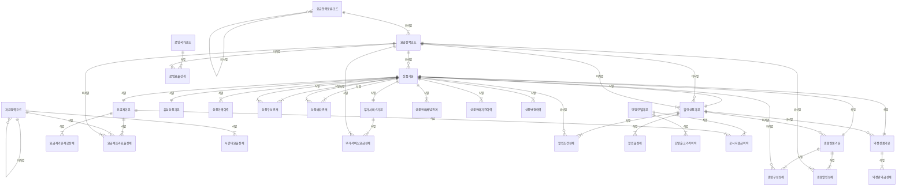

# 04. 논리 모델 — PRD 상품

> 작성 2026-11-07 · subagent_logical_modeler(작성) · masteragent_da_coordinator 03 논리 관문 재생성 · 정본 `model/logical/PRD.json` — 이 문서는 JSON 에서 생성(손수정 금지)
> 엔터티 30(핵심 10 · 기본·일반 20 · 정산 STL 0) · 속성 244 · 관계 44 · 관문 리뷰 `reviews/03_logical.md`

## 1. 엔터티 목록

| ID | 엔터티 | 물리명 | 테이블명(미리보기) | 유형 | 단계 | 모듈 | PK | 속성 수 | 설명 |
|---|---|---|---|---|---|---|---|---|---|
| PRD-001 | 상품기본 | `PROD_BAS` | `PTL_PRD_PROD_M` | REF | CNCP |  | 상품코드 | 13 | 판매하는 모든 통신 상품(요금제·부가서비스·할인·결합·약정·유심)의 공통 정의(TM Forum SID Product Offering). 유형별 상세 6종의 상위(슈퍼타입). 판매 종료·폐지 후에도 행을 지우지 않고 상태·판매종료일자로 표현한다. 현재 월정액은 여기, 변경 이력은 상품가격이력. |
| PRD-002 | 요금제기본 | `RTPLN_BAS` | `PTL_PRD_RTPLN_M` | REF | CNCP |  | 상품코드 | 7 | 음성·문자·데이터 기본제공량과 소진 후 속도 제한(QoS)을 정한 월정액 요금제의 서브타입 상세. 이용약관 신고 대상. 초과 요율·시간대 요율·기본제공 상세 항목은 기본 엔터티(요금제기본제공상세·요금제초과요율상세)로 분리. |
| PRD-003 | 부가서비스기본 | `ADSVC_BAS` | `PTL_PRD_ADSVC_M` | REF | CNCP |  | 상품코드 | 10 | 요금제에 덧붙여 가입하는 부가서비스·옵션(통화연결음·데이터 옵션·로밍 요금제·휴대폰 보험·콘텐츠 구독 등)의 서브타입 상세. 망(HLR/HSS) 부가서비스 코드와 연동되며, 제3자 콘텐츠 상품은 PRM 콘텐츠제공사가 공급한다(S2 — 70% 미사용). |
| PRD-004 | 할인상품기본 | `DSCNT_PROD_BAS` | `PTL_PRD_DSCNT_PROD_M` | REF | CNCP |  | 상품코드 | 13 | 요금에서 빼 주는 할인 규칙(선택약정 25%·장기고객·복지·제휴카드·결합·임직원·프로모션)의 서브타입 상세. 정률·정액 방식과 한도, 대상 요금항목, 할인이 청구서에 찍히는 할인 요금항목을 정한다. 조건·구간별 할인율은 기본 엔터티(할인조건상세·할인율상세). |
| PRD-005 | 결합상품기본 | `CMBN_PROD_BAS` | `PTL_PRD_CMBN_PROD_M` | REF | CNCP |  | 상품코드 | 10 | 여러 회선·상품을 묶어 할인하는 결합 규칙(유무선 결합·가족 무선 결합·인터넷+IPTV·법인 결합)의 서브타입 상세. 결합 가능 회선 수·가족관계 확인·결합할인 상품과 배분 방식을 정한다. 구성 상품·회선별 할인은 기본 엔터티(결합구성상세·결합할인상세). |
| PRD-006 | 약정상품기본 | `AGRMT_PROD_BAS` | `PTL_PRD_AGRMT_PROD_M` | REF | CNCP |  | 상품코드 | 11 | 일정 기간 이용을 약속하고 혜택을 받는 약정 규칙(선택약정 요금할인 25%·공시지원금 약정·기기·요금·결합 약정)의 서브타입 상세. 약정 개월 수·위약금(할인반환금·지원금 반환) 산정 방식과 상한을 정한다. 경과 기간별 위약금 구간은 기본 엔터티(약정위약금상세). |
| PRD-007 | 단말모델기본 | `EQP_MDL_BAS` | `PTL_PRD_EQP_MDL_M` | REF | CNCP |  | 단말모델코드 | 11 | 판매·개통 가능한 단말 모델(스마트폰·피처폰·태블릿·웨어러블·라우터·IoT 모듈)의 기준 정보. 판매 상품(상품기본)이 아니라 단말 카탈로그라 별도 주식별자(단말모델코드). 현재 출고가·공시지원금은 여기, 변경 이력은 기본 엔터티(단말출고가이력·공시지원금이력 — 단말기유통법 공시). 개별 단말 재고는 PRM. |
| PRD-008 | 유심상품기본 | `USIM_PROD_BAS` | `PTL_PRD_USIM_PROD_M` | REF | CNCP |  | 상품코드 | 8 | 회선에 장착하는 가입자 식별 모듈 상품(USIM·eSIM·NFC 유심·IoT 유심)의 서브타입 상세. 종류·형태·판매가(유심비)를 정한다. 개별 유심 일련번호·재고는 PRM, 회선 장착은 ORD. |
| PRD-009 | 요금항목코드 | `CHRG_ITM_CD` | `PTL_PRD_CHRG_ITM_C` | REF | CNCP |  | 요금항목코드 | 10 | 청구서 한 줄이 되는 과금 항목 체계(월정액·통화료·데이터료·부가사용료·할인·단말할부금·위약금·조정·부가가치세·연체가산금·소액결제 대행). 사용량 Rating·요금계산·청구상세·수납배분이 모두 이 코드로 이어진다. 과세 유형·청구서 출력 순서·수납배분 우선순위를 가진다. |
| PRD-010 | 상품가격이력 | `PROD_PRC_HIST` | `PTL_PRD_PROD_PRC_H` | REF | CNCP |  | 상품코드 + 가격적용시작일시 | 9 | 상품별 월정액·가격 변경 이력(적용 시작·종료 일시, SCD2). 과거 청구월의 요금 재계산·소급 조정 때 그 시점 가격을 재현한다. 현재 가격은 상품기본.월정액금액. 단말 출고가·공시지원금 이력은 단말모델 쪽 기본 엔터티. |
| PRD-011 | 상품구성관계 | `PROD_CMPS_REL` | `PTL_PRD_PROD_CMPS_R` | REF | LGCL |  | 상위상품코드 + 구성상품코드 | 6 | 패키지 상품(요금제 + 필수 부가서비스 묶음 등)의 상위 상품 ↔ 구성 상품 N:M 해소(SID BundledProductOffering). |
| PRD-012 | 상품배타관계 | `PROD_EXCLN_REL` | `PTL_PRD_PROD_EXCLN_R` | REF | LGCL |  | 기준상품코드 + 대상상품코드 + 배타관계유형코드 | 6 | 동시 가입 불가·선행 가입 필수·동시 가입 필수 같은 상품 간 가입 제약(SID ProductOfferingRelationship) N:M 해소. 가입 신청 검증 규칙의 원천. |
| PRD-013 | 요금제기본제공상세 | `RTPLN_BSCPRVD_DTL` | `PTL_PRD_RTPLN_BSCPRVD_D` | REF | LGCL |  | 상품코드 + 사용서비스유형코드 | 7 | 요금제의 사용 서비스별(음성·영상통화·문자·데이터 등) 기본제공량·무제한·이월·소진 후 속도 제한. 요금제기본의 서비스별 반복 그룹을 행으로 정규화(결정 L2). |
| PRD-014 | 요금제초과요율상세 | `RTPLN_EXCS_TRF_DTL` | `PTL_PRD_RTPLN_EXCS_TRF_D` | REF | LGCL |  | 상품코드 + 과금권역코드 + 사용서비스유형코드 + 요율적용시작일자 | 10 | 기본제공량 초과 시 사용 서비스·과금권역별 단위 요율(초·KB·건 단위). 적용 기간으로 요율 변경 재현(SCD2). |
| PRD-015 | 과금권역코드 | `RAT_ZONE_CD` | `PTL_PRD_RAT_ZONE_C` | REF | LGCL |  | 과금권역코드 | 6 | Rating 기준 과금 권역(국내 이동·유선·국제·위성·특수번호 등) 계층. planner 후보 '통화권역코드'를 개명(결정 L1). |
| PRD-016 | 시간대요율상세 | `TMBND_TRF_DTL` | `PTL_PRD_TMBND_TRF_D` | REF | LGCL |  | 과금권역코드 + 사용서비스유형코드 + 시간대유형코드 + 요율적용시작일자 | 8 | 과금권역·사용 서비스별 시간대(주간·야간·심야·주말·공휴일) 가산율(할증 +, 할인 −). 기준 요율에 곱해 적용. |
| PRD-017 | 로밍국가코드 | `ROAM_NATN_CD` | `PTL_PRD_ROAM_NATN_C` | REF | LGCL |  | 국가코드 | 7 | 로밍 서비스 대상 국가(ISO 3166 국가코드 기준)와 로밍 권역. PRM.로밍사업자기본(방문망 사업자)이 국가코드로 참조한다(PRM 에 키 요구). |
| PRD-018 | 로밍요율상세 | `ROAM_TRF_DTL` | `PTL_PRD_ROAM_TRF_D` | REF | LGCL |  | 국가코드 + 사용서비스유형코드 + 사용방향구분코드 + 요율적용시작일자 | 9 | 국가·사용 서비스·발착신별 로밍 요율(고객 청구 기준). 사업자 간 TAP 정산 요율은 PRM(STL) 쪽. |
| PRD-019 | 부가서비스요금상세 | `ADSVC_CHRG_DTL` | `PTL_PRD_ADSVC_CHRG_D` | REF | LGCL |  | 상품코드 + 요금항목코드 + 요금적용시작일자 | 8 | 부가서비스의 요금항목별 월정액·단위 요금과 일할 계산 여부. 적용 기간으로 요금 변경 재현(SCD2). |
| PRD-020 | 할인조건상세 | `DSCNT_CND_DTL` | `PTL_PRD_DSCNT_CND_D` | REF | LGCL |  | 상품코드 + 조건순번 | 9 | 할인 적용 조건(대상 요금제·가입 기간·고객 등급·연령·결합 회선 수·청구 금액) — 한 할인의 조건 여러 개는 AND. |
| PRD-021 | 할인율상세 | `DSCNT_RT_DTL` | `PTL_PRD_DSCNT_RT_D` | REF | LGCL |  | 상품코드 + 할인단계순번 | 7 | 단계(구간)별 할인율·할인금액(예 가입 2년 10%·5년 20%, 청구액 구간별 정액). |
| PRD-022 | 결합구성상세 | `CMBN_CMPS_DTL` | `PTL_PRD_CMBN_CMPS_D` | REF | LGCL |  | 상품코드 + 구성순번 | 8 | 결합 상품을 이루는 구성(무선 회선·인터넷·IPTV 등)과 구성별 최소·최대 회선 수. |
| PRD-023 | 결합할인상세 | `CMBN_DSCNT_DTL` | `PTL_PRD_CMBN_DSCNT_D` | REF | LGCL |  | 상품코드 + 결합회선수 + 할인적용시작일자 | 8 | 결합 회선 수별 회선당·대표회선 할인(예 2회선 3,300원·5회선 이상 11,000원). 적용 기간으로 변경 재현. |
| PRD-024 | 약정위약금상세 | `AGRMT_PNLT_DTL` | `PTL_PRD_AGRMT_PNLT_D` | REF | LGCL |  | 상품코드 + 위약금단계순번 | 7 | 약정 경과 개월 구간별 위약금(할인반환금·지원금 반환) 비율·정액. |
| PRD-025 | 단말출고가격이력 | `EQP_SHPM_PRC_HIST` | `PTL_PRD_EQP_SHPM_PRC_H` | REF | LGCL |  | 단말모델코드 + 가격적용시작일시 | 5 | 단말 모델 출고가 변경 이력(SCD2). planner 후보 '단말출고가이력'을 표준단어 조합으로 개명(결정 L5). |
| PRD-026 | 공시지원금이력 | `PBANC_SUBSD_HIST` | `PTL_PRD_PBANC_SUBSD_H` | REF | LGCL |  | 단말모델코드 + 요금제상품코드 + 지원금적용시작일시 | 8 | 단말기유통법 공시 — 요금제·단말 모델별 공시지원금·추가지원금과 공시 기간(공시 후 최소 유지 일수). N:M(단말모델↔요금제)을 기간 행으로 해소. |
| PRD-027 | 상품판매채널관계 | `PROD_SALE_CHNL_REL` | `PTL_PRD_PROD_SALE_CHNL_R` | REF | LGCL |  | 상품코드 + 판매채널유형코드 | 5 | 상품별 판매 가능 채널(대리점·판매점·온라인·직영·텔레마케팅·법인영업) — 상품 ↔ 판매채널 N:M 해소. |
| PRD-028 | 상품판매기간이력 | `PROD_SALE_PRD_HIST` | `PTL_PRD_PROD_SALE_PRD_H` | REF | LGCL |  | 상품코드 + 판매시작일자 | 5 | 상품 판매 개시·중지·재개 기간 이력. 현재값은 상품기본.판매시작일자·판매종료일자. |
| PRD-029 | 요금항목분류코드 | `CHRG_ITM_CLSF_CD` | `PTL_PRD_CHRG_ITM_CLSF_C` | REF | LGCL |  | 요금항목분류코드 | 5 | 요금항목의 상위 분류(월정액·사용·일회성·할부·할인·세금·기타) 계층. 청구서 소계 단위. |
| PRD-030 | 상품변경이력 | `PROD_CHG_HIST` | `PTL_PRD_PROD_CHG_H` | REF | LGCL |  | 상품코드 + 상품변경순번 | 8 | 상품 정의 속성 변경 감사 이력(어떤 항목이 무엇에서 무엇으로 왜 바뀌었는지). 가격·판매기간은 전용 이력 엔터티. |

## 2. 엔터티별 속성

속성 순서 = PK → FK → 일반(규칙 2-9). FK 표기 = `<영역>.<엔터티>.<속성>`. NULL Y = 선택. 시스템 칼럼 4개는 DDL 생성 때만 붙는다(D7).

### PRD-001 상품기본 `PROD_BAS` (REF·CNCP)

판매하는 모든 통신 상품(요금제·부가서비스·할인·결합·약정·유심)의 공통 정의(TM Forum SID Product Offering). 유형별 상세 6종의 상위(슈퍼타입). 판매 종료·폐지 후에도 행을 지우지 않고 상태·판매종료일자로 표현한다. 현재 월정액은 여기, 변경 이력은 상품가격이력.

| # | 속성 | 물리명 | 도메인 | PK | FK | NULL | 설명 |
|---|---|---|---|---|---|---|---|
| 1 | 상품코드 | PROD_CD | 코드V20 | PK |  | N | 상품의 코드 — 업무 분류 값을 식별하는 부호, 엔터티에서는 기준 코드 집합 |
| 2 | 기본요금항목코드 | BAS_CHRG_ITM_CD | 코드V10 |  | PRD.요금항목코드.요금항목코드 | Y | 기본 요금 항목의 코드 — 업무 분류 값을 식별하는 부호, 엔터티에서는 기준 코드 집합 |
| 3 | 상품명 | PROD_NM | 명V200 |  |  | N | 상품의 명 — 대상을 부르는 이름 |
| 4 | 상품등록일시 | PROD_REG_DTM | 일시TS |  |  | N | 상품 등록의 일시 — 연월일 시분초까지의 시점 |
| 5 | 상품상태유형코드 | PROD_STTS_TY_CD | 코드V10 |  |  | N | 상품 상태의 유형 코드 — 공통코드(codes.json) |
| 6 | 상품유형코드 | PROD_TY_CD | 코드V10 |  |  | N | 상품의 유형 코드 — 공통코드(codes.json) |
| 7 | 서비스망유형코드 | SVC_NTWK_TY_CD | 코드V10 |  |  | N | 서비스 망의 유형 코드 — 공통코드(codes.json) |
| 8 | 가입대상유형코드 | SBSC_TRGT_TY_CD | 코드V10 |  |  | N | 가입 대상의 유형 코드 — 공통코드(codes.json) |
| 9 | 판매시작일자 | SALE_BGNG_DT | 일자C8 |  |  | N | 판매 시작의 일자 — 연월일(YYYYMMDD) |
| 10 | 판매종료일자 | SALE_END_DT | 일자C8 |  |  | Y | 판매 종료의 일자 — 연월일(YYYYMMDD) |
| 11 | 월정액금액 | MM_FXAMT_AMT | 금액N15 |  |  | Y | 월 정액의 금액 — 원화 금액(원 단위 정수) |
| 12 | 부가가치세포함여부 | VAT_INCL_YN | 여부C1 |  |  | N | 부가가치세 포함의 여부 — 해당 여부(Y/N) |
| 13 | 상품내용 | PROD_CN | 내용V4000 |  |  | Y | 상품 설명(약관 요약·홈페이지 안내 문구) — 자유 서술(S9 넓은 행 후보) |

정규화 : 슈퍼타입. 1NF: 서브타입별 속성은 6개 서브타입으로 분리(빈 칼럼 반복 방지). 2NF: 단일 PK. 3NF: 기본 요금항목 이름은 요금항목코드 조회(FK 만). 현재 월정액은 상품가격이력 현재행과 같지만 개념 P7(현재값+이력 쌍) 유지 — 이력이 정본.

변경 메모 : 논리 보강 : 상품내용

### PRD-002 요금제기본 `RTPLN_BAS` (REF·CNCP)

음성·문자·데이터 기본제공량과 소진 후 속도 제한(QoS)을 정한 월정액 요금제의 서브타입 상세. 이용약관 신고 대상. 초과 요율·시간대 요율·기본제공 상세 항목은 기본 엔터티(요금제기본제공상세·요금제초과요율상세)로 분리.

| # | 속성 | 물리명 | 도메인 | PK | FK | NULL | 설명 |
|---|---|---|---|---|---|---|---|
| 1 | 상품코드 | PROD_CD | 코드V20 | PK | PRD.상품기본.상품코드 | N | 상품의 코드 — 업무 분류 값을 식별하는 부호, 엔터티에서는 기준 코드 집합 |
| 2 | 요금제공시명 | RTPLN_PBANC_NM | 명V200 |  |  | N | 요금제 공시의 명 — 대상을 부르는 이름 |
| 3 | 요금제등록일시 | RTPLN_REG_DTM | 일시TS |  |  | N | 요금제 등록의 일시 — 연월일 시분초까지의 시점 |
| 4 | 요금제약관신고상태유형코드 | RTPLN_TRMS_DCLR_STTS_TY_CD | 코드V10 |  |  | N | 요금제 약관 신고 상태의 유형 코드 — 공통코드(codes.json) |
| 5 | 요금제유형코드 | RTPLN_TY_CD | 코드V10 |  |  | N | 요금제의 유형 코드 — 공통코드(codes.json) |
| 6 | 선택약정할인대상여부 | CHC_AGRMT_DSCNT_TRGT_YN | 여부C1 |  |  | N | 선택 약정 할인 대상의 여부 — 해당 여부(Y/N) |
| 7 | 약관신고일자 | TRMS_DCLR_DT | 일자C8 |  |  | Y | 이용약관 신고(수리) 일자 — 미신고(작성 중)는 NULL |

정규화 : 서브타입(1:1 식별). 1NF: 개념의 기본제공음성분수·기본제공문자건수·기본제공데이터용량·음성/데이터무제한여부·소진후제한속도값은 사용 서비스별 반복 그룹 → 요금제기본제공상세(상품코드+사용서비스유형코드) 행으로 이동(결정 L2). 2NF·3NF 충족.

변경 메모 : 개념 대비 제거 : 기본제공음성분수·기본제공문자건수·기본제공데이터용량·음성무제한여부·데이터무제한여부·소진후제한속도값 / 논리 보강 : 약관신고일자

### PRD-003 부가서비스기본 `ADSVC_BAS` (REF·CNCP)

요금제에 덧붙여 가입하는 부가서비스·옵션(통화연결음·데이터 옵션·로밍 요금제·휴대폰 보험·콘텐츠 구독 등)의 서브타입 상세. 망(HLR/HSS) 부가서비스 코드와 연동되며, 제3자 콘텐츠 상품은 PRM 콘텐츠제공사가 공급한다(S2 — 70% 미사용).

| # | 속성 | 물리명 | 도메인 | PK | FK | NULL | 설명 |
|---|---|---|---|---|---|---|---|
| 1 | 상품코드 | PROD_CD | 코드V20 | PK | PRD.상품기본.상품코드 | N | 상품의 코드 — 업무 분류 값을 식별하는 부호, 엔터티에서는 기준 코드 집합 |
| 2 | 콘텐츠제공사번호 | CNTS_PRVD_CO_NO | 번호V20 |  | PRM.콘텐츠제공사기본.콘텐츠제공사번호 | Y | 콘텐츠 제공 사의 번호 — 대상을 식별하거나 외부에서 부여받은 번호 |
| 3 | 부가서비스공시명 | ADSVC_PBANC_NM | 명V200 |  |  | N | 부가서비스 공시의 명 — 대상을 부르는 이름 |
| 4 | 부가서비스등록일시 | ADSVC_REG_DTM | 일시TS |  |  | N | 부가서비스 등록의 일시 — 연월일 시분초까지의 시점 |
| 5 | 부가서비스망연동상태유형코드 | ADSVC_NTWK_LNK_STTS_TY_CD | 코드V10 |  |  | N | 부가서비스 망 연동 상태의 유형 코드 — 공통코드(codes.json) |
| 6 | 부가서비스유형코드 | ADSVC_TY_CD | 코드V10 |  |  | N | 부가서비스의 유형 코드 — 공통코드(codes.json) |
| 7 | 과금방식유형코드 | RAT_SCHM_TY_CD | 코드V10 |  |  | N | 과금 방식의 유형 코드 — 공통코드(codes.json) |
| 8 | 망서비스번호 | NTWK_SVC_NO | 번호V20 |  |  | Y | 망 서비스의 번호 — 대상을 식별하거나 외부에서 부여받은 번호 |
| 9 | 무료제공개월수 | FREE_PRVD_MCNT | 수N5 |  |  | Y | 무료 제공의 개월수 — 기간의 개월 수 |
| 10 | 중복가입가능여부 | DUP_SBSC_PSBL_YN | 여부C1 |  |  | N | 중복 가입 가능의 여부 — 해당 여부(Y/N) |

정규화 : 서브타입(1:1 식별). 금액은 요금항목별·기간별로 달라 부가서비스요금상세로 분리(반복 그룹 제거). 3NF: 제공사 이름은 PRM 조회.

### PRD-004 할인상품기본 `DSCNT_PROD_BAS` (REF·CNCP)

요금에서 빼 주는 할인 규칙(선택약정 25%·장기고객·복지·제휴카드·결합·임직원·프로모션)의 서브타입 상세. 정률·정액 방식과 한도, 대상 요금항목, 할인이 청구서에 찍히는 할인 요금항목을 정한다. 조건·구간별 할인율은 기본 엔터티(할인조건상세·할인율상세).

| # | 속성 | 물리명 | 도메인 | PK | FK | NULL | 설명 |
|---|---|---|---|---|---|---|---|
| 1 | 상품코드 | PROD_CD | 코드V20 | PK | PRD.상품기본.상품코드 | N | 상품의 코드 — 업무 분류 값을 식별하는 부호, 엔터티에서는 기준 코드 집합 |
| 2 | 할인대상요금항목코드 | DSCNT_TRGT_CHRG_ITM_CD | 코드V10 |  | PRD.요금항목코드.요금항목코드 | Y | 할인 대상 요금 항목의 코드 — 업무 분류 값을 식별하는 부호, 엔터티에서는 기준 코드 집합 |
| 3 | 할인요금항목코드 | DSCNT_CHRG_ITM_CD | 코드V10 |  | PRD.요금항목코드.요금항목코드 | N | 할인 요금 항목의 코드 — 업무 분류 값을 식별하는 부호, 엔터티에서는 기준 코드 집합 |
| 4 | 제휴파트너번호 | ALNC_PRTNR_NO | 번호V20 |  | PRM.파트너기본.파트너번호 | Y | 제휴 파트너의 번호 — 대상을 식별하거나 외부에서 부여받은 번호 |
| 5 | 할인공시명 | DSCNT_PBANC_NM | 명V200 |  |  | N | 할인 공시의 명 — 대상을 부르는 이름 |
| 6 | 할인상품등록일시 | DSCNT_PROD_REG_DTM | 일시TS |  |  | N | 할인 상품 등록의 일시 — 연월일 시분초까지의 시점 |
| 7 | 할인승인상태유형코드 | DSCNT_APRV_STTS_TY_CD | 코드V10 |  |  | N | 할인 승인 상태의 유형 코드 — 공통코드(codes.json) |
| 8 | 할인유형코드 | DSCNT_TY_CD | 코드V10 |  |  | N | 할인의 유형 코드 — 공통코드(codes.json) |
| 9 | 할인방식유형코드 | DSCNT_SCHM_TY_CD | 코드V10 |  |  | N | 할인 방식의 유형 코드 — 공통코드(codes.json) |
| 10 | 할인율 | DSCNT_RT | 율N5_2 |  |  | Y | 할인의 율 — 비율(백분율, 소수 2자리) |
| 11 | 할인금액 | DSCNT_AMT | 금액N15 |  |  | Y | 할인의 금액 — 원화 금액(원 단위 정수) |
| 12 | 할인한도금액 | DSCNT_LMT_AMT | 금액N15 |  |  | Y | 할인 한도의 금액 — 원화 금액(원 단위 정수) |
| 13 | 중복할인가능여부 | DUP_DSCNT_PSBL_YN | 여부C1 |  |  | N | 중복 할인 가능의 여부 — 해당 여부(Y/N) |

정규화 : 서브타입(1:1 식별). 대표 정률·정액만 여기, 조건·단계는 할인조건상세·할인율상세(반복 그룹 제거). 3NF: 요금항목·파트너 이름은 FK 조회.

### PRD-005 결합상품기본 `CMBN_PROD_BAS` (REF·CNCP)

여러 회선·상품을 묶어 할인하는 결합 규칙(유무선 결합·가족 무선 결합·인터넷+IPTV·법인 결합)의 서브타입 상세. 결합 가능 회선 수·가족관계 확인·결합할인 상품과 배분 방식을 정한다. 구성 상품·회선별 할인은 기본 엔터티(결합구성상세·결합할인상세).

| # | 속성 | 물리명 | 도메인 | PK | FK | NULL | 설명 |
|---|---|---|---|---|---|---|---|
| 1 | 상품코드 | PROD_CD | 코드V20 | PK | PRD.상품기본.상품코드 | N | 상품의 코드 — 업무 분류 값을 식별하는 부호, 엔터티에서는 기준 코드 집합 |
| 2 | 결합할인상품코드 | CMBN_DSCNT_PROD_CD | 코드V20 |  | PRD.할인상품기본.상품코드 | Y | 결합 할인 상품의 코드 — 업무 분류 값을 식별하는 부호, 엔터티에서는 기준 코드 집합 |
| 3 | 결합상품공시명 | CMBN_PROD_PBANC_NM | 명V200 |  |  | N | 결합 상품 공시의 명 — 대상을 부르는 이름 |
| 4 | 결합상품등록일시 | CMBN_PROD_REG_DTM | 일시TS |  |  | N | 결합 상품 등록의 일시 — 연월일 시분초까지의 시점 |
| 5 | 결합상품운영상태유형코드 | CMBN_PROD_OPER_STTS_TY_CD | 코드V10 |  |  | N | 결합 상품 운영 상태의 유형 코드 — 공통코드(codes.json) |
| 6 | 결합유형코드 | CMBN_TY_CD | 코드V10 |  |  | N | 결합의 유형 코드 — 공통코드(codes.json) |
| 7 | 최소결합회선수 | MIN_CMBN_LINE_CNT | 수N5 |  |  | N | 최소 결합 회선의 수 — 개수·인원 등 셀 수 있는 수 |
| 8 | 최대결합회선수 | MAX_CMBN_LINE_CNT | 수N5 |  |  | N | 최대 결합 회선의 수 — 개수·인원 등 셀 수 있는 수 |
| 9 | 결합할인배분방식유형코드 | CMBN_DSCNT_ALLC_SCHM_TY_CD | 코드V10 |  |  | N | 결합 할인 배분 방식의 유형 코드 — 공통코드(codes.json) |
| 10 | 가족관계확인필요여부 | FMLY_REL_IDNTF_NEED_YN | 여부C1 |  |  | N | 가족 관계 확인 필요의 여부 — 해당 여부(Y/N) |

정규화 : 서브타입(1:1 식별). 구성·회선 수별 할인은 결합구성상세·결합할인상세(반복 그룹 제거). 3NF 충족 — 유선상품포함여부는 결합유형코드·결합구성상세에서 유도되므로 제거(관문 G1).

### PRD-006 약정상품기본 `AGRMT_PROD_BAS` (REF·CNCP)

일정 기간 이용을 약속하고 혜택을 받는 약정 규칙(선택약정 요금할인 25%·공시지원금 약정·기기·요금·결합 약정)의 서브타입 상세. 약정 개월 수·위약금(할인반환금·지원금 반환) 산정 방식과 상한을 정한다. 경과 기간별 위약금 구간은 기본 엔터티(약정위약금상세).

| # | 속성 | 물리명 | 도메인 | PK | FK | NULL | 설명 |
|---|---|---|---|---|---|---|---|
| 1 | 상품코드 | PROD_CD | 코드V20 | PK | PRD.상품기본.상품코드 | N | 상품의 코드 — 업무 분류 값을 식별하는 부호, 엔터티에서는 기준 코드 집합 |
| 2 | 연계할인상품코드 | LNKG_DSCNT_PROD_CD | 코드V20 |  | PRD.할인상품기본.상품코드 | Y | 연계 할인 상품의 코드 — 업무 분류 값을 식별하는 부호, 엔터티에서는 기준 코드 집합 |
| 3 | 약정상품공시명 | AGRMT_PROD_PBANC_NM | 명V200 |  |  | N | 약정 상품 공시의 명 — 대상을 부르는 이름 |
| 4 | 약정상품등록일시 | AGRMT_PROD_REG_DTM | 일시TS |  |  | N | 약정 상품 등록의 일시 — 연월일 시분초까지의 시점 |
| 5 | 약정상품운영상태유형코드 | AGRMT_PROD_OPER_STTS_TY_CD | 코드V10 |  |  | N | 약정 상품 운영 상태의 유형 코드 — 공통코드(codes.json) |
| 6 | 약정유형코드 | AGRMT_TY_CD | 코드V10 |  |  | N | 약정의 유형 코드 — 공통코드(codes.json) |
| 7 | 약정개월수 | AGRMT_MCNT | 수N5 |  |  | N | 약정의 개월수 — 기간의 개월 수 |
| 8 | 위약금산정방식유형코드 | PNLT_ASMT_SCHM_TY_CD | 코드V10 |  |  | N | 위약금 산정 방식의 유형 코드 — 공통코드(codes.json) |
| 9 | 위약금상한금액 | PNLT_UPLMT_AMT | 금액N15 |  |  | Y | 위약금 상한의 금액 — 원화 금액(원 단위 정수) |
| 10 | 재약정가능여부 | RE_AGRMT_PSBL_YN | 여부C1 |  |  | N | 재 약정 가능의 여부 — 해당 여부(Y/N) |
| 11 | 약정승계가능여부 | AGRMT_SCSN_PSBL_YN | 여부C1 |  |  | N | 약정 승계 가능의 여부 — 해당 여부(Y/N) |

정규화 : 서브타입(1:1 식별). 경과 구간별 위약금은 약정위약금상세. 선택약정할인율 제거 — 연계할인상품코드 → 할인상품기본.할인율 이행 종속(관문 G1, L6 대체). ORD.약정계약기본은 가입 당시 값을 자기 속성으로 보존.

### PRD-007 단말모델기본 `EQP_MDL_BAS` (REF·CNCP)

판매·개통 가능한 단말 모델(스마트폰·피처폰·태블릿·웨어러블·라우터·IoT 모듈)의 기준 정보. 판매 상품(상품기본)이 아니라 단말 카탈로그라 별도 주식별자(단말모델코드). 현재 출고가·공시지원금은 여기, 변경 이력은 기본 엔터티(단말출고가이력·공시지원금이력 — 단말기유통법 공시). 개별 단말 재고는 PRM.

| # | 속성 | 물리명 | 도메인 | PK | FK | NULL | 설명 |
|---|---|---|---|---|---|---|---|
| 1 | 단말모델코드 | EQP_MDL_CD | 코드V20 | PK |  | N | 단말 모델의 코드 — 업무 분류 값을 식별하는 부호, 엔터티에서는 기준 코드 집합 |
| 2 | 단말모델명 | EQP_MDL_NM | 명V100 |  |  | N | 단말 모델의 명 — 대상을 부르는 이름 |
| 3 | 단말모델등록일시 | EQP_MDL_REG_DTM | 일시TS |  |  | N | 단말 모델 등록의 일시 — 연월일 시분초까지의 시점 |
| 4 | 단말모델판매상태유형코드 | EQP_MDL_SALE_STTS_TY_CD | 코드V10 |  |  | N | 단말 모델 판매 상태의 유형 코드 — 공통코드(codes.json) |
| 5 | 제조사유형코드 | MNFCT_CO_TY_CD | 코드V10 |  |  | N | 제조 사의 유형 코드 — 공통코드(codes.json) |
| 6 | 단말유형코드 | EQP_TY_CD | 코드V10 |  |  | N | 단말의 유형 코드 — 공통코드(codes.json) |
| 7 | 서비스망유형코드 | SVC_NTWK_TY_CD | 코드V10 |  |  | N | 서비스 망의 유형 코드 — 공통코드(codes.json) |
| 8 | 출시일자 | LNCH_DT | 일자C8 |  |  | N | 출시의 일자 — 연월일(YYYYMMDD) |
| 9 | 단말출고가격 | EQP_SHPM_PRC | 금액N15 |  |  | N | 단말 출고의 가격 — 재화의 판매·출고 가격 |
| 10 | eSIM지원여부 | ESIM_SPRT_YN | 여부C1 |  |  | N | eSIM 지원의 여부 — 해당 여부(Y/N) |
| 11 | 자급제여부 | SLFSPLY_YN | 여부C1 |  |  | N | 자급제의 여부 — 해당 여부(Y/N) |

정규화 : 독립 기준 엔터티. 3NF: 제조사 이름은 코드값. 현재 출고가는 현재값+이력 쌍(01 §5-1). 공시지원금 제거 — 값이 (단말모델, 요금제)에 종속(공시지원금이력이 원천, 관문 G1·L7 대체).

### PRD-008 유심상품기본 `USIM_PROD_BAS` (REF·CNCP)

회선에 장착하는 가입자 식별 모듈 상품(USIM·eSIM·NFC 유심·IoT 유심)의 서브타입 상세. 종류·형태·판매가(유심비)를 정한다. 개별 유심 일련번호·재고는 PRM, 회선 장착은 ORD.

| # | 속성 | 물리명 | 도메인 | PK | FK | NULL | 설명 |
|---|---|---|---|---|---|---|---|
| 1 | 상품코드 | PROD_CD | 코드V20 | PK | PRD.상품기본.상품코드 | N | 상품의 코드 — 업무 분류 값을 식별하는 부호, 엔터티에서는 기준 코드 집합 |
| 2 | 유심상품공시명 | USIM_PROD_PBANC_NM | 명V200 |  |  | N | 유심 상품 공시의 명 — 대상을 부르는 이름 |
| 3 | 유심상품등록일시 | USIM_PROD_REG_DTM | 일시TS |  |  | N | 유심 상품 등록의 일시 — 연월일 시분초까지의 시점 |
| 4 | 유심상품공급상태유형코드 | USIM_PROD_SPLY_STTS_TY_CD | 코드V10 |  |  | N | 유심 상품 공급 상태의 유형 코드 — 공통코드(codes.json) |
| 5 | 유심종류코드 | USIM_KND_CD | 코드V10 |  |  | N | 유심의 종류 코드 — 공통코드(codes.json) |
| 6 | 유심형태유형코드 | USIM_FORM_TY_CD | 코드V10 |  |  | N | 유심 형태의 유형 코드 — 공통코드(codes.json) |
| 7 | 유심판매가격 | USIM_SALE_PRC | 금액N15 |  |  | N | 유심 판매의 가격 — 재화의 판매·출고 가격 |
| 8 | NFC지원여부 | NFC_SPRT_YN | 여부C1 |  |  | N | NFC 지원의 여부 — 해당 여부(Y/N) |

정규화 : 서브타입(1:1 식별). 서비스망유형코드는 슈퍼타입(상품기본)에 이미 있어 제거(결정 L3 — 중복 속성 제거). 2NF·3NF 충족.

변경 메모 : 개념 대비 제거 : 서비스망유형코드

### PRD-009 요금항목코드 `CHRG_ITM_CD` (REF·CNCP)

청구서 한 줄이 되는 과금 항목 체계(월정액·통화료·데이터료·부가사용료·할인·단말할부금·위약금·조정·부가가치세·연체가산금·소액결제 대행). 사용량 Rating·요금계산·청구상세·수납배분이 모두 이 코드로 이어진다. 과세 유형·청구서 출력 순서·수납배분 우선순위를 가진다.

| # | 속성 | 물리명 | 도메인 | PK | FK | NULL | 설명 |
|---|---|---|---|---|---|---|---|
| 1 | 요금항목코드 | CHRG_ITM_CD | 코드V10 | PK |  | N | 요금 항목의 코드 — 업무 분류 값을 식별하는 부호, 엔터티에서는 기준 코드 집합 |
| 2 | 요금항목분류코드 | CHRG_ITM_CLSF_CD | 코드V10 |  | PRD.요금항목분류코드.요금항목분류코드 | N | 상위 분류(청구서 소계 단위) — 개념의 요금항목분류유형코드를 기준 엔터티 FK 로 대체(결정 L4) |
| 3 | 요금항목명 | CHRG_ITM_NM | 명V100 |  |  | N | 요금 항목의 명 — 대상을 부르는 이름 |
| 4 | 요금항목등록일시 | CHRG_ITM_REG_DTM | 일시TS |  |  | N | 요금 항목 등록의 일시 — 연월일 시분초까지의 시점 |
| 5 | 요금항목사용상태유형코드 | CHRG_ITM_USE_STTS_TY_CD | 코드V10 |  |  | N | 요금 항목 사용 상태의 유형 코드 — 공통코드(codes.json) |
| 6 | 요금항목유형코드 | CHRG_ITM_TY_CD | 코드V10 |  |  | N | 요금 항목의 유형 코드 — 공통코드(codes.json) |
| 7 | 과세유형코드 | TXTN_TY_CD | 코드V10 |  |  | N | 과세의 유형 코드 — 공통코드(codes.json) |
| 8 | 청구서출력순번 | INVC_OUTPT_SEQ | 순번N5 |  |  | N | 청구서 출력의 순번 — 부모 안의 처리·표시 순서 |
| 9 | 수납배분우선순위 | RCV_ALLC_PRRT | 순번N5 |  |  | N | 수납 배분의 우선순위 — 여러 대상 중 먼저 처리하는 순서 |
| 10 | 할인대상여부 | DSCNT_TRGT_YN | 여부C1 |  |  | N | 할인 대상의 여부 — 해당 여부(Y/N) |

정규화 : 3NF: 개념의 요금항목분류유형코드(공통코드)를 요금항목분류코드 엔터티 FK 로 대체 — 분류가 계층·출력 순번을 가져 기준 엔터티(결정 L4). 분류명은 FK 조회.

변경 메모 : 개념 대비 제거 : 요금항목분류유형코드 / 논리 보강 : 요금항목분류코드

### PRD-010 상품가격이력 `PROD_PRC_HIST` (REF·CNCP)

상품별 월정액·가격 변경 이력(적용 시작·종료 일시, SCD2). 과거 청구월의 요금 재계산·소급 조정 때 그 시점 가격을 재현한다. 현재 가격은 상품기본.월정액금액. 단말 출고가·공시지원금 이력은 단말모델 쪽 기본 엔터티.

| # | 속성 | 물리명 | 도메인 | PK | FK | NULL | 설명 |
|---|---|---|---|---|---|---|---|
| 1 | 상품코드 | PROD_CD | 코드V20 | PK | PRD.상품기본.상품코드 | N | 상품의 코드 — 업무 분류 값을 식별하는 부호, 엔터티에서는 기준 코드 집합 |
| 2 | 가격적용시작일시 | PRC_APLCN_BGNG_DTM | 일시TS | PK |  | N | 가격 적용 시작의 일시 — 연월일 시분초까지의 시점 |
| 3 | 적용상품명 | APLCN_PROD_NM | 명V200 |  |  | N | 적용 상품의 명 — 대상을 부르는 이름 |
| 4 | 가격변경일시 | PRC_CHG_DTM | 일시TS |  |  | N | 가격 변경의 일시 — 연월일 시분초까지의 시점 |
| 5 | 가격적용상태유형코드 | PRC_APLCN_STTS_TY_CD | 코드V10 |  |  | N | 가격 적용 상태의 유형 코드 — 공통코드(codes.json) |
| 6 | 가격적용종료일시 | PRC_APLCN_END_DTM | 일시TS |  |  | Y | 가격 적용 종료의 일시 — 연월일 시분초까지의 시점 |
| 7 | 월정액금액 | MM_FXAMT_AMT | 금액N15 |  |  | N | 월 정액의 금액 — 원화 금액(원 단위 정수) |
| 8 | 가격변경사유유형코드 | PRC_CHG_RSN_TY_CD | 코드V10 |  |  | N | 가격 변경 사유의 유형 코드 — 공통코드(codes.json) |
| 9 | 부가가치세포함여부 | VAT_INCL_YN | 여부C1 |  |  | N | 부가가치세 포함의 여부 — 해당 여부(Y/N) |

정규화 : SCD2 이력(상품코드+가격적용시작일시). 적용상품명은 당시 명칭 스냅숏(시점 보존). 이전월정액금액 제거 — 직전 이력 행에서 유도(관문 G1, 물리 반정규화 후보).

### PRD-011 상품구성관계 `PROD_CMPS_REL` (REF·LGCL)

패키지 상품(요금제 + 필수 부가서비스 묶음 등)의 상위 상품 ↔ 구성 상품 N:M 해소(SID BundledProductOffering).

| # | 속성 | 물리명 | 도메인 | PK | FK | NULL | 설명 |
|---|---|---|---|---|---|---|---|
| 1 | 상위상품코드 | UP_PROD_CD | 코드V20 | PK | PRD.상품기본.상품코드 | N | 상위 상품의 코드 — 업무 분류 값을 식별하는 부호, 엔터티에서는 기준 코드 집합 |
| 2 | 구성상품코드 | CMPS_PROD_CD | 코드V20 | PK | PRD.상품기본.상품코드 | N | 구성 상품의 코드 — 업무 분류 값을 식별하는 부호, 엔터티에서는 기준 코드 집합 |
| 3 | 구성필요여부 | CMPS_NEED_YN | 여부C1 |  |  | N | 구성 필요의 여부 — 해당 여부(Y/N) |
| 4 | 구성상품수 | CMPS_PROD_CNT | 수N5 |  |  | N | 패키지 안 같은 구성 상품 수량(대개 1) |
| 5 | 적용시작일자 | APLCN_BGNG_DT | 일자C8 |  |  | N | 적용 시작의 일자 — 연월일(YYYYMMDD) |
| 6 | 적용종료일자 | APLCN_END_DT | 일자C8 |  |  | Y | 적용 종료의 일자 — 연월일(YYYYMMDD) |

정규화 : N:M 해소(상품↔상품, 역할명 상위·구성). 2NF: 비키 속성은 두 키 조합 전체에 종속. 3NF 충족.

### PRD-012 상품배타관계 `PROD_EXCLN_REL` (REF·LGCL)

동시 가입 불가·선행 가입 필수·동시 가입 필수 같은 상품 간 가입 제약(SID ProductOfferingRelationship) N:M 해소. 가입 신청 검증 규칙의 원천.

| # | 속성 | 물리명 | 도메인 | PK | FK | NULL | 설명 |
|---|---|---|---|---|---|---|---|
| 1 | 기준상품코드 | STD_PROD_CD | 코드V20 | PK | PRD.상품기본.상품코드 | N | 기준 상품의 코드 — 업무 분류 값을 식별하는 부호, 엔터티에서는 기준 코드 집합 |
| 2 | 대상상품코드 | TRGT_PROD_CD | 코드V20 | PK | PRD.상품기본.상품코드 | N | 대상 상품의 코드 — 업무 분류 값을 식별하는 부호, 엔터티에서는 기준 코드 집합 |
| 3 | 배타관계유형코드 | EXCLN_REL_TY_CD | 코드V10 | PK |  | N | 제약 종류 — 같은 두 상품에 여러 제약이 있을 수 있어 키에 포함 |
| 4 | 적용시작일자 | APLCN_BGNG_DT | 일자C8 |  |  | N | 적용 시작의 일자 — 연월일(YYYYMMDD) |
| 5 | 적용종료일자 | APLCN_END_DT | 일자C8 |  |  | Y | 적용 종료의 일자 — 연월일(YYYYMMDD) |
| 6 | 배타사유내용 | EXCLN_RSN_CN | 내용V200 |  |  | Y | 배타 사유의 내용 — 자유 서술 내용 |

정규화 : N:M 해소(상품↔상품). PK 에 배타관계유형코드 포함 — 같은 두 상품에 다른 제약 공존. 2NF·3NF 충족.

### PRD-013 요금제기본제공상세 `RTPLN_BSCPRVD_DTL` (REF·LGCL)

요금제의 사용 서비스별(음성·영상통화·문자·데이터 등) 기본제공량·무제한·이월·소진 후 속도 제한. 요금제기본의 서비스별 반복 그룹을 행으로 정규화(결정 L2).

| # | 속성 | 물리명 | 도메인 | PK | FK | NULL | 설명 |
|---|---|---|---|---|---|---|---|
| 1 | 상품코드 | PROD_CD | 코드V20 | PK | PRD.요금제기본.상품코드 | N | 상품의 코드 — 업무 분류 값을 식별하는 부호, 엔터티에서는 기준 코드 집합 |
| 2 | 사용서비스유형코드 | USE_SVC_TY_CD | 코드V10 | PK |  | N | 사용 서비스의 유형 코드 — 공통코드(codes.json) |
| 3 | 사용단위유형코드 | USE_UNIT_TY_CD | 코드V10 |  |  | N | 사용 단위의 유형 코드 — 공통코드(codes.json) |
| 4 | 기본제공량 | BSCPRVD_QTY | 수량N18 |  |  | Y | 사용단위 기준 월 기본제공량 — 무제한이면 NULL |
| 5 | 무제한여부 | UNLMT_YN | 여부C1 |  |  | N | 무제한의 여부 — 해당 여부(Y/N) |
| 6 | 이월가능여부 | CYOV_PSBL_YN | 여부C1 |  |  | N | 이월 가능의 여부 — 해당 여부(Y/N) |
| 7 | 소진후제한속도값 | EXHST_AFTR_RSTR_SPD_VL | 값N10 |  |  | Y | 기본제공 소진 후 제한 속도(kbps) — 제한 없으면 NULL |

정규화 : 요금제기본의 반복 그룹을 정규화한 결과. 2NF: (상품코드, 사용서비스유형코드) 전체 종속. 3NF 충족.

### PRD-014 요금제초과요율상세 `RTPLN_EXCS_TRF_DTL` (REF·LGCL)

기본제공량 초과 시 사용 서비스·과금권역별 단위 요율(초·KB·건 단위). 적용 기간으로 요율 변경 재현(SCD2).

| # | 속성 | 물리명 | 도메인 | PK | FK | NULL | 설명 |
|---|---|---|---|---|---|---|---|
| 1 | 상품코드 | PROD_CD | 코드V20 | PK | PRD.요금제기본.상품코드 | N | 상품의 코드 — 업무 분류 값을 식별하는 부호, 엔터티에서는 기준 코드 집합 |
| 2 | 과금권역코드 | RAT_ZONE_CD | 코드V10 | PK | PRD.과금권역코드.과금권역코드 | N | 과금 권역의 코드 — 업무 분류 값을 식별하는 부호, 엔터티에서는 기준 코드 집합 |
| 3 | 사용서비스유형코드 | USE_SVC_TY_CD | 코드V10 | PK |  | N | 사용 서비스의 유형 코드 — 공통코드(codes.json) |
| 4 | 요율적용시작일자 | TRF_APLCN_BGNG_DT | 일자C8 | PK |  | N | 요율 적용 시작의 일자 — 연월일(YYYYMMDD) |
| 5 | 요금항목코드 | CHRG_ITM_CD | 코드V10 |  | PRD.요금항목코드.요금항목코드 | N | 초과 사용료가 청구되는 요금항목 |
| 6 | 요율적용종료일자 | TRF_APLCN_END_DT | 일자C8 |  |  | Y | 요율 적용 종료의 일자 — 연월일(YYYYMMDD) |
| 7 | 사용단위유형코드 | USE_UNIT_TY_CD | 코드V10 |  |  | N | 사용 단위의 유형 코드 — 공통코드(codes.json) |
| 8 | 과금단위값 | RAT_UNIT_VL | 값N10 |  |  | N | 과금 단위 크기(예 10초·512바이트) |
| 9 | 단위요금금액 | UNIT_CHRG_AMT | 금액N15 |  |  | N | 과금 단위당 요금(원) |
| 10 | 초과요금상한금액 | EXCS_CHRG_UPLMT_AMT | 금액N15 |  |  | Y | 월 초과 요금 상한(데이터 안심 차단) — 없으면 NULL |

정규화 : SCD2 기간 행. 2NF: 단위요금은 (요금제·서비스·권역·시작일자) 전체에 종속. 3NF: 권역명·요금항목명은 FK 조회.

### PRD-015 과금권역코드 `RAT_ZONE_CD` (REF·LGCL)

Rating 기준 과금 권역(국내 이동·유선·국제·위성·특수번호 등) 계층. planner 후보 '통화권역코드'를 개명(결정 L1).

| # | 속성 | 물리명 | 도메인 | PK | FK | NULL | 설명 |
|---|---|---|---|---|---|---|---|
| 1 | 과금권역코드 | RAT_ZONE_CD | 코드V10 | PK |  | N | 과금 권역의 코드 — 업무 분류 값을 식별하는 부호, 엔터티에서는 기준 코드 집합 |
| 2 | 상위과금권역코드 | UP_RAT_ZONE_CD | 코드V10 |  | PRD.과금권역코드.과금권역코드 | Y | 상위 과금 권역의 코드 — 업무 분류 값을 식별하는 부호, 엔터티에서는 기준 코드 집합 |
| 3 | 과금권역명 | RAT_ZONE_NM | 명V100 |  |  | N | 과금 권역의 명 — 대상을 부르는 이름 |
| 4 | 과금권역유형코드 | RAT_ZONE_TY_CD | 코드V10 |  |  | N | 과금 권역의 유형 코드 — 공통코드(codes.json 신규 등재 필요) |
| 5 | 과금권역등록일시 | RAT_ZONE_REG_DTM | 일시TS |  |  | N | 과금 권역 등록의 일시 — 연월일 시분초까지의 시점 |
| 6 | 사용여부 | USE_YN | 여부C1 |  |  | N | 사용의 여부 — 해당 여부(Y/N) |

정규화 : 계층 = 자기 참조 1:N. 3NF: 상위 권역 이름은 조회.

### PRD-016 시간대요율상세 `TMBND_TRF_DTL` (REF·LGCL)

과금권역·사용 서비스별 시간대(주간·야간·심야·주말·공휴일) 가산율(할증 +, 할인 −). 기준 요율에 곱해 적용.

| # | 속성 | 물리명 | 도메인 | PK | FK | NULL | 설명 |
|---|---|---|---|---|---|---|---|
| 1 | 과금권역코드 | RAT_ZONE_CD | 코드V10 | PK | PRD.과금권역코드.과금권역코드 | N | 과금 권역의 코드 — 업무 분류 값을 식별하는 부호, 엔터티에서는 기준 코드 집합 |
| 2 | 사용서비스유형코드 | USE_SVC_TY_CD | 코드V10 | PK |  | N | 사용 서비스의 유형 코드 — 공통코드(codes.json) |
| 3 | 시간대유형코드 | TMBND_TY_CD | 코드V10 | PK |  | N | 시간대의 유형 코드 — 공통코드(codes.json 신규 등재 필요) |
| 4 | 요율적용시작일자 | TRF_APLCN_BGNG_DT | 일자C8 | PK |  | N | 요율 적용 시작의 일자 — 연월일(YYYYMMDD) |
| 5 | 요율적용종료일자 | TRF_APLCN_END_DT | 일자C8 |  |  | Y | 요율 적용 종료의 일자 — 연월일(YYYYMMDD) |
| 6 | 시작시간값 | BGNG_HR_VL | 값N10 |  |  | N | 시간대 시작 HHMM(예 2300) |
| 7 | 종료시간값 | END_HR_VL | 값N10 |  |  | N | 시간대 종료 HHMM(예 0800, 자정 넘김 허용) |
| 8 | 시간대가산율 | TMBND_ADTN_RT | 율N5_2 |  |  | N | 기준 요율 대비 가산율(%) — 할인은 음수 |

정규화 : 2NF: 가산율·시각은 (권역·서비스·시간대·시작일자) 전체 종속. 3NF 충족.

### PRD-017 로밍국가코드 `ROAM_NATN_CD` (REF·LGCL)

로밍 서비스 대상 국가(ISO 3166 국가코드 기준)와 로밍 권역. PRM.로밍사업자기본(방문망 사업자)이 국가코드로 참조한다(PRM 에 키 요구).

| # | 속성 | 물리명 | 도메인 | PK | FK | NULL | 설명 |
|---|---|---|---|---|---|---|---|
| 1 | 국가코드 | NATN_CD | 코드V10 | PK |  | N | 국가 코드 — 외부 표준 ISO 3166-1 alpha-2 값을 그대로 쓴다(공통코드 아님) |
| 2 | 국가명 | NATN_NM | 명V100 |  |  | N | 국가의 명 — 대상을 부르는 이름 |
| 3 | 영문국가명 | ENG_NATN_NM | 명V100 |  |  | N | 영문 국가의 명 — 대상을 부르는 이름 |
| 4 | 로밍권역유형코드 | ROAM_ZONE_TY_CD | 코드V10 |  |  | N | 로밍 권역의 유형 코드 — 공통코드(codes.json 신규 등재 필요) |
| 5 | 국가번호 | NATN_NO | 번호V20 |  |  | N | 국제전화 국가 번호(예 82·1·81) |
| 6 | 통화코드 | CRNCY_CD | 코드V10 |  |  | N | 현지 통화(ISO 4217) |
| 7 | 로밍가능여부 | ROAM_PSBL_YN | 여부C1 |  |  | N | 로밍 가능의 여부 — 해당 여부(Y/N) |

정규화 : PK = ISO 국가코드(외부 표준). 3NF: 통화 이름은 외부 코드값. 국가명·영문국가명은 국가코드에 직접 종속.

### PRD-018 로밍요율상세 `ROAM_TRF_DTL` (REF·LGCL)

국가·사용 서비스·발착신별 로밍 요율(고객 청구 기준). 사업자 간 TAP 정산 요율은 PRM(STL) 쪽.

| # | 속성 | 물리명 | 도메인 | PK | FK | NULL | 설명 |
|---|---|---|---|---|---|---|---|
| 1 | 국가코드 | NATN_CD | 코드V10 | PK | PRD.로밍국가코드.국가코드 | N | 국가 코드 — 외부 표준 ISO 3166-1 alpha-2 값을 그대로 쓴다(공통코드 아님) |
| 2 | 사용서비스유형코드 | USE_SVC_TY_CD | 코드V10 | PK |  | N | 사용 서비스의 유형 코드 — 공통코드(codes.json) |
| 3 | 사용방향구분코드 | USE_DRCT_SE_CD | 코드V10 | PK |  | N | 사용 방향의 구분 코드 — 공통코드(codes.json 신규 등재 필요) |
| 4 | 요율적용시작일자 | TRF_APLCN_BGNG_DT | 일자C8 | PK |  | N | 요율 적용 시작의 일자 — 연월일(YYYYMMDD) |
| 5 | 요금항목코드 | CHRG_ITM_CD | 코드V10 |  | PRD.요금항목코드.요금항목코드 | N | 요금 항목의 코드 — 업무 분류 값을 식별하는 부호, 엔터티에서는 기준 코드 집합 |
| 6 | 요율적용종료일자 | TRF_APLCN_END_DT | 일자C8 |  |  | Y | 요율 적용 종료의 일자 — 연월일(YYYYMMDD) |
| 7 | 사용단위유형코드 | USE_UNIT_TY_CD | 코드V10 |  |  | N | 사용 단위의 유형 코드 — 공통코드(codes.json) |
| 8 | 과금단위값 | RAT_UNIT_VL | 값N10 |  |  | N | 과금 단위의 값 — 측정·설정·암호화된 값 |
| 9 | 단위요금금액 | UNIT_CHRG_AMT | 금액N15 |  |  | N | 단위 요금의 금액 — 원화 금액(원 단위 정수) |

정규화 : SCD2 기간 행. 2NF: (국가·서비스·발착신·시작일자) 전체 종속. 3NF 충족.

### PRD-019 부가서비스요금상세 `ADSVC_CHRG_DTL` (REF·LGCL)

부가서비스의 요금항목별 월정액·단위 요금과 일할 계산 여부. 적용 기간으로 요금 변경 재현(SCD2).

| # | 속성 | 물리명 | 도메인 | PK | FK | NULL | 설명 |
|---|---|---|---|---|---|---|---|
| 1 | 상품코드 | PROD_CD | 코드V20 | PK | PRD.부가서비스기본.상품코드 | N | 상품의 코드 — 업무 분류 값을 식별하는 부호, 엔터티에서는 기준 코드 집합 |
| 2 | 요금항목코드 | CHRG_ITM_CD | 코드V10 | PK | PRD.요금항목코드.요금항목코드 | N | 요금 항목의 코드 — 업무 분류 값을 식별하는 부호, 엔터티에서는 기준 코드 집합 |
| 3 | 요금적용시작일자 | CHRG_APLCN_BGNG_DT | 일자C8 | PK |  | N | 요금 적용 시작의 일자 — 연월일(YYYYMMDD) |
| 4 | 요금적용종료일자 | CHRG_APLCN_END_DT | 일자C8 |  |  | Y | 요금 적용 종료의 일자 — 연월일(YYYYMMDD) |
| 5 | 과금방식유형코드 | RAT_SCHM_TY_CD | 코드V10 |  |  | N | 과금 방식의 유형 코드 — 공통코드(codes.json) |
| 6 | 월정액금액 | MM_FXAMT_AMT | 금액N15 |  |  | Y | 월 정액의 금액 — 원화 금액(원 단위 정수) |
| 7 | 단위요금금액 | UNIT_CHRG_AMT | 금액N15 |  |  | Y | 단위 요금의 금액 — 원화 금액(원 단위 정수) |
| 8 | 일할계산여부 | DYPRT_CALC_YN | 여부C1 |  |  | N | 일할 계산의 여부 — 해당 여부(Y/N) |

정규화 : SCD2 기간 행. 월정액·단위요금은 과금방식에 따라 하나만 쓰임(나머지 NULL — S5). 3NF 충족.

### PRD-020 할인조건상세 `DSCNT_CND_DTL` (REF·LGCL)

할인 적용 조건(대상 요금제·가입 기간·고객 등급·연령·결합 회선 수·청구 금액) — 한 할인의 조건 여러 개는 AND.

| # | 속성 | 물리명 | 도메인 | PK | FK | NULL | 설명 |
|---|---|---|---|---|---|---|---|
| 1 | 상품코드 | PROD_CD | 코드V20 | PK | PRD.할인상품기본.상품코드 | N | 상품의 코드 — 업무 분류 값을 식별하는 부호, 엔터티에서는 기준 코드 집합 |
| 2 | 조건순번 | CND_SEQ | 순번N5 | PK |  | N | 조건의 순번 — 부모 안의 처리·표시 순서 |
| 3 | 조건대상상품코드 | CND_TRGT_PROD_CD | 코드V20 |  | PRD.상품기본.상품코드 | Y | 대상 요금제 조건일 때만 — 그 밖의 조건은 NULL(S5) |
| 4 | 할인조건유형코드 | DSCNT_CND_TY_CD | 코드V10 |  |  | N | 할인 조건의 유형 코드 — 공통코드(codes.json 신규 등재 필요) |
| 5 | 조건최소값 | CND_MIN_VL | 값N10 |  |  | Y | 조건 최소의 값 — 측정·설정·암호화된 값 |
| 6 | 조건최대값 | CND_MAX_VL | 값N10 |  |  | Y | 조건 최대의 값 — 측정·설정·암호화된 값 |
| 7 | 조건내용 | CND_CN | 내용V200 |  |  | Y | 조건의 내용 — 자유 서술 내용 |
| 8 | 적용시작일자 | APLCN_BGNG_DT | 일자C8 |  |  | N | 적용 시작의 일자 — 연월일(YYYYMMDD) |
| 9 | 적용종료일자 | APLCN_END_DT | 일자C8 |  |  | Y | 적용 종료의 일자 — 연월일(YYYYMMDD) |

정규화 : 1NF: 조건마다 1행(AND). 2NF: (할인상품, 조건순번) 전체 종속. 3NF 충족.

### PRD-021 할인율상세 `DSCNT_RT_DTL` (REF·LGCL)

단계(구간)별 할인율·할인금액(예 가입 2년 10%·5년 20%, 청구액 구간별 정액).

| # | 속성 | 물리명 | 도메인 | PK | FK | NULL | 설명 |
|---|---|---|---|---|---|---|---|
| 1 | 상품코드 | PROD_CD | 코드V20 | PK | PRD.할인상품기본.상품코드 | N | 상품의 코드 — 업무 분류 값을 식별하는 부호, 엔터티에서는 기준 코드 집합 |
| 2 | 할인단계순번 | DSCNT_STEP_SEQ | 순번N5 | PK |  | N | 할인 단계의 순번 — 부모 안의 처리·표시 순서 |
| 3 | 단계최소값 | STEP_MIN_VL | 값N10 |  |  | N | 단계 최소의 값 — 측정·설정·암호화된 값 |
| 4 | 단계최대값 | STEP_MAX_VL | 값N10 |  |  | Y | 단계 최대의 값 — 측정·설정·암호화된 값 |
| 5 | 할인율 | DSCNT_RT | 율N5_2 |  |  | Y | 할인의 율 — 비율(백분율, 소수 2자리) |
| 6 | 할인금액 | DSCNT_AMT | 금액N15 |  |  | Y | 할인의 금액 — 원화 금액(원 단위 정수) |
| 7 | 할인한도금액 | DSCNT_LMT_AMT | 금액N15 |  |  | Y | 할인 한도의 금액 — 원화 금액(원 단위 정수) |

정규화 : 1NF: 단계마다 1행. 2NF·3NF 충족.

### PRD-022 결합구성상세 `CMBN_CMPS_DTL` (REF·LGCL)

결합 상품을 이루는 구성(무선 회선·인터넷·IPTV 등)과 구성별 최소·최대 회선 수.

| # | 속성 | 물리명 | 도메인 | PK | FK | NULL | 설명 |
|---|---|---|---|---|---|---|---|
| 1 | 상품코드 | PROD_CD | 코드V20 | PK | PRD.결합상품기본.상품코드 | N | 상품의 코드 — 업무 분류 값을 식별하는 부호, 엔터티에서는 기준 코드 집합 |
| 2 | 구성순번 | CMPS_SEQ | 순번N5 | PK |  | N | 구성의 순번 — 부모 안의 처리·표시 순서 |
| 3 | 구성상품코드 | CMPS_PROD_CD | 코드V20 |  | PRD.상품기본.상품코드 | Y | 특정 상품 한정 구성일 때만 — 유형만 정하면 NULL |
| 4 | 결합구성유형코드 | CMBN_CMPS_TY_CD | 코드V10 |  |  | N | 결합 구성의 유형 코드 — 공통코드(codes.json 신규 등재 필요) |
| 5 | 최소회선수 | MIN_LINE_CNT | 수N5 |  |  | N | 최소 회선의 수 — 개수·인원 등 셀 수 있는 수 |
| 6 | 최대회선수 | MAX_LINE_CNT | 수N5 |  |  | N | 최대 회선의 수 — 개수·인원 등 셀 수 있는 수 |
| 7 | 대표회선가능여부 | RPRS_LINE_PSBL_YN | 여부C1 |  |  | N | 대표 회선 가능의 여부 — 해당 여부(Y/N) |
| 8 | 구성필요여부 | CMPS_NEED_YN | 여부C1 |  |  | N | 구성 필요의 여부 — 해당 여부(Y/N) |

정규화 : 1NF: 구성마다 1행. 2NF·3NF 충족.

### PRD-023 결합할인상세 `CMBN_DSCNT_DTL` (REF·LGCL)

결합 회선 수별 회선당·대표회선 할인(예 2회선 3,300원·5회선 이상 11,000원). 적용 기간으로 변경 재현.

| # | 속성 | 물리명 | 도메인 | PK | FK | NULL | 설명 |
|---|---|---|---|---|---|---|---|
| 1 | 상품코드 | PROD_CD | 코드V20 | PK | PRD.결합상품기본.상품코드 | N | 상품의 코드 — 업무 분류 값을 식별하는 부호, 엔터티에서는 기준 코드 집합 |
| 2 | 결합회선수 | CMBN_LINE_CNT | 수N5 | PK |  | N | 결합 회선의 수 — 개수·인원 등 셀 수 있는 수 |
| 3 | 할인적용시작일자 | DSCNT_APLCN_BGNG_DT | 일자C8 | PK |  | N | 할인 적용 시작의 일자 — 연월일(YYYYMMDD) |
| 4 | 할인요금항목코드 | DSCNT_CHRG_ITM_CD | 코드V10 |  | PRD.요금항목코드.요금항목코드 | N | 할인 요금 항목의 코드 — 업무 분류 값을 식별하는 부호, 엔터티에서는 기준 코드 집합 |
| 5 | 할인적용종료일자 | DSCNT_APLCN_END_DT | 일자C8 |  |  | Y | 할인 적용 종료의 일자 — 연월일(YYYYMMDD) |
| 6 | 회선할인금액 | LINE_DSCNT_AMT | 금액N15 |  |  | N | 회선 할인의 금액 — 원화 금액(원 단위 정수) |
| 7 | 대표회선할인금액 | RPRS_LINE_DSCNT_AMT | 금액N15 |  |  | Y | 대표 회선 할인의 금액 — 원화 금액(원 단위 정수) |
| 8 | 할인율 | DSCNT_RT | 율N5_2 |  |  | Y | 할인의 율 — 비율(백분율, 소수 2자리) |

정규화 : SCD2 기간 행(회선 수 단계). 2NF·3NF 충족.

### PRD-024 약정위약금상세 `AGRMT_PNLT_DTL` (REF·LGCL)

약정 경과 개월 구간별 위약금(할인반환금·지원금 반환) 비율·정액.

| # | 속성 | 물리명 | 도메인 | PK | FK | NULL | 설명 |
|---|---|---|---|---|---|---|---|
| 1 | 상품코드 | PROD_CD | 코드V20 | PK | PRD.약정상품기본.상품코드 | N | 상품의 코드 — 업무 분류 값을 식별하는 부호, 엔터티에서는 기준 코드 집합 |
| 2 | 위약금단계순번 | PNLT_STEP_SEQ | 순번N5 | PK |  | N | 위약금 단계의 순번 — 부모 안의 처리·표시 순서 |
| 3 | 경과시작개월수 | ELPS_BGNG_MCNT | 수N5 |  |  | N | 경과 시작의 개월수 — 기간의 개월 수 |
| 4 | 경과종료개월수 | ELPS_END_MCNT | 수N5 |  |  | N | 경과 종료의 개월수 — 기간의 개월 수 |
| 5 | 위약금산정방식유형코드 | PNLT_ASMT_SCHM_TY_CD | 코드V10 |  |  | N | 위약금 산정 방식의 유형 코드 — 공통코드(codes.json) |
| 6 | 위약금율 | PNLT_RT | 율N5_2 |  |  | Y | 위약금의 율 — 비율(백분율, 소수 2자리) |
| 7 | 위약금금액 | PNLT_AMT | 금액N15 |  |  | Y | 위약금의 금액 — 원화 금액(원 단위 정수) |

정규화 : 1NF: 경과 구간마다 1행. 2NF·3NF 충족.

### PRD-025 단말출고가격이력 `EQP_SHPM_PRC_HIST` (REF·LGCL)

단말 모델 출고가 변경 이력(SCD2). planner 후보 '단말출고가이력'을 표준단어 조합으로 개명(결정 L5).

| # | 속성 | 물리명 | 도메인 | PK | FK | NULL | 설명 |
|---|---|---|---|---|---|---|---|
| 1 | 단말모델코드 | EQP_MDL_CD | 코드V20 | PK | PRD.단말모델기본.단말모델코드 | N | 단말 모델의 코드 — 업무 분류 값을 식별하는 부호, 엔터티에서는 기준 코드 집합 |
| 2 | 가격적용시작일시 | PRC_APLCN_BGNG_DTM | 일시TS | PK |  | N | 가격 적용 시작의 일시 — 연월일 시분초까지의 시점 |
| 3 | 가격적용종료일시 | PRC_APLCN_END_DTM | 일시TS |  |  | Y | 가격 적용 종료의 일시 — 연월일 시분초까지의 시점 |
| 4 | 단말출고가격 | EQP_SHPM_PRC | 금액N15 |  |  | N | 단말 출고의 가격 — 재화의 판매·출고 가격 |
| 5 | 가격변경사유유형코드 | PRC_CHG_RSN_TY_CD | 코드V10 |  |  | N | 가격 변경 사유의 유형 코드 — 공통코드(codes.json) |

정규화 : SCD2 이력. 이전단말출고가격 제거 — 직전 이력 행에서 유도(관문 G1, 물리 반정규화 후보).

### PRD-026 공시지원금이력 `PBANC_SUBSD_HIST` (REF·LGCL)

단말기유통법 공시 — 요금제·단말 모델별 공시지원금·추가지원금과 공시 기간(공시 후 최소 유지 일수). N:M(단말모델↔요금제)을 기간 행으로 해소.

| # | 속성 | 물리명 | 도메인 | PK | FK | NULL | 설명 |
|---|---|---|---|---|---|---|---|
| 1 | 단말모델코드 | EQP_MDL_CD | 코드V20 | PK | PRD.단말모델기본.단말모델코드 | N | 단말 모델의 코드 — 업무 분류 값을 식별하는 부호, 엔터티에서는 기준 코드 집합 |
| 2 | 요금제상품코드 | RTPLN_PROD_CD | 코드V20 | PK | PRD.요금제기본.상품코드 | N | 요금제 상품의 코드 — 업무 분류 값을 식별하는 부호, 엔터티에서는 기준 코드 집합 |
| 3 | 지원금적용시작일시 | SUBSD_APLCN_BGNG_DTM | 일시TS | PK |  | N | 지원금 적용 시작의 일시 — 연월일 시분초까지의 시점 |
| 4 | 지원금적용종료일시 | SUBSD_APLCN_END_DTM | 일시TS |  |  | Y | 지원금 적용 종료의 일시 — 연월일 시분초까지의 시점 |
| 5 | 공시일자 | PBANC_DT | 일자C8 |  |  | N | 공시의 일자 — 연월일(YYYYMMDD) |
| 6 | 공시지원금 | PBANC_SUBSD | 금액N15 |  |  | N | 공시의 지원금 — 단말 구매 시 지원하는 금액(공시·추가 지원금) |
| 7 | 추가지원금 | ADD_SUBSD | 금액N15 |  |  | Y | 유통망 추가지원금(공시지원금의 15% 이내) |
| 8 | 최소공시일수 | MIN_PBANC_DCNT | 일수N3 |  |  | N | 공시 후 변경 금지 최소 일수(7일) |

정규화 : N:M(단말모델↔요금제) + 기간 해소. 2NF: 지원금은 (모델·요금제·시작일시) 전체 종속. 3NF 충족.

### PRD-027 상품판매채널관계 `PROD_SALE_CHNL_REL` (REF·LGCL)

상품별 판매 가능 채널(대리점·판매점·온라인·직영·텔레마케팅·법인영업) — 상품 ↔ 판매채널 N:M 해소.

| # | 속성 | 물리명 | 도메인 | PK | FK | NULL | 설명 |
|---|---|---|---|---|---|---|---|
| 1 | 상품코드 | PROD_CD | 코드V20 | PK | PRD.상품기본.상품코드 | N | 상품의 코드 — 업무 분류 값을 식별하는 부호, 엔터티에서는 기준 코드 집합 |
| 2 | 판매채널유형코드 | SALE_CHNL_TY_CD | 코드V10 | PK |  | N | 판매 채널의 유형 코드 — 공통코드(codes.json 신규 등재 필요) |
| 3 | 판매시작일자 | SALE_BGNG_DT | 일자C8 |  |  | N | 판매 시작의 일자 — 연월일(YYYYMMDD) |
| 4 | 판매종료일자 | SALE_END_DT | 일자C8 |  |  | Y | 판매 종료의 일자 — 연월일(YYYYMMDD) |
| 5 | 판매가능여부 | SALE_PSBL_YN | 여부C1 |  |  | N | 판매 가능의 여부 — 해당 여부(Y/N) |

정규화 : N:M 해소(상품↔판매채널 코드값). 2NF·3NF 충족.

### PRD-028 상품판매기간이력 `PROD_SALE_PRD_HIST` (REF·LGCL)

상품 판매 개시·중지·재개 기간 이력. 현재값은 상품기본.판매시작일자·판매종료일자.

| # | 속성 | 물리명 | 도메인 | PK | FK | NULL | 설명 |
|---|---|---|---|---|---|---|---|
| 1 | 상품코드 | PROD_CD | 코드V20 | PK | PRD.상품기본.상품코드 | N | 상품의 코드 — 업무 분류 값을 식별하는 부호, 엔터티에서는 기준 코드 집합 |
| 2 | 판매시작일자 | SALE_BGNG_DT | 일자C8 | PK |  | N | 판매 시작의 일자 — 연월일(YYYYMMDD) |
| 3 | 판매종료일자 | SALE_END_DT | 일자C8 |  |  | Y | 판매 종료의 일자 — 연월일(YYYYMMDD) |
| 4 | 판매종료사유유형코드 | SALE_END_RSN_TY_CD | 코드V10 |  |  | Y | 판매 종료 사유의 유형 코드 — 공통코드(codes.json 신규 등재 필요) |
| 5 | 가입가능여부 | SBSC_PSBL_YN | 여부C1 |  |  | N | 가입 가능의 여부 — 해당 여부(Y/N) |

정규화 : SCD2 형태 기간 이력(상품코드+판매시작일자). 3NF 충족.

### PRD-029 요금항목분류코드 `CHRG_ITM_CLSF_CD` (REF·LGCL)

요금항목의 상위 분류(월정액·사용·일회성·할부·할인·세금·기타) 계층. 청구서 소계 단위.

| # | 속성 | 물리명 | 도메인 | PK | FK | NULL | 설명 |
|---|---|---|---|---|---|---|---|
| 1 | 요금항목분류코드 | CHRG_ITM_CLSF_CD | 코드V10 | PK |  | N | 요금 항목 분류의 코드 — 업무 분류 값을 식별하는 부호, 엔터티에서는 기준 코드 집합 |
| 2 | 상위요금항목분류코드 | UP_CHRG_ITM_CLSF_CD | 코드V10 |  | PRD.요금항목분류코드.요금항목분류코드 | Y | 상위 요금 항목 분류의 코드 — 업무 분류 값을 식별하는 부호, 엔터티에서는 기준 코드 집합 |
| 3 | 요금항목분류명 | CHRG_ITM_CLSF_NM | 명V100 |  |  | N | 요금 항목 분류의 명 — 대상을 부르는 이름 |
| 4 | 청구서출력순번 | INVC_OUTPT_SEQ | 순번N5 |  |  | N | 청구서 출력의 순번 — 부모 안의 처리·표시 순서 |
| 5 | 사용여부 | USE_YN | 여부C1 |  |  | N | 사용의 여부 — 해당 여부(Y/N) |

정규화 : 계층 = 자기 참조 1:N. 3NF 충족.

### PRD-030 상품변경이력 `PROD_CHG_HIST` (REF·LGCL)

상품 정의 속성 변경 감사 이력(어떤 항목이 무엇에서 무엇으로 왜 바뀌었는지). 가격·판매기간은 전용 이력 엔터티.

| # | 속성 | 물리명 | 도메인 | PK | FK | NULL | 설명 |
|---|---|---|---|---|---|---|---|
| 1 | 상품코드 | PROD_CD | 코드V20 | PK | PRD.상품기본.상품코드 | N | 상품의 코드 — 업무 분류 값을 식별하는 부호, 엔터티에서는 기준 코드 집합 |
| 2 | 상품변경순번 | PROD_CHG_SEQ | 순번N10 | PK |  | N | 상품 변경의 순번 — 부모 안의 처리·표시 순서 |
| 3 | 상품변경일시 | PROD_CHG_DTM | 일시TS |  |  | N | 상품 변경의 일시 — 연월일 시분초까지의 시점 |
| 4 | 상품변경사유유형코드 | PROD_CHG_RSN_TY_CD | 코드V10 |  |  | N | 상품 변경 사유의 유형 코드 — 공통코드(codes.json 신규 등재 필요) |
| 5 | 변경항목명 | CHG_ITM_NM | 명V100 |  |  | N | 변경 항목의 명 — 대상을 부르는 이름 |
| 6 | 변경이전값 | CHG_BFR_VL | 값V256 |  |  | Y | 변경 이전의 값 — 측정·설정·암호화된 값 |
| 7 | 변경후값 | CHG_AFTR_VL | 값V256 |  |  | Y | 변경 후의 값 — 측정·설정·암호화된 값 |
| 8 | 변경사유내용 | CHG_RSN_CN | 내용V200 |  |  | Y | 변경 사유의 내용 — 자유 서술 내용 |

정규화 : 감사 이력(항목 단위 1행 — 1NF). 변경 전후 값은 자유 문자열(원자값). 3NF 충족.

## 3. 관계

rels 는 자식(FK 보유) 엔터티에 기록. card = 부모:자식, 식별 = FK 가 자식 PK 에 포함, 선택 = 자식 FK NULL 허용.

| 부모 | 자식 | 관계명 | 카디널리티 | 식별 | 선택 | FK 속성 |
|---|---|---|---|---|---|---|
| PRD.요금항목코드 | PRD.상품기본 | 기본 요금항목으로 청구된다 | 1:N | N | Y | 기본요금항목코드 |
| PRD.상품기본 | PRD.요금제기본 | 상품기본이(가) 요금제기본을(를) 가진다 | 1:1 | Y | N | 상품코드 |
| PRD.상품기본 | PRD.부가서비스기본 | 상품기본이(가) 부가서비스기본을(를) 가진다 | 1:1 | Y | N | 상품코드 |
| PRM.콘텐츠제공사기본 | PRD.부가서비스기본 | 콘텐츠제공사가 공급한다(자사 서비스는 NULL — S5) | 1:N | N | Y | 콘텐츠제공사번호 |
| PRD.상품기본 | PRD.할인상품기본 | 상품기본이(가) 할인상품기본을(를) 가진다 | 1:1 | Y | N | 상품코드 |
| PRD.요금항목코드 | PRD.할인상품기본 | 이 요금항목을 할인 대상으로 한다(전체 대상이면 NULL) | 1:N | N | Y | 할인대상요금항목코드 |
| PRD.요금항목코드 | PRD.할인상품기본 | 할인 금액이 이 요금항목으로 청구된다 | 1:N | N | N | 할인요금항목코드 |
| PRM.파트너기본 | PRD.할인상품기본 | 제휴 할인을 후원하는 파트너(역할명 제휴파트너번호) | 1:N | N | Y | 제휴파트너번호 |
| PRD.상품기본 | PRD.결합상품기본 | 상품기본이(가) 결합상품기본을(를) 가진다 | 1:1 | Y | N | 상품코드 |
| PRD.할인상품기본 | PRD.결합상품기본 | 결합할인 규칙을 쓴다(역할명 결합할인상품코드) | 1:N | N | Y | 결합할인상품코드 |
| PRD.상품기본 | PRD.약정상품기본 | 상품기본이(가) 약정상품기본을(를) 가진다 | 1:1 | Y | N | 상품코드 |
| PRD.할인상품기본 | PRD.약정상품기본 | 선택약정 할인 규칙을 쓴다(역할명 연계할인상품코드) | 1:N | N | Y | 연계할인상품코드 |
| PRD.상품기본 | PRD.유심상품기본 | 상품기본이(가) 유심상품기본을(를) 가진다 | 1:1 | Y | N | 상품코드 |
| PRD.요금항목분류코드 | PRD.요금항목코드 | 분류에 속한다 | 1:N | N | N | 요금항목분류코드 |
| PRD.상품기본 | PRD.상품가격이력 | 상품기본이(가) 상품가격이력을(를) 가진다 | 1:N | Y | N | 상품코드 |
| PRD.상품기본 | PRD.상품구성관계 | 패키지 상위 상품이 된다(역할명 상위상품코드) | 1:N | Y | N | 상위상품코드 |
| PRD.상품기본 | PRD.상품구성관계 | 패키지 구성 상품이 된다(역할명 구성상품코드) | 1:N | Y | N | 구성상품코드 |
| PRD.상품기본 | PRD.상품배타관계 | 가입 제약의 기준 상품이 된다 | 1:N | Y | N | 기준상품코드 |
| PRD.상품기본 | PRD.상품배타관계 | 가입 제약의 대상 상품이 된다 | 1:N | Y | N | 대상상품코드 |
| PRD.요금제기본 | PRD.요금제기본제공상세 | 요금제기본이(가) 요금제기본제공상세을(를) 가진다 | 1:N | Y | N | 상품코드 |
| PRD.요금제기본 | PRD.요금제초과요율상세 | 요금제기본이(가) 요금제초과요율상세을(를) 가진다 | 1:N | Y | N | 상품코드 |
| PRD.과금권역코드 | PRD.요금제초과요율상세 | 과금권역코드이(가) 요금제초과요율상세을(를) 가진다 | 1:N | Y | N | 과금권역코드 |
| PRD.요금항목코드 | PRD.요금제초과요율상세 | 요금항목코드이(가) 요금제초과요율상세을(를) 가진다 | 1:N | N | N | 요금항목코드 |
| PRD.과금권역코드 | PRD.과금권역코드 | 상위 권역에 속한다(자기 참조, 최상위는 NULL) | 1:N | N | Y | 상위과금권역코드 |
| PRD.과금권역코드 | PRD.시간대요율상세 | 과금권역코드이(가) 시간대요율상세을(를) 가진다 | 1:N | Y | N | 과금권역코드 |
| PRD.로밍국가코드 | PRD.로밍요율상세 | 로밍국가코드이(가) 로밍요율상세을(를) 가진다 | 1:N | Y | N | 국가코드 |
| PRD.요금항목코드 | PRD.로밍요율상세 | 요금항목코드이(가) 로밍요율상세을(를) 가진다 | 1:N | N | N | 요금항목코드 |
| PRD.부가서비스기본 | PRD.부가서비스요금상세 | 부가서비스기본이(가) 부가서비스요금상세을(를) 가진다 | 1:N | Y | N | 상품코드 |
| PRD.요금항목코드 | PRD.부가서비스요금상세 | 요금항목코드이(가) 부가서비스요금상세을(를) 가진다 | 1:N | Y | N | 요금항목코드 |
| PRD.할인상품기본 | PRD.할인조건상세 | 할인상품기본이(가) 할인조건상세을(를) 가진다 | 1:N | Y | N | 상품코드 |
| PRD.상품기본 | PRD.할인조건상세 | 상품기본이(가) 할인조건상세을(를) 가진다 | 1:N | N | Y | 조건대상상품코드 |
| PRD.할인상품기본 | PRD.할인율상세 | 할인상품기본이(가) 할인율상세을(를) 가진다 | 1:N | Y | N | 상품코드 |
| PRD.결합상품기본 | PRD.결합구성상세 | 결합상품기본이(가) 결합구성상세을(를) 가진다 | 1:N | Y | N | 상품코드 |
| PRD.상품기본 | PRD.결합구성상세 | 상품기본이(가) 결합구성상세을(를) 가진다 | 1:N | N | Y | 구성상품코드 |
| PRD.결합상품기본 | PRD.결합할인상세 | 결합상품기본이(가) 결합할인상세을(를) 가진다 | 1:N | Y | N | 상품코드 |
| PRD.요금항목코드 | PRD.결합할인상세 | 요금항목코드이(가) 결합할인상세을(를) 가진다 | 1:N | N | N | 할인요금항목코드 |
| PRD.약정상품기본 | PRD.약정위약금상세 | 약정상품기본이(가) 약정위약금상세을(를) 가진다 | 1:N | Y | N | 상품코드 |
| PRD.단말모델기본 | PRD.단말출고가격이력 | 단말모델기본이(가) 단말출고가격이력을(를) 가진다 | 1:N | Y | N | 단말모델코드 |
| PRD.단말모델기본 | PRD.공시지원금이력 | 단말모델기본이(가) 공시지원금이력을(를) 가진다 | 1:N | Y | N | 단말모델코드 |
| PRD.요금제기본 | PRD.공시지원금이력 | 요금제별 공시 금액(역할명 요금제상품코드) | 1:N | Y | N | 요금제상품코드 |
| PRD.상품기본 | PRD.상품판매채널관계 | 상품기본이(가) 상품판매채널관계을(를) 가진다 | 1:N | Y | N | 상품코드 |
| PRD.상품기본 | PRD.상품판매기간이력 | 상품기본이(가) 상품판매기간이력을(를) 가진다 | 1:N | Y | N | 상품코드 |
| PRD.요금항목분류코드 | PRD.요금항목분류코드 | 상위 분류에 속한다(자기 참조, 최상위는 NULL) | 1:N | N | Y | 상위요금항목분류코드 |
| PRD.상품기본 | PRD.상품변경이력 | 상품기본이(가) 상품변경이력을(를) 가진다 | 1:N | Y | N | 상품코드 |

## 4. 다른 주제영역과의 관계(areas.json crossRels 32건)

| 자식(from) | 부모(to) | 카디널리티 | 비고 |
|---|---|---|---|
| ORD.가입상품기본 | PRD.상품기본 | N:1 | 가입 인스턴스 ← 상품 정의(S2 인기 상품 쏠림) |
| ORD.약정계약기본 | PRD.약정상품기본 | N:1 | 약정 규칙 참조 |
| ORD.단말할부계약기본 | PRD.단말모델기본 | N:1 | 할부 단말 모델 |
| ORD.회선기본 | PRD.유심상품기본 | N:1 | 장착 유심 종류 |
| ORD.결합계약기본 | PRD.결합상품기본 | N:1 | 결합 규칙 |
| PAY.사용내역 | PRD.요금항목코드 | N:1 | Rating 결과 요금항목 |
| PAY.할인적용내역 | PRD.할인상품기본 | N:1 | 적용 할인 규칙 |
| PAY.요금계산내역 | PRD.요금항목코드 | N:1 | 요금계산 결과 요금항목 |
| ORD.가입신청기본 | PRD.상품기본 | N:1 | 대표 요금제로 신청된다 (02 개념 관문 추가) |
| PRD.부가서비스기본 | PRM.콘텐츠제공사기본 | N:1 | 콘텐츠제공사가 공급한다(자사 서비스는 NULL — S5) (02 개념 관문 추가) |
| PRD.할인상품기본 | PRM.파트너기본 | N:1 | 제휴 할인을 후원하는 파트너 (02 개념 관문 추가) |
| ORD.회선기본 | PRD.단말모델기본 | N:1 | 회선에 장착된다(자급제 미확인 단말은 회선 쪽 NULL — S5) (02 개념 관문 추가) |
| PRM.단말재고내역 | PRD.단말모델기본 | N:1 | 유통망 재고로 입고된다 (02 개념 관문 추가) |
| PRM.유심재고내역 | PRD.유심상품기본 | N:1 | 유통망 재고로 입고된다 (02 개념 관문 추가) |
| PAY.청구상세 | PRD.요금항목코드 | N:1 | 청구서 라인 항목이 된다 (02 개념 관문 추가) |
| INV.수납배분상세 | PRD.요금항목코드 | N:1 | 수납 배분 대상 항목이 된다 (02 개념 관문 추가) |
| INV.수납배분우선순위코드 | PRD.요금항목분류코드 | N:1 | 배분 순위 적용 요금항목 분류 (04 INV 논리 관문 추가 G2) |
| PRM.수수료요율상세 | PRD.상품기본 | N:1 | 상품별 차등 수수료 요율(선택, STL) (04 PRM 논리 관문 추가) |
| PRM.장려금정책기본 | PRD.단말모델기본 | N:1 | 단말 모델별 장려금(선택, STL) (04 PRM 논리 관문 추가) |
| PRM.장려금정책기본 | PRD.상품기본 | N:1 | 요금제별 장려금(선택, STL) (04 PRM 논리 관문 추가) |
| ORD.가입신청상세 | PRD.상품기본 | N:1 | 상품기본-가입신청상세 (03 논리 관문 추가) |
| ORD.회선변경이력 | PRD.유심상품기본 | N:1 | 유심상품기본-회선변경이력(유심상품코드) (03 논리 관문 추가) |
| ORD.회선변경이력 | PRD.단말모델기본 | N:1 | 단말모델기본-회선변경이력(선택) (03 논리 관문 추가) |
| ORD.가입상품이력 | PRD.상품기본 | N:1 | 상품기본-가입상품이력 (03 논리 관문 추가) |
| ORD.요금제변경신청내역 | PRD.상품기본 | N:1 | 상품기본-요금제변경신청내역(변경상품코드) (03 논리 관문 추가) |
| ORD.부가서비스신청내역 | PRD.부가서비스기본 | N:1 | 부가서비스기본-부가서비스신청내역 (03 논리 관문 추가) |
| ORD.지원금적용내역 | PRD.단말모델기본 | N:1 | 단말모델기본-지원금적용내역 (03 논리 관문 추가) |
| ORD.회선단말관계 | PRD.단말모델기본 | N:1 | 단말모델기본-회선단말관계(선택) (03 논리 관문 추가) |
| ORD.단말변경내역 | PRD.단말모델기본 | N:1 | 단말모델기본-단말변경내역 (03 논리 관문 추가) |
| ORD.유심변경내역 | PRD.유심상품기본 | N:1 | 유심상품기본-유심변경내역(유심상품코드) (03 논리 관문 추가) |
| PAY.요금항목월통계 | PRD.요금항목코드 | N:1 | 요금항목의 월 매출을 집계한다 (03 논리 관문 추가) |
| PRM.로밍사업자기본 | PRD.로밍국가코드 | N:1 | 로밍국가코드-로밍사업자기본(방문망 국가) (03 논리 관문 추가) |

## 5. Mermaid ERD(영역 내 관계)

## 6. 결정 메모

- **L1** planner '통화권역코드' → '과금권역코드'(RAT_ZONE_CD) — 표준단어 '통화' = CRNCY(화폐, ISO 4217)와 '통화(call)' 동음이의 — 한 단어 두 뜻 금지. Rating 권역이라 과금(RAT) + 권역(신규 ZONE)
- **L2** 요금제기본의 기본제공 6속성 → 요금제기본제공상세(요금제 × 사용서비스유형코드) 행으로 이동 — 음성·문자·데이터 칼럼 나열은 1NF 반복 그룹(영상통화·MMS·로밍데이터 추가 때마다 칼럼 추가). PAY 사용서비스유형코드 공통코드와 키를 맞춰 Rating 조인 경로 단일화. 대표 3칼럼 반정규화는 물리 단계 판단
- **L3** 유심상품기본.서비스망유형코드 제거 — 슈퍼타입 상품기본에 같은 속성 — 서브타입 중복(같은 사실 두 곳)
- **L4** 요금항목코드.요금항목분류유형코드(공통코드) → 요금항목분류코드 엔터티 FK — planner 기본 엔터티와 공통코드 이중 정의. 계층(상위 분류)·청구서 소계 순번을 가지므로 기준 엔터티가 맞음. codes.json 요금항목분류유형코드는 폐기 대상(값 9개는 엔터티 초기 데이터로 이관) — 표준사전 담당 반영
- **L5** planner '단말출고가이력' → '단말출고가격이력' — '가'는 표준단어 아님(가격 = PRC). 개념 속성 단말출고가격(EQP_SHPM_PRC)과 일치
- **L6** 약정상품기본.선택약정할인율 제거(관문 G1 — 원안 "유지" 대체) — 연계할인상품코드 → 할인상품기본.할인율 이행 종속(3NF). ORD.약정계약기본 CHC_AGRMT_DSCNT_RT 는 가입 당시 스냅숏이라 PRD 원천 불필요
- **L7** 단말모델기본.공시지원금 제거(관문 G1 — 원안 "의미 한정" 대체) — 공시지원금은 (단말모델, 요금제) 종속 — 공시지원금이력이 원천. 대표 요금제 속성이 없어 단말모델 단독으로 결정 불가
- **L8** 요율·공시·가격 기간 행은 적용 시작 일자/일시를 PK 에 포함(SCD2) — 과거 청구월 재계산·AI 학습 때 당시 기준 재현
- **L9** 로밍국가코드 PK = 국가코드(NATN_CD, ISO 3166) — 별도 로밍국가코드 속성 만들지 않음 — CUS·PRM 이 이미 국가코드 용어를 씀(같은 키 = 같은 이름). PRM.로밍사업자기본에 국가코드 FK 추가 요구(childReq)
- **L10** 신규 단어 5개(구성 CMPS·배타 EXCLN·요율 TRF·권역 ZONE·시간대 TMBND) — planner 엔터티명 유지에 필요. 시간대는 '시간+대' 분해 시 '대'가 비표준이라 합성어 1단어
- **L11** 시간대 경계 = 시작시간값·종료시간값(HHMM, 값N10) — '시간'(HR)은 속성 분류어가 아님 — 분류어 '값'으로 끝맺음. 자정 넘김(2300→0800) 허용
- **L12** 핵심 엔터티 유형·이름·PK 는 개념 그대로(무단 재설계 금지), 상품내용·약관신고일자·요금항목분류코드만 논리 보강 — 재호출 지침. 보강 사유는 엔터티 chgNote
- **L13** 시스템 칼럼 4개·삭제여부 없음 — 상태유형코드·종료일자로 생애 표현 — CONTEXT D7
- **G1** 논리 단계 유도·이행 종속 속성 5개 제거(결합상품기본.유선상품포함여부·약정상품기본.선택약정할인율·단말모델기본.공시지원금·상품가격이력.이전월정액금액·단말출고가격이력.이전단말출고가격) — 규칙 2-7 반정규화는 물리 단계에서만 — 물리 모델러가 조회 경로·건수 근거로 재도입 판단. 기본(현재값)+이력 쌍(월정액금액·단말출고가격)은 01 §5-1 SCD2 원칙이라 유지 (coordinator 04 관문 2026-11-07)

## 7. 물리 단계 인계

3NF 예외·반정규화 근거는 2절 엔터티별 "정규화" 줄과 아래 부록(원 작성 문서 이관)을 함께 본다. 반정규화 결정은 물리 단계에서만 한다(규칙 2-7).

## 8. 표준사전 반영

03 논리 관문 표준사전 2차 병합 완료(2026-11-07) — 이 영역 신규 단어 5·용어 78·코드 10을 tools/std_words.js·std_codes.js 원장에 등재하고 tools/std_build.js 로 model/std 재생성(docs/03_standards.md 8절). 비운 배열은 다음 단계 신규 요청용

## 부록. 원 작성 문서의 정규화·물리 인계 절(03 관문 이관 — 원문 그대로, 이름이 JSON 과 다르면 JSON 이 정본)

### 원문 4. 정규화 요약

- 1NF : 요금제 기본제공량(서비스별)·할인 조건/단계·결합 구성/회선 수 할인·약정 위약금 구간·부가서비스 요금을 행 엔터티로 분리.
- 2NF : 복합 PK 엔터티(상세·관계·이력) 비키 속성은 키 전체에 종속 — 엔터티별 메모 2절.
- 3NF : 이름·분류는 코드/기준 엔터티 FK 로만 보관(요금항목분류·과금권역·로밍국가), 서브타입 중복 속성 제거(유심상품기본.서비스망유형코드).
- N:M : 상품↔상품(구성·배타), 상품↔판매채널, 단말모델↔요금제(공시지원금이력)를 관계·기간 엔터티로 해소.
- 예외(스냅숏) : 이력의 당시 명칭(적용상품명) — 시점 보존 목적, 이행 종속 아님. 직전 값·유도 값 5개는 관문 G1 로 제거(물리 반정규화 후보).

### 원문 7. 물리 단계 인계

- 반정규화 후보 : 요금제기본 대표 기본제공 3칼럼(음성분·문자건·데이터량 — 상품 목록 조회), 관문 G1 제거 5칼럼(단말모델기본 대표 공시지원금·약정상품기본 선택약정할인율·결합상품기본 유선상품포함여부·상품가격이력 이전월정액금액·단말출고가격이력 이전단말출고가격) — 조회 경로·건수 근거가 있을 때만 재도입.
- 편향 대상 : 상품기본.상품상태유형코드(S3 판매종료 대다수), 부가서비스기본.콘텐츠제공사번호(S5 NULL 다수), 상품내용(S9 넓은 행), 할인조건상세.조건대상상품코드(S5).
- 볼륨 : 전부 T1~T2 기준표 — 파티션 불필요. 이력·요율 기간 행은 현재행 조회용 부분 인덱스(종료 NULL) 검토.
