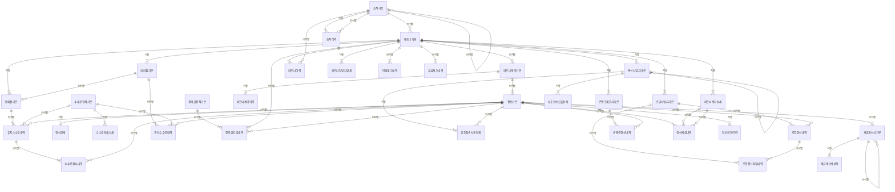

# 04. 논리 모델 — PRM 파트너

> 작성 2026-11-07 · subagent_logical_modeler(작성) · masteragent_da_coordinator 03 논리 관문 재생성 · 정본 `model/logical/PRM.json` — 이 문서는 JSON 에서 생성(손수정 금지)
> 엔터티 34(핵심 10 · 기본·일반 24 · 정산 STL 19) · 속성 303 · 관계 62 · 관문 리뷰 `reviews/03_logical.md`

## 1. 엔터티 목록

| ID | 엔터티 | 물리명 | 테이블명(미리보기) | 유형 | 단계 | 모듈 | PK | 속성 수 | 설명 |
|---|---|---|---|---|---|---|---|---|---|
| PRM-001 | 파트너기본 | `PRTNR_BAS` | `PTL_PRM_PRTNR_M` | BASE | CNCP |  | 파트너번호 | 16 | 통신사와 거래하는 모든 외부 당사자(대리점·판매점·제휴사·콘텐츠·소액결제 제공사·타 통신사·국제로밍 사업자·수납대행기관)의 공통 실체(슈퍼타입). 사업자등록·과세유형·관리 조직처럼 정산·세금계산서에 공통으로 쓰는 속성을 가진다. 제휴사는 별도 상세 없이 파트너유형코드로만 구분. 거래 종료 후에도 행을 지우지 않는다. |
| PRM-002 | 조직기본 | `ORG_BAS` | `PTL_PRM_ORG_M` | REF | CNCP |  | 조직코드 | 10 | 사내 영업 조직(본사·본부·지사·영업팀·직영매장·고객센터) 기준 정보(D5 — 파트너 관리 주체라 PRM). 상위 조직 자기 참조로 계층을 이루고, 개편 시 행을 닫고(유효종료일자) 새 코드를 연다. |
| PRM-003 | 대리점기본 | `AGNC_BAS` | `PTL_PRM_AGNC_M` | BASE | CNCP |  | 대리점번호 | 10 | 통신사와 위탁 계약을 맺고 개통·사후관리를 대행하는 1차 유통망(대리점) 서브타입. 관리 대리점으로서 회선의 관리수수료·유치 실적이 귀속되고(S10) 산하 판매점(2차점)을 거느린다. |
| PRM-004 | 판매점기본 | `SHOP_BAS` | `PTL_PRM_SHOP_M` | BASE | CNCP |  | 판매점번호 | 11 | 대리점 산하 또는 통신사 직계약으로 가입을 유치하는 판매 채널(판매점·양판점·온라인·방문판매) 서브타입. 단말기유통법 사전승낙 정보를 가지며 가입신청·부가서비스 유치의 귀속처(유치수수료 근거). |
| PRM-005 | 콘텐츠제공사기본 | `CNTS_PRVD_CO_BAS` | `PTL_PRM_CNTS_PRVD_CO_M` | BASE | CNCP |  | 콘텐츠제공사번호 | 9 | 부가서비스 콘텐츠(통화연결음·음악·영상·게임)와 휴대폰 소액결제를 제공하는 사업자(CP·PG·앱마켓) 서브타입. 고객 청구서에 정보이용료로 대신 청구하고 수수료를 뗀 금액을 정산해 준다(STL). |
| PRM-006 | 통신사업자기본 | `CARR_BAS` | `PTL_PRM_CARR_M` | BASE | CNCP |  | 통신사업자번호 | 10 | 국내 기간·별정 통신사업자(MNO·MVNO·유선·인터넷전화·국제전화) 서브타입. 번호이동 상대·번호 원 할당 사업자·상호접속료 정산 상대(STL). MVNO 는 망을 빌려주는 상위 사업자를 가진다. |
| PRM-007 | 로밍사업자기본 | `ROAM_BZMN_BAS` | `PTL_PRM_ROAM_BZMN_M` | BASE | CNCP |  | 로밍사업자번호 | 11 | 국제로밍 협정을 맺은 해외 이동통신사업자 서브타입. GSMA TADIG 코드로 TAP(사용 기록)·RAP(반송) 파일을 주고받으며 아웃바운드(우리 고객 해외 사용)·인바운드(해외 고객 국내 사용) 사용료를 상호 청구한다(STL). |
| PRM-008 | 파트너계약기본 | `PRTNR_CTRT_BAS` | `PTL_PRM_PRTNR_CTRT_M` | ACT | CNCP |  | 파트너계약번호 | 12 | 파트너와 맺은 거래 계약(대리점·판매점 위탁, 콘텐츠 제공, 상호접속, 국제로밍 협정, 제휴, 수납대행) 한 건. 계약 기간·자동갱신·정산주기·지급조건이 정산의 기준이 되고 변경은 파트너계약이력에 남긴다. |
| PRM-009 | 정산기본 | `STLM_BAS` | `PTL_PRM_STLM_M` | ACT | CNCP | STL | 정산번호 | 14 | 파트너 계약 1건 × 정산년월 × 정산유형(유치·관리수수료, 장려금, 상호접속료, 국제로밍, 콘텐츠, 환수)의 정산 머리 건. 건별 근거는 정산상세·원천 내역, 단계는 정산확정이력, 송금은 정산지급내역. 공급가액·부가가치세금액은 세금계산서 발행 근거라 확정 시점 스냅샷(P8). |
| PRM-010 | 세금계산서기본 | `TXINV_BAS` | `PTL_PRM_TXINV_M` | ACT | CNCP | STL | 세금계산서번호 | 14 | 정산 확정 금액으로 파트너와 주고받는 (전자)세금계산서 한 장(부가가치세법). 매출(통신사 발행 — 상호접속료·로밍 수취)과 매입(파트너 발행·역발행 — 수수료·장려금·콘텐츠)을 모두 담고, 수정세금계산서는 원 세금계산서를 자기 참조한다. |
| PRM-011 | 파트너이력 | `PRTNR_HIST` | `PTL_PRM_PRTNR_H` | ACT | LGCL |  | 파트너번호 + 유효시작일시 | 10 | 파트너 상호·상태·과세유형·관리 조직·소재 지역 변경 이력(SCD2 — 유효시작·종료일시). |
| PRM-012 | 파트너계약이력 | `PRTNR_CTRT_HIST` | `PTL_PRM_PRTNR_CTRT_H` | ACT | LGCL |  | 파트너계약번호 + 유효시작일시 | 8 | 파트너계약 상태·종료일자·정산주기·자동갱신 변경 이력(SCD2). |
| PRM-013 | 파트너계좌상세 | `PRTNR_ACCT_DTL` | `PTL_PRM_PRTNR_ACCT_D` | BASE | LGCL |  | 파트너번호 + 파트너계좌순번 | 9 | 정산 지급·수취에 쓰는 파트너 은행 계좌. 계좌번호는 암호화 값으로만 둔다(D11). |
| PRM-014 | 파트너담당자상세 | `PRTNR_PIC_DTL` | `PTL_PRM_PRTNR_PIC_D` | BASE | LGCL |  | 파트너번호 + 담당자순번 | 7 | 파트너 쪽 업무 담당자(정산·영업·기술·세무) 연락처. 합성 이름·번호만(D11). |
| PRM-015 | 조직이력 | `ORG_HIST` | `PTL_PRM_ORG_H` | ACT | LGCL |  | 조직코드 + 유효시작일시 | 7 | 조직 명칭·상위 조직·상태 변경 이력(SCD2) — 개편 시점 실적 귀속 재현용. |
| PRM-016 | 단말재고내역 | `EQP_STCK_DTLS` | `PTL_PRM_EQP_STCK_L` | ACT | LGCL |  | 단말재고번호 | 9 | 유통망(대리점·판매점)이 보유한 단말 한 대(IMEI 단위) 재고의 입고·출고 내역. |
| PRM-017 | 유심재고내역 | `USIM_STCK_DTLS` | `PTL_PRM_USIM_STCK_L` | ACT | LGCL |  | 유심재고번호 | 7 | 유통망이 보유한 유심 한 장(유심일련번호 단위) 재고의 입고·출고 내역. |
| PRM-018 | 정산상세 | `STLM_DTL` | `PTL_PRM_STLM_D` | ACT | LGCL | STL | 정산번호 + 정산상세순번 | 6 | 정산 머리 건의 항목별(정산항목유형) 건수·금액 요약 줄. 원천 건별 근거는 각 수수료·장려금·상호접속·로밍·콘텐츠 내역이 정산번호로 가리킨다. |
| PRM-019 | 수수료정책기본 | `FEE_PLCY_BAS` | `PTL_PRM_FEE_PLCY_M` | REF | LGCL | STL | 수수료정책번호 | 7 | 유치·관리·환수 수수료 정책(기간·대상). 정책별 요율은 수수료요율상세. |
| PRM-020 | 수수료요율상세 | `FEE_TRF_DTL` | `PTL_PRM_FEE_TRF_D` | REF | LGCL | STL | 수수료정책번호 + 수수료요율순번 | 7 | 수수료 정책의 요율 줄 — 대상 요금제·대리점 등급별 정액 또는 정률. |
| PRM-021 | 유치수수료내역 | `ATRCT_FEE_DTLS` | `PTL_PRM_ATRCT_FEE_L` | ACT | LGCL | STL | 유치수수료번호 | 8 | 개통(가입계약) 건별로 유치 판매점에 지급하는 유치(판매) 수수료. |
| PRM-022 | 관리수수료내역 | `MGMT_FEE_DTLS` | `PTL_PRM_MGMT_FEE_L` | ACT | LGCL | STL | 관리수수료번호 | 10 | 유지 회선(가입계약) × 월 관리 대리점에 지급하는 관리 수수료(청구금액 기준 정률). |
| PRM-023 | 수수료환수내역 | `FEE_CLBK_DTLS` | `PTL_PRM_FEE_CLBK_L` | ACT | LGCL | STL | 수수료환수번호 | 8 | 조기 해지·약정 위반 등으로 지급한 유치 수수료를 되돌려 받는 환수 건. |
| PRM-024 | 장려금정책기본 | `INCNTV_PLCY_BAS` | `PTL_PRM_INCNTV_PLCY_M` | REF | LGCL | STL | 장려금정책번호 | 8 | 단말 모델·요금제별 유통망 판매 장려금 정책(기간·건당 금액). |
| PRM-025 | 장려금지급내역 | `INCNTV_GIVE_DTLS` | `PTL_PRM_INCNTV_GIVE_L` | ACT | LGCL | STL | 장려금지급번호 | 8 | 장려금 정책에 따라 유통망에 지급하는 판매 장려금 건(개통 건 기준). |
| PRM-026 | 상호접속요율상세 | `INTCN_TRF_DTL` | `PTL_PRM_INTCN_TRF_D` | REF | LGCL | STL | 통신사업자번호 + 상호접속유형코드 + 적용시작일자 | 5 | 상대 통신사업자 × 상호접속유형 × 적용기간별 접속 요율(과기정통부 고시 기준, 원/분). |
| PRM-027 | 상호접속사용집계 | `INTCN_USE_AGG` | `PTL_PRM_INTCN_USE_T` | PROC | LGCL | STL | 통신사업자번호 + 정산년월 + 상호접속유형코드 | 7 | 상대 사업자 × 월 × 상호접속유형별 접속 사용(호) 건수·초수·금액 집계(원천 = PAY 사용내역). 후보명 "상호접속통화집계" 에서 개명(L3). |
| PRM-028 | 로밍정산파일내역 | `ROAM_STLM_FILE_DTLS` | `PTL_PRM_ROAM_STLM_FILE_L` | ACT | LGCL | STL | 로밍정산파일번호 | 11 | 로밍 사업자와 주고받은 TAP·RAP 파일 한 개(파일 순번·레코드 건수·금액). |
| PRM-029 | 로밍정산내역 | `ROAM_STLM_DTLS` | `PTL_PRM_ROAM_STLM_L` | ACT | LGCL | STL | 로밍정산번호 | 8 | 로밍 사업자 × 월 × 방향(인·아웃바운드) 정산 금액(정산 통화·환율). |
| PRM-030 | 콘텐츠정산내역 | `CNTS_STLM_DTLS` | `PTL_PRM_CNTS_STLM_L` | ACT | LGCL | STL | 콘텐츠정산번호 | 9 | 콘텐츠제공사 × 월 정보이용료·소액결제 정산(청구·수납 금액에서 수수료 공제). |
| PRM-031 | 정산지급내역 | `STLM_GIVE_DTLS` | `PTL_PRM_STLM_GIVE_L` | ACT | LGCL | STL | 정산번호 + 정산지급순번 | 8 | 정산 확정 금액의 실제 송금·수취·상계 건(분할 지급 가능). |
| PRM-032 | 정산확정이력 | `STLM_CFMTN_HIST` | `PTL_PRM_STLM_CFMTN_H` | ACT | LGCL | STL | 정산번호 + 정산확정이력순번 | 6 | 정산의 검증·이의·확정·취소 단계 이력. |
| PRM-033 | 세금계산서상세 | `TXINV_DTL` | `PTL_PRM_TXINV_D` | ACT | LGCL | STL | 세금계산서번호 + 세금계산서상세순번 | 5 | 세금계산서 품목 줄(최대 4줄 관행 — 정산 항목별). |
| PRM-034 | 정산월통계 | `STLM_MM_STATS` | `PTL_PRM_STLM_MM_S` | PROC | LGCL | STL | 정산년월 + 정산유형코드 + 파트너유형코드 | 8 | 정산년월 × 정산유형 × 파트너유형 정산 건수·금액 통계(경영 보고). |

## 2. 엔터티별 속성

속성 순서 = PK → FK → 일반(규칙 2-9). FK 표기 = `<영역>.<엔터티>.<속성>`. NULL Y = 선택. 시스템 칼럼 4개는 DDL 생성 때만 붙는다(D7).

### PRM-001 파트너기본 `PRTNR_BAS` (BASE·CNCP)

통신사와 거래하는 모든 외부 당사자(대리점·판매점·제휴사·콘텐츠·소액결제 제공사·타 통신사·국제로밍 사업자·수납대행기관)의 공통 실체(슈퍼타입). 사업자등록·과세유형·관리 조직처럼 정산·세금계산서에 공통으로 쓰는 속성을 가진다. 제휴사는 별도 상세 없이 파트너유형코드로만 구분. 거래 종료 후에도 행을 지우지 않는다.

| # | 속성 | 물리명 | 도메인 | PK | FK | NULL | 설명 |
|---|---|---|---|---|---|---|---|
| 1 | 파트너번호 | PRTNR_NO | 번호V20 | PK |  | N | 파트너의 번호 — 대상을 식별하거나 외부에서 부여받은 번호 |
| 2 | 지역코드 | RGN_CD | 코드V10 |  | CUS.지역코드.지역코드 | Y | 소재 지역(해외 사업자 NULL — S10 지역↔대리점 상관) |
| 3 | 관리조직코드 | MGMT_ORG_CD | 코드V10 |  | PRM.조직기본.조직코드 | Y | 관리하는 사내 영업 조직 — 역할명, PRM.조직기본.조직코드(해외 사업자 NULL) |
| 4 | 파트너명 | PRTNR_NM | 명V200 |  |  | N | 사업자등록상 상호(법적 명의) |
| 5 | 파트너등록일시 | PRTNR_REG_DTM | 일시TS |  |  | N | 파트너 등록의 일시 — 연월일 시분초까지의 시점 |
| 6 | 파트너상태유형코드 | PRTNR_STTS_TY_CD | 코드V10 |  |  | N | 파트너 상태의 유형 코드 — 공통코드(codes.json) |
| 7 | 파트너유형코드 | PRTNR_TY_CD | 코드V10 |  |  | N | 서브타입 판별자(대리점·판매점·제휴사·콘텐츠제공사·통신사업자·로밍사업자·수납대행기관) |
| 8 | 사업자등록번호 | BRNO | 번호V20 |  |  | Y | 국내 사업자만(해외 NULL — S5) |
| 9 | 법인등록번호 | CRNO | 번호V20 |  |  | Y | 법원 법인등록번호 13자리 |
| 10 | 대표자명 | RPRSV_NM | 명V100 |  |  | Y | 대표자의 명 — 대상을 부르는 이름 |
| 11 | 사업자과세유형코드 | BZMN_TXTN_TY_CD | 코드V10 |  |  | N | 사업자 과세의 유형 코드 — 공통코드(codes.json) |
| 12 | 국가코드 | NATN_CD | 코드V10 |  |  | N | ISO 3166 국가(외부 표준 코드) |
| 13 | 대표전화번호 | RPRS_TELNO | 전화번호V20 |  |  | Y | 대표의 전화번호 — 전화번호(숫자 문자열) |
| 14 | 사업장주소 | BPLC_ADDR | 주소V200 |  |  | Y | 사업장의 주소 — 우편·전자 주소 |
| 15 | 거래시작일자 | TRD_BGNG_DT | 일자C8 |  |  | N | 거래 시작의 일자 — 연월일(YYYYMMDD) |
| 16 | 거래종료일자 | TRD_END_DT | 일자C8 |  |  | Y | 거래 종료의 일자 — 연월일(YYYYMMDD) |

정규화 : 1NF : 계좌·담당자 반복 → 파트너계좌상세·파트너담당자상세, 변경 → 파트너이력. 2NF : 단일 PK. 3NF : 국가코드는 국내 사업자면 지역코드로 정해지지만 해외 사업자는 지역이 NULL 이라 국가가 유일한 소재 정보 — 지역→국가 종속은 지역이 있을 때만 성립하는 부분 함수라 독립 속성으로 둠. 유형별 고유 속성은 서브타입 5개로 분리.

### PRM-002 조직기본 `ORG_BAS` (REF·CNCP)

사내 영업 조직(본사·본부·지사·영업팀·직영매장·고객센터) 기준 정보(D5 — 파트너 관리 주체라 PRM). 상위 조직 자기 참조로 계층을 이루고, 개편 시 행을 닫고(유효종료일자) 새 코드를 연다.

| # | 속성 | 물리명 | 도메인 | PK | FK | NULL | 설명 |
|---|---|---|---|---|---|---|---|
| 1 | 조직코드 | ORG_CD | 코드V10 | PK |  | N | 조직의 코드 — 업무 분류 값을 식별하는 부호, 엔터티에서는 기준 코드 집합 |
| 2 | 상위조직코드 | UP_ORG_CD | 코드V10 |  | PRM.조직기본.조직코드 | Y | 상위 조직 — 역할명 자기 참조(본사 NULL) |
| 3 | 조직명 | ORG_NM | 명V100 |  |  | N | 조직의 명 — 대상을 부르는 이름 |
| 4 | 조직등록일시 | ORG_REG_DTM | 일시TS |  |  | N | 조직 등록의 일시 — 연월일 시분초까지의 시점 |
| 5 | 조직상태유형코드 | ORG_STTS_TY_CD | 코드V10 |  |  | N | 조직 상태의 유형 코드 — 공통코드(codes.json) |
| 6 | 조직유형코드 | ORG_TY_CD | 코드V10 |  |  | N | 조직의 유형 코드 — 공통코드(codes.json) |
| 7 | 조직장명 | ORG_HD_NM | 명V100 |  |  | Y | 조직 장의 명 — 대상을 부르는 이름 |
| 8 | 비용센터코드 | CST_CTR_CD | 코드V10 |  |  | Y | ERP 비용센터(외부 코드) |
| 9 | 유효시작일자 | VLD_BGNG_DT | 일자C8 |  |  | N | 유효 시작의 일자 — 연월일(YYYYMMDD) |
| 10 | 유효종료일자 | VLD_END_DT | 일자C8 |  |  | Y | 유효 종료의 일자 — 연월일(YYYYMMDD) |

정규화 : 1NF : 명칭·상위 조직 변경 → 조직이력. 2NF : 단일 PK. 3NF : 이행 종속 없음(계층은 자기 참조 FK).

### PRM-003 대리점기본 `AGNC_BAS` (BASE·CNCP)

통신사와 위탁 계약을 맺고 개통·사후관리를 대행하는 1차 유통망(대리점) 서브타입. 관리 대리점으로서 회선의 관리수수료·유치 실적이 귀속되고(S10) 산하 판매점(2차점)을 거느린다.

| # | 속성 | 물리명 | 도메인 | PK | FK | NULL | 설명 |
|---|---|---|---|---|---|---|---|
| 1 | 대리점번호 | AGNC_NO | 번호V20 | PK | PRM.파트너기본.파트너번호 | N | 파트너번호의 역할명(값 동일, 1:1 식별 서브타입) |
| 2 | 대리점명 | AGNC_NM | 명V100 |  |  | N | 영업 간판명(법적 상호 = 파트너명과 다를 수 있음) |
| 3 | 대리점등록일시 | AGNC_REG_DTM | 일시TS |  |  | N | 대리점 등록의 일시 — 연월일 시분초까지의 시점 |
| 4 | 대리점상태유형코드 | AGNC_STTS_TY_CD | 코드V10 |  |  | N | 대리점 상태의 유형 코드 — 공통코드(codes.json) |
| 5 | 대리점유형코드 | AGNC_TY_CD | 코드V10 |  |  | N | 대리점의 유형 코드 — 공통코드(codes.json) |
| 6 | 대리점등급유형코드 | AGNC_GRD_TY_CD | 코드V10 |  |  | N | 대리점 등급의 유형 코드 — 공통코드(codes.json) |
| 7 | 개설일자 | OPN_DT | 일자C8 |  |  | N | 개설의 일자 — 연월일(YYYYMMDD) |
| 8 | 폐쇄일자 | CLSR_DT | 일자C8 |  |  | Y | 폐쇄의 일자 — 연월일(YYYYMMDD) |
| 9 | 담보금액 | CLTRL_AMT | 금액N15 |  |  | N | 담보의 금액 — 원화 금액(원 단위 정수) |
| 10 | 전속대리점여부 | EXCL_AGNC_YN | 여부C1 |  |  | N | 전속 대리점의 여부 — 해당 여부(Y/N) |

정규화 : 1NF 충족. 2NF : 단일 PK. 3NF : 사업자·과세·조직 등 공통 속성은 슈퍼타입(파트너기본) 한 곳에만. 대리점명은 간판명으로 파트너명(법적 상호)과 독립.

### PRM-004 판매점기본 `SHOP_BAS` (BASE·CNCP)

대리점 산하 또는 통신사 직계약으로 가입을 유치하는 판매 채널(판매점·양판점·온라인·방문판매) 서브타입. 단말기유통법 사전승낙 정보를 가지며 가입신청·부가서비스 유치의 귀속처(유치수수료 근거).

| # | 속성 | 물리명 | 도메인 | PK | FK | NULL | 설명 |
|---|---|---|---|---|---|---|---|
| 1 | 판매점번호 | SHOP_NO | 번호V20 | PK | PRM.파트너기본.파트너번호 | N | 파트너번호의 역할명(값 동일) |
| 2 | 대리점번호 | AGNC_NO | 번호V20 |  | PRM.대리점기본.대리점번호 | Y | 상위 대리점(양판점·직계약 판매점 NULL — S5) |
| 3 | 판매점명 | SHOP_NM | 명V100 |  |  | N | 판매점의 명 — 대상을 부르는 이름 |
| 4 | 판매점등록일시 | SHOP_REG_DTM | 일시TS |  |  | N | 판매점 등록의 일시 — 연월일 시분초까지의 시점 |
| 5 | 판매점상태유형코드 | SHOP_STTS_TY_CD | 코드V10 |  |  | N | 판매점 상태의 유형 코드 — 공통코드(codes.json) |
| 6 | 판매점유형코드 | SHOP_TY_CD | 코드V10 |  |  | N | 판매점의 유형 코드 — 공통코드(codes.json) |
| 7 | 사전승낙번호 | PRAPRV_NO | 번호V20 |  |  | Y | 사전승낙의 번호 — 대상을 식별하거나 외부에서 부여받은 번호 |
| 8 | 사전승낙일자 | PRAPRV_DT | 일자C8 |  |  | Y | 사전승낙의 일자 — 연월일(YYYYMMDD) |
| 9 | 개설일자 | OPN_DT | 일자C8 |  |  | N | 개설의 일자 — 연월일(YYYYMMDD) |
| 10 | 폐쇄일자 | CLSR_DT | 일자C8 |  |  | Y | 폐쇄의 일자 — 연월일(YYYYMMDD) |
| 11 | 신분증스캐너보유여부 | IDCD_SCNR_HOLD_YN | 여부C1 |  |  | N | 신분증 스캐너 보유의 여부 — 해당 여부(Y/N) |

정규화 : 1NF 충족. 2NF : 단일 PK. 3NF : 사전승낙일자는 사전승낙번호(외부 발급 번호)의 속성이지만 번호 체계 엔터티가 없고 1:1 이라 판매점 속성으로 둠.

### PRM-005 콘텐츠제공사기본 `CNTS_PRVD_CO_BAS` (BASE·CNCP)

부가서비스 콘텐츠(통화연결음·음악·영상·게임)와 휴대폰 소액결제를 제공하는 사업자(CP·PG·앱마켓) 서브타입. 고객 청구서에 정보이용료로 대신 청구하고 수수료를 뗀 금액을 정산해 준다(STL).

| # | 속성 | 물리명 | 도메인 | PK | FK | NULL | 설명 |
|---|---|---|---|---|---|---|---|
| 1 | 콘텐츠제공사번호 | CNTS_PRVD_CO_NO | 번호V20 | PK | PRM.파트너기본.파트너번호 | N | 파트너번호의 역할명(값 동일) |
| 2 | 콘텐츠제공사명 | CNTS_PRVD_CO_NM | 명V100 |  |  | N | 콘텐츠 제공 사의 명 — 대상을 부르는 이름 |
| 3 | 콘텐츠제공사등록일시 | CNTS_PRVD_CO_REG_DTM | 일시TS |  |  | N | 콘텐츠 제공 사 등록의 일시 — 연월일 시분초까지의 시점 |
| 4 | 콘텐츠제공사상태유형코드 | CNTS_PRVD_CO_STTS_TY_CD | 코드V10 |  |  | N | 콘텐츠 제공 사 상태의 유형 코드 — 공통코드(codes.json) |
| 5 | 콘텐츠제공사유형코드 | CNTS_PRVD_CO_TY_CD | 코드V10 |  |  | N | 콘텐츠 제공 사의 유형 코드 — 공통코드(codes.json) |
| 6 | 부가통신사업신고번호 | VASB_DCLR_NO | 번호V20 |  |  | Y | 부가통신사업 신고의 번호 — 대상을 식별하거나 외부에서 부여받은 번호 |
| 7 | 정산수수료율 | STLM_FEE_RT | 율N5_2 |  |  | N | 현재 적용 정산 수수료율(월 정산 건의 수수료 금액은 콘텐츠정산내역에 확정) |
| 8 | 휴대폰결제가맹여부 | HP_PYMT_AFLT_YN | 여부C1 |  |  | N | 휴대폰 결제 가맹의 여부 — 해당 여부(Y/N) |
| 9 | 고객센터전화번호 | CUST_CTR_TELNO | 전화번호V20 |  |  | Y | 고객 센터의 전화번호 — 전화번호(숫자 문자열) |

정규화 : 1NF 충족. 2NF : 단일 PK. 3NF : 이행 종속 없음. 정산수수료율은 현재값, 과거 월 적용분은 콘텐츠정산내역의 정산수수료금액으로 보존.

### PRM-006 통신사업자기본 `CARR_BAS` (BASE·CNCP)

국내 기간·별정 통신사업자(MNO·MVNO·유선·인터넷전화·국제전화) 서브타입. 번호이동 상대·번호 원 할당 사업자·상호접속료 정산 상대(STL). MVNO 는 망을 빌려주는 상위 사업자를 가진다.

| # | 속성 | 물리명 | 도메인 | PK | FK | NULL | 설명 |
|---|---|---|---|---|---|---|---|
| 1 | 통신사업자번호 | CARR_NO | 번호V20 | PK | PRM.파트너기본.파트너번호 | N | 파트너번호의 역할명(값 동일) |
| 2 | 상위통신사업자번호 | UP_CARR_NO | 번호V20 |  | PRM.통신사업자기본.통신사업자번호 | Y | MVNO 의 망 제공 사업자 — 역할명 자기 참조(MNO NULL) |
| 3 | 통신사업자명 | CARR_NM | 명V100 |  |  | N | 통신사업자의 명 — 대상을 부르는 이름 |
| 4 | 통신사업자등록일시 | CARR_REG_DTM | 일시TS |  |  | N | 통신사업자 등록의 일시 — 연월일 시분초까지의 시점 |
| 5 | 통신사업자상태유형코드 | CARR_STTS_TY_CD | 코드V10 |  |  | N | 통신사업자 상태의 유형 코드 — 공통코드(codes.json) |
| 6 | 통신사업자유형코드 | CARR_TY_CD | 코드V10 |  |  | N | 통신사업자의 유형 코드 — 공통코드(codes.json) |
| 7 | 번호이동사업자코드 | MNP_BZMN_CD | 코드V10 |  |  | Y | KTOA 번호이동 사업자 코드(외부 코드) |
| 8 | 망식별코드 | NTWK_IDFC_CD | 코드V10 |  |  | Y | ITU-T E.212 MCC+MNC(MVNO NULL) |
| 9 | 상호접속계약일자 | INTCN_CTRT_DT | 일자C8 |  |  | Y | 상호접속 계약의 일자 — 연월일(YYYYMMDD) |
| 10 | 상호접속정산대상여부 | INTCN_STLM_TRGT_YN | 여부C1 |  |  | N | 상호접속 정산 대상의 여부 — 해당 여부(Y/N) |

정규화 : 1NF : 상호접속 요율 반복 → 상호접속요율상세. 2NF : 단일 PK. 3NF : 이행 종속 없음.

### PRM-007 로밍사업자기본 `ROAM_BZMN_BAS` (BASE·CNCP)

국제로밍 협정을 맺은 해외 이동통신사업자 서브타입. GSMA TADIG 코드로 TAP(사용 기록)·RAP(반송) 파일을 주고받으며 아웃바운드(우리 고객 해외 사용)·인바운드(해외 고객 국내 사용) 사용료를 상호 청구한다(STL).

| # | 속성 | 물리명 | 도메인 | PK | FK | NULL | 설명 |
|---|---|---|---|---|---|---|---|
| 1 | 로밍사업자번호 | ROAM_BZMN_NO | 번호V20 | PK | PRM.파트너기본.파트너번호 | N | 파트너번호의 역할명(값 동일) |
| 2 | 국가코드 | NATN_CD | 코드V10 |  | PRD.로밍국가코드.국가코드 | N | 방문망(로밍 상대 망)이 서비스하는 국가 — ISO 3166-1 alpha-2, FK → PRD.로밍국가코드. 파트너기본.국가코드(계약 법인 소재국)와 다를 수 있음(그룹 사업자) |
| 3 | 로밍사업자명 | ROAM_BZMN_NM | 명V100 |  |  | N | 로밍 사업자의 명 — 대상을 부르는 이름 |
| 4 | 로밍사업자등록일시 | ROAM_BZMN_REG_DTM | 일시TS |  |  | N | 로밍 사업자 등록의 일시 — 연월일 시분초까지의 시점 |
| 5 | 로밍사업자상태유형코드 | ROAM_BZMN_STTS_TY_CD | 코드V10 |  |  | N | 로밍 사업자 상태의 유형 코드 — 공통코드(codes.json) |
| 6 | TADIG코드 | TADIG_CD | 코드V10 |  |  | N | GSMA TD.13 사업자 코드(외부 코드) |
| 7 | 망식별코드 | NTWK_IDFC_CD | 코드V10 |  |  | N | 망 식별 코드 — 외부 표준 ITU-T E.212 MCC+MNC 값을 그대로 쓴다(공통코드 아님) |
| 8 | 로밍방향구분코드 | ROAM_DRCT_SE_CD | 코드V10 |  |  | N | 로밍 방향의 구분 코드 — 공통코드(codes.json) |
| 9 | 로밍계약일자 | ROAM_CTRT_DT | 일자C8 |  |  | N | 로밍 계약의 일자 — 연월일(YYYYMMDD) |
| 10 | 정산통화코드 | STLM_CRNCY_CD | 코드V10 |  |  | N | ISO 4217(SDR·USD·EUR 등) |
| 11 | 데이터청산사명 | DATA_CLRH_CO_NM | 명V100 |  |  | Y | 데이터 청산 사의 명 — 대상을 부르는 이름 |

정규화 : 1NF : 파일·월 정산 반복 → 로밍정산파일내역·로밍정산내역. 2NF : 단일 PK. 3NF : 국가코드(방문망 국가, FK → PRD.로밍국가코드)는 TADIG 망 단위 사실로, 슈퍼타입 파트너기본.국가코드(계약 법인 소재국)와 다를 수 있어(그룹 사업자) 이행 종속 아님 — 03 관문 L4-R 로 추가(당초 L4 는 같은 값으로 보고 불수용).

### PRM-008 파트너계약기본 `PRTNR_CTRT_BAS` (ACT·CNCP)

파트너와 맺은 거래 계약(대리점·판매점 위탁, 콘텐츠 제공, 상호접속, 국제로밍 협정, 제휴, 수납대행) 한 건. 계약 기간·자동갱신·정산주기·지급조건이 정산의 기준이 되고 변경은 파트너계약이력에 남긴다.

| # | 속성 | 물리명 | 도메인 | PK | FK | NULL | 설명 |
|---|---|---|---|---|---|---|---|
| 1 | 파트너계약번호 | PRTNR_CTRT_NO | 번호V20 | PK |  | N | 파트너 계약의 번호 — 대상을 식별하거나 외부에서 부여받은 번호 |
| 2 | 파트너번호 | PRTNR_NO | 번호V20 |  | PRM.파트너기본.파트너번호 | N | 파트너의 번호 — 대상을 식별하거나 외부에서 부여받은 번호 |
| 3 | 파트너계약명 | PRTNR_CTRT_NM | 명V100 |  |  | N | 파트너 계약의 명 — 대상을 부르는 이름 |
| 4 | 파트너계약일시 | PRTNR_CTRT_DTM | 일시TS |  |  | N | 파트너 계약의 일시 — 연월일 시분초까지의 시점 |
| 5 | 파트너계약상태유형코드 | PRTNR_CTRT_STTS_TY_CD | 코드V10 |  |  | N | 파트너 계약 상태의 유형 코드 — 공통코드(codes.json) |
| 6 | 파트너계약유형코드 | PRTNR_CTRT_TY_CD | 코드V10 |  |  | N | 파트너 계약의 유형 코드 — 공통코드(codes.json) |
| 7 | 계약시작일자 | CTRT_BGNG_DT | 일자C8 |  |  | N | 계약 시작의 일자 — 연월일(YYYYMMDD) |
| 8 | 계약종료일자 | CTRT_END_DT | 일자C8 |  |  | Y | 계약 종료의 일자 — 연월일(YYYYMMDD) |
| 9 | 자동갱신여부 | ATMT_RNW_YN | 여부C1 |  |  | N | 자동 갱신의 여부 — 해당 여부(Y/N) |
| 10 | 정산주기유형코드 | STLM_CYCL_TY_CD | 코드V10 |  |  | N | 정산 주기의 유형 코드 — 공통코드(codes.json) |
| 11 | 지급조건내용 | GIVE_CND_CN | 내용V200 |  |  | Y | 지급 조건의 내용 — 자유 서술 내용 |
| 12 | 계약해지일자 | CTRT_TRMN_DT | 일자C8 |  |  | Y | 계약 해지의 일자 — 연월일(YYYYMMDD) |

정규화 : 1NF : 계약 조건 변경 반복 → 파트너계약이력. 2NF : 단일 PK. 3NF : 이행 종속 없음.

### PRM-009 정산기본 `STLM_BAS` (ACT·CNCP·STL)

파트너 계약 1건 × 정산년월 × 정산유형(유치·관리수수료, 장려금, 상호접속료, 국제로밍, 콘텐츠, 환수)의 정산 머리 건. 건별 근거는 정산상세·원천 내역, 단계는 정산확정이력, 송금은 정산지급내역. 공급가액·부가가치세금액은 세금계산서 발행 근거라 확정 시점 스냅샷(P8).

| # | 속성 | 물리명 | 도메인 | PK | FK | NULL | 설명 |
|---|---|---|---|---|---|---|---|
| 1 | 정산번호 | STLM_NO | 번호V20 | PK |  | N | 정산의 번호 — 대상을 식별하거나 외부에서 부여받은 번호 |
| 2 | 파트너계약번호 | PRTNR_CTRT_NO | 번호V20 |  | PRM.파트너계약기본.파트너계약번호 | N | 정산 기준 계약(정산 당사자 파트너는 계약에서 결정) |
| 3 | 정산명 | STLM_NM | 명V100 |  |  | N | 정산의 명 — 대상을 부르는 이름 |
| 4 | 정산일시 | STLM_DTM | 일시TS |  |  | N | 정산의 일시 — 연월일 시분초까지의 시점 |
| 5 | 정산상태유형코드 | STLM_STTS_TY_CD | 코드V10 |  |  | N | 정산 상태의 유형 코드 — 공통코드(codes.json) |
| 6 | 정산년월 | STLM_YM | 년월C6 |  |  | N | 정산의 년월 — 연월(YYYYMM) |
| 7 | 정산유형코드 | STLM_TY_CD | 코드V10 |  |  | N | 정산의 유형 코드 — 공통코드(codes.json) |
| 8 | 정산방향구분코드 | STLM_DRCT_SE_CD | 코드V10 |  |  | N | 지급·수취(상호접속·로밍은 상계 후 순액 방향) |
| 9 | 정산대상금액 | STLM_TRGT_AMT | 금액N15 |  |  | N | 정산 대상의 금액 — 원화 금액(원 단위 정수) |
| 10 | 공제금액 | DDTN_AMT | 금액N15 |  |  | N | 공제의 금액 — 원화 금액(원 단위 정수) |
| 11 | 공급가액 | SPLYAMT | 금액N15 |  |  | N | 부가가치세를 제외한 공급 대가 금액 |
| 12 | 부가가치세금액 | VAT_AMT | 금액N15 |  |  | N | 부가가치세의 금액 — 원화 금액(원 단위 정수) |
| 13 | 통화코드 | CRNCY_CD | 코드V10 |  |  | N | 통화 코드 — 외부 표준 ISO 4217 값을 그대로 쓴다(공통코드 아님) |
| 14 | 지급예정일자 | GIVE_SCHD_DT | 일자C8 |  |  | Y | 지급 예정의 일자 — 연월일(YYYYMMDD) |

정규화 : 1NF : 항목별 금액 → 정산상세, 확정 단계 → 정산확정이력, 송금 → 정산지급내역. 2NF : 단일 PK(후보키 = 파트너계약번호+정산년월+정산유형코드). 3NF : 개념 모델의 파트너번호는 파트너계약번호가 결정하는 이행 종속 → 제거(물리 반정규화 후보). 정산확정일시는 정산확정이력의 확정 행에서 유도 → 제거. 공급가액·부가가치세금액은 상세 합계지만 법적 확정값 스냅샷(P8)으로 보존.

### PRM-010 세금계산서기본 `TXINV_BAS` (ACT·CNCP·STL)

정산 확정 금액으로 파트너와 주고받는 (전자)세금계산서 한 장(부가가치세법). 매출(통신사 발행 — 상호접속료·로밍 수취)과 매입(파트너 발행·역발행 — 수수료·장려금·콘텐츠)을 모두 담고, 수정세금계산서는 원 세금계산서를 자기 참조한다.

| # | 속성 | 물리명 | 도메인 | PK | FK | NULL | 설명 |
|---|---|---|---|---|---|---|---|
| 1 | 세금계산서번호 | TXINV_NO | 번호V20 | PK |  | N | 세금계산서의 번호 — 대상을 식별하거나 외부에서 부여받은 번호 |
| 2 | 정산번호 | STLM_NO | 번호V20 |  | PRM.정산기본.정산번호 | N | 정산의 번호 — 대상을 식별하거나 외부에서 부여받은 번호 |
| 3 | 원세금계산서번호 | ORGN_TXINV_NO | 번호V20 |  | PRM.세금계산서기본.세금계산서번호 | Y | 수정 발행의 원 세금계산서 — 역할명 자기 참조(정발행 NULL) |
| 4 | 세금계산서품목명 | TXINV_PRDLST_NM | 명V200 |  |  | N | 세금계산서 품목의 명 — 대상을 부르는 이름 |
| 5 | 세금계산서발행일시 | TXINV_PBLCN_DTM | 일시TS |  |  | N | 세금계산서 발행의 일시 — 연월일 시분초까지의 시점 |
| 6 | 세금계산서상태유형코드 | TXINV_STTS_TY_CD | 코드V10 |  |  | N | 세금계산서 상태의 유형 코드 — 공통코드(codes.json) |
| 7 | 세금계산서유형코드 | TXINV_TY_CD | 코드V10 |  |  | N | 세금계산서의 유형 코드 — 공통코드(codes.json) |
| 8 | 매입매출구분코드 | PRCHS_SLS_SE_CD | 코드V10 |  |  | N | 매입 매출의 구분 코드 — 공통코드(codes.json) |
| 9 | 작성일자 | WRT_DT | 일자C8 |  |  | N | 작성의 일자 — 연월일(YYYYMMDD) |
| 10 | 공급가액 | SPLYAMT | 금액N15 |  |  | N | 부가가치세를 제외한 공급 대가 금액 |
| 11 | 세액 | TXAMT | 금액N15 |  |  | N | 과세표준에 세율을 곱한 세금 금액 |
| 12 | 전자세금계산서승인번호 | ELCTR_TXINV_APRV_NO | 번호V30 |  |  | Y | 전자 세금계산서 승인의 번호 — 대상을 식별하거나 외부에서 부여받은 번호 |
| 13 | 국세청전송일시 | NTS_TRNM_DTM | 일시TS |  |  | Y | 국세청 전송의 일시 — 연월일 시분초까지의 시점 |
| 14 | 수정사유유형코드 | MDFCN_RSN_TY_CD | 코드V10 |  |  | Y | 수정 사유의 유형 코드 — 공통코드(codes.json) |

정규화 : 1NF : 품목 줄 → 세금계산서상세. 2NF : 단일 PK. 3NF : 개념 모델의 파트너번호는 정산번호→파트너계약→파트너로 결정되는 이행 종속 → 제거(물리 반정규화 후보). 매입매출구분코드는 정산방향과 대부분 같지만 상계 정산(상호접속·로밍)에서 한 정산에 매출·매입 세금계산서가 함께 나오므로 독립.

### PRM-011 파트너이력 `PRTNR_HIST` (ACT·LGCL)

파트너 상호·상태·과세유형·관리 조직·소재 지역 변경 이력(SCD2 — 유효시작·종료일시).

| # | 속성 | 물리명 | 도메인 | PK | FK | NULL | 설명 |
|---|---|---|---|---|---|---|---|
| 1 | 파트너번호 | PRTNR_NO | 번호V20 | PK | PRM.파트너기본.파트너번호 | N | 파트너의 번호 — 대상을 식별하거나 외부에서 부여받은 번호 |
| 2 | 유효시작일시 | VLD_BGNG_DTM | 일시TS | PK |  | N | 유효 시작의 일시 — 연월일 시분초까지의 시점 |
| 3 | 지역코드 | RGN_CD | 코드V10 |  | CUS.지역코드.지역코드 | Y | 지역의 코드 — 업무 분류 값을 식별하는 부호, 엔터티에서는 기준 코드 집합 |
| 4 | 관리조직코드 | MGMT_ORG_CD | 코드V10 |  | PRM.조직기본.조직코드 | Y | 관리 조직의 코드 — 업무 분류 값을 식별하는 부호, 엔터티에서는 기준 코드 집합 |
| 5 | 유효종료일시 | VLD_END_DTM | 일시TS |  |  | Y | 유효 종료의 일시 — 연월일 시분초까지의 시점 |
| 6 | 파트너명 | PRTNR_NM | 명V200 |  |  | N | 파트너의 명 — 대상을 부르는 이름 |
| 7 | 파트너상태유형코드 | PRTNR_STTS_TY_CD | 코드V10 |  |  | N | 파트너 상태의 유형 코드 — 공통코드(codes.json) |
| 8 | 사업자과세유형코드 | BZMN_TXTN_TY_CD | 코드V10 |  |  | N | 사업자 과세의 유형 코드 — 공통코드(codes.json) |
| 9 | 대표자명 | RPRSV_NM | 명V100 |  |  | Y | 대표자의 명 — 대상을 부르는 이름 |
| 10 | 파트너변경사유유형코드 | PRTNR_CHG_RSN_TY_CD | 코드V10 |  |  | N | 파트너 변경 사유의 유형 코드 — 공통코드(codes.json) |

정규화 : 2NF : 모든 속성이 (파트너번호, 유효시작일시) 시점 값. 3NF : 이행 종속 없음.

### PRM-012 파트너계약이력 `PRTNR_CTRT_HIST` (ACT·LGCL)

파트너계약 상태·종료일자·정산주기·자동갱신 변경 이력(SCD2).

| # | 속성 | 물리명 | 도메인 | PK | FK | NULL | 설명 |
|---|---|---|---|---|---|---|---|
| 1 | 파트너계약번호 | PRTNR_CTRT_NO | 번호V20 | PK | PRM.파트너계약기본.파트너계약번호 | N | 파트너 계약의 번호 — 대상을 식별하거나 외부에서 부여받은 번호 |
| 2 | 유효시작일시 | VLD_BGNG_DTM | 일시TS | PK |  | N | 유효 시작의 일시 — 연월일 시분초까지의 시점 |
| 3 | 유효종료일시 | VLD_END_DTM | 일시TS |  |  | Y | 유효 종료의 일시 — 연월일 시분초까지의 시점 |
| 4 | 파트너계약상태유형코드 | PRTNR_CTRT_STTS_TY_CD | 코드V10 |  |  | N | 파트너 계약 상태의 유형 코드 — 공통코드(codes.json) |
| 5 | 계약종료일자 | CTRT_END_DT | 일자C8 |  |  | Y | 계약 종료의 일자 — 연월일(YYYYMMDD) |
| 6 | 정산주기유형코드 | STLM_CYCL_TY_CD | 코드V10 |  |  | N | 정산 주기의 유형 코드 — 공통코드(codes.json) |
| 7 | 자동갱신여부 | ATMT_RNW_YN | 여부C1 |  |  | N | 자동 갱신의 여부 — 해당 여부(Y/N) |
| 8 | 파트너계약변경사유유형코드 | PRTNR_CTRT_CHG_RSN_TY_CD | 코드V10 |  |  | N | 파트너 계약 변경 사유의 유형 코드 — 공통코드(codes.json) |

정규화 : 2NF : 시점 값만. 3NF : 이행 종속 없음.

### PRM-013 파트너계좌상세 `PRTNR_ACCT_DTL` (BASE·LGCL)

정산 지급·수취에 쓰는 파트너 은행 계좌. 계좌번호는 암호화 값으로만 둔다(D11).

| # | 속성 | 물리명 | 도메인 | PK | FK | NULL | 설명 |
|---|---|---|---|---|---|---|---|
| 1 | 파트너번호 | PRTNR_NO | 번호V20 | PK | PRM.파트너기본.파트너번호 | N | 파트너의 번호 — 대상을 식별하거나 외부에서 부여받은 번호 |
| 2 | 파트너계좌순번 | PRTNR_ACCT_SEQ | 순번N5 | PK |  | N | 파트너 계좌의 순번 — 부모 안의 처리·표시 순서 |
| 3 | 은행코드 | BANK_CD | 코드V10 |  | INV.은행코드.은행코드 | N | 은행의 코드 — 업무 분류 값을 식별하는 부호, 엔터티에서는 기준 코드 집합 |
| 4 | 계좌번호암호화값 | ACCT_NO_ENCPT_VL | 값V256 |  |  | N | 계좌 번호 암호화의 값 — 측정·설정·암호화된 값 |
| 5 | 예금주명 | DPSOWN_NM | 명V100 |  |  | N | 예금주의 명 — 대상을 부르는 이름 |
| 6 | 대표계좌여부 | RPRS_ACCT_YN | 여부C1 |  |  | N | 대표 계좌의 여부 — 해당 여부(Y/N) |
| 7 | 계좌실명확인여부 | ACCT_RLNM_IDNTF_YN | 여부C1 |  |  | N | 계좌 실명 확인의 여부 — 해당 여부(Y/N) |
| 8 | 유효시작일자 | VLD_BGNG_DT | 일자C8 |  |  | N | 유효 시작의 일자 — 연월일(YYYYMMDD) |
| 9 | 유효종료일자 | VLD_END_DT | 일자C8 |  |  | Y | 유효 종료의 일자 — 연월일(YYYYMMDD) |

정규화 : 1NF : 파트너의 반복 계좌를 행으로 분리. 2NF : 은행명 등 은행 속성은 은행코드(INV) 소유. 3NF : 이행 종속 없음.

### PRM-014 파트너담당자상세 `PRTNR_PIC_DTL` (BASE·LGCL)

파트너 쪽 업무 담당자(정산·영업·기술·세무) 연락처. 합성 이름·번호만(D11).

| # | 속성 | 물리명 | 도메인 | PK | FK | NULL | 설명 |
|---|---|---|---|---|---|---|---|
| 1 | 파트너번호 | PRTNR_NO | 번호V20 | PK | PRM.파트너기본.파트너번호 | N | 파트너의 번호 — 대상을 식별하거나 외부에서 부여받은 번호 |
| 2 | 담당자순번 | PIC_SEQ | 순번N5 | PK |  | N | 담당자의 순번 — 부모 안의 처리·표시 순서 |
| 3 | 담당자명 | PIC_NM | 명V100 |  |  | N | 담당자의 명 — 대상을 부르는 이름 |
| 4 | 담당자유형코드 | PIC_TY_CD | 코드V10 |  |  | N | 담당 업무(정산·영업·기술·세무·법무) |
| 5 | 담당자휴대전화번호 | PIC_MBL_TELNO | 전화번호V20 |  |  | Y | 담당자 휴대의 전화번호 — 전화번호(숫자 문자열) |
| 6 | 담당자이메일주소 | PIC_EML_ADDR | 주소V100 |  |  | Y | 담당자 이메일의 주소 — 우편·전자 주소 |
| 7 | 대표담당자여부 | RPRS_PIC_YN | 여부C1 |  |  | N | 대표 담당자의 여부 — 해당 여부(Y/N) |

정규화 : 1NF : 반복 담당자를 행으로 분리. 2NF·3NF 충족(CUS 법인 담당자와 같은 용어 사용).

### PRM-015 조직이력 `ORG_HIST` (ACT·LGCL)

조직 명칭·상위 조직·상태 변경 이력(SCD2) — 개편 시점 실적 귀속 재현용.

| # | 속성 | 물리명 | 도메인 | PK | FK | NULL | 설명 |
|---|---|---|---|---|---|---|---|
| 1 | 조직코드 | ORG_CD | 코드V10 | PK | PRM.조직기본.조직코드 | N | 조직의 코드 — 업무 분류 값을 식별하는 부호, 엔터티에서는 기준 코드 집합 |
| 2 | 유효시작일시 | VLD_BGNG_DTM | 일시TS | PK |  | N | 유효 시작의 일시 — 연월일 시분초까지의 시점 |
| 3 | 상위조직코드 | UP_ORG_CD | 코드V10 |  | PRM.조직기본.조직코드 | Y | 상위 조직의 코드 — 업무 분류 값을 식별하는 부호, 엔터티에서는 기준 코드 집합 |
| 4 | 유효종료일시 | VLD_END_DTM | 일시TS |  |  | Y | 유효 종료의 일시 — 연월일 시분초까지의 시점 |
| 5 | 조직명 | ORG_NM | 명V100 |  |  | N | 조직의 명 — 대상을 부르는 이름 |
| 6 | 조직상태유형코드 | ORG_STTS_TY_CD | 코드V10 |  |  | N | 조직 상태의 유형 코드 — 공통코드(codes.json) |
| 7 | 조직변경사유유형코드 | ORG_CHG_RSN_TY_CD | 코드V10 |  |  | N | 조직 변경 사유의 유형 코드 — 공통코드(codes.json) |

정규화 : 2NF : 시점 값만. 3NF : 이행 종속 없음.

### PRM-016 단말재고내역 `EQP_STCK_DTLS` (ACT·LGCL)

유통망(대리점·판매점)이 보유한 단말 한 대(IMEI 단위) 재고의 입고·출고 내역.

| # | 속성 | 물리명 | 도메인 | PK | FK | NULL | 설명 |
|---|---|---|---|---|---|---|---|
| 1 | 단말재고번호 | EQP_STCK_NO | 번호V20 | PK |  | N | 단말 재고의 번호 — 대상을 식별하거나 외부에서 부여받은 번호 |
| 2 | 파트너번호 | PRTNR_NO | 번호V20 |  | PRM.파트너기본.파트너번호 | N | 재고 보유 유통망(대리점·판매점 파트너번호) |
| 3 | 단말모델코드 | EQP_MDL_CD | 코드V20 |  | PRD.단말모델기본.단말모델코드 | N | 단말 모델의 코드 — 업무 분류 값을 식별하는 부호, 엔터티에서는 기준 코드 집합 |
| 4 | IMEI번호 | IMEI_NO | 번호V20 |  |  | N | IMEI의 번호 — 대상을 식별하거나 외부에서 부여받은 번호 |
| 5 | 단말재고유형코드 | EQP_STCK_TY_CD | 코드V10 |  |  | N | 단말 재고의 유형 코드 — 공통코드(codes.json) |
| 6 | 단말재고상태유형코드 | EQP_STCK_STTS_TY_CD | 코드V10 |  |  | N | 단말 재고 상태의 유형 코드 — 공통코드(codes.json) |
| 7 | 입고일시 | WRHS_DTM | 일시TS |  |  | N | 입고의 일시 — 연월일 시분초까지의 시점 |
| 8 | 입고금액 | WRHS_AMT | 금액N15 |  |  | N | 입고의 금액 — 원화 금액(원 단위 정수) |
| 9 | 출고일시 | SHPM_DTM | 일시TS |  |  | Y | 출고의 일시 — 연월일 시분초까지의 시점 |

정규화 : 1NF 충족(대당 1행). 2NF : 단일 PK. 3NF : 출고가격은 단말모델(PRD 가격 이력)이 결정 → 두지 않음, 입고금액은 거래 사실이라 보존.

### PRM-017 유심재고내역 `USIM_STCK_DTLS` (ACT·LGCL)

유통망이 보유한 유심 한 장(유심일련번호 단위) 재고의 입고·출고 내역.

| # | 속성 | 물리명 | 도메인 | PK | FK | NULL | 설명 |
|---|---|---|---|---|---|---|---|
| 1 | 유심재고번호 | USIM_STCK_NO | 번호V20 | PK |  | N | 유심 재고의 번호 — 대상을 식별하거나 외부에서 부여받은 번호 |
| 2 | 파트너번호 | PRTNR_NO | 번호V20 |  | PRM.파트너기본.파트너번호 | N | 파트너의 번호 — 대상을 식별하거나 외부에서 부여받은 번호 |
| 3 | 유심상품코드 | USIM_PROD_CD | 코드V20 |  | PRD.유심상품기본.상품코드 | N | 유심 상품 — 역할명, PRD.유심상품기본.상품코드 |
| 4 | 유심일련번호 | USIM_SN | 일련번호V20 |  |  | N | 유심의 일련번호 — 부모 안에서 등록 차례로 매기는 번호 또는 기기 일련번호 |
| 5 | 유심재고상태유형코드 | USIM_STCK_STTS_TY_CD | 코드V10 |  |  | N | 유심 재고 상태의 유형 코드 — 공통코드(codes.json) |
| 6 | 입고일시 | WRHS_DTM | 일시TS |  |  | N | 입고의 일시 — 연월일 시분초까지의 시점 |
| 7 | 출고일시 | SHPM_DTM | 일시TS |  |  | Y | 출고의 일시 — 연월일 시분초까지의 시점 |

정규화 : 1NF·2NF·3NF 충족(장당 1행, 단일 PK).

### PRM-018 정산상세 `STLM_DTL` (ACT·LGCL·STL)

정산 머리 건의 항목별(정산항목유형) 건수·금액 요약 줄. 원천 건별 근거는 각 수수료·장려금·상호접속·로밍·콘텐츠 내역이 정산번호로 가리킨다.

| # | 속성 | 물리명 | 도메인 | PK | FK | NULL | 설명 |
|---|---|---|---|---|---|---|---|
| 1 | 정산번호 | STLM_NO | 번호V20 | PK | PRM.정산기본.정산번호 | N | 정산의 번호 — 대상을 식별하거나 외부에서 부여받은 번호 |
| 2 | 정산상세순번 | STLM_DTL_SEQ | 순번N5 | PK |  | N | 정산 상세의 순번 — 부모 안의 처리·표시 순서 |
| 3 | 정산항목유형코드 | STLM_ITM_TY_CD | 코드V10 |  |  | N | 정산 항목의 유형 코드 — 공통코드(codes.json) |
| 4 | 정산건수 | STLM_NOCS | 건수N10 |  |  | N | 정산의 건수 — 처리·발생 건의 수 |
| 5 | 정산대상금액 | STLM_TRGT_AMT | 금액N15 |  |  | N | 정산 대상의 금액 — 원화 금액(원 단위 정수) |
| 6 | 공제금액 | DDTN_AMT | 금액N15 |  |  | N | 공제의 금액 — 원화 금액(원 단위 정수) |

정규화 : 1NF : 항목 반복을 행으로. 2NF : 정산 머리 속성 없음. 3NF : 이행 종속 없음.

### PRM-019 수수료정책기본 `FEE_PLCY_BAS` (REF·LGCL·STL)

유치·관리·환수 수수료 정책(기간·대상). 정책별 요율은 수수료요율상세.

| # | 속성 | 물리명 | 도메인 | PK | FK | NULL | 설명 |
|---|---|---|---|---|---|---|---|
| 1 | 수수료정책번호 | FEE_PLCY_NO | 번호V20 | PK |  | N | 수수료 정책의 번호 — 대상을 식별하거나 외부에서 부여받은 번호 |
| 2 | 수수료정책명 | FEE_PLCY_NM | 명V100 |  |  | N | 수수료 정책의 명 — 대상을 부르는 이름 |
| 3 | 수수료유형코드 | FEE_TY_CD | 코드V10 |  |  | N | 수수료의 유형 코드 — 공통코드(codes.json) |
| 4 | 수수료정책상태유형코드 | FEE_PLCY_STTS_TY_CD | 코드V10 |  |  | N | 수수료 정책 상태의 유형 코드 — 공통코드(codes.json) |
| 5 | 적용시작일자 | APLCN_BGNG_DT | 일자C8 |  |  | N | 적용 시작의 일자 — 연월일(YYYYMMDD) |
| 6 | 적용종료일자 | APLCN_END_DT | 일자C8 |  |  | Y | 적용 종료의 일자 — 연월일(YYYYMMDD) |
| 7 | 수수료정책내용 | FEE_PLCY_CN | 내용V4000 |  |  | Y | 수수료 정책의 내용 — 자유 서술 내용 |

정규화 : 1NF : 요율 반복 → 수수료요율상세. 2NF·3NF 충족.

### PRM-020 수수료요율상세 `FEE_TRF_DTL` (REF·LGCL·STL)

수수료 정책의 요율 줄 — 대상 요금제·대리점 등급별 정액 또는 정률.

| # | 속성 | 물리명 | 도메인 | PK | FK | NULL | 설명 |
|---|---|---|---|---|---|---|---|
| 1 | 수수료정책번호 | FEE_PLCY_NO | 번호V20 | PK | PRM.수수료정책기본.수수료정책번호 | N | 수수료 정책의 번호 — 대상을 식별하거나 외부에서 부여받은 번호 |
| 2 | 수수료요율순번 | FEE_TRF_SEQ | 순번N5 | PK |  | N | 수수료 요율의 순번 — 부모 안의 처리·표시 순서 |
| 3 | 상품코드 | PROD_CD | 코드V20 |  | PRD.상품기본.상품코드 | Y | 대상 요금제(NULL = 전 상품) |
| 4 | 대리점등급유형코드 | AGNC_GRD_TY_CD | 코드V10 |  |  | Y | 대상 대리점 등급(NULL = 전 등급) |
| 5 | 수수료계산유형코드 | FEE_CALC_TY_CD | 코드V10 |  |  | N | 수수료 계산의 유형 코드 — 공통코드(codes.json) |
| 6 | 수수료율 | FEE_RT | 율N5_2 |  |  | Y | 정률일 때 |
| 7 | 수수료금액 | FEE_AMT | 금액N15 |  |  | Y | 정액일 때 건당 금액 |

정규화 : 2NF : 정책 속성(기간·유형)은 머리에만. 3NF : 정률·정액은 수수료계산유형코드에 따라 배타(한쪽 NULL).

### PRM-021 유치수수료내역 `ATRCT_FEE_DTLS` (ACT·LGCL·STL)

개통(가입계약) 건별로 유치 판매점에 지급하는 유치(판매) 수수료.

| # | 속성 | 물리명 | 도메인 | PK | FK | NULL | 설명 |
|---|---|---|---|---|---|---|---|
| 1 | 유치수수료번호 | ATRCT_FEE_NO | 번호V20 | PK |  | N | 유치 수수료의 번호 — 대상을 식별하거나 외부에서 부여받은 번호 |
| 2 | 가입계약번호 | SBSC_CTRT_NO | 번호V20 |  | ORD.가입계약기본.가입계약번호 | N | 수수료 근거 개통 계약(ORD 소유 키) |
| 3 | 판매점번호 | SHOP_NO | 번호V20 |  | PRM.판매점기본.판매점번호 | N | 지급 귀속 판매점(확정 시점 사실 — 양수도·이관 반영) |
| 4 | 수수료정책번호 | FEE_PLCY_NO | 번호V20 |  | PRM.수수료정책기본.수수료정책번호 | N | 수수료 정책의 번호 — 대상을 식별하거나 외부에서 부여받은 번호 |
| 5 | 정산번호 | STLM_NO | 번호V20 |  | PRM.정산기본.정산번호 | Y | 반영 정산(정산 전 NULL) |
| 6 | 수수료발생일자 | FEE_OCRN_DT | 일자C8 |  |  | N | 수수료 발생의 일자 — 연월일(YYYYMMDD) |
| 7 | 수수료금액 | FEE_AMT | 금액N15 |  |  | N | 수수료의 금액 — 원화 금액(원 단위 정수) |
| 8 | 유치수수료상태유형코드 | ATRCT_FEE_STTS_TY_CD | 코드V10 |  |  | N | 유치 수수료 상태의 유형 코드 — 공통코드(codes.json) |

정규화 : 2NF : 단일 PK. 3NF : 판매점번호는 가입신청(ORD)에서 유도 가능하지만 가입신청이 없는 계약(명의변경 등)·판매점 이관이 있어 지급 귀속 사실로 독립.

### PRM-022 관리수수료내역 `MGMT_FEE_DTLS` (ACT·LGCL·STL)

유지 회선(가입계약) × 월 관리 대리점에 지급하는 관리 수수료(청구금액 기준 정률).

| # | 속성 | 물리명 | 도메인 | PK | FK | NULL | 설명 |
|---|---|---|---|---|---|---|---|
| 1 | 관리수수료번호 | MGMT_FEE_NO | 번호V20 | PK |  | N | 관리 수수료의 번호 — 대상을 식별하거나 외부에서 부여받은 번호 |
| 2 | 가입계약번호 | SBSC_CTRT_NO | 번호V20 |  | ORD.가입계약기본.가입계약번호 | N | 가입 계약의 번호 — 대상을 식별하거나 외부에서 부여받은 번호 |
| 3 | 대리점번호 | AGNC_NO | 번호V20 |  | PRM.대리점기본.대리점번호 | N | 그 달 관리 대리점(시점 사실 — 대리점 변경 반영) |
| 4 | 수수료정책번호 | FEE_PLCY_NO | 번호V20 |  | PRM.수수료정책기본.수수료정책번호 | N | 수수료 정책의 번호 — 대상을 식별하거나 외부에서 부여받은 번호 |
| 5 | 정산번호 | STLM_NO | 번호V20 |  | PRM.정산기본.정산번호 | Y | 정산의 번호 — 대상을 식별하거나 외부에서 부여받은 번호 |
| 6 | 정산년월 | STLM_YM | 년월C6 |  |  | N | 정산의 년월 — 연월(YYYYMM) |
| 7 | 수수료대상금액 | FEE_TRGT_AMT | 금액N15 |  |  | N | 수수료 대상의 금액 — 원화 금액(원 단위 정수) |
| 8 | 수수료율 | FEE_RT | 율N5_2 |  |  | N | 수수료의 율 — 비율(백분율, 소수 2자리) |
| 9 | 수수료금액 | FEE_AMT | 금액N15 |  |  | N | 수수료의 금액 — 원화 금액(원 단위 정수) |
| 10 | 관리수수료상태유형코드 | MGMT_FEE_STTS_TY_CD | 코드V10 |  |  | N | 관리 수수료 상태의 유형 코드 — 공통코드(codes.json) |

정규화 : 2NF : 단일 PK(후보키 가입계약번호+정산년월). 3NF : 수수료금액은 대상금액×율이지만 절사·상한 적용 후 확정값이라 보존(INV 수납대행수수료와 같은 원칙).

### PRM-023 수수료환수내역 `FEE_CLBK_DTLS` (ACT·LGCL·STL)

조기 해지·약정 위반 등으로 지급한 유치 수수료를 되돌려 받는 환수 건.

| # | 속성 | 물리명 | 도메인 | PK | FK | NULL | 설명 |
|---|---|---|---|---|---|---|---|
| 1 | 수수료환수번호 | FEE_CLBK_NO | 번호V20 | PK |  | N | 수수료 환수의 번호 — 대상을 식별하거나 외부에서 부여받은 번호 |
| 2 | 유치수수료번호 | ATRCT_FEE_NO | 번호V20 |  | PRM.유치수수료내역.유치수수료번호 | N | 유치 수수료의 번호 — 대상을 식별하거나 외부에서 부여받은 번호 |
| 3 | 해지신청번호 | TRMN_APLY_NO | 번호V20 |  | ORD.해지신청내역.해지신청번호 | Y | 원인 해지(ORD 소유 키, 해지 외 사유 NULL) |
| 4 | 정산번호 | STLM_NO | 번호V20 |  | PRM.정산기본.정산번호 | Y | 정산의 번호 — 대상을 식별하거나 외부에서 부여받은 번호 |
| 5 | 수수료환수일자 | FEE_CLBK_DT | 일자C8 |  |  | N | 수수료 환수의 일자 — 연월일(YYYYMMDD) |
| 6 | 수수료환수금액 | FEE_CLBK_AMT | 금액N15 |  |  | N | 수수료 환수의 금액 — 원화 금액(원 단위 정수) |
| 7 | 수수료환수사유유형코드 | FEE_CLBK_RSN_TY_CD | 코드V10 |  |  | N | 수수료 환수 사유의 유형 코드 — 공통코드(codes.json) |
| 8 | 수수료환수상태유형코드 | FEE_CLBK_STTS_TY_CD | 코드V10 |  |  | N | 수수료 환수 상태의 유형 코드 — 공통코드(codes.json) |

정규화 : 3NF : 환수 대상 판매점·계약은 유치수수료번호가 결정 → 두지 않음.

### PRM-024 장려금정책기본 `INCNTV_PLCY_BAS` (REF·LGCL·STL)

단말 모델·요금제별 유통망 판매 장려금 정책(기간·건당 금액).

| # | 속성 | 물리명 | 도메인 | PK | FK | NULL | 설명 |
|---|---|---|---|---|---|---|---|
| 1 | 장려금정책번호 | INCNTV_PLCY_NO | 번호V20 | PK |  | N | 장려금 정책의 번호 — 대상을 식별하거나 외부에서 부여받은 번호 |
| 2 | 단말모델코드 | EQP_MDL_CD | 코드V20 |  | PRD.단말모델기본.단말모델코드 | Y | 대상 단말(NULL = 전 단말) |
| 3 | 상품코드 | PROD_CD | 코드V20 |  | PRD.상품기본.상품코드 | Y | 대상 요금제(NULL = 전 요금제) |
| 4 | 장려금정책명 | INCNTV_PLCY_NM | 명V100 |  |  | N | 장려금 정책의 명 — 대상을 부르는 이름 |
| 5 | 장려금유형코드 | INCNTV_TY_CD | 코드V10 |  |  | N | 장려금의 유형 코드 — 공통코드(codes.json) |
| 6 | 적용시작일자 | APLCN_BGNG_DT | 일자C8 |  |  | N | 적용 시작의 일자 — 연월일(YYYYMMDD) |
| 7 | 적용종료일자 | APLCN_END_DT | 일자C8 |  |  | Y | 적용 종료의 일자 — 연월일(YYYYMMDD) |
| 8 | 장려금금액 | INCNTV_AMT | 금액N15 |  |  | N | 장려금의 금액 — 원화 금액(원 단위 정수) |

정규화 : 1NF : 정책 1행 = 대상 1조합(대상 여러 개면 정책 분리). 3NF 충족.

### PRM-025 장려금지급내역 `INCNTV_GIVE_DTLS` (ACT·LGCL·STL)

장려금 정책에 따라 유통망에 지급하는 판매 장려금 건(개통 건 기준).

| # | 속성 | 물리명 | 도메인 | PK | FK | NULL | 설명 |
|---|---|---|---|---|---|---|---|
| 1 | 장려금지급번호 | INCNTV_GIVE_NO | 번호V20 | PK |  | N | 장려금 지급의 번호 — 대상을 식별하거나 외부에서 부여받은 번호 |
| 2 | 장려금정책번호 | INCNTV_PLCY_NO | 번호V20 |  | PRM.장려금정책기본.장려금정책번호 | N | 장려금 정책의 번호 — 대상을 식별하거나 외부에서 부여받은 번호 |
| 3 | 파트너번호 | PRTNR_NO | 번호V20 |  | PRM.파트너기본.파트너번호 | N | 지급 유통망(대리점·판매점) |
| 4 | 가입계약번호 | SBSC_CTRT_NO | 번호V20 |  | ORD.가입계약기본.가입계약번호 | Y | 근거 개통 계약(실적 일괄 장려금 NULL) |
| 5 | 정산번호 | STLM_NO | 번호V20 |  | PRM.정산기본.정산번호 | Y | 정산의 번호 — 대상을 식별하거나 외부에서 부여받은 번호 |
| 6 | 장려금발생일자 | INCNTV_OCRN_DT | 일자C8 |  |  | N | 장려금 발생의 일자 — 연월일(YYYYMMDD) |
| 7 | 장려금금액 | INCNTV_AMT | 금액N15 |  |  | N | 장려금의 금액 — 원화 금액(원 단위 정수) |
| 8 | 장려금지급상태유형코드 | INCNTV_GIVE_STTS_TY_CD | 코드V10 |  |  | N | 장려금 지급 상태의 유형 코드 — 공통코드(codes.json) |

정규화 : 3NF : 장려금금액은 정책 금액의 지급 시점 확정값(정책 변경 후 보존).

### PRM-026 상호접속요율상세 `INTCN_TRF_DTL` (REF·LGCL·STL)

상대 통신사업자 × 상호접속유형 × 적용기간별 접속 요율(과기정통부 고시 기준, 원/분).

| # | 속성 | 물리명 | 도메인 | PK | FK | NULL | 설명 |
|---|---|---|---|---|---|---|---|
| 1 | 통신사업자번호 | CARR_NO | 번호V20 | PK | PRM.통신사업자기본.통신사업자번호 | N | 통신사업자의 번호 — 대상을 식별하거나 외부에서 부여받은 번호 |
| 2 | 상호접속유형코드 | INTCN_TY_CD | 코드V10 | PK |  | N | 상호접속의 유형 코드 — 공통코드(codes.json) |
| 3 | 적용시작일자 | APLCN_BGNG_DT | 일자C8 | PK |  | N | 적용 시작의 일자 — 연월일(YYYYMMDD) |
| 4 | 적용종료일자 | APLCN_END_DT | 일자C8 |  |  | Y | 적용 종료의 일자 — 연월일(YYYYMMDD) |
| 5 | 상호접속율 | INTCN_RT | 율N5_2 |  |  | N | 분당 접속 요율(원/분, 소수 2자리) |

정규화 : 2NF : 요율은 키 3개 전체에 종속. 3NF 충족.

### PRM-027 상호접속사용집계 `INTCN_USE_AGG` (PROC·LGCL·STL)

상대 사업자 × 월 × 상호접속유형별 접속 사용(호) 건수·초수·금액 집계(원천 = PAY 사용내역). 후보명 "상호접속통화집계" 에서 개명(L3).

| # | 속성 | 물리명 | 도메인 | PK | FK | NULL | 설명 |
|---|---|---|---|---|---|---|---|
| 1 | 통신사업자번호 | CARR_NO | 번호V20 | PK | PRM.통신사업자기본.통신사업자번호 | N | 통신사업자의 번호 — 대상을 식별하거나 외부에서 부여받은 번호 |
| 2 | 정산년월 | STLM_YM | 년월C6 | PK |  | N | 정산의 년월 — 연월(YYYYMM) |
| 3 | 상호접속유형코드 | INTCN_TY_CD | 코드V10 | PK |  | N | 상호접속의 유형 코드 — 공통코드(codes.json) |
| 4 | 정산번호 | STLM_NO | 번호V20 |  | PRM.정산기본.정산번호 | Y | 정산의 번호 — 대상을 식별하거나 외부에서 부여받은 번호 |
| 5 | 상호접속건수 | INTCN_NOCS | 건수N10 |  |  | N | 상호접속의 건수 — 처리·발생 건의 수 |
| 6 | 상호접속초수 | INTCN_SCNT | 수N10 |  |  | N | 상호접속의 초수 — 시간의 초 수 |
| 7 | 상호접속금액 | INTCN_AMT | 금액N15 |  |  | N | 상호접속의 금액 — 원화 금액(원 단위 정수) |

정규화 : 가공(PROC) 엔터티 — 원천 집계. 2NF : 집계값은 키 전체에 종속. 3NF 충족.

### PRM-028 로밍정산파일내역 `ROAM_STLM_FILE_DTLS` (ACT·LGCL·STL)

로밍 사업자와 주고받은 TAP·RAP 파일 한 개(파일 순번·레코드 건수·금액).

| # | 속성 | 물리명 | 도메인 | PK | FK | NULL | 설명 |
|---|---|---|---|---|---|---|---|
| 1 | 로밍정산파일번호 | ROAM_STLM_FILE_NO | 번호V20 | PK |  | N | 로밍 정산 파일의 번호 — 대상을 식별하거나 외부에서 부여받은 번호 |
| 2 | 로밍사업자번호 | ROAM_BZMN_NO | 번호V20 |  | PRM.로밍사업자기본.로밍사업자번호 | N | 로밍 사업자의 번호 — 대상을 식별하거나 외부에서 부여받은 번호 |
| 3 | 로밍정산번호 | ROAM_STLM_NO | 번호V20 |  | PRM.로밍정산내역.로밍정산번호 | Y | 반영 월 정산(미반영 NULL) |
| 4 | 로밍정산파일명 | ROAM_STLM_FILE_NM | 명V100 |  |  | N | 로밍 정산 파일의 명 — 대상을 부르는 이름 |
| 5 | 로밍정산파일유형코드 | ROAM_STLM_FILE_TY_CD | 코드V10 |  |  | N | 로밍 정산 파일의 유형 코드 — 공통코드(codes.json) |
| 6 | 로밍방향구분코드 | ROAM_DRCT_SE_CD | 코드V10 |  |  | N | 로밍 방향의 구분 코드 — 공통코드(codes.json) |
| 7 | 로밍정산파일순번 | ROAM_STLM_FILE_SEQ | 순번N10 |  |  | N | 로밍 정산 파일의 순번 — 부모 안의 처리·표시 순서 |
| 8 | 로밍정산파일처리일시 | ROAM_STLM_FILE_PRCS_DTM | 일시TS |  |  | N | 로밍 정산 파일 처리의 일시 — 연월일 시분초까지의 시점 |
| 9 | 레코드건수 | RCRD_NOCS | 건수N10 |  |  | N | 파일에 담긴 CDR 레코드 수 |
| 10 | 정산통화금액 | STLM_CRNCY_AMT | 금액N18_4 |  |  | N | 정산통화(SDR 등) 기준 사용 금액 — 소수 정밀도는 물리 단계 지정(SDR 소수 3자리) |
| 11 | 로밍정산파일상태유형코드 | ROAM_STLM_FILE_STTS_TY_CD | 코드V10 |  |  | N | 로밍 정산 파일 상태의 유형 코드 — 공통코드(codes.json) |

정규화 : 3NF : 로밍사업자번호는 월 정산 반영 전부터 필요한 파일 귀속 사실(로밍정산번호 NULL 가능)이라 유지.

### PRM-029 로밍정산내역 `ROAM_STLM_DTLS` (ACT·LGCL·STL)

로밍 사업자 × 월 × 방향(인·아웃바운드) 정산 금액(정산 통화·환율).

| # | 속성 | 물리명 | 도메인 | PK | FK | NULL | 설명 |
|---|---|---|---|---|---|---|---|
| 1 | 로밍정산번호 | ROAM_STLM_NO | 번호V20 | PK |  | N | 로밍 정산의 번호 — 대상을 식별하거나 외부에서 부여받은 번호 |
| 2 | 로밍사업자번호 | ROAM_BZMN_NO | 번호V20 |  | PRM.로밍사업자기본.로밍사업자번호 | N | 로밍 사업자의 번호 — 대상을 식별하거나 외부에서 부여받은 번호 |
| 3 | 정산번호 | STLM_NO | 번호V20 |  | PRM.정산기본.정산번호 | Y | 정산의 번호 — 대상을 식별하거나 외부에서 부여받은 번호 |
| 4 | 정산년월 | STLM_YM | 년월C6 |  |  | N | 정산의 년월 — 연월(YYYYMM) |
| 5 | 로밍방향구분코드 | ROAM_DRCT_SE_CD | 코드V10 |  |  | N | 로밍 방향의 구분 코드 — 공통코드(codes.json) |
| 6 | 정산통화금액 | STLM_CRNCY_AMT | 금액N18_4 |  |  | N | 정산통화(SDR 등) 기준 사용 금액 — 소수 정밀도는 물리 단계 지정(SDR 소수 3자리) |
| 7 | 적용환율 | APLCN_EXRT | 환율N15_4 |  |  | N | 정산통화 → 원화 환산에 적용한 환율 |
| 8 | 로밍정산상태유형코드 | ROAM_STLM_STTS_TY_CD | 코드V10 |  |  | N | 로밍 정산 상태의 유형 코드 — 공통코드(codes.json) |

정규화 : 3NF : 원화 환산 금액은 정산통화금액×적용환율로 유도 → 두지 않음(물리 반정규화 후보). 정산 통화는 로밍사업자기본 소유.

### PRM-030 콘텐츠정산내역 `CNTS_STLM_DTLS` (ACT·LGCL·STL)

콘텐츠제공사 × 월 정보이용료·소액결제 정산(청구·수납 금액에서 수수료 공제).

| # | 속성 | 물리명 | 도메인 | PK | FK | NULL | 설명 |
|---|---|---|---|---|---|---|---|
| 1 | 콘텐츠정산번호 | CNTS_STLM_NO | 번호V20 | PK |  | N | 콘텐츠 정산의 번호 — 대상을 식별하거나 외부에서 부여받은 번호 |
| 2 | 콘텐츠제공사번호 | CNTS_PRVD_CO_NO | 번호V20 |  | PRM.콘텐츠제공사기본.콘텐츠제공사번호 | N | 콘텐츠 제공 사의 번호 — 대상을 식별하거나 외부에서 부여받은 번호 |
| 3 | 정산번호 | STLM_NO | 번호V20 |  | PRM.정산기본.정산번호 | Y | 정산의 번호 — 대상을 식별하거나 외부에서 부여받은 번호 |
| 4 | 정산년월 | STLM_YM | 년월C6 |  |  | N | 정산의 년월 — 연월(YYYYMM) |
| 5 | 결제건수 | PYMT_NOCS | 건수N10 |  |  | N | 결제의 건수 — 처리·발생 건의 수 |
| 6 | 청구금액 | BILL_AMT | 금액N15 |  |  | N | 청구의 금액 — 원화 금액(원 단위 정수) |
| 7 | 수납금액 | RCV_AMT | 금액N15 |  |  | N | 수납의 금액 — 원화 금액(원 단위 정수) |
| 8 | 정산수수료금액 | STLM_FEE_AMT | 금액N15 |  |  | N | 정산 수수료의 금액 — 원화 금액(원 단위 정수) |
| 9 | 콘텐츠정산상태유형코드 | CNTS_STLM_STTS_TY_CD | 코드V10 |  |  | N | 콘텐츠 정산 상태의 유형 코드 — 공통코드(codes.json) |

정규화 : 3NF : 정산수수료금액은 그 달 적용 수수료율의 확정값(제공사 현재 율과 독립).

### PRM-031 정산지급내역 `STLM_GIVE_DTLS` (ACT·LGCL·STL)

정산 확정 금액의 실제 송금·수취·상계 건(분할 지급 가능).

| # | 속성 | 물리명 | 도메인 | PK | FK | NULL | 설명 |
|---|---|---|---|---|---|---|---|
| 1 | 정산번호 | STLM_NO | 번호V20 | PK | PRM.정산기본.정산번호 | N | 정산의 번호 — 대상을 식별하거나 외부에서 부여받은 번호 |
| 2 | 정산지급순번 | STLM_GIVE_SEQ | 순번N5 | PK |  | N | 정산 지급의 순번 — 부모 안의 처리·표시 순서 |
| 3 | 파트너번호 | PRTNR_NO | 번호V20 |  | PRM.파트너계좌상세.파트너번호 | Y | 지급 계좌 소유 파트너(채권양도 시 정산 당사자와 다름, 상계 NULL) |
| 4 | 파트너계좌순번 | PRTNR_ACCT_SEQ | 순번N5 |  | PRM.파트너계좌상세.파트너계좌순번 | Y | 파트너 계좌의 순번 — 부모 안의 처리·표시 순서 |
| 5 | 정산지급일시 | STLM_GIVE_DTM | 일시TS |  |  | N | 정산 지급의 일시 — 연월일 시분초까지의 시점 |
| 6 | 정산지급금액 | STLM_GIVE_AMT | 금액N15 |  |  | N | 정산 지급의 금액 — 원화 금액(원 단위 정수) |
| 7 | 정산지급방법유형코드 | STLM_GIVE_MTHD_TY_CD | 코드V10 |  |  | N | 정산 지급 방법의 유형 코드 — 공통코드(codes.json) |
| 8 | 정산지급상태유형코드 | STLM_GIVE_STTS_TY_CD | 코드V10 |  |  | N | 정산 지급 상태의 유형 코드 — 공통코드(codes.json) |

정규화 : 2NF : 지급 속성은 (정산번호, 순번) 전체에 종속. 3NF : 지급 계좌 파트너는 채권양도(팩토링) 때 정산 당사자와 달라 이행 종속 아님.

### PRM-032 정산확정이력 `STLM_CFMTN_HIST` (ACT·LGCL·STL)

정산의 검증·이의·확정·취소 단계 이력.

| # | 속성 | 물리명 | 도메인 | PK | FK | NULL | 설명 |
|---|---|---|---|---|---|---|---|
| 1 | 정산번호 | STLM_NO | 번호V20 | PK | PRM.정산기본.정산번호 | N | 정산의 번호 — 대상을 식별하거나 외부에서 부여받은 번호 |
| 2 | 정산확정이력순번 | STLM_CFMTN_HIST_SEQ | 순번N5 | PK |  | N | 정산 확정 이력의 순번 — 부모 안의 처리·표시 순서 |
| 3 | 정산상태유형코드 | STLM_STTS_TY_CD | 코드V10 |  |  | N | 정산 상태의 유형 코드 — 공통코드(codes.json) |
| 4 | 처리일시 | PRCS_DTM | 일시TS |  |  | N | 처리의 일시 — 연월일 시분초까지의 시점 |
| 5 | 정산대상금액 | STLM_TRGT_AMT | 금액N15 |  |  | N | 정산 대상의 금액 — 원화 금액(원 단위 정수) |
| 6 | 이의내용 | OBJC_CN | 내용V4000 |  |  | Y | 이의의 내용 — 자유 서술 내용 |

정규화 : 2NF·3NF 충족 — 정산대상금액은 단계별 시점 값.

### PRM-033 세금계산서상세 `TXINV_DTL` (ACT·LGCL·STL)

세금계산서 품목 줄(최대 4줄 관행 — 정산 항목별).

| # | 속성 | 물리명 | 도메인 | PK | FK | NULL | 설명 |
|---|---|---|---|---|---|---|---|
| 1 | 세금계산서번호 | TXINV_NO | 번호V20 | PK | PRM.세금계산서기본.세금계산서번호 | N | 세금계산서의 번호 — 대상을 식별하거나 외부에서 부여받은 번호 |
| 2 | 세금계산서상세순번 | TXINV_DTL_SEQ | 순번N5 | PK |  | N | 세금계산서 상세의 순번 — 부모 안의 처리·표시 순서 |
| 3 | 세금계산서품목명 | TXINV_PRDLST_NM | 명V200 |  |  | N | 세금계산서 품목의 명 — 대상을 부르는 이름 |
| 4 | 공급가액 | SPLYAMT | 금액N15 |  |  | N | 부가가치세를 제외한 공급 대가 금액 |
| 5 | 세액 | TXAMT | 금액N15 |  |  | N | 과세표준에 세율을 곱한 세금 금액 |

정규화 : 1NF : 품목 반복을 행으로. 2NF·3NF 충족.

### PRM-034 정산월통계 `STLM_MM_STATS` (PROC·LGCL·STL)

정산년월 × 정산유형 × 파트너유형 정산 건수·금액 통계(경영 보고).

| # | 속성 | 물리명 | 도메인 | PK | FK | NULL | 설명 |
|---|---|---|---|---|---|---|---|
| 1 | 정산년월 | STLM_YM | 년월C6 | PK |  | N | 정산의 년월 — 연월(YYYYMM) |
| 2 | 정산유형코드 | STLM_TY_CD | 코드V10 | PK |  | N | 정산의 유형 코드 — 공통코드(codes.json) |
| 3 | 파트너유형코드 | PRTNR_TY_CD | 코드V10 | PK |  | N | 파트너의 유형 코드 — 공통코드(codes.json) |
| 4 | 정산건수 | STLM_NOCS | 건수N10 |  |  | N | 정산의 건수 — 처리·발생 건의 수 |
| 5 | 정산대상금액 | STLM_TRGT_AMT | 금액N15 |  |  | N | 정산 대상의 금액 — 원화 금액(원 단위 정수) |
| 6 | 공제금액 | DDTN_AMT | 금액N15 |  |  | N | 공제의 금액 — 원화 금액(원 단위 정수) |
| 7 | 공급가액 | SPLYAMT | 금액N15 |  |  | N | 부가가치세를 제외한 공급 대가 금액 |
| 8 | 부가가치세금액 | VAT_AMT | 금액N15 |  |  | N | 부가가치세의 금액 — 원화 금액(원 단위 정수) |

정규화 : 가공(PROC) 엔터티 — 정산기본 집계. 2NF·3NF 충족.

## 3. 관계

rels 는 자식(FK 보유) 엔터티에 기록. card = 부모:자식, 식별 = FK 가 자식 PK 에 포함, 선택 = 자식 FK NULL 허용.

| 부모 | 자식 | 관계명 | 카디널리티 | 식별 | 선택 | FK 속성 |
|---|---|---|---|---|---|---|
| CUS.지역코드 | PRM.파트너기본 | 지역코드-파트너기본 | 1:N | N | Y | 지역코드 |
| PRM.조직기본 | PRM.파트너기본 | 조직기본-파트너기본(관리조직코드) | 1:N | N | Y | 관리조직코드 |
| PRM.조직기본 | PRM.조직기본 | 조직기본-조직기본(상위조직코드) | 1:N | N | Y | 상위조직코드 |
| PRM.파트너기본 | PRM.대리점기본 | 파트너기본-대리점기본(대리점번호) | 1:N | Y | N | 대리점번호 |
| PRM.파트너기본 | PRM.판매점기본 | 파트너기본-판매점기본(판매점번호) | 1:N | Y | N | 판매점번호 |
| PRM.대리점기본 | PRM.판매점기본 | 대리점기본-판매점기본 | 1:N | N | Y | 대리점번호 |
| PRM.파트너기본 | PRM.콘텐츠제공사기본 | 파트너기본-콘텐츠제공사기본(콘텐츠제공사번호) | 1:N | Y | N | 콘텐츠제공사번호 |
| PRM.파트너기본 | PRM.통신사업자기본 | 파트너기본-통신사업자기본(통신사업자번호) | 1:N | Y | N | 통신사업자번호 |
| PRM.통신사업자기본 | PRM.통신사업자기본 | 통신사업자기본-통신사업자기본(상위통신사업자번호) | 1:N | N | Y | 상위통신사업자번호 |
| PRM.파트너기본 | PRM.로밍사업자기본 | 파트너기본-로밍사업자기본(로밍사업자번호) | 1:N | Y | N | 로밍사업자번호 |
| PRD.로밍국가코드 | PRM.로밍사업자기본 | 로밍국가코드-로밍사업자기본(방문망 국가) | 1:N | N | N | 국가코드 |
| PRM.파트너기본 | PRM.파트너계약기본 | 파트너기본-파트너계약기본 | 1:N | N | N | 파트너번호 |
| PRM.파트너계약기본 | PRM.정산기본 | 파트너계약기본-정산기본 | 1:N | N | N | 파트너계약번호 |
| PRM.정산기본 | PRM.세금계산서기본 | 정산기본-세금계산서기본 | 1:N | N | N | 정산번호 |
| PRM.세금계산서기본 | PRM.세금계산서기본 | 세금계산서기본-세금계산서기본(원세금계산서번호) | 1:N | N | Y | 원세금계산서번호 |
| PRM.파트너기본 | PRM.파트너이력 | 파트너기본-파트너이력 | 1:N | Y | N | 파트너번호 |
| CUS.지역코드 | PRM.파트너이력 | 지역코드-파트너이력 | 1:N | N | Y | 지역코드 |
| PRM.조직기본 | PRM.파트너이력 | 조직기본-파트너이력(관리조직코드) | 1:N | N | Y | 관리조직코드 |
| PRM.파트너계약기본 | PRM.파트너계약이력 | 파트너계약기본-파트너계약이력 | 1:N | Y | N | 파트너계약번호 |
| PRM.파트너기본 | PRM.파트너계좌상세 | 파트너기본-파트너계좌상세 | 1:N | Y | N | 파트너번호 |
| INV.은행코드 | PRM.파트너계좌상세 | 은행코드-파트너계좌상세 | 1:N | N | N | 은행코드 |
| PRM.파트너기본 | PRM.파트너담당자상세 | 파트너기본-파트너담당자상세 | 1:N | Y | N | 파트너번호 |
| PRM.조직기본 | PRM.조직이력 | 조직기본-조직이력 | 1:N | Y | N | 조직코드 |
| PRM.조직기본 | PRM.조직이력 | 조직기본-조직이력(상위조직코드) | 1:N | N | Y | 상위조직코드 |
| PRM.파트너기본 | PRM.단말재고내역 | 파트너기본-단말재고내역 | 1:N | N | N | 파트너번호 |
| PRD.단말모델기본 | PRM.단말재고내역 | 단말모델기본-단말재고내역 | 1:N | N | N | 단말모델코드 |
| PRM.파트너기본 | PRM.유심재고내역 | 파트너기본-유심재고내역 | 1:N | N | N | 파트너번호 |
| PRD.유심상품기본 | PRM.유심재고내역 | 유심상품기본-유심재고내역(유심상품코드) | 1:N | N | N | 유심상품코드 |
| PRM.정산기본 | PRM.정산상세 | 정산기본-정산상세 | 1:N | Y | N | 정산번호 |
| PRM.수수료정책기본 | PRM.수수료요율상세 | 수수료정책기본-수수료요율상세 | 1:N | Y | N | 수수료정책번호 |
| PRD.상품기본 | PRM.수수료요율상세 | 상품기본-수수료요율상세 | 1:N | N | Y | 상품코드 |
| ORD.가입계약기본 | PRM.유치수수료내역 | 가입계약기본-유치수수료내역 | 1:N | N | N | 가입계약번호 |
| PRM.판매점기본 | PRM.유치수수료내역 | 판매점기본-유치수수료내역 | 1:N | N | N | 판매점번호 |
| PRM.수수료정책기본 | PRM.유치수수료내역 | 수수료정책기본-유치수수료내역 | 1:N | N | N | 수수료정책번호 |
| PRM.정산기본 | PRM.유치수수료내역 | 정산기본-유치수수료내역 | 1:N | N | Y | 정산번호 |
| ORD.가입계약기본 | PRM.관리수수료내역 | 가입계약기본-관리수수료내역 | 1:N | N | N | 가입계약번호 |
| PRM.대리점기본 | PRM.관리수수료내역 | 대리점기본-관리수수료내역 | 1:N | N | N | 대리점번호 |
| PRM.수수료정책기본 | PRM.관리수수료내역 | 수수료정책기본-관리수수료내역 | 1:N | N | N | 수수료정책번호 |
| PRM.정산기본 | PRM.관리수수료내역 | 정산기본-관리수수료내역 | 1:N | N | Y | 정산번호 |
| PRM.유치수수료내역 | PRM.수수료환수내역 | 유치수수료내역-수수료환수내역 | 1:N | N | N | 유치수수료번호 |
| ORD.해지신청내역 | PRM.수수료환수내역 | 해지신청내역-수수료환수내역 | 1:N | N | Y | 해지신청번호 |
| PRM.정산기본 | PRM.수수료환수내역 | 정산기본-수수료환수내역 | 1:N | N | Y | 정산번호 |
| PRD.단말모델기본 | PRM.장려금정책기본 | 단말모델기본-장려금정책기본 | 1:N | N | Y | 단말모델코드 |
| PRD.상품기본 | PRM.장려금정책기본 | 상품기본-장려금정책기본 | 1:N | N | Y | 상품코드 |
| PRM.장려금정책기본 | PRM.장려금지급내역 | 장려금정책기본-장려금지급내역 | 1:N | N | N | 장려금정책번호 |
| PRM.파트너기본 | PRM.장려금지급내역 | 파트너기본-장려금지급내역 | 1:N | N | N | 파트너번호 |
| ORD.가입계약기본 | PRM.장려금지급내역 | 가입계약기본-장려금지급내역 | 1:N | N | Y | 가입계약번호 |
| PRM.정산기본 | PRM.장려금지급내역 | 정산기본-장려금지급내역 | 1:N | N | Y | 정산번호 |
| PRM.통신사업자기본 | PRM.상호접속요율상세 | 통신사업자기본-상호접속요율상세 | 1:N | Y | N | 통신사업자번호 |
| PRM.통신사업자기본 | PRM.상호접속사용집계 | 통신사업자기본-상호접속사용집계 | 1:N | Y | N | 통신사업자번호 |
| PRM.정산기본 | PRM.상호접속사용집계 | 정산기본-상호접속사용집계 | 1:N | N | Y | 정산번호 |
| PRM.로밍사업자기본 | PRM.로밍정산파일내역 | 로밍사업자기본-로밍정산파일내역 | 1:N | N | N | 로밍사업자번호 |
| PRM.로밍정산내역 | PRM.로밍정산파일내역 | 로밍정산내역-로밍정산파일내역 | 1:N | N | Y | 로밍정산번호 |
| PRM.로밍사업자기본 | PRM.로밍정산내역 | 로밍사업자기본-로밍정산내역 | 1:N | N | N | 로밍사업자번호 |
| PRM.정산기본 | PRM.로밍정산내역 | 정산기본-로밍정산내역 | 1:N | N | Y | 정산번호 |
| PRM.콘텐츠제공사기본 | PRM.콘텐츠정산내역 | 콘텐츠제공사기본-콘텐츠정산내역 | 1:N | N | N | 콘텐츠제공사번호 |
| PRM.정산기본 | PRM.콘텐츠정산내역 | 정산기본-콘텐츠정산내역 | 1:N | N | Y | 정산번호 |
| PRM.정산기본 | PRM.정산지급내역 | 정산기본-정산지급내역 | 1:N | Y | N | 정산번호 |
| PRM.파트너계좌상세 | PRM.정산지급내역 | 파트너계좌상세-정산지급내역 | 1:N | N | Y | 파트너번호 |
| PRM.파트너계좌상세 | PRM.정산지급내역 | 파트너계좌상세-정산지급내역 | 1:N | N | Y | 파트너계좌순번 |
| PRM.정산기본 | PRM.정산확정이력 | 정산기본-정산확정이력 | 1:N | Y | N | 정산번호 |
| PRM.세금계산서기본 | PRM.세금계산서상세 | 세금계산서기본-세금계산서상세 | 1:N | Y | N | 세금계산서번호 |

## 4. 다른 주제영역과의 관계(areas.json crossRels 33건)

| 자식(from) | 부모(to) | 카디널리티 | 비고 |
|---|---|---|---|
| ORD.가입신청기본 | PRM.판매점기본 | N:1 | 유치 채널(유치 수수료 근거) |
| PRM.유치수수료내역 | ORD.가입계약기본 | N:1 | 개통 건별 수수료(STL) |
| PRM.수수료환수내역 | ORD.해지신청내역 | N:1 | 조기 해지 환수(STL) |
| PAY.로밍사용내역 | PRM.로밍사업자기본 | N:1 | 방문망 사업자(TAP 발신처, STL) |
| PAY.소액결제청구상세 | PRM.콘텐츠제공사기본 | N:1 | 결제 제공사(STL) |
| PAY.콘텐츠이용요금내역 | PRM.콘텐츠제공사기본 | N:1 | 콘텐츠 제공사(STL) |
| PRM.파트너기본 | CUS.지역코드 | N:1 | 유통망 소재 지역(S10 지역↔대리점 상관) |
| ORD.번호이동신청기본 | PRM.통신사업자기본 | N:1 | 번호이동 전출·전입 상대 사업자 |
| ORD.가입계약기본 | PRM.대리점기본 | N:1 | 관리 대리점(관리수수료·유치 실적 귀속, S10) |
| PRM.관리수수료내역 | ORD.가입계약기본 | N:1 | 유지 회선 기반 월 관리 수수료(STL) |
| PRD.부가서비스기본 | PRM.콘텐츠제공사기본 | N:1 | 콘텐츠제공사가 공급한다(자사 서비스는 NULL — S5) (02 개념 관문 추가) |
| PRD.할인상품기본 | PRM.파트너기본 | N:1 | 제휴 할인을 후원하는 파트너 (02 개념 관문 추가) |
| PRM.단말재고내역 | PRD.단말모델기본 | N:1 | 유통망 재고로 입고된다 (02 개념 관문 추가) |
| PRM.유심재고내역 | PRD.유심상품기본 | N:1 | 유통망 재고로 입고된다 (02 개념 관문 추가) |
| ORD.서비스번호기본 | PRM.통신사업자기본 | N:1 | 번호 원래 할당 사업자(역할명 원통신사업자번호, 번호이동 전입 번호만) (02 개념 관문 추가) |
| ORD.가입상품기본 | PRM.판매점기본 | N:1 | 부가서비스 유치 판매점(대부분 NULL — S5) (02 개념 관문 추가) |
| CUS.실명인증내역 | PRM.파트너기본 | N:1 | 인증을 수행한 매장·대리점(선택) (04 CUS 논리 관문 추가) |
| CUS.멤버십포인트내역 | PRM.파트너기본 | N:1 | 포인트 적립·사용 제휴처(선택) (04 CUS 논리 관문 추가) |
| CUS.고객상담내역 | PRM.조직기본 | N:1 | 상담 처리 조직(고객센터) (04 CUS 논리 관문 추가) |
| COL.추심수수료내역 | PRM.정산기본 | N:1 | 추심 수수료가 파트너 정산으로 지급된다(선택 FK) (04 COL 논리 관문 추가) |
| PRM.파트너이력 | CUS.지역코드 | N:1 | 시점별 소재 지역(SCD2 스냅숏) (04 PRM 논리 관문 추가) |
| PRM.파트너계좌상세 | INV.은행코드 | N:1 | 지급 계좌 은행(D5 은행 = INV) (04 PRM 논리 관문 추가) |
| PRM.수수료요율상세 | PRD.상품기본 | N:1 | 상품별 차등 수수료 요율(선택, STL) (04 PRM 논리 관문 추가) |
| PRM.장려금정책기본 | PRD.단말모델기본 | N:1 | 단말 모델별 장려금(선택, STL) (04 PRM 논리 관문 추가) |
| PRM.장려금정책기본 | PRD.상품기본 | N:1 | 요금제별 장려금(선택, STL) (04 PRM 논리 관문 추가) |
| PRM.장려금지급내역 | ORD.가입계약기본 | N:1 | 개통 건 귀속 장려금(선택, STL) (04 PRM 논리 관문 추가) |
| ORD.가입계약이력 | PRM.대리점기본 | N:1 | 대리점기본-가입계약이력(선택) (03 논리 관문 추가) |
| ORD.요금제변경신청내역 | PRM.판매점기본 | N:1 | 판매점기본-요금제변경신청내역(선택) (03 논리 관문 추가) |
| ORD.부가서비스신청내역 | PRM.판매점기본 | N:1 | 판매점기본-부가서비스신청내역(선택) (03 논리 관문 추가) |
| ORD.지원금적용내역 | PRM.판매점기본 | N:1 | 판매점기본-지원금적용내역(선택) (03 논리 관문 추가) |
| ORD.단말변경내역 | PRM.판매점기본 | N:1 | 판매점기본-단말변경내역 (03 논리 관문 추가) |
| ORD.유심변경내역 | PRM.판매점기본 | N:1 | 판매점기본-유심변경내역(선택) (03 논리 관문 추가) |
| PRM.로밍사업자기본 | PRD.로밍국가코드 | N:1 | 로밍국가코드-로밍사업자기본(방문망 국가) (03 논리 관문 추가) |

## 5. Mermaid ERD(영역 내 관계)

## 6. 결정 메모

- **L1** 개념 모델 이행 종속 제거 : 정산기본.파트너번호(파트너계약번호가 결정)·정산확정일시(정산확정이력에서 유도), 세금계산서기본.파트너번호(정산→계약→파트너) — 규칙 2-7 3NF, 반정규화는 물리 단계에서만 — denormCandidates 로 넘김. 개념 rels 파트너기본 1:N 정산기본·세금계산서기본은 계약 경유 관계로 대체
- **L2** 서브타입 5개(대리점·판매점·콘텐츠제공사·통신사업자·로밍사업자) PK = 파트너번호 역할명이면서 파트너기본 FK(1:1 식별) — 개념 P2. ORD·PAY·PRD 가 이미 이 이름으로 참조
- **L3** 후보 "상호접속통화집계" → 엔터티명 상호접속사용집계 — 표준단어 통화 = CRNCY(화폐) — PRD L1 과 같은 동음이의 회피. areas.json crossRels·개념 rels 의 옛 이름은 coordinator 정리 대상(PRM 내부 관계라 다른 영역 영향 없음)
- **L4** PRD 논리 제안(PRM.로밍사업자기본→PRD.로밍국가코드 FK ROAM_NATN_CD) 불수용 — 조인은 파트너기본.국가코드 = PRD.로밍국가코드.국가코드(같은 ISO 값) — PRD 로밍국가코드 PK = 국가코드(NATN_CD) 로 파트너기본.국가코드와 같은 값 — 서브타입에 FK 를 또 두면 슈퍼타입 속성에 이행 종속되는 중복. 로밍 미협정 국가(국내 등)는 로밍국가코드에 없어 슈퍼타입에 FK 를 걸 수도 없음 → 관계는 설계 메모(조건부 참조)로만
- **L5** 정산 원천 내역(유치·관리수수료, 환수, 장려금, 상호접속사용집계, 로밍정산, 콘텐츠정산)은 정산번호 FK(NULL 허용 = 정산 전)로 정산기본에 묶고 정산상세는 항목 요약 줄 — 원천 유형마다 키가 달라 정산상세에서 다형 FK 를 두면 RI 설계 불가 — 원천→정산 방향 FK 가 정규형
- **L6** 정산지급내역의 지급 계좌 = (파트너번호, 파트너계좌순번) 복합 FK — 채권양도(팩토링)로 지급 계좌 소유자가 정산 당사자와 다를 수 있음 — 이행 종속 아님. 상계 지급은 계좌 NULL
- **L7** 상호접속 요율 속성 = 상호접속율(율N5_2, 원/분) — 원/분 소수 2자리 요율(최대 999.99) — 율 대표도메인 율N5_2. 요율(TRF)은 속성 분류어가 아니라 용어 끝 단어로 못 써 상호접속+율로 구성(금액N18_4 은 통화 금액용)
- **L8** 새 단어 9개(담당자 PIC·요율 TRF·환율 EXRT·장려금 INCNTV·환수 CLBK·재고 STCK·입고 WRHS·유치 ATRCT·이의 OBJC) — 담당자·요율·환율은 CUS·PRD·PAY 논리 newWords 와 같은 약어 — 사전 미등재. model/std 수정 금지 지시 — newWords 로만 기록, 다른 영역 새 용어와 같은 이름은 같은 물리명 재사용(sameAs)
- **L9** 개념 basicEntRels 4건(단말재고→PRD 단말모델, 유심재고→PRD 유심상품, 유치·관리수수료→ORD 가입계약) 을 해당 엔터티 rels 로 이관, basicEntRels 키는 논리 JSON 에 두지 않음 — 02 관문 승계 이슈 3
- **L10** 외부 표준 코드(국가·통화·정산통화·TADIG·망식별·번호이동사업자·비용센터)는 공통코드 3종 대상 밖 — docs/03 6절 ②·개념 P10
- **L11** 수납대행기관은 INV 소유 실체로 두고 PRM 파트너 서브타입을 만들지 않음(파트너유형코드 값만) — 개념 P3 — INV 수납대행기관기본이 이미 정산번호로 PRM 정산과 연결
- **L12** 04 논리 관문(coordinator) : L3 개명을 areas.json·개념 PRM·PAY 논리 normNote·docs/01·02·04_PAY 에 전파, L4 수용 — areas.json crossRels PRM.로밍사업자기본→PRD.로밍국가코드 철회, 이 모델의 새 교차 관계 6건(파트너이력→CUS.지역코드, 파트너계좌상세→INV.은행코드, 수수료요율상세·장려금정책기본→PRD.상품기본, 장려금정책기본→PRD.단말모델기본, 장려금지급내역→ORD.가입계약기본) crossRels 등재 — CONTEXT 6절 관계 양끝 존재·crossRels = 논리 rels 일치. 기록 reviews/04_logical_PRM.md
- **L4-R** (03 논리 관문 번복) 로밍사업자기본에 국가코드(NATN_CD, 방문망 국가) FK → PRD.로밍국가코드 추가 — L4 불수용 철회 — TADIG 망 단위 국가(요율 권역 결정 키)와 파트너 법인 소재국은 다른 사실(예 그룹 본사 국가 ≠ 망 국가) → 슈퍼타입 이행 종속 아님. 로밍 정산·요율 권역 조회가 이 FK 로 PRD 로밍국가코드에 바로 닿음. 요청 PRD childReq 반영

## 7. 물리 단계 인계

| 반정규화 후보 칼럼 | 대상 테이블 | 원천 | 사유 |
|---|---|---|---|
| 파트너번호 | PTL_PRM_STLM_M | 파트너계약기본 | 파트너별 정산 조회·정산월통계 집계 경로(조인 1단계 제거) |
| 정산확정일시 | PTL_PRM_STLM_M | 정산확정이력 | 확정 기간 조회·지급 예정 산정 |
| 파트너번호 | PTL_PRM_TXINV_M | 정산기본→파트너계약기본 | 거래처별 세금계산서 조회·국세청 전송 묶음 |
| 원화정산금액 | PTL_PRM_ROAM_STLM_L | 정산통화금액×적용환율 | 원화 합계 보고 |

다른 영역이 참조하는 키 :

- 파트너기본 — 파트너번호 PRTNR_NO 번호V20 ← CUS 실명인증내역·멤버십포인트내역, PRD 할인상품기본(역할명 제휴파트너번호 ALNC_PRTNR_NO)
- 조직기본 — 조직코드 ORG_CD 코드V10 ← CUS 고객상담내역
- 대리점기본 — 대리점번호 AGNC_NO 번호V20 ← ORD 가입계약기본·가입계약이력
- 판매점기본 — 판매점번호 SHOP_NO 번호V20 ← ORD 가입신청기본·가입상품기본·요금제변경신청내역·부가서비스신청내역·지원금적용내역·단말변경내역·유심변경내역
- 콘텐츠제공사기본 — 콘텐츠제공사번호 CNTS_PRVD_CO_NO 번호V20 ← PRD 부가서비스기본, PAY 소액결제청구상세·콘텐츠이용요금내역
- 통신사업자기본 — 통신사업자번호 CARR_NO 번호V20 ← ORD 번호이동신청기본, ORD 서비스번호기본(역할명 원통신사업자번호)
- 로밍사업자기본 — 로밍사업자번호 ROAM_BZMN_NO 번호V20 ← PAY 로밍사용내역
- 정산기본 — 정산번호 STLM_NO 번호V20 ← INV 수납대행수수료내역, COL 추심수수료내역

3NF 예외·반정규화 근거는 2절 엔터티별 "정규화" 줄과 아래 부록(원 작성 문서 이관)을 함께 본다. 반정규화 결정은 물리 단계에서만 한다(규칙 2-7).

## 8. 표준사전 반영

03 논리 관문 표준사전 2차 병합 완료(2026-11-07) — 이 영역 신규 단어 9·용어 79·코드 24을 tools/std_words.js·std_codes.js 원장에 등재하고 tools/std_build.js 로 model/std 재생성(docs/03_standards.md 8절). 비운 배열은 다음 단계 신규 요청용

## 부록. 원 작성 문서의 정규화·물리 인계 절(03 관문 이관 — 원문 그대로, 이름이 JSON 과 다르면 JSON 이 정본)

### 원문 9. 물리 단계로 넘기는 반정규화 후보

| 칼럼 | 대상 테이블 | 원천 | 사유 |
|---|---|---|---|
| 파트너번호 | PTL_PRM_STLM_M | 파트너계약기본 | 파트너별 정산 조회·정산월통계 집계 경로(조인 1단계 제거) |
| 정산확정일시 | PTL_PRM_STLM_M | 정산확정이력 | 확정 기간 조회·지급 예정 산정 |
| 파트너번호 | PTL_PRM_TXINV_M | 정산기본→파트너계약기본 | 거래처별 세금계산서 조회·국세청 전송 묶음 |
| 원화정산금액 | PTL_PRM_ROAM_STLM_L | 정산통화금액×적용환율 | 원화 합계 보고 |
